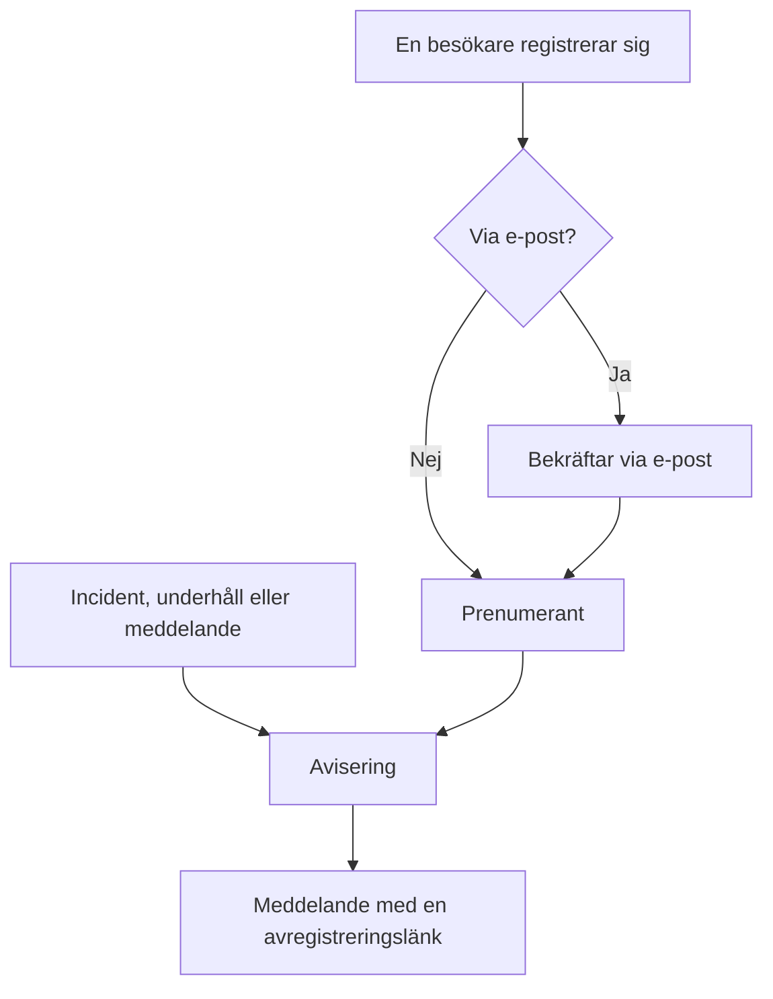

# Prenumeranter och meddelanden

En statussida är en plats som folk går till. Prenumeranter är de som helst slipper — de ger dig en gång en e-postadress, ett telefonnummer, en Slack-webhook eller en HTTP-slutpunkt, och därefter kommer dina uppdateringar till dem.

Meddelanden är den andra halvan av samma jobb. En monitor kan tala om för dina besökare att kassan returnerar 500-fel; ingen monitor kan tala om för dem att du migrerar databaser på lördag, att en extern leverantör har en dålig dag eller att incidenten de läste om i går är helt avslutad. Meddelanden är fritextkanalen för allt dina kontroller inte kan se, och de når samma prenumerantlista.

Den här sidan tar upp båda: de fem prenumerationskanalerna och hur besökare registrerar sig, vad prenumeranter kan välja att aviseras om, flödena för dubbel opt-in och avregistrering, e-postrapporten som prenumeranter kan få varje månad, och hur meddelanden skrivs, schemaläggs och görs om till mallar.

:::cards
- [Prenumerationskanaler](#prenumerationskanaler): Kanalerna besökare kan registrera sig via, och sidan de registrerar sig på.
- [Vad prenumeranter får veta](#vad-prenumeranter-aviseras-om): Meddelanden, underhåll, incidenter och episoder, och redigeringar av dem.
- [Kontrollera vad som skickades](#kontrollera-vad-som-skickades): Varje aviserings status, och Försök igen och Skicka igen.
- [Meddelanden](#meddelanden): Publicera ett meddelande på en eller flera statussidor.
:::

## Så fungerar det



Varje statussida har sina egna prenumeranter. En besökare registrerar sig på statussidans sida **Prenumerera**, där en e-postadress bekräftar med en länk innan den får något, eller så lägger ditt team till besökaren i instrumentpanelen. Därefter aviserar varje incident, varje schemalagd underhållshändelse och varje meddelande som når sidan dess prenumeranter, var och en via kanalen de registrerade sig med, och varje meddelande innehåller länken som avslutar prenumerationen.

## Prenumerationskanaler

En statussida stöder fem kanaler. De, och sidan besökare registrerar sig på, slås på på ett ställe: kortet **Kanaler** under **Statussidor → din sida → Prenumeranter → Prenumerantinställningar**. Varje reglage sparas så fort du slår om det:

- **Visa prenumerantsida** (`showSubscriberPageOnStatusPage`) — på som standard. Lägger objektet **Prenumerera** i statussidans navigeringsfält, där besökare registrerar sig via kanalerna nedan.
- **E-post** (`enableEmailSubscribers`) — på som standard. Allt annat är av tills du slår på det.
- **SMS** (`enableSmsSubscribers`) — av som standard. På OneUptime Cloud betalas varje SMS från projektets saldo för SMS och samtal, om inte sidan har en egen **Twilio-konfiguration** (se [nedan](#e-postsidfot-anpassad-smtp-och-twilio)). Att slå på den kräver också att **SMS** är på för projektet, i kortet **Aviseringskanaler** under **Projektinställningar > Aviseringar > Aviseringsinställningar**, vilket en projektägare, en **Billing Admin** eller någon med **Manage Billing** kan göra.
- **Slack** (`enableSlackSubscribers`) — av som standard.
- **Microsoft Teams** (`enableMicrosoftTeamsSubscribers`) — av som standard.
- **Webhook** (`enableWebhookSubscribers`) — av som standard.

Reglagen avgör hur besökare kan registrera sig själva, och statussidan avvisar en registrering via en kanal som är av. De stoppar inte aviseringar: prenumeranter som ditt team lägger till i instrumentpanelen, med API:et eller via ett arbetsflöde, får uppdateringar oavsett vilka kanaler som är på.

På OneUptime Cloud står abonnemangets namn vid ett reglage som ditt abonnemang inte omfattar: **Growth** för **SMS** och **Visa prenumerantsida**, **Scale** för **Slack**, **Microsoft Teams** och **Webhook**. Att stänga av en kanal fungerar på alla abonnemang, så en kanal som en provperiod slog på kan alltid stängas av igen; reglaget säger det under sig.

Varje kanal har också en egen lista i statussidans sidomeny under **Prenumeranter**: **E-postprenumeranter**, **SMS-prenumeranter**, **Slack-prenumeranter**, **MS Teams-prenumeranter** och **Webhook-prenumeranter**. Det är där du ser vem som är registrerad, lägger till någon manuellt eller lämnar en **Anteckningar** (`internalNote`) till dig själv om en viss prenumerant. Så länge en kanal är av säger listans överkant det, med kanalens reglage just där, så att du kan slå på den utan att lämna listan.

**Ett reglage räcker inte.** Objektet **Prenumerera** i statussidans navigeringsfält visas bara när **Visa prenumerantsida** är på *och* minst en kanal är på. Om du slår på **E-post** men låter **Visa prenumerantsida** vara av har besökarna inget sätt att nå formuläret.

## Vad en besökare ser på prenumerationssidan

Sidan **Prenumerera** har en undermeny med en flik per påslagen kanal. Varje flik frågar efter det minsta den behöver:

| Flik | Adress | Rubrik | Vad den frågar efter |
| --- | --- | --- | --- |
| **E-post** | `/subscribe/email` | **Prenumerera via e-post** | **Din e-post**, med exemplet `subscriber@company.com`. |
| **SMS** | `/subscribe/sms` | **Prenumerera via SMS** | **Ditt telefonnummer**, med exemplet `+11234567890`. |
| **Slack** | `/subscribe/slack` | **Prenumerera via Slack** | **Slack-arbetsytans namn** (används för validering) och **URL för inkommande webhook i Slack**, med exemplet `https://hooks.slack.com/services/...`. |
| **MS Teams** | `/subscribe/microsoft-teams` | **Prenumerera via Microsoft Teams** | **Microsoft Teams-arbetsytans namn** och **URL för inkommande webhook i Microsoft Teams**, med exemplet `https://outlook.office.com/webhook/...`. |
| **Webhooks** | `/subscribe/webhooks` | **Prenumerera via webhook** | **Webhook-URL**, med exemplet `https://example.com/webhook`. En JSON-`POST`-begäran skickas till den vid varje händelse på statussidan. |

Knappen för att skicka heter **Prenumerera**. En registrering via SMS, Slack, Microsoft Teams eller webhook visar *Du har prenumererat.* En registrering via e-post säger att en bekräftelselänk har skickats och att man ska kontrollera skräppostmappen om den inte kommer fram (se [Dubbel opt-in för e-post](#dubbel-opt-in-för-e-post)). Flikarna **E-post**, **SMS**, **Slack** och **MS Teams** har också uppdelningen **Ny prenumeration** / **Hantera befintlig prenumeration**, så att någon som redan prenumererar kan komma tillbaka till sina inställningar utan att leta efter ett gammalt meddelande.

## Låta prenumeranter välja resurser och händelsetyper

Som standard får en prenumerant allt på sidan. Två reglage på kortet **Avancerade prenumerantinställningar** ändrar det:

- **Tillåt prenumeranter att välja resurser** (`allowSubscribersToChooseResources`) — av som standard. Slå på den så får prenumerationsformuläret ett reglage **Prenumerera på alla resurser**; slå av det så visas **Välj resurser att prenumerera på**, så att besökaren kan välja enskilda resurser.
- **Tillåt prenumeranter att välja händelsetyper** (`allowSubscribersToChooseEventTypes`) — av som standard. Samma form: ett reglage **Prenumerera på alla händelsetyper**, och **Välj händelsetyper att prenumerera på** under när det är av.

Med någon av dem påslagen är prenumerationsformuläret fortfarande en enda sida. Under vart uppdateringarna ska skickas (e-postadressen, telefonnumret, arbetsytan eller webhooken) kommer **Inställningar**, ihopfällt till en rad som säger vad besökaren kommer att få. Varje resurs och varje sorts händelse är redan valda, så den börjar som "Du får alla uppdateringar från den här statussidan.", och en besökare som vill ha allt trycker på **Prenumerera** utan att öppna den. Alla andra öppnar **Inställningar** och begränsar resurserna eller händelsetyperna; ihopfälld igen följer raden det de valde ("Du får bara uppdateringar om de resurser du har valt."). Med båda av finns det inga **Inställningar**: formuläret är vart uppdateringarna ska skickas, och sedan **Prenumerera**.

Sidan **Uppdatera prenumeration** (se nedan) visar samma val utfällda, eftersom det är dem en prenumerant kommer dit för att ändra.

Händelsetyperna är `Incident`, `Announcement` och `Scheduled Event`.

**En monitorgrupp står för varje monitor i den.** En resurs på sidan är antingen en monitor eller en monitorgrupp, och en prenumerant som väljer en monitorgrupp aviseras om incidenter, schemalagda underhållshändelser (inklusive deras anteckningar) och meddelanden för vilken monitor som helst i gruppen, precis som om den monitorn hade valts, och det är också så statussidan visar dem. Den som bara valde andra resurser aviseras inte, och den som valde en monitor och gruppen som innehåller den får en avisering, inte två.

Valen hamnar i prenumerantposten som **Is Subscribed to All Resources** (`isSubscribedToAllResources`, standard true), **Is Subscribed to All Event Types** (`isSubscribedToAllEventTypes`, standard true), **Subscribed to Resources** och **Subscribed to Event Types**.

**En prenumerant väljer bland resurserna på sin egen sida.** **Subscribed to Resources** anger resurser på prenumerantens egen statussida, vem som än skriver det: en besökare på sidan, en kollega i instrumentpanelen, en API-nyckel eller ett arbetsflöde. En besökare väljer bland det sidan visar för hen, så en resurs vars monitor är arkiverad, och som sidan döljer, är inte en hen kan välja. En resurs på en annan statussida, eller en som sidan döljer för en besökare, avvisas med den `400` som anger fältet och ID:t, precis som ett ID som inte matchar något. En ändring frågar bara om de resurser den lägger till, så en prenumeration behåller en resurs den redan anger, till exempel en vars monitor arkiverades efter att den valdes. En prenumerant aviseras bara om en händelse via resurser på sin egen sida.

Bra för: en sida som täcker flera produkter. En kund som bara använder ditt API vill inte ha en avisering varje gång marknadsföringswebbplatsen vacklar — låt hen begränsa listan själv i stället för att se hen avregistrera sig helt.

Samma kort innehåller också **Prenumeranters tidszoner**.

## Dubbel opt-in för e-post

E-postprenumeranter bekräftar alltid. När en prenumerant skapas med en e-postadress och inte skapades som redan bekräftad tvingas **Is Subscription Confirmed** (`isSubscriptionConfirmed`) till `false`, och en sexsiffrig **Subscription Confirmation Token** genereras. OneUptime skickar sedan en bekräftelselänk på formen `{statusPageUrl}/confirm-subscription/{statusPageSubscriberId}?verification-token={token}`. Besökaren hamnar på en sida **Bekräfta prenumeration** och ser, när det har gått igenom, *Prenumeration bekräftad*.

Prenumeranter via SMS, Slack, Microsoft Teams och webhook hoppar över det här — de skapas med `isSubscriptionConfirmed` redan satt till `true`. Det gör även e-postprenumeranter som ditt team lägger till under **E-postprenumeranter**: där är **Skicka inte bekräftelselänk** på som standard. Stäng av det för att låta adressen bekräfta som vid en registrering.

**Obekräftad betyder tyst.** Frågan som hämtar prenumeranter till en avisering filtrerar på `isUnsubscribed: false` och `isSubscriptionConfirmed: true`. En e-postadress som aldrig klickade på länken blir kvar i din lista **E-postprenumeranter** och får ingenting. Om någon svär på att hen prenumererar men inte hör något, kontrollera den kolumnen först.

Det finns inget reglage för att stänga av e-postbekräftelsen — den är ovillkorlig för alla som registrerar sig via statussidan. En separat kolumn per prenumerant, **Send You Have Subscribed Message** (`sendYouHaveSubscribedMessage`, standard true), styr e-postmeddelandet "du prenumererar" som skickas när en prenumerant har bekräftats.

## Hantera och avsluta en prenumeration

Varje meddelande en prenumerant får innehåller en avregistreringslänk på formen `{statusPageUrl}/unsubscribe/{statusPageSubscriberId}-{token}`: längst ned i ett e-postmeddelande, i texten i ett SMS, ett Slack- eller ett Microsoft Teams-meddelande, och som `unsubscribeUrl` i en webhooks payload. Token är en slumpmässig hemlighet som hör till just den prenumerationen, så länken fungerar utan inloggning. Det gäller även en privat statussida, där allt annat kräver en inloggad besökare.

Det enda undantaget är ett SMS från en **public** statussida, som i stället innehåller prenumerantens länk till **Uppdatera prenumeration** (se nedan). Den sidan fungerar på en offentlig statussida utan inloggning, och dess länk är 57 tecken kortare. Ett SMS debiteras per segment om 160 tecken, så den längre länken skulle skjuta de flesta standardtexter till ytterligare ett segment. `{{unsubscribeUrl}}` i en anpassad SMS-mall följer samma regel. Ett SMS från en privat statussida innehåller avregistreringslänken.

SMS-loggen (fliken **SMS** under **Aviseringsloggar**, på statussidan och i projektinställningarna) sparar texten i varje SMS, och fler projektmedlemmar kan läsa den än som kan hantera prenumeranter. Därför visar loggen en avregistreringslänk där token har ersatts med `[redacted]`, till exempel `{statusPageUrl}/unsubscribe/{statusPageSubscriberId}-[redacted]`. Bara prenumerantens egen telefon får den fungerande länken. API:et returnerar heller aldrig en ny prenumerants token, inte ens i svaret på begäran som skapade den.

**Att öppna länken ändrar ingenting.** Sidan visar statussidans namn och logotyp och prenumerationen som länken hör till: en e-postadress i sin helhet, ett telefonnummer maskerat utom de fyra sista siffrorna, namnet på en Slack- eller Microsoft Teams-arbetsyta eller en webhooks värd. Den frågar *Vill du sluta ta emot aviseringar från den här statussidan?* och bara ett tryck på **Avsluta prenumeration** avslutar prenumerationen, så e-postskannrar och länkförhandsvisningar som öppnar varje länk i ett meddelande inte kan avregistrera någon. Inget annat från sidan visas, och inget av dess anpassade JavaScript körs. Att bekräfta två gånger, eller att öppna länken till en prenumeration som redan är avslutad, säger bara att den är avslutad. På en offentlig statussida länkar avregistreringssidan också till prenumerantens sida **Uppdatera prenumeration**, för att i stället välja vilka aviseringar man får.

Sidan **Uppdatera prenumeration**, `{statusPageUrl}/update-subscription/{statusPageSubscriberId}`, har rubriken **Uppdatera prenumeration** och talar om för besökaren att hen kan uppdatera sina inställningar eller avregistrera sig där. Den innehåller:

- De väljare för resurser och händelsetyper som sidan tillåter.
- Ett reglage **Avsluta prenumeration**, beskrivet som avregistrering från alla resurser. Det skriver **Är avprenumererad** (`isUnsubscribed`, standard false).
- En knapp för att skicka med texten **Uppdatera prenumeration**; när du sparar visas *Dina ändringar har sparats.*

På en privat statussida kräver den en inloggad besökare, som resten av sidan. Den som har tappat bort länken använder **Hantera befintlig prenumeration** på sidan **Prenumerera** och trycker på **Skicka hanteringslänk**. Länken går till själva prenumerationen — dess e-postadress, dess telefonnummer eller dess Slack- eller Microsoft Teams-kanal —, aldrig till en adress i begäran, och sidan svarar likadant oavsett om en prenumeration matchade eller inte, så den kan inte användas för att ta reda på vem som prenumererar. Det meddelandet länkar till sidan **Uppdatera prenumeration** och ger en anpassad mall båda länkarna: `manageSubscriptionUrl` och `unsubscribeUrl`.

Slutpunkterna bakom allt detta är `POST .../subscribe/:statusPageId`, `POST .../manage-subscription/:statusPageId`, `POST .../get-subscription/:statusPageId/:subscriberId`, `PUT .../update-subscription/:statusPageId/:subscriberId`, och `GET` och `POST .../unsubscribe/:statusPageId/:subscriberId/:token`. Avregistreringens `GET` beskriver bara länken. `POST` avslutar prenumerationen oavsett innehåll, även innehållet `List-Unsubscribe=One-Click` i en avregistreringsbegäran med ett klick. Båda ger samma svar för en felaktig token, en borttagen prenumerant och en prenumerant på en annan statussida, så de kan inte användas för att ta reda på vem som prenumererar.

Avregistrering vänder en flagga i stället för att ta bort en rad, så posten blir kvar i kanallistan med **Är avprenumererad** satt — användbart när du senare behöver förklara varför en viss adress slutade få e-post. Den registrerar också **Avprenumererad den** (`unsubscribedAt`), vem som än avslutade prenumerationen: prenumeranten via länken eller sidan **Uppdatera prenumeration**, eller en kollega i instrumentpanelen eller via API:et. Varje prenumerantlista har en kolumn och ett filter **Avprenumererad den**. Att stänga av **Är avprenumererad** igen rensar den. Prenumerationer som avslutades innan OneUptime registrerade detta har inget datum.

Länkar i meddelanden som skickades innan avregistreringssidan fanns fungerar fortfarande: en länk till **Uppdatera prenumeration** öppnar fortfarande den sidan. Mycket gamla meddelanden innehöll `/api/status-page-subscriber/unsubscribe/{statusPageSubscriberId}`, som förr avregistrerade så fort den öppnades. Den ändrar inte längre något: den leder till avregistreringssidan, som säger att länken är inaktuell och att man ska använda den i ett nyare meddelande.

### Delade adresser och e-postlistor

Alla som kan läsa en brevlåda kan avregistrera den. För en adress som någon registrerade själv är det meningen. För en som ditt team lade till, till exempel en plats e-postlista som `site03-all@`, betyder det att en enda läsare kan ta bort alla på listan från sidan före nästa driftstopp. Därför:

- **Lägg till personer med deras egna adresser när du kan.** Formuläret **Lägg till i bulk** och formuläret för e-postprenumeranter säger det, i beskrivningen av e-postfältet.
- **Teamet aviseras.** En prenumerant som ditt team lade till är en som har lagts till från instrumentpanelen, med en API-nyckel (REST-API:et, Terraform, ett skript) eller av ett arbetsflöde; API:et läser det som **Is Added By Team** (`isAddedByTeam`). När en sådan avregistrerar sig, via sin länk eller sidan **Uppdatera prenumeration**, får statussidans ägare (dess ägaranvändare och medlemmarna i dess ägarteam) var sitt e-postmeddelande som anger prenumeranten, med en länk till sidans prenumerantlista. Det gör även kollegan som lade till den, när det var en kollega. En sida utan ägare skickar e-postmeddelandet bara till den kollegan, så en prenumerant som en API-nyckel eller ett arbetsflöde lade till på en sida utan ägare rapporteras inte. Personer som registrerade sig själva på statussidan rapporteras aldrig. Prenumeranter som en API-nyckel eller ett arbetsflöde lade till innan OneUptime registrerade detta kan inte skiljas från registreringar och rapporteras inte heller.
- **Prenumerantlistorna visar det.** Ovanför varje lista anger ett meddelande de prenumeranter som ditt team lade till och som har avregistrerat sig de senaste 30 dagarna.

Avregistreringssidan varnar läsaren av en sådan prenumeration innan hen bekräftar: om det är en delad adress stoppar avregistreringen aviseringarna för alla som tar emot dem, och teamet aviseras.

## Vad prenumeranter aviseras om

Prenumeranter aviseras om de tre händelsetyperna ovan, men varje källa har sitt eget reglage, så inget skickas av misstag.

### Aviseringar om meddelanden

Själva meddelandet har **Should subscribers be notified?** (`shouldStatusPageSubscribersBeNotified`), som visas i formuläret som kryssrutan **Meddela statussideprenumeranter** under **Schema och aviseringar**, på som standard. Prenumeranter aviseras en gång, när meddelandet börjar visas, så det avgörs när meddelandet skapas; en redigering kan inte ändra det. Ett arbetsflöde som skriver det senare sparar det bara: att skriva tillbaka det oförändrat skickar aldrig meddelandet igen, att slå på det skickar det inte, och att stänga av det innan aviseringen har skickats hoppar över aviseringen. Om meddelandet anger monitorer under **Berörda monitorer** begränsas aviseringen till de monitorerna: på en sida där prenumeranter väljer resurser går den till prenumeranterna på de monitorerna, på monitorgrupperna som innehåller dem och på alla resurser. Lämna fältet tomt så aviseras alla prenumeranter. På en statussida som inte listar någon av de monitorerna, varken direkt eller via en grupp, är meddelandet till alla som läser den sidan, så varje prenumerant där som får meddelanden aviseras.

### Schemalagda underhållshändelser

En schemalagd underhållshändelse har en egen uppsättning prenumerantkolumner: **Should subscribers be notified when event is created?**, **Should subscribers be notified when event is changed to ongoing?**, **Should subscribers be notified when event is changed to ended?**, plus **Subscriber notifications before the event** och **Next subscriber notification before the event at?** för förvarningar. **Statussidor** på händelsen avgör vilka sidor den visas på, och **Should be visible on status page?** avgör om den visas alls.

**Skapa schemalagt underhållsevenemang** går igenom två steg och sedan en granskning, som **Deklarera incident** gör:

1. **Händelse** — **Titel**, **Beskrivning**, **Börjar den** och **Slutar den**. En ny händelse börjar vid nästa hela timme på din klocka och varar en timme; ändra tiderna bara när de är fel. Att flytta **Börjar den** flyttar **Slutar den** med, så att fönstret behåller sin längd, och händelsen måste sluta efter att den börjar. **Ägare** och **Etiketter** väntar under **Fler fält**.
2. **Berörda resurser** — först **Monitorer**, och direkt under dem **Ändra övervakningsstatus till** när en monitor är vald: monitorerna byter till den statusen när händelsen börjar, och tillbaka till i drift när den slutar. Sedan **Andra påverkade resurser**: värdarna, klustren, containervärdarna, databaserna, IoT-flottorna, nätverksplatserna och tjänsterna som underhållet berör. Sedan **Visa händelse på dessa statussidor**, och sedan **Aviseringar till prenumeranter**, ihopfällt till en rad som säger vad som kommer att hända. Som standard står det "Prenumeranter på händelsens statussidor aviseras när den schemaläggs, när den börjar och när den slutar." Öppna det för att ändra **När händelsen schemaläggs**, **När händelsen börjar**, **När händelsen slutar** och **Påminnelser före händelsen**; raden följer det du kryssar i, och granskningssteget visar den också.

Från fliken **Schemalagt underhåll** på en värd, ett Kubernetes-, Proxmox-, Ceph- eller Docker Swarm-kluster, en Docker- eller Podman-värd, en vCenter, en lagringsenhet, en IoT-flotta, en databas, en tjänst eller en nätverksplats öppnar **Skapa schemalagt underhållsevenemang** (och **Skapa från mall**) samma formulär med den resursen redan vald under **Andra påverkade resurser**, och brödsmulorna leder tillbaka till den fliken. Fliken **Schemalagt underhåll** på ett inventarieobjekt väljer värden, tjänsten eller Kubernetes-klustret som objektet pekar på, och brödsmulorna leder tillbaka via den resursens flik.

Bara titeln behöver skrivas: allt annat har ett standardvärde, så **Nästa** går igenom de andra stegen utan att fråga något, och **Skapa schemalagt underhållsevenemang** finns på granskningen i slutet. Ingen aviseras förrän du väljer en statussida. De tre inställningarna **När händelsen…** väljs när händelsen skapas, och ett arbetsflöde som skriver **När händelsen schemaläggs** senare sparar den bara: skriven tillbaka oförändrad eller påslagen skickar den ingenting, och avslagen innan aviseringen "schemalagd" har skickats hoppas den aviseringen över. Knappen **Redigera** på händelsens kort **Maintenance Details** ändrar dess titel, fönster och etiketter (**Händelse**) och dess statussidor och påminnelser (**Statussidor**). Knappen **Redigera** på dess kort **Berörda resurser** frågar på samma sätt som formuläret: **Monitorer**, sedan **Ändra övervakningsstatus till** när det finns en monitor, och sedan **Andra påverkade resurser**, och kortet visar statusen under monitorerna. Alla som kan redigera händelsen kan ändra dess monitorstatus tills händelsen börjar. När den börjar — vid starttiden, eller när någon flyttar den till ett pågående tillstånd manuellt, från Slack eller Microsoft Teams eller via API:et —, byter dess monitorer till den status den har i det ögonblicket, och det gör även monitorer som läggs till medan den pågår. Att flytta den från **Scheduled** direkt till ett eget tillstånd placerat mellan **Ongoing** och **Ended**, som "Verifying", startar den på samma sätt: dess monitorer byter till dess status, som de skulle göra i **Ongoing**, och går tillbaka till i drift när den slutar. Från och med då kan statusen inte längre ändras: kortets **Redigera** visar den skrivskyddad, med "Händelsen har börjat, så det här kan inte längre ändras.", och API:et avvisar en ändring med "Change Monitor Status to can no longer be changed: this event has already started." Att skriva tillbaka den status som händelsen redan har godtas fortfarande. Mallar för schemalagt underhåll (**Inställningar → Händelsemallar**) använder samma steg, med mallens namn först och dess återkommande schema sist. En mall frågar efter **Ändra övervakningsstatus till** oavsett om den anger monitorer, eftersom dess status också gäller de monitorer som väljs när en händelse schemaläggs från den. Kortet **Berörda resurser** för en befintlig mall frågar på samma sätt och visar den status mallen väljer, eller **Monitorer behåller sin status.** när den inte väljer någon; alla som kan redigera mallen kan ändra det där.

**Vilka statussidor?** Så snart händelsen anger monitorer föreslås statussidorna som visar dem under **Visa händelse på dessa statussidor**: "Statussidor som visar de berörda monitorerna:" följt av varje sidas namn. Klicka på ett namn för att lägga till den sidan, eller på **Lägg till alla** för att lägga till alla. En sida räknas när den listar en av monitorerna, direkt eller via en monitorgrupp. Bara statussidorna du kan se föreslås, och arkiverade sidor och sidor som inte visar schemalagda underhållshändelser utelämnas. Inget väljs åt dig: en statussida som du väljer visar händelsen och, med standardaviseringarna, aviserar sina prenumeranter, så det förblir ditt val. Steget **Statussidor** i händelsens **Redigera** och formulären för en mall för schemalagt underhåll föreslår på samma sätt, utifrån händelsens eller mallens monitorer.

**Egna tillstånd.** En händelse pågår i **Ongoing** och i varje eget tillstånd placerat mellan **Ongoing** och **Ended** — ett steg "Verifying", till exempel. Ett eget tillstånd placerat före **Ongoing** har inte börjat än, och ett placerat efter **Ended** — "Reviewing" — är över. Allt som frågar om en händelse pågår tillämpar den här enda regeln. En sådan händelse listas som pågående på sina statussidor — på översikten, på händelsens egen sida och i RSS-flödet — och i listorna **Ongoing** under **Schemalagt underhåll** och **Hem**, deras menymärken och rutan **Pågående underhåll** på **Hem**, och Microsoft Teams-appen listar den som pågående underhåll. Dess monitorer förblir i underhåll, nätverksplatserna och telemetriserierna den täcker förblir tystade, och SLO-burn-rate-varningar på dess monitorer hålls tillbaka. Vid dess **Slutar den** avslutas den som en pågående händelse gör, och dess prenumeranter aviseras om **När händelsen slutar** är på. Att flytta den från **Ongoing** eller "Verifying" direkt till ett eget tillstånd placerat efter **Ended** avslutar den som **Ended** gör: dess monitorer går tillbaka till i drift, och händelsens rubrik visar hur länge den varade. Att flytta den från **Ongoing** till "Verifying", eller från **Ended** till "Reviewing", startar eller avslutar ingenting igen. Ett tillstånds placering är dess plats i listan på sidan **Händelsestatus**, under **Schemalagt underhåll → Inställningar**.

**Väntar på att börja, över och slutförd.** Samma placering avgör resten. En händelse väntar på sin **Börjar den** i **Scheduled** och i varje eget tillstånd placerat mellan **Scheduled** och **Ongoing** — ett steg "Confirmed", till exempel. Vid starttiden börjar den därifrån som den börjar från **Scheduled**: den går över till **Ongoing**, dess monitorer byter till dess **Ändra övervakningsstatus till**, dess ägare aviseras och dess prenumeranter också om **När händelsen börjar** är på. Fram till dess listas den bland kommande händelser — på översikten, sidan med planerade händelser och RSS-flödet på dess statussidor, och när någon frågar Microsoft Teams-appen om schemalagt underhåll —, och påminnelserna före händelsen skickas fortfarande till dess prenumeranter. Dess flöde och dess statussidas tidslinje visar ett sådant tillstånd med den klocka de visar för **Scheduled**. Ett eget tillstånd placerat före **Scheduled** — ett "Draft" eller ett godkännandesteg — har inte heller börjat, men väntar på en person: ingenting startar en händelse där vid dess tid, och den listas inte som kommande. En händelse är över i **Ended**, i **Completed** och i varje eget tillstånd placerat efter **Ended**, och händelsens **Översikt** behandlar den som över överallt — dess rubrik, dess kort **Mätningar** och tidslinjen den visar. Den är slutförd i **Completed** och i varje eget tillstånd placerat efter det — "Archived": det är det som stoppar påminnelserna till dess ägare (**Remind until event is Completed**), det som Slack och Microsoft Teams vägrar **Mark as Complete** för, och det som dess flöde och dess statussidas tidslinje markerar som klart. I **Ended**, eller i "Reviewing" mellan **Ended** och **Completed**, är den över men ännu inte slutförd.

**Nätverksplatser följer varje tillståndsändring.** Nätverksplatserna som en händelse täcker slutar räkna dess planerade avbrott mot platserna ovanför dem medan den pågår. Varje ändring av händelsens tillstånd beräknar om deras status direkt, i båda riktningarna — även när den går tillbaka, som när posten för tillståndet den är i tas bort från dess **Tillståndstidslinje**: flyttad tillbaka från "Verifying" till **Scheduled** slutar den tysta dem direkt i stället för vid nästa genomgång, som fortfarande körs var femte minut som skyddsnät.

**Vad flödet registrerar vid en redigering.** En redigering lägger till en post **Scheduled Maintenance was updated.** i händelsens **Schemalagd Underhåll Flöde** — publicerad även i dess Slack- och Microsoft Teams-kanaler — med en rad för varje sak den ändrade: titeln, **Börjar den**, **Slutar den**, beskrivningen, påminnelserna före händelsen, vad händelsen påverkar, **Ändra övervakningsstatus till**, statussidorna den visas på och dess etiketter, var och en med sitt nya värde. Ett värde som sparas som det var får ingen rad, så att spara kortet **Maintenance Details** utan att ändra något — det skickar titeln, fönstret, etiketterna, statussidorna och påminnelserna varje gång — eller en API-klient, ett arbetsflöde eller Terraform som skriver tillbaka händelsen som den är, lägger inte till någon post alls. En tid är densamma när den anger samma ögonblick, hur den än är skriven — en som är skriven utan tidszon är UTC, som den lagras —, och påminnelserna, statussidorna, de berörda resurserna och etiketterna är samma mängd i vilken ordning som helst. Att ta bort alla påminnelser, statussidor eller etiketter registreras som "No reminders before the event.", "Not shown on any status page." eller "All labels removed.", och att ta bort den sista berörda resursen förutom monitorerna — den sista värden, det sista klustret eller den sista tjänsten, till exempel — som "No other affected resources.". Händelsens påminnelseregel matchas igen, och väntan på dess nästa påminnelse börjar om, bara när dess etiketter ändras eller dess reglage **Skicka påminnelser** slås om. En påminnelseregel (**Schemalagt underhåll → Regler → Reminder Rules**) med **Remind While Event is Scheduled** av räknar den första påminnelsen från händelsens start, så att flytta **Börjar den** till en annan tid flyttar den påminnelsen med så länge starten fortfarande ligger framåt; påminnelserna från en regel som påminner medan händelsen är schemalagd stannar där de är. En monitors flöde registrerar på samma sätt en redigering av dess namn, beskrivning och etiketter.

Om en händelse skapas med **När händelsen schemaläggs** av (under **Aviseringar till prenumeranter** i formulärets steg **Berörda resurser**) börjar nya offentliga anteckningar på den med **Notify status page subscribers** av, med en rad under kryssrutan som förklarar varför. Det gäller på händelsens sida **Offentliga anteckningar** och i **Add Public Note** i **Schemalagd Underhåll Flöde**, som öppnar samma anteckningsredigerare. Anteckningar som publiceras utan ett uttryckligt val följer samma inställning **När händelsen schemaläggs**: anteckningar från Slack och Microsoft Teams, arbetsflöden och API-begäranden som utelämnar `shouldStatusPageSubscribersBeNotifiedOnNoteCreated`. Ett uttryckligt `true` eller `false` behålls alltid. **När händelsen schemaläggs** stänger bara av meddelandet som skickas när händelsen skapas. Påminnelser (**Subscriber notifications before the event**, angivna med **Påminnelser före händelsen** i formuläret) och aviseringarna som **När händelsen börjar** och **När händelsen slutar** anger är separata inställningar och skickas fortfarande. Om prenumeranterna redan har fått veta om händelsen på det sättet, till exempel via en påminnelse eller aviseringen om att den pågår, kryssar du i rutan för att avisera dem om anteckningen.

Fönstret **Markera schemalagt underhåll som `<state name>`**, som öppnas från knapparna högst upp på händelsens sida **Översikt**, har en enda kryssruta **Meddela statussideprenumeranter** som täcker både tillståndsändringen och fönstrets **Offentlig anteckning** (ihopfälld under **Lägg till en offentlig anteckning**). På en händelse som skapades med **När händelsen schemaläggs** på börjar den ikryssad, som tidigare. På en händelse som skapades med den av börjar den urkryssad, med samma rad under, utom i två fall där den börjar ikryssad, i linje med vad den automatiska tillståndsändringen skulle meddela:

- Du flyttar händelsen till dess pågående tillstånd, eller från ett tillstånd där den inte har börjat till ett eget tillstånd placerat mellan **Ongoing** och **Ended** (den börjar), och **När händelsen börjar** är på.
- Du flyttar händelsen till ett avslutat eller slutfört tillstånd, eller från ett tillstånd där den pågår till ett eget tillstånd placerat efter **Ended** (den slutar), och **När händelsen slutar** är på.

**En anteckning som skickas med en tillståndsändring är det enda meddelandet.** Skriv en **Offentlig anteckning** i det fönstret (eller i massåtgärden **Ändra tillstånd**) med **Meddela statussideprenumeranter** påslaget, så får prenumeranterna anteckningen, i varje kanal, i stället för ett separat meddelande om tillståndsändringen: ett meddelande, inte två. Tillståndsändringen visar **Aviseringar skickade**, och dess statusmeddelande säger att anteckningen bar den. Anteckningen publiceras när tillståndsändringen har sparats: den följer ändringen i händelsens flöde och i Slack och Microsoft Teams, och en tillståndsändring som inte sparas publicerar ingen anteckning och aviserar ingen. En anteckning med bara blanksteg publiceras inte, och prenumeranterna får meddelandet om tillståndsändringen. Med rutan urkryssad aviserar varken tillståndsändringen eller dess anteckning någon. Via API:et går anteckningen med tillståndsändringen i `"miscDataProps": {"publicNote": "..."}` på `POST /api/scheduled-maintenance-state-timeline`, och `shouldStatusPageSubscribersBeNotified` avgör för båda (utelämnat aviserar tillståndsändringen och dess anteckning gör det inte). Incidenter fungerar på samma sätt; se [Incidentstatusar och allvarlighetsgrader](/docs/incidents/states-and-severities#meddela-statussidans-prenumeranter-om-en-tillståndsändring).

**Anteckningen anger det nya tillståndet.** Eftersom den är det enda meddelandet säger en anteckning som skickas med en tillståndsändring vad händelsen är nu, i varje kanal, som meddelandet om tillståndsändringen gjorde: e-postmeddelandets ämne lyder `[Ongoing Scheduled Maintenance] <title>` och dess detaljer visar en rad **Status**, SMS:et säger `Maintenance <title> on <status page> is Ongoing.`, meddelanden i Slack och Microsoft Teams har en rad `**Status:** Ongoing`, och webhookens payload `ScheduledMaintenanceNoteCreated` har `scheduledMaintenanceState` i `data`. En anteckning som publiceras för sig läses som alltid. Att publicera anteckningen kräver **Create Scheduled Maintenance Status Page Note** (de inbyggda rollerna för schemalagt underhåll och för projektet har den): den som inte har den erbjuds inte **Lägg till en offentlig anteckning**, och en tillståndsändring som hen skickar med en anteckning avvisas, så händelsen behåller sitt tillstånd i stället för att ändras utan att någon aviseras.

Det manuella formuläret på händelsens sida **Tillståndstidslinje** och massåtgärden **Ändra tillstånd** i listan över schemalagt underhåll tittar inte på de här inställningarna: deras kryssruta **Meddela statussideprenumeranter** börjar alltid ikryssad.

Händelser som skapas från en mall tar **När händelsen schemaläggs** från mallen, tillsammans med dess andra prenumerantinställningar. **Skapa från mall** fyller i formuläret med mallens värden, och återkommande händelser som en mall schemalägger under **Inställningar → Händelsemallar** kopierar dem.

### Incidenter

`Incident` är den tredje händelsetypen. Vad som över huvud taget gör att en incident når en statussida — vilka resurser den berör och vilka tillstånd som håller den synlig — beskrivs i [Incidentstatusar och allvarlighetsgrader](/docs/incidents/states-and-severities). Offentliga anteckningar på en incident som deklarerades utan att avisera prenumeranter börjar med **Meddela statussideprenumeranter** av; se [Incidentanteckningar, ägare och flöde](/docs/incidents/notes-owners-and-feed#publicera-en-offentlig-anteckning).

En incidents meddelanden — skapad, tillstånd ändrat, offentlig anteckning och efteranalys — går till prenumeranterna på varje statussida som listar en av dess monitorer. Två inställningar begränsar det. **Begränsa till dessa statussidor** på incidenten håller den till de sidor du väljer bland dem, och **Visa bara incidenter som är begränsade till den här sidan** på en statussida håller borta varje incident som inte är begränsad till den. För en incident som är begränsad till vissa sidor får en e-postadress eller ett telefonnummer som prenumererar på flera av dem ett e-postmeddelande eller SMS per utskick, inte ett per sida; meddelanden via webhook, Slack och Microsoft Teams slås aldrig ihop. Formuläret för att deklarera och sidan **Offentliga anteckningar** visar vem som kommer att aviseras innan något skickas. Se [En statussida per målgrupp](/docs/status-pages/one-status-page-per-audience).

#### Efteranalysen

Prenumeranter får veta om en incidents efteranalys en gång, när den publiceras: första gången statussidan visar den. Statussidan visar en efteranalys när **Publicera på statussidan** är på och efteranalysen har en anteckning; dess bilagor visas med anteckningen, aldrig utan den. Så att slå på publicering över en skriven anteckning publicerar den, och det gör även att skriva anteckningen till en efteranalys som är påslagen. **Avisera prenumeranter**, i samma formulär, avgör om de aviseras alls. Därefter:

- **Att spara den igen aviserar ingen.** Formuläret **Redigera obduktionsanteckning** skickar hela efteranalysen vid varje sparande, och en API-klient, Terraform eller ett arbetsflöde kan skriva tillbaka hela incidenten; det som redan var publicerat är inte nytt.
- **Att redigera en publicerad efteranalys aviserar inte heller någon.** Statussidan visar den nya anteckningen direkt, och incidentflödet registrerar den en gång, som **Postmortem Note updated**, men prenumeranterna har redan aviserats. Blanksteg runt anteckningen räknas inte som en ändring.
- **Att ta bort den från statussidan aviserar ingen, och att publicera den igen aviserar dem igen**: de såg den försvinna. Att tömma anteckningen i en publicerad efteranalys tar också bort den från statussidan.
- **En efteranalys som är påslagen utan anteckning visar ingenting**, så ingen aviseras förrän dess anteckning är skriven.
- **En efteranalys som publiceras medan dess incident är dold skickas när incidenten blir synlig.** Statussidan visar bara en efteranalys på en incident som den visar — **Synlig på statussidan** på, och incidenten inte privat —, så ingen aviseras medan incidenten är dold, och aviseringens status lyder **Inte skickad än: incident dold på statussidor**. Att slå på **Synlig på statussidan** skickar den, en gång (för en privat incident tillsammans med att stänga av **Privat incident**), och reglaget på incidentens sida **Inställningar** talar om det för dig innan du sparar. Att dölja incidenten och visa den igen skickar inget mer, och att visa en incident vars efteranalys redan har skickats, eller inte är publicerad, skickar ingenting. En efteranalys som en tidigare version hoppade över på det här sättet skickas på samma sätt om dess incident fortfarande var dold när du uppgraderade; en vars incident har gjorts synlig sedan dess förblir oskickad, eftersom statussidan har visat den sedan dess.
- **Avisera prenumeranter läses när aviseringen skickas.** En efteranalys som publiceras med den av meddelas inte, och att slå på den efteråt skickar inte aviseringen som den publicerades utan.

Aviseringens status finns på incidentens sida **Efteranalys**; en som misslyckades erbjuder **Försök igen** (se [Försök igen och skicka igen](#försök-igen-och-skicka-igen)). Via API:et publicerar det att skriva `showPostmortemOnStatusPage` som `true` över en skriven `postmortemNote` den, även när begäran skriver tillbaka hela incidenten, inklusive dess aviseringsstatus som den är, och att göra en dold incident synlig — skriva `isVisibleOnStatusPage` som `true`, och `isPrivate` som `false` för en privat — skickar en efteranalys som väntar på det. Att skriva `subscriberNotificationStatusOnPostmortemPublished` som `Pending` skickar den igen. En avisering som redan väntar eller håller på att skickas köas inte en gång till, och en efteranalys som publicerades medan en avisering förbereddes meddelas fortfarande en gång. Det automatiska AI-utkastet till efteranalys skrivs aldrig in i en efteranalys som är påslagen, så ett ogranskat utkast når aldrig prenumeranter.

#### Förhandsgranska e-postmeddelandet innan det skickas

**Förhandsgranskning** är en liten länk bredvid värdet den förhandsgranskar: bredvid **Ja** under **Meddela statussideprenumeranter** i sista steget av **Deklarera ny incident**, och bredvid kryssrutan **Meddela statussideprenumeranter** medan du skriver en offentlig anteckning. Den öppnar **Förhandsgranskning av avisering**, som visar e-postmeddelandet som varje statussidas prenumeranter kommer att få, byggt och renderat av samma kod, mall och inställningar som aviseringen skickas med, så det du ser är det de får:

- välj en statussida för att se dess e-postmeddelande, med ämnet och antalen "upp till" per kanal;
- en rad säger vilken mall som används och varför, till exempel att sidans anpassade mall inte används eftersom sidan inte har någon **Anpassad SMTP-konfiguration**;
- när inget kommer att skickas (inga monitorer, en privat eller dold incident, **Meddela statussideprenumeranter** av, eller ingen statussida som visar incidenten) säger den det i stället för att visa ett e-postmeddelande.

Bara statussidorna du kan se förhandsgranskas; de andra räknas. E-postmeddelandet visas i en isolerad ram som inte kör skript. Dess avregistreringslänk är ett exempel, eftersom varje prenumerants e-postmeddelande har en egen.

**Skicka test till mig** skickar den visade sidans e-postmeddelande till ditt kontos e-postadress, med `[Test]` först i ämnet, via sidans **Anpassad SMTP-konfiguration** när den har en. Den skickar aldrig till någon annan adress, kräver att ditt kontos e-postadress är verifierad, och varje person kan skicka tio testmeddelanden var 15:e minut.

#### Anpassade incidentfält i aviseringar

Anpassade incidentfält med **Ta med i aviseringar till prenumeranter** på (under **Incidenter → Inställningar → Anpassade fält**) skickas med incidentens meddelanden — skapad, tillstånd ändrat, offentlig anteckning publicerad eller uppdaterad, och efteranalys. Det fungerar på alla abonnemang som har anpassade fält; det kräver varken en anpassad mall eller anpassad SMTP.

- **E-post** listar dem i detaljrutan, under incidentens egna rader, i fältens **Ordning**. Ett fält som incidenten inte har något värde för utelämnas. Ett ja/nej-fält lyder **Ja** eller **Nej**, ett datum är den dag som valdes (samma dag för varje mottagare, var hen än befinner sig, för ett datum som valts i vilken tidszon som helst från UTC−10:59 till UTC+13), ett datum och en tid visas i statussidans tidszoner för prenumeranter, lång text behåller sina rader, och rich text visas formaterad, med samma regler för länkar som anteckningar. Dess inbäddade bilder görs synliga för de personer den skickas till, när det första meddelandet som innehåller den skickas.
- **Slack** och **Microsoft Teams** listar dem på samma sätt, ett per rad.
- **Webhook**-payloads har dem i `data.customFields`, med varje fälts **Mallvariabel** som nyckel: `{ "name": ..., "type": ..., "value": ... }`, med värdet som det är lagrat (`null` när incidenten inte har något). Nycklarna ändras inte när ett fält byter namn.
- **SMS** utelämnar dem. Ett textmeddelande debiteras per segment och standardtexten fyller redan nästan ett; en anpassad SMS-mall kan placera vilket fält som helst med `{{incident.customFields.<key>}}`.
- Aviseringar om **Incident episode** har inga anpassade fält: en episod grupperar incidenter som har var sina värden. Varje medlemsincidents egna aviseringar har dess fält.

Posten **Prenumerantavisering skickad** i incidentflödet listar, under **Custom fields sent**, de värden som varje utskick lade in i ett meddelande. Prenumeranter finns oftast utanför ditt team, så slå bara på inställningen för fält som kan delas med dem utan risk.

Sektionen **Aviseringsloggar** i statussidans sidomeny (`{id}/notification-logs`) är dit du går när du behöver se vad sidan faktiskt har skickat.

### Incidentepisoder

En incidentepisod registrerar i `shouldStatusPageSubscribersBeNotifiedOnEpisodeCreated` om prenumeranterna fick veta att den skapades. Episoder som skapas med knappen **Skapa episod** eller av **Grupperingsregler** har den påslagen; en API-begäran kan skapa en med den satt till `false`.

På en episod som skapades med den satt till `false` börjar nya offentliga anteckningar med **Notify status page subscribers** av, med en rad under som förklarar varför, på episodens sida **Offentliga anteckningar** och i **Add Public Note** i **Episodflöde**, som öppnar samma anteckningsredigerare. Du kan fortfarande kryssa i den. Anteckningar som publiceras utan ett uttryckligt val följer samma inställning: anteckningar från Slack, arbetsflöden och API-begäranden som utelämnar `shouldStatusPageSubscribersBeNotifiedOnNoteCreated`. Ett uttryckligt `true` eller `false` behålls alltid. Bara den här inställningen räknas: till skillnad från en incident ändrar det inte var kryssrutan börjar att göra en episod privat.

Det här gäller bara offentliga anteckningar. Episodens tillståndsändringar (**Bekräfta**, **Lös** och automatisk lösning) aviserar fortfarande prenumeranter, eftersom varken episodens fönster för tillståndsändring eller formuläret på dess sida **Tillståndstidslinje** har en kryssruta **Meddela statussideprenumeranter**.

En episod som skapas i ett senare tillstånd — med **Inledande tillstånd** i formuläret **Skapa episod**, eller ett tillstånd som skickas via API:et — meddelas en gång, av dess avisering om att den skapats: dess första tillstånd skickas aldrig för sig som en tillståndsändring, vilket tillstånd det än är, och en episod som skapades med `shouldStatusPageSubscribersBeNotifiedOnEpisodeCreated` satt till `false` meddelar det inte alls. Den första raden i dess tillståndstidslinje registrerar den aviseringen som överhoppad, med orsaken.

### Avisera prenumeranter om en redigering

Prenumeranter får veta om ett meddelande eller en offentlig anteckning en gång, när det publiceras. Att redigera det efteråt ändrar vad statussidan visar men aviserar ingen, om du inte begär det vid den redigeringen.

Redigeringsformuläret för ett meddelande, och för en offentlig anteckning på en incident, en schemalagd underhållshändelse eller en incidentepisod, har en kryssruta **Meddela prenumeranter om denna uppdatering**. Den börjar urkryssad varje gång, så att en rättad stavning förblir tyst; kryssa i den när ändringen spelar roll — ett nytt underhållsfönster, en reviderad påverkan, en rättad kunduppdatering. Den finns inte i formulären för att skapa, som har sitt eget val **Meddela statussideprenumeranter**. På ett meddelande finns den i steget **Meddelande**, direkt under beskrivningen.

När du sparar med rutan ikryssad får prenumeranterna det redigerade innehållet märkt som en uppdatering i stället för som ett nytt inlägg:

- **E-post** använder en egen mall — till exempel ämnet `[Announcement Updated] <title>` och rubriken `Announcement Updated: <title>`, eller **Updated Note** i detaljrutan i ett anteckningsmeddelande.
- **SMS**, **Slack** och **Microsoft Teams** säger att meddelandet eller anteckningen har uppdaterats.
- **Webhook**-prenumeranter får `AnnouncementUpdated`, `IncidentNoteUpdated`, `ScheduledMaintenanceNoteUpdated` eller `EpisodeNoteUpdated` som `eventType`, med det senaste innehållet i `data`.

Uppdateringen går till samma personer som originalet skulle nå i dag: samma kanalreglage, samma inställningar för resurser och händelsetyper, och samma synlighetskontroller (en dold incident eller en sida med **Visa meddelanden** av skickar fortfarande ingenting).

Två fall skickar med avsikt ingenting, och registrerar varför:

- **Den ursprungliga aviseringen har inte skickats än.** Om ett meddelande eller en anteckning fortfarande väntar på att meddelas läser den aviseringen objektet när den skickas och innehåller redan din redigering, så ett separat meddelande om "uppdaterad" skulle bara förvirra folk. Om originalet håller på att skickas i det ögonblicket väntar uppdateringen i stället och skickas när originalet är klart: det utskicket läste objektet före din redigering, så prenumeranterna kan ha fått texten från före den.
- **Meddelandet är schemalagt till senare.** Tills **Börja visa meddelande vid** har passerat finns det inte på någon statussida, och den som aviseras när det går live ser den redigerade versionen.

Det redigerade objektet visar en **Uppdateringsaviseringsstatus** bredvid den ursprungliga, med samma tillstånd (**Sending Soon**, **Aviseringar skickade**, **Misslyckades** och så vidare). **Försök igen** på en misslyckad uppdateringsavisering skickar uppdateringen igen, aldrig det ursprungliga meddelandet om "publicerad". Varje statussida kan anpassa de här meddelandena med malltyperna **Subscriber Announcement Updated**, **Subscriber Incident Note Updated**, **Subscriber Scheduled Maintenance Note Updated** och **Subscriber Episode Note Updated**; utan en anpassad mall används den inbyggda uppdateringstexten.

Via API:et skickar du valet bredvid fälten du ändrar, i `miscDataProps`:

```json
{
  "data": {
    "description": "The maintenance now starts on Sunday at 02:00 UTC."
  },
  "miscDataProps": {
    "notifySubscribersOfUpdate": true
  }
}
```

som innehåll i `PUT /api/status-page-announcement/<announcement-id>` (eller `incident-public-note`, `scheduled-maintenance-public-note`, `incident-episode-public-note`). Utelämna `miscDataProps` så är redigeringen tyst, som tidigare.

## Kontrollera vad som skickades

Varje prenumerantavisering har en egen status, bredvid det den handlar om. För en incident är det aviseringen om "skapad" på incidentens **Översikt**, varje rad i dess **Tillståndstidslinje**, varje offentlig anteckning och dess **Efteranalys**. Schemalagda underhållshändelser och meddelanden visar sina på samma sätt, och incidentepisoder på sina offentliga anteckningar. Klicka på statusen för att läsa dess meddelande, som säger vad som hände. Offentliga anteckningar visar statusen som ett märke med egen formulering:

| Status | På en offentlig anteckning | Vad det betyder |
| --- | --- | --- |
| **Sending Soon** | **Notifying subscribers soon** | I kö. Jobbet som skickar den körs varje minut. |
| **Notifications Being Sent** | **Notifying subscribers** | Jobbet arbetar sig igenom prenumeranterna. |
| **Aviseringar skickade** | **Subscribers notified** | Den har skickats. Se nedan vad det betyder. |
| **Misslyckades** | **Notification failed** | Inte alla prenumeranter fick den, eller så stoppades utskicket. Meddelandet säger vad som skickades och vad **Försök igen** gör. |
| **Notifications skipped.** | **Subscribers not notified** | Inget skulle skickas, till exempel för att incidenten är dold på statussidor. Meddelandet säger varför. |

### Så räknas ett utskick

Aviseringar för incidenter och incidentepisoder — skapad, tillstånd ändrat, offentlig anteckning publicerad eller uppdaterad, och efteranalys — räknas meddelande för meddelande:

- **Ett meddelande räknas som skickat** när e-postservern eller SMS-leverantören har tagit emot det, eller när slutpunkten hos Slack, Microsoft Teams eller webhooken har svarat. "Skickat" är så långt OneUptime kan se: en e-postserver kan fortfarande studsa ett e-postmeddelande senare.
- **Ett meddelande räknas som misslyckat** när det avvisas, när skickandet ger ett fel eller när det inte får något svar inom 4 minuter. Ett enda fel gör aviseringen **Misslyckades**; de andra prenumeranterna får den fortfarande.
- **Alla prenumeranter nås.** En statussidas prenumeranter läses 10 000 åt gången fram till den sista, med 20 meddelanden på väg samtidigt. En avisering slutar starta nya meddelanden 20 minuter efter att den startade: statussidorna och prenumeranterna den inte nådde till dess listas som inte skickade, och den markeras som **Misslyckades**.
- **Antalen registreras per statussida.** Statusmeddelandet listar för varje statussida hur många meddelanden som skickades och misslyckades i varje kanal, till exempel `Site 03: 41 email sent. Site 07: 16 email, 2 SMS sent; 2 email failed.` Posten **Prenumerantavisering skickad** i incidentens flöde listar samma antal med ämnet som varje sidas e-postmeddelande skickades med. **Aviseringsloggar** på varje statussida visar varje meddelande.

Aviseringar om schemalagt underhåll och meddelanden räknas ännu inte på det här sättet. Deras meddelanden lämnas över till avsändarna utan att vänta på svar, så **Aviseringar skickade** betyder att de har lämnats över, och ett utskick når högst 10 000 prenumeranter på varje statussida.

### Utskick som avbröts

Ett utskick vars server startar om eller slutar svara halvvägs kan inte slutföras, och inget annat skulle avgöra det. Därför markeras en avisering som fortfarande står på **Notifications Being Sent** efter 40 minuter, längre än något utskick får ta, som **Misslyckades**, med ett meddelande som börjar med `Interrupted:` och säger vad **Försök igen** kommer att göra. Det gäller alla aviseringar ovan, även schemalagt underhåll och meddelanden. Kontrollen körs var 5:e minut.

### Försök igen och skicka igen

**Försök igen** erbjuds på en avisering som **Misslyckades**. Den lägger tillbaka aviseringen i kön, och nästa körning av utskicksjobbet, inom en minut, skickar den igen. På en incident erbjuds det också att skicka igen efter att en avisering har gått ut: **Skicka meddelandet igen** på en offentlig anteckning, och **Skicka igen** på incidentens avisering om "skapad", på dess **Översikt**. Båda frågar först och listar statussidorna den skulle nå nu med ett antal "upp till" per kanal. Ingen av dem erbjuds på en avisering som hoppades över, eller medan en fortfarande står i kö eller håller på att skickas. Se [Incidentanteckningar, ägare och flöde](/docs/incidents/notes-owners-and-feed#när-en-offentlig-anteckning-faktiskt-når-prenumeranterna).

En avisering som skickas igen skickas som läget är när den går ut: till de statussidor den når då, och till deras prenumeranter då. För en incident betyder det att sidorna som sedan dess har lagts till i eller tagits bort från dess omfång räknas, liksom de personer som har registrerat eller avregistrerat sig sedan dess.

**Förloppet sparas per statussida, inte per prenumerant.**

- **Incidentens avisering om "skapad"** registrerar varje statussida när alla dess prenumeranter har fått den, och **Försök igen** hoppar över de sidorna. En sida där ett meddelande misslyckades, eller där utskicket stoppades halvvägs, får den igen i sin helhet, så prenumeranterna på den sidan som redan fick den får den en gång till. För att skicka den till alla sidor igen använder du **Skicka igen till alla sidor** (se [Lägga till statussidor](/docs/status-pages/one-status-page-per-audience#lägga-till-statussidor)).
- **Alla andra aviseringar** — en tillståndsändring, en offentlig anteckning, en efteranalys och de för episoder, schemalagda underhållshändelser och meddelanden — har ingen sådan registrering. **Försök igen** skickar den igen till alla statussidor, även till de prenumeranter som redan fick den.

För en incident som är begränsad till vissa statussidor gäller regeln om ett e-postmeddelande eller SMS per person inom varje utskick, så ett nytt försök, som är ett eget utskick, kan nå någon som fick det första. Se [Ett e-postmeddelande per person](/docs/status-pages/one-status-page-per-audience#ett-e-postmeddelande-per-person).

## E-postrapporter

En statussida kan skicka sina prenumeranter en rapport via e-post enligt ett schema: för varje resurs på sidan dess upptid, dess driftstopp och dess incidenter under en period. Det anges på kortet **E-postrapporter** under **Statussidor → din sida → Avancerad → Rapporter**.

- **Skicka e-postrapporter** slår på och av rapporter och sparas så fort du slår om det. Det finns inget att fylla i i något av fallen.
- **Första gången rapporter slås på** får sidan ett schema: en rapport den 1:a varje månad kl. 09:00, med start nästa 1:a i månaden, var och en om hela den föregående kalendermånaden, så rapporten som skickas den 1 november täcker oktober. 09:00 är i rapportens tidszon, som är UTC om du inte ändrar den.
- **Medan rapporter är på** säger kortet när nästa rapport skickas och vilka datum den täcker, hur ofta rapporter skickas, vad var och en täcker och tidszonen. **Redigera schema** ändrar dem på en sida: **Hur ofta**, och **Första rapporten den**, som varje senare rapport följer enligt hur ofta du skickar dem, vid samma tid på dagen. Under **Fler fält** finns **Rapportens tidszon** och **Rapportperiod**: den föregående hela kalenderperioden (en veckorapport täcker måndag till söndag) eller ett rullande antal dagar som slutar när rapporten skickas. Nästa rapport och dess datum beräknas medan du redigerar, innan du sparar. Om kortet säger **Inte schemalagd än** medan rapporter är på sparar du schemat med **Redigera schema**: det beräknar när nästa rapport skickas.
- **Att stänga av rapporter** behåller schemat. Påslagna igen skickas rapporter enligt det igen från nästa datum, så en sida som var avstängd i en månad skickar inte rapporten den missade.
- **Skicka testrapport**, under kortet, skickar en rapport via e-post till en adress du anger, så att du kan se vad prenumeranter får, oavsett om rapporter är på eller inte. Den kräver detsamma som att slå på rapporter: behörighet att redigera sidan och, på OneUptime Cloud, abonnemanget **Growth**.

Rapporter går till sidans e-postprenumeranter; prenumeranter via SMS, Slack, Microsoft Teams och webhook får dem inte. En mall **Subscriber Report** som är kopplad till sidan ersätter det inbyggda e-postmeddelandet när sidan har en **Anpassad SMTP-konfiguration** (se [Anpassa aviseringsmallar](#anpassa-aviseringsmallar)). På OneUptime Cloud kräver det abonnemanget **Growth** eller högre att slå på rapporter, och på ett lägre abonnemang står abonnemangets namn vid reglaget. Att stänga av dem fungerar på alla abonnemang, så en sida som en provperiod lämnade med rapporter påslagna alltid kan sluta: reglaget säger det under sig, och att slå på rapporter igen kräver **Growth**.

**Via API:et eller Terraform** ger det sidan samma standardschema att slå på `isReportEnabled` utan `reportStartDateTime` eller `reportRecurringInterval`, i stället för att lämna rapporter påslagna utan något schemalagt. Ett schema som du skickar med behålls, och så även ett som sidan redan har. Skicka `reportRecurringInterval` utan `reportStartDateTime` så skickas den första rapporten kl. 09:00 i början av nästa period i det intervallet: nästa dag för ett dagligt schema, nästa måndag för ett veckovis, den 1:a nästa månad för ett månatligt och den 1 januari för ett årligt; ett schema per timme börjar vid nästa hela timme. Servern beräknar `sendNextReportBy`, tiden när nästa rapport skickas, och avvisar en `reportStartDateTime` eller `reportRecurringInterval` som den inte kan läsa.

## Anpassa aviseringsmallar

Fliken **Aviseringsmallar** under **Prenumerantinställningar** listar mallarna som den här statussidan använder, med kolumnerna **Mallnamn**, **Händelsetyp** och **Aviseringsmetod** — så att du kan variera formuleringen per händelsetyp och per kanal i stället för att godta ett enda standardmeddelande för allt.

Mallar för hela projektet finns en nivå upp, under **Statussidor → Inställningar → Prenumerantmallar**, bredvid **Meddelandemallar**.

### Vad en anpassad mall behöver

På OneUptime Cloud är aviseringsmallar för prenumeranter en funktion i abonnemanget **Scale**; egendriftade installationer har inga abonnemangsgränser. En mall används först när den är kopplad till en statussida på den sidans flik **Aviseringsmallar**, och två kanaler kräver dessutom att sidan skickar via din egen leverantör:

| Kanal | En kopplad mall används när sidan har |
| --- | --- |
| **E-post** | en **Anpassad SMTP-konfiguration** (se [nedan](#e-postsidfot-anpassad-smtp-och-twilio)) |
| **SMS** | en **Twilio-konfiguration** |
| **Slack** och **Microsoft Teams** | inget mer |

Utan dem skickar sidan sitt standardmeddelande via e-post eller SMS. När en kopplad mall för e-post eller SMS inte kan användas av den anledningen säger fliken **Aviseringsmallar** det med **Anpassade mallar kräver konfiguration**. Anpassade SMTP- och Twilio-konfigurationer kräver abonnemanget **Growth** eller högre. Webhook-prenumeranter får alltid standard-JSON-payloaden.

Inget av detta behövs för att få med anpassade incidentfält i meddelanden. Fält som är markerade med **Ta med i aviseringar till prenumeranter** finns med i standardmeddelandena via e-post, Slack, Microsoft Teams och webhook på alla abonnemang som har anpassade fält (se [Anpassade incidentfält i aviseringar](#anpassade-incidentfält-i-aviseringar)). En anpassad mall är till för att placera dem själv, var som helst i din egen layout.

### Incidentvariabler

Mallar för de fem händelsetyperna för incidenter — **Subscriber Incident Created**, **Subscriber Incident State Changed**, **Subscriber Incident Note Created**, **Subscriber Incident Note Updated** och **Subscriber Incident Postmortem Published** — kan använda de här utöver sina egna variabler:

| Variabel | Fylls med |
| --- | --- |
| `{{incidentLabels}}` | Incidentens etiketter, avgränsade med kommatecken. |
| `{{affectedStatusPages}}` | Namnen på alla statussidor som incidenten visas på, avgränsade med kommatecken. |
| `{{incident.customFields.<key>}}` | Värdet i ett anpassat incidentfält, enligt fältets **Mallvariabel**, oavsett om fältet är markerat med **Ta med i aviseringar till prenumeranter**. |

Nyckeln är fältets **Mallvariabel**, som inte ändras när fältet byter namn; mallformuläret listar projektets anpassade incidentfält, vart och ett med sin variabel, under mallens innehåll (se [Infoga variabler](#infoga-variabler)). Mallar som sparats med den äldre `{{customFields.<key>}}` fylls i på samma sätt. Ett fält som incidenten inte har något värde för lämnas tomt. I ett e-postmeddelandes innehåll escapas ett vanligt fält som alla andra värden, medan ett fält med rich text, lång text eller datum och tid infogas som HTML: formaterad Markdown, dess rader eller en rad per prenumeranttidszon. Inbäddade bilder i ett fält med rich text görs synliga för de personer det skickas till.

**Två av dem är interna data.** `{{affectedStatusPages}}` anger varje målgrupp som incidenten når: med [en statussida per målgrupp](/docs/status-pages/one-status-page-per-audience) får prenumeranterna på en plats veta vilka andra platser som påverkas, och en kund får veta namnen på andra. Ett anpassat fält kan innehålla anteckningar som är avsedda för ditt team. Placera dem bara i mallar vars prenumeranter får se dem.

**Att placera etiketter och anpassade fält kräver åtkomst till incidenter.** `{{incidentLabels}}` och `{{incident.customFields.<key>}}` läser ditt teams incidentposter, som statussidan inte visar. Därför kan en mall som placerar dem bara sparas av någon som kan läsa alla incidenter och deras anpassade fält — **Project Owner**, **Project Admin**, **Project Member** eller **Viewer**, eller **Incident Admin**, **Incident Member** eller **Incident Viewer**, utan en begränsning till vissa etiketter eller till incidenter som hen äger. **Status Page Admin** och **Status Page Member** kan på egen hand skriva mallar, men inte lägga till de här platshållarna; de kan fortfarande redigera resten av en mall som redan har dem. `{{affectedStatusPages}}` kräver inte mer än själva mallen.

### Tillståndet i anteckningsmallar

Mallar för **Subscriber Incident Note Created** och **Subscriber Scheduled Maintenance Note Created** kan ange händelsens tillstånd med `{{incidentState}}` och `{{scheduledMaintenanceState}}`. För en anteckning som publiceras med en tillståndsändring är det tillståndet som ändringen gick till, även om händelsen har gått vidare när meddelandet skickas; för alla andra anteckningar är det händelsens tillstånd när meddelandet skickas. Mallarna **Note Updated** får händelsens tillstånd när uppdateringen skickas. En anpassad e-postmall utan eget ämne faller, för en anteckning som publiceras med en tillståndsändring, tillbaka på tillståndsändringens ämne: `[Incident Resolved] <title>` eller `[Scheduled Maintenance Ongoing] <title>`.

### Infoga variabler

Du behöver aldrig skriva en variabels namn. Under mallens innehåll — och under ämnet i en e-postmall — listar **Mallvariabler** varje variabel som mallens händelse kan använda, med vad den fylls med: statussidans, händelsens egna och, för en incidenthändelse, projektets anpassade incidentfält efter namn. Den förblir ihopfälld tills du öppnar den, och ett klick på en variabel infogar den där markören står. HTML-redigeraren i en e-postmall har också **Infoga variabel** i verktygsfältet, och i alla de här fälten öppnar det listan under markören att skriva `{{`: fortsätt skriva för att begränsa den, välj med piltangenterna och tryck på Enter eller Tab. För en rapportmall slutar listan med det som dess loopar når, som `{{this.resourceName}}` inuti `{{#each report.resources}}`. En malls egen sida har hela **Referens för mallvariabler**.

### Värden i mallar

Innehållet i en **E-post**-mall skickas som HTML, så värdena som OneUptime lägger in i det escapas: en titel, ett namn, en allvarlighetsgrad eller ett tillstånd och en URL läses som de tecken de innehåller, och markup i dem (en incident med titeln `<a href="...">`, till exempel) visas som text i stället för att bli en länk. Beskrivningar, anteckningar, efteranalysen och `{{resourcesAffected}}` är redan HTML och infogas som de är. Mallens egen HTML skickas som du skrev den. Ett ämne och ett SMS visar text som den är skriven, så de får varje vanligt värde oförändrat, och beskrivningar, anteckningar, efteranalysen och fält med rich text som ren text: deras Markdown-formatering försvinner, och det gör även HTML-taggar och -kommentarer, som `<b>`, `</p>` eller `<!-- draft -->`. Ett `<` som inte inleder någon av dem, som i `p99 < 200 ms`, blir kvar. För att behålla vinkelparenteser lägger du texten i ett infogat kodavsnitt, som i `Map<String, Integer>` mellan enkla backticks: ett inhägnat kodblock utelämnas, och det gör även allt inuti en kommentar. Ett meddelande i Slack eller Microsoft Teams är Markdown, så i varje meddelande till prenumeranter — en incidents, en incidentepisods, en schemalagd underhållshändelses eller ett meddelandes, och välkomst- och testmeddelandena — escapas varje vanligt värde (en titel, statussidans namn, en allvarlighetsgrad eller ett tillstånd, de berörda resurserna, texten i ett anpassat fält) för Markdown, både i standardmeddelandena och i dina egna mallar: det läses som de tecken det innehåller, på en rad, och hakparenteser, `<` eller ett omnämnande som `<!channel>` i det visas som text i stället för att bli en länk, en bild eller en ping. Beskrivningar och anteckningar är redan Markdown och infogas som de är.

Länkar och bilder i Markdown som når ett e-postmeddelande (beskrivningar, anteckningar, meddelanden) behålls bara för `http`-, `https`- och `mailto`-adresser (`http` och `https` för bilder); alla andra länkar visas som sin text.

### Förhandsgranskning i realtid

Medan du skriver en mall fyller **Förhandsgranskning i realtid** under mallens innehåll i den med exempelvärden, på samma sätt som varje avisering fylls i med riktiga värden. En e-postmall visas som e-postmeddelandet skulle se ut, i en isolerad ram, med HTML-värden som HTML och alla andra värden escapade; de andra kanalerna visar texten de skulle skicka. Platshållare som mallens händelse inte erbjuder listas under förhandsgranskningen: de skickas som de är skrivna. Rapportmallar har ingen förhandsgranskning, eftersom de fylls i med rapportens egna data när rapporten skickas.

## E-postsidfot, anpassad SMTP och Twilio

Tre kort till under **Prenumerantinställningar** styr hur meddelanden till prenumeranter lämnar ditt projekt:

- **Inställningar för e-postsidfot** — **Aktivera anpassad text för e-postsidfot** och **Sidfotstext för prenumeranters e-postavisering** sätter din egen sidfot på e-postmeddelanden till prenumeranter.
- **Anpassad SMTP** — **Anpassad SMTP-konfiguration** skickar e-post till prenumeranter via din egen e-postserver i stället för standardservern.
- **Twilio-konfiguration** — **Twilio-konfiguration** är Twilio-kontot som används för SMS-prenumeranter.

Anpassad SMTP är värt att sätta upp tidigt om du har e-postprenumeranter: e-post som kommer från din egen domän filtreras bort betydligt mer sällan och får betydligt oftare förtroende av kunden som läser den klockan 2 på natten.

## Meddelanden

Ett meddelande är en post på projektnivå (modellen `StatusPageAnnouncement`) som du sprider till en eller flera statussidor, eventuellt begränsad till vissa monitorer, med ett fönster under vilket det visas.

Du skapar ett från **Statussidor → Mer → Meddelanden**, eller från **Meddelanden** i en enskild statussidas sidomeny. Skapat från en statussida är den sidan redan vald, så det frågar bara efter en titel och en beskrivning: **Nästa** går igenom resten, och **Skapa meddelande**, på granskningen, tar dig tillbaka till sidans lista **Meddelanden** (eller till projektets lista, om du avmarkerade den sidan på vägen). Formuläret för att skapa har två steg och sedan en granskning:

1. **Meddelande** — **Titel** (obligatorisk, minst två tecken) och **Beskrivning** (Markdown, obligatorisk: det är texten folk läser på statussidan). **Bilagor**, för filer som ska finnas tillgängliga med meddelandet på statussidan, väntar under **Fler fält**.
2. **Statussidor** — **Visa meddelande på dessa statussidor**, ett obligatoriskt flerval (ett meddelande kan riktas mot flera sidor samtidigt), och **Berörda monitorer**: om du inte väljer någon aviseras alla prenumeranter. När monitorer har valts föreslås statussidorna som visar dem under statussideväljaren ("Statussidor som visar de berörda monitorerna:", och sedan varje sidas namn). Klicka på ett namn för att lägga till den sidan, eller på **Lägg till alla**; inget väljs åt dig. Under dem är **Schema och aviseringar** ihopfällt till en rad som säger vad som kommer att hända: "Visas nu och ligger kvar tills du avslutar det. Prenumeranter aviseras när det börjar visas." Öppna det för att ändra **Börja visa meddelande vid** (standard är nu), **Sluta visa meddelande vid** (tomt: meddelandet ligger kvar tills du anger ett slut) eller **Meddela statussideprenumeranter** (på som standard). Raden följer dina svar. Slutet måste komma efter starten och, på ett nytt meddelande, fortfarande ligga framåt: ett som redan har tagit slut skulle aldrig visas.

Granskningssteget visar samma rad. **Skapa från mall** fyller i formuläret från en mall; skapat från en statussida behålls mallens egna statussidor bredvid den sidan.

Meddelandets egen sida redigerar det i samma två steg. **Meddela prenumeranter om denna uppdatering** finns under beskrivningen (se [Avisera prenumeranter om en redigering](#avisera-prenumeranter-om-en-redigering)), och **Schema** innehåller starten och slutet. Att ange ett slut som har passerat är sättet att ta ned ett meddelande.

Besökare läser meddelanden på `/announcements`, uppdelade i **Aktiva meddelanden** och **Tidigare meddelanden**, vart och ett märkt med **Meddelat den**. Meddelanden som är live just nu fästs också högst upp på översiktssidan. När det inte finns något att visa står det *Inga meddelanden* på sidan, med anmärkningen att inga har publicerats hittills.

Bilagor levereras från `GET {statusPageCrudPath}/status-page-announcement/attachment/:statusPageId/:announcementId/:fileId`, bakom samma läskontroll som själva statussidan — så en bilaga på en privat sida förblir privat.

## Så fungerar schemaläggningen av meddelanden

**Show At** (`showAnnouncementAt`) och **End At** (`endAnnouncementAt`) styr allt, men översiktssidan och listan över meddelanden ställer olika frågor, och skillnaden lurar folk.

- **Översiktssidan** visar ett meddelande när `showAnnouncementAt` ligger i det förflutna och `endAnnouncementAt` antingen ligger i framtiden eller är tomt.
- **Listan `/announcements`** visar meddelanden vars `showAnnouncementAt` faller inom meddelandenas historikfönster (`showAnnouncementHistoryInDays`, standard 14), och delar sedan upp dem på klientsidan i aktiva och tidigare.

Två konsekvenser som är värda att planera för:

- **Ett meddelande utan slutdatum upphör aldrig.** Lämna **Sluta visa meddelande vid** tomt så blir det fäst på översiktssidan på obestämd tid. Sätt ett slutdatum på allt som är tidsbundet.
- **Ett gammalt men fortfarande aktivt meddelande kan försvinna från listan.** Om det började för mer än `showAnnouncementHistoryInDays` dagar sedan faller det bort från `/announcements` medan det ligger kvar på översikten. Öka historikfönstret om du har långvariga meddelanden.

**Bilder följer meddelandet.** En bild i ett meddelandes beskrivning öppnas för alla från **Börja visa meddelande vid** och framåt, inte tidigare. Medan ett meddelande är schemalagt till senare öppnas dess bilder bara för medlemmarna i ditt projekt, precis som själva meddelandet bara visas i instrumentpanelen. Så snart det börjar visas öppnas dess bilder för alla, på statussidan och i e-postmeddelandena som prenumeranterna får. De förblir så efter att det har tagit slut, eftersom dess statussidor fortfarande listar det under **Tidigare meddelanden** och dess länk fortsätter att fungera. Flytta ett meddelande till en senare tid så blir dess bilder privata igen fram till dess.

Om meddelanden visas över huvud taget anges på kortet **Vad din statussida visar** under **Avancerade inställningar**: **Visa meddelanden** (`showAnnouncementsOnStatusPage`, standard true) och, under den, **Visa de senaste … dagarna** (`showAnnouncementHistoryInDays`, standard 14). Med **Visa meddelanden** av avvisar meddelandeslutpunkten begäran helt.

## Meddelandemallar

Om du publicerar samma sorts meddelande gång på gång — en månatlig förvarning om underhåll, en återkommande försämring hos en tredje part —, förbered det i förväg. **Statussidor → Inställningar → Meddelandemallar** lagrar modellen `StatusPageAnnouncementTemplate`. Dess formulär går igenom **Mallinformation** (**Mallnamn**, **Mallbeskrivning**) och sedan meddelandets egna steg: **Meddelande** (**Titel**, **Beskrivning**) och **Statussidor** (**Visa meddelande på dessa statussidor**, **Berörda monitorer** och **Meddela statussideprenumeranter**, på som standard), så att spridningen och beslutet att avisera fattas en gång i stället för varje gång. En mall har inget schema: ett meddelande som skapas från den börjar visas när det skapas, om du inte ändrar det under **Schema och aviseringar**.

## Webhook-prenumeranter och SSRF-skydd

Webhook-prenumeranter får en JSON-`POST`-begäran vid varje händelse på statussidan, vilket gör dem till det enklaste sättet att föra in statussidans uppdateringar i ett eget system — en chattbot, en intern instrumentpanel, en ärendekö. Payloads för incidenter innehåller `data.customFields`, incidentens anpassade fält som är markerade med **Ta med i aviseringar till prenumeranter** (se [Anpassade incidentfält i aviseringar](#anpassade-incidentfält-i-aviseringar)).

Eftersom registrering är en offentlig åtgärd på en offentlig sida skyddar OneUptime målet:

- En generisk **Webhook-URL** valideras innan den godtas, och privata adresser, loopback-, link-local- och molnmetadata-adresser avvisas. Du kan inte rikta en prenumeration mot något inuti OneUptime-installationens eget nätverk.
- En **URL för inkommande webhook i Slack** måste börja med `https://hooks.slack.com/services/`.
- En **URL för inkommande webhook i Microsoft Teams** måste vara en `https`-adress på `office.com`, `office365.com`, `logic.azure.com` eller `environment.api.powerplatform.com`, eller på en underdomän till någon av dem.

Om en webhook-prenumeration avvisas vid registreringen är en intern eller felformaterad URL det första du ska kontrollera.

## Nästa steg

:::cards
- [Statussidor – Översikt](/docs/status-pages/index): Vad en statussida är, och hur den är uppbyggd.
- [Statussidans resurser och grupper](/docs/status-pages/resources-and-groups): Monitorerna och grupperna som prenumeranter väljer mellan.
- [En statussida per målgrupp](/docs/status-pages/one-status-page-per-audience): Begränsa en incident till de sidor vars prenumeranter bör få veta om den.
- [Statussidans varumärke och domäner](/docs/status-pages/branding-and-domains): Utseendet på sidan som dina meddelanden länkar till.
:::
