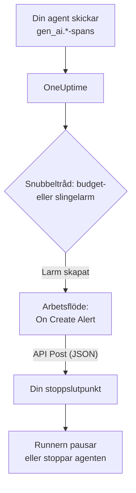

# Circuit breakers för AI-agenter

En AI-agent fallerar sällan genom att krascha. Den fallerar genom att fortsätta: den försöker igen med ett trasigt verktyg, planerar samma steg en gång till eller startar fler underagenter, medan varje varv kostar fler tokens. Den här sidan bygger en circuit breaker för det av delar som OneUptime redan har: ett larm som märker den skenande agenten och ett arbetsflöde som anropar en slutpunkt du äger för att stoppa den.

:::cards
- [Välj en snubbeltråd](#välj-en-snubbeltråd): Larma på kostnad, eller på ett verktyg som anropas om och om igen.
- [Bygg stoppslutpunkten](#bygg-stoppslutpunkten): Den lilla tjänsten som pausar din agent.
- [Bygg arbetsflödet](#bygg-arbetsflödet): Från ett nytt larm till ett anrop till din slutpunkt.
- [Testa circuit breakern](#testa-circuit-breakern): Lös ut den för hand och sedan på riktigt.
:::

## Så fungerar det



Circuit breakern bevakar den OpenTelemetry som din agent redan skickar, direkt eller [via en gateway](/docs/telemetry/ai-gateways), och agerar bredvid anropsvägen, inte i den. Ingenting läggs till i varje modellanrop, och att byta leverantör, SDK eller gateway gör inte sönder den.

Priset är hastighet: den stoppar en skenande agent på minuter, inte millisekunder. Behåll stegbegränsningar och tidsgränser i själva agenten, och låt circuit breakern fånga det som slinker förbi dem.

| Snubbeltråd | Fångar | Tid till larm |
| --- | --- | --- |
| Ett budgetlarm från en metrikövervakning | Kostnader som fortsätter att stiga, oavsett orsak | Upp till 15 minuter, plus en minut för monitorn |
| Ett slingelarm från en spårningsövervakning | Samma verktyg anropat om och om igen | 1 till 5 minuter |

## Innan du börjar

- Din agent skickar GenAI-spans till OneUptime. Se [AI- / LLM-observerbarhet](/docs/telemetry/ai-llm-observability).
- En HTTPS-slutpunkt som kan pausa eller stoppa agentens runner och som går att nå från OneUptime. Du bygger den i [Bygg stoppslutpunkten](#bygg-stoppslutpunkten).
- Behörighet att skapa monitorer och arbetsflöden i projektet.

## Välj en snubbeltråd

Båda snubbeltrådarna slutar på samma sätt: en monitor skapar ett larm, och det nya larmet startar arbetsflödet. Du kan sätta upp båda: arbetsflödet bryr sig inte om vilken som löste ut.

### Ett budgetlarm

Kostnaden är det säkraste tecknet på en skenande agent. En budget summerar dagens AI-kostnader var 15:e minut och publicerar dem som två metriker, `oneuptime.llm.budget.spend.usd` och `oneuptime.llm.budget.percent.used`, var och en med budgetens ID i `oneuptime.llm.budget.id`.

:::steps
1. Öppna **Produkter → AI / LLM → Budgetar** och klicka på **Skapa LLM Cost Budget**. Ange en **Daglig budget (USD)**, och välj agentens tjänst i **Tjänst (valfritt)** så att budgeten bara bevakar den agenten.
2. Välj **Visa ID** i radmenyn för den nya budgeten och kopiera ID:t.
3. Skapa en [Metrikövervakning](/docs/monitor/metrics-monitor) på `oneuptime.llm.budget.percent.used`, filtrerad på attributet `oneuptime.llm.budget.id` med ID:t du kopierade, och sätt dess **Tidsintervall** till **Past 30 Minutes**.
4. Lägg till ett kriterium **Greater Than Or Equal To** `100` som skapar ett larm, och ge det en **Larmtitel** som namnger agenten, till exempel `LLM budget exceeded: support-bot`. Både arbetsflödet och din slutpunkt läser den titeln.
:::

Filtrera på ID:t, inte på namnet: byter du namn på en budget byter dess serie namn, och en monitor som filtrerar på det gamla namnet skulle i tysthet sluta träffa. Behåll tidsintervallet på 30 minuter: en budget publicerar en punkt var 15:e minut, så ett kortare intervall hittar ingenting mellan två punkter, och larmet öppnas och löses om och om igen.

Ett extra kriterium vid `80` med lägre allvarlighetsgrad varnar först en människa via larmets jourpolicy, innan circuit breakern löser ut vid `100`.

### Ett slingelarm

En agent som har fastnat lämnar ett spår du kan känna igen: samma verktygsspan, om och om igen. En frisk körning anropar inte ett verktyg dussintals gånger på några minuter, så en räkning fångar slingan långt innan budgeten gör det.

:::steps
1. Öppna **Övervakare**, klicka på **Skapa monitor** och välj **Spår** under **Fler monitortyper**.
2. Under **Fler fält** sätter du **Filtrera efter telemetritjänst** till agentens tjänst och **Filtrera efter attribut** till `gen_ai.tool.name` lika med verktyget du väntar dig att den fastnar i en slinga på, till exempel `search_web`. Om din instrumentering namnger varje verktygs span anger du i stället det namnet i **Span-namn**.
3. Sätt **Övervakningsspår för (tid)** till **Senaste 5 minuterna**.
4. Lägg till ett kriterium **Span Count** **Greater Than** ett tal som ingen frisk körning når på fem minuter, till exempel `50`, som skapar ett larm med en titel som `Agent loop: support-bot`.
:::

En extra spårningsövervakning med **Filtrera efter spannstatus** satt till **Fel** och en lägre räkning fångar stormar av nya försök: ett verktyg som fortsätter att misslyckas och en agent som fortsätter att försöka igen.

## Bygg stoppslutpunkten

Arbetsflödet skickar en `POST` med en JSON-kropp till en slutpunkt du kör. Vad ”stopp” betyder bestämmer du. Från den minsta effekten till den största:

| Åtgärd | Effekt |
| --- | --- |
| Stoppa nytt arbete | Runnern startar inga nya körningar för den agenten |
| Avbryt dess körningar | Den agentens pågående körningar avbryts |
| Pausa poolen | Alla workers töms tills någon återställer circuit breakern |

En minimal slutpunkt i Express som löser ut en circuit breaker per agent:

```typescript title="circuit-breaker.ts"
import express from "express";

const app = express();
app.use(express.json());

const tripped = new Set<string>(); // agents whose breaker is open

app.post("/circuit-breaker", (req, res) => {
  if (req.headers["authorization"] !== `Bearer ${process.env.KILL_TOKEN}`) {
    return res.status(401).end();
  }

  const alertTitle: string = req.body.alertTitle ?? "";

  // "LLM budget exceeded: support-bot" -> "support-bot"
  const agent: string = alertTitle.split(": ").pop() ?? "unknown";

  tripped.add(agent); // your run loop checks this set
  abortActiveRuns(agent); // cancel that agent's runs in flight

  // Answer fast; do the slow cleanup in the background.
  return res.status(200).json({ tripped: agent });
});
```

Bygg den efter de här reglerna:

- Gör utlösningen idempotent. En varning och en överskridning, eller ett budgetlarm och ett slingelarm samtidigt, kan lösa ut den mer än en gång, och en andra utlösning får inte ändra någonting.
- Svara inom en sekund eller två och städa upp i bakgrunden. Arbetsflödet räknar varje 2xx-svar som en framgång.
- Kräv en hemlighet. Alla som kan anropa slutpunkten kan stoppa dina agenter, så kontrollera en bearer-token, som arbetsflödet skickar från en hemlig global variabel.
- Återställ den för hand. En utlöst circuit breaker förblir utlöst tills någon har tittat på körningen: öppna agentens konversation under **Produkter → AI / LLM → Konversationer** för att läsa eller spela upp vad den gjorde.

Anropet görs från OneUptime. På OneUptime Cloud måste din slutpunkt gå att nå från internet. En självhostad installation avvisar privata nätverksadresser om inte en administratör tillåter dem: se [Utgående nätverksåtkomst](/docs/workflows/configuration#utgående-nätverksåtkomst).

## Bygg arbetsflödet

Spara först slutpunktens token där arbetsflödet kan använda den utan att visa den: öppna **Arbetsflöden → Globala variabler**, klicka på **Skapa Arbetsflöde Variabel**, ge den namnet `AGENT_KILL_TOKEN`, lägg token i **Innehåll** och slå på **Hemlighet**. Ett hemligt värde rensas bort ur körningsloggar och stegspår.

:::steps
### Skapa arbetsflödet

Öppna **Produkter → Arbetsflöden** och klicka på **Skapa arbetsflöde**. Klicka på **Börja från grunden**, ge det namnet `AI agent circuit breaker` och klicka på **Skapa arbetsflöde**. Det öppnas i **Byggare**, avstängt.

### Lägg till utlösaren

Klicka på det streckade blocket **Choose what starts this workflow** och välj **On Create Alert** i panelen **Add Trigger**. Klicka på utlösaren, markera titeln och beskrivningen i **Select Fields** och klicka på **Spara**. ID:t på blocket, `alert-on-create-1`, är hur senare block hänvisar till det.

### Kontrollera titeln

Klicka på **Lägg till komponent**, välj **If / Else** och koppla utlösarens punkt **Success** till den. Sätt **Value to check** till larmets titel (klicka på **{ }** och välj den), **Comparison** till **innehåller** och **Compare with** till början som dina snubbeltrådars titlar har gemensamt, till exempel `LLM budget exceeded`.

### Anropa din slutpunkt

Lägg till **API Post (JSON)** och koppla punkten **Yes** på **If / Else** till den. Sätt dess **URL** till din slutpunkt, till exempel `https://agents.example.com/circuit-breaker`, och fyll i huvudena och kroppen nedan.

### Rapportera ett fel

Lägg till **Send Message to Slack** eller **Send Email** och koppla API-blockets punkt **Error** till den. En circuit breaker som inte lyckas lösa ut är det enda larm som en människa måste se.

### Slå på det

Slå på **Aktiverad** högst upp i **Byggare**.
:::

API-blockets **Request Headers**:

```json title="Request Headers"
{
  "Authorization": "Bearer {{global.variables.AGENT_KILL_TOKEN}}",
  "Content-Type": "application/json"
}
```

Dess **Request Body**:

```json title="Request Body"
{
  "source": "oneuptime-circuit-breaker",
  "alertId": "{{local.components.alert-on-create-1.returnValues.model._id}}",
  "alertTitle": "{{local.components.alert-on-create-1.returnValues.model.title}}",
  "alertDescription": "{{local.components.alert-on-create-1.returnValues.model.description}}"
}
```

För att reagera på flera snubbeltrådar låter du alla deras titlar börja på samma sätt, eller kedjar fler **If / Else**-block från punkten **No**. Se [Bygga ett arbetsflöde](/docs/workflows/authoring) för arbetsytan och [Variabler](/docs/workflows/variables) för `{{…}}`-referenserna.

## Testa circuit breakern

:::steps
1. Lös ut den för hand. Öppna **Varningar**, klicka på **Skapa varning** och skapa ett larm med titeln `LLM budget exceeded: test`. Körningen visas under **Arbetsflöden → Loggar → Körningar**, och din slutpunkt tar emot anropet.
2. Lös ut den på riktigt. Skapa en budget med en mycket liten gräns, till exempel `0.01` USD, på en testagents tjänst, rikta en budgetmonitor mot den och låt agenten köra: procenten passerar 100, larmet öppnas, arbetsflödet körs och circuit breakern löser ut. För slingelarmet ger du en testagent ett verktyg som alltid misslyckas.
3. Lös ut den två gånger. Skapa samma larm igen: din slutpunkt måste ta emot den andra utlösningen utan att ändra något.
:::

## Så beter sig circuit breakern över tid

- Arbetsflödet körs när ett larm skapas, så en snubbeltråd löser ut circuit breakern en gång per larm, inte en gång per utvärdering.
- En budget räknar UTC-dygnet, så procenten börjar om från 0 vid midnatt UTC. Ett budgetlarm kan då lösas, och nästa dåliga dag öppnar ett nytt larm som löser ut circuit breakern igen.
- En monitor håller sitt larm öppet så länge kriterierna är uppfyllda. Med **Lös larm automatiskt** påslaget löses larmet när de inte längre är det, och nästa överskridning öppnar ett nytt larm.
- Att återställa är en människas beslut på båda sidor: lös larmet i OneUptime och återställ circuit breakern i din runner.
- Varje nytt larm i projektet startar arbetsflödet. Det är **If / Else** som håller andra larm borta från circuit breakern: utelämna den inte.

## Felsökning

:::details Arbetsflödet körs inte
Kontrollera att **Aktiverad** är påslaget högst upp i **Byggare**: arbetsflöden skapas avstängda. Kontrollera sedan att larmet skapades efter att du slog på arbetsflödet: utlösaren startar bara en körning för ett nytt larm.
:::

:::details Arbetsflödet körs men tar alltid grenen No
Titeln är tom eller matchar inte. Ett fält som utlösarens **Select Fields** inte markerar kommer fram tomt, så markera titeln. Jämför sedan larmets titel med **Compare with**: **innehåller** måste hitta exakt den texten i den.
:::

:::details Din slutpunkt svarar 401
Huvudet `Authorization` matchar inte den token som din slutpunkt förväntar sig. Kontrollera namnet i `{{global.variables.AGENT_KILL_TOKEN}}` och värdet som är sparat i den globala variabeln. Värdet för en hemlig variabel kan inte läsas tillbaka, så skriv in det igen med **Update Content** om du är osäker.
:::

:::details Budgetlarmet öppnas och löses om och om igen
Monitorns **Tidsintervall** är kortare än budgetens 15 minuter mellan två punkter. Sätt det till **Past 30 Minutes**.
:::

:::details Anropet når aldrig fram till din slutpunkt
Öppna körningen under **Arbetsflöden → Loggar → Körningar** och steget **API Post (JSON)**: där står varför anropet misslyckades. På OneUptime Cloud måste slutpunkten gå att nå från internet; en självhostad installation avvisar privata nätverksadresser om inte en administratör tillåter dem.
:::

## Nästa steg

:::cards
- [AI- / LLM-observerbarhet](/docs/telemetry/ai-llm-observability): Budgetar, kostnader och de spans som circuit breakern bevakar.
- [Spårningsövervakning](/docs/monitor/traces-monitor): Spanfilter och kriterier i detalj.
- [Arbetsflöden](/docs/workflows/index): Utlösare, komponenter, variabler och körningar.
- [AI-gatewayer](/docs/telemetry/ai-gateways): Alla agenters modellanrop genom en enda export.
:::
