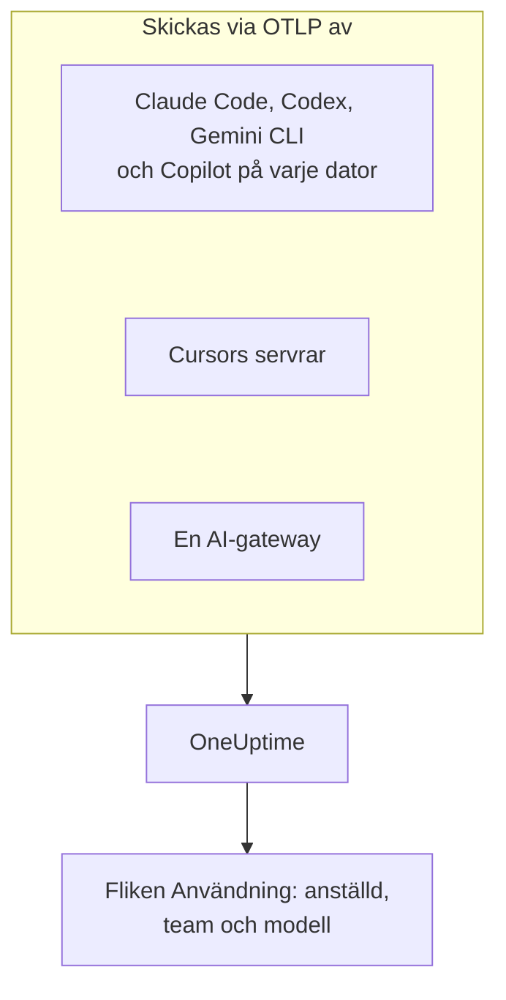

# AI-kodassistenter

Dina utvecklare använder Claude Code, Cursor, Codex, Gemini CLI och Copilot, och fakturorna fortsätter att växa. Den här sidan besvarar frågorna som en chef har: **vem som använder vilket verktyg, med vilka modeller, och vad varje person och varje team spenderar**.

De flesta kodassistenter exporterar OpenTelemetry själva, så det finns inget att installera på utvecklarnas datorer: peka exporten mot OneUptime, så hamnar tokens, kostnad och verktygsanvändning bredvid AI-anropen från dina egna appar. Allt här kommer in via OpenTelemetry; OneUptime frågar inte någon leverantörs administrations- eller fakturerings-API.

:::cards
- [Stödmatris](#stödmatris): Vad varje verktyg skickar, och om det nämner en person.
- [Tilldelning till anställda och team](#tilldelning-till-anställda-och-team): Nycklarna som sätter ett namn och ett team på kostnaderna.
- [Fliken Användning](#fliken-användning): Vad kostnadstabellerna kan och inte kan visa för en kodassistent.
- [Var du börjar](#var-du-börjar): En utrullningsordning som ger resultat från första dagen.
:::

## Så fungerar det

Varje verktyg skickar sin telemetri till OneUptimes OTLP-endpoint med din intagningsnyckel: från varje utvecklardator, från leverantörens servrar (Cursor) eller från en gateway som din modelltrafik går igenom.



## Innan du börjar

1. Skapa en intagningsnyckel för telemetri under **Projektinställningar → Telemetri och APM → Intagningsnycklar**.
2. Din OTLP-endpoint är `https://oneuptime.com/otlp`, eller `https://YOUR-ONEUPTIME-HOST/otlp` om du driftar OneUptime själv.
3. Varje export skickar nyckeln i headern `x-oneuptime-token`.

En intagningsnyckel för hela flottan räcker. Den hamnar på varje utvecklardator, så behandla den som en delad autentiseringsuppgift som bara kan skicka data, och rotera den som vilken annan som helst.

## Stödmatris

Tre saker avgör vad du får från ett verktyg: om det över huvud taget skickar OpenTelemetry, hur dess telemetri når OneUptime och om något i den nämner en person.

| Verktyg | Vad det skickar | Hur det når OneUptime | Vem det nämner | Guide |
| --- | --- | --- | --- | --- |
| Claude Code | Mätvärden och loggar; traces i beta | Från varje dator; miljövariabler eller en fil med hanterade inställningar | `user.email`, när inloggningen skett med ett Claude-konto | [Claude Code](/docs/telemetry/claude-code) |
| Cursor | Mätvärden och loggar | Från Cursors servrar, konfigurerat en gång i Cursors dashboard; bara med Enterprise-planen | `cursor.user.id`, ett heltal | [Cursor](/docs/telemetry/cursor) |
| OpenAI Codex | Traces, mätvärden och loggar, var och en påslagen i `~/.codex/config.toml` | Från varje dator, en fullständig URL per signal | Ingen på spans eller mätvärden: du sätter själv `user.id` och `user.email` i `[otel.span_attributes]` | [OpenAI Codex](/docs/telemetry/openai-codex) |
| Gemini CLI | Traces, mätvärden och loggar | Från varje dator, oftast via en lokal collector | `user.email`, när inloggningen skett | [Gemini CLI och GitHub Copilot](/docs/telemetry/gemini-cli-and-copilot) |
| GitHub Copilot | Traces, mätvärden och loggar, bara från dess agentytor | Från redigeraren eller agentvärden | Ingen: du sätter själv `enduser.id` och `user.email` på varje dator | [Gemini CLI och GitHub Copilot](/docs/telemetry/gemini-cli-and-copilot) |
| Cline | Mätvärden och loggar | Konfigurerat centralt, i Clines organisationsdashboard | Ett anonymiserat `user_id` | — |
| LiteLLM och Portkey | Traces av varje anrop genom gatewayen | Från gatewayprocessen | Med LiteLLM ägaren av den virtuella nyckeln | [AI-gatewayer](/docs/telemetry/ai-gateways) |
| Dina egna appar | Det som din GenAI-instrumentering skickar | Från din app | Den du sätter som `user.id` | [AI- / LLM-observerbarhet](/docs/telemetry/ai-llm-observability) |
| Windsurf, JetBrains AI, Amazon Bedrock, Azure OpenAI | Ingen egen OpenTelemetry | Bara genom en gateway som du sätter framför | Den som gatewayen nämner | [AI-gatewayer](/docs/telemetry/ai-gateways) |

Ett tankstreck betyder att OneUptime ännu inte har en guide för verktyget. Dess telemetri tas ändå emot som all annan OpenTelemetry.

:::details Vad GitHub Copilot exporterar, exakt
Copilot exporterar bara OpenTelemetry från sina agentytor: chatt och agentläge i VS Code, agentvärden bakom Copilot CLI, Copilot SDK och agentarbetsflöden i JetBrains-IDE:er via Copilot-pluginen. GitHub dokumenterar ingen export för inlineförslag, Copilot på github.com eller Copilots kodgranskning. Copilot skickar inga användarattribut alls, så sätt `enduser.id` och `user.email` per dator via `resourceAttributes` eller `OTEL_RESOURCE_ATTRIBUTES`.
:::

:::details Amazon Bedrock, Azure OpenAI, Windsurf och JetBrains AI
- **Amazon Bedrock**: API:erna `InvokeModel` och `Converse` skickar ingen OpenTelemetry. Bedrock AgentCore är annorlunda: AWS dokumenterar mätvärden, spans och loggar för den, som skickas till CloudWatch som standard. Med `DISABLE_ADOT_OBSERVABILITY=true` stänger du av körmiljöns standardkonfiguration för ADOT, så att du kan peka ADOT-SDK:t mot OneUptime i stället.
- **Azure OpenAI**: tjänsten skickar ingenting, och dess Azure Monitor-mätvärden saknar användardimension. Instrumentera klienten, eller sätt API Management eller en annan gateway framför.
- **Windsurf**: dokumenterar ingen telemetriexport. Data per användare finns i Windsurfs Enterprise-API, som OneUptime inte frågar.
- **JetBrains AI Assistant och Junie**: exporterar ingen användning. JetBrains OpenTelemetry-plugin tar emot din egen apps telemetri inne i IDE:n; den skickar ingenting ut.
:::

## Tilldelning till anställda och team

OneUptime kopierar personen som gjorde ett anrop, och deras team, till kolumner när telemetrin kommer in, så att fliken **Användning** kan rangordna personer och team utan attributfilter.

### Attribut som läses som den anställde

På ett span vinner den första nyckeln som finns, i denna ordning:

| Kolumn | Nycklar, den föredragna först |
| --- | --- |
| Anställd-id | `user.id`, `enduser.id`, `litellm.metadata.user_api_key_user_id`, `metadata.user_api_key_user_id`, `traceloop.association.properties.user_id`, `langfuse.user.id`, `user.account_uuid`, `user.account_id`, `cursor.user.id` |
| Den anställdes e-post | `user.email`, `litellm.metadata.user_api_key_user_email`, `metadata.user_api_key_user_email`, `traceloop.association.properties.user_email`, `enduser.email` |
| Team / kostnadsställe | `team.id`, `team`, `cost_center`, `department`, `litellm.metadata.user_api_key_team_id`, `litellm.team.id`, `metadata.user_api_key_team_id`, `cursor.team.id` |

På en datapunkt för ett mätvärde är listan kortare och börjar med e-postadressen, eftersom kodassistenterna som skickar mätvärden själva skickar `user.email`:

| Kolumn | Nycklar, den föredragna först |
| --- | --- |
| Anställd | `user.email`, `user.id`, `user.account_uuid`, `user.account_id`, `cursor.user.id` |
| Team / kostnadsställe | `team.id`, `team`, `cost_center`, `department`, `cursor.team.id` |
| Modell | `gen_ai.request.model`, `model`, `cursor.model.name` |

Så läses de här nycklarna:

- **Varje nyckel läses också med prefixet `resource.`.** OTLP-intaget lagrar resursattribut under det prefixet, så `OTEL_RESOURCE_ATTRIBUTES=team.id=platform` kommer in som `resource.team.id`. Nycklarna utan prefix prövas först, så ett värde på spannet slår ett värde på hela processen.
- **Fliken Användning visar en persons e-postadress när anropet har en, och annars id:t.** Rader med samma e-postadress läggs ihop, så en utvecklare på två datorer blir en rad.
- **Identitet läses bara från AI-anrop.** `user.id`, `user.email` och `team.id` är generiska nycklar som även webbläsar- och backend-spans bär; bara spans som redan känts igen som AI-anrop får kolumnerna.
- **Loggposter läses inte för identitet.** Det spelar roll för Codex, som bara sätter `user.email` på sina loggar.
- LiteLLM stavar de här nycklarna på två sätt: dess standard-`otel`-callback använder prefixet `metadata.`, och dess valfria OpenTelemetry v2-läge (`LITELLM_OTEL_V2=true`) namnrymden `litellm.`. OneUptime läser båda, så en standardproxy fungerar utan extra konfiguration.

### Team och kostnadsställen

Ingen instrumentering skickar `team.id`, `team`, `cost_center` eller `department`: din organisation sätter dem, oftast via `OTEL_RESOURCE_ATTRIBUTES` på verktygets process.

```bash
export OTEL_RESOURCE_ATTRIBUTES="team.id=platform,team=Platform_Engineering,cost_center=eng-123,department=engineering"
```

Sätt den där du redan provisionerar utvecklardatorer: en MDM-profil, en fil med hanterade inställningar eller en skalprofil från dina dotfiles. Värden får inte innehålla blanksteg: använd understreck, eller procentkodning som `%20`. Codex har inga resursattribut, så sätt samma nycklar i dess `[otel.span_attributes]` i stället.

För att dela upp kostnaderna per applikation använder du tjänstnamnet (`OTEL_SERVICE_NAME`, eller verktygets egen inställning). Uppdelningen **Applikation / Tjänst** täcker bara verktyg som skickar GenAI-spans.

### Vad som medvetet inte behandlas som den anställde

Ett anrop kan bära två olika personer: den anställde som gjorde det och kunden som det gjordes för. De här nycklarna bär kunden, och OneUptime läser dem aldrig in i en identitetskolumn:

- `gen_ai.user` och `llm.user`: så som instrumenteringar återger OpenAIs begärandeparameter `user`, som OpenAI beskriver som en identifierare för dina slutanvändare.
- `litellm.metadata.user_api_key_end_user_id`, `metadata.user_api_key_end_user_id` och `litellm.end_user.id`: LiteLLMs slutanvändare, till skillnad från nyckelns ägare, som är den anställde.

Att läsa ett kund-id som en anställd skulle göra en supportbot som betjänar 40 000 kunder till 40 000 spökanställda, medan utvecklaren som äger kostnaderna skulle verka inte spendera något. Nycklarna stannar i spannets attribut, och trace-visarens **LLM**-flik visar dem som slutanvändaren.

### Integritet

Den anställdes e-postkolumn innehåller personuppgifter. Tracens **Scrub-regler** täcker den precis som de täcker attributet som den lästes från, så en regel som maskerar e-postadresser maskerar även kolumnen. Du hittar dem under **Spår → Inställningar**.

## Kodassistentmätvärden som OneUptime läser

Kodassistenterna namnger sina mätvärden med ett eget prefix i stället för `gen_ai.*`, så OneUptime känner igen vart och ett med namn:

| Mätvärde | Verktyg | Enhet |
| --- | --- | --- |
| `claude_code.token.usage` | Claude Code | Tokens |
| `claude_code.cost.usage` | Claude Code | USD |
| `cursor.token.usage` | Cursor | Tokens |
| `cursor.cost.usage` | Cursor | USD, en uppskattning enligt Cursor själv |
| `codex.turn.token_usage` | OpenAI Codex | Tokens |
| `codex.turn.cost_microusd` | OpenAI Codex | Miljondelar av en USD: OneUptime räknar om dem, så gör det inte själv |

OneUptime läser också tokens från `gen_ai.client.token.usage`, `gen_ai.client.token.count`, `llm.token.usage` och `llm.usage.tokens`, och kostnad från `gen_ai.client.cost`, `gen_ai.client.cost.usd`, `gen_ai.usage.cost`, `litellm_spend_metric` och `litellm.cost.total`.

Två saker att känna till innan du läser siffrorna:

- **`gemini_cli.token.usage` utelämnas med avsikt.** Gemini CLI skickar sina tokens två gånger, som ett eget mätvärde och som `gen_ai.client.token.usage`, och att läsa båda skulle fördubbla dem. Dess tokens räknas en gång, via `gen_ai.client.token.usage`. Gemini CLI skickar inget kostnadsmätvärde: slå på dess traces så att varje anrop prissätts.
- **Bara indata- och utdatatokens räknas.** Tokentypen läses från `gen_ai.token.type`, `llm.token.type`, `type`, `cursor.token.type` eller `token_type`, och bara `input` och `output` (eller de äldre `prompt` och `completion`) räknas. Cacheläsningar och -skrivningar, Codex `total` (som upprepar de andra) och `reasoning_output` (en del av `output`) utelämnas, så en total från mätvärden är mindre än summan av allt ett verktyg skickar.

## Fliken Användning

Öppna **Produkter → AI / LLM** och gå till **Användning**. Den rangordnar **Anställd**, **Team**, **Modell**, **Leverantör** och **Applikation / Tjänst** efter kostnad, över de senaste 7 dagarna om du inte väljer en annan period. Anrop som inte nämner någon räknas under **Ej tilldelat**: en stor rad **Ej tilldelat** visar vilket verktyg som fortfarande saknar sin identitet.

### Kodassistentmätvärden är en reserv, inte ett tillägg

GenAI-spans kommer först: mätvärdena läses bara för ett tal som spans inte rapporterade något för, och de två läggs aldrig ihop ([varför](/docs/telemetry/ai-llm-observability#spans-först-mätvärden-fyller-i)). För kodassistenter får det en tydlig följd: **om samma projekt tar emot GenAI-spans med kostnad visas inte kodassistenternas kostnader.** Ge kodassistenterna ett eget projekt, med en egen intagningsnyckel.

När reserven gäller är det här vad varje uppdelning kan visa för ett verktyg som bara skickar mätvärden:

| Uppdelning | Från mätvärden |
| --- | --- |
| **Anställd** | Ja, från varje identitetsnyckel ovan, med och utan prefixet `resource.` |
| **Team** | Ja, från teamnycklarna |
| **Modell** | Ja: Claude Code och Codex skickar ett `model` utan prefix, Cursor `cursor.model.name` |
| **Leverantör** | Nej: kodassistenternas mätvärden nämner ingen leverantör |
| **Applikation / Tjänst** | Nej: deras mätvärden hör inte till någon OneUptime-tjänst |

En rad som lästs från mätvärden bär bara kostnad: dess celler för anrop och tokens visar `—`, eftersom en kostnadsräknare saknar detaljer per anrop, och en 0 där skulle påstå att personen inte gjorde några anrop. Tabellen är märkt med **från GenAI-mätvärden**.

## Ingen OpenTelemetry? Sätt en gateway framför

För Windsurf, JetBrains AI, Bedrocks modell-API:er, Azure OpenAI och allt annat utan egen export sätter du en AI-gateway framför. Varje anrop går då genom en process som skickar OpenTelemetry, och du konfigurerar exporten en gång.

**Använd LiteLLM med en virtuell nyckel per anställd.** LiteLLM sätter nyckelägarens id och e-postadress på varje span, som OneUptime läser som den anställde, och nyckelns team som teamet. Det prissätter också varje anrop självt, med de anpassade priser du sätter på proxyn, och kostnaden det rapporterar vinner över OneUptimes uppskattning. Använd inte dess slutanvändar-id för detta: det är kunden. Konfigurationen finns i [AI-gatewayer](/docs/telemetry/ai-gateways).

Två begränsningar innan du planerar kring en gateway:

- **En gateway ser bara trafik som skickas genom den.** Cursors egen åsidosättning av bas-URL:en är en inställning per användare som bara täcker chattmodeller (Tab-komplettering använder fortfarande Cursors modeller), så föredra Cursors inbyggda export.
- **En gateway ser modellanropet, inte agenten.** Den registrerar prompter och svar, men inte verktygsanropen, filredigeringarna och besluten att godkänna eller avvisa som ett verktygs egen telemetri rapporterar.

## Promptinnehåll: standardvärdena skiljer sig mellan verktyg

Prompter och svar är de mest riskfyllda data i den här pipelinen: de innehåller rutinmässigt källkod, kunddata och inklistrade autentiseringsuppgifter. Kontrollera varje verktygs standardvärde:

| Verktyg | Promptinnehåll som standard |
| --- | --- |
| Claude Code | Av: varje typ av innehåll har en egen variabel för att slå på det |
| Cursor | Av: bara den valfria familjen `conversation_content` skickar meddelandetext |
| OpenAI Codex | Av: `log_user_prompt` är `false` som standard |
| Gemini CLI | **På**: `logPrompts` är `true` som standard, så sätt den till `false` när du slår på telemetri |
| GitHub Copilot | Av: `captureContent`, som hanterade inställningar kan låsa med `lockCaptureContent` |
| LiteLLM | På med standard-`otel`-callbacken (stäng av det med `turn_off_message_logging`); av i OpenTelemetry v2-läge |

Codex skickar också sina mätvärden till OpenAI som standard: se [OpenAI Codex](/docs/telemetry/openai-codex). Där du samlar in innehåll med avsikt gäller tracens **Scrub-regler** och **Drop-filter** för det som för all annan telemetri.

## Vad OneUptime inte gör ännu

- **Inga administrations- eller faktureringskopplingar mot leverantörer.** OneUptime frågar inte Anthropics Admin API, Cursors Admin API, OpenAIs endpoints för användning och kostnader, GitHubs Copilot-fakturering eller Windsurfs och JetBrains API:er. Hämta siffror på fakturanivå från leverantören.
- **Kostnad är en uppskattning om inte ett verktyg rapporterar den.** En rapporterad kostnad används som den är; annars prissätter OneUptime tokens efter listpriser. Cursors `cursor.cost.usage` är själv en uppskattning.
- **Identitet på loggposter läses inte.** Codex `user.email`, som det bara skickar på loggar, kopplas inte till kostnaderna.
- **Cursors `cursor.user.email` läses inte ännu**, så Cursor-användare visas som sitt heltal `cursor.user.id`.
- **Codex-spans nämner ingen modell**, så OneUptime kan inte prissätta dem: Codex visar tokens per person, och sin kostnad bara i totalerna.
- **Verktyg förändras snabbt.** Om den här sidan säger att ett verktyg saknar export, kontrollera dess aktuella dokumentation innan du bygger kring en gateway.

## Var du börjar

Rulla ut i den här ordningen; varje steg är användbart för sig. Använd ett projekt som inte redan tar emot GenAI-spans från dina egna appar, annars håller [reservregeln](#kodassistentmätvärden-är-en-reserv-inte-ett-tillägg) kodassistenternas kostnader borta från sidan.

1. **Gemini CLI**, om någon använder det. Det skickar `user.email` utan konfiguration, så det visar tilldelningen fungera hela vägen. Slå på dess traces också: det skickar inget kostnadsmätvärde.
2. **Claude Code**: en fil med hanterade inställningar för flottan, `user.email` utan extra arbete, ett riktigt kostnadsmätvärde samt godkännandegrad, commits, pull requests och kodrader per utvecklare.
3. **Cursor**, med Enterprise-planen: en skärm i Cursors dashboard, ingen utvecklardator berörd, även om personer kommer in som heltal.
4. **Copilot och Codex**, som båda behöver en identitet satt på varje dator. Gör det när du provisionerar datorer: anrop som kom in utan en kan inte tilldelas i efterhand.
5. **En LiteLLM-gateway** för allt annat, med en virtuell nyckel per anställd.

## Nästa steg

:::cards
- [Claude Code](/docs/telemetry/claude-code): Slå på Claude Codes export för en dator eller hela flottan.
- [Cursor](/docs/telemetry/cursor): Skicka Cursors teamtelemetri från Cursors dashboard.
- [OpenAI Codex](/docs/telemetry/openai-codex): Konfigurera Codex tre exportörer och sätt en identitet på dess spans.
- [AI- / LLM-observerbarhet](/docs/telemetry/ai-llm-observability): Konversationer, varningar, kostnad och budgetar för varje AI-anrop.
:::
