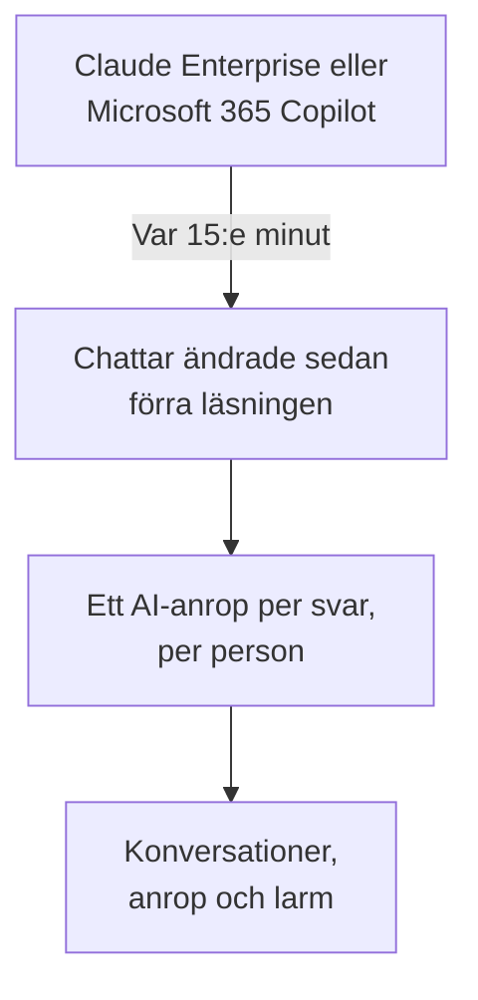

# Företagets AI-verktyg

Se vad dina medarbetare frågar de AI-verktyg som ditt företag betalar för, som konversationer per person. Anslut Claude Enterprise eller Microsoft 365 Copilot med inloggningsuppgifter som bara kan läsa, så hämtar OneUptime varje ny chatt till **Konversationer** var 15:e minut. Bara projektets ägare och administratörer kan läsa dem, om du inte väljer något annat.

:::cards
- [Berätta för dina medarbetare först](#berätta-för-dina-medarbetare-först): Deras chattar är deras egna ord.
- [Anslut ett verktyg](#anslut-ett-verktyg): Klistra in inloggningsuppgifterna, välj vem som får läsa, testa och anslut.
- [Integritet](#integritet): Vem som får läsa konversationerna, och om orden sparas.
- [Andra AI-verktyg](#andra-ai-verktyg): ChatGPT Enterprise, Gemini, Open WebUI, LibreChat och kodassistenter.
:::

## Berätta för dina medarbetare först

> [!IMPORTANT]
> Det här är dina medarbetares egna ord. Innan du ansluter ett verktyg, berätta för dem att deras chattar med det sparas och vem som kan läsa dem, och stäm av med er juridiska avdelning eller HR vad era policyer och lokal lag kräver.

## Så fungerar det

Var 15:e minut ber OneUptime verktyget om de chattar som har ändrats sedan förra läsningen. Varje svar blir ett AI-anrop från personen som frågade, med frågorna som ställts sedan förra svaret, och varje chatt blir en konversation.

Chattarna kommer in på samma sätt som dina appars AI-anrop, så scrub-regler, drop-filter, lagringstid och AI-larmen gäller för dem. Verktygen betalas per licens, så de här anropen har varken tokens eller kostnad. En fråga utan svar i en timme kommer in för sig själv, så även en chatt som AI:n aldrig svarade på visas.

## Innan du börjar

- Rollen Project Owner eller Project Admin. Bara de kan ansluta, ändra eller ta bort ett verktyg.
- En administratör av verktyget som skapar inloggningsuppgifterna: varje verktygs avsnitt nedan säger vem.
- Dina medarbetare informerade, och svaret från er juridiska avdelning eller HR.

## Anslut ett verktyg

:::steps
### Öppna Anslut

Öppna **Produkter → AI / LLM → Anslut**. Under **Ditt företags AI-verktyg** klickar du på verktygets ruta.

### Klistra in inloggningsuppgifterna

Under **Autentiseringsuppgifter** fyller du i det som verktyget ber om. Hemligheter sparas krypterade och visas aldrig igen.

### Välj vem som får läsa

Under **Integritet** ställer du in **Vem som kan läsa konversationer** och **Spara det som skrevs**, som [Integritet](#integritet) förklarar.

### Testa det

Under **Testa** klickar du på **Testa anslutningen**. OneUptime räknar chattarna från de senaste 7 dagarna: inget som någon har skrivit läses, visas eller sparas.

### Anslut

Klicka på **Anslut**. Den första läsningen startar inom en minut och hämtar de senaste 7 dagarna.
:::

## Claude Enterprise

OneUptime läser varje claude.ai-chatt i din organisation via Compliance API: vem som frågade, vad Claude fick för fråga, vad den svarade och vilken modell den använde. En chatt som får ett nytt meddelande läses igen, och de svar som redan hämtats känns igen och hoppas över.

:::steps
### Slå på Compliance API

Organisationens primära ägare öppnar Organization settings, API i claude.ai och slår på Compliance API.

### Skapa en åtkomstnyckel för efterlevnad

Skapa där en nyckel med scopet `read:compliance_user_data`. Den börjar med `sk-ant-api01-`.

### Anslut Claude Enterprise

Klistra in nyckeln som **Åtkomstnyckel för efterlevnad**.
:::

## Microsoft 365 Copilot

OneUptime läser varje persons interaktionshistorik med Copilot från Microsoft Graph: vad personen frågade Copilot i Teams, Outlook, Word, Excel, PowerPoint, Loop eller Copilot Chat, vad den svarade och i vilken app. En prompt och svaren på den blir ett AI-anrop, och en Copilot-session en konversation. En stor tenant läses i delar och fortsätter där förra läsningen slutade.

:::steps
### Registrera en app

Registrera en app i Microsoft Entra ID och skapa en klienthemlighet för den.

### Bevilja behörigheterna

Ge appen programbehörigheterna `AiEnterpriseInteraction.Read.All` och `User.Read.All` från Microsoft Graph, och ge administratörsmedgivande.

### Anslut Copilot

Fyll i **Katalog-ID (tenant)**, **Program-ID (klient)** och **Klienthemlighet**. Vill du bara läsa vissa personer anger du en grupps objekt-id i **Endast personer i den här gruppen** under **Fler fält** och ger appen även `GroupMember.Read.All`. För Azure Government ändrar du **Moln** på samma ställe.
:::

## Integritet

| Inställning | Vad den gör |
| --- | --- |
| **Vem som kan läsa konversationer** | **Projektägare och administratörer**, standardvärdet: ingen annan i projektet ser de här konversationerna, eller AI-anropen de består av, någonstans i OneUptime. **Alla som får läsa AI-anrop**: alla som får läsa projektets traces. |
| **Spara det som skrevs** | På, standardvärdet: frågorna och svaren sparas. Av: OneUptime sparar vem som frågade, när, med vilken modell och i vilken app, men inte orden. |

En ändring av vem som får läsa gäller inom en minut. Att stänga av **Spara det som skrevs** gäller för de chattar som läses efteråt; det som sparades innan finns kvar tills lagringstiden tar slut.

Vill du behålla orden men maskera delar av dem, som e-postadresser eller kortnummer, använder du **Scrub-regler** under **Spår → Inställningar**: de gäller innan något sparas. Konversationerna sparas så länge anslutningens tjänst sparar sina traces: se [Datalagring](/docs/telemetry/data-retention). Att ta bort en anslutning stoppar dess läsningar; det den har läst finns kvar, läsbart för samma personer, tills lagringstiden tar slut.

## Andra AI-verktyg

De här verktygen har inget API som OneUptime kan läsa folks chattar med, eller kräver en annan väg.

### ChatGPT Enterprise

OpenAI öppnar bara sitt Compliance API för en workspace på begäran och publicerar inte vad dess poster innehåller, så OneUptime kan ännu inte läsa chattar från ChatGPT Enterprise. Att ansluta din OpenAI-organisation som ett [leverantörskonto](/docs/telemetry/ai-provider-accounts#openai) visar dess API-användning och API-kostnad, som inte omfattar ChatGPT.

### Gemini för Google Workspace

Google erbjuder inget API för att läsa folks Gemini-chattar. Google Vault sparar dem för eDiscovery.

### Kodassistenter

Claude Code, Codex, Gemini CLI, GitHub Copilot och Cursor skickar sin egen OpenTelemetry: se [AI-kodassistenter](/docs/telemetry/ai-coding-assistants).

### Open WebUI och LibreChat

Självhostade chattappar anropar modellerna via ett API som du anger. Sätt en LiteLLM-proxy framför modellerna och skicka dess traces till OneUptime som [AI-gatewayer](/docs/telemetry/ai-gateways#litellm-proxy) visar: varje chatts promptar och svar kommer in som AI-anrop. En virtuell nyckel per person visar vem som frågade; en nyckel som alla delar nämner ingen. Open WebUI:s egen OpenTelemetry-export spårar dess webbförfrågningar och databasanrop, inte chattarna.

## Felsökning

:::details Testet hittar inga chattar
Ingen har använt verktyget de senaste 7 dagarna, eller så tillhör inloggningsuppgifterna en annan organisation eller tenant. För Copilot kontrollerar du att gruppen under **Endast personer i den här gruppen** är den du menar.
:::

:::details Inloggningsuppgifterna fungerar men får inte läsa det som anslutningen behöver
För Copilot ger du administratörsmedgivande för appens Graph-behörigheter, och även `GroupMember.Read.All` när du anger en grupp. För Claude Enterprise skapar du nyckeln med scopet `read:compliance_user_data`.
:::

:::details Någon kan inte se konversationerna
**Vem som kan läsa konversationer** är satt till **Projektägare och administratörer**. En ägare eller administratör kan ändra det med **Redigera** på anslutningens rad.
:::

:::details Konversationerna visar vem som frågade, men inga ord
**Spara det som skrevs** var avstängt när de lästes. Att slå på det gäller för de chattar som läses efteråt.
:::

## Nästa steg

:::cards
- [AI- / LLM-observerbarhet](/docs/telemetry/ai-llm-observability): Läs och spela upp konversationer, och få veta när svar går fel.
- [Konton hos AI-leverantörer](/docs/telemetry/ai-provider-accounts): Användning och kostnad för dina konton hos OpenAI, Anthropic, Azure, Bedrock och Vertex AI.
- [AI-kodassistenter](/docs/telemetry/ai-coding-assistants): Kostnad per utvecklare för kodverktygen.
- [Datalagring](/docs/telemetry/data-retention): Hur länge konversationerna sparas.
:::
