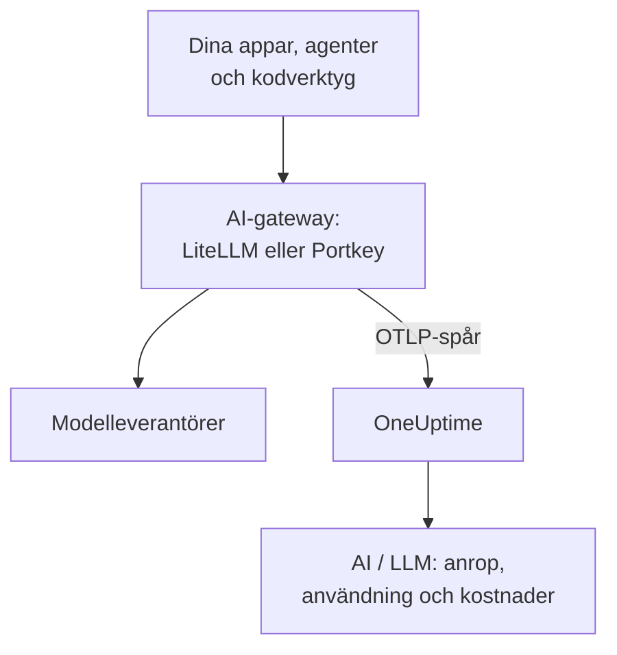

# AI-gatewayer (LiteLLM, Portkey)

En AI-gateway sitter mellan dina appar och modelleverantörerna, så varje modellanrop går genom den. Skicka gatewayens OpenTelemetry till OneUptime en gång, så kommer varje anrop bakom den in i [AI / LLM](/docs/telemetry/ai-llm-observability) med modell, tokens, kostnad och, om du inte stänger av det, prompten och svaret, utan att du behöver instrumentera varje app.

:::cards
- [LiteLLM Proxy](#litellm-proxy): Inbyggd export, konfigurerad med tre variabler.
- [Vem som använde vad](#en-virtuell-nyckel-per-anställd): En virtuell LiteLLM-nyckel per anställd namnger varje person.
- [Portkey](#portkey): Inbyggd export på självhostade gatewayer; på andra ställen instrumenterar du appen.
- [Kontrollera att anropen kommer fram](#kontrollera-att-anropen-kommer-fram): Vad du ska se, och vad du gör om du inte ser det.
:::

## Så fungerar det



| | LiteLLM Proxy | Portkey, självhostad eller Enterprise | Portkey, öppen källkod eller hostad |
| --- | --- | --- | --- |
| Export till OneUptime | Inbyggd | Inbyggd, experimentell | Ingen: instrumentera appen i stället |
| Slutpunkt att ange | `https://oneuptime.com/otlp/v1/traces` | `https://oneuptime.com/otlp` | Appens egen exportör |
| Namnger varje person | Ja, med en virtuell nyckel per anställd | Nej | Bara det som appen skickar |
| Prompter och svar | Skickas, om du inte stänger av dem | Skickas alltid | Beror på instrumenteringen |

## Innan du börjar

- En ingestion-nyckel: öppna **Projektinställningar → Telemetri och APM → Intagningsnycklar** och klicka på **Skapa ingestion-nyckel**.
- Din OTLP-bas-URL: `https://oneuptime.com/otlp`, eller `https://YOUR-ONEUPTIME-HOST/otlp` om du hostar OneUptime själv. OneUptime tar emot OTLP över HTTP, i protobuf och i JSON.
- Nyckeln följer med i huvudet `x-oneuptime-token` i varje exportbegäran.

## LiteLLM Proxy

LiteLLM:s OpenTelemetry-callback ingår i proxyn med öppen källkod, och den officiella Docker-avbildningen (`ghcr.io/berriai/litellm`) innehåller de paket den behöver.

:::steps
### Slå på otel-callbacken

Lägg till `otel` bland callbackarna i proxyns `config.yaml`:

```yaml title="config.yaml"
model_list:
  - model_name: gpt-4o
    litellm_params:
      model: openai/gpt-4o
      api_key: os.environ/OPENAI_API_KEY

litellm_settings:
  callbacks: ["otel"]
```

### Rikta exportören mot OneUptime

Ange tre variabler på proxyn:

```bash
export OTEL_EXPORTER="otlp_http"
export OTEL_ENDPOINT="https://oneuptime.com/otlp/v1/traces"
export OTEL_HEADERS="x-oneuptime-token=YOUR_INGESTION_TOKEN"
```

### Starta proxyn

:::tabs
@tab Docker
```bash
docker run \
  -v $(pwd)/config.yaml:/app/config.yaml \
  -e OPENAI_API_KEY="sk-..." \
  -e OTEL_EXPORTER="otlp_http" \
  -e OTEL_ENDPOINT="https://oneuptime.com/otlp/v1/traces" \
  -e OTEL_HEADERS="x-oneuptime-token=YOUR_INGESTION_TOKEN" \
  -e OTEL_SERVICE_NAME="litellm-gateway" \
  -p 4000:4000 \
  ghcr.io/berriai/litellm:main-stable \
  --config /app/config.yaml
```
@tab pip
```bash
pip install 'litellm[proxy]' opentelemetry-api opentelemetry-sdk opentelemetry-exporter-otlp
litellm --config config.yaml
```
:::

`litellm[proxy]` ensamt innehåller inte OpenTelemetry-paketen, så installera dem bredvid.

### Skicka en begäran genom den

Anropa proxyn en gång och kontrollera sedan AI / LLM enligt [Kontrollera att anropen kommer fram](#kontrollera-att-anropen-kommer-fram).
:::

| Variabel | Värde | Anmärkningar |
| --- | --- | --- |
| `OTEL_EXPORTER` | `otlp_http` | Läses även som `OTEL_EXPORTER_OTLP_PROTOCOL` |
| `OTEL_ENDPOINT` | `https://oneuptime.com/otlp/v1/traces` | Den fullständiga sökvägen `/v1/traces` fungerar med alla LiteLLM-versioner; läses även som `OTEL_EXPORTER_OTLP_ENDPOINT` |
| `OTEL_HEADERS` | `x-oneuptime-token=YOUR_INGESTION_TOKEN` | Kommaseparerade `key=value`-par; läses även som `OTEL_EXPORTER_OTLP_HEADERS` |
| `OTEL_SERVICE_NAME` | Namnet på din gateway | Tjänsten som anropen visas under; `litellm` om du inte anger något |

### Vad LiteLLM skickar

Varje anrop bär `gen_ai.system`, `gen_ai.request.model`, `gen_ai.response.model`, `gen_ai.usage.input_tokens` och `gen_ai.usage.output_tokens`, sina parametrar och prompten och svaret: allt som OneUptime behöver för att [läsa anropet](/docs/telemetry/ai-llm-observability).

Sedan LiteLLM 1.81 ligger de här attributen på begärans span `Received Proxy Server Request`, och det finns inte längre något separat span `litellm_request`. När en begäran gör flera modellanrop skriver varje anrop där över det föregåendes attribut, så ange `USE_OTEL_LITELLM_REQUEST_SPAN=true` för att få ett span `litellm_request` för varje anrop.

LiteLLM prissätter varje anrop själv, inklusive egna priser som du har ställt in på proxyn, och rapporterar priset som `gen_ai.cost.total_cost`. OneUptime föredrar ett rapporterat pris framför sin egen uppskattning och [uppskattar utifrån tokens](/docs/telemetry/ai-llm-observability) bara när LiteLLM inte kunde prissätta anropet, till exempel för en egen modell utan angivet pris.

### En virtuell nyckel per anställd

Ge varje person en egen virtuell LiteLLM-nyckel, så kommer varje anrop som personen gör in med vem det är. LiteLLM skriver nyckelägarens ID, e-postadress och team på spannet, och OneUptime läser dem som den anställda och teamet, så att fliken **Användning** rangordnar kostnaderna per person utan att något behöver ställas in på deras datorer.

Virtuella nycklar kräver en databas och en huvudnyckel på proxyn (`DATABASE_URL` och `LITELLM_MASTER_KEY`). Skapa en användare med personens e-postadress och sedan en nyckel för den användaren:

```bash
curl -X POST "http://localhost:4000/user/new" \
  -H "Authorization: Bearer YOUR_MASTER_KEY" \
  -H "Content-Type: application/json" \
  -d '{"user_email": "alice@example.com"}'

curl -X POST "http://localhost:4000/key/generate" \
  -H "Authorization: Bearer YOUR_MASTER_KEY" \
  -H "Content-Type: application/json" \
  -d '{"user_id": "USER_ID_FROM_THE_FIRST_CALL", "team_id": "platform"}'
```

| Span-attribut från LiteLLM | OneUptime läser det som |
| --- | --- |
| `metadata.user_api_key_user_id` | Den anställdas ID |
| `metadata.user_api_key_user_email` | Den anställdas e-postadress |
| `metadata.user_api_key_team_id` | Teamet |
| `metadata.user_api_key_end_user_id` | Aldrig den anställda: det är den `user` som din app skickar för sin egen kund |

I LiteLLM:s OpenTelemetry v2-läge kommer samma värden med prefixet `litellm.` (`litellm.metadata.user_api_key_user_email` och så vidare), som OneUptime också läser.

### Håll prompter utanför

Callbacken `otel` skickar som standard hela prompter och svar. För att hålla dem utanför använder du något av de här alternativen:

:::tabs
@tab Alla callbackar
```yaml title="config.yaml"
litellm_settings:
  callbacks: ["otel"]
  turn_off_message_logging: true
```
@tab Bara OTel-callbacken
```yaml title="config.yaml"
litellm_settings:
  callbacks: ["otel"]

callback_settings:
  otel:
    message_logging: False
```
@tab Miljövariabel
```bash
export OTEL_INSTRUMENTATION_GENAI_CAPTURE_MESSAGE_CONTENT="NO_CONTENT"
```
:::

`callback_settings` är en nyckel på översta nivån, inte en nyckel under `litellm_settings`. För att behålla prompter men maskera delar av dem använder du i stället rensningsregler under **Spår → Inställningar**.

:::details LiteLLM:s OpenTelemetry v2-läge
Nyare LiteLLM-versioner har ett valfritt OpenTelemetry v2-läge (`LITELLM_OTEL_V2=true`, ingen ändring i `config.yaml`). Det skickar ett spår per begäran, med HTTP-hanteringen, autentiseringen, guardrails och modellanropet som GenAI-spans med namn som `chat gpt-4o`. I v2-läget är prompter avstängda som standard; slå på dem med `OTEL_INSTRUMENTATION_GENAI_CAPTURE_MESSAGE_CONTENT`. Kostnaden kommer som `litellm.cost.total`, som OneUptime också läser. Använd det ena läget eller det andra, inte båda.
:::

## Portkey

Vad Portkey kan skicka beror på hur du kör den:

| Driftsättning | Export till OneUptime |
| --- | --- |
| Självhostad gateway eller Enterprise-gateway | Inbyggd (experimentell): ange variablerna nedan |
| Gateway med öppen källkod (`portkey-ai/gateway`) | Ingen: instrumentera appen som anropar den |
| Hostad gateway (portkey.ai) | Ingen på gatewayen: instrumentera appen som anropar den |

Portkey har också en egen OpenTelemetry-slutpunkt (`api.portkey.ai/v1/otel`). Den tar emot spår i Portkey, i motsatt riktning mot den här sidan.

### Självhostade gatewayer och Enterprise-gatewayer

Ange de här variablerna på gatewayens container:

```yaml title="docker-compose.yml"
services:
  portkey-gateway:
    environment:
      EXPERIMENTAL_GEN_AI_OTEL_TRACES_ENABLED: "true"
      EXPERIMENTAL_GEN_AI_OTEL_EXPORTER_OTLP_ENDPOINT: "https://oneuptime.com/otlp"
      EXPERIMENTAL_GEN_AI_OTEL_EXPORTER_OTLP_HEADERS: "x-oneuptime-token=YOUR_INGESTION_TOKEN"
```

- Ange bas-URL:en för OTLP: Portkey lägger själv till `/v1/traces`.
- Huvuden är kommaseparerade `key=value`-par. `EXPERIMENTAL_GEN_AI_OTEL_RESOURCE_ATTRIBUTES` lägger till resursattribut på samma sätt, till exempel `deployment.environment=production`.
- Portkey skickar OTLP över HTTP bara som JSON, vilket OneUptime tar emot utan en collector emellan.
- Varje anrop är ett span med namnet `{operation} {model}`, till exempel `chat gpt-4o`, under tjänsten `portkey`, med `gen_ai.provider.name`, den begärda och den levererade modellen, tokenräkningarna, `gen_ai.conversation.id` och meddelandena i `gen_ai.input.messages` och `gen_ai.output.messages`.
- Hela prompter och svar ingår alltid. Maskera det som behövs med rensningsregler under **Spår → Inställningar**.
- Varje anrop skickas för sig efter svaret, utan batchning och utan nya försök: en misslyckad export går förlorad. Behandla det som observerbarhet, inte som en granskningslogg.
- Om ditt `x-portkey-trace-id` är ett giltigt spår-ID (32 hexadecimala tecken) återanvänder Portkey det, så att gatewayens spans hänger ihop med din egen apps spår.

Portkey märker den här exporten som experimentell. Om variablerna inte har någon effekt, jämför Portkeys aktuella dokumentation med din gateways version.

### Gatewayer med öppen källkod och hostade gatewayer

Gatewayen med öppen källkod har ingen exportör, och på den hostade gatewayen kan du inte ange dess variabler. Instrumentera i stället appen som anropar Portkey. Portkey talar OpenAI:s API, så GenAI-instrumenteringarna från [AI- / LLM-observerbarhet](/docs/telemetry/ai-llm-observability) (OpenLLMetry, OpenInference, OpenLIT) spårar din SDK:s anrop även när bas-URL:en pekar på Portkey:

```python
from traceloop.sdk import Traceloop
from openai import OpenAI

Traceloop.init(
    app_name="my-ai-agent",
    api_endpoint="https://oneuptime.com/otlp",
    headers={"x-oneuptime-token": "YOUR_INGESTION_TOKEN"},
)

client = OpenAI(
    base_url="https://api.portkey.ai/v1",   # or your gateway's URL
    default_headers={"x-portkey-api-key": "PORTKEY_API_KEY"},
)
# Calls through Portkey are now traced to OneUptime.
```

De här spannen beskriver anropet som din app gjorde det: modellen den bad om, tiden den väntade, de tokens den fick tillbaka. Det som gatewayen bestämde längs vägen, som en reservlösning, ett nytt försök eller en cacheträff, stannar i Portkey. För att se det i OneUptime använder du den självhostade gatewayens export.

## Kontrollera att anropen kommer fram

:::steps
1. Skicka en begäran genom gatewayen och vänta några sekunder.
2. Öppna **Produkter → AI / LLM → Anrop**. Anropet finns i listan med leverantör, modell och tokens.
3. Klicka på anropet för att öppna dess spår, och öppna spannets flik **LLM**: modellen, tokens, parametrarna och, om du inte stängde av dem, prompten och svaret.
4. Öppna **Användning**: anropet räknas med i totalerna, med den kostnad som gatewayen rapporterade eller som OneUptime uppskattade.
:::

## Felsökning

:::details Ingenting kommer från LiteLLM
Ange `OTEL_EXPORTER="console"` en kort stund. Om spans visas i proxyns utdata spårar LiteLLM, och problemet ligger i slutpunkten eller nyckeln. `DEBUG_OTEL="true"` visar vad exportören gör.
:::

:::details Nyckeln avvisas
OneUptime svarar `401` på en saknad, okänd eller utgången nyckel och `422` på en inaktiverad nyckel eller en webbläsarnyckel. Skapa en servernyckel under **Projektinställningar → Telemetri och APM → Intagningsnycklar** och skicka den i `x-oneuptime-token`.
:::

:::details Slutpunkten är fel
LiteLLM tar den fullständiga sökvägen, `https://oneuptime.com/otlp/v1/traces`. Portkey tar bas-URL:en, `https://oneuptime.com/otlp`, och lägger själv till `/v1/traces`.
:::

:::details Spans kommer fram, men inte i AI / LLM
Filtrera **Spår** på gatewayens tjänst (`litellm`, `portkey` eller din `OTEL_SERVICE_NAME`) för att se de råa spannen. Ett span räknas bara som ett modellanrop när det bär `gen_ai.*`-attribut: kontrollera att callbacken är `otel` och att anropet gick till en modell.
:::

:::details Kostnaderna visas som ej tilldelade
Anropen namnger ingen person. Ge varje anställd en egen virtuell nyckel, som i [En virtuell nyckel per anställd](#en-virtuell-nyckel-per-anställd). Fältet `user` som din app skickar namnger dess kund, inte den anställda, och läses aldrig som den anställda.
:::

:::details Av flera anrop visas bara det sista
Sedan LiteLLM 1.81 delar en begärans modellanrop ett enda span. Ange `USE_OTEL_LITELLM_REQUEST_SPAN=true` för att få ett span för varje anrop.
:::

## Nästa steg

:::cards
- [AI- / LLM-observerbarhet](/docs/telemetry/ai-llm-observability): Konversationer, larm, användning och dagliga kostnadsbudgetar för de här anropen.
- [AI-kodassistenter](/docs/telemetry/ai-coding-assistants): Sätt en gateway framför verktyg som inte skickar telemetri själva.
- [Circuit breakers för AI-agenter](/docs/telemetry/ai-agent-circuit-breaker): Stoppa en skenande agent när dess larm utlöses.
- [Spårningsövervakning](/docs/monitor/traces-monitor): Larma på spanmönster, som ett verktyg som anropas i en slinga.
:::
