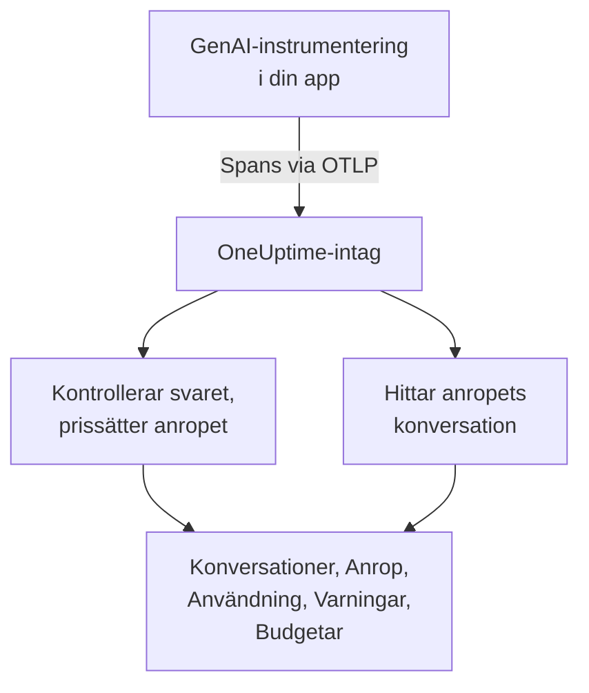
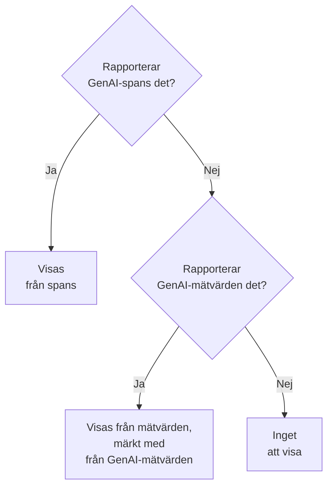

# AI- / LLM-observerbarhet

Läs varje konversation som din AI har haft, spela upp den igen som den hände och få veta när den svarar dåligt. OneUptime bygger allt detta på standard-OpenTelemetry: om din app skickar spans med **GenAI-semantiska konventioner** (`gen_ai.*`) får du konversationer, varningar, användning och kostnad, utan något proprietärt SDK.

:::cards
- [Sätt upp det](#sätt-upp-det-i-fem-steg): Fem steg, från det första spannet till flaggade svar.
- [Spela upp en konversation](#läs-och-spela-upp-en-konversation): Läs en chatt som personen såg den, i den takt den hände.
- [Få varningar](#få-veta-när-ain-svarar-dåligt): Färdiga varningar för svar som misslyckas, nekas, kapas, flaggas eller är långsamma.
- [Håll koll på kostnaderna](#se-vem-som-spenderar-vad): Kostnad per person, team, modell och app, med dagliga budgetar.
:::

## Så fungerar det

Din apps GenAI-instrumentering exporterar varje anrop till modellen som ett OpenTelemetry-span. När spannet kommer in läser OneUptime dess `gen_ai.*`-attribut, kontrollerar svaret efter problem, prissätter anropet och lägger det under den konversation det hör till.



Öppna **Produkter → AI / LLM** under **Observerbarhet**. Produkten har sju flikar:

| Flik | Vad den visar |
| --- | --- |
| **Konversationer** | Varje konversation som din AI har haft, med de som behöver uppmärksamhet först. Ovanför listan: konversationer, AI-svar, hur många som behöver uppmärksamhet, kostnad och den typiska svarstiden. |
| **Anrop** | Varje modell-, embedding-, agent- och verktygsanrop. Filtrera på tjänst, leverantör, modell, operation, person, team eller konversation; klicka på ett anrop för att öppna det i trace-visaren. |
| **Användning** | Anrop, tokens och kostnad för en tidsperiod, rangordnade efter anställd, team, modell, leverantör eller app. |
| **Varningar** | Färdiga varningar för när AI:n svarar dåligt, och dina AI / LLM-monitorer. |
| **Budgetar** | Dagliga kostnadsgränser, publicerade som mätvärden som du kan varna på. |
| **Priser** | Dina egna priser för modeller som den inbyggda prislistan inte känner till. |
| **Inställning** | De fem stegen nedan, med ditt projekts endpoint. |

I trace-visaren har spannet för varje AI-anrop också en **LLM**-flik: leverantör, modell, tokens, kostnad, begärandeparametrar samt prompten och svaret.

## Innan du börjar

- Ett OneUptime-projekt där du kan skapa en intagningsnyckel för telemetri.
- En app som anropar en modell, och en GenAI-instrumentering för dess språk: **OpenLLMetry** (Traceloop), **OpenInference** (Arize), **Vercel AI SDK** eller OpenTelemetry-instrumenteringarna för OpenAI, Anthropic och Gemini.

> [!TIP]
> Modelltrafik som går genom en gateway som LiteLLM eller Portkey kan exporteras från gatewayen i stället för från varje app: se [AI-gatewayer](/docs/telemetry/ai-gateways). För kodassistenterna som dina utvecklare använder, se [AI-kodassistenter](/docs/telemetry/ai-coding-assistants).

## Sätt upp det i fem steg

Det första steget är allt du behöver för att se anrop. Varje steg efter det visar mer.

:::steps
### Skicka dina AI-anrop

Skapa en intagningsnyckel under **Projektinställningar → Telemetri och APM → Intagningsnycklar** ([OpenTelemetry-snabbstarten](/docs/telemetry/open-telemetry#skapa-en-intagningsnyckel) går igenom det). Peka sedan din instrumentering mot OneUptime:

:::tabs
@tab Python
```bash
pip install traceloop-sdk opentelemetry-exporter-otlp
```

```python
from traceloop.sdk import Traceloop

Traceloop.init(
    app_name="my-ai-agent",
    api_endpoint="https://oneuptime.com/otlp",
    headers={"x-oneuptime-token": "YOUR_INGESTION_TOKEN"},
)
# Your OpenAI, Anthropic and LangChain calls are now traced.
```
@tab Node.js
```bash
npm install @traceloop/node-server-sdk
```

```typescript
import * as traceloop from "@traceloop/node-server-sdk";

traceloop.initialize({
  appName: "my-ai-agent",
  baseUrl: "https://oneuptime.com/otlp",
  headers: { "x-oneuptime-token": "YOUR_INGESTION_TOKEN" },
});
```
@tab OpenTelemetry SDK
```bash
export OTEL_EXPORTER_OTLP_ENDPOINT="https://oneuptime.com/otlp"
export OTEL_EXPORTER_OTLP_HEADERS="x-oneuptime-token=YOUR_INGESTION_TOKEN"
export OTEL_EXPORTER_OTLP_PROTOCOL="http/protobuf"
export OTEL_SERVICE_NAME="my-ai-agent"
```
:::

Driftar du OneUptime själv? Använd `https://YOUR-ONEUPTIME-HOST/otlp` i stället för `https://oneuptime.com/otlp`. Anropa din modell en gång, så dyker anropet upp under **Anrop**.

### Registrera vad som sades

En konversation visar bara vad folk frågade och vad AI:n svarade när din instrumentering registrerar det. OpenLLMetry registrerar prompter och svar om du inte sätter `TRACELOOP_TRACE_CONTENT=false`. OpenTelemetry-instrumenteringarna registrerar dem bara när du ber om det:

```bash
export OTEL_INSTRUMENTATION_GENAI_CAPTURE_MESSAGE_CONTENT=true
```

Nyare OpenTelemetry-instrumenteringar tar `span_only`, `event_only` eller `span_and_event` i stället för `true`. Utan registrerat innehåll visar en konversation ändå sina tider, sin kostnad och sina problem. Prompter kan innehålla känsliga data: [Integritet och maskering](#integritet-och-maskering) visar hur du maskerar dem innan de lagras.

### Gruppera anrop i konversationer

En chattapp gör ett modellanrop per tur. Sätt `gen_ai.conversation.id` (eller `session.id`) till din chatts id på varje AI-anrop, så visas varje chatt som en konversation, oavsett hur många anrop och traces den tog. Med OpenLLMetry sätter du det en gång per begäran:

```python
from traceloop.sdk import Traceloop

Traceloop.set_association_properties({
    "session_id": chat.id,
    "user_email": user.email,
})
```

Med Vercel AI SDK skickar du chattens id som `experimental_telemetry: { metadata: { sessionId } }`. Anrop utan konversations-id visas ändå, en begäran (en trace) åt gången.

### Ange vem som frågade

Sätt `user.id` eller `user.email` på varje AI-anrop (associationsegenskapen ovan sätter e-postadressen). Då visar varje konversation vem den var med, du kan söka i listan efter person, och fliken **Användning** rangordnar kostnaderna efter anställd. [Tilldelning till anställda och team](/docs/telemetry/ai-coding-assistants#tilldelning-till-anställda-och-team) listar alla identitetsnycklar som OneUptime läser.

### Flagga dåliga svar

OneUptime kontrollerar varje svar när det kommer in och markerar vad som gick fel med det:

| Problem | Vad det betyder | Hittas via |
| --- | --- | --- |
| Misslyckat | Anropet slutade med ett fel, så inget svar kom | Span-status Error, `error.type` eller en avslutningsorsak `error` |
| Nekat | AI:n vägrade, eller ett säkerhetsfilter blockerade svaret | En avslutningsorsak för vägran eller säkerhet (`content_filter`, `refusal`, `SAFETY` och liknande), en vägran i svaret eller ett svar som börjar med en standardvägran på engelska |
| Kapat | Svaret stannade vid tokengränsen | En avslutningsorsak `length`, `max_tokens` eller `MAX_TOKENS` |
| Tomt | Ingen text och inget verktygsanrop | Registrerat innehåll som inte innehåller något, eller 0 utdatatokens |
| Flaggat | En utvärdering som din app skickade sa att svaret var dåligt | En `gen_ai.evaluation.result`-händelse |

De fyra första kräver inget av dig. För att flagga ett svar som din guardrail, din utvärdering eller en tumme ned-knapp avvisar lägger du till en `gen_ai.evaluation.result`-händelse på svarets span, medan spannet är öppet, med `gen_ai.evaluation.score.label` satt till `fail`:

```python
from opentelemetry import trace

trace.get_current_span().add_event(
    "gen_ai.evaluation.result",
    {
        "gen_ai.evaluation.name": "relevance",
        "gen_ai.evaluation.score.label": "fail",
        "gen_ai.evaluation.explanation": "The answer is about another product.",
    },
)
```

Etiketter som `incorrect`, `wrong`, `unhelpful`, `toxic`, `unsafe` och `hallucination` räknas också som misslyckade. OneUptime skickar aldrig dina konversationer till en annan AI för att bedöma dem: varje kontroll läser bara det som anropet självt bär.
:::

## Läs och spela upp en konversation

En konversation öppnas i sin helhet, som en chattapp visar sin historik: det personen sa till höger, AI:ns svar till vänster med modell, tid, tokens och kostnad, verktygsanrop däremellan, och vad som gick fel, markerat där det hände. **Detaljer** under ett svar visar varför det stannade, dess utvärderingar och en länk till anropet i Spår.

Fältet längst ned spelar upp konversationen som personen upplevde den:

| Kontroll | Vad den gör |
| --- | --- |
| **Spela upp igen** | Spelar upp konversationen från det första meddelandet, i den takt den hände. "AI:n svarar…" räknar upp medan ett svar är på väg. Klicka på tiden för ett meddelande för att spela upp därifrån. |
| **Hoppa över väntan** | På som standard: kortar av all tystnad som är längre än 3 sekunder. |
| `1x` | Ändrar hastigheten: 1x, 2x, 4x eller 8x. |
| **K**, **J** eller **←**, **L** eller **→** | Spela upp eller pausa, gå ett meddelande bakåt, gå ett meddelande framåt. |

Sidans adress sparar meddelandet där en uppspelning stannade (`?step=`), så en länk som du delar öppnas vid det ögonblicket.

## Få veta när AI:n svarar dåligt

Fliken **Varningar** listar de varningar som de flesta AI-appar vill ha. När du väljer en öppnas **Skapa monitor** ifylld, och du kan ändra allt innan du sparar:

| Varning | När den meddelar dig | Allvarlighetsgrad |
| --- | --- | --- |
| Svar går fel | Mer än 5 % av svaren på 15 minuter misslyckas, nekas, kapas, är tomma eller flaggas | Warning |
| AI-anrop misslyckas | Mer än 10 % av anropen till modellen på 5 minuter slutar med ett fel | Critical |
| AI:n vägrar svara | Mer än 5 % av svaren på 30 minuter är vägranden | Warning |
| Svar kapas | 3 eller fler svar på 30 minuter stannar vid tokengränsen | Warning |
| Svar flaggas | En utvärdering markerar ett svar som dåligt | Warning |
| Svar är långsamma | Mer än 10 % av svaren på 15 minuter tar längre än 30 sekunder | Warning |
| AI:n slutar svara | AI:n ger inga svar på 30 minuter | Critical |

Varningarna på en andel av svaren väntar också på minst 3 dåliga svar, så ett dåligt svar av två larmar ingen. En Critical-varning får ditt projekts högsta varningsgrad och en Warning-varning nästa: High och Low i ett nytt projekt.

Varje varning är en **AI / LLM**-monitor. Dess inställningar anger vad som räknas som ett dåligt svar (**Räkna ett svar som dåligt när det**, **Eller tar längre än (sekunder)**), hur långt bakåt varje kontroll tittar (**Tidsfönster**, 15 minuter som standard), vilka **Appar** den övervakar och, under **Fler fält**, vilken **Modell**. En **Förhandsgranskning** visar vad monitorn skulle räkna just nu. Dess kriterier jämför tre tal: **Dåliga AI-svar (i %)**, **Dåliga AI-svar** och **AI-svar**.

En färdig varning skapar en varning som löser sig själv, och visar monitorn som **Degraded** medan svaren är dåliga. Dess incident är ifylld men avstängd: slå på den för att larma någon.

## Se vem som spenderar vad

Fliken **Användning** visar anrop, tokens och kostnad för en tidsperiod (de senaste 7 dagarna om du inte väljer en annan) och en tabell över de 25 största i en av fem uppdelningar: **Anställd**, **Team**, **Modell**, **Leverantör** och **Applikation / Tjänst**. Anrop som inte nämner någon räknas under **Ej tilldelat** och slängs aldrig.

Personer och team kommer från identitetsattribut på anropet: se [Tilldelning till anställda och team](/docs/telemetry/ai-coding-assistants#tilldelning-till-anställda-och-team).

### Spans först, mätvärden fyller i

GenAI-spans bär modellen, tokens och kostnaden för ett anrop, så där de finns svarar de på allt. Vissa verktyg publicerar token- och kostnadsmätvärden och inga GenAI-spans, som de flesta kodassistenter. OneUptime läser bara de mätvärdena för ett tal som spans inte rapporterade något för, och lägger aldrig ihop de två: många instrumenteringar skickar båda för samma anrop, och att lägga ihop dem skulle räkna varje dollar två gånger.



| Var | Vad som faller tillbaka på mätvärden | När |
| --- | --- | --- |
| Indata- och utdatatokens | Båda totalerna | Spans tokentotaler är båda 0 |
| Kostnad (USD) | Kostnaden, med Codex kostnad i mikro-USD omräknad till USD | Spans kostnadstotal är 0 |
| LLM-anrop | Inget: bara spans | — |
| Tabellerna **Anställd**, **Team**, **Modell** | Bara kostnad; cellerna för anrop och tokens visar `—` | Den tabellen hittade inga rader från spans |
| Tabellerna **Leverantör**, **Applikation / Tjänst** | Inget: bara spans | — |
| Konversationer | Inget: konversationer byggs från spans | — |

Ett tal från mätvärden är märkt med **från GenAI-mätvärden**, eftersom det saknar matchande rader under **Anrop**. Så fort dina GenAI-spans rapporterar ett tal visas alltså inte andelen från ett verktyg som bara skickar mätvärden. För att se ett sådant verktygs kostnader för sig skickar du det till ett eget projekt, där inga GenAI-spans kommer in.

## Vad ett anrop kostar

En kostnad som din instrumentering rapporterar (`gen_ai.usage.cost`) används som den är, även när den är 0. När ingen rapporteras uppskattar OneUptime en när spannet kommer in, utifrån antalet tokens och en inbyggd prislista för vanliga modeller från OpenAI, Anthropic, Google Gemini, Mistral, DeepSeek, xAI, Cohere, Amazon Nova och Meta Llama. Den levererade modellen prissätts först, sedan den begärda modellen.

Modeller matchas på det längsta namnprefixet, så id:n med datum eller leverantörsprefix som `gpt-4o-2024-08-06` och `us.anthropic.claude-sonnet-4-5-20250929-v1:0` hittar sin familjs pris. En modell som listan inte känner till, även en ny version, gissas aldrig: dess kostnad förblir 0 tills du prissätter den. Uppskattningarna använder listpriser, utan rabatter för cache eller batch.

För att prissätta en modell själv (ett förhandlat pris, en finjusterad modell eller en modell som du driftar själv) lägger du till den på fliken **Priser**, under **Anpassade LLM-priser**: ett **Modellprefix**, ett **Indatapris (USD per 1M tokens)** och ett **Utdatapris (USD per 1M tokens)**. Det längsta matchande prefixet vinner över dina priser och den inbyggda listan; vid lika vinner ditt pris. Ett pris gäller för anrop som kommer in ungefär en minut efter att du har sparat det; anrop som redan lagrats behåller sin kostnad.

## Dagliga kostnadsbudgetar

En budget följer en dags kostnader, i USD, över UTC-dygnet. Var 15:e minut summerar OneUptime dagens AI-kostnader (från spans, eller från GenAI-kostnadsmätvärden när inget span rapporterade något), visar dem på budgeten och publicerar två mätvärden:

| Mätvärde | Vad det är |
| --- | --- |
| `oneuptime.llm.budget.spend.usd` | Dagens kostnader hittills, i USD |
| `oneuptime.llm.budget.percent.used` | Kostnaderna som procent av den dagliga gränsen |

Båda bär `oneuptime.llm.budget.id` och `oneuptime.llm.budget.name`, och budgetens omfång när den har ett.

:::steps
### Skapa budgeten

På fliken **Budgetar** klickar du på **Skapa LLM Cost Budget**. Ge den ett namn och en **Daglig budget (USD)**, och lämna omfånget tomt för hela projektet, eller välj en **Tjänst (valfritt)**, en **LLM-leverantör (valfritt)** eller en **LLM-modell (valfritt)**. Flera budgetar kan bevaka olika omfång.

### Varna på den

Skapa en [metrikövervakning](/docs/monitor/metrics-monitor) på `oneuptime.llm.budget.percent.used`, filtrerad på `oneuptime.llm.budget.id` (namnet ändras när du byter namn på budgeten). Lägg till ett kriterium `>= 80` som ger en varning och ett `>= 100` som ger en kritisk varning.

### Bredda fönstret

Sätt monitorns rullande fönster till 30 minuter. En budget publicerar en punkt var 15:e minut, så standardfönstret på 1 minut skulle inte hitta något mellan två punkter.
:::

En budgetvarning kan också köra ett arbetsflöde som stoppar en skenande agent: se [Circuit breakers för AI-agenter](/docs/telemetry/ai-agent-circuit-breaker).

## Dashboards och varningar på mätvärden

GenAI-mätvärden som `gen_ai.client.token.usage` och `gen_ai.client.operation.duration` kommer in som vanliga OpenTelemetry-mätvärden. Visa dem i en [dashboard](/docs/dashboards/index), eller varna på dem med en [metrikövervakning](/docs/monitor/metrics-monitor), till exempel när p95 för `gen_ai.client.operation.duration` passerar ett tröskelvärde, grupperat per modell.

## Integritet och maskering

AI-anrop lagras som trace-spans, så tracens **Scrub-regler** och **Drop-filter** gäller för dem: maskera ett attribut, eller släpp ett span, innan det lagras. Du hittar båda under **Spår → Inställningar**. Den anställdes e-postkolumn maskeras tillsammans med attributet som den lästes från, så en regel som maskerar e-postadresser täcker den också.

Konversationer läses med samma behörighet som traces: den som kan läsa projektets traces kan läsa dess konversationer, och ingen annan.

## Attribut som OneUptime läser

OneUptime läser OpenTelemetrys GenAI-konventioner och de stavningar som OpenLLMetry, OpenInference, Vercel AI SDK och LiteLLM använder, så de vanliga biblioteken fungerar som de är. För varje värde vinner den första nyckeln som ett span bär:

| Värde | Nycklar, i den ordning de prövas |
| --- | --- |
| Leverantör | `gen_ai.system`, `gen_ai.provider.name`, `llm.system`, `llm.provider` |
| Operation | `gen_ai.operation.name`, `llm.request.type`, `openinference.span.kind` |
| Begärd modell | `gen_ai.request.model`, `llm.model_name`, `llm.request.model` |
| Levererad modell | `gen_ai.response.model`, `llm.response.model` |
| Indatatokens | `gen_ai.usage.input_tokens`, `gen_ai.usage.prompt_tokens`, `llm.token_count.prompt`, `llm.usage.prompt_tokens` |
| Utdatatokens | `gen_ai.usage.output_tokens`, `gen_ai.usage.completion_tokens`, `llm.token_count.completion`, `llm.usage.completion_tokens` |
| Totalt antal tokens | `gen_ai.usage.total_tokens`, `llm.token_count.total`, `llm.usage.total_tokens` |
| Kostnad (USD) | `gen_ai.usage.cost`, `gen_ai.usage.cost_usd`, `gen_ai.usage.total_cost`, `llm.usage.total_cost`, `gen_ai.cost.total_cost`, `litellm.cost.total` |
| Konversation | `gen_ai.conversation.id`, `session.id`, `langfuse.session.id`, `traceloop.association.properties.session_id`, `ai.telemetry.metadata.sessionId` |
| Agent | `gen_ai.agent.name`, `agent.name` |
| Verktyg | `gen_ai.tool.name`, `tool.name`, `ai.toolCall.name` |
| Avslutningsorsak | `gen_ai.response.finish_reasons`, `gen_ai.response.finish_reason`, `llm.response.finish_reason`, `ai.response.finishReason` |
| Fel | `error.type` |

Ett span räknas som ett AI-anrop när det bär något av dessa värden, eller ett attribut som börjar med `gen_ai.`, `llm.` eller `traceloop.`. Totalt antal tokens är indata plus utdata när ingen total rapporteras. Nycklarna `gen_ai.usage.total_tokens` och `gen_ai.usage.cost` ingår inte i konventionerna, som inte definierar någon av dem; OneUptime läser dem eftersom vanliga instrumenteringar skickar dem.

Identitetsnycklarna (vem som gjorde anropet, och deras team) listas under [Tilldelning till anställda och team](/docs/telemetry/ai-coding-assistants#tilldelning-till-anställda-och-team).

### Var prompter och svar läses ifrån

Konversationsvyn läser ett anrops meddelanden från, i denna ordning:

- händelsen `gen_ai.client.inference.operation.details`;
- attributen `gen_ai.input.messages`, `gen_ai.output.messages` och `gen_ai.system_instructions`;
- de äldre händelserna per roll: `gen_ai.system.message`, `gen_ai.user.message`, `gen_ai.assistant.message`, `gen_ai.tool.message` och `gen_ai.choice`;
- de indexerade attributen: OpenLLMetrys `gen_ai.prompt.N.content` och `gen_ai.completion.N.content`, OpenInferences `llm.input_messages.N.message.content` och `llm.output_messages.N.message.content`;
- meddelandearrayerna i `gen_ai.prompt`, `gen_ai.completion`, `ai.prompt.messages`, `ai.response.text`, `input.value` och `output.value`.

## Felsökning

:::details Anrop kommer in, men inga konversationer visar text
Din instrumentering registrerar inte innehåll. Slå på det som [Registrera vad som sades](#registrera-vad-som-sades) visar; anrop som gjordes innan dess förblir utan text.
:::

:::details Varje anrop i en chatt visas som en egen konversation
Anropen bär inget konversations-id. Sätt `gen_ai.conversation.id` eller `session.id` på varje anrop i chatten, som [Gruppera anrop i konversationer](#gruppera-anrop-i-konversationer) visar.
:::

:::details Anrop visar tokens men kostar $0
Modellen finns inte i den inbyggda prislistan, eller så nämner spannet ingen modell. Lägg till modellens priser på fliken **Priser**; anrop som kommer in efter det prissätts.
:::

:::details Fliken Användning säger från GenAI-mätvärden och visar `—` för anrop och tokens
Talen kommer från ett verktyg som skickar mätvärden och inga GenAI-spans, som en kodassistent. Ett mätvärde bär kostnad men inga detaljer per anrop, så de cellerna förblir tomma. Se [Spans först, mätvärden fyller i](#spans-först-mätvärden-fyller-i).
:::

:::details En budgetmonitor växlar mellan två tillstånd
Monitorns rullande fönster är kortare än 15 minuter, så ibland hittar den ingen punkt. Sätt det till 30 minuter.
:::

## Nästa steg

:::cards
- [AI-kodassistenter](/docs/telemetry/ai-coding-assistants): Kostnad per utvecklare för Claude Code, Cursor, Codex, Gemini CLI och Copilot.
- [AI-gatewayer](/docs/telemetry/ai-gateways): Traca alla appars modellanrop från en enda LiteLLM- eller Portkey-gateway.
- [Circuit breakers för AI-agenter](/docs/telemetry/ai-agent-circuit-breaker): Stoppa en skenande agent när en budgetvarning utlöses.
- [OpenTelemetry](/docs/telemetry/open-telemetry): Endpoints, intagningsnycklar och gränser för varje signal.
:::
