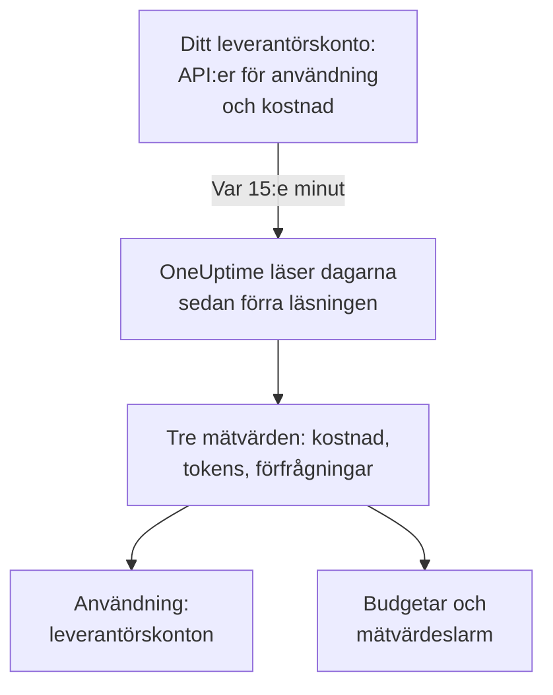

# Konton hos AI-leverantörer

Se vad dina konton hos AI-leverantörer har använt och vad det har kostat, utan att ändra dina appar. Anslut ett konto hos OpenAI, Anthropic, Azure OpenAI och Microsoft Foundry, Amazon Bedrock eller Google Vertex AI med inloggningsuppgifter som bara kan läsa, så läser OneUptime dess användning var 15:e minut in i **Användning**, **Budgetar** och mätvärden som du kan larma på.

:::cards
- [Anslut ett konto](#anslut-ett-konto): Välj leverantör, klistra in inloggningsuppgifterna, testa dem och anslut.
- [Vad varje leverantör ger](#vad-varje-leverantör-ger): Kostnad, tokens och förfrågningar, och hur varje leverantör grupperar dem.
- [Se användningen](#se-användningen): Efter modell, person, projekt eller resurs, API-nyckel och anslutning.
- [Budgetar och larm](#budgetar-och-larm): En daglig budget på fakturan och larm på mätvärdena.
:::

## Så fungerar det

Var 15:e minut ber OneUptime varje anslutet konto om dess användning per UTC-dygn och sparar den som tre mätvärden i anslutningens egen tjänst. Varje läsning tar dagarna sedan förra läsningen, och de senaste 3 dagarna igen, i dag inräknad, eftersom leverantörerna fortsätter att lägga till i dag och rättar de dagar som just passerat.

Ett kontos användning är det som det fakturerades för, en dag i taget. Den innehåller inga konversationer, promptar eller svar: för det skickar du dina appars AI-anrop, som [AI- / LLM-observerbarhet](/docs/telemetry/ai-llm-observability) visar. De två hålls isär, så inget räknas två gånger.

## Innan du börjar

- Rollen Project Owner eller Project Admin. Bara de kan ansluta, ändra eller ta bort ett konto; alla som läser projektets telemetri ser anslutningarna och användningen.
- Inloggningsuppgifter för kontot från någon som administrerar det. Varje leverantörs avsnitt nedan säger vilka och var de skapas.
- Inget att installera: OneUptime anropar leverantörens API från sina egna servrar.

## Anslut ett konto

:::steps
### Öppna Anslut

Öppna **Produkter → AI / LLM → Anslut**. Under **Dina konton hos AI-leverantörer** klickar du på leverantörens ruta.

### Klistra in inloggningsuppgifterna

Under **Autentiseringsuppgifter** fyller du i det som leverantören ber om. Hemligheter sparas krypterade och visas aldrig igen, varken i Dashboarden eller via API:et. **Namn** och de inställningar som de flesta låter vara finns under **Fler fält**.

### Testa dem

Under **Testa** klickar du på **Testa anslutningen**. OneUptime läser användningen för de senaste 7 dagarna och visar vad det hittade: kostnad, tokens, förfrågningar, modeller, personer, nycklar och projekt. Inget sparas förrän du ansluter.

### Anslut

Klicka på **Anslut**. Den första läsningen startar inom en minut och hämtar de senaste 30 dagarna.
:::

Anslutna konton listas under rutorna, med **Status** och **Senast läst**. **Läs nu** läser direkt, **Testa** kontrollerar de sparade inställningarna igen, **Stäng av** slutar läsa och behåller det som lästs, och **Redigera** ändrar inställningarna: en hemlighet som lämnas tom behåller den sparade. **View error** visar varför en läsning misslyckades, utan någon hemlighet.

## Vad varje leverantör ger

| Leverantör | Kostnad | Grupperat efter | Inloggningsuppgifter |
| --- | --- | --- | --- |
| OpenAI | Det som OpenAI rapporterar | Projekt, API-nyckel, person och modell | En administratörsnyckel |
| Anthropic | Det som Anthropic rapporterar | Workspace, API-nyckel, person och modell | En administratörsnyckel |
| Azure OpenAI och Microsoft Foundry | Uppskattad utifrån tokens | Resurs och modell | En app med Monitoring Reader |
| Amazon Bedrock | Uppskattad utifrån tokens | Region och modell | En åtkomstnyckel som läser CloudWatch |
| Google Vertex AI | Uppskattad utifrån tokens | Region och modell | Ett tjänstkonto med Monitoring Viewer |

Alla leverantörer utom Anthropic räknar också förfrågningar: Anthropics användningsrapport har inga. En uppskattad kostnad använder prislistan från [Vad ett anrop kostar](/docs/telemetry/ai-llm-observability#vad-ett-anrop-kostar) och dina egna priser från **Priser**, och markeras som en uppskattning. En modell som prislistan inte känner till har ingen kostnad förrän du sätter ett pris på den där.

Inga av dessa inloggningsuppgifter kan anropa en modell: var och en läser användning, kostnader eller mätvärden och inget annat.

## OpenAI

OneUptime läser din OpenAI-organisation med en administratörsnyckel: användningen av completions och embeddings per dag, modell, projekt, API-nyckel och person, och varje dags kostnader per projekt och post. En kostnadspost fördelas på de nycklar och personer som använde dess modell, så att även en persons rad har en kostnad. Projekt- och nyckelnamn och personernas e-postadresser ersätter OpenAIs id:n.

:::steps
### Skapa en administratörsnyckel för OpenAI

Öppna Settings, Organization, Admin keys i OpenAIs dashboard och skapa en nyckel. Bara organisationens ägare kan göra det. Den börjar med `sk-admin-`.

### Anslut OpenAI

Klistra in nyckeln som **Administratörsnyckel**.
:::

## Anthropic

OneUptime läser din Claude API-organisation med en administratörsnyckel: användningsrapporten för meddelanden per dag, modell, workspace, API-nyckel och person, och kostnadsrapporten per workspace och post, fördelad på samma sätt. Claude Code som används med organisationens nycklar eller Console-inloggningar finns också i dessa rapporter, under den person eller nyckel som använde det.

:::steps
### Skapa en administratörsnyckel för Anthropic

Öppna Settings, Admin keys i Claude Console och skapa en nyckel. Bara organisationens administratörer kan göra det. Den börjar med `sk-ant-admin01-`.

### Anslut Anthropic

Klistra in nyckeln som **Administratörsnyckel**.
:::

## Azure OpenAI och Microsoft Foundry

OneUptime läser varje Azure OpenAI- och Foundry-resurs i en prenumeration från Azure Monitor: tokens och förfrågningar per dag, resurs och modell. Azure Monitor räknar tokens, inte pengar, och nämner varken person eller nyckel, så kostnaden är OneUptimes uppskattning och person och nyckel förblir tomma.

:::steps
### Registrera en app

Registrera en app i Microsoft Entra ID och skapa en klienthemlighet för den.

### Låt den läsa mätvärdena

Ge appen rollen Monitoring Reader på prenumerationen.

### Anslut Azure

Fyll i **Katalog-ID (tenant)**, **Program-ID (klient)**, **Prenumerations-ID** och **Klienthemlighet**. För Azure Government ändrar du **Moln** under **Fler fält**.
:::

## Amazon Bedrock

OneUptime läser CloudWatch-mätvärdena `AWS/Bedrock` för varje region du anger: indata-, utdata- och cachetokens samt anrop, per dag och modell. CloudWatch räknar tokens, inte pengar, och nämner varken person eller nyckel: kostnaden är OneUptimes uppskattning, och varje region listas som ett projekt.

:::steps
### Skapa en åtkomstnyckel

Skapa en IAM-användare eller -roll vars policy tillåter `cloudwatch:GetMetricData` och `cloudwatch:ListMetrics`, och en åtkomstnyckel för den.

### Anslut Bedrock

Fyll i **Åtkomstnyckel-ID**, **Hemlig åtkomstnyckel** och **Regioner**, åtskilda med kommatecken: `us-east-1` om du inte ändrar det.
:::

## Google Vertex AI

OneUptime läser de Cloud Monitoring-mätvärden som Vertex AI publicerar för sina modeller, Gemini och partnermodeller som Claude: indata- och utdatatokens samt anrop, per dag, region och modell. Cloud Monitoring räknar tokens, inte pengar, och nämner varken person eller nyckel: kostnaden är OneUptimes uppskattning.

:::steps
### Skapa ett tjänstkonto

Skapa ett tjänstkonto med rollen Monitoring Viewer i projektet, och en JSON-nyckel för det.

### Anslut Vertex AI

Fyll i **Projekt-ID** och klistra in hela nyckelfilen som **Tjänstkontonyckel (JSON)**.
:::

## Se användningen

Öppna **Användning** och välj **Leverantörskonton**. Där ser du de kostnader, tokens och förfrågningar som dina konton rapporterade för tidsperioden, rangordnade efter **Modell**, **Person**, **Leverantör**, **Projekt eller resurs**, **API-nyckel** eller **Anslutning**. Perioden börjar vid midnatt UTC den första dagen, eftersom leverantörerna rapporterar hela dagar.

**Leverantörskonton** och **Dina AI-anrop** läggs aldrig ihop. Ett anrop som din app gör med en nyckel från ett anslutet konto finns i båda, så att lägga ihop dem skulle räkna det två gånger.

## Budgetar och larm

En budget räknar det ena eller det andra. Under **Budgetar** skapar du en budget och sätter **Räkna utgifter från** till **Leverantörskonton**: den räknar vad de anslutna kontona fakturerades för UTC-dygnet, avgränsat av **LLM-leverantör (valfritt)** och **LLM-modell (valfritt)** när du anger dem. Leverantörerna rapporterar en dags användning minuter till timmar senare, så för larm inom minuter bör du i stället budgetera **Dina AI-anrop**.

Varje kontos användning sparas som tre mätvärden, som du kan visa på en [dashboard](/docs/dashboards/index) eller övervaka med en [Metrikövervakning](/docs/monitor/metrics-monitor):

| Mätvärde | Vad det är |
| --- | --- |
| `oneuptime.llm.provider.cost` | En dags kostnad, i USD |
| `oneuptime.llm.provider.tokens` | En dags tokens, efter `gen_ai.token.type`: `input` (cachade tokens inräknade), `output`, `cache_read` och `cache_write` |
| `oneuptime.llm.provider.requests` | En dags förfrågningar |

Varje punkt får tidsstämpeln för början av sitt UTC-dygn. Den bär `oneuptime.llm.connection.id` och `oneuptime.llm.connection.name`, och det som leverantören nämner: `gen_ai.provider.name`, `gen_ai.request.model`, `user.email`, `oneuptime.llm.provider.project` och `oneuptime.llm.provider.api_key`. En uppskattad kostnad bär `oneuptime.llm.cost.estimated`.

## När läsningarna sker

| Läsning | När |
| --- | --- |
| Den första | Inom en minut efter anslutningen, 30 dagar bakåt |
| De följande | Var 15:e minut |
| Efter att en nyckel eller behörighet har nekats | 60 minuter senare |
| Efter alla andra fel | 15 minuter senare |
| Avstängd | Ingen förrän den slås på igen |

En plan utan telemetrifunktioner läser ingenting. Att ta bort en anslutning stoppar dess läsningar och behåller det den har läst tills tjänstens lagringstid tar bort det.

## Varför OneUptime inte har en egen gateway

OneUptime läser dina konton; det står aldrig mellan dina appar och leverantörerna. En proxy skulle hålla dina leverantörsnycklar och lägga till ett extra steg i varje modellanrop som dina appar gör. Går din modelltrafik redan genom LiteLLM, Portkey eller OpenRouter skickar du gatewayens traces till OneUptime som [AI-gatewayer](/docs/telemetry/ai-gateways) visar, och ansluter kontot för dess faktura.

## Felsökning

:::details Testet säger att nyckeln eller hemligheten inte godkändes
Kontrollera att du kopierade allt, att den inte har återkallats och att det är den sort som leverantören ber om: en administratörsnyckel från OpenAI eller Anthropic, inte en projekt- eller API-nyckel.
:::

:::details Inloggningsuppgifterna fungerar men får inte läsa det som anslutningen behöver
Ge dem den roll som den här sidan nämner för leverantören: Monitoring Reader på Azure-prenumerationen, de två CloudWatch-åtgärderna i AWS, Monitoring Viewer på Google Cloud-projektet.
:::

:::details Testet lyckas, men inget visas för i dag
Leverantörerna rapporterar en dags användning minuter till timmar efteråt och rättar den under en dag eller två. Nästa läsningar hämtar den.
:::

:::details Kostnaden skiljer sig från fakturan
En rapporterad kostnad är leverantörens siffra före skatter, krediter och rabatter. En uppskattad kostnad är tokens till listpris, eller till dina egna priser från **Priser**.
:::

## Nästa steg

:::cards
- [AI- / LLM-observerbarhet](/docs/telemetry/ai-llm-observability): Konversationer, larm och kostnad för dina egna appars AI-anrop.
- [Företagets AI-verktyg](/docs/telemetry/ai-company-tools): Vad dina medarbetare frågar Claude Enterprise och Microsoft 365 Copilot.
- [AI-gatewayer](/docs/telemetry/ai-gateways): Spåra varje modellanrop genom LiteLLM, Portkey eller OpenRouter.
- [Metrikövervakning](/docs/monitor/metrics-monitor): Larma på leverantörernas mätvärden.
:::
