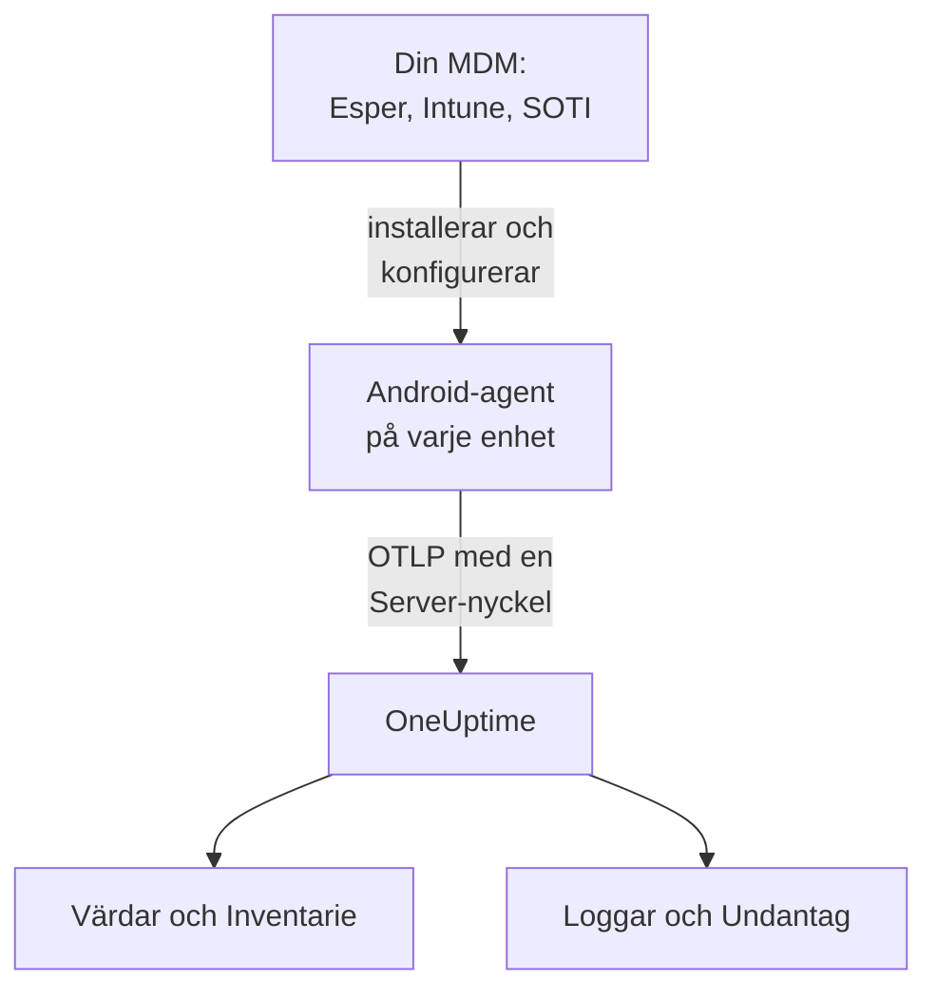

# Android-agent

OneUptimes Android-agent rapporterar till OneUptime om en Android-enhet som din organisation äger, till exempel en beställningskiosk, en kassaterminal, en handdator eller en spelare för digital skyltning: dess minne, lagring, nätverk, batteri och temperatur, dess omstarter, apparna som är installerade på den, och krascher och loggar från apparna på den. Din MDM installerar och konfigurerar den på hela flottan på en gång. Varje enhet blir en värd i **Värdar** och en post i **Inventarie**, bredvid dina servrar och Windows-datorer.

:::cards
- [När du ska använda den](#agenten-eller-appinstrumentering): Agenten ser enheten, appinstrumentering ser din app.
- [Distribuera den med Esper](#distribuera-den-med-esper): Ladda upp APK:n, skicka ut inställningarna, starta den en gång.
- [Inställningar](#inställningar): Varje nyckel i dess hanterade konfiguration.
- [Läs andra appars loggar](#läs-andra-appars-loggar): Bevilja READ_LOGS en gång, med adb eller din MDM.
:::

## Så fungerar det

Agenten är en liten app som körs som en förgrundstjänst. Varje minut läser den enhetens hälsa och skickar den till din OneUptime över OTLP med en **Server**-intagningsnyckel, tillsammans med enhetens omstarter, installerade appar och loggar. Den startar av sig själv när enheten startar, sparar det den samlar in på enheten medan nätverket ligger nere, och skickar det när nätverket är tillbaka. Den håller aldrig en sovande enhet vaken, och den komprimerar det den skickar.



## Agenten eller appinstrumentering

| | [OpenTelemetry Android](/docs/rum/android-setup) i din app | Android-agenten |
| --- | --- | --- |
| Vad den ser | Din app: dess krascher, ANR:er, skärmar, sessioner, förfrågningar och arbetsflöden | Enheten: minne, lagring, nätverk, batteri, omstarter, installerade appar, och alla appars krascher och ANR:er |
| Var det visas | **Övervakning av verkliga användare**, **Spår** och **Undantag** | **Värdar**, **Inventarie**, **Loggar** och **Undantag** |
| Hur du installerar den | I din apps kod | Som en app, via din MDM |

På enheter som du äger använder du båda, och ger enheten samma namn i båda: agentens inställning `device_name` och det `host.name` som din app sätter. Enheten blir då en enda post i **Inventarie**, med appens och enhetens telemetri tillsammans.

## Innan du börjar

- Enheter med Android 7.0 eller senare, som hanteras av en MDM som stöder Androids hanterade konfigurationer: Esper, Microsoft Intune, Workspace ONE, SOTI och andra MDM-lösningar för Android Enterprise. För en enstaka enhet räcker adb.
- En **Server**-intagningsnyckel, skapad under **Projektinställningar → Telemetri och APM → Intagningsnycklar** med **Skapa intagningsnyckel**.
- Agenten: `oneuptime-android-agent.apk`, som bifogas till varje [OneUptime-release](https://github.com/OneUptime/oneuptime/releases/latest).
- Utgående HTTPS från enheterna till din OneUptime-URL. Agenten avvisar en URL som inte börjar med `https://`, eftersom varje förfrågan innehåller intagningsnyckeln.

## Distribuera den med Esper

:::steps
### Ladda upp APK:n

I Esper-konsolen laddar du upp `oneuptime-android-agent.apk` till **App Library** och lägger till den i blueprinten för de enheter som ska övervakas.

### Skicka ut inställningarna

Öppna agentens **Managed Configuration** i blueprinten och klistra in dess inställningar. Esper fyller i platshållarna på varje enhet, med Esper Agent 8.00.0764 eller senare:

```json title="Managed configuration"
{
  "oneuptime_url": "https://oneuptime.com",
  "oneuptime_token": "YOUR_TELEMETRY_INGESTION_TOKEN",
  "device_name": "${esper.deviceName}",
  "device_serial": "${esper.serialNumber}",
  "device_type": "kiosk",
  "labels": "region=emea"
}
```

Om du driftar OneUptime själv anger du din egen URL i `oneuptime_url`. Konvergera sedan enheterna, så att de läser de nya inställningarna.

### Starta den en gång

Android startar inte en nyinstallerad app vid uppstart förrän den har öppnats en gång. Slå på **Launch on Start** för agenten i blueprinten, i Multi-App-läget, eller öppna agenten en gång på varje enhet. Därefter startar den av sig själv varje gång enheten startar, och efter varje uppdatering.

### Hitta enheterna i OneUptime

Inom en minut visas varje enhet under **Värdar**, namngiven efter sitt `device_name`, och i **Inventarie**. Agentens egen skärm på enheten visar om den rapporterar, och vad som stoppar den när den inte gör det.
:::

Andra MDM-lösningar fungerar på samma sätt: Lägg till APK:n som en verksamhetsspecifik eller intern app, sätt samma nycklar i dess appkonfiguration och öppna den en gång på varje enhet.

## Inställningar

Agenten läser de här nycklarna från sin hanterade konfiguration. En enhet utan hanterad konfiguration kan i stället konfigureras på agentens egen skärm, med URL:en, intagningsnyckeln och enhetens namn. En nyckel som anges där lagras krypterad med Android Keystore.

| Nyckel | Vad den anger | Standard |
| --- | --- | --- |
| `oneuptime_url` | Din OneUptime-URL | `https://oneuptime.com` |
| `oneuptime_token` | En **Server**-intagningsnyckel | Inget: Utan en nyckel skickar agenten ingenting |
| `device_name` | Enhetens namn i **Värdar** och **Inventarie**, som är dess identitet där | Dess modell och början av dess Android ID |
| `device_serial` | Dess serienummer, som Android inte ger till appar från och med Android 10 | Inget |
| `device_type` | Vad den är, till exempel en kiosk, en kassaterminal eller en handdator | `Android device` |
| `device_location` | Var den finns, till exempel en butiks nummer | Inget |
| `labels` | Etiketter för värden, som `name=value`-par avgränsade med kommatecken | Inget |
| `collection_interval_seconds` | Hur ofta den rapporterar, från 30 till 600 sekunder | `60` |
| `logcat_enabled` | Om den skickar det den läser från Logcat | `true` |
| `logcat_min_level` | De minst allvarliga Logcat-rader som den skickar på Android 12 och tidigare: `verbose`, `debug`, `info`, `warn`, `error` eller `fatal` | `warn` |
| `installed_apps_enabled` | Om den skickar de installerade apparna | `true` |

En platshållare som din MDM inte fyllde i, till exempel `${esper.deviceName}` som skickas som den är, ignoreras, och agentens skärm säger det. Behåll samma `device_name` när en enhet väl rapporterar: Ett nytt namn är en ny värd.

## Läs andra appars loggar

Android låter en app läsa andra appars loggar bara med behörigheten READ_LOGS, och bara adb kan bevilja den: inte appen själv, och inte en enhetspolicy. Bevilja den en gång på varje enhet, så förblir den beviljad genom omstarter och uppdateringar:

```bash
adb shell pm grant com.oneuptime.androidagent android.permission.READ_LOGS
```

Med Esper kör du kommandot över **Secure Remote ADB**: Slå på ADB-åtkomst för enheten, anslut med `espercli secureadb connect -d DEVICE_ID` och kör sedan kommandot. Android startar om agenten när behörigheten beviljas, och agenten börjar läsa direkt.

Vad agenten sedan läser beror på Android-versionen:

- Android 13 och senare: alla appars krascher och ANR:er. Android visar andra appars loggrader bara för en app som syns på skärmen, efter att personen vid enheten har tillåtit det, så en agent som körs i bakgrunden kan inte läsa dem.
- Android 12 och tidigare: alla appars krascher och ANR:er, och alla appars loggrader på `logcat_min_level` och högre.

Utan READ_LOGS rapporterar agenten allt annat, och både dess skärm och enhetens loggar talar om hur du beviljar behörigheten.

## Vad den rapporterar

| Vad | Var det visas i OneUptime |
| --- | --- |
| Minne, lagring, nätverk och drifttid | Enhetens sida i **Värdar**: samma mätvärden som en servers insamlare skickar, så att larmmallarna för värdar fungerar |
| Batterinivå och batteritemperatur, och om enheten är ansluten till extern ström | Mätvärdena `hw.battery.charge`, `hw.temperature` och `android.battery.plugged` |
| Termiskt tillstånd | Mätvärdena `android.thermal.status` och `android.thermal.headroom` |
| Omstarter | **Loggar**, med `@event.name:device.boot`: hur länge enheten hade varit igång, om den stängdes av korrekt, hur länge den var avstängd, och omstartsloopar |
| Installerade appar | **Loggar**, med `@event.name:android.package.inventory` en gång om dagen, och varje installation, uppdatering och borttagning |
| Alla appars krascher och ANR:er | **Undantag**, som ohanterade, namngivna efter appen |
| Märke, modell, serienummer, OS-version och firmware | Enhetens post i **Inventarie** |

Från och med Android 8 döljer Android enhetens CPU-användning för appar, så agenten rapporterar CPU-användning bara på Android 7, och på byggen som tillåter det.

Larmmallarna för värdar som passar en enhet är Host Stopped Reporting, High Memory Utilization, High Filesystem Usage och Host Restarted. En enhet som fortsätter att starta om loggar en varning vid varje uppstart, med `android.boot.recent_count` satt till antalet uppstarter under den senaste timmen.

## Felsökning

:::details En enhet visas inte i Värdar
Öppna agenten på enheten: Dess skärm talar om vad som saknas, till exempel en intagningsnyckel, en URL som den inte kan använda, eller en uppladdning som misslyckades och varför. På en enhet där agenten aldrig öppnades efter installationen har den inte heller startat: Öppna den en gång, eller slå på **Launch on Start**.
:::

:::details Agenten säger att OneUptime avvisade intagningsnyckeln
Använd en **Server**-nyckel som är påslagen och inte har gått ut. En **Webbläsare**-nyckel avvisas från en enhet.
:::

:::details Inga loggar från andra appar
Bevilja READ_LOGS, som [Läs andra appars loggar](#läs-andra-appars-loggar) beskriver. På Android 13 och senare läses bara andra appars krascher och ANR:er.
:::

:::details Två enheter visas som en värd
De har samma `device_name`. Använd en platshållare som skiljer sig från enhet till enhet, till exempel `${esper.deviceName}` eller `${esper.serialNumber}`.
:::

## Nästa steg

:::cards
- [Android-konfiguration](/docs/rum/android-setup): Instrumentera din egen app med OpenTelemetry Android.
- [Värdar](/docs/telemetry/hosts): En värds sidor, avläsningar och larm.
- [Värdövervakning](/docs/monitor/host-monitor): Få ett larm när en enhet slutar rapportera eller får ont om lagringsutrymme.
- [Undantag](/docs/telemetry/exceptions): Triagera de krascher och ANR:er som dina enheter rapporterar.
:::
