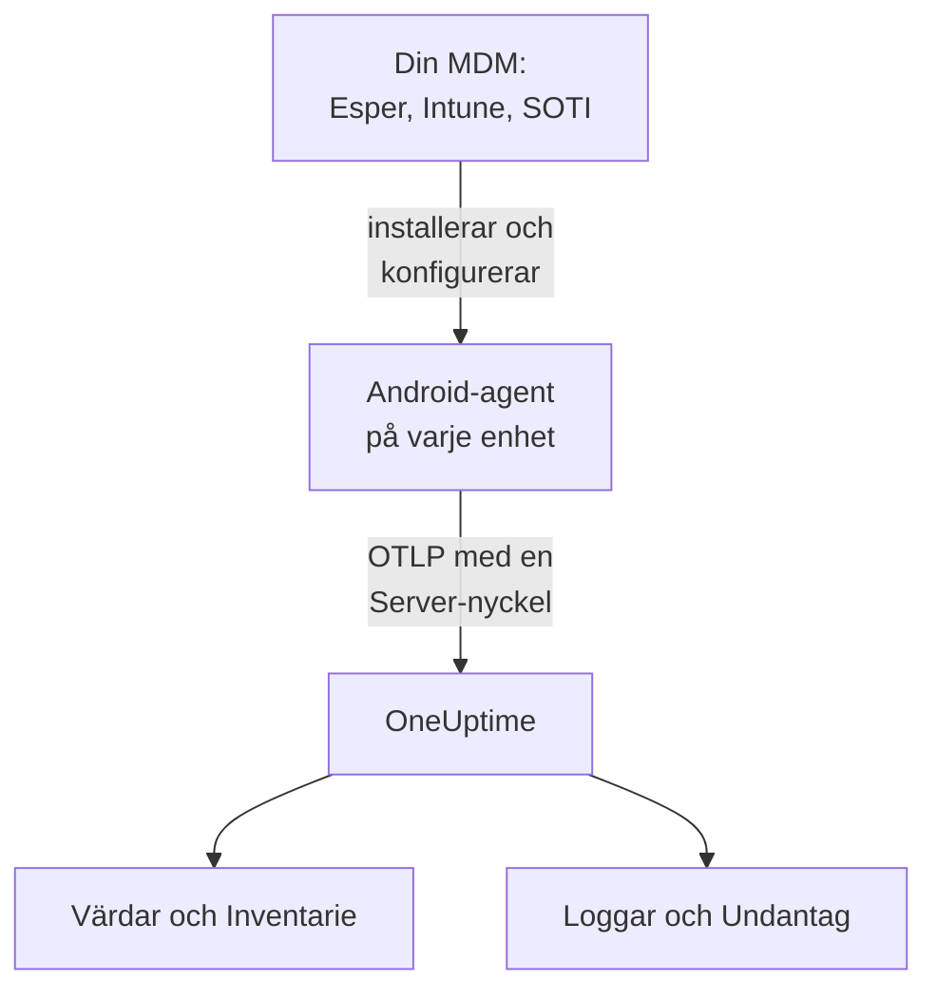

# Android-agent

OneUptimes Android-agent rapporterar till OneUptime om en Android-enhet som din organisation äger, till exempel en beställningskiosk, en kassaterminal, en handdator eller en spelare för digital skyltning: dess minne, lagring, nätverk, batteri och temperatur, dess omstarter, apparna som är installerade på den, och krascher och loggar från apparna på den. Din MDM installerar och konfigurerar den på hela flottan på en gång. Varje enhet blir en värd i **Värdar** och en post i **Inventarie**, bredvid dina servrar och Windows-datorer.

:::cards
- [När du ska använda den](#agenten-eller-appinstrumentering): Agenten ser enheten, appinstrumentering ser din app.
- [Distribuera den med Esper](#distribuera-den-med-esper): Ladda upp APK:n, skicka ut inställningarna, starta den en gång.
- [Inställningar](#inställningar): Varje nyckel i dess hanterade konfiguration.
- [Läs andra appars loggar](#läs-andra-appars-loggar): Bevilja READ_LOGS en gång, med adb eller din MDM.
- [Loggsessioner](#loggsessioner): Alla appars loggar under en tid, tillåtet av personen vid enheten.
:::

## Så fungerar det

Agenten är en liten app som körs som en förgrundstjänst. Varje minut läser den enhetens hälsa och skickar den till din OneUptime över OTLP med en **Server**-intagningsnyckel, tillsammans med enhetens omstarter, installerade appar och loggar. Den startar av sig själv när enheten startar, sparar det den samlar in på enheten medan nätverket ligger nere, och skickar det när nätverket är tillbaka. Den håller aldrig en sovande enhet vaken, och den komprimerar det den skickar.



## Agenten eller appinstrumentering

| | [OpenTelemetry Android](/docs/rum/android-setup) i din app | Android-agenten |
| --- | --- | --- |
| Vad den ser | Din app: dess krascher, ANR:er, skärmar, sessioner, förfrågningar och arbetsflöden | Enheten: minne, lagring, nätverk, batteri, omstarter, installerade appar, och alla appars krascher och ANR:er |
| Var det visas | **Övervakning av verkliga användare**, **Spår** och **Undantag** | **Värdar**, **Inventarie**, **Loggar** och **Undantag** |
| Hur du installerar den | I din apps kod | Som en app, via din MDM |

På enheter som du äger använder du båda, och ger enheten samma namn i båda: agentens inställning `device_name` och det `host.name` som din app sätter. Enheten blir då en enda post i **Inventarie**, med appens och enhetens telemetri tillsammans.

## Innan du börjar

- Enheter med Android 7.0 eller senare, som hanteras av en MDM som stöder Androids hanterade konfigurationer: Esper, Microsoft Intune, Workspace ONE, SOTI och andra MDM-lösningar för Android Enterprise. För en enstaka enhet räcker adb.
- En **Server**-intagningsnyckel, skapad under **Projektinställningar → Telemetri och APM → Intagningsnycklar** med **Skapa intagningsnyckel**.
- Agenten: `oneuptime-android-agent.apk`, som bifogas till varje [OneUptime-release](https://github.com/OneUptime/oneuptime/releases/latest).
- Utgående HTTPS från enheterna till din OneUptime-URL. Agenten avvisar en URL som inte börjar med `https://`, eftersom varje förfrågan innehåller intagningsnyckeln.

## Distribuera den med Esper

:::steps
### Ladda upp APK:n

I Esper-konsolen laddar du upp `oneuptime-android-agent.apk` till **App Library** och lägger till den i blueprinten för de enheter som ska övervakas.

### Skicka ut inställningarna

Öppna agentens **Managed Configuration** i blueprinten och klistra in dess inställningar. Esper fyller i platshållarna på varje enhet, med Esper Agent 8.00.0764 eller senare:

```json title="Managed configuration"
{
  "oneuptime_url": "https://oneuptime.com",
  "oneuptime_token": "YOUR_TELEMETRY_INGESTION_TOKEN",
  "device_name": "${esper.deviceName}",
  "device_serial": "${esper.serialNumber}",
  "device_type": "kiosk",
  "labels": "region=emea"
}
```

Om du driftar OneUptime själv anger du din egen URL i `oneuptime_url`. Konvergera sedan enheterna, så att de läser de nya inställningarna.

### Starta den en gång

Android startar inte en nyinstallerad app vid uppstart förrän den har öppnats en gång. Slå på **Launch on Start** för agenten i blueprinten, i Multi-App-läget, eller öppna agenten en gång på varje enhet. Därefter startar den av sig själv varje gång enheten startar, och efter varje uppdatering.

### Hitta enheterna i OneUptime

Inom en minut visas varje enhet under **Värdar**, namngiven efter sitt `device_name`, och i **Inventarie**. Agentens egen skärm på enheten visar om den rapporterar, och vad som stoppar den när den inte gör det.
:::

Andra MDM-lösningar fungerar på samma sätt: Lägg till APK:n som en verksamhetsspecifik eller intern app, sätt samma nycklar i dess appkonfiguration och öppna den en gång på varje enhet.

## Inställningar

Agenten läser de här nycklarna från sin hanterade konfiguration. En enhet utan hanterad konfiguration kan i stället konfigureras på agentens egen skärm, med URL:en, intagningsnyckeln och enhetens namn. En nyckel som anges där lagras krypterad med Android Keystore.

| Nyckel | Vad den anger | Standard |
| --- | --- | --- |
| `oneuptime_url` | Din OneUptime-URL | `https://oneuptime.com` |
| `oneuptime_token` | En **Server**-intagningsnyckel | Inget: Utan en nyckel skickar agenten ingenting |
| `device_name` | Enhetens namn i **Värdar** och **Inventarie**, som är dess identitet där | Dess modell och början av dess Android ID |
| `device_serial` | Dess serienummer, som Android inte ger till appar från och med Android 10 | Inget |
| `device_type` | Vad den är, till exempel en kiosk, en kassaterminal eller en handdator | `Android device` |
| `device_location` | Var den finns, till exempel en butiks nummer | Inget |
| `labels` | Etiketter för värden, som `name=value`-par avgränsade med kommatecken | Inget |
| `collection_interval_seconds` | Hur ofta den rapporterar, från 30 till 600 sekunder | `60` |
| `logcat_enabled` | Om den skickar det den läser från Logcat | `true` |
| `logcat_min_level` | De minst allvarliga Logcat-rader som den skickar på Android 12 och tidigare: `verbose`, `debug`, `info`, `warn`, `error` eller `fatal` | `warn` |
| `installed_apps_enabled` | Om den skickar de installerade apparna | `true` |

En platshållare som din MDM inte fyllde i, till exempel `${esper.deviceName}` som skickas som den är, ignoreras, och agentens skärm säger det. Behåll samma `device_name` när en enhet väl rapporterar: Ett nytt namn är en ny värd.

Agentens skärm, dess aviseringar och de titlar och beskrivningar som din MDM visar för de här nycklarna är på enhetens språk, på alla språk som OneUptimes instrumentpanel finns på.

## Läs andra appars loggar

Android låter en app läsa andra appars loggar bara med behörigheten READ_LOGS, och bara adb kan bevilja den: inte appen själv, och inte en enhetspolicy. Bevilja den en gång på varje enhet, så förblir den beviljad genom omstarter och uppdateringar:

```bash
adb shell pm grant com.oneuptime.androidagent android.permission.READ_LOGS
```

Med Esper kör du kommandot över **Secure Remote ADB**: Slå på ADB-åtkomst för enheten, anslut med `espercli secureadb connect --device DEVICE_ID` och kör sedan kommandot. Android startar om agenten när behörigheten beviljas, och agenten börjar läsa direkt.

Vad agenten sedan läser beror på Android-versionen:

- Android 13 och senare: alla appars krascher och ANR:er. Android visar andra appars loggrader bara för en app som syns på skärmen, efter att personen vid enheten har tillåtit det, så en agent som körs i bakgrunden kan inte läsa dem. Be om dem under en tid med en [loggsession](#loggsessioner).
- Android 12 och tidigare: alla appars krascher och ANR:er, och alla appars loggrader på `logcat_min_level` och högre.

Utan READ_LOGS rapporterar agenten allt annat, och både dess skärm och enhetens loggar talar om hur du beviljar behörigheten.

### Stack traces från krascher och orsaker till omstart

Android sparar den fullständiga rapporten om varje appkrasch, varje native krasch och varje ANR, och orsaken till varje omstart, i sin DropBox. Agenten läser dem för alla appar när den har READ_LOGS och åtkomst till användningsdata, och på Android 15 och senare READ_DROPBOX_DATA. Bevilja dem en gång med adb, precis som READ_LOGS:

```bash
adb shell pm grant com.oneuptime.androidagent android.permission.READ_DROPBOX_DATA
adb shell appops set com.oneuptime.androidagent GET_USAGE_STATS allow
```

Det första kommandot gäller Android 15 och senare; åtkomst till användningsdata kan också slås på i enhetens **Inställningar → Åtkomst till användningsdata**. En enhetspolicy kan inte bevilja dessa, och agentens skärm listar de kommandon som återstår att köra. Med dem har varje krasch i **Undantag** hela sin stack trace, en native krasch sin signal och biblioteket den kraschade i, en ANR sin huvudtråds stack, och en omstart i **Loggar** den orsak som Android anger för den. Kortnummer, e-postadresser, token och lösenord i det som agenten läser ersätts med `[card number]`, `[email]`, `[token]` och `[redacted]` innan det skickas.

### Bevilja dem på hela flottan

Varje rapport från agenten anger vilka av de här behörigheterna den fortfarande saknar. Om du vill lista de enheter som behöver dem öppnar du **Inventarie**, sedan **Alla objekt**, och filtrerar på **Agentbehörigheter**: **Saknas**. Slå på kolumnen **Agentbehörigheter** för att se vad varje enhet saknar, och exportera listan som CSV.

En enhetspolicy kan inte bevilja dessa: READ_LOGS och READ_DROPBOX_DATA är behörigheter som bara adb, systemet eller enhetens tillverkare kan ge, och åtkomst till användningsdata ställs in med adb eller av personen vid enheten. Vad Esper erbjuder, och varför inget av det beviljar dem:

- **Appbehörigheter**, i en blueprint eller med kommandot `SET_APP_PERMISSION`, går via Androids API för enhetsägare, som bara beviljar de behörigheter som en app ber personen vid enheten om. Android avvisar dessa.
- **Hanterad konfiguration** anger agentens egna inställningar, aldrig Androids behörigheter.
- **Run Shell Script** körs på Linux- och Windows-enheter, inte på Android-enheter.
- **Secure Remote ADB** ansluter till en enhet i taget, från en dator som kör `espercli`. På Esper Foundation-enheter behövs ingen vid enheten. På andra enheter godkänner någon vid enheten **Allow USB debugging?** första gången.

Bevilja dem därför med adb:

- **Innan en enhet skickas ut**, när den förbereds med en USB-kabel. Det här beviljar alla tre på varje enhet som är ansluten till datorn:

  ```bash
  for serial in $(adb devices | awk 'NR > 1 && $2 == "device" { print $1 }'); do
    adb -s "$serial" shell pm grant com.oneuptime.androidagent android.permission.READ_LOGS
    adb -s "$serial" shell pm grant com.oneuptime.androidagent android.permission.READ_DROPBOX_DATA
    adb -s "$serial" shell appops set com.oneuptime.androidagent GET_USAGE_STATS allow
  done
  ```

  På Android 14 och tidigare säger det andra kommandot att behörigheten är okänd: den enheten behöver den inte.
- **På en enhet ute i fält**, över Secure Remote ADB, en enhet i listan **Saknas** i taget.
- **Bara åtkomst till användningsdata** kan slås på av personen vid enheten, under **Inställningar → Åtkomst till användningsdata**, eller med knappen på agentens skärm.

Enhetens nästa rapport, inom en minut, tar bort den från listan **Saknas**.

### CPU-användning

Från och med Android 8 döljer Android en enhets CPU-användning för appar. Bara en app som är enhetsägare kan läsa den, och bara på enheter vars hårdvara rapporterar den. Agenten läser den när den är enhetsägare, vilket du ställer in med adb på en enhet som saknar konton och inte har någon annan enhetsägare:

```bash
adb shell dpm set-device-owner com.oneuptime.androidagent/.admin.AgentDeviceAdminReceiver
```

En enhet som din MDM redan äger kan inte ha en andra ägare, så dess CPU-användning är inte tillgänglig, och agentens skärm säger det. Dess CPU-användning utelämnas då från värdlistan, och mallen **High CPU Utilization** erbjuds inte för den.

## Loggsessioner

En loggsession skickar alla appars loggar från en enhet under en tid, för felsökning. På Android 13 och senare är det det enda sättet att läsa andra appars loggrader, eftersom Android bara visar dem för en app som syns på skärmen, efter att personen vid enheten har tillåtit det.

:::steps
### Begär en loggsession

Öppna enheten i **Värdar**, sedan **Loggar**, och klicka på **Begär loggsession** i **Loggsessioner**. Välj hur länge enheten skickar sina loggar, från 15 minuter till 4 timmar, och den lägsta nivå som den skickar: **Info**, **Felsökning** eller **Utförlig**. Lägg till en **Anteckning** som säger varför du ber om dem, till exempel ”Undersöker varför betalappen kraschar efter kl. 18”.

### Tillåt den på enheten

Inom en minut visar enheten en avisering om att någon har bett om dess loggar, med personens namn och din anteckning. Personen vid enheten öppnar agenten, där begäran visas med din anteckning under sig, och trycker på **Tillåt**. På Android 13 och senare frågar Android sedan om åtkomst till alla enhetsloggar ska tillåtas, och det tillåter personen också.

### Läs raderna

Sessionen står på **Samlar in**, och alla appars rader kommer in i enhetens loggar. Klicka på **Visa rader** för att se sessionens rader för sig, eller på **Ladda ner rader** för att spara dem som en fil. Sessionen slutar när tiden är ute, eller när någon stoppar den på enheten eller avbryter den i OneUptime.
:::

Anteckningen är en rad på högst 200 tecken. Enheten visar den som du skrev den, inom citattecken, i aviseringen och på agentens skärm medan sessionen väntar eller körs; den översätts aldrig. Radbrytningar blir mellanslag, och kortnummer, e-postadresser, token och lösenord i den ersätts med `[card number]`, `[email]`, `[token]` och `[redacted]` innan den sparas, precis som i det som agenten skickar. I listan över sessioner visas anteckningen under namnet på den som bad om sessionen, och värdens **Granskningsloggar** sparar den tillsammans med begäran.

**Ladda ner rader** sparar sessionens rader som en textfil i det format som `logcat -v threadtime` skriver ut, och som en leverantörs support kan läsa: varje rad med sin tid på millisekunden, sin process och tråd, sin nivå, sin tagg och sitt meddelande. Tiderna anges i UTC. Filens första rader anger vilken session, enhet och anteckning den gäller, och vem som bad om den. Den innehåller de rader som **Loggar** visar, maskerade av agenten, och kräver därför samma behörighet som att läsa enhetens loggar. En fil rymmer högst 100 000 rader och 32 MB; filen för en längre session slutar med att ange hur många rader sessionen har.

En session behöver READ_LOGS och `logcat_enabled`; utan dem står den på **Otillgänglig**. En session i taget körs på en enhet. En begäran som ingen tillåter inom en timme går ut, och en session som enheten startar om under slutar med den, eftersom Androids behörighet upphör med agentens process. Att be om en session kräver behörighet att redigera värden, och värdens **Granskningsloggar** sparar vem som bad om den, och när.

## Vad den rapporterar

| Vad | Var det visas i OneUptime |
| --- | --- |
| Minne, lagring, nätverk och drifttid | Enhetens sida i **Värdar**: samma mätvärden som en servers insamlare skickar, så att larmmallarna för värdar fungerar |
| Batterinivå och batteritemperatur, och om enheten är ansluten till extern ström | Mätvärdena `hw.battery.charge`, `hw.temperature` och `android.battery.plugged` |
| Termiskt tillstånd | Mätvärdena `android.thermal.status` och `android.thermal.headroom` |
| CPU-användning | Mätvärdet `system.cpu.utilization`: på Android 7, och på Android 8 och senare när agenten är [enhetsägare](#cpu-användning) |
| Omstarter | **Loggar**, med `@event.name:device.boot`: hur länge enheten hade varit igång, om den stängdes av korrekt, hur länge den var avstängd, varför den startade om, och omstartsloopar |
| Installerade appar | **Loggar**, med `@event.name:android.package.inventory` en gång om dagen, och varje installation, uppdatering och borttagning |
| Alla appars krascher och ANR:er | **Undantag**, som ohanterade, namngivna efter appen, med sina stackar när agenten läser [DropBox](#stack-traces-från-krascher-och-orsaker-till-omstart) |
| Märke, modell, serienummer, OS-version, säkerhetspatchnivå och firmware | Enhetens post i **Inventarie**, med filtret och kolumnen **Säkerhetspatchnivå** |
| Hur gammal dess säkerhetspatchnivå är | Mätvärdet `android.os.security_patch.age`, i dagar |
| De behörigheter som agenten fortfarande saknar | Enhetens post i **Inventarie**, med filtret och kolumnen **Agentbehörigheter** |

I **Värdar** står enhetens OS som Android, med Androids logotyp.

En enhet ligger efter med sina säkerhetspatchar när dess säkerhetspatchnivå är äldre än 90 dagar. Google publicerar en säkerhetsbulletin för Android varje månad, och Android Enterprise Recommended kräver att en enhets tillverkare levererar uppdateringen för var och en inom 90 dagar, så en enhet som ligger längre efter saknar korrigeringar som dess tillverkare borde ha levererat. I **Inventarie** listar filtret **Säkerhetspatchnivå** de enheter som står som **Föråldrad**; mallen **Security Patch Out of Date** larmar för var och en av dem.

Antalet uppstarter under den senaste timmen är mätvärdet `android.boot.recent_count`, och en enhet som fortsätter att starta om loggar en varning vid varje uppstart. I **Värdar** erbjuds en Android-enhet egna larmmallar: Device Unplugged, Low Battery, Device Overheating, Restart Loop, Storage Nearly Full och Security Patch Out of Date, tillsammans med Host Stopped Reporting, Host Restarted och High Memory Utilization, och High CPU Utilization när den rapporterar CPU-användning. Varje larms första felsökningskommandon är adb-kommandon. Se [Värdövervakning](/docs/monitor/host-monitor#android-enheter).

## Felsökning

:::details En enhet visas inte i Värdar
Öppna agenten på enheten: Dess skärm talar om vad som saknas, till exempel en intagningsnyckel, en URL som den inte kan använda, eller en uppladdning som misslyckades och varför. På en enhet där agenten aldrig öppnades efter installationen har den inte heller startat: Öppna den en gång, eller slå på **Launch on Start**.
:::

:::details Agenten säger att OneUptime avvisade intagningsnyckeln
Använd en **Server**-nyckel som är påslagen och inte har gått ut. En **Webbläsare**-nyckel avvisas från en enhet.
:::

:::details Inga loggar från andra appar
Bevilja READ_LOGS, som [Läs andra appars loggar](#läs-andra-appars-loggar) beskriver. På Android 13 och senare läses bara andra appars krascher och ANR:er, om inte en [loggsession](#loggsessioner) körs.
:::

:::details En loggsession står kvar på Väntar på godkännande
Ingen vid enheten har tillåtit den ännu. Någon måste öppna agenten på enheten och trycka på **Tillåt**, och på Android 13 och senare även tillåta Androids dialogruta, medan agenten syns på skärmen. En session som Androids dialogruta avböjde står på **Avböjd**: Begär en ny.
:::

:::details Två enheter visas som en värd
De har samma `device_name`. Använd en platshållare som skiljer sig från enhet till enhet, till exempel `${esper.deviceName}` eller `${esper.serialNumber}`.
:::

## Nästa steg

:::cards
- [Android-konfiguration](/docs/rum/android-setup): Instrumentera din egen app med OpenTelemetry Android.
- [Värdar](/docs/telemetry/hosts): En värds sidor, avläsningar och larm.
- [Värdövervakning](/docs/monitor/host-monitor): Få ett larm när en enhet slutar rapportera eller får ont om lagringsutrymme.
- [Undantag](/docs/telemetry/exceptions): Triagera de krascher och ANR:er som dina enheter rapporterar.
:::
