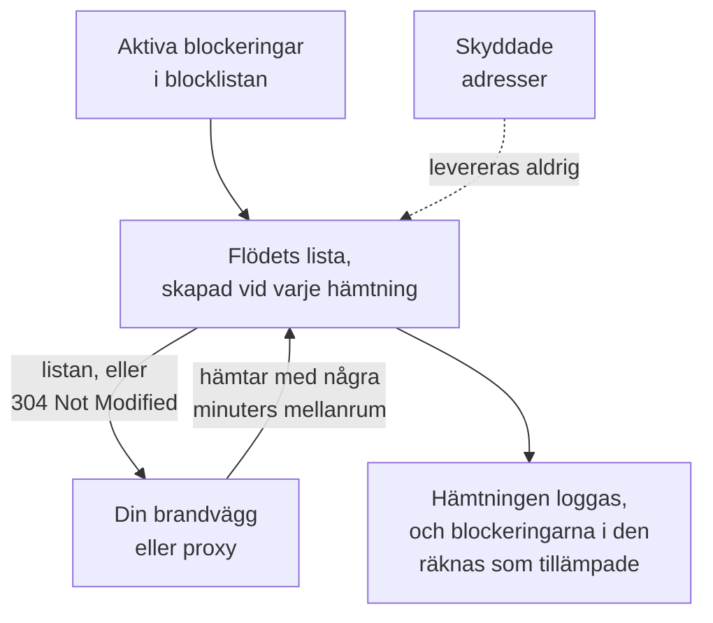

# Blocklistflöden för brandväggar och proxyer

Ett blocklistflöde är en hemlig URL som din brandvägg eller proxy läser ditt projekts [blocklista](/docs/telemetry/security-cases#blocklista) från med några minuters mellanrum. Palo Alto Networks, FortiGate, Check Point, Cisco Secure Firewall, OPNsense och pfSense läser det som en extern lista, och kommandon som du kopierar från OneUptime tillämpar det med nftables, ipset, nginx, HAProxy eller Windows-brandväggen. Det är din brandvägg som ansluter till OneUptime: OneUptime behöver aldrig en väg in i ditt nätverk eller ett lösenord till din brandvägg.

:::cards
- [Skapa ett flöde](#skapa-ett-flöde): Välj brandväggen, kopiera hemligheten och följ dess steg.
- [Konfigurera din brandvägg](#konfigurera-din-brandvägg): Stegen för varje brandvägg och proxy, och hur ofta den hämtar.
- [När en blockering är tillämpad](#när-en-blockering-är-tillämpad): Först när en brandvägg har hämtat en lista som innehåller den.
- [Rotera eller återkalla hemligheten](#rotera-eller-återkalla-hemligheten): En ny hemlighet med ett dygns överlappning, eller ingen alls direkt.
:::

## Så fungerar det



Varje hämtning skapar listan av de blockeringar som är aktiva i just det ögonblicket. En blockering som upphör eller hävs är borta från nästa hämtning, och en skyddad adress finns aldrig med, inte ens en som skyddades efter att den blockerades. En blockering räknas som tillämpad hos flödet först när en brandvägg har hämtat en lista som innehåller den.

## Innan du börjar

- En brandvägg eller proxy som läser en lista med adresser från en `https`-URL, eller en Linux- eller Windows-värd där du kan köra kommandon som root eller som administratör.
- En väg ut till OneUptime över HTTPS från brandväggen: `https://oneuptime.com` eller adressen till din egen OneUptime-server.
- En roll som kan skapa flöden: Projektägare, Projektadministratör eller Säkerhetsadministratör. Säkerhetsmedlem och Säkerhetstittare kan läsa flöden och deras hämtningar. Se [Roller](/docs/permissions/reference#roller).

## Skapa ett flöde

:::steps
### Gå till Blocklistflöden

Öppna **Produkter → Säkerhetshändelser → Playbooks → Blocklistflöden**.

### Skapa flödet

Klicka på **Skapa Blocklistflöde** och välj under **Brandvägg** den brandvägg som läser det. **Namn** är vad Blocklistan kallar flödet där en blockering tillämpas; lämnas fältet tomt får flödet brandväggens namn, till exempel "FortiGate feed". Under **Fler fält** väljer **Levererar** IPv4 och IPv6, endast IPv4 eller endast IPv6, och **Tillåtna källadresser** begränsar vem som får läsa flödet.

### Kopiera hemligheten

Flödets sida öppnas med dess hemlighet, som visas bara en gång: OneUptime sparar bara dess hash. Kopiera den och klicka sedan på **Klar**. Tills du lämnar sidan fyller stegen på den i hemligheten åt dig.

### Följ stegen för din brandvägg

**Konfigurera din brandvägg** visar den URL som ska klistras in, hur din brandvägg skickar hemligheten och stegen i dess egen konsol, ifyllda. Välj en annan brandvägg där för att se dess steg i stället. Efter din brandväggs första hämtning visar flödets status **Läser**, och **Hämtningar** listar hämtningen.
:::

## Vad ett flöde levererar

| Fil | För | Vad den innehåller |
| --- | --- | --- |
| `blocklist.txt` | Palo Alto Networks, pfSense, ipset, HAProxy, Windows-brandväggen och alla andra brandväggar | En adress eller ett intervall per rad. |
| `blocklist.txt?comments=1` | FortiGate, Check Point, Cisco Secure Firewall och OPNsense, som hoppar över rader som börjar med `#` | Varje adress eller intervall efter en rad som säger varför den är blockerad. |
| `nftables.nft` | nftables | En fil för `nft -f` som tömmer seten `blocklist_v4` och `blocklist_v6` i tabellen `inet oneuptime` och fyller dem igen. |
| `nginx.conf` | nginx | En `deny`-rad för varje adress eller intervall. |
| En fils namn följt av `.md5`, till exempel `blocklist.txt.md5` | Cisco Secure Firewall | Filens MD5, så att brandväggen bara laddar ned listan när den har ändrats. |

Ett flödes URL är `https://oneuptime.com/api/blocklist-feed/<feed ID>/<file>`, och flödets sida visar den ifylld för din brandvägg. Med `?comments=1` ser listan ut så här:

```text
# OneUptime case CASE-42 until 2026-11-21 10:42 UTC
203.0.113.7
# OneUptime blocklist until lifted
198.51.100.0/24
```

Ett flöde levererar de aktiva blockeringar vars åtgärd är **Blockera**. Det levererar aldrig en utmaning, som en brandvägg inte kan utföra, och ett flöde som levererar endast IPv4 eller endast IPv6 utelämnar de andra adresserna. Filen för nftables utelämnar en adress som ett intervall i listan redan täcker, eftersom nftables avvisar överlappande poster i ett set.

När inget är blockerat innehåller `blocklist.txt` en adress, `192.0.2.1` (`2001:db8::1` för ett flöde som levererar endast IPv6). Det är en adress som är reserverad för dokumentation, och ingen trafik på internet kommer från den: Palo Alto Networks och Cisco behåller den senaste lista de läste när en lista kommer tillbaka tom, så en tom lista skulle fortsätta att blockera det du har hävt.

Varje svar har en `ETag`. En brandvägg som skickar tillbaka den i `If-None-Match` får `304 Not Modified` så länge listan är oförändrad, och det gör kommandona som du får från OneUptime.

## Så skickar en brandvägg hemligheten

| Hur | Vad brandväggen skickar | Används av |
| --- | --- | --- |
| Basic-autentisering | Valfritt användarnamn, till exempel `oneuptime`, med hemligheten som lösenord | Palo Alto Networks (endast över HTTPS), FortiGate och Check Point |
| Bearer-token | `Authorization: Bearer <secret>` | Kommandona för nftables, ipset, nginx, HAProxy och Windows-brandväggen |
| Hemlighet i URL:en | `https://oneuptime.com/api/blocklist-feed/<feed ID>/<secret>/blocklist.txt` | Cisco Secure Firewall, OPNsense och pfSense, som inte dokumenterar något annat sätt att skicka den |

En begäran utan hemlighet, eller med fel hemlighet, får `401 Unauthorized`. En URL med fel hemlighet i får `404 Not Found`, precis som en adress som inte finns. OneUptimes egen webbserver skriver inte flödes-URL:er i sin åtkomstlogg, så en hemlighet i en URL hamnar inte där.

## Begränsa vem som får läsa ett flöde

**Tillåtna källadresser** under **Fler fält** tar upp till 50 adresser och intervall, en per rad, till exempel `203.0.113.7` eller `198.51.100.0/24`. En begäran från någon annan adress får `403 Forbidden`, även med rätt hemlighet. Lämna fältet tomt för att låta alla adresser som har hemligheten läsa flödet.

Varje adress kan hämta ett flöde 60 gånger i minuten och hämta flöden 600 gånger i minuten totalt. Därutöver får den `429 Too Many Requests` med en `Retry-After`-header.

## När en blockering är tillämpad

En blockering räknas som tillämpad hos ett flöde när en brandvägg har hämtat en lista som innehåller den, efter att blockeringen skapades, och i tio minuter efter varje sådan hämtning. Ett `304 Not Modified`-svar räknas som en hämtning av samma lista. På sidan **Blocklista** blir flödets chip under **Tillämpad hos** då grönt, och dess verktygstips säger hur lång tid efter blockeringen brandväggen hämtade den, till exempel "En brandvägg hämtade den här blockeringen från FortiGate feed 3 min efter att den skapades. Senast hämtad för 2 minuter sedan."

Efter tio minuter utan hämtning säger chippet att brandväggen inte har hämtat flödet sedan dess: brandväggen kanske fortfarande blockerar adressen, men OneUptime kan inte veta det. Låt därför din brandvägg hämta flödet var femte minut eller oftare. En brandvägg som hämtar mer sällan, till exempel OPNsense, blockerar fortfarande mellan sina hämtningar, och OneUptime räknar blockeringen som tillämpad där bara under de tio minuterna efter varje hämtning.

En blockering som upphör eller hävs är borta från nästa hämtning, och dess chip väntar på att en brandvägg ska hämta listan utan den. När OneUptime inte kan läsa vilka adresser som är skyddade svarar flödet med `503 Service Unavailable` och `Retry-After: 60` i stället för med en lista som kanske innehåller en av dem, och brandväggen behåller listan den har.

## När en brandvägg slutar läsa

OneUptime lär sig hur ofta varje flöde hämtas. När ett flöde inte har hämtats på tre gånger sitt vanliga intervall, och minst tio minuter, visar dess status **Slutade läsa**, **Blocklista** nämner det ovanför listan, och Projektägarna får ett e-postmeddelande: "Your firewall stopped reading the blocklist feed _flödesnamn_". Tills en brandvägg har hämtat ett flöde två gånger förväntar sig OneUptime en hämtning var femte minut, varje timme från OPNsense och varje dag från pfSense.

Nästa hämtning tar bort det, och ett senare stopp skickar ett nytt e-postmeddelande. Ett flöde vars hemlighet har återkallats räknas aldrig som stoppat.

## Rotera eller återkalla hemligheten

**Rotera hemlighet** på flödets sida skapar en ny hemlighet och visar den en gång. Hemligheten den ersätter fortsätter att fungera i 24 timmar, så att du kan ge varje brandvägg den nya; **Hämtningar** markerar en hämtning som fortfarande skickade den gamla som **Föregående hemlighet**. Roterar du igen inom de 24 timmarna slutar den äldsta hemligheten att fungera direkt.

**Återkalla hemlighet** avslutar hemligheten, och den föregående, direkt: använd den när en hemlighet har läckt. Flödet svarar då ingen, och dess brandväggar behåller listan de har utan att uppdatera den, tills **Rotera hemlighet** skapar en ny hemlighet. Om du tar bort ett flöde avslutas flödet, dess hemlighet och dess hämtningar.

## Konfigurera din brandvägg

Flödets sida visar de här stegen för den brandvägg du väljer, med URL:en, användarnamnet och, direkt efter att hemligheten har skapats, hemligheten ifyllda.

| Brandvägg | Fil | Hemlighet | Hämtningsintervall | Rymmer högst |
| --- | --- | --- | --- | --- |
| Palo Alto Networks | `blocklist.txt` | Basic-autentisering | 5 minuter, det kortaste den erbjuder | 30 anpassade listor och 50 000 adresser totalt (150 000 på serierna PA-3200, PA-5200 och PA-7000) |
| FortiGate | `blocklist.txt?comments=1` | Basic-autentisering | 5 minuter (1 till 43 200; 5 som standard) | 300 000 adresser, fördelat på alla dess hotflöden |
| Check Point | `blocklist.txt?comments=1`, IPv4 | Basic-autentisering | 5 minuter (varje timme som standard) | 50 000 adresser i ett flöde |
| Cisco Secure Firewall | `blocklist.txt?comments=1` och dess MD5 | I URL:en | 5 minuter (2 timmar som standard) | |
| OPNsense | `blocklist.txt?comments=1` | I URL:en | 1 timme, det kortaste den erbjuder | |
| pfSense | `blocklist.txt` | I URL:en | 1 dag, det kortaste den erbjuder | |
| nftables, ipset, nginx, HAProxy, Windows-brandväggen | Sina egna | Bearer-token | 1 minut | |

### Palo Alto Networks

1. Gå till **Objects → External Dynamic Lists** i webbgränssnittet och klicka på **Add**.
2. Ställ in **Type** på **IP List** och **Source** på flödets URL, `https://oneuptime.com/api/blocklist-feed/<feed ID>/blocklist.txt`.
3. Slå på **Client Authentication** med **Username** `oneuptime` och flödets hemlighet som **Password**.
4. Ställ in **Check for updates** på **Every Five Minutes**, klicka på **OK** och gör en commit.
5. Under **Policies → Security** lägger du till en regel med listan som **Source Address** och åtgärden **Deny** och gör en commit.

Palo Alto Networks skickar användarnamnet och lösenordet endast över HTTPS. Den läser bara en kommentar efter en adress, aldrig på en egen rad, så dess flöde är den enkla listan. Se [Configure the Firewall to Access an External Dynamic List](https://docs.paloaltonetworks.com/pan-os/11-1/pan-os-admin/policy/use-an-external-dynamic-list-in-policy/configure-the-firewall-to-access-an-external-dynamic-list).

### FortiGate

1. Gå till **Security Fabric → External Connectors**, klicka på **Create New** och välj **IP Address** under **Threat Feeds**.
2. Ställ in **URL of external resource** på flödets URL, `https://oneuptime.com/api/blocklist-feed/<feed ID>/blocklist.txt?comments=1`.
3. Slå på **HTTP basic authentication** med **Username** `oneuptime` och flödets hemlighet som **Password**.
4. Ställ in **Refresh Rate** på 5 minuter och klicka på **OK**.
5. Under **Policy & Objects → Firewall Policy** använder du flödet som **Source** i en policy och ställer in **Action** på **DENY**.

Se [Configuring a threat feed](https://docs.fortinet.com/document/fortigate/7.6.0/administration-guide/379433/configuring-a-threat-feed).

### Check Point

1. Öppna **Object Explorer** i SmartConsole och välj **New → More → Network Object → Network Feed**.
2. Ställ in **Feed URL** på flödets URL, `https://oneuptime.com/api/blocklist-feed/<feed ID>/blocklist.txt?comments=1`, **Format** på **Flat list** och **Data type** på **IP Address**.
3. Under **Advanced Settings** anger du **Username** `oneuptime` och flödets hemlighet som lösenord för **Authentication**.
4. Ställ in **Check feed interval** på 5 minuter, klicka på **Test Feed** och sedan på **OK**.
5. Använd flödet som **Source** i en Access Control-regel med åtgärden **Drop** och installera policyn.

Check Point dokumenterar IPv4-adresser för ett nätverksflöde, så ett flöde som skapas för Check Point levererar endast IPv4. Se [Network Feed](https://sc1.checkpoint.com/documents/R82/WebAdminGuides/EN/CP_R82_SecurityManagement_AdminGuide/Content/Topics-SECMG/Network_Feed.htm).

### Cisco Secure Firewall

1. Välj **Objects → Security Intelligence** i management center och klicka på **Add Network Lists and Feeds**.
2. Ställ in **Type** på **Feed**, **Feed URL** på flödets URL, `https://oneuptime.com/api/blocklist-feed/<feed ID>/<secret>/blocklist.txt?comments=1`, och **MD5 URL** på samma URL med `.md5` efter `blocklist.txt`.
3. Ställ in **Update Frequency** på 5 minuter och spara.
4. Öppna **Security Intelligence → Networks** i din åtkomstkontrollpolicy, lägg till flödet i **Block List** och spara och distribuera sedan.

Cisco kräver en MD5-URL för en uppdateringsfrekvens på 30 minuter eller mindre, och dess hanterade enheter hämtar uppdateringar från management center var 30:e minut, så en blockering når dem upp till 30 minuter efter att flödet har hämtats. Se [Creating Security Intelligence feeds](https://docs.manage.security.cisco.com/cdfmc/t_creating_security_intelligence_feeds.html).

### OPNsense

1. Gå till **Firewall → Aliases** och lägg till ett alias av typen **URL Table (IPs)**.
2. Ställ in **Content** på flödets URL, `https://oneuptime.com/api/blocklist-feed/<feed ID>/<secret>/blocklist.txt?comments=1`, och **Refresh Frequency** på 0 dagar och 1 timme.
3. Spara, klicka på **Apply** och lägg sedan till en regel under **Firewall → Rules** som blockerar trafik vars **Source** är aliaset.

OPNsense hämtar en URL-tabell högst en gång i timmen, så OneUptime bekräftar bara dess blockeringar under de tio minuterna efter varje hämtning. Den blockerar dem ändå däremellan. Se [Aliases](https://docs.opnsense.org/manual/aliases.html).

### pfSense

1. Gå till **Firewall → Aliases**, klicka på **Add** och välj **URL Table (IPs)**.
2. Ange flödets URL, `https://oneuptime.com/api/blocklist-feed/<feed ID>/<secret>/blocklist.txt`, och ställ in uppdateringsintervallet på 1 dag.
3. Klicka på **Save** och **Apply Changes** och lägg sedan till en regel under **Firewall → Rules** med aliaset som **Source** och åtgärden **Block**.

> [!WARNING]
> pfSense hämtar en URL-tabell högst en gång om dagen: för långsamt för att blockera en attack medan den pågår. Använd den för långa blockeringar, bredvid en brandvägg som hämtar med några minuters mellanrum.

Se [Alias Types](https://docs.netgate.com/pfsense/en/latest/firewall/aliases-types.html).

### nftables

Kör kommandona som flödets sida visar en gång som root. De skapar tabellen `inet oneuptime` med två set, `blocklist_v4` och `blocklist_v6`, regler i dess kedjor `input` och `forward` som kastar trafik från adresserna i dem, och skriptet `/usr/local/sbin/oneuptime-blocklist`, som sparar hemligheten i `/etc/oneuptime-blocklist`, som bara root kan läsa.

```bash
# Run once, as root.
install -d -m 700 /etc/oneuptime-blocklist /var/lib/oneuptime-blocklist
printf 'Authorization: Bearer %s\n' 'YOUR_FEED_SECRET' > /etc/oneuptime-blocklist/auth
chmod 600 /etc/oneuptime-blocklist/auth
cat > /usr/local/sbin/oneuptime-blocklist <<'SCRIPT'
#!/bin/sh
# Loads the OneUptime blocklist into nftables when it changed.
set -eu
URL='https://oneuptime.com/api/blocklist-feed/<feed ID>/nftables.nft'
STATE=/var/lib/oneuptime-blocklist
if ! nft list table inet oneuptime >/dev/null 2>&1; then
  rm -f "$STATE/etag"
  nft -f - <<'NFT'
table inet oneuptime {
  set blocklist_v4 { type ipv4_addr; flags interval; auto-merge; }
  set blocklist_v6 { type ipv6_addr; flags interval; auto-merge; }
  chain input {
    type filter hook input priority filter; policy accept;
    ip saddr @blocklist_v4 drop
    ip6 saddr @blocklist_v6 drop
  }
  chain forward {
    type filter hook forward priority filter; policy accept;
    ip saddr @blocklist_v4 drop
    ip6 saddr @blocklist_v6 drop
  }
}
NFT
fi
TMP=$(mktemp)
trap 'rm -f "$TMP" "$TMP.h"' EXIT
ETAG=$(cat "$STATE/etag" 2>/dev/null || true)
CODE=$(curl --silent --show-error --max-time 60 --header @/etc/oneuptime-blocklist/auth \
  ${ETAG:+--header "If-None-Match: $ETAG"} \
  --dump-header "$TMP.h" --output "$TMP" --write-out '%{http_code}' "$URL")
[ "$CODE" = 304 ] && exit 0
[ "$CODE" = 200 ] || { echo "oneuptime-blocklist: the feed answered $CODE" >&2; exit 1; }
nft -f "$TMP"
sed -n 's/^[Ee][Tt][Aa][Gg]:[[:space:]]*//p' "$TMP.h" | tr -d '\r' > "$STATE/etag"
SCRIPT
chmod 700 /usr/local/sbin/oneuptime-blocklist
echo '* * * * * root flock -n /run/oneuptime-blocklist.lock /usr/local/sbin/oneuptime-blocklist' > /etc/cron.d/oneuptime-blocklist
/usr/local/sbin/oneuptime-blocklist
```

Skriptet körs varje minut från `/etc/cron.d/oneuptime-blocklist`. Det läser in `nftables.nft` bara när listan har ändrats, i en enda transaktion, så att seten aldrig är halvfulla. Se [Sets](https://wiki.nftables.org/wiki-nftables/index.php/Sets).

### ipset och iptables

Kör kommandona som flödets sida visar en gång som root. De skapar två set, `oneuptime_v4` och `oneuptime_v6`, och regler i kedjan `PREROUTING` i tabellen `raw`, för iptables och ip6tables, som kastar trafik från adresserna i dem.

Skriptet körs varje minut från cron. När listan har ändrats fyller det två nya set och byter ut de gamla mot dem, så att reglerna aldrig ser ett halvfullt set. Se [ipset](https://ipset.netfilter.org/ipset.man.html).

### nginx

Lägg till include-raden i `server`-blocket för varje webbplats som ska skyddas och kör sedan kommandona som flödets sida visar en gång som root:

```nginx
server {
    include /etc/nginx/oneuptime-blocklist.conf;
}
```

```bash
# Run once, as root.
install -d -m 700 /etc/oneuptime-blocklist /var/lib/oneuptime-blocklist
printf 'Authorization: Bearer %s\n' 'YOUR_FEED_SECRET' > /etc/oneuptime-blocklist/auth
chmod 600 /etc/oneuptime-blocklist/auth
touch /etc/nginx/oneuptime-blocklist.conf
cat > /usr/local/sbin/oneuptime-blocklist <<'SCRIPT'
#!/bin/sh
# Writes the OneUptime blocklist for nginx when it changed, and reloads nginx.
set -eu
URL='https://oneuptime.com/api/blocklist-feed/<feed ID>/nginx.conf'
STATE=/var/lib/oneuptime-blocklist
TMP=$(mktemp)
trap 'rm -f "$TMP" "$TMP.h"' EXIT
ETAG=$(cat "$STATE/etag" 2>/dev/null || true)
CODE=$(curl --silent --show-error --max-time 60 --header @/etc/oneuptime-blocklist/auth \
  ${ETAG:+--header "If-None-Match: $ETAG"} \
  --dump-header "$TMP.h" --output "$TMP" --write-out '%{http_code}' "$URL")
[ "$CODE" = 304 ] && exit 0
[ "$CODE" = 200 ] || { echo "oneuptime-blocklist: the feed answered $CODE" >&2; exit 1; }
cp /etc/nginx/oneuptime-blocklist.conf "$STATE/last.conf"
cp "$TMP" /etc/nginx/oneuptime-blocklist.conf
if nginx -t -q; then nginx -s reload; else cp "$STATE/last.conf" /etc/nginx/oneuptime-blocklist.conf; exit 1; fi
sed -n 's/^[Ee][Tt][Aa][Gg]:[[:space:]]*//p' "$TMP.h" | tr -d '\r' > "$STATE/etag"
SCRIPT
chmod 700 /usr/local/sbin/oneuptime-blocklist
echo '* * * * * root flock -n /run/oneuptime-blocklist.lock /usr/local/sbin/oneuptime-blocklist' > /etc/cron.d/oneuptime-blocklist
/usr/local/sbin/oneuptime-blocklist

# Then add this line to the server block of the site to protect, and reload nginx:
#   include /etc/nginx/oneuptime-blocklist.conf;
```

Skriptet körs varje minut från cron. När listan har ändrats skriver det `/etc/nginx/oneuptime-blocklist.conf`, kontrollerar konfigurationen med `nginx -t` och läser in nginx på nytt, och det lägger tillbaka den föregående filen om kontrollen misslyckas.

Bakom en lastbalanserare eller ett CDN ser nginx lastbalanserarens adress, inte besökarens, om inte realip-modulen är konfigurerad: ställ in `set_real_ip_from` på lastbalanserarens adresser och `real_ip_header` på den header den skickar, eller blockera vid lastbalanseraren i stället. Se [ngx_http_access_module](https://nginx.org/en/docs/http/ngx_http_access_module.html).

### HAProxy

Skapa listfilen som root, lägg till två rader i `haproxy.cfg` och läs sedan in HAProxy på nytt en gång: dess Runtime API uppdaterar bara en lista som HAProxy redan läser.

```text
global
    stats socket /run/haproxy/admin.sock mode 660 level admin

frontend www
    http-request deny if { src -n -f /etc/haproxy/oneuptime-blocklist.lst }
```

Kör sedan resten av kommandona som flödets sida visar. Skriptet körs varje minut från cron och skriver, när listan har ändrats, `/etc/haproxy/oneuptime-blocklist.lst` och uppdaterar HAProxy via dess Runtime API, utan omladdning. Se [The Runtime API](https://docs.haproxy.org/3.4/management.html#9.3).

### Windows-brandväggen

Kör kommandona som flödets sida visar en gång i PowerShell som administratör. De sparar ett skript och hemligheten i `C:\ProgramData\OneUptime\Blocklist`, som bara SYSTEM och Administratörer kan läsa, och registrerar den schemalagda uppgiften "OneUptime Blocklist", som kör skriptet varje minut som SYSTEM.

Skriptet upprätthåller inkommande regler som blockerar varje adress på listan, 1 000 per regel: "OneUptime blocklist 0", "OneUptime blocklist 1" och så vidare. Se [Set-NetFirewallRule](https://learn.microsoft.com/en-us/powershell/module/netsecurity/set-netfirewallrule).

### Andra brandväggar

1. Peka din brandvägg eller proxy mot flödets URL, `https://oneuptime.com/api/blocklist-feed/<feed ID>/blocklist.txt`: en adress eller ett intervall per rad.
2. Skicka flödets hemlighet som lösenord för Basic-autentisering, med valfritt användarnamn, eller som bearer-token.
3. Låt den hämta listan var 5:e minut eller oftare: en blockering räknas som tillämpad där i tio minuter efter varje hämtning.

### Kubernetes

Blockera vid edge-nätverket eller molnets WAF framför klustret, ansluten som ett mål för blocklistan under **Säkerhetsanslutningar** eller **Molnanslutningar**, eller på en proxy som du kör framför det med kommandona för nginx eller HAProxy. Community-kontrollern Ingress NGINX har lagts ned, och dess repository arkiverades i mars 2026, så OneUptime dokumenterar inte dess annoteringar. Se [Ingress NGINX Retirement](https://kubernetes.io/blog/2025/11/11/ingress-nginx-retirement/).

## Gränser

| Vad | Gräns |
| --- | --- |
| Poster i ett flöde | 20 000 |
| Tillåtna källadresser | 50 adresser och intervall |
| Hämtningar av ett flöde från en adress | 60 i minuten |
| Hämtningar av alla flöden från en adress | 600 i minuten |
| En ersatt hemlighet fortsätter att fungera | 24 timmar |
| En blockering räknas som tillämpad efter en hämtning | 10 minuter |
| Sparade hämtningar | 30 dagar |

## Felsökning

:::details Brandväggen får 401 Unauthorized
Hemligheten den skickar är inte flödets. Kontrollera att lösenordet, eller bearer-tokenet, är hela hemligheten, utan något före eller efter. En hemlighet som ersattes för mer än 24 timmar sedan fungerar inte längre: **Rotera hemlighet** skapar en ny.
:::

:::details Brandväggen får 404 Not Found
URL:en pekar på ett flöde som inte finns, en fil som ett flöde inte levererar eller fel hemlighet i URL:en. Kopiera URL:en igen från flödets sida.
:::

:::details Brandväggen får 403 Forbidden
Flödets **Tillåtna källadresser** innehåller inte adressen som brandväggen hämtar från. **Hämtningar** visar adressen som varje hämtning kom från.
:::

:::details En blockerings chip säger att den väntar på att en brandvägg ska hämta flödet
Ingen brandvägg har hämtat flödet sedan blockeringen skapades. Kontrollera **Hämtningar** på flödets sida: en brandvägg som hämtar var femte minut har blockeringen inom fem minuter.
:::

## Nästa steg

:::cards
- [Säkerhetsärenden och playbooks](/docs/telemetry/security-cases): Blockera en adress från ett ärende, manuellt eller från en playbook.
- [Hotunderrättelser](/docs/telemetry/threat-intelligence): Hämta in kända skadliga adresser i OneUptime.
- [Säkerhetshändelser](/docs/telemetry/security-events): Hitta de adresser som är värda att blockera.
:::
