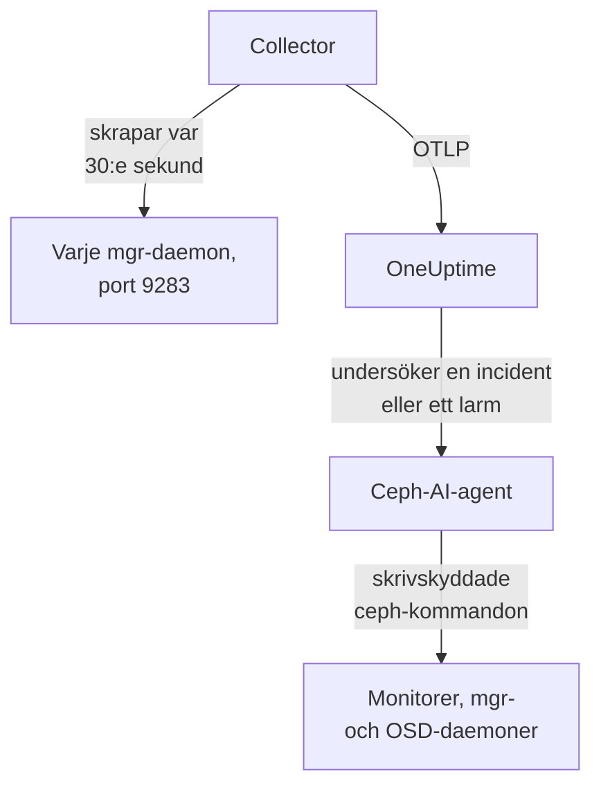

# Ceph-agent

OneUptimes Ceph-agent övervakar ett Ceph-kluster: dess hälsa, monitorkvorum, OSD:er, pooler och placement groups. Den skrapar Ceph mgr-modulen `prometheus` på varje mgr-daemon, stämplar varje mätvärde med ditt klusters namn och skickar det till OneUptime, där klustret visas med sina OSD:er, pooler och daemoner. [Ceph-övervakare](/docs/monitor/ceph-monitor) larmar utifrån det som kommer in.

:::cards
- [Installera agenten](#installera-agenten): Aktivera mgr-modulen, sedan installationsskriptet eller Docker Compose.
- [Vad agenten samlar in](#vad-agenten-samlar-in): Serierna bakom Ceph-sidorna, mätvärdena och larmmallarna.
- [AI-agent](#ai-agent): Låt OneUptime AI läsa klustret medan den undersöker.
- [Felsökning](#felsökning): Ett diagnosskript, och de vanliga problemen.
:::

## Så fungerar det

Agenten är två containrar som du kör med Docker Compose på en maskin. En OpenTelemetry Collector skrapar mgr-modulen `prometheus` på varje mgr-daemon var 30:e sekund. Bara den aktiva mgr:en svarar med mätvärden, så när den växlar över till en standby fortsätter mätvärdena att komma utan någon ändring. Ceph-AI-agenten bredvid låter OneUptime AI köra skrivskyddade `ceph`-kommandon medan den undersöker en incident eller ett larm.



Klustret registrerar sig med sina första data, under det namn som agenten stämplar på varje mätvärde som `ceph.cluster.name`.

## Innan du börjar

- Docker Engine 20.10 eller senare med pluginet Docker Compose v2, på en maskin som når dina Ceph mgr-daemoner på port 9283.
- Ett skal på en Ceph-adminnod, där `ceph`-CLI:t fungerar med administratörsrättigheter.
- En intagningsnyckel. Skapa en under **Projektinställningar → Telemetri och APM → Intagningsnycklar** och kopiera värdet.
- Utgående HTTPS från den maskinen till din OneUptime-URL.

## Installera agenten

:::steps
### Aktivera mgr-modulen prometheus

På en Ceph-adminnod:

```bash
ceph mgr module enable prometheus
```

Varje mgr-daemon serverar då Prometheus-mätvärden på port `9283` under `/metrics`. Bara den aktiva mgr:en returnerar mätvärden: standby-mgr:er svarar med ett tomt svar, eller med ett HTTP-fel om `mgr/prometheus/standby_behaviour` är satt till `error`. Därför skrapar agenten varje mgr. Lista dem:

```bash
ceph mgr stat                    # active mgr
ceph orch ps --daemon-type mgr   # all mgrs (cephadm clusters)
```

### Installera och starta agenten

:::tabs
@tab install.sh
Ladda ned installationsskriptet och kör det på maskinen som ska vara värd för agenten:

```bash
curl -sSL https://raw.githubusercontent.com/OneUptime/oneuptime/master/agents/CephAgent/install.sh -o install.sh
bash install.sh
```

Skriptet frågar efter din OneUptime-URL, intagningsnyckeln, ett namn på klustret och mgr-slutpunkterna, och om [AI-agenten](#ai-agent) får tillämpa åtgärder. Där `ceph` fungerar med administratörsrättigheter erbjuder det också att skapa AI-agentens egen Ceph-klient. Det installerar till `/opt/oneuptime-ceph-agent`, skriver en `.env`-fil med `0600` och startar agenten med Docker Compose. Om du kör skriptet igen återanvänder det allt i den `.env` i stället för att fråga igen, och det är så du [uppgraderar agenten](#uppgradera-agenten).
@tab Docker Compose
Ladda ned `docker-compose.yml` och `otel-collector-config.yaml` från [CephAgent-katalogen](https://github.com/OneUptime/oneuptime/tree/master/agents/CephAgent) till en ny mapp:

```bash
mkdir oneuptime-ceph-agent && cd oneuptime-ceph-agent
curl -fsSLO https://raw.githubusercontent.com/OneUptime/oneuptime/master/agents/CephAgent/docker-compose.yml
curl -fsSLO https://raw.githubusercontent.com/OneUptime/oneuptime/master/agents/CephAgent/otel-collector-config.yaml
```

Skapa en `.env`-fil bredvid dem:

```bash title=".env"
ONEUPTIME_URL=YOUR_ONEUPTIME_URL
ONEUPTIME_TELEMETRY_INGESTION_KEY=YOUR_TELEMETRY_INGESTION_TOKEN
CEPH_CLUSTER_NAME=my-ceph-cluster
CEPH_MGR_ENDPOINTS=[ceph-mon-1:9283,ceph-mon-2:9283,ceph-mon-3:9283]
```

Lista varje mgr-daemon, den aktiva och standby-daemonerna, kommaseparerade och inom hakparenteser: Hakparenteserna får collectorn att läsa värdet som en lista med skrapmål. Starta agenten:

```bash
docker compose up -d
```

AI-agentens container startar också och väntar på en egen Ceph-klient: se [AI-agent](#ai-agent).
:::

### Kontrollera att agenten körs

```bash
docker compose ps
docker logs -f oneuptime-ceph-agent
```

`docker compose ps` listar collectorn (`oneuptime-ceph-agent`) och AI-agenten (`oneuptime-ceph-ai-agent`). Collectorns loggar bör visa den här raden när den har startat:

```text
Everything is ready. Begin running and processing data.
```

### Hitta klustret i OneUptime

Öppna **Produkter → Infrastruktur → Ceph → Alla kluster**. Klustret visas under sitt `CEPH_CLUSTER_NAME` inom ungefär en minut, med sina OSD:er, pooler och daemoner.
:::

## Miljövariabler

Installationsskriptet skriver dessa till `/opt/oneuptime-ceph-agent/.env`; en Docker Compose-installation läser dem från `.env` bredvid `docker-compose.yml`. När du har ändrat ett kör du `docker compose up -d` i den mappen.

| Variabel | Obligatorisk | Beskrivning |
| --- | --- | --- |
| `ONEUPTIME_URL` | Ja | Din OneUptime-URL, till exempel `https://oneuptime.com` eller din självhostade instans. Använd `http://` och dess port om instansen bara använder HTTP. |
| `ONEUPTIME_TELEMETRY_INGESTION_KEY` | Ja | Intagningsnyckeln från **Projektinställningar → Telemetri och APM → Intagningsnycklar**. |
| `CEPH_CLUSTER_NAME` | Ja | Klustrets namn i OneUptime, stämplat på varje mätvärde som resursattributet `ceph.cluster.name`. Håll det stabilt: att ändra det senare registrerar ett andra kluster. Standard är `ceph`. |
| `CEPH_MGR_ENDPOINTS` | Ja | Varje mgr-daemon som en kommaseparerad `host:port`-lista inom hakparenteser, till exempel `[ceph-mon-1:9283,ceph-mon-2:9283,ceph-mon-3:9283]`. Installationsskriptet lägger till hakparenteserna åt dig. |

AI-agentens egna inställningar finns under [AI-agent](#ai-agent).

## Så skrapar agenten

- **Varje mgr, var 30:e sekund.** mgr-modulen `prometheus` cachar varje skrapning i `mgr/prometheus/scrape_interval` (15 sekunder som standard). Skrapa aldrig oftare än så: Du skulle bara läsa cachen igen.
- **`honor_labels: true`.** Etiketterna som Ceph exporterar (`ceph_daemon`, `pool_id`, instansetiketter per daemon) behålls som de är. Utan det skulle etiketten `instance` skrivas om för varje skrapmål och ändras varje gång den aktiva mgr:en byts, vilket bryter varje serie.

## Vad agenten samlar in

Agenten skickar allt som mgr-modulen `prometheus` exporterar. OneUptimes Ceph-sidor, mätvärdeskatalog och larmmallar bygger på dessa serier:

| Kategori | Mätvärden |
| --- | --- |
| Klusterhälsa | `ceph_health_status` (0 = OK, 1 = WARN, 2 = ERR), `ceph_health_detail` (en serie per aktiv hälsokontroll, med etiketterna `name` och `severity`, från Quincy och framåt; grunden för larmmallarna för hälsokontroller och för översiktens **Active Health Checks**), `ceph_healthcheck_slow_ops`, `ceph_daemon_health_metrics` (per daemon, efter `type`), `ceph_mon_quorum_status`, `ceph_mon_metadata`, `ceph_cluster_total_bytes`, `ceph_cluster_total_used_bytes` |
| OSD | `ceph_osd_up`, `ceph_osd_in`, `ceph_osd_apply_latency_ms`, `ceph_osd_commit_latency_ms`, `ceph_osd_stat_bytes`, `ceph_osd_stat_bytes_used`, `ceph_osd_numpg`, `ceph_osd_metadata`, per OSD efter etiketten `ceph_daemon` (till exempel `osd.3`) |
| Pool | `ceph_pool_stored`, `ceph_pool_max_avail`, `ceph_pool_objects`, `ceph_pool_rd`, `ceph_pool_wr`, `ceph_pool_rd_bytes`, `ceph_pool_wr_bytes`, `ceph_pool_metadata`. Dataserierna har bara en etikett `pool_id`; poolens namn står på `ceph_pool_metadata`. |
| Placement groups | `ceph_pg_total`, `ceph_pg_active`, `ceph_pg_clean`, `ceph_pg_degraded`, `ceph_pg_undersized` (alla per pool, efter `pool_id`), `ceph_num_objects_degraded`, `ceph_num_objects_misplaced` |
| Daemoner | `ceph_mgr_metadata`, `ceph_mds_metadata` och `ceph_rgw_metadata`, utöver monitor- och OSD-metadata ovan. Var och en namnger en daemon och bär dess version i etiketten `ceph_version`: Sidan **Daemons** listar dem. |

### Fler skrapmål

mgr-modulen täcker klustrets hälsa och kapacitet. För en närmare titt lägger du till fler jobb under `scrape_configs` i `otel-collector-config.yaml`:

- **`ceph-exporter` (Reef 18.2 och senare).** cephadm kör en `ceph-exporter`-daemon på varje klustervärd, som serverar prestandaräknare per daemon på port `9926`. Lägg till ett mål per värd.
- **`node_exporter`.** Den vanliga följeslagaren för varje Ceph-värds CPU-, minnes-, disk- och nätverksmätvärden, på port `9100` som standard.

Båda får resursattributet `ceph.cluster.name` från den medföljande processorn `resource`, så de hamnar på samma kluster i OneUptime.

## Valfritt — Skicka Ceph-klusterloggen

Agenten kan följa `/var/log/ceph/ceph.log` och skicka den till OneUptime, vilket fyller klustrets sida **Cluster Log**. Det är avstängt som standard eftersom agenten då måste köras på en värd som har klusterloggen: som standard en monitorvärd.

:::steps
### Slå på receivern

Avkommentera mottagaren `filelog` och pipelinen `logs` i `otel-collector-config.yaml`.

### Montera loggkatalogen

Avkommentera i `docker-compose.yml` den volym som monterar katalogen i collectorn:

```yaml
- /var/log/ceph:/var/log/ceph:ro
```

### Starta om agenten

```bash
docker compose up -d
```
:::

Raderna skickas allteftersom de skrivs. OneUptime läser formatet för `ceph.log` (tid, daemon, nivå `INF`/`WRN`/`ERR`, meddelande) när den visar dem, och processorn `resource` stämplar `ceph.cluster.name`, så loggen hamnar på det här klustret.

## Tagga klustret med projektetiketter

Ett resursattribut som börjar med `oneuptime.label.` blir en projektetikett på klustret: `oneuptime.label.<dimension>=<value>` är etiketten `<dimension>:<value>`. Lägg till attributen i processorn `resource` i `otel-collector-config.yaml`, bredvid `ceph.cluster.name`:

```yaml
processors:
  resource:
    attributes:
      # ...existing attributes...
      - key: oneuptime.label.team
        value: storage
        action: upsert
      - key: oneuptime.label.env
        value: production
        action: upsert
```

Collectorn läser sin konfiguration bara när den startar: Kör `docker compose restart oneuptime-ceph-agent`. Klustret visar då etiketterna `team:storage` och `env:production`. Etiketter jämförs utan hänsyn till skiftläge, så en befintlig etikett `Production` återanvänds i stället för att dupliceras, och agenten tar aldrig bort en etikett som någon har lagt till i OneUptime.

## Kör som en systemd-tjänst

För att starta agenten med maskinen och starta om den när den misslyckas installerar du dess systemd-enhet. Den förutsätter att agenten ligger i `/opt/oneuptime-ceph-agent`, där installationsskriptet placerar den:

```bash
sudo curl -fsSL https://raw.githubusercontent.com/OneUptime/oneuptime/master/agents/CephAgent/systemd/oneuptime-ceph-agent.service -o /etc/systemd/system/oneuptime-ceph-agent.service
sudo systemctl daemon-reload
sudo systemctl enable --now oneuptime-ceph-agent
```

## Uppgradera agenten

Agenten rapporterar den collector-version som dess filer låser som sin **Agentversion**. När den är äldre än den version som den här OneUptime-utgåvan låser visas en varningssymbol bredvid den på klustrets **Översikt**. Välj den för att se de här kommandona. En agent som installerades innan dess filer rapporterade en version visar ingen förrän den har uppgraderats på det här sättet.

Collectorns image är låst i `docker-compose.yml` och dess konfiguration är en fil bredvid den, så att bara hämta images för inte agenten framåt. Kör `install.sh` igen: det återanvänder varje värde i din befintliga `.env` (inget frågas efter igen), förnyar `docker-compose.yml` och `otel-collector-config.yaml` (en fil som du har redigerat sparas som `<file>.bak.<timestamp>`), hämtar imagesen och återskapar agenten så att collectorn läser sin nya konfiguration. AI-agentens mapp `ceph/` lämnas som den är.

```bash
curl -sSL https://raw.githubusercontent.com/OneUptime/oneuptime/master/agents/CephAgent/install.sh -o install.sh
bash install.sh
```

Installerade du den med Docker Compose i stället? I agentens mapp laddar du ned båda filerna igen (och gör om eventuella ändringar du hade gjort i dem), hämtar sedan imagesen och återskapar agenten:

```bash
curl -fsSLO https://raw.githubusercontent.com/OneUptime/oneuptime/master/agents/CephAgent/docker-compose.yml
curl -fsSLO https://raw.githubusercontent.com/OneUptime/oneuptime/master/agents/CephAgent/otel-collector-config.yaml
docker compose pull
docker compose up -d --force-recreate
```

## Avinstallera agenten

```bash
cd /opt/oneuptime-ceph-agent
docker compose down
```

Om du skapade AI-agentens Ceph-klient tar du bort den på en adminnod med `ceph auth del client.oneuptime-ai`.

## AI-agent

Agentens `docker-compose.yml` kör också **Ceph-AI-agenten**, `oneuptime-ceph-ai-agent` (image `oneuptime/resource-ai-agent:release`). Medan OneUptime AI undersöker en incident eller ett larm på det här klustret kör den skrivskyddade `ceph`-kommandon genom den — `ceph health detail`, `ceph osd tree`, `ceph pg dump_stuck`, `ceph crash ls` — och tillämpar, bara om du tillåter det, åtgärder som att markera en OSD som in igen eller rensa `noout`. Den registrerar sig som klustret med namnet `CEPH_CLUSTER_NAME`, precis som collectorn, och visas på klustrets sida **AI → AI-agent** i OneUptime.

- **AI-undersökningar är på som standard.** När agenten väl ansluter undersöker OneUptime AI incidenter och larm på det här klustret med den, och klustrets **Översikt** visar agentens status. För att stoppa sätter du `ONEUPTIME_AI_INVESTIGATION=false` där agenten körs (**Ändra** under **Vad AI får göra** på AI-agentsidan visar hur), eller utelämnar agenten.
- **Dess egen Ceph-klient är den hårda gränsen.** Den ansluter som `client.oneuptime-ai`, med klustrets minimala `ceph.conf` och den klientens nyckelring i en mapp `ceph/` bredvid `docker-compose.yml` (monterad skrivskyddad på `/etc/ceph`). Med läs-caps kan inget som den kör ändra klustret. Vid en ny installation erbjuder `install.sh` att skapa klienten; att köra det igen gör aldrig det. Lägg aldrig admin-nyckelringen i den mappen.
- Den är **skrivskyddad** om du inte sätter `ONEUPTIME_AI_ALLOW_WRITES=true` och ger klienten caps för åtgärderna (agentens README listar dem); `ONEUPTIME_AI_WRITE_TARGETS` (till exempel `osd.*,cluster`) begränsar vad en åtgärd får röra. `ONEUPTIME_AI_FIXES` i samma `.env` anger hur åtgärder körs — `ask-for-approval` (en person godkänner varje), `automatic` eller `bypass-approval` — och AI-agentsidan visar det skrivskyddat ([Vad AI får göra, fastställt av agenten](/docs/ai/infrastructure-ai-agents#what-ai-may-do-set-by-the-agent)).
- Den ansluter utåt till monitorerna (TCP 3300 och 6789) och mgr- och OSD-daemonerna (TCP 6800–7300), körs som UID 1000 utan capabilities och kör aldrig `auth`, `config-key`, `tell` eller något som raderar data. Ta bort tjänsten `oneuptime-ceph-ai-agent` ur `docker-compose.yml` om du inte använder OneUptime AI.

För att skapa klienten för hand kör du detta på en Ceph-adminnod, i agentens mapp (kopiera de två filerna till mappen `ceph/` på agentens maskin om det är en annan):

```bash
mkdir -p ceph
ceph config generate-minimal-conf > ceph/ceph.conf
ceph auth get-or-create client.oneuptime-ai mon 'allow r' mgr 'allow r' osd 'allow r' -o ceph/ceph.client.oneuptime-ai.keyring
sudo chown 1000:1000 ceph/ceph.client.oneuptime-ai.keyring
sudo chmod 600 ceph/ceph.client.oneuptime-ai.keyring
docker compose up -d
```

Vad den får köra, hur åtgärder fungerar och hur du felsöker den: [Infrastructure AI Agents](/docs/ai/infrastructure-ai-agents#ceph-clusters).

## Felsökning

:::details Kör diagnosskriptet först
Agenten levereras med ett skript, [`troubleshoot.sh`](https://github.com/OneUptime/oneuptime/blob/master/agents/CephAgent/troubleshoot.sh), som kontrollerar hela kedjan: containerkörtiden, varje konfigurerad mgr-slutpunkt, det klusternamn som stämplas på varje mätvärde, tokenens format, collectorns egna mätvärden, och om OneUptime godtar intagningsnyckeln. Det varnar när ingen slutpunkt returnerar `ceph_health_status`, eller när bara en är konfigurerad, eftersom bara den aktiva mgr:en serverar mätvärden. Nyckelkontrollen är viktigast. OneUptime nekar en felaktig nyckel med `401` (`422` för en inaktiverad nyckel eller en webbläsarnyckel), och collectorn behandlar båda som permanenta: den släpper batchen och loggar ett enda `Exporting failed`-fel, som är lätt att missa medan containern förblir frisk. Skriptet frågar `GET <url>/otlp/v1/validate` inifrån agentens nätverk för ett direkt `200` (giltig) eller `401` (ogiltig), och faller tillbaka på `POST /fluentd/v1/logs` på äldre servrar.

```bash
curl -sSL https://raw.githubusercontent.com/OneUptime/oneuptime/master/agents/CephAgent/troubleshoot.sh -o troubleshoot.sh
bash troubleshoot.sh    # add -d <dir> if you installed outside /opt/oneuptime-ceph-agent
```

Det avslutas med en bedömning som anger den mest sannolika orsaken.
:::

:::details Inget kluster visas i OneUptime
1. Läs collectorns loggar: `docker logs oneuptime-ceph-agent`. En `401` vid export betyder en felaktig intagningsnyckel; en nekad anslutning betyder en felaktig `ONEUPTIME_URL`.
2. Kontrollera att en mgr serverar mätvärden: `curl http://ACTIVE_MGR_HOST:9283/metrics | head` bör skriva ut `ceph_*`-rader. Om inte, aktivera modulen med `ceph mgr module enable prometheus`.
3. Kontrollera att `CEPH_MGR_ENDPOINTS` står inom hakparenteser. Utan dem läser collectorn hela den kommaseparerade listan som ett enda mål, som inte finns.
:::

:::details Klustret visas som frånkopplat
Ett kluster blir frånkopplat när OneUptime inte har tagit emot något från det på 15 minuter; OneUptime kontrollerar var 5:e minut, och tid då OneUptime själv inte tog emot data räknas inte. Kontrollera att collectorn körs (`docker compose ps`), att dess loggar inte visar några exportfel och att maskinen fortfarande når din OneUptime-URL. Klustret blir anslutet igen med sina nästa data.
:::

:::details Mätvärdena stannar efter en mgr-failover
Du skrapar troligen bara den mgr som tidigare var aktiv. Lista varje mgr-daemon i `CEPH_MGR_ENDPOINTS`: Att skrapa standby-daemonerna kostar nästan ingenting, och de svarar med tomma svar.
:::

:::details Skrapfel för standby-mgr:er i collectorns loggar
Väntat när `mgr/prometheus/standby_behaviour` är satt till `error` på ditt kluster: Standby-daemonerna svarar då med HTTP 500. Skrapningen av den aktiva mgr:en lyckas fortfarande, så felen är brus; sätt tillbaka beteendet till `default` för att tysta dem.
:::

:::details Mätvärdena hamnar under fel kluster
OneUptime registrerar ett Ceph-kluster efter dess `ceph.cluster.name`, som agenten tar från `CEPH_CLUSTER_NAME`. Att ändra det efter de första data skapar ett andra kluster i stället för att byta namn på det första.
:::

## Nästa steg

:::cards
- [Ceph-övervakning](/docs/monitor/ceph-monitor): Larma om hälsa, OSD:er, placement groups, kapacitet, krascher och långsamma operationer.
- [Proxmox-agent](/docs/telemetry/proxmox): Kör du Ceph under Proxmox VE? Övervaka klustret också.
- [Infrastructure AI Agents](/docs/ai/infrastructure-ai-agents): Vad Ceph-AI-agenten får köra och hur åtgärder fungerar.
- [OpenTelemetry-collector på värden](/docs/telemetry/host-otel-collector): Operativsystemets vy av varje Ceph-värd.
:::
