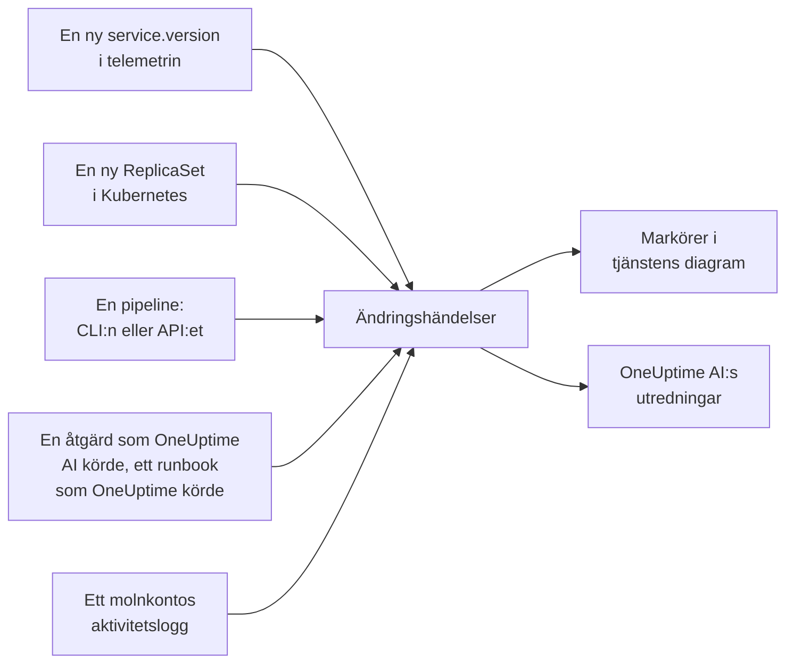

# Driftsättningar och ändringar

OneUptime för bok över vad som ändrades i ditt projekt: driftsättningar, utrullningar i Kubernetes, konfigurationsändringar, ändringarna i dina anslutna molnkonton och de åtgärder som OneUptime själv körde. Varje ändring ritas som en markör i diagrammen för sin tjänst eller molnresurs, och OneUptime AI läser ändringarna när den utreder en incident, så att "det började direkt efter driftsättningen 10:02" är det första du får veta, inte det sista.

:::cards
- [Vad OneUptime registrerar på egen hand](#vad-oneuptime-registrerar-på-egen-hand): Driftsättningar och utrullningar ur telemetrin, dina molnkontons ändringar, och egna åtgärder.
- [Registrera en driftsättning från en pipeline](#registrera-en-driftsättning-från-en-pipeline): CLI:n, GitHub Actions och API:et.
- [Så använder OneUptime AI ändringar](#så-använder-oneuptime-ai-ändringar): De misstänkta ändringarna i varje utredning.
- [Referens](#referens): Fält, attribut och gränser.
:::

## Så fungerar det



## Vad OneUptime registrerar på egen hand

Du behöver inte skicka något för de här. OneUptime registrerar dem utifrån telemetrin som den redan tar emot och utifrån det som den själv gör.

| Ändring | Registreras när | Källa |
| --- | --- | --- |
| En driftsättning | En tjänst börjar rapportera en `service.version` som den inte har rapporterat tidigare i sin miljö | `service-version` |
| En utrullning | Poddarna i en Kubernetes-Deployment börjar köra en ReplicaSet som de inte har kört tidigare: en ny avbildning, en ändrad miljövariabel eller konfigurationsreferens, eller en omstart | `kubernetes` |
| En åtgärd som OneUptime AI körde | En AI-agent rapporterar resultatet av ett kommando som ändrar något, till exempel `kubectl rollout restart` | `oneuptime-ai` |
| Ett runbook | Ett runbook som OneUptime körde slutförs, misslyckas eller avbryts efter att det har startat | `runbook` |
| En molnändring | Aktivitetsloggen för ett anslutet molnkonto registrerar en ändring: AWS CloudTrail, Azures aktivitetslogg eller Google Clouds granskningslogg Admin Activity | `cloud` |
| En leverantörshändelse | Molnleverantören publicerar en hälsohändelse om kontot: AWS Health, Azure Service Health eller Resource Health, eller Google Cloud Service Health | `cloud-health` |

- **Den första versionen som en tjänst rapporterar är dess utgångsläge, inte en driftsättning.** En tjänst som har körts i månader driftsätts inte i samma ögonblick som OneUptime börjar ta emot dess telemetri.
- **En återgång till en version som har setts under de senaste 30 dagarna registreras inte,** eftersom den versionen inte är ny. En återgång som OneUptime AI kör registreras som en åtgärd.
- **Efter 6 nya versioner eller ReplicaSets under en timme registreras inga fler förrän timmen är slut.** Annars skulle en "version" som ändras med varje podd, till exempel en tidsstämpel för bygget, registrera en driftsättning för varje podd.

En driftsättning registreras bara för en tjänst som rapporterar `service.version`. Ange den, tillsammans med miljön och committen, i resursattributen för din OpenTelemetry-SDK eller collector:

```bash
OTEL_RESOURCE_ATTRIBUTES="service.version=2.3.1,deployment.environment.name=production,vcs.ref.head.revision=$GIT_SHA"
```

En utrullning kräver [Kubernetes-agenten](/docs/telemetry/kubernetes-agent), som märker varje podds telemetri med dess Deployment och ReplicaSet.

En molnändring eller en leverantörshändelse kräver ett [anslutet molnkonto](/docs/telemetry/cloud-accounts). Var och en knyts till molnresursen den nämner, när OneUptime listar den resursen, och ritas i resursens diagram. Typen kommer från åtgärden: `deployment`, `scaling` eller `rollback` när åtgärdens namn säger det, annars `config-change`, och `provider-event` för en hälsohändelse. Diagram som inte är filtrerade till någon resurs utelämnar ett molnkontos aktivitetslogg, så att ett livligt konto inte tränger undan dina driftsättningar; leverantörens hälsohändelser finns kvar i dem.

## Registrera en driftsättning från en pipeline

En pipeline kan registrera en driftsättning, eller vilken annan ändring som helst, när den sker: en konfigurationsändring, en migrering, en funktionsflagga. Den skriver med en intagningsnyckel för telemetri från ditt projekt, samma sorts nyckel som dina applikationer skickar telemetri med. Skapa en under **Projektinställningar → Telemetri och APM → Intagningsnycklar**.

En nyckel som är fäst vid en tjänst registrerar varje ändring under den tjänsten.

:::tabs
@tab CLI
```bash
oneuptime deploy \
  --service checkout \
  --service-version 2.3.1 \
  --commit "$GIT_SHA" \
  --environment production \
  --url https://oneuptime.com \
  --ingestion-key "$ONEUPTIME_TELEMETRY_INGESTION_KEY"
```
@tab GitHub Actions
```yaml title=".github/workflows/deploy.yml"
- name: Record the deploy in OneUptime
  env:
    ONEUPTIME_URL: https://oneuptime.com
    ONEUPTIME_TELEMETRY_INGESTION_KEY: ${{ secrets.ONEUPTIME_TELEMETRY_INGESTION_KEY }}
  run: |
    npx -y @oneuptime/cli deploy \
      --service checkout \
      --service-version "${{ github.ref_name }}" \
      --commit "${{ github.sha }}" \
      --repository "${{ github.server_url }}/${{ github.repository }}" \
      --environment production
```
@tab API
```bash
curl -X POST https://oneuptime.com/telemetry/change-events/v1/ingest \
  -H "Content-Type: application/json" \
  -H "x-oneuptime-token: $ONEUPTIME_TELEMETRY_INGESTION_KEY" \
  -d '{"events": [{"serviceName": "checkout", "version": "2.3.1", "commit": "1a2b3c4", "environment": "production"}]}'
```
:::

På ett självhostat OneUptime använder du din egen adress i stället för `https://oneuptime.com`. API:et svarar med hur många händelser det lagrade och hur många det hoppade över:

```json
{ "ingested": 1, "skipped": 0 }
```

Se [`oneuptime deploy`](/docs/cli/command-reference#oneuptime-deploy) för alla alternativ i CLI:n.

## Så använder OneUptime AI ändringar

Varje [AI-utredning](/docs/ai/ai-sre) av en incident eller ett larm utgår från ändringarna som registrerades under de 2 timmarna före den, och under de 10 minuterna efter, för en pipeline som registrerar sin driftsättning först när utrullningen är klar. Ändringarna på de tjänster, kluster, värdar och molnresurser som incidenten är länkad till kommer först.

För upp till 4 av dem som anger en tjänst läser OneUptime tjänstens telemetri under 30 minuter före och efter ändringen, och markerar ändringen som **misstänkt** när tjänsten blev mätbart sämre direkt efter den:

| Signal | Misstänkt när |
| --- | --- |
| Misslyckade spans | Felfrekvensen minst fördubblades och steg med minst en procentenhet, över minst 10 misslyckade spans |
| Svarstid | p99 ökade med minst hälften, och med minst 100 ms |
| Undantag | Minst tre gånger så många per minut, och minst 10 av dem |
| Nya undantag | En undantagstyp som först sågs i versionen som ändringen levererade, mellan 10 minuter före och 30 minuter efter ändringen, inträffade minst 3 gånger |

OneUptime avgör vilken ändring som är misstänkt utifrån de här siffrorna, inte utifrån vad en ändrings titel säger. Utredningen kontrollerar en misstänkt ändring först, säger om den orsakade incidenten och säger om det snabbaste säkra sättet att åtgärda den är att rulla tillbaka den.

När den misstänkta ändringen är en utrullning i Kubernetes på ett kluster där [AI-åtgärder](/docs/ai/ai-sre#så-fungerar-åtgärder) är påslagna, rullar OneUptime AI först tillbaka den, med en `kubectl rollout undo` som OneUptime bygger utifrån den registrerade ändringen. En driftsättning som levererar kod rullas tillbaka genom sina commits: utredningen pekar ut den commit eller pull request som orsakade felet, så att en [pull-förfrågan med en korrigering](/docs/ai/ai-sre#automatiska-kodkorrigeringar) kan återställa precis den.

OneUptime kontrollerar också varje driftsättning på egen hand, oavsett om någon larmas eller inte. När de 30 minuterna efter en driftsättning har gått jämför den dem med de 30 minuterna före enligt samma trösklar, och när tjänsten blev sämre nämner en [AI-insikt](/docs/ai/ai-sre#insikter-proaktiv-upptäckt) driftsättningen på den tjänsten.

En pull-förfrågan med en korrigering som OneUptime AI har öppnat kontrolleras på samma sätt: när en registrerad driftsättning innehåller dess commit bevakar OneUptime där det som korrigeringen var till för - undantaget, operationen den gjorde snabbare, monitorn bakom incidenten eller aviseringen, telemetrin den lägger till - och anger om korrigeringen fungerade (se [Automatiska kodkorrigeringar](/docs/ai/ai-sre#automatiska-kodkorrigeringar)). Den driftsatta korrigeringen läses i driftsättningens version bara när tjänstens egen telemetri rapporterar den versionen, och annars från 10 minuter efter driftsättningen, när gamla instanser har stoppats.

I en utredning och i [Fråga AI](/docs/ai/ask-ai) listar `recent_changes` ändringarna i valfritt tidsfönster, och `get_change_details` visar vad en driftsättning levererade: commits sedan tjänstens föregående driftsättning, deras författare, pull requests och filerna de ändrade. Det kräver committen på ändringen och att dess repository är anslutet i Kod: via [GitHub App](/docs/ai/github-app) eller en GitLab-, Forgejo- eller Gitea-anslutning (se [Ansluta ett repositorium](/docs/ai/ai-agent#ansluta-ett-repositorium)).

## Referens

### Fält

| Fält | Vad det är |
| --- | --- |
| `title` | Vad som ändrades, till exempel `Deploy 2.3.1`. En driftsättning som skickar `version` kan utelämna det |
| `eventType` | Typen av ändring: `deployment` (standard), `config-change`, `scaling`, `rollback`, `feature-flag` eller en egen |
| `serviceName` | Tjänsten som ändringen hör till. Utan den gäller ändringen hela projektet |
| `time` | När den hände, som ISO 8601 eller epoksekunder eller -millisekunder. Standard är när den kom fram |
| `description` | Detaljer om ändringen |
| `version` | Den driftsatta versionen |
| `previousVersion` | Versionen som den ersatte |
| `commit` | Den driftsatta committen (även `commitSha` eller `sha`) |
| `repository` | Committens repository (även `repositoryUrl`) |
| `branch` | Den driftsatta branchen |
| `pullRequest` | Den driftsatta pull requesten |
| `environment` | Miljön som driftsättningen gjordes i |
| `attributes` | Upp till 50 attribut till, som text, tal eller booleska värden |

Fälten på toppnivå lagras som attribut under OpenTelemetry-namnen: `version` som `service.version`, `commit` som `vcs.ref.head.revision`, `repository` som `vcs.repository.url.full`, `branch` som `vcs.ref.head.name`, `pullRequest` som `vcs.change.id` och `environment` som `deployment.environment.name`. Ett attribut som skickas under ett av de namnen har företräde framför sitt fält.

Attribut vars namn börjar med `oneuptime.` är OneUptimes egna och tas bort från det som en pipeline skickar. Varje ändring som en pipeline registrerar anger det i `oneuptime.change.source`, som är `api`.

En ändring som lästs från ett molnkonto namnger kontot och resursen under OpenTelemetrys namn, `cloud.provider`, `cloud.account.id`, `cloud.region` och `cloud.resource_id`, och håller åtgärden i `oneuptime.cloud.operation`, vem som körde den i `oneuptime.cloud.actor`, om den misslyckades i `oneuptime.change.status` och molnkontot i `oneuptime.cloud_account.id`.

### Gränser

| Gräns | Värde |
| --- | --- |
| Händelser i en begäran | 100 |
| Titel | 500 tecken |
| Beskrivning | 5 000 tecken |
| Attribut | 50 |
| Tid | En tid mer än 366 dagar bakåt, eller mer än 60 minuter framåt, ersätts med tiden då händelsen kom fram |

## Nästa steg

:::cards
- [AI SRE](/docs/ai/ai-sre): Vad en utredning läser och hur den åtgärdar det den hittar.
- [Kommandoreferens](/docs/cli/command-reference): Varje kommando i CLI:n.
- [OpenTelemetry](/docs/telemetry/open-telemetry): Skicka dina tjänsters telemetri, med deras versioner.
- [Anslut ett molnkonto](/docs/telemetry/cloud-accounts): Ändringarna och hälsohändelserna i dina AWS-, Azure- och Google Cloud-konton.
:::
