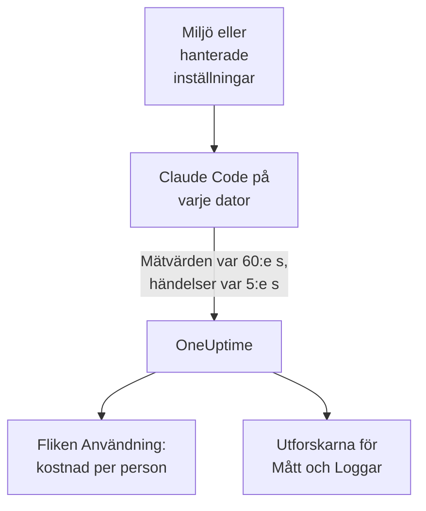

# Claude Code

Claude Code exporterar själv OpenTelemetry-mätvärden och -händelser, direkt till OneUptime: ingen collector och ingen gateway emellan. Slå på det med några få miljövariabler, eller för en hel flotta med en enda fil med hanterade inställningar, och se kostnad, tokens, sessioner, commits och godkända redigeringar per utvecklare.

:::cards
- [Konfigurera en dator](#konfigurera-en-dator): Sex miljövariabler och en omstart.
- [Rulla ut till flottan](#rulla-ut-till-flottan): En fil med hanterade inställningar på varje dator.
- [Tilldela kostnader till personer](#tilldela-användning-till-personer-och-team): Vem som är inloggad, och när du måste sätta identiteten själv.
- [Felsökning](#felsökning): Vad du kontrollerar när inget kommer in.
:::

## Så fungerar det



Claude Code skickar:

- **Kostnad och tokens**: `claude_code.cost.usage` (USD) och `claude_code.token.usage`, per modell, per huvudagent eller subagent, och per agent, skill, plugin eller MCP-server som gjorde anropet.
- **Aktivitet**: sessioner, commits, pull requests, tillagda och borttagna kodrader samt aktiv tid.
- **Redigeringsbeslut**: `claude_code.code_edit_tool.decision` räknar godkända och avvisade redigeringar, så godkännandegraden är `accept / (accept + reject)`, per språk och per verktyg.
- **Händelser**: prompter, verktygsresultat, API-begäranden och -fel, ändringar av behörighetsläge och anslutningar till MCP-servrar, som OTLP-loggposter.

Varje datapunkt för ett mätvärde och varje händelse bär `user.email` när utvecklaren är inloggad med ett Claude-konto, och OneUptime läser den som den anställde på mätvärdena, där kostnaden och tokens finns.

## Innan du börjar

1. Skapa en intagningsnyckel för telemetri under **Projektinställningar → Telemetri och APM → Intagningsnycklar**.
2. Din OTLP-endpoint är `https://oneuptime.com/otlp`, eller `https://YOUR-ONEUPTIME-HOST/otlp` om du driftar OneUptime själv.
3. Använd en nyckel för hela flottan. Den hamnar på varje utvecklardator, så behandla den som en delad autentiseringsuppgift som bara kan skicka data, och rotera den som vilken annan som helst.

## Konfigurera en dator

:::steps
### Exportera variablerna

Lägg till dem i din skalprofil (`.zshrc` eller `.bashrc`), eller exportera dem i terminalen som du startar Claude Code från:

```bash
export CLAUDE_CODE_ENABLE_TELEMETRY=1
export OTEL_METRICS_EXPORTER=otlp
export OTEL_LOGS_EXPORTER=otlp
export OTEL_EXPORTER_OTLP_PROTOCOL=http/protobuf
export OTEL_EXPORTER_OTLP_ENDPOINT="https://oneuptime.com/otlp"
export OTEL_EXPORTER_OTLP_HEADERS="x-oneuptime-token=YOUR_INGESTION_TOKEN"
```

| Variabel | Vad den gör |
| --- | --- |
| `CLAUDE_CODE_ENABLE_TELEMETRY` | Huvudbrytaren: utan den exporteras ingenting. |
| `OTEL_METRICS_EXPORTER`, `OTEL_LOGS_EXPORTER` | `otlp` skickar till OneUptime. `otlp,console` skriver också ut det som skickas, praktiskt medan du konfigurerar. |
| `OTEL_EXPORTER_OTLP_PROTOCOL` | `http/protobuf`; `http/json` och `grpc` fungerar också. |
| `OTEL_EXPORTER_OTLP_ENDPOINT` | Bas-URL:en. Claude Code lägger själv till `/v1/metrics` och `/v1/logs`. |
| `OTEL_EXPORTER_OTLP_HEADERS` | Kommaseparerade `key=value`-par; här din intagningsnyckel. |

### Starta om Claude Code

Variablerna läses när Claude Code startar. Mätvärden skickas var 60:e sekund och händelser var 5:e sekund, så använd Claude Code en minut innan du tittar.

### Kontrollera att data kommer in

Öppna **Mått** och sök efter `claude_code.token.usage`, öppna sedan **Produkter → AI / LLM** och gå till **Användning**: din kostnad visas under din e-postadress, märkt med **från GenAI-mätvärden**.
:::

För att skicka mätvärden och händelser till olika ställen sätter du i stället `OTEL_EXPORTER_OTLP_METRICS_ENDPOINT` och `OTEL_EXPORTER_OTLP_LOGS_ENDPOINT`, med den fullständiga sökvägen (`https://oneuptime.com/otlp/v1/metrics`, `https://oneuptime.com/otlp/v1/logs`).

## Rulla ut till flottan

I en organisation levererar du samma variabler i en fil med hanterade inställningar. Den har samma form som `settings.json`, med variablerna i ett `env`-block:

```json title="managed-settings.json"
{
  "env": {
    "CLAUDE_CODE_ENABLE_TELEMETRY": "1",
    "OTEL_METRICS_EXPORTER": "otlp",
    "OTEL_LOGS_EXPORTER": "otlp",
    "OTEL_EXPORTER_OTLP_PROTOCOL": "http/protobuf",
    "OTEL_EXPORTER_OTLP_ENDPOINT": "https://oneuptime.com/otlp",
    "OTEL_EXPORTER_OTLP_HEADERS": "x-oneuptime-token=YOUR_INGESTION_TOKEN",
    "OTEL_RESOURCE_ATTRIBUTES": "team.id=platform,cost_center=eng-123"
  }
}
```

:::steps
### Lägg filen där Claude Code läser den

| Plattform | Sökväg |
| --- | --- |
| macOS | `/Library/Application Support/ClaudeCode/managed-settings.json` |
| Linux och WSL | `/etc/claude-code/managed-settings.json` |
| Windows | `C:\Program Files\ClaudeCode\managed-settings.json` |

Claude Code läser inte längre den gamla Windows-sökvägen `C:\ProgramData\ClaudeCode\managed-settings.json`. Om du redan levererar en fil med hanterade inställningar lägger du i stället till en tilläggsfil, som `managed-settings.d/10-telemetry.json` bredvid den: Claude Code sammanfogar först `managed-settings.json` och sedan varje `*.json`-fil i `managed-settings.d/` i alfabetisk ordning.

### Kontrollera en dator

Kör `/status` i Claude Code. Raden `Setting sources` ska visa `Enterprise managed settings (file)`, eller `(drop-ins)` eller `(file + drop-ins)` för en tilläggsfil. En annan källa inom parentes betyder att en högre rankad källa vann och att din inte användes.

### Se flottan komma in

På fliken **Användning** visas varje utvecklare som en rad så snart hen har använt Claude Code med de nya inställningarna.
:::

Samma JSON kan också komma från serverhanterade inställningar i administrationskonsolen för claude.ai (hämtade vid start och varje timme), från en macOS-konfigurationsprofil i domänen `com.anthropic.claudecode` eller från ett `Settings`-värde under `HKLM\SOFTWARE\Policies\ClaudeCode` i Windows.

:::details Vilken hanterad källa som vinner, och hur telemetrivariablerna kombineras
Som standard använder Claude Code den högst rankade källan som sätter någon policynyckel och ignorerar de andra: serverhanterade inställningar, sedan en MDM- eller operativsystempolicy, sedan filerna med hanterade inställningar och sedan registervärdet `HKCU` per användare. `env`-blocket är undantaget: sedan version 2.1.223 sammanfogas det variabel för variabel mellan administrationskällorna.

Det gör inte telemetrivariablerna: variablerna `OTEL_EXPORTER_OTLP_*`, innehållsbrytarna `OTEL_LOG_*`, `OTEL_LOGS_EXPORTER` och variablerna för tracing-betan kommer tillsammans från den högst rankade källa som sätter någon av dem, så en endpoint från en källa paras aldrig ihop med autentiseringsuppgifter från en annan. Om en högre rankad källa sätter någon av dem bidrar en tilläggsfil för telemetri inte med något.

Serverhanterade inställningar kräver ett steg till: en `OTEL_EXPORTER_OTLP_ENDPOINT` som inte är tom tillämpas först när varje utvecklare har godkänt en säkerhetsdialog i en interaktiv session, och ändringar i exportörinställningarna gäller från nästa start. Filer och MDM-policyer har ingen dialog.
:::

:::details Rotera intagningsnyckeln utan att redigera varje dator
I stället för en fast header sätter du `"otelHeadersHelper": "/path/to/generate-otel-headers.sh"` i inställningarna. Skriptet skriver ut ett platt JSON-objekt med headers, som `{"x-oneuptime-token":"..."}`. Claude Code kör det vid start och sedan igen med ett intervall på `CLAUDE_CODE_OTEL_HEADERS_HELPER_DEBOUNCE_MS` millisekunder (`1740000` som standard, 29 minuter). Fel visas i `/status`.
:::

## Tilldela användning till personer och team

**Den anställde är `user.email`.** Claude Code skickar den när utvecklaren är inloggad med ett Claude-konto, och det finns ingen variabel för att stänga av den. OneUptime läser den från varje datapunkt för kostnad och tokens, utan konfiguration.

**Andra inloggningar skickar ingen e-postadress.** Med en API-nyckel, eller med Claude på Amazon Bedrock, Google Cloud eller Microsoft Foundry, finns det inget Claude-konto i sessionen, och Claude Code skickar bara `user.id` och `session.id`. Sätt identiteten själv, per dator, i de hanterade inställningarna eller i ett startskript:

```bash
export OTEL_RESOURCE_ATTRIBUTES="user.email=jdoe@example.com,team.id=platform"
```

**`user.id` är inte en person.** Det är ett slumpmässigt id som Claude Code skriver till `~/.claude.json` vid första körningen: ett per installation, och ett nytt om filen tas bort. Utan e-postadress visas varje installation som sin egen rad. Ett undantag: en session som är inloggad på en gateway för Claude-appar skickar den inloggade identiteten (`user.id` är identitetsleverantörens subject, `user.email` e-postadressen) och ignorerar `user.*`-nycklar som du sätter själv.

**Team och kostnadsställen** kommer från `OTEL_RESOURCE_ATTRIBUTES`: OneUptime läser `team.id`, `team`, `cost_center` och `department`. Värden får inte innehålla blanksteg, och citattecken skyddar dem inte: skriv `team=Platform_Engineering`, eller använd procentkodning, som i `team=Platform%20Engineering`. Claude Code kopierar de här nycklarna till varje datapunkt (`OTEL_METRICS_INCLUDE_RESOURCE_ATTRIBUTES`, påslaget som standard), och OneUptime läser dem på båda ställena. En nyckel som du sätter åsidosätter aldrig en som Claude Code sätter själv.

## Vad OneUptime visar

På **Produkter → AI / LLM → Användning** matar `claude_code.cost.usage` tabellerna **Anställd**, **Team** och **Modell**, och `claude_code.token.usage` tokentotalerna. Två regler avgör vad du ser:

- **Mätvärdena fyller i för spans; de läggs aldrig ovanpå dem.** Om samma projekt tar emot GenAI-spans med kostnad från dina egna appar visas inte Claude Codes kostnader. Skicka Claude Code till ett eget projekt. Se [Spans först, mätvärden fyller i](/docs/telemetry/ai-llm-observability#spans-först-mätvärden-fyller-i).
- **En rad från mätvärden bär bara kostnad.** Dess celler för anrop och tokens visar `—`, och tabellerna **Leverantör** och **Applikation / Tjänst** förblir tomma: mätvärdena nämner ingen leverantör och hör inte till någon OneUptime-tjänst.

Allt annat, som godkännandegrad, kodrader, commits och pull requests per utvecklare, eller kostnad per `query_source`, visar du i en [dashboard](/docs/dashboards/index) utifrån mätvärdena nedan och varnar på med en [metrikövervakning](/docs/monitor/metrics-monitor).

## Mätvärden

Varje mätvärde är en räknare och bär standardattributen utöver sina egna.

| Mätvärde | Enhet | Egna attribut |
| --- | --- | --- |
| `claude_code.session.count` | ingen | `start_type`: `fresh`, `resume`, `continue`, `agents_view` |
| `claude_code.lines_of_code.count` | ingen | `type`: `added`, `removed`; `model` |
| `claude_code.commit.count` | ingen | inga |
| `claude_code.pull_request.count` | ingen | inga |
| `claude_code.cost.usage` | USD | `model`; `query_source`: `main`, `subagent`, `auxiliary`; `speed`: `fast`, `normal`; `effort`; `agent.name`, `skill.name`, `plugin.name`, `marketplace.name`, `mcp_server.name`, `mcp_tool.name` |
| `claude_code.token.usage` | tokens | `type`: `input`, `output`, `cacheRead`, `cacheCreation`; och samma attribut som `claude_code.cost.usage` |
| `claude_code.code_edit_tool.decision` | ingen | `tool_name`: `Edit`, `Write`, `NotebookEdit`; `decision`: `accept`, `reject`; `source`; `language` |
| `claude_code.active_time.total` | s | `type`: `user` (vid tangentbordet), `cli` (verktyg och modellsvar) |

Standardattributen är `session.id`, `app.version`, `app.entrypoint`, `organization.id`, `user.account_uuid`, `user.account_id`, `user.id`, `user.email` och `terminal.type`, plus dina `OTEL_RESOURCE_ATTRIBUTES`. Några av dem kan stängas av: se [Håll nere volymen av mätvärden](#håll-nere-volymen-av-mätvärden).

- Cachetokentyperna är i camelCase: `cacheRead` och `cacheCreation`. OneUptimes tokentotaler räknar bara `input` och `output`.
- På kostnads- och tokenmätvärdena står namnen på dina egna agenter och MCP-servrar, och på plugins och skills från tredje part, som `custom` eller `third-party`, om inte `OTEL_LOG_TOOL_DETAILS=1` är satt (Claude Code 2.1.273 eller senare).

## Händelser

Händelser kommer in som OTLP-loggposter, var och en med `event.name`, `event.timestamp` och `event.sequence`. De du kommer att använda mest:

| Händelse | Vad den registrerar |
| --- | --- |
| `claude_code.user_prompt` | En prompt: dess längd och kommando; texten bara om du slår på det |
| `claude_code.api_request` | En modellbegäran: `model`, `cost_usd`, `cost_usd_micros`, `duration_ms`, `input_tokens`, `output_tokens`, cachetokens |
| `claude_code.api_error` | En begäran som misslyckades efter sina nya försök: `model`, `error`, `status_code`, `attempt` |
| `claude_code.tool_result` | En verktygskörning: `tool_name`, `success`, `duration_ms` och beslutet som tillät den |
| `claude_code.tool_decision` | Om ett verktyg tilläts, och av vad |
| `claude_code.mcp_server_connection` | En MCP-server som ansluter eller misslyckas |

Claude Code skickar många fler, som vägranden, ändringar av behörighetsläge och händelser från plugins, hooks och skills: Anthropics [övervakningsreferens](https://code.claude.com/docs/en/monitoring-usage) listar dem alla. I `cost_usd_micros` är kostnaden ett heltal miljondelar av en USD, som summeras utan avrundningsavvikelser.

## Håll nere volymen av mätvärden

Claude Code sätter som standard `session.id` på varje datapunkt, och varje session är en ny serie. I en flotta driver det enda attributet upp volymen av mätvärden, och kostnadsrapportering behöver det inte:

```bash
export OTEL_METRICS_INCLUDE_SESSION_ID=false
```

| Variabel | Standard | Lägger till |
| --- | --- | --- |
| `OTEL_METRICS_INCLUDE_SESSION_ID` | `true` | `session.id`, ett nytt värde varje session |
| `OTEL_METRICS_INCLUDE_VERSION` | `false` | `app.version` |
| `OTEL_METRICS_INCLUDE_ACCOUNT_UUID` | `true` | `user.account_uuid` och `user.account_id` |
| `OTEL_METRICS_INCLUDE_ENTRYPOINT` | `false` | `app.entrypoint` |
| `OTEL_METRICS_INCLUDE_RESOURCE_ATTRIBUTES` | `true` | Dina nycklar från `OTEL_RESOURCE_ATTRIBUTES` |
| `OTEL_METRICS_INCLUDE_REPOSITORY` | `false` | Repositoriets `vcs.*`-attribut |

`user.email`, `user.id`, `organization.id` och `terminal.type` har ingen brytare. Händelser är den mest aktiva signalen: varje aktiv utvecklare skickar var 5:e sekund (`OTEL_LOGS_EXPORT_INTERVAL`, i millisekunder). Höj värdet för att skicka färre och större batcher, eller sätt `OTEL_LOGS_EXPORTER=none` om du bara behöver kostnad och användning, som alla finns i mätvärdena.

## Prompt- och verktygsinnehåll är avstängt som standard

Claude Code exporterar inte prompter, svar, verktygsargument eller verktygsutdata om du inte slår på vart och ett:

| Variabel | Standard | Vad `1` slår på |
| --- | --- | --- |
| `OTEL_LOG_USER_PROMPTS` | av | Prompttext |
| `OTEL_LOG_ASSISTANT_RESPONSES` | av | Svarstext; när den inte är satt följer den `OTEL_LOG_USER_PROMPTS` |
| `OTEL_LOG_TOOL_DETAILS` | av | Verktygsparametrar, Bash-kommandon och de riktiga namnen på agenter, plugins, skills och MCP-servrar |
| `OTEL_LOG_TOOL_CONTENT` | av | Verktygsindata och -utdata, bara på trace-spans |
| `OTEL_LOG_RAW_API_BODIES` | av | Fullständiga bodies för API-begäranden och -svar (`file:<dir>` skriver dem till disk i stället) |

Vi rekommenderar att du låter dem vara avstängda: mätvärdena och de maskerade händelserna svarar redan på vem som spenderade vad, på vilken modell och med vilken godkännandegrad. Insamling av innehåll flyttar prompter, källkod och verktygsutdata till ett telemetrilager med andra åtkomstkontroller än dina repositorier. Om du slår på det för en utredning begränsar `CLAUDE_CODE_OTEL_CONTENT_MAX_LENGTH` (`61440` som standard) hur mycket som skickas per post, och tracens **Scrub-regler** och **Drop-filter** under **Spår → Inställningar** maskerar eller släpper det innan det lagras.

## Mätvärden kommer in som deltan

Claude Code skickar deltamätvärden som standard: varje datapunkt är ökningen sedan den senaste exporten, inte en löpande total. När du visar dem i diagram eller varnar på dem summerar du datapunkterna över fönstret, och du använder inte en rate- eller räknarnollställningsfunktion som för en kumulativ räknare: siffrorna blir fel utan att se fel ut.

```bash
export OTEL_EXPORTER_OTLP_METRICS_TEMPORALITY_PREFERENCE=cumulative
```

Lås `cumulative` bara om varje exportör i din organisation använder det, och blanda inte de två i en flotta.

## Traces (beta)

Claude Code har också en betaexportör för traces, som ritar varje interaktion som ett träd av spans: `claude_code.interaction`, med `claude_code.llm_request` och `claude_code.tool` under sig.

```bash
export CLAUDE_CODE_ENHANCED_TELEMETRY_BETA=1
export OTEL_TRACES_EXPORTER=otlp
```

> [!WARNING]
> Håll traces-betan borta från projektet som du använder för kostnader. Dess modellspans bär `gen_ai.system` och `gen_ai.request.model`, så OneUptime listar dem under **Anrop**, men deras tokens ligger i `input_tokens` och `output_tokens`, inte i `gen_ai.usage.*`-nycklarna, så de kommer in utan tokens och utan kostnad. Så snart de finns är det de raderna som tabellerna **Anställd**, **Team** och **Modell** visar, till $0, i stället för kostnaderna från mätvärdena.

I Agent SDK-sessioner och icke-interaktiva `-p`-sessioner plockar Claude Code upp en inkommande `TRACEPARENT`, så att dess spans ansluter till anroparens trace; interaktiva sessioner ignorerar den. Den skickar bara headern `traceparent` till modellen när `ANTHROPIC_BASE_URL` inte är satt eller är Anthropics API; bakom din egen proxy sätter du `CLAUDE_CODE_PROPAGATE_TRACEPARENT=1`.

## Felsökning

:::details Inget kommer in alls
Kontrollera först `CLAUDE_CODE_ENABLE_TELEMETRY=1`: utan den gör ingen annan variabel något. Lägg sedan till `console` i exportörerna (`OTEL_METRICS_EXPORTER=otlp,console`) och titta i terminalen: om datapunkter skrivs ut fungerar Claude Code, och problemet är endpointen, nyckeln eller nätverket.
:::

:::details Filen med hanterade inställningar verkar ignoreras
Kör `/status` och läs raden `Setting sources`. Står ingen hanterad källa ligger filen på fel sökväg, är inte giltig JSON eller kan inte läsas av utvecklarens konto. Står en annan källa vann den, och din användes inte. Serverhanterade inställningar väntar dessutom på att utvecklaren godkänner dialogen i en interaktiv session.
:::

:::details Kostnaderna visas som Ej tilldelat, eller som en rad per installation
De utvecklarna är inte inloggade med ett Claude-konto: de använder en API-nyckel, Amazon Bedrock, Google Cloud eller Microsoft Foundry. Sätt `user.email` i `OTEL_RESOURCE_ATTRIBUTES` för dem, som [Tilldela användning till personer och team](#tilldela-användning-till-personer-och-team) visar.
:::

:::details Teamet eller kostnadsstället saknas
Kontrollera att `OTEL_RESOURCE_ATTRIBUTES` är satt på datorn, inte innehåller blanksteg och inte återanvänder en nyckel som Claude Code sätter själv: Claude Codes värde vinner.
:::

:::details Siffrorna ser för små eller för stora ut
Claude Code skickar deltan: summera datapunkterna över fönstret, som [Mätvärden kommer in som deltan](#mätvärden-kommer-in-som-deltan) förklarar. Och vänta en hel minut: mätvärden skickas var 60:e sekund.
:::

:::details Nyckeln avvisas
OneUptime avvisar en felaktig `x-oneuptime-token`. Kopiera nyckeln igen från **Projektinställningar → Telemetri och APM → Intagningsnycklar**, och kontrollera att headern lyder `x-oneuptime-token=YOUR_INGESTION_TOKEN` utan blanksteg runt `=`.
:::

## Nästa steg

:::cards
- [AI-kodassistenter](/docs/telemetry/ai-coding-assistants): Så tilldelas kostnader för alla kodassistenter.
- [AI- / LLM-observerbarhet](/docs/telemetry/ai-llm-observability): Konversationer, varningar, kostnad och budgetar för dina egna AI-anrop.
- [Metrikövervakning](/docs/monitor/metrics-monitor): Varna på kostnad eller tokens per utvecklare.
:::
