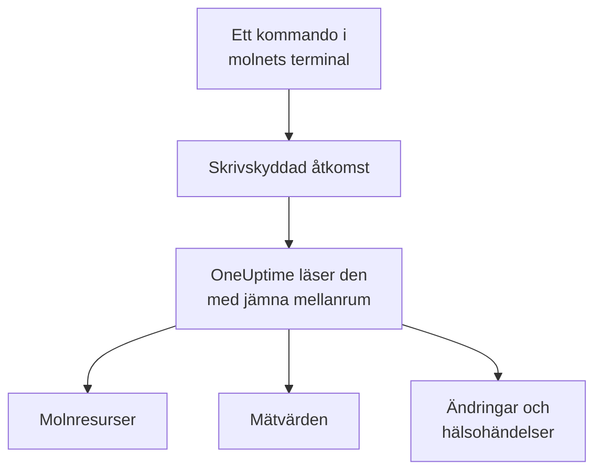

# Anslut ett molnkonto

Anslut ett AWS-konto, en Azure-prenumeration eller ett Google Cloud-projekt från instrumentpanelen, så listar OneUptime alla resurser där, läser deras viktigaste mätvärden och registrerar vad som ändrats i dem och vad din molnleverantör säger om deras hälsa. Du kör ett kommando i molnets egen webbläsarterminal och klistrar in det som skrivs ut: ingen collector att köra och inget att installera.

:::cards
- [Amazon Web Services](#amazon-web-services): En IAM-roll som OneUptime loggar in med, eller en åtkomstnyckel.
- [Microsoft Azure](#microsoft-azure): En app med rollen Monitoring Reader.
- [Google Cloud](#google-cloud): Ett tjänstkonto med fyra skrivskyddade roller.
- [Vad OneUptime läser](#vad-oneuptime-läser): Resurser, mätvärden, ändringar och hälsohändelser, hur ofta och vad det kostar.
- [Datasäkerhet](#datasäkerhet): Vad anslutningen låter Datasäkerhet läsa, och vad varje nivå lägger till i kommandot.
- [Låt AI åtgärda problem](#låt-ai-åtgärda-problem): Ett kommando till, så kan OneUptime AI åtgärda det den hittar.
:::

## Så fungerar det



- **Åtkomsten kan bara läsa.** Kommandot skapar en åtkomst som läser dina resurser och hur de är konfigurerade, deras mätvärden, vad som ändrats och leverantörens hälsohändelser, och inget annat: åtgärderna nedan på AWS, rollen **Monitoring Reader** på Azure och fyra visningsroller på Google Cloud. OneUptime läser aldrig data eller hemligheter med den, utom loggrader när du låter AI läsa ett kontos loggar och innehållsprover när du slår på dem för [Datasäkerhet](#datasäkerhet). Ta bort den för att stänga ute OneUptime.
- **OneUptime läser enligt ett schema.** Var 5:e minut för Azure och Google Cloud, och var 10:e minut för AWS, om du inte väljer ett annat intervall när du ansluter. Varje läsning registrerar också vad som ändrats sedan den förra, och var 30:e minut listar en läsning alla resurser igen.
- **Varje resurs får en egen sida.** Resurser visas under **Moln → Alla resurser** med sina viktigaste mätvärden, ägare och etiketter. Sidan för en listad resurs visar också dess **Anslutna resurser** (vad den körs i, vad som skickar trafik till den), dess slutpunkter, taggar och inställningar, och dess **Incidenter**, **Larm** och **Ändringar**.
- **Varje konto får en egen sida.** Konton visas under **Moln → Konton** med sina resurser efter typ och region, sina **Ändringar** och en **Topologi** över hur resurserna hänger ihop.
- **OneUptime AI läser vad som ändrats.** En undersökning av en incident eller ett larm som är länkat till en molnresurs läser först den resursens ändringar, och läser kontots aktivitetslogg igen när den startar.

## Innan du börjar

- **En projektägare eller -administratör.** Bara de kan ansluta, testa och redigera molnkonton.
- **Molnets terminal** (AWS CloudShell, Azure Cloud Shell eller Google Cloud Shell), inloggad som någon som får skapa en IAM-roll eller -användare, en appregistrering eller ett tjänstkonto.

## Amazon Web Services

:::steps
### Öppna AWS-formuläret

Gå till **Moln → Anslut** och välj **Amazon Web Services**.

### Kör kommandot i AWS CloudShell

Välj hur OneUptime loggar in. En **IAM-roll** är det rekommenderade sättet: inget hemligt lagras, och du kan ta bort rollen när som helst. Formuläret visar kommandot, skrivet för ditt projekt: det skapar en roll som litar på OneUptimes AWS-konto med ditt projekts externa ID, och skriver ut rollens ARN.

Under **Vad som ska läsas** väljer du det här kontot, eller alla konton i din AWS Organization. Kör organisationens kommando i dess hanteringskonto: det lägger till ett StackSet som placerar samma roll i varje konto, nu och när nya konton tillkommer, och låter hanteringskontots roll lista kontona. En anslutning läser upp till 50 konton.

Använd en **Åtkomstnyckel** när en roll inte är möjlig: den läser bara sitt eget konto. Det här kommandot skapar en användare med samma behörigheter och skriver ut dess nyckel:

```bash
aws iam create-user --user-name OneUptimeReadOnly > /dev/null 2>&1 || true
aws iam put-user-policy --user-name OneUptimeReadOnly --policy-name OneUptimeReadOnly --policy-document '{"Version":"2012-10-17","Statement":[{"Effect":"Allow","Action":["cloudwatch:GetMetricData","cloudwatch:ListMetrics","tag:GetResources","iam:ListAccountAliases","cloudformation:ListResources","ec2:DescribeInstances","ec2:DescribeVolumes","ec2:DescribeVpcs","ec2:DescribeNatGateways","autoscaling:DescribeAutoScalingGroups","elasticloadbalancing:DescribeLoadBalancers","elasticloadbalancing:DescribeLoadBalancerAttributes","elasticloadbalancing:DescribeTargetGroups","elasticloadbalancing:DescribeTargetGroupAttributes","elasticloadbalancing:DescribeTargetHealth","elasticloadbalancing:DescribeTags","ecs:ListClusters","ecs:DescribeClusters","ecs:ListServices","ecs:DescribeServices","lambda:ListFunctions","rds:DescribeDBInstances","rds:DescribeDBClusters","elasticache:DescribeReplicationGroups","sqs:ListQueues","sqs:GetQueueAttributes","sns:ListTopics","sns:GetTopicAttributes","sns:ListSubscriptionsByTopic","dynamodb:ListTables","dynamodb:DescribeTable","kinesis:ListStreams","kinesis:DescribeStreamSummary","states:ListStateMachines","states:DescribeStateMachine","cloudfront:ListDistributions","elasticfilesystem:DescribeFileSystems","es:ListDomainNames","es:DescribeDomains","apprunner:ListServices","apprunner:DescribeService","cloudtrail:LookupEvents","health:DescribeEvents","health:DescribeEventDetails","rds:DescribeEvents","autoscaling:DescribeScalingActivities","ec2:DescribeInstanceStatus","ecs:DescribeTaskDefinition","lambda:GetFunctionConfiguration","lambda:GetFunctionConcurrency","lambda:GetAlias","servicequotas:ListServiceQuotas","logs:DescribeLogGroups","logs:FilterLogEvents"],"Resource":"*"},{"Effect":"Allow","Action":["apigateway:GET"],"Resource":["arn:aws:apigateway:*::/restapis","arn:aws:apigateway:*::/restapis/*","arn:aws:apigateway:*::/apis","arn:aws:apigateway:*::/apis/*"]}]}'
aws iam create-access-key --user-name OneUptimeReadOnly
```

### Klistra in det som AWS-kommandot skrev ut

Klistra in allt som kommandot skrev ut i **Det som kommandot skrev ut**. OneUptime plockar ut rollens ARN, eller åtkomstnyckel-ID:t och dess hemlighet.

### Testa och anslut AWS

OneUptime testar anslutningen när det här steget öppnas: det loggar in, räknar resurserna det hittar och säger vad det kostar att läsa dem. Välj **Anslut** för att spara.
:::

Rollen och användaren kan göra följande, och inget annat:

| Vad OneUptime använder dem till | Åtgärder |
| --- | --- |
| Hitta resurserna som rapporterar mätvärden, och läsa deras mätvärden | `cloudwatch:GetMetricData`, `cloudwatch:ListMetrics` |
| Namnge varje resurs och läsa dess taggar | `tag:GetResources`, `iam:ListAccountAliases` |
| Lista varje resurs och hur den är konfigurerad, genom Cloud Control | `cloudformation:ListResources`, `ec2:DescribeInstances`, `ec2:DescribeVolumes`, `ec2:DescribeVpcs`, `ec2:DescribeNatGateways`, `autoscaling:DescribeAutoScalingGroups`, `elasticloadbalancing:DescribeLoadBalancers`, `elasticloadbalancing:DescribeLoadBalancerAttributes`, `elasticloadbalancing:DescribeTargetGroups`, `elasticloadbalancing:DescribeTargetGroupAttributes`, `elasticloadbalancing:DescribeTargetHealth`, `elasticloadbalancing:DescribeTags`, `ecs:ListClusters`, `ecs:DescribeClusters`, `ecs:ListServices`, `ecs:DescribeServices`, `lambda:ListFunctions`, `rds:DescribeDBInstances`, `rds:DescribeDBClusters`, `elasticache:DescribeReplicationGroups`, `sqs:ListQueues`, `sqs:GetQueueAttributes`, `sns:ListTopics`, `sns:GetTopicAttributes`, `sns:ListSubscriptionsByTopic`, `dynamodb:ListTables`, `dynamodb:DescribeTable`, `kinesis:ListStreams`, `kinesis:DescribeStreamSummary`, `states:ListStateMachines`, `states:DescribeStateMachine`, `cloudfront:ListDistributions`, `elasticfilesystem:DescribeFileSystems`, `es:ListDomainNames`, `es:DescribeDomains`, `apprunner:ListServices`, `apprunner:DescribeService`, `apigateway:GET` |
| Läsa vad som ändrats: kontots hanteringshändelser | `cloudtrail:LookupEvents` |
| Läsa AWS egna hälsohändelser för kontot | `health:DescribeEvents`, `health:DescribeEventDetails` |
| Läsa en resurs aktuella status och senaste händelser under en undersökning | `rds:DescribeEvents`, `autoscaling:DescribeScalingActivities`, `ec2:DescribeInstanceStatus`, `ecs:DescribeTaskDefinition`, `lambda:GetFunctionConfiguration`, `lambda:GetFunctionConcurrency`, `lambda:GetAlias` |
| Läsa kontots kvoter under en undersökning | `servicequotas:ListServiceQuotas` |
| Läsa loggrader, bara när du låter AI läsa ett kontos loggar | `logs:DescribeLogGroups`, `logs:FilterLogEvents` |
| Lista organisationens konton, från dess hanteringskonto | `organizations:ListAccounts` |

`apigateway:GET` tillåts bara på API:ernas egna definitioner, aldrig på deras nycklar, och bara hanteringskontots roll får lista organisationens konton. AWS Health svarar bara konton med en supportplan av typen Business, Enterprise On-Ramp eller Enterprise: utan en sådan frågar OneUptime igen en dag senare.

> [!NOTE]
> På en egen installation av OneUptime behöver vägen med en **IAM-roll** en AWS-identitet som tillhör OneUptime självt: sätt `CLOUD_CONNECT_AWS_ACCESS_KEY_ID` och `CLOUD_CONNECT_AWS_SECRET_ACCESS_KEY` till nyckeln för en IAM-användare som får anropa `sts:AssumeRole`. Utan dem erbjuder formuläret en **Åtkomstnyckel**.

## Microsoft Azure

:::steps
### Öppna Azure-formuläret

Gå till **Moln → Anslut** och välj **Microsoft Azure**.

### Kör kommandot i Azure Cloud Shell

Kommandot skapar en app med rollen **Monitoring Reader** på din nuvarande prenumeration, och skriver ut dess uppgifter med datumet då dess hemlighet går ut:

```bash
SCOPE="/subscriptions/$(az account show --query id --output tsv)"
OUT=$(az ad sp create-for-rbac --name OneUptimeReadOnly --role "Monitoring Reader" --scopes "$SCOPE")
APP=$(echo "$OUT" | jq -r .appId)
END=$(az ad app credential list --id "$APP" --query "max([].endDateTime)" --output tsv)
echo "$OUT" | jq --arg end "$END" '. + {endDateTime: $end}'
```

Under **Vad som ska läsas** väljer du i stället alla prenumerationer i klientorganisationen, och rollen tilldelas klientorganisationens rothanteringsgrupp:

```bash
SCOPE="/providers/Microsoft.Management/managementGroups/$(az account show --query tenantId --output tsv)"
OUT=$(az ad sp create-for-rbac --name OneUptimeReadOnly --role "Monitoring Reader" --scopes "$SCOPE")
APP=$(echo "$OUT" | jq -r .appId)
END=$(az ad app credential list --id "$APP" --query "max([].endDateTime)" --output tsv)
echo "$OUT" | jq --arg end "$END" '. + {endDateTime: $end}'
```

### Klistra in det som Azure-kommandot skrev ut

Klistra in allt som kommandot skrev ut i **Det som kommandot skrev ut**. OneUptime plockar ut `tenant`, `appId`, `password` och datumet då den går ut.

### Testa och anslut Azure

OneUptime testar anslutningen när det här steget öppnas. Välj **Anslut** för att spara.
:::

För att läsa fler prenumerationer med samma app ger du den rollen på var och en av dem:

```bash
az role assignment create --assignee <APP_ID> --role "Monitoring Reader" --scope /subscriptions/<SUBSCRIPTION_ID>
```

OneUptime läser varje prenumeration som appen kan läsa, upp till 50, om du inte listar några under **Prenumerationer**. Appens hemlighet slutar fungera det datum den går ut: från 30 dagar innan varnar varje läsning för det. Kör kommandot igen och klistra in det som skrivs ut för att ge den en ny.

## Google Cloud

:::steps
### Öppna Google Cloud-formuläret

Gå till **Moln → Anslut** och välj **Google Cloud**.

### Kör kommandot i Google Cloud Shell

Kör det i projektet som ska övervakas. Det slår på API:erna som OneUptime läser, skapar ett tjänstkonto med rollerna **Monitoring Viewer**, **Cloud Asset Viewer**, **Logs Viewer** och **Service Health Viewer**, och skriver ut dess nyckel:

```bash
PROJECT_ID=$(gcloud config get-value project)
gcloud services enable monitoring.googleapis.com cloudasset.googleapis.com logging.googleapis.com cloudresourcemanager.googleapis.com servicehealth.googleapis.com
gcloud iam service-accounts create oneuptime-read-only --display-name "OneUptime (read only)" > /dev/null 2>&1 || true
gcloud projects add-iam-policy-binding "$PROJECT_ID" --member "serviceAccount:oneuptime-read-only@$PROJECT_ID.iam.gserviceaccount.com" --role roles/monitoring.viewer --condition=None > /dev/null
gcloud projects add-iam-policy-binding "$PROJECT_ID" --member "serviceAccount:oneuptime-read-only@$PROJECT_ID.iam.gserviceaccount.com" --role roles/cloudasset.viewer --condition=None > /dev/null
gcloud projects add-iam-policy-binding "$PROJECT_ID" --member "serviceAccount:oneuptime-read-only@$PROJECT_ID.iam.gserviceaccount.com" --role roles/logging.viewer --condition=None > /dev/null
gcloud projects add-iam-policy-binding "$PROJECT_ID" --member "serviceAccount:oneuptime-read-only@$PROJECT_ID.iam.gserviceaccount.com" --role roles/servicehealth.viewer --condition=None > /dev/null
gcloud iam service-accounts keys create oneuptime-key.json --iam-account "oneuptime-read-only@$PROJECT_ID.iam.gserviceaccount.com"
cat oneuptime-key.json && rm oneuptime-key.json
```

Under **Vad som ska läsas** väljer du i stället alla projekt i organisationen, och rollerna tilldelas projektets organisation:

```bash
PROJECT_ID=$(gcloud config get-value project)
ORG_ID=$(gcloud projects get-ancestors "$PROJECT_ID" --format="value(id)" | tail -1)
gcloud services enable monitoring.googleapis.com cloudasset.googleapis.com logging.googleapis.com cloudresourcemanager.googleapis.com servicehealth.googleapis.com
gcloud iam service-accounts create oneuptime-read-only --display-name "OneUptime (read only)" > /dev/null 2>&1 || true
gcloud organizations add-iam-policy-binding "$ORG_ID" --member "serviceAccount:oneuptime-read-only@$PROJECT_ID.iam.gserviceaccount.com" --role roles/monitoring.viewer --condition=None > /dev/null
gcloud organizations add-iam-policy-binding "$ORG_ID" --member "serviceAccount:oneuptime-read-only@$PROJECT_ID.iam.gserviceaccount.com" --role roles/cloudasset.viewer --condition=None > /dev/null
gcloud organizations add-iam-policy-binding "$ORG_ID" --member "serviceAccount:oneuptime-read-only@$PROJECT_ID.iam.gserviceaccount.com" --role roles/logging.viewer --condition=None > /dev/null
gcloud organizations add-iam-policy-binding "$ORG_ID" --member "serviceAccount:oneuptime-read-only@$PROJECT_ID.iam.gserviceaccount.com" --role roles/servicehealth.viewer --condition=None > /dev/null
gcloud iam service-accounts keys create oneuptime-key.json --iam-account "oneuptime-read-only@$PROJECT_ID.iam.gserviceaccount.com"
cat oneuptime-key.json && rm oneuptime-key.json
```

### Klistra in nyckeln

Klistra in allt som kommandot skrev ut. OneUptime läser nyckelns eget projekt och lagrar nyckeln krypterad.

### Testa och anslut Google Cloud

OneUptime testar anslutningen när det här steget öppnas. Välj **Anslut** för att spara.
:::

För att läsa fler projekt med samma tjänstkonto ger du det de fyra rollerna i vart och ett av dem och listar dem under **Projekt**:

```bash
for ROLE in roles/monitoring.viewer roles/cloudasset.viewer roles/logging.viewer roles/servicehealth.viewer; do gcloud projects add-iam-policy-binding <PROJECT_ID> --member "serviceAccount:oneuptime-read-only@<KEY_PROJECT_ID>.iam.gserviceaccount.com" --role "$ROLE"; done
```

En organisations anslutning läser upp till 50 av dess projekt, om du inte listar några under **Projekt**.

## Datasäkerhet

Samma anslutning kan låta [Datasäkerhet](/docs/data-security/index) läsa kontots datalager: dess buckets, databaser och datavaruhus. Under **Fler fält** står **Datasäkerhet** på **Av** tills du väljer något annat, och kommandot som formuläret visar ändras med det:

| Datasäkerhet | Vad Datasäkerhet får läsa | Vad kommandot lägger till |
| --- | --- | --- |
| **Av** | Inget av kontots datalager | Ingenting |
| **Endast konfiguration** | Vem som kan nå varje datalager, och hur det krypteras, säkerhetskopieras och loggas. Aldrig data. | På AWS en andra inbäddad policy, `OneUptimeDataSecurity`, med läsåtgärder. På Azure och Google Cloud ingenting: **Monitoring Reader** och **Cloud Asset Viewer** läser det redan. |
| **Konfiguration och innehållsprover** | Det, och prov från objekt och rader, för att hitta känsliga data i dem | På AWS samma policy med `s3:ListBucket`, `s3:GetObject` och `kms:Decrypt` enbart via S3. På Azure **Storage Blob Data Reader**. På Google Cloud `roles/storage.objectViewer`, `roles/bigquery.dataViewer` och BigQuery API. |

På AWS lägger rollens kommando till policyn med en rad till. På innehållsnivån ser den ut så här:

```bash
aws iam put-role-policy --role-name "$ROLE" --policy-name OneUptimeDataSecurity --policy-document '{"Version":"2012-10-17","Statement":[{"Effect":"Allow","Action":["s3:ListAllMyBuckets","s3:GetBucketLocation","s3:GetBucketPolicyStatus","s3:GetBucketPublicAccessBlock","s3:GetAccountPublicAccessBlock","s3:GetBucketAcl","s3:GetBucketPolicy","s3:GetEncryptionConfiguration","s3:GetBucketVersioning","s3:GetBucketLogging","s3:GetBucketOwnershipControls","s3:GetReplicationConfiguration","s3:GetBucketTagging","rds:DescribeDBInstances","rds:DescribeDBClusters","rds:DescribeDBSnapshots","rds:DescribeDBSnapshotAttributes","rds:DescribeDBClusterSnapshots","rds:DescribeDBClusterSnapshotAttributes","dynamodb:ListTables","dynamodb:DescribeTable","dynamodb:DescribeContinuousBackups","redshift:DescribeClusters","redshift:DescribeLoggingStatus","es:ListDomainNames","es:DescribeDomains","elasticache:DescribeReplicationGroups","elasticfilesystem:DescribeFileSystems","kms:ListAliases"],"Resource":"*"},{"Effect":"Allow","Action":["s3:ListBucket"],"Resource":"arn:aws:s3:::*"},{"Effect":"Allow","Action":["s3:GetObject"],"Resource":"arn:aws:s3:::*/*"},{"Effect":"Allow","Action":["kms:Decrypt"],"Resource":"*","Condition":{"StringLike":{"kms:ViaService":"s3.*.amazonaws.com"}}}]}'
```

IAM begränsar en användares egna inbäddade policyer till totalt 2 048 tecken, så med en **Åtkomstnyckel** läggs policyn på en grupp, `OneUptimeDataSecurity`, som användaren går med i:

```bash
aws iam create-user --user-name OneUptimeReadOnly > /dev/null 2>&1 || true
aws iam put-user-policy --user-name OneUptimeReadOnly --policy-name OneUptimeReadOnly --policy-document '{"Version":"2012-10-17","Statement":[{"Effect":"Allow","Action":["cloudwatch:GetMetricData","cloudwatch:ListMetrics","tag:GetResources","iam:ListAccountAliases","cloudformation:ListResources","ec2:DescribeInstances","ec2:DescribeVolumes","ec2:DescribeVpcs","ec2:DescribeNatGateways","autoscaling:DescribeAutoScalingGroups","elasticloadbalancing:DescribeLoadBalancers","elasticloadbalancing:DescribeLoadBalancerAttributes","elasticloadbalancing:DescribeTargetGroups","elasticloadbalancing:DescribeTargetGroupAttributes","elasticloadbalancing:DescribeTargetHealth","elasticloadbalancing:DescribeTags","ecs:ListClusters","ecs:DescribeClusters","ecs:ListServices","ecs:DescribeServices","lambda:ListFunctions","rds:DescribeDBInstances","rds:DescribeDBClusters","elasticache:DescribeReplicationGroups","sqs:ListQueues","sqs:GetQueueAttributes","sns:ListTopics","sns:GetTopicAttributes","sns:ListSubscriptionsByTopic","dynamodb:ListTables","dynamodb:DescribeTable","kinesis:ListStreams","kinesis:DescribeStreamSummary","states:ListStateMachines","states:DescribeStateMachine","cloudfront:ListDistributions","elasticfilesystem:DescribeFileSystems","es:ListDomainNames","es:DescribeDomains","apprunner:ListServices","apprunner:DescribeService","cloudtrail:LookupEvents","health:DescribeEvents","health:DescribeEventDetails","rds:DescribeEvents","autoscaling:DescribeScalingActivities","ec2:DescribeInstanceStatus","ecs:DescribeTaskDefinition","lambda:GetFunctionConfiguration","lambda:GetFunctionConcurrency","lambda:GetAlias","servicequotas:ListServiceQuotas","logs:DescribeLogGroups","logs:FilterLogEvents"],"Resource":"*"},{"Effect":"Allow","Action":["apigateway:GET"],"Resource":["arn:aws:apigateway:*::/restapis","arn:aws:apigateway:*::/restapis/*","arn:aws:apigateway:*::/apis","arn:aws:apigateway:*::/apis/*"]}]}'
aws iam create-group --group-name OneUptimeDataSecurity > /dev/null 2>&1 || true
aws iam put-group-policy --group-name OneUptimeDataSecurity --policy-name OneUptimeDataSecurity --policy-document '{"Version":"2012-10-17","Statement":[{"Effect":"Allow","Action":["s3:ListAllMyBuckets","s3:GetBucketLocation","s3:GetBucketPolicyStatus","s3:GetBucketPublicAccessBlock","s3:GetAccountPublicAccessBlock","s3:GetBucketAcl","s3:GetBucketPolicy","s3:GetEncryptionConfiguration","s3:GetBucketVersioning","s3:GetBucketLogging","s3:GetBucketOwnershipControls","s3:GetReplicationConfiguration","s3:GetBucketTagging","rds:DescribeDBInstances","rds:DescribeDBClusters","rds:DescribeDBSnapshots","rds:DescribeDBSnapshotAttributes","rds:DescribeDBClusterSnapshots","rds:DescribeDBClusterSnapshotAttributes","dynamodb:ListTables","dynamodb:DescribeTable","dynamodb:DescribeContinuousBackups","redshift:DescribeClusters","redshift:DescribeLoggingStatus","es:ListDomainNames","es:DescribeDomains","elasticache:DescribeReplicationGroups","elasticfilesystem:DescribeFileSystems","kms:ListAliases"],"Resource":"*"},{"Effect":"Allow","Action":["s3:ListBucket"],"Resource":"arn:aws:s3:::*"},{"Effect":"Allow","Action":["s3:GetObject"],"Resource":"arn:aws:s3:::*/*"},{"Effect":"Allow","Action":["kms:Decrypt"],"Resource":"*","Condition":{"StringLike":{"kms:ViaService":"s3.*.amazonaws.com"}}}]}'
aws iam add-user-to-group --user-name OneUptimeReadOnly --group-name OneUptimeDataSecurity
aws iam create-access-key --user-name OneUptimeReadOnly
```

På Azure lägger innehållsnivån till **Storage Blob Data Reader** i samma omfång som **Monitoring Reader**:

```bash
SCOPE="/subscriptions/$(az account show --query id --output tsv)"
OUT=$(az ad sp create-for-rbac --name OneUptimeReadOnly --role "Monitoring Reader" --scopes "$SCOPE")
APP=$(echo "$OUT" | jq -r .appId)
az role assignment create --assignee "$APP" --role "Storage Blob Data Reader" --scope "$SCOPE" > /dev/null
END=$(az ad app credential list --id "$APP" --query "max([].endDateTime)" --output tsv)
echo "$OUT" | jq --arg end "$END" '. + {endDateTime: $end}'
```

På Google Cloud lägger den till de två rollerna och slår på `bigquery.googleapis.com`:

```bash
PROJECT_ID=$(gcloud config get-value project)
gcloud services enable monitoring.googleapis.com cloudasset.googleapis.com logging.googleapis.com cloudresourcemanager.googleapis.com servicehealth.googleapis.com bigquery.googleapis.com
gcloud iam service-accounts create oneuptime-read-only --display-name "OneUptime (read only)" > /dev/null 2>&1 || true
gcloud projects add-iam-policy-binding "$PROJECT_ID" --member "serviceAccount:oneuptime-read-only@$PROJECT_ID.iam.gserviceaccount.com" --role roles/monitoring.viewer --condition=None > /dev/null
gcloud projects add-iam-policy-binding "$PROJECT_ID" --member "serviceAccount:oneuptime-read-only@$PROJECT_ID.iam.gserviceaccount.com" --role roles/cloudasset.viewer --condition=None > /dev/null
gcloud projects add-iam-policy-binding "$PROJECT_ID" --member "serviceAccount:oneuptime-read-only@$PROJECT_ID.iam.gserviceaccount.com" --role roles/logging.viewer --condition=None > /dev/null
gcloud projects add-iam-policy-binding "$PROJECT_ID" --member "serviceAccount:oneuptime-read-only@$PROJECT_ID.iam.gserviceaccount.com" --role roles/servicehealth.viewer --condition=None > /dev/null
gcloud projects add-iam-policy-binding "$PROJECT_ID" --member "serviceAccount:oneuptime-read-only@$PROJECT_ID.iam.gserviceaccount.com" --role roles/storage.objectViewer --condition=None > /dev/null
gcloud projects add-iam-policy-binding "$PROJECT_ID" --member "serviceAccount:oneuptime-read-only@$PROJECT_ID.iam.gserviceaccount.com" --role roles/bigquery.dataViewer --condition=None > /dev/null
gcloud iam service-accounts keys create oneuptime-key.json --iam-account "oneuptime-read-only@$PROJECT_ID.iam.gserviceaccount.com"
cat oneuptime-key.json && rm oneuptime-key.json
```

Kommandot för en lägre nivå ersätter AWS-policyn med den lägre nivåns policy. **Av** lägger inte till något, så det som ett tidigare kommando beviljade finns kvar tills du tar bort det: policyn `OneUptimeDataSecurity` på AWS, med `aws iam delete-role-policy --role-name <your role> --policy-name OneUptimeDataSecurity`, och innehållsnivåns roller på Azure och Google Cloud. Datasäkerhet slutar läsa direkt i båda fallen: den läser bara det som anslutningens nivå anger. [Konfigurera Datasäkerhet](/docs/data-security/setup) listar varje åtgärd i policyn, och vad Datasäkerhet sparar av det den läser.

## Vad OneUptime läser

| | AWS | Azure | Google Cloud |
| --- | --- | --- | --- |
| Resurser | Varje resurs av de typer som OneUptime känner till, i alla regioner du använder, från Cloud Control | Varje resurs i prenumerationerna, från Resource Graph | Varje resurs i projekten, från Cloud Asset Inventory |
| Mätvärden | De viktigaste mätvärdena för varje tjänst, som en instans CPU, nätverk och statuskontroller | Upp till 8 viktiga mätvärden per resurs | De viktigaste mätvärdena för varje resurstyp |
| Ändringar | Hanteringshändelserna i CloudTrail | Aktivitetsloggens administrativa händelser | Granskningsloggen Admin Activity |
| Hälsohändelser | AWS Health | Service Health och Resource Health | Service Health |
| Läses var | 10:e minut | 5:e minut | 5:e minut |
| En borttagen resurs | Arkiveras när en fullständig listning inte längre har den | Arkiveras när en fullständig listning inte längre har den | Arkiveras när en fullständig listning inte längre har den |

Varje läsning fortsätter där den förra slutade, så varje datapunkt och varje ändring skrivs en gång. En ny anslutnings första läsning startar inom en minut och går en timme bakåt för mätvärden och 2 timmar bakåt för ändringar; efter ett uppehåll går en läsning högst 6 timmar bakåt. En resurs som bara rapporterar mätvärden, och som ingen listning har, arkiveras efter 7 dagar utan mätvärden.

Anropen som OneUptime gör faktureras ditt molnkonto, till molnets priser. Att lista resurser och läsa ändringar och hälsohändelser kostar inget på alla tre molnen; att läsa mätvärden gör det. Testet uppskattar vad det som hittas kostar, och att läsa mer sällan kostar mindre: ändra **Intervall för läsning av mätvärden** under **Fler fält**.

| Moln | Pris |
| --- | --- |
| AWS | CloudWatch `GetMetricData`: $0.01 per 1 000 mätvärden, och varje viktigt mätvärde för en resurs är ett mätvärde per läsning |
| Azure | De första 1 000 000 mätvärdesläsningarna per månad för varje prenumeration är gratis, därefter $0.01 per 1 000 |
| Google Cloud | De första 1 000 000 lästa tidsserierna per månad är gratis, därefter $0.50 per miljon |

## Det du ser i OneUptime

- **Ett kontos sida.** Under **Moln → Konton** räknar ett kontos översikt dess resurser efter typ och region och säger när en anslutning senast läste det. Dess **Resurser** listar dem, dess **Ändringar** listar vad som ändrats i det, nyast först, och dess **Topologi** ritar dess regioner, nätverken i dem och vad som körs i vart och ett, med de öppna incidenterna och larmen på resurserna de är länkade till. Dess **Feed** registrerar hur kontot kom till OneUptime, när dess Moln-AI-agent anslöt eller återställdes, och vem som ändrade vad OneUptime AI får göra i det.
- **En resurs ändringar.** En ändring sparas som en ändringshändelse knuten till resursen den ändrade och till dess konto, och ritas som en markör i resursens mätvärdesdiagram tillsammans med dess incidenter och larm. Diagram som inte är filtrerade till någon resurs utelämnar ett molnkontos aktivitetslogg, så att ett livligt konto inte tränger undan dina driftsättningar; leverantörens hälsohändelser finns kvar i dem.
- **Incidenter och larm.** Länka en molnresurs till en övervakning, en incident eller ett larm under dess länkade resurser, så listas dess incidenter och larm på resursens sida. En övervakning av en webbplats, ett API, SSL, ping eller en port vars värd leder till en slutpunkt för en resurs, direkt eller via dess DNS, listar resursen under **Föreslagna molnresurser** på sitt kort **Länkade resurser**: välj **Länka resurs** för att länka den.

## Låt AI åtgärda problem

OneUptime AI läser varje anslutet konto medan den utreder, med den skrivskyddade åtkomsten ovan. För att låta den även åtgärda problem, som att starta om en tjänst, skala ut den eller rulla tillbaka den, öppnar du kontot under **Moln → Konton** och väljer **Låt AI åtgärda problem** på **AI-agent**-kortet i dess **Översikt**.

Dialogrutan ställer en fråga, **Hur långt får AI gå?**: **Fråga mig först**, standardvalet, där OneUptime AI föreslår varje åtgärd och en människa godkänner den med ett klick, eller **Åtgärda problem på egen hand när det är säkert**, där säkra ändringar körs av sig själva och mer riskfyllda fortfarande väntar på godkännande. Allt annat har ett säkert standardvärde under **Fler fält**. Sedan visar den ett kommando, skrivet för det här kontot: kör det i AWS CloudShell, Azure Cloud Shell eller Google Cloud Shell, inloggad som någon som får skapa roller i kontot. Kommandot skapar en roll som bara får göra de påslagna ändringarna och startar Moln-AI-agenten med den i ditt konto. Agenten ansluter av sig själv inom några minuter, och dialogrutan säger det: det finns inget att klistra in tillbaka.

Agenten är en liten container som körs hela månaden i ditt konto och faktureras av ditt moln till dess listpriser:

| Moln | Vad som körs | Ungefär |
| --- | --- | --- |
| AWS | En ECS Fargate-uppgift med 0.25 vCPU och 0.5 GB, och dess publika IPv4-adress, till priserna i `us-east-1` | $13 i månaden |
| Azure | En Container Apps-replik med 0.25 vCPU och 0.5 GiB, efter prenumerationens månatliga gratiskvot på 180 000 vCPU-sekunder och 360 000 GiB-sekunder | $14 i månaden |
| Google Cloud | En Cloud Run-instans med 1 vCPU och 0.5 GiB med CPU alltid allokerad, vilket tar en hel vCPU, efter den månatliga gratisnivån på 240 000 vCPU-sekunder och 450 000 GiB-sekunder | $45 i månaden |

Vad agenten får ändra, hur varje ändring placeras i en nivå och ångras, och hur du läser dess loggar: [AI-agenter för infrastrukturen](/docs/ai/infrastructure-ai-agents#i-ett-molnkonto).

## Felsökning

:::details Testet säger att nyckeln eller hemligheten inte godkändes
Kopiera allt som kommandot skrev ut och klistra in det igen. En nyckel som skapades för en minut sedan kan ta en minut innan den fungerar. En Azure-hemlighet som har gått ut avvisas också: kör kommandot igen.
:::

:::details Testet loggar in, men kan inte läsa
Kör kommandot igen: det ger rollerna som OneUptime behöver. På AWS kör du kommandot som formuläret visar för det här projektet: en roll som skapades för ett annat projekt litar på det projektets externa ID, inte på det här projektets.
:::

:::details Google Cloud låter inte kommandot skapa en nyckel
En organisationsprincip, `iam.disableServiceAccountKeyCreation`, kan förbjuda nycklar för tjänstkonton. Be organisationens administratör om ett undantag för projektet, eller [skicka mätvärdena med din egen collector](/docs/telemetry/cloud-resources).
:::

:::details Inga resurser visas
Den första läsningen listar varje resurs i kontot, oavsett om den rapporterar mätvärden eller inte. Om en anslutning inte fungerar säger **View error** under **Moln → Anslut** varför dess senaste läsning misslyckades.
:::

:::details Några av organisationens konton saknas
En anslutning läser upp till 50 konton, prenumerationer eller projekt, och varje läsning säger till när det finns fler. Anslut de andra med en egen anslutning.
:::

## Nästa steg

:::cards
- [Molnresurser](/docs/telemetry/cloud-resources): Kör din egen OpenTelemetry Collector i stället, eller strömma CloudWatch-mätvärden.
- [Driftsättningar och ändringar](/docs/telemetry/change-events): Varje ändring som OneUptime registrerar, och hur OneUptime AI läser dem.
- [Mätvärdesmonitor](/docs/monitor/metrics-monitor): Larma på en resurs mätvärden.
:::
