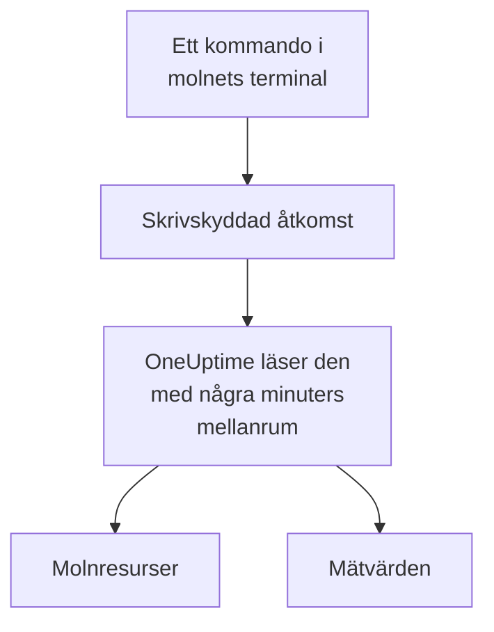

# Anslut ett molnkonto

Anslut ett AWS-konto, en Azure-prenumeration eller ett Google Cloud-projekt från instrumentpanelen, så listar OneUptime dess resurser och läser deras viktigaste mätvärden enligt ett schema. Du kör ett kommando i molnets egen webbläsarterminal och klistrar in det som skrivs ut: ingen collector att köra och inget att installera.

:::cards
- [Amazon Web Services](#amazon-web-services): En IAM-roll som OneUptime loggar in med, eller en åtkomstnyckel.
- [Microsoft Azure](#microsoft-azure): En app med rollen Monitoring Reader.
- [Google Cloud](#google-cloud): Ett tjänstkonto med rollen Monitoring Viewer.
- [Vad OneUptime läser](#vad-oneuptime-läser): Vilka resurser och mätvärden, hur ofta och vad det kostar.
:::

## Så fungerar det



- **Åtkomsten kan bara läsa.** Kommandot skapar en åtkomst som läser mätvärden och inget annat: tre läsåtgärder på AWS, rollen **Monitoring Reader** på Azure och rollen **Monitoring Viewer** på Google Cloud. Ta bort den för att stänga ute OneUptime.
- **OneUptime läser enligt ett schema.** Var 5:e minut för Azure och Google Cloud, och var 10:e minut för AWS, om du inte väljer ett annat intervall när du ansluter.
- **Varje resurs får en egen sida.** Resurser visas under **Moln → Alla resurser** med sina viktigaste mätvärden, ägare och etiketter, precis som resurserna som en collector rapporterar.

## Innan du börjar

- **En projektägare eller -administratör.** Bara de kan ansluta, testa och redigera molnkonton.
- **Molnets terminal** (AWS CloudShell, Azure Cloud Shell eller Google Cloud Shell), inloggad som någon som får skapa en IAM-roll eller -användare, en appregistrering eller ett tjänstkonto.

## Amazon Web Services

:::steps
### Öppna AWS-formuläret

Gå till **Moln → Anslut** och välj **Amazon Web Services**.

### Kör kommandot i AWS CloudShell

Välj hur OneUptime loggar in. En **IAM-roll** är det rekommenderade sättet: inget hemligt lagras, och du kan ta bort rollen när som helst. Formuläret visar kommandot, skrivet för ditt projekt: det skapar en roll som litar på OneUptimes AWS-konto med ditt projekts externa ID, och skriver ut rollens ARN. Använd en **Åtkomstnyckel** när en roll inte är möjlig. Det här kommandot skapar en användare med samma behörigheter och skriver ut dess nyckel:

```bash
aws iam create-user --user-name OneUptimeReadOnly > /dev/null 2>&1 || true
aws iam put-user-policy --user-name OneUptimeReadOnly --policy-name OneUptimeReadOnly --policy-document '{"Version":"2012-10-17","Statement":[{"Effect":"Allow","Action":["cloudwatch:GetMetricData","cloudwatch:ListMetrics","tag:GetResources"],"Resource":"*"}]}'
aws iam create-access-key --user-name OneUptimeReadOnly
```

### Klistra in det som AWS-kommandot skrev ut

Klistra in allt som kommandot skrev ut i **Det som kommandot skrev ut**. OneUptime plockar ut rollens ARN, eller åtkomstnyckel-ID:t och dess hemlighet.

### Testa och anslut AWS

OneUptime testar anslutningen när det här steget öppnas: det loggar in, räknar resurserna det hittar och säger vad det kostar att läsa dem. Välj **Anslut** för att spara.
:::

Rollen och användaren kan göra tre saker, och inget annat:

| Åtgärd | Vad OneUptime använder den till |
| --- | --- |
| `cloudwatch:ListMetrics` | Hitta resurserna som rapporterar mätvärden, i varje region |
| `cloudwatch:GetMetricData` | Läsa deras viktigaste mätvärden |
| `tag:GetResources` | Namnge varje resurs efter dess `Name`-tagg |

> [!NOTE]
> På en egen OneUptime-installation behöver sättet **IAM-roll** en egen AWS-identitet för OneUptime: ange `CLOUD_CONNECT_AWS_ACCESS_KEY_ID` och `CLOUD_CONNECT_AWS_SECRET_ACCESS_KEY` som nyckeln för en IAM-användare som får anropa `sts:AssumeRole`. Utan dem erbjuder formuläret en **Åtkomstnyckel**.

## Microsoft Azure

:::steps
### Öppna Azure-formuläret

Gå till **Moln → Anslut** och välj **Microsoft Azure**.

### Kör kommandot i Azure Cloud Shell

Kommandot skapar en app med rollen **Monitoring Reader** på din nuvarande prenumeration och skriver ut dess uppgifter:

```bash
az ad sp create-for-rbac --name OneUptimeReadOnly --role "Monitoring Reader" --scopes "/subscriptions/$(az account show --query id --output tsv)"
```

### Klistra in det som Azure-kommandot skrev ut

Klistra in allt som kommandot skrev ut i **Det som kommandot skrev ut**. OneUptime plockar ut `tenant`, `appId` och `password`.

### Testa och anslut Azure

OneUptime testar anslutningen när det här steget öppnas. Välj **Anslut** för att spara.
:::

Om du vill läsa fler prenumerationer med samma app ger du den rollen på var och en av dem:

```bash
az role assignment create --assignee <APP_ID> --role "Monitoring Reader" --scope /subscriptions/<SUBSCRIPTION_ID>
```

OneUptime läser alla prenumerationer som appen kan läsa, om du inte anger några under **Prenumerationer**.

## Google Cloud

:::steps
### Öppna Google Cloud-formuläret

Gå till **Moln → Anslut** och välj **Google Cloud**.

### Kör kommandot i Google Cloud Shell

Kör det i projektet som ska övervakas. Det slår på Cloud Monitoring API, skapar ett tjänstkonto med rollen **Monitoring Viewer** och skriver ut dess nyckel:

```bash
PROJECT_ID=$(gcloud config get-value project)
gcloud services enable monitoring.googleapis.com
gcloud iam service-accounts create oneuptime-read-only --display-name "OneUptime (read only)"
gcloud projects add-iam-policy-binding "$PROJECT_ID" --member "serviceAccount:oneuptime-read-only@$PROJECT_ID.iam.gserviceaccount.com" --role roles/monitoring.viewer --condition=None > /dev/null
gcloud iam service-accounts keys create oneuptime-key.json --iam-account "oneuptime-read-only@$PROJECT_ID.iam.gserviceaccount.com"
cat oneuptime-key.json && rm oneuptime-key.json
```

### Klistra in nyckeln

Klistra in allt som kommandot skrev ut. OneUptime läser nyckelns eget projekt och lagrar nyckeln krypterad.

### Testa och anslut Google Cloud

OneUptime testar anslutningen när det här steget öppnas. Välj **Anslut** för att spara.
:::

Om du vill läsa fler projekt med samma tjänstkonto ger du det rollen i vart och ett av dem och anger dem under **Projekt**:

```bash
gcloud projects add-iam-policy-binding <PROJECT_ID> --member "serviceAccount:oneuptime-read-only@<KEY_PROJECT_ID>.iam.gserviceaccount.com" --role roles/monitoring.viewer
```

## Vad OneUptime läser

| | AWS | Azure | Google Cloud |
| --- | --- | --- | --- |
| Resurser | De som rapporterar mätvärden till CloudWatch, i alla regioner du använder | Alla resurser i prenumerationerna | De som rapporterar mätvärden till Cloud Monitoring |
| Mätvärden | De viktigaste mätvärdena för varje tjänst, som en instans CPU, nätverk och statuskontroller | Upp till 8 viktiga mätvärden per resurs | De viktigaste mätvärdena för varje resurstyp |
| Läses var | 10:e minut | 5:e minut | 5:e minut |
| En borttagen resurs | Arkiveras efter 7 dagar utan mätvärden | Arkiveras vid nästa läsning | Arkiveras efter 7 dagar utan mätvärden |

Varje läsning fortsätter där den förra slutade, så varje datapunkt skrivs en gång. En ny anslutnings första läsning startar inom en minut och går en timme bakåt; efter ett uppehåll går en läsning högst 6 timmar bakåt.

Anropen som OneUptime gör faktureras ditt molnkonto, till molnets priser. Testet uppskattar vad det som hittas kostar, och att läsa mer sällan kostar mindre: ändra **Intervall för läsning av mätvärden** under **Fler fält**.

| Moln | Pris |
| --- | --- |
| AWS | CloudWatch `GetMetricData`: $0.01 per 1 000 mätvärden, och varje viktigt mätvärde för en resurs är ett mätvärde per läsning |
| Azure | De första 1 000 000 mätvärdesläsningarna per månad för varje prenumeration är gratis, därefter $0.01 per 1 000 |
| Google Cloud | De första 1 000 000 lästa tidsserierna per månad är gratis, därefter $0.50 per miljon |

## Felsökning

:::details Testet säger att nyckeln eller hemligheten inte godkändes
Kopiera allt som kommandot skrev ut och klistra in det igen. En nyckel som skapades för en minut sedan kan ta en minut innan den fungerar.
:::

:::details Testet loggar in, men kan inte läsa
Kör kommandot igen: det ger rollen som OneUptime behöver. På AWS kör du kommandot som formuläret visar för det här projektet: en roll som skapades för ett annat projekt litar på det projektets externa ID, inte på det här projektets.
:::

:::details Google Cloud låter inte kommandot skapa en nyckel
En organisationsprincip, `iam.disableServiceAccountKeyCreation`, kan förbjuda nycklar för tjänstkonton. Be organisationens administratör om ett undantag för projektet, eller [skicka mätvärdena med din egen collector](/docs/telemetry/cloud-resources).
:::

:::details Inga resurser visas
På AWS och Google Cloud visas en resurs när den rapporterar mätvärden. Om en anslutning inte fungerar säger **View error** under **Moln → Anslut** varför dess senaste läsning misslyckades.
:::

## Nästa steg

:::cards
- [Molnresurser](/docs/telemetry/cloud-resources): Kör din egen OpenTelemetry Collector i stället, eller strömma CloudWatch-mätvärden.
- [Mätvärdesmonitor](/docs/monitor/metrics-monitor): Larma på en resurs mätvärden.
:::
