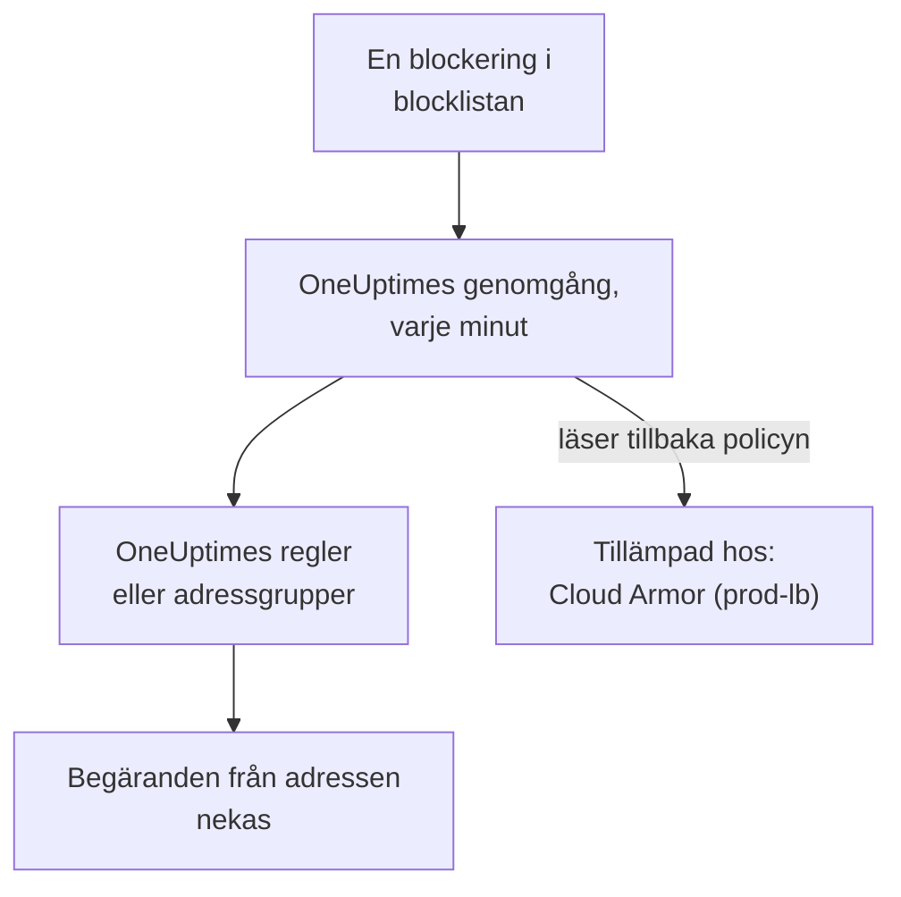

# Blockera adresser i Cloud Armor

Ditt projekts blocklista kan tillämpas i Google Cloud Armor-säkerhetspolicyerna för dina lastbalanserare. Slå på det för en Google Cloud-anslutning som du redan har, välj säkerhetspolicyerna, och varje adress som blocklistan blockerar blockeras där, oavsett om en person, en playbook eller OneUptime AI blockerade den.

:::cards
- [Slå på det](#slå-på-det): En inställning på Google Cloud-anslutningen, och rollen som den kräver.
- [Vad OneUptime skapar](#vad-oneuptime-skapar): Egna regler i varje policy, eller adressgrupper med Cloud Armor Enterprise.
- [Vilken adress som matchas](#vilken-adress-som-matchas): Adressen som anslöt, eller användar-IP:n bakom en proxy.
:::

## Så fungerar det

OneUptime underhåller egna regler i varje säkerhetspolicy som du väljer, och lägger in adresserna som blocklistan blockerar i dem. Varje minut ändrar den det som har ändrats, en regel i taget, och läser sedan tillbaka policyn. På sidan **Blocklista** anger en blockerings **Tillämpad hos** Cloud Armor (prod-lb) först när policyn har blockeringen; tills dess är den inte tillämpad.

## Innan du börjar

- Ett Google Cloud-projekt som är anslutet till OneUptime (se [Anslut ett molnkonto](/docs/telemetry/cloud-accounts#google-cloud)).
- En roll som får ändra var blocklistan tillämpas: **Projektägare**, **Projektadministratör** eller **Säkerhetsadministratör**.
- Någon som får skapa roller och tilldela dem i Google Cloud-projektet, för att köra ett kommando i Cloud Shell.

## Slå på det

:::steps
### Öppna anslutningen
Öppna **Moln → Anslut** och redigera Google Cloud-anslutningen.

### Slå på inställningen
Under **Fler fält** ställer du in **Blockera adresser i Cloud Armor** på **På** och sparar. Konfigurationskommandot som formuläret visar ger nu rollen nedan där det ger de andra. En anslutning som du redan har behöver inte köra det igen: dialogrutan **Lägg till WAF** ger raderna som tilldelar rollen i policyns projekt.

### Lägg till säkerhetspolicyerna
Öppna **Säkerhetshändelser → Playbooks → Blocklista**. Under **Moln-WAF:er** klickar du på **Lägg till WAF** och väljer en säkerhetspolicy. OneUptime frågar Google Cloud om anslutningen får skriva den, utan att skriva något.

### Bevilja rollen om den saknas
När en behörighet saknas visar dialogrutan raderna som tilldelar den i policyns projekt. Kör dem i Cloud Shell, klicka på **Kontrollera igen** och lägg sedan till policyn. Dess **Status** visar **Tillämpar** när OneUptime har konfigurerat den.
:::

Säkerhetspolicyerna kommer från anslutningens inventering: en policy som OneUptime inte har läst än visas efter nästa läsning. Så länge en policy tillämpar blocklistan kan anslutningens inställning inte stängas av och anslutningen inte tas bort: ta först bort policyn, så att OneUptime tar ut sina regler.

## Vad OneUptime skapar

OneUptime väljer hur en policy rymmer blocklistan när du lägger till den.

| Vad | Namn | Var |
| --- | --- | --- |
| Regler som nekar med 403, var och en med upp till 10 adresser eller intervall | Deras beskrivning börjar med `OneUptime blocklist <project> #1`, `#2`, ... | I varje policy som du väljer, högst 20 av dem. |
| Två adressgrupper, IPv4 och IPv6 | `oneuptime-<project>-block-ipv4`, `oneuptime-<project>-block-ipv6` | Globala, i policyns projekt. Endast med Cloud Armor Enterprise. |
| En regel som nekar med 403 allt som någon av grupperna innehåller | Dess beskrivning börjar med `OneUptime blocklist <project>, address groups` | I varje global backend-policy som du väljer, med Cloud Armor Enterprise. |

`<project>` är de första åtta tecknen i ditt projekts externa ID, så två OneUptime-projekt som väljer en och samma policy skriver aldrig varandras regler. Cloud Armor namnger en regel enbart efter dess prioritet, så OneUptime känner igen sina egna regler på deras beskrivning.

- **Regler.** Cloud Armor rymmer 10 adresser eller intervall i en regel, så en policy rymmer upp till 200 blockeringar i OneUptimes 20 regler; en blockering som inte får plats säger det på sin rad.
- **Adressgrupper.** En global backend-policy i ett projekt med Cloud Armor Enterprise rymmer i stället blocklistan i två adressgrupper: 10 000 IPv4- och 2 000 IPv6-intervall. Alla sådana policyer i projektet delar på dem, och en regel i varje policy nekar det de innehåller. Grupperna tar 16 000 enheter av projektets kvot för adressgrupper.

OneUptime lägger till, ändrar och tar bort var och en av sina regler för sig, med Cloud Armors regelmetoder: den skriver aldrig policyn i sin helhet, och skriver aldrig någon av dina regler. En enskild adress skrivs som `/32` eller `/128`.

## Reglernas plats i policyn

OneUptime placerar sina regler på lediga prioriteter före din första regel som släpper igenom en begäran, lägsta först, så att ingen av dina regler släpper igenom en blockerad adress: en regel som tillåter, stryper, bannlyser efter frekvens eller fördelar rättvist. En av dina regler som nekar får komma först. OneUptime numrerar aldrig om, ändrar eller tar bort någon av dina regler: när ingen prioritet är ledig före din första sådana regel visar policyn **Ingen ledig prioritet**, och OneUptime lägger till sin regel så snart du frigör en.

## Vilken adress som matchas

| Säkerhetspolicy | Klientadress | När du ska välja den |
| --- | --- | --- |
| Backend | **Adressen som anslöt till lastbalanseraren (origin.ip)** | Standardvalet. |
| Backend | Användar-IP:n från policyns begärandehuvuden (origin.user_ip) | För en lastbalanserare bakom en annan proxy eller ett annat CDN. |
| Edge | Adressen som anslöt till lastbalanseraren (origin.ip) | Det enda valet: en edge-policy läser ingen annan adress. |

`origin.user_ip` är adressen i policyns huvuden för användar-IP (`userIpRequestHeaders`), som en proxy eller ett CDN framför lastbalanseraren skriver. Om inga är angivna, eller om det inte finns någon giltig adress i dem, är den `origin.ip`. Välj den bara när en sådan proxy skriver dem, eftersom en klient som når lastbalanseraren direkt kan skriva dem själv. Valet finns under **Fler fält** i dialogrutan **Lägg till WAF**, och du kan ändra det senare med **Klientadress** på policyns rad.

En network edge-säkerhetspolicy, för passthrough Network Load Balancers, kan inte väljas, och dialogrutan **Lägg till WAF** säger varför: dess regler matchar paket, inte begäranden.

OneUptimes regler i Cloud Armor nekar bara. En blockering som ber om att utmana en adress tillämpas inte i Cloud Armor, och säger det. En utmaning från en policy för automatisk respons tillämpas där som en blockering lika länge.

## När en regel ändras manuellt

När någon sätter en av OneUptimes regler i förhandsgranskningsläge, ändrar den eller tar bort den, eller tar bort en av OneUptimes adressgrupper, lämnar OneUptime den som den lämnades. Policyn visar **Ändrad manuellt**, och blockeringarna som den innehöll tillämpas inte, med orsak, tills någon klickar på **Återställ** på policyns rad. Återställ skriver regeln igen som OneUptime skriver den, på sin egen prioritet så länge den är ledig, och skapar en borttagen adressgrupp igen.

OneUptime kontrollerar inte att en policy är kopplad till en backend-tjänst. En policy som inte är kopplad till någon blockerar ingenting.

## Behåll en policy i Terraform

En `google_compute_security_policy` med `rule`-block äger varje regel i policyn, så dess nästa plan tar bort OneUptimes regler. Behåll dina regler som `google_compute_security_policy_rule`-resurser, som lämnar andra regler i fred, eller lägg till `ignore_changes = [rule]` i policyns `lifecycle`-block.

## Behörigheter

Konfigurationskommandot lägger till en anpassad roll, `oneuptimeCloudArmorBlocklist`, där det ger anslutningens andra roller, och tilldelar den till anslutningens tjänstkonto. Raderna som dialogrutan **Lägg till WAF** visar lägger till samma roll i policyns projekt. En policy som rymmer blocklistan i regler, inte i adressgrupper, behöver bara sina egna behörigheter.

| Behörighet | Varför |
| --- | --- |
| `compute.securityPolicies.get`, `compute.securityPolicies.update` | Läsa en global policy och ändra OneUptimes regler i den. |
| `compute.regionSecurityPolicies.get`, `compute.regionSecurityPolicies.update` | Läsa en regional policy och ändra OneUptimes regler i den. |
| `compute.globalOperations.get`, `compute.regionOperations.get` | Vänta tills en ändring är klar. |
| `compute.projects.get` | Läsa om projektet har Cloud Armor Enterprise. |
| `networksecurity.addressGroups.get`, `networksecurity.addressGroups.list`, `networksecurity.addressGroups.create`, `networksecurity.addressGroups.update`, `networksecurity.addressGroups.delete`, `networksecurity.addressGroups.use` | Underhålla OneUptimes adressgrupper, och referera till dem från dess regel. Endast med Cloud Armor Enterprise. |
| `networksecurity.operations.get` | Vänta tills en ändring av en adressgrupp är klar. |

Rollen kan inte ta bort en policy, och OneUptime skriver aldrig något annat. Konfigurationskommandot aktiverar också API:erna för Compute Engine och Network Security.

## Ta bort det

:::steps
### Ta bort säkerhetspolicyn
På **Säkerhetshändelser → Playbooks → Blocklista** klickar du på **Ta bort** på policyns rad. OneUptime tar ut sina regler ur policyn och raderar sina adressgrupper när ingen annan policy i projektet använder dem.

### Stäng av inställningen
Redigera anslutningen, ställ in **Blockera adresser i Cloud Armor** på **Av** och spara. Inställningen kan stängas av när ingen policy i anslutningen längre tillämpar blocklistan.
:::

När OneUptime inte längre får skriva policyn kryssar du i **Ta bara bort från OneUptime** i dialogrutan **Ta bort WAF**. OneUptime tar bort policyn från blocklistan och nämner de regler och adressgrupper som den lämnade kvar: de fortsätter att blockera det de innehåller tills du tar bort dem i Google Cloud.

## Felsökning

:::details Tillämpar inte
Policyns status säger vad Google Cloud svarade och vad du ska göra. Ett avslag nämner behörigheten som saknas: kör raderna som **Lägg till WAF** visar för policyn och klicka sedan på **Kontrollera igen**. Ett avslag på grund av en kvot nämner kvoten: be Google Cloud om mer, eller ta bort regler som du inte längre använder.
:::

:::details Ingen ledig prioritet
Varje prioritet före din första regel som släpper igenom en begäran är upptagen. Ge den regeln ett högre nummer och klicka sedan på **Kontrollera igen**.
:::

:::details En policy finns inte i listan
OneUptime listar säkerhetspolicyerna för anslutningar med inställningen påslagen, när den har läst dem. En policy som har lagts till sedan dess visas efter anslutningens nästa läsning.
:::

## Nästa steg

:::cards
- [Säkerhetsärenden och playbooks](/docs/telemetry/security-cases): Blockera en adress från ett ärende och se dess steg kontrolleras.
- [Anslut ett molnkonto](/docs/telemetry/cloud-accounts): Anslutningen som den här inställningen hör till.
:::
