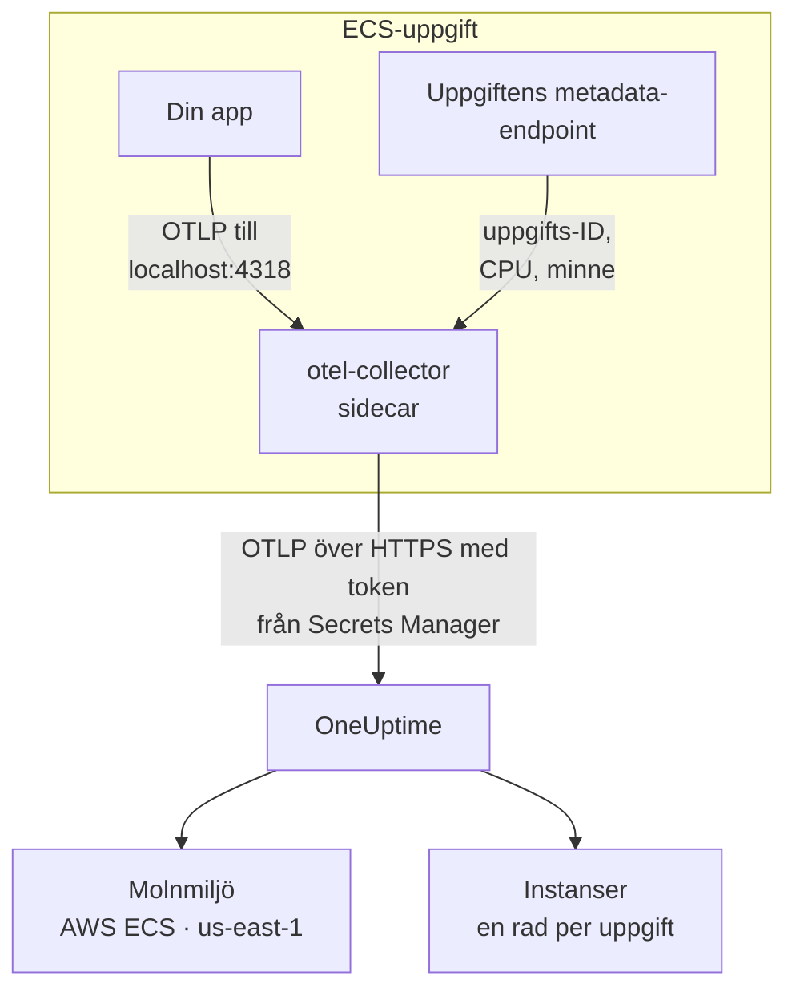

# AWS ECS / Fargate

Skicka spår, loggar och mätvärden från dina Amazon ECS-uppgifter till OneUptime, med både starttypen Fargate och EC2. Varje uppgift som rapporterar `cloud.platform=aws_ecs` hamnar i en **Cloud Environment** per AWS-konto och region, till exempel _AWS ECS · us-east-1 · 123456789012_, oavsett om den kör en tjänst eller femtio.

:::cards
- [Så fungerar det](#så-fungerar-det): Vad ECS-detektorn och sidecar-collectorn gör.
- [Konfigurera](#konfigurera): Spara din token, lägg till inställningarna i uppgiftsdefinitionen, distribuera och kontrollera.
- [Den fullständiga uppgiftsdefinitionen](#den-fullständiga-uppgiftsdefinitionen): En komplett Fargate-uppgiftsdefinition att registrera.
- [Felsökning](#felsökning): Uppgifter som fastnar i PENDING, avvisade exporter, tomma instanser eller rutor.
:::

## Så fungerar det



- **ECS-detektorn namnger miljön.** OpenTelemetrys ECS-resursdetektor, i SDK:t eller i en collector, läser den metadata-endpoint som ECS ger varje container och stämplar kontot, regionen och uppgiften på allt som uppgiften skickar. Inget är hårdkodat.
- **Uppgiften namnger varje instans.** Miljöns flik **Instanser** listar de uppgifter som körs efter uppgifts-ID, med deras CPU och minne.
- **En sidecar-collector lägger till CPU och minne.** Dess receiver `awsecscontainermetrics` läser varje uppgifts CPU och minne från samma endpoint, och den har din token så att applikationen aldrig ser den.

ECS-detektorn sätter de här resursattributen:

| Attribut | Sätts av ECS-detektorn | Används till |
| ------------------------------------------------------------------ | ----------------------- | --------------------------------------------------------------------------------------------------------- |
| `cloud.platform` | `aws_ecs` | Arkiverar telemetrin under **Molnmiljöer**. Värdet måste vara exakt |
| `cloud.account.id` | `123456789012` | En del av miljönyckeln |
| `cloud.region` | `us-east-1` | En del av miljönyckeln |
| `aws.ecs.task.arn` | uppgiftens ARN | Namnger en uppgift som körs under **Instanser**, efter uppgifts-ID:t i slutet |
| `aws.ecs.task.id` | uppgifts-ID:t | Samma sak; nyare detektorversioner sätter båda |
| `aws.ecs.cluster.arn`, `aws.ecs.task.family`, `aws.ecs.launchtype` | klustret och uppgiften | Behålls på varje spann, logg och mätvärde så att du kan söka på dem; ingår inte i miljön |

Miljönyckeln är `aws_ecs|123456789012|us-east-1`. Uppgifts-ID:t namnger en instans även när SDK:t också sätter `service.instance.id`: sidecarens containermätvärden bär bara uppgifts-ID:t, så när det är nyckeln hålls en uppgifts spann och dess CPU och minne på en rad. Se [Molnmiljöer](/docs/telemetry/cloud-environments) för hela regeln.

## Innan du börjar

- **En intagningsnyckel.** Skapa en nyckel av typen **Server** under **Projektinställningar → Telemetri och APM → Intagningsnycklar** och kopiera dess token.
- **Ett ECS-kluster och en uppgiftsdefinition som du kan revidera**, och AWS CLI konfigurerat för det kontot.
- **Din applikation instrumenterad med ett OpenTelemetry-SDK** som exporterar OTLP, i valfritt språk.

## Välj hur telemetrin lämnar uppgiften

| | Sidecar collector | SDK direct |
| ----------------------- | ---------------------------------------------- | ----------------------------------------------- |
| Extra container | `otel-collector` i varje uppgift | Ingen |
| CPU och minne per uppgift | Ja, från receivern `awsecscontainermetrics` | Nej |
| Har din token | Collectorn | Applikationen |
| Hemligheten innehåller | Bara din token | Hela headern `x-oneuptime-token=...` |

De flesta team använder sidecar-collectorn: den stämplar attributen `cloud.*` även på telemetri från bibliotek som inte vet något om ECS. SDK direct är det enklaste valet för en enda tjänst. Varje steg nedan har en flik för båda; välj en, så följer varje steg den.

## Konfigurera

:::steps
### Spara din token i Secrets Manager

> [!IMPORTANT]
> Din token är en hemlighet. Förvara den i AWS Secrets Manager och referera till den från uppgiftsdefinitionen med `secrets` och `valueFrom`. En token i en vanlig post under `environment` syns för alla som kan läsa uppgiftsdefinitionen, och dyker upp i varje utdata från `describe-task-definition` och varje CloudFormation-diff.

:::tabs
@tab Sidecar collector
```bash
aws secretsmanager create-secret \
  --name oneuptime/ingestion-token \
  --region us-east-1 \
  --secret-string "YOUR_TELEMETRY_INGESTION_TOKEN"
```

Collectorns konfiguration lägger till headerns namn, så den här hemligheten innehåller bara din token.
@tab SDK direct
```bash
aws secretsmanager create-secret \
  --name oneuptime/ingestion-token \
  --region us-east-1 \
  --secret-string "x-oneuptime-token=YOUR_TELEMETRY_INGESTION_TOKEN"
```

ECS lägger en hemlighets värde oförändrat i variabeln, och `OTEL_EXPORTER_OTLP_HEADERS` behöver hela paret `name=value`, så den här hemligheten innehåller hela headern.
:::

Notera det ARN som kommandot skriver ut. Det slutar med ett slumpmässigt suffix, till exempel `oneuptime/ingestion-token-AbCdEf`, och du klistrar in det i uppgiftsdefinitionen.

### Låt uppgiften läsa hemligheten

Uppgiftens körningsroll (den roll som ECS startar uppgiften med, inte den roll som din kod körs som) måste kunna läsa hemligheten. Koppla den här policyn till `ecsTaskExecutionRole`:

```json title="secret-access-policy.json"
{
  "Version": "2012-10-17",
  "Statement": [
    {
      "Effect": "Allow",
      "Action": ["secretsmanager:GetSecretValue"],
      "Resource": "arn:aws:secretsmanager:us-east-1:123456789012:secret:oneuptime/ingestion-token-*"
    }
  ]
}
```

Om en kundhanterad KMS-nyckel krypterar hemligheten behöver rollen också `kms:Decrypt` på den nyckeln. Utan någon av dem startar inte uppgiften: den stoppas med `ResourceInitializationError: unable to pull secrets`.

### Lägg till inställningarna i uppgiftsdefinitionen

:::tabs
@tab Sidecar collector
1. **AWS Console → Amazon Elastic Container Service → Task definitions** → välj familjen → **Create new revision**.
2. Under **Container - 1** (din applikation) fäller du ut **Environment variables** och lägger till applikationsvariablerna nedan.
3. **+ Add container**: namn `otel-collector`, avbildning `otel/opentelemetry-collector-contrib:latest` (lås en version när det fungerar), **Essential container: No**. Under **Docker configuration → Command** anger du `--config=env:OTEL_COLLECTOR_CONFIG`.
4. Lägg på collector-containern till miljövariabeln `ONEUPTIME_TOKEN` med **Value type: ValueFrom** och hemlighetens ARN, och `OTEL_COLLECTOR_CONFIG` med **Value type: Value** och collector-konfigurationen nedan.
5. Under **Startup dependency ordering** på applikationscontainern lägger du till `otel-collector` med villkoret **Start**, så att applikationen aldrig startar innan något lyssnar på port 4318.
6. Under **Task execution role** kontrollerar du att det är rollen som du kopplade policyn till.

Applikationsvariabler. I nätverksläget `awsvpc` (alltid på Fargate) delar containrarna i en uppgift ett nätverk, så `localhost` är sidecaren:

```bash
OTEL_SERVICE_NAME=checkout-api
OTEL_EXPORTER_OTLP_ENDPOINT=http://localhost:4318
OTEL_EXPORTER_OTLP_PROTOCOL=http/protobuf
```

Collector-konfiguration. Collectorn läser allt från variabeln `OTEL_COLLECTOR_CONFIG`, så det finns ingen fil att bygga in i en avbildning, och den fyller i `${env:ONEUPTIME_TOKEN}` från hemligheten som ECS lägger i dess miljö:

```yaml title="OTEL_COLLECTOR_CONFIG"
receivers:
  otlp:
    protocols:
      http:
        endpoint: 0.0.0.0:4318
      grpc:
        endpoint: 0.0.0.0:4317
  # Per-task and per-container CPU / memory from the ECS task metadata
  # endpoint. This is what fills the CPU and memory tiles in OneUptime.
  awsecscontainermetrics:
    collection_interval: 20s
processors:
  # Stamps cloud.provider, cloud.platform=aws_ecs, cloud.account.id,
  # cloud.region and aws.ecs.task.arn on every span, log and metric.
  resourcedetection:
    detectors: [env, ecs]
    timeout: 5s
  batch: {}
exporters:
  otlphttp/oneuptime:
    endpoint: https://oneuptime.com/otlp
    headers:
      x-oneuptime-token: ${env:ONEUPTIME_TOKEN}
service:
  pipelines:
    traces:
      receivers: [otlp]
      processors: [resourcedetection, batch]
      exporters: [otlphttp/oneuptime]
    metrics:
      receivers: [otlp, awsecscontainermetrics]
      processors: [resourcedetection, batch]
      exporters: [otlphttp/oneuptime]
    logs:
      receivers: [otlp]
      processors: [resourcedetection, batch]
      exporters: [otlphttp/oneuptime]
```

Varken detektorn `ecs` eller receivern `awsecscontainermetrics` behöver någon IAM-behörighet: båda läser den metadata-endpoint som ECS ger varje container i `ECS_CONTAINER_METADATA_URI_V4`.
@tab SDK direct
1. **AWS Console → Amazon Elastic Container Service → Task definitions** → välj familjen → **Create new revision**.
2. Under **Container - 1** (din applikation) fäller du ut **Environment variables** och lägger till variablerna nedan. Lägg till `OTEL_EXPORTER_OTLP_HEADERS` med **Value type: ValueFrom** och hemlighetens ARN som värde.
3. Lägg till inställningen som slår på ECS-resursdetektorn för ditt språk, från tabellen nedan.
4. Under **Task execution role** kontrollerar du att det är rollen som du kopplade policyn till.

```bash
OTEL_SERVICE_NAME=checkout-api
OTEL_EXPORTER_OTLP_ENDPOINT=https://oneuptime.com/otlp
OTEL_EXPORTER_OTLP_PROTOCOL=http/protobuf
# Injected from Secrets Manager (secrets / valueFrom), not typed here.
OTEL_EXPORTER_OTLP_HEADERS=x-oneuptime-token=YOUR_TELEMETRY_INGESTION_TOKEN
```

| Språk | Slå på ECS-detektorn |
| -------- | --------------------------------------------------------------------------------------------------------------- |
| Node.js | `OTEL_NODE_RESOURCE_DETECTORS=env,host,os,aws` (auto-instrumentations-node) |
| Python | `pip install opentelemetry-sdk-extension-aws`, sedan `OTEL_EXPERIMENTAL_RESOURCE_DETECTORS=aws_ecs` |
| Java | `-Dotel.resource.providers.aws.enabled=true` (agenten levereras med providern avstängd) |
| Go | `import "go.opentelemetry.io/contrib/detectors/aws/ecs"` och skicka `ecs.NewResourceDetector()` till `resource.New` |
| .NET | Paketet `OpenTelemetry.Resources.AWS`: `.ConfigureResource(r => r.AddAWSECSDetector())` |

I en fil med uppgiftsdefinitionen är hemligheten `"secrets": [{ "name": "OTEL_EXPORTER_OTLP_HEADERS", "valueFrom": "<secret ARN>" }]`.
:::

Om du driftar OneUptime själv använder du `https://YOUR-ONEUPTIME-HOST/otlp` som endpoint.

### Distribuera den nya revisionen

Klicka på **Create**, sedan **Clusters → your cluster → Services → select the service → Update → Task definition revision: latest → Deploy**. Eller från CLI:

```bash
aws ecs update-service \
  --cluster production \
  --service checkout-api \
  --task-definition checkout-api
```

### Kontrollera anslutningen

Kontrollera din token först: det är den billigaste kontrollen, och inget efter den fungerar utan den.

```bash
curl -i https://oneuptime.com/otlp/v1/validate \
  -H "x-oneuptime-token: YOUR_TELEMETRY_INGESTION_TOKEN"
```

`200` med `"valid": true` betyder att din token accepteras. `401` betyder att den är okänd, återkallad, inaktiverad eller har gått ut. Kör samma kommando inifrån uppgiften med ECS Exec för att bevisa att uppgiften själv når OneUptime:

```bash
aws ecs execute-command --cluster production --task <task id> \
  --container app --interactive --command "sh"
```

Collectorns CloudWatch-loggström (`otel/otel-collector/...`) ska visa `Everything is ready`, utan rader med `401` eller `connection refused`. Inom en minut efter det första spannet, den första loggen eller det första mätvärdet visas miljön under **Moln → All Environments** som _AWS ECS · us-east-1 · 123456789012_.
:::

## Den fullständiga uppgiftsdefinitionen

Sidecar-konfigurationen som en fil som du registrerar med `aws ecs register-task-definition --cli-input-json file://task-definition.json`. Byt ut konto-ID, region, avbildning och hemlighetens ARN:

```json title="task-definition.json"
{
  "family": "checkout-api",
  "requiresCompatibilities": ["FARGATE"],
  "networkMode": "awsvpc",
  "cpu": "512",
  "memory": "1024",
  "executionRoleArn": "arn:aws:iam::123456789012:role/ecsTaskExecutionRole",
  "taskRoleArn": "arn:aws:iam::123456789012:role/checkout-api-task-role",
  "containerDefinitions": [
    {
      "name": "app",
      "image": "123456789012.dkr.ecr.us-east-1.amazonaws.com/checkout-api:1.4.2",
      "essential": true,
      "portMappings": [{ "containerPort": 8080, "protocol": "tcp" }],
      "environment": [
        { "name": "OTEL_SERVICE_NAME", "value": "checkout-api" },
        {
          "name": "OTEL_EXPORTER_OTLP_ENDPOINT",
          "value": "http://localhost:4318"
        },
        { "name": "OTEL_EXPORTER_OTLP_PROTOCOL", "value": "http/protobuf" }
      ],
      "dependsOn": [
        { "containerName": "otel-collector", "condition": "START" }
      ],
      "logConfiguration": {
        "logDriver": "awslogs",
        "options": {
          "awslogs-group": "/ecs/checkout-api",
          "awslogs-region": "us-east-1",
          "awslogs-stream-prefix": "app"
        }
      }
    },
    {
      "name": "otel-collector",
      "image": "otel/opentelemetry-collector-contrib:latest",
      "essential": false,
      "command": ["--config=env:OTEL_COLLECTOR_CONFIG"],
      "secrets": [
        {
          "name": "ONEUPTIME_TOKEN",
          "valueFrom": "arn:aws:secretsmanager:us-east-1:123456789012:secret:oneuptime/ingestion-token-AbCdEf"
        }
      ],
      "environment": [
        {
          "name": "OTEL_COLLECTOR_CONFIG",
          "value": "receivers:\n  otlp:\n    protocols:\n      http:\n        endpoint: 0.0.0.0:4318\n      grpc:\n        endpoint: 0.0.0.0:4317\n  awsecscontainermetrics:\n    collection_interval: 20s\nprocessors:\n  resourcedetection:\n    detectors: [env, ecs]\n    timeout: 5s\n  batch: {}\nexporters:\n  otlphttp/oneuptime:\n    endpoint: https://oneuptime.com/otlp\n    headers:\n      x-oneuptime-token: ${env:ONEUPTIME_TOKEN}\nservice:\n  pipelines:\n    traces:\n      receivers: [otlp]\n      processors: [resourcedetection, batch]\n      exporters: [otlphttp/oneuptime]\n    metrics:\n      receivers: [otlp, awsecscontainermetrics]\n      processors: [resourcedetection, batch]\n      exporters: [otlphttp/oneuptime]\n    logs:\n      receivers: [otlp]\n      processors: [resourcedetection, batch]\n      exporters: [otlphttp/oneuptime]\n"
        }
      ],
      "logConfiguration": {
        "logDriver": "awslogs",
        "options": {
          "awslogs-group": "/ecs/checkout-api",
          "awslogs-region": "us-east-1",
          "awslogs-stream-prefix": "otel"
        }
      }
    }
  ]
}
```

Värdet av `OTEL_COLLECTOR_CONFIG` är collector-konfigurationen som en enda JSON-sträng. I stället för att escapa den för hand kan du ha YAML-koden i `collector.yaml` och låta `jq` göra det:

```bash
jq --rawfile cfg collector.yaml \
  '.containerDefinitions[1].environment[0].value = $cfg' \
  task-definition.json > task-definition.rendered.json
aws ecs register-task-definition --cli-input-json file://task-definition.rendered.json
```

## Nätverk

Uppgiften måste nå två saker utanför din VPC: Secrets Manager för att starta, och OneUptime för att exportera.

- **Fargate-uppgifter i privata undernät** behöver en väg till internet: en NAT-gateway i undernätets routningstabell, eller ett offentligt undernät med `assignPublicIp=ENABLED`. En uppgift utan något av dem hänger i `PENDING` på hemligheten, innan collectorn skickar något.
- **Utgående trafik i säkerhetsgruppen** måste tillåta TCP 443 till OneUptime-värden: `oneuptime.com`, eller din egen värd på den port den lyssnar på. Standardsäkerhetsgruppen tillåter all utgående trafik; en låst grupp gör det ofta inte. Telemetri behöver ingen inkommande regel.
- **VPC-gränssnittsslutpunkter** för `com.amazonaws.us-east-1.secretsmanager` (och `ecr.api`, `ecr.dkr` och S3 för att hämta avbildningar) håller AWS-anropen borta från NAT-vägen. OneUptime självt behöver fortfarande vägen till internet.

```bash
aws ecs update-service \
  --cluster production \
  --service checkout-api \
  --task-definition checkout-api \
  --network-configuration "awsvpcConfiguration={subnets=[subnet-0abc1234],securityGroups=[sg-0def5678],assignPublicIp=ENABLED}"
```

## Vad du får

- **Översikt**: begäranden, felfrekvens och p95-latens från dina spår, rutorna **CPU** och **Minne** och **Främsta instanser efter CPU**. Rutorna fylls från `ecs.task.cpu.utilized` och `ecs.task.memory.utilized` från receivern `awsecscontainermetrics`, eller från valfritt mätvärde `container.cpu.utilization` och `container.memory.usage` som bär uppgiftens identitet. SDK direct skickar inget av dem.
- **Instanser**: en rad per uppgift som körs, namngiven efter uppgifts-ID:t (slutet av `aws.ecs.task.arn`), med senaste CPU, minne och tidpunkt då den senast sågs. En uppgift som slutar rapportera blir **Stale**.
- **Loggar**, **Spår** och **Mätvärden**: allt som bar `cloud.platform=aws_ecs` för det här kontot och den här regionen.
- **Tjänster**: samma uppgifter, uppdelade efter `service.name`.

## Felsökning

ECS-felen, i den ordning de inträffar:

:::details En uppgift fastnar i PENDING med "unable to pull secrets"
Hela felet är `ResourceInitializationError: unable to pull secrets`. Antingen saknar uppgiftens körningsroll `secretsmanager:GetSecretValue` på hemligheten (eller `kms:Decrypt` på dess nyckel), eller så har uppgiften ingen väg till Secrets Manager: ingen NAT-gateway och ingen VPC-slutpunkt. Se [Nätverk](#nätverk).
:::

:::details Collectorn loggar 401
Hemligheten innehåller fel värde. För sidecar-collectorn måste den vara bara din token; för SDK direct hela headern `x-oneuptime-token=...`. Kontrollera själva din token med kommandot i [Kontrollera anslutningen](#kontrollera-anslutningen).
:::

:::details Miljön visas, men Instanser är tom
Telemetrin bär ingen uppgiftsidentitet. Se till att detektorn `ecs` körs: resursen måste bära `aws.ecs.task.arn`, `aws.ecs.task.id` eller `service.instance.id`.
:::

:::details Instanser fylls, men rutorna CPU och Minne förblir tomma
Receivern `awsecscontainermetrics` saknas i pipelinen `metrics`, eller så hoppar den pipelinen över processorn `resourcedetection`, så att containermätvärdena kommer utan `cloud.platform`. SDK direct fyller aldrig de här rutorna.
:::

En miljö som aldrig visas, hamnar under **Värdar** eller **Serverlösa funktioner**, visar **Frånkopplad** eller delas i två tas upp på [Felsökning i molnet](/docs/telemetry/cloud-troubleshooting).

## Nästa steg

:::cards
- [Molnmiljöer](/docs/telemetry/cloud-environments): Så identifieras miljöer och instanser.
- [Felsökning i molnet](/docs/telemetry/cloud-troubleshooting): Felen som alla plattformar har gemensamt.
- [Molnresurser (IaaS och PaaS)](/docs/telemetry/cloud-resources): Dina lastbalanserare, RDS-databaser och bucketar från CloudWatch.
- [OpenTelemetry](/docs/telemetry/open-telemetry): Instrumentera din applikation, och se endpoints och gränser.
:::
