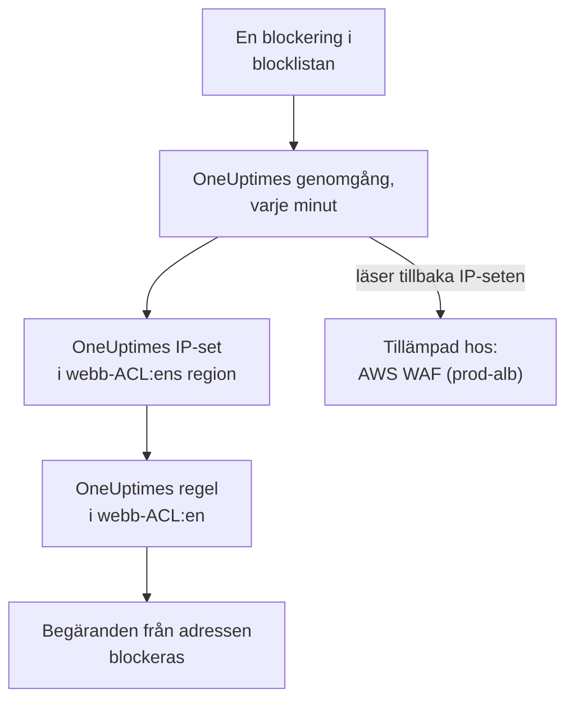

# Blockera adresser i AWS WAF

Ditt projekts blocklista kan tillämpas i de webb-ACL:er i AWS WAF som står framför dina CloudFront-distributioner, lastbalanserare och API Gateway-API:er. Slå på det för en AWS-molnanslutning som du redan har, välj webb-ACL:erna, och varje adress som blocklistan blockerar blockeras där, oavsett om en person, en playbook eller OneUptime AI blockerade den.

:::cards
- [Slå på det](#slå-på-det): En inställning på AWS-anslutningen, och dess konfigurationskommando igen.
- [Vad OneUptime skapar](#vad-oneuptime-skapar): Fyra IP-set per region, och två regler per webb-ACL.
- [Hantera webb-ACL:en i kod](#hantera-webb-aclen-i-kod): Lägg till reglerna själv i Terraform eller CloudFormation.
:::

## Så fungerar det

OneUptime underhåller egna IP-set i varje region där en vald webb-ACL finns, och en regel i varje webb-ACL som blockerar adresserna i dem. Varje minut skriver den varje set en gång med det som blocklistan innehåller, och läser sedan tillbaka seten. På sidan **Blocklista** anger en blockerings **Tillämpad hos** AWS WAF (prod-alb) först när AWS WAF har blockeringen och webb-ACL:ens regel blockerar det set som blockeringen finns i; tills dess är den inte tillämpad.

## Innan du börjar

- Ett AWS-konto som är anslutet till OneUptime (se [Anslut ett molnkonto](/docs/telemetry/cloud-accounts#amazon-web-services)).
- En roll som får ändra var blocklistan tillämpas: **Projektägare**, **Projektadministratör** eller **Säkerhetsadministratör**.
- Någon som kan köra anslutningens konfigurationskommando i AWS-kontot igen.

## Slå på det

:::steps
### Öppna anslutningen
Öppna **Moln → Anslut** och redigera AWS-anslutningen.

### Välj vem som lägger till regeln
Under **Fler fält** ställer du in **Blockera adresser i AWS WAF** på **På, och OneUptime lägger till sin regel**, eller på **På, och jag lägger till regeln i kod** om dina webb-ACL:er hanteras i Terraform eller CloudFormation.

### Kör konfigurationskommandot igen
Kommandot som formuläret nu visar ger åtkomst till IP-seten, och till regeln när OneUptime lägger till den. Kör det i AWS CloudShell och spara sedan anslutningen.

### Lägg till webb-ACL:erna
Öppna **Säkerhetshändelser → Playbooks → Blocklista**. Under **Moln-WAF:er** klickar du på **Lägg till WAF**, väljer en webb-ACL och, under **Fler fält**, var den läser klientens adress, och lägger till den. OneUptime konfigurerar den direkt, och dess **Status** visar **Tillämpar** när dess regel blockerar IP-seten.
:::

Webb-ACL:erna kommer från anslutningens inventering: en webb-ACL som OneUptime inte har läst än visas efter nästa läsning. Så länge en webb-ACL tillämpar blocklistan kan anslutningens inställning varken stängas av eller ändras så att du lägger till regeln i kod i stället för OneUptime, och anslutningen kan inte tas bort: ta först bort webb-ACL:en, så att OneUptime tar ut sin regel.

## Vad OneUptime skapar

| Vad | Namn | Var |
| --- | --- | --- |
| Fyra IP-set: blockering och utmaning, IPv4 och IPv6 | `oneuptime-<project>-block-ipv4`, `oneuptime-<project>-block-ipv6`, `oneuptime-<project>-challenge-ipv4`, `oneuptime-<project>-challenge-ipv6` | I varje region där en vald webb-ACL finns. CloudFronts webb-ACL:er är globala, och deras set finns i `us-east-1`. |
| Två regler: en blockerar, en utmanar | `OneUptime-Blocklist-<project>`, `OneUptime-Challenge-<project>` | I varje vald webb-ACL, när OneUptime lägger till sin regel. |

`<project>` är de första åtta tecknen i ditt projekts externa ID, så två OneUptime-projekt i ett konto skriver aldrig varandras set. Webb-ACL:er i en region delar på seten. En enskild adress skrivs som `/32` eller `/128`. AWS WAF rymmer 10 000 adresser i ett set, och 100 IP-set i en region om inte AWS har höjt gränsen åt dig; en blockering som inte får plats säger det på sin rad.

## Regelns plats i webb-ACL:en

OneUptime placerar sina två regler på lediga prioriteter under din första regel, så att de körs före reglerna som du har skrivit. Utan regler i webb-ACL:en får de prioriteterna 0 och 1. OneUptime numrerar aldrig om, ändrar eller tar bort någon av dina regler: när det inte finns två lediga prioriteter under din första regel visar webb-ACL:en **Ingen ledig prioritet**, och OneUptime lägger till sina regler så snart du frigör två.

Varje regel matchar när något av dess set, IPv4 eller IPv6, innehåller klientens adress. AWS WAF uppdaterar en webb-ACL i sin helhet, så OneUptime läser den, lägger till sina regler och skriver tillbaka den med webb-ACL:ens låstoken, och läser den igen om någon annan har skrivit den under tiden.

## Vidarebefordrade adresser

En webb-ACL bakom en annan proxy eller ett annat CDN ser proxyns adress, inte klientens. Välj under **Klientadress** var den läser klientens adress:

| Klientadress | Vad regeln läser |
| --- | --- |
| **Begärans källadress** | Adressen som begäran kom från. Standardvalet. |
| Den sista adressen i `X-Forwarded-For`-huvudet | Adressen som den sista proxyn lade till. En adress före den är en som begäran bara påstod. |
| `CF-Connecting-IP`-huvudet | Den enda adress som Cloudflare skriver. |
| `True-Client-IP`-huvudet | Den enda adress som Akamai eller Cloudflare Enterprise skriver. |

En begäran utan huvudet matchar inte: AWS WAF släpper igenom den i stället för att blockera en proxys adress.

## Hantera webb-ACL:en i kod

Med **På, och jag lägger till regeln i kod** skapar OneUptime bara IP-seten och skriver aldrig till din webb-ACL. Klicka på **Visa regel** på webb-ACL:ens rad: där får du båda reglerna som Terraform (`rule`-block i `aws_wafv2_web_acl`) och som CloudFormation, med varje sets ARN och huvudet som webb-ACL:en läser. Lägg till dem i din kod före dina andra regler och tillämpa den.

Tills reglerna finns där visar webb-ACL:en **Väntar på din regel**, och dess blockeringar tillämpas inte. OneUptime läser webb-ACL:en vid varje genomgång, och blockeringarna tillämpas från den första genomgång som för varje set hittar en regel som blockerar det, vad du än har döpt regeln till.

## Behörigheter

Konfigurationskommandot lägger till en inbäddad policy, `OneUptimeWafBlocklist`, i rollen. Med en åtkomstnyckel hamnar den, på grund av IAM:s gräns för en användares egna policyer, i en grupp, `OneUptimeWafBlocklist-<project>`, som användaren går med i.

| Åtgärd | Resurs | Varför |
| --- | --- | --- |
| `wafv2:ListIPSets` | Alla | Hitta OneUptimes IP-set i en region. |
| `wafv2:GetIPSet`, `wafv2:CreateIPSet`, `wafv2:UpdateIPSet`, `wafv2:DeleteIPSet` | Endast OneUptimes IP-set (`oneuptime-<project>-*`) | Underhålla seten, och ta bort dem när du tar bort den sista webb-ACL:en i en region. |
| `wafv2:GetSampledRequests` | Webb-ACL:er | Läsa de begäranden som en regel avvisade: beviset som ett ärendes blockeringssteg kontrolleras mot. |
| `wafv2:UpdateWebACL` | Webb-ACL:er, och de IP-set, regex-set och regelgrupper som de refererar till | Lägga till OneUptimes regler. Endast med **På, och OneUptime lägger till sin regel**. |

Läsning av en webb-ACL, `wafv2:GetWebACL`, finns redan i anslutningens skrivskyddade policy.

## Ta bort det

:::steps
### Ta bort webb-ACL:en
På **Säkerhetshändelser → Playbooks → Blocklista** klickar du på **Ta bort** på webb-ACL:ens rad. OneUptime tar ut sina regler ur webb-ACL:en, och tömmer och raderar sina IP-set när ingen annan webb-ACL i regionen använder dem.

### Stäng av inställningen
Redigera anslutningen, ställ in **Blockera adresser i AWS WAF** på **Av** och spara. Inställningen kan stängas av när ingen webb-ACL i anslutningen längre tillämpar blocklistan.
:::

När OneUptime inte längre får skriva webb-ACL:en kryssar du i **Ta bara bort från OneUptime** i dialogrutan **Ta bort WAF**. OneUptime tar bort webb-ACL:en från blocklistan och nämner de regler och IP-set som den lämnade kvar i AWS WAF: de fortsätter att blockera det de innehåller tills du tar bort dem där. En regel som du har skrivit och som fortfarande refererar till ett set behåller det också: OneUptime tömmer det och nämner det.

## Felsökning

:::details Tillämpar inte
Webb-ACL:ens status säger vad AWS svarade och vad du ska göra. Ett avslag nämner åtgärden och den inställning som ger den: slå på inställningen, eller välj **På, och OneUptime lägger till sin regel**, kör sedan anslutningens konfigurationskommando igen och klicka på **Kontrollera igen**.
:::

:::details Ingen ledig prioritet
Din första regel har prioritet 0 eller 1, så det finns inte två lediga prioriteter under den. Höj dina reglers prioritetsnummer med två och klicka sedan på **Kontrollera igen**.
:::

:::details En webb-ACL finns inte i listan
OneUptime listar webb-ACL:erna för anslutningar med inställningen påslagen, när den har läst dem. Webb-ACL:er som bara har setts genom sina mätvärden behöver anslutningens konfigurationskommando igen, så att OneUptime kan läsa dem.
:::

## Nästa steg

:::cards
- [Säkerhetsärenden och playbooks](/docs/telemetry/security-cases): Blockera en adress från ett ärende och se dess steg kontrolleras.
- [Anslut ett molnkonto](/docs/telemetry/cloud-accounts): Anslutningen som den här inställningen hör till.
:::
