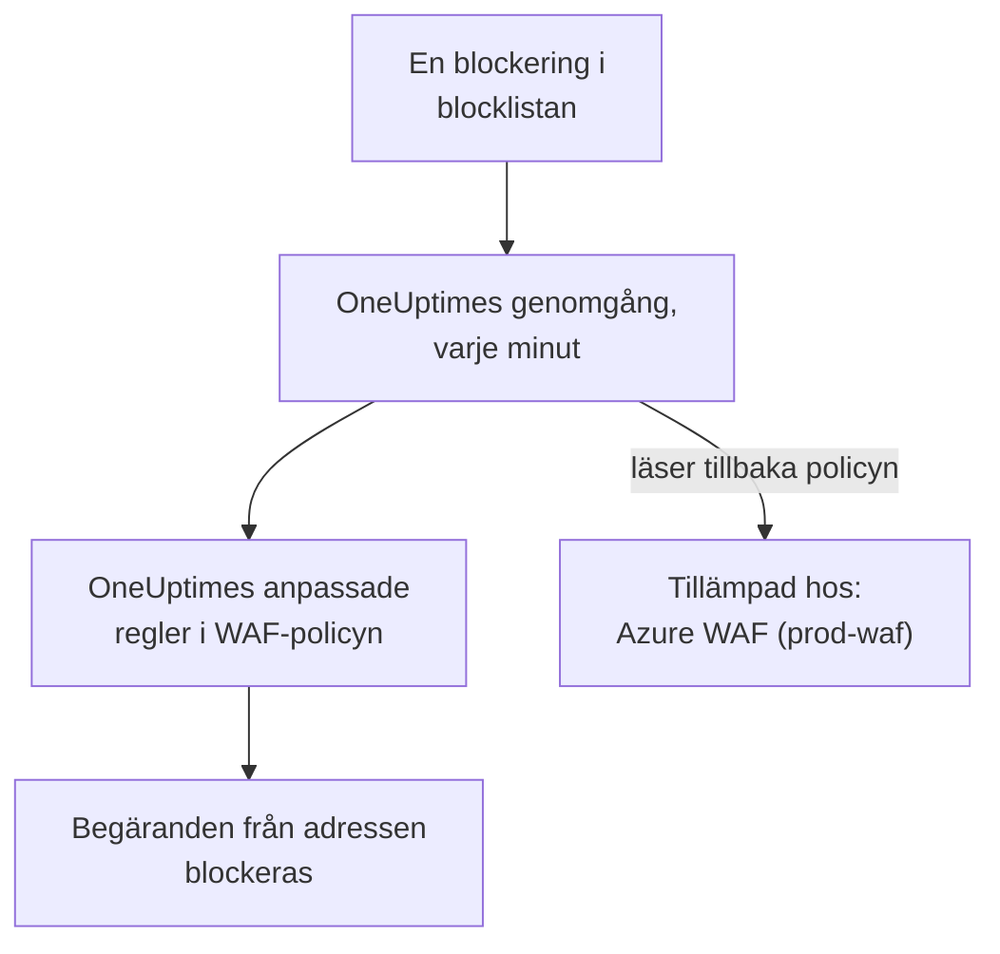

# Blockera adresser i Azure WAF

Ditt projekts blocklista kan tillämpas i Azure WAF-policyerna för dina Application Gateway- och Front Door-resurser. Slå på det för en Azure-molnanslutning som du redan har, välj WAF-policyerna, och varje adress som blocklistan blockerar blockeras där, oavsett om en person, en playbook eller OneUptime AI blockerade den.

:::cards
- [Slå på det](#slå-på-det): En inställning på Azure-anslutningen, och rollen som den kräver.
- [Vad OneUptime skapar](#vad-oneuptime-skapar): Egna anpassade regler i varje policy som du väljer.
- [Vilken adress som matchas](#vilken-adress-som-matchas): Adressen som anslöt, eller den ursprungliga klienten bakom en proxy.
:::

## Så fungerar det

OneUptime underhåller egna anpassade regler i varje WAF-policy som du väljer, och lägger in adresserna som blocklistan blockerar i dem. Varje minut skriver den policyn en gång med det som blocklistan innehåller, och läser sedan tillbaka den. På sidan **Blocklista** anger en blockerings **Tillämpad hos** Azure WAF (prod-waf) först när policyn har blockeringen och Azure har verkställt ändringen; tills dess är den inte tillämpad.

## Innan du börjar

- En Azure-prenumeration som är ansluten till OneUptime (se [Anslut ett molnkonto](/docs/telemetry/cloud-accounts#microsoft-azure)).
- En roll som får ändra var blocklistan tillämpas: **Projektägare**, **Projektadministratör** eller **Säkerhetsadministratör**.
- Någon som får tilldela roller i Azure-prenumerationen, för att köra ett kommando i Azure Cloud Shell.

## Slå på det

:::steps
### Öppna anslutningen
Öppna **Moln → Anslut** och redigera Azure-anslutningen.

### Slå på inställningen
Under **Fler fält** ställer du in **Blockera adresser i Azure WAF** på **På** och sparar. Konfigurationskommandot som formuläret visar ger nu rollen nedan på hela prenumerationen. En anslutning som du redan har behöver inte köra det igen: dialogrutan **Lägg till WAF** ger raderna som tilldelar rollen på en enda policy.

### Lägg till WAF-policyerna
Öppna **Säkerhetshändelser → Playbooks → Blocklista**. Under **Moln-WAF:er** klickar du på **Lägg till WAF** och väljer en WAF-policy. OneUptime frågar Azure om anslutningen får skriva den, utan att skriva något.

### Bevilja rollen om den saknas
När en behörighet saknas visar dialogrutan raderna som tilldelar den på just den policyn. Kör dem i Azure Cloud Shell, klicka på **Kontrollera igen** och lägg sedan till policyn. Dess **Status** visar **Tillämpar** när OneUptime har läst den.
:::

WAF-policyerna kommer från anslutningens inventering: en policy som OneUptime inte har läst än visas efter nästa läsning. Så länge en policy tillämpar blocklistan kan anslutningens inställning inte stängas av och anslutningen inte tas bort: ta först bort policyn, så att OneUptime tar ut sina regler.

## Vad OneUptime skapar

| Vad | Namn | Var |
| --- | --- | --- |
| Anpassade regler, var och en med ett IP-matchningsvillkor och åtgärden Block | `OneUptime<project>Block1`, `OneUptime<project>Block2`, ... | I varje WAF-policy som du väljer, högst 10 av dem. |

`<project>` är de första åtta tecknen i ditt projekts externa ID, så två OneUptime-projekt som väljer en och samma policy skriver aldrig varandras regler. En regel rymmer 540 adresser eller intervall på Application Gateway, 600 med CRS 3.2 eller ett Default Rule Set, och 600 på Front Door. Med tio regler rymmer en policy 5 400 eller 6 000 blockeringar; en blockering som inte får plats säger det på sin rad.

OneUptime ändrar inget i en policy utöver sina egna regler. Azure skriver bara en WAF-policy i sin helhet, så OneUptime läser policyn med dess ETag, ändrar sina egna regler och skriver tillbaka den med ETag:en i `If-Match`: alla andra regler, inställningar och hanterade regeluppsättningar skrivs som de lästes. När någon annan har skrivit policyn under tiden avvisar Azure skrivningen, och OneUptime läser den igen och gör sin ändring ovanpå det som skrevs.

## Reglernas plats i policyn

OneUptime placerar sina regler på lediga prioriteter före din första regel som tillåter trafik, lägsta först, så att ingen av dina regler släpper igenom en blockerad adress. En av dina regler som blockerar eller loggar får komma först. OneUptime numrerar aldrig om, ändrar eller tar bort någon av dina regler: när ingen prioritet är ledig före din första Allow-regel visar policyn **Ingen ledig prioritet**, och OneUptime lägger till sin regel så snart du frigör en.

## Vilken adress som matchas

| WAF-policy | Klientadress | När du ska välja den |
| --- | --- | --- |
| Front Door | **Adressen som anslöt till Front Door (SocketAddr)** | Standardvalet. |
| Front Door | Den ursprungliga klienten, från X-Forwarded-For (RemoteAddr) | För en Front Door bakom en annan proxy eller ett annat CDN. |
| Application Gateway | Adressen som anslöt till gatewayen (RemoteAddr) | Det enda valet: dess IP-matchning läser ingen annan adress. |

Front Door tar `RemoteAddr` från `X-Forwarded-For`-huvudet, som en klient som ansluter direkt till Front Door kan skriva själv. Välj den bara när en annan proxy eller ett annat CDN framför Front Door skriver det huvudet. Valet finns under **Fler fält** i dialogrutan **Lägg till WAF**, och du kan ändra det senare med **Klientadress** på policyns rad.

Application Gateways IP-matchning läser bara IPv4-adresser, så en IPv6-blockering tillämpas inte där, och dess rad säger varför.

OneUptimes regler i Azure WAF blockerar bara. En blockering som ber om att utmana en adress tillämpas inte i Azure WAF, och säger det. En utmaning från en policy för automatisk respons tillämpas där som en blockering lika länge.

## Hur lång tid en ändring tar

Application Gateway verkställer en ändring när Azure skriver den. Front Door godtar ändringen och sprider den till sina edge-platser under de närmaste minuterna: policyn visar **Verkställer ändringen**, och en ny blockerings **Tillämpad hos** väntar på policyn tills Azure rapporterar den som etablerad. Blockeringen tillämpas från och med då.

## När en regel ändras manuellt

När någon stänger av, ändrar eller tar bort en av OneUptimes regler i Azure lämnar OneUptime den som den lämnades. Policyn visar **Ändrad manuellt**, och blockeringarna som regeln innehöll tillämpas inte, med orsak, tills någon klickar på **Återställ** på policyns rad. Återställ skriver regeln igen som OneUptime skriver den, på sin egen prioritet så länge den är ledig.

En policy som inte blockerar något säger det också, och dess blockeringar tillämpas inte:

- En policy som är avstängd.
- En policy i läget **Detection**, som bara loggar det som OneUptimes regler matchar.
- En policy som inte är kopplad till en Application Gateway, en lyssnare, en sökvägsregel eller en Front Door-domän.

## Behåll en policy i Terraform

Terraform skriver också en WAF-policy i sin helhet, så dess nästa plan tar bort OneUptimes regler. Låt OneUptime behålla dem genom att lägga till `ignore_changes = [custom_rules]` i `lifecycle`-blocket för en `azurerm_web_application_firewall_policy`, eller `ignore_changes = [custom_rule]` i blocket för en `azurerm_cdn_frontdoor_firewall_policy`, och håll dina egna anpassade regler utanför den policyns kod.

## Behörigheter

Konfigurationskommandot lägger till en anpassad roll, `OneUptime WAF Blocklist`, och tilldelar den till anslutningens app på prenumerationen. Raderna som dialogrutan **Lägg till WAF** visar tilldelar samma roll på en enda policy.

| Åtgärd | Varför |
| --- | --- |
| `Microsoft.Network/ApplicationGatewayWebApplicationFirewallPolicies/read`, `Microsoft.Network/ApplicationGatewayWebApplicationFirewallPolicies/write` | Läsa en Application Gateway-WAF-policy och skriva OneUptimes regler i den. |
| `Microsoft.Network/FrontDoorWebApplicationFirewallPolicies/read`, `Microsoft.Network/FrontDoorWebApplicationFirewallPolicies/write` | Läsa en Front Door-WAF-policy och skriva OneUptimes regler i den. |

Rollen kan inte ta bort en policy, och OneUptime skriver aldrig något annat.

## Ta bort det

:::steps
### Ta bort WAF-policyn
På **Säkerhetshändelser → Playbooks → Blocklista** klickar du på **Ta bort** på policyns rad. OneUptime tar ut sina regler ur policyn och ändrar inget annat i den.

### Stäng av inställningen
Redigera anslutningen, ställ in **Blockera adresser i Azure WAF** på **Av** och spara. Inställningen kan stängas av när ingen policy i anslutningen längre tillämpar blocklistan.
:::

När OneUptime inte längre får skriva policyn kryssar du i **Ta bara bort från OneUptime** i dialogrutan **Ta bort WAF**. OneUptime tar bort policyn från blocklistan och nämner de regler som den lämnade kvar i den: de fortsätter att blockera det de innehåller tills du tar bort dem i Azure.

## Felsökning

:::details Tillämpar inte
Policyns status säger vad Azure svarade och vad du ska göra. Ett avslag nämner behörigheten som saknas: kör raderna som **Lägg till WAF** visar för policyn och klicka sedan på **Kontrollera igen**.
:::

:::details Ingen ledig prioritet
Din första regel som tillåter trafik har prioritet 1, eller så är varje prioritet före den upptagen. Ge den ett högre prioritetsnummer och klicka sedan på **Kontrollera igen**.
:::

:::details En policy finns inte i listan
OneUptime listar WAF-policyerna för anslutningar med inställningen påslagen, när den har läst dem. En policy som har lagts till sedan dess visas efter anslutningens nästa läsning.
:::

## Nästa steg

:::cards
- [Säkerhetsärenden och playbooks](/docs/telemetry/security-cases): Blockera en adress från ett ärende och se dess steg kontrolleras.
- [Anslut ett molnkonto](/docs/telemetry/cloud-accounts): Anslutningen som den här inställningen hör till.
:::
