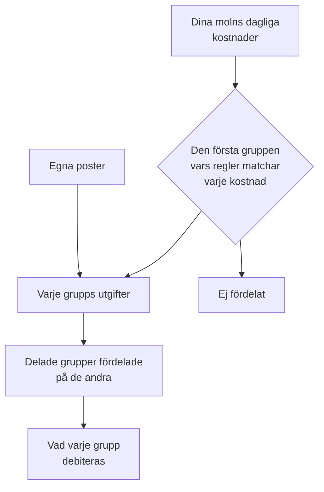

# Fördelning av molnkostnader

Kostnadsgrupper besvarar den första frågan på varje månatlig molnfaktura: vem spenderade pengarna? En **kostnadsvy** som ”Efter team” eller ”Efter kostnadsställe” fördelar utgifterna från dina anslutna konton i **kostnadsgrupper** efter regler, utan att något räknas två gånger. Det som ingen regel tar förblir synligt som ej fördelade utgifter, och delade kostnader fördelas på grupperna. Du hittar dem under **Moln → Utgifter → Kostnadsgrupper**.

:::cards
- [Skapa en vy](#skapa-en-vy): Efter team utifrån de ägare du redan har angett, efter en tagg eller med egna grupper.
- [Skriv en grupps regler](#skriv-en-grupps-regler): Konton, tjänster, taggar, ägarteam, etiketter och mer.
- [Ej fördelade utgifter](#ej-fördelade-utgifter): Det som ingen regel tar, och ett klick för att fördela det.
- [Delade kostnader](#delade-kostnader): En supportplan eller ett delat kluster, fördelat på grupperna.
:::

## Så fungerar det



- **Den första gruppen som matchar tar kostnaden.** En vys grupper har en ordning, och varje kostnad hamnar i den första gruppen vars regler matchar den, så ingenting räknas två gånger. Grupperna och de ej fördelade utgifterna blir alltid tillsammans periodens totalsumma.
- **Regler läser allt som en kostnad har.** Kontot, molnleverantören, tjänsten, regionen, resursen och dess taggar, och det OneUptime vet om resursen: dess ägarteam, dess etiketter, dess App Platforms-miljö och app.
- **Allt räknas ut när du tittar.** Ingenting skrivs per kostnad. En regel du ändrar fördelar varje månad som OneUptime sparar på nytt, upp till 400 dagar bakåt, utan väntan. Varje siffra följer väljaren ovanför den, fakturerad, amorterad eller netto, som under [Molnkostnader](/docs/telemetry/cloud-costs#fakturerad-amorterad-och-netto), och en egen post är densamma på varje bas.
- **Flera vyer kan fördela samma utgifter.** ”Efter team” och ”Efter kostnadsställe” fördelar var för sig allt, på sitt eget sätt.

## Innan du börjar

- **Kostnader som läses.** [Anslut ett molnkonto](/docs/telemetry/cloud-accounts) och låt det [läsa sina kostnader](/docs/telemetry/cloud-costs).
- **Taggar eller ägare, om du vill ha dem.** Regler på taggar kräver kostnader som har dem; på AWS slår du på [Kostnader per resurs](/docs/telemetry/cloud-costs#kostnader-per-resurs). Ägarteam kommer från varje resurs ägare, angivna för hand eller med [ägarregler](/docs/configuration/label-and-owner-rules).

## Skapa en vy

Öppna **Moln → Utgifter → Kostnadsgrupper**. Ett projekt utan en vy erbjuds tre sätt att börja:

| Start | Vad den skapar |
| --- | --- |
| **Efter team, från ägare** | En grupp för varje team som äger molnresurser, kopplad till teamet. |
| **Efter en tagg** | En grupp för varje värde av en tagg som dina kostnader har, till exempel `team` eller `cost-center`. |
| **Dina egna grupper** | En tom vy. Du skriver själv varje grupps regler. |

OneUptime skapar grupperna i en vy efter tagg eller efter ägarteam när du sparar den, och sedan varje timme allteftersom nya taggvärden och ägare dyker upp. Du kan byta namn på de grupperna, koppla dem till ett team eller dela dem. Deras regler förblir OneUptimes. Om du vill skapa de saknade grupperna nu öppnar du vyn och klickar på **Skapa grupper nu**.

## Skriv en grupps regler

Öppna en vy och sedan **Skapa Kostnadsgrupp** under **Grupper**. En kostnad hör till gruppen när **någon** av dess regler matchar den, och en regel matchar när **alla** dess villkor gör det. Ett villkor jämför något som en kostnad har med de värden du väljer eller skriver:

| Fält | Vad det läser |
| --- | --- |
| **Tagg** | Värdet av en tagg, utifrån taggens nyckel. **är angiven** och **är inte angiven** frågar om kostnaden har den. |
| **Konto** | Det anslutna konto som kostnaden faktureras till. |
| **Ägarteam** | De team som äger resursen i OneUptime. |
| **Tjänst** | Tjänsten, så som ditt molns fakturering kallar den. |
| **Etikett** | Etiketterna på resursen, eller på dess konto, i OneUptime. |
| **Region** | Regionen. Lämna värdet tomt för en global tjänst. |
| **Moln** | AWS, Azure eller Google Cloud. |
| **Resurs** | Resursen, så som ditt moln kallar den. |
| **App Platforms-miljö** och **App** | Det som en miljö eller en app faktureras, så som **Moln → Utgifter → Kostnader** räknar det. |
| **Kubernetes-namnrymd** och **Kubernetes-kluster** | Ett klusters namnrymder, när en delad grupp fördelas efter dem. Se [Kubernetes-kluster](#kubernetes-kluster). |

Text jämförs oavsett skiftläge: `Payments` och `payments` är ett team. En taggs nyckel jämförs så som den är skriven, så som dina moln sparar den.

En grupp **Betalningar** med tre regler tar till exempel en kostnad som är taggad `team: payments`, **eller** fakturerad till kontot payments, **eller** ägd av teamet Betalningar.

### Gruppernas ordning

Dra grupperna under **Grupper** för att ändra deras ordning. En grupp vars regler en tidigare grupp redan täcker kan aldrig ta en kostnad, och dess rad anger vilken grupp som tar allt. En grupp vars regler också matchar kostnader som en tidigare grupp tar anger hur mycket av dem den får.

### Resurser med flera ägarteam

En resurs som två team äger delas lika mellan dem: varje teams halva går genom reglerna för sig. En regel som inte frågar om ägare, till exempel en tagg eller ett konto, tar fortfarande hela kostnaden. En halva vars team saknar grupp förblir ej fördelad.

## Ej fördelade utgifter

En vys sida listar det som ingen regel tar ännu: de tjänster, konton, taggvärden och ägarteam som det består av, de dyraste först. Klicka på **Lägg till i grupp** bredvid en av dem för att lägga till en regel för den i en grupp eller i en ny grupp. Kostnaderna flyttas direkt in i gruppen, även för tidigare månader.

## Delade kostnader

En supportplan, ett delat kluster eller en nätverkshubb tillhör alla. Gör den till en egen grupp, slå sedan på **Delad** under **Fler fält** och välj hur dess kostnader fördelas på vyns andra grupper:

| Fördelning | Hur |
| --- | --- |
| **Fördela efter andel av utgifterna** | Varje grupp tar sin andel av de andra gruppernas molnutgifter den månaden. En månad då de inte spenderade något fördelas lika. |
| **Fördela lika** | Samma belopp till varje grupp. |
| **Fördela efter fasta procentsatser** | De procentsatser du anger för varje grupp, sammanlagt 100. |
| **Fördela efter Kubernetes-namnrymder** | Vad varje namnrymd i ett kluster kostade den månaden. Se nedan. |

En delad grupps kostnader fördelas dag för dag med varje månads andelar, så att en månad ger samma siffror oavsett om den läses per dag eller per månad. Ej fördelade utgifter får aldrig någon andel.

### Kubernetes-kluster

Ett klusters noder faktureras av ditt moln, medan klustrets egen kostnadsmotor anger vad varje namnrymd använde. Så debiterar du varje team för dess arbetslaster i ett delat kluster:

1. Skapa en grupp vars regler matchar klustrets noder, till exempel **Tagg** `eks:cluster-name` **är en av** `prod`.
2. Slå på **Delad**, välj **Fördela efter Kubernetes-namnrymder** och välj **Kubernetes-kluster**.
3. Ge teamens grupper regler som läser namnrymdernas labels, som räknas som taggar. Till exempel **Tagg** `team` **är en av** `payments`, eller **Kubernetes-namnrymd** **börjar med** `payments-`.

Varje månad fördelas nodernas kostnader efter vad varje namnrymd kostade i klustrets [kostnadsmotor](/docs/telemetry/kubernetes-cost), och varje namnrymds del går till den första gruppen vars regler matchar den. Ledig kapacitet, och en namnrymd som ingen grupp tar, stannar hos klustrets grupp. Klustrets egna prissatta kostnader läggs aldrig till din faktura, så ingenting räknas två gånger.

## Egna poster

Under **Egna poster** på **Moln → Utgifter → Kostnadsgrupper** lägger du till en debitering eller kreditering som dina molns fakturor inte har med: en andel av ett supportavtal, en företagsrabatt, ett internt påslag eller en plattformsavgift.

- **En gång eller varje månad.** En månatlig post fördelas över varje månads dagar, så att en del av en månad får sin del.
- **På ett konto eller en grupp.** En post som lagts till på ett konto går genom varje vys regler som kontots kostnader gör. En post som lagts till i en grupp går direkt till den.
- **Alltid separat.** Varje siffra håller poster åtskilda från det molnen fakturerade, så att molnens egna siffror fortfarande stämmer med deras konsoler.

## Se varje grupps utgifter

- **Moln → Utgifter → Kostnader**: Välj **Kostnadsgrupper** och en vy under **Vart pengarna går**. Varje grupps utgifter, jämfört med perioden innan.
- **En vys sida**: vad varje grupp debiterades, med dess delade kostnader, det som ingen regel tar, och **Ladda ner CSV** för månadens internfakturering.
- **En grupps sida**: dess utgifter dag för dag, de tjänster, resurser och konton den debiteras mest för, och dess regler. Den visar bara den gruppens utgifter, så koppla gruppen till dess **Team** och skicka teamet sidan: alla som får läsa molnutgifterna kan öppna den.

## API, CLI och MCP

Vyer, grupper och poster är API-resurser (`cloud-cost-view`, `cloud-cost-group`, `cloud-cost-line-item`), med CLI-kommandon och MCP-verktyg som varje resurs. En grupps regler är JSON:

```json
[
  { "conditions": [{ "field": "tag", "key": "team", "operator": "is", "values": ["payments"] }] },
  { "conditions": [{ "field": "ownerTeam", "operator": "is", "values": ["<team ID>"] }] }
]
```

För att läsa vad en vy fördelar, för hela UTC-dagar från `startDate` till `endDate`:

```bash
curl -X POST "https://oneuptime.com/api/cloud-cost-view/<view ID>/allocation" \
  -H "apikey: <API key>" -H "tenantid: <project ID>" -H "Content-Type: application/json" \
  -d '{"startDate": "2026-11-01", "endDate": "2026-11-30", "currency": "USD"}'
```

Svaret har varje grupps `total` och vad den består av (`cloud`, `lineItems`, `sharedIn`, `sharedOut`), dess siffror per dag eller per månad, perioden innan, och vad de ej fördelade utgifterna består av. `POST /cloud-cost-group/<group ID>/spend` svarar för en grupp. Skicka `basis` som `billed`, `amortized` eller `net` för siffror på den basen; utan den gäller projektets, och svarets `basis` säger vilken.

## Gränser

- En vy rymmer högst 500 grupper. En vy efter tagg skapar grupper för de 500 dyraste värdena.
- En grupp har högst 25 regler, en regel 20 villkor och ett villkor 200 värden.
- Kostnader sparas i 400 dagar, så en vy läser högst 400 dagar.

## Felsökning

:::details En grupp får ingenting
Dess regler matchar kanske ännu ingen kostnad, eller så tar en tidigare grupp alla kostnader de matchar. Dess rad under **Grupper** nämner då den gruppen: dra den här ovanför den, eller begränsa den tidigare gruppens regler.
:::

:::details En kostnad ligger i fel grupp
En kostnad hamnar i den första gruppen vars regler matchar den. Dra den grupp den hör till ovanför gruppen som tar den, eller begränsa den gruppens regler.
:::

:::details En regel på en tagg matchar ingenting
En kostnad behåller de taggar den hade när den lästes: etiketterna i en faktureringsexport från Google Cloud, annars taggarna på den resurs den faktureras till, vilket på AWS kräver [Kostnader per resurs](/docs/telemetry/cloud-costs#kostnader-per-resurs). En taggs nyckel jämförs så som den är skriven.
:::

:::details En vy efter tagg eller efter ägarteam saknar en grupp
OneUptime skapar de saknade grupperna varje timme: en för varje taggvärde i de senaste 400 dagarnas kostnader, eller för varje team som äger molnresurser, upp till 500 grupper. Klicka på **Skapa grupper nu** på vyns sida för att skapa dem direkt.
:::

:::details Siffrorna utelämnar ett konto
En vys siffror är i den valuta som de flesta av dina konton faktureras i. Ett konto som faktureras i en annan utelämnas från dem, och det gör även en post i en annan valuta.
:::

## Nästa steg

:::cards
- [Molnkostnader och besparingar](/docs/telemetry/cloud-costs): Vad dina anslutna konton kostar, och hur du spenderar mindre.
- [Etikett- och ägarregler](/docs/configuration/label-and-owner-rules): Ge resurser ägarteam och etiketter som reglerna kan läsa.
- [Kubernetes-kostnadsobserverbarhet](/docs/telemetry/kubernetes-cost): Vad varje Kubernetes-arbetslast kostar.
:::
