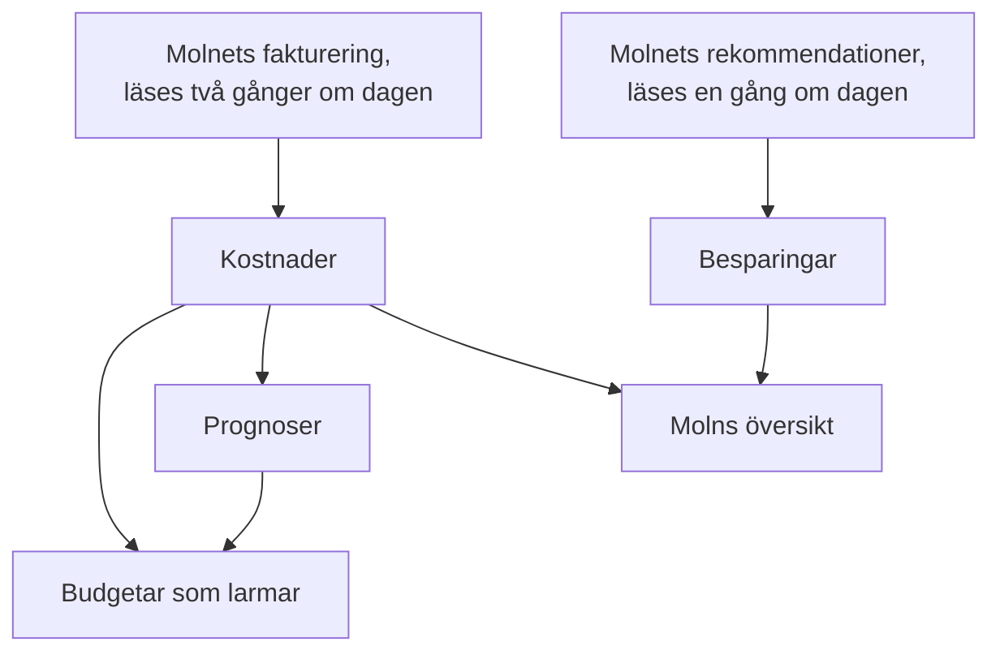

# Molnkostnader och besparingar

Ett anslutet molnkonto säger också vad det kostar och hur det kunde kosta mindre. OneUptime läser varje dags kostnader från molnets egen fakturering och rekommendationerna från molnets egen rekommendationstjänst, visar dem under **Moln → Utgifter → Kostnader** och **Moln → Utgifter → Besparingar**, listar dina Savings Plans, reservationer och rabatter för åtagen användning under **Moln → Utgifter → Åtaganden**, säger till under **Moln → Utgifter → Budgetar** innan en månad, ett kvartal eller ett år kostar mer än sin budget, och förutsäger de kommande månaderna under **Moln → Utgifter → Prognos**. När du tillåter det genomför den också de besparingar som en ägare godkänner, stoppar resurser som inte är produktion utanför arbetstid och kontrollerar varje ändring mot fakturan.

:::cards
- [Amazon Web Services](#amazon-web-services): Cost Explorer och Cost Optimization Hub, var och en påslagen en gång.
- [Microsoft Azure](#microsoft-azure): Cost Management och Azure Advisor, med en roll till.
- [Google Cloud](#google-cloud): Din faktureringsexport till BigQuery, och Recommender.
- [Fakturerad, amorterad och netto](#fakturerad-amorterad-och-netto): Varje kostnad på tre sätt, så att åtaganden och krediter hamnar där pengarna gick.
- [Åtaganden och förnyelser](#åtaganden-och-förnyelser): Varje åtagande, larm innan ett upphör eller medan det används för lite, och vad som ska förnyas eller köpas.
- [Genomför besparingar](#genomför-besparingar): Tillämpa en besparing med ägarens godkännande, och ångra den.
- [Scheman utanför arbetstid](#scheman-utanför-arbetstid): Stoppa resurser som inte är produktion på natten och på helgerna.
- [AI-regler för besparingar](#ai-regler-för-besparingar): Förslag till ägare, eller ändringar inom en gräns.
- [Budgetar](#budgetar): En månads, ett kvartals eller ett års budget för valfritt konto, kostnadsgrupp eller tjänst.
- [Prognoser](#prognoser): Vad de kommande 12 månaderna är på väg att kosta, och hur säkert det är.
- [Obligatoriska taggar](#obligatoriska-taggar): Hur mycket av dina utgifter som har taggarna du kräver, och nya resurser utan dem.
:::

## Så fungerar det



- **Kostnaderna kommer från molnets egen fakturering.** AWS Cost Explorer, Azure Cost Management och Google Clouds faktureringsexport till BigQuery, i den valuta kontot faktureras i, var och en sparad fakturerad, amorterad och netto: se [Fakturerad, amorterad och netto](#fakturerad-amorterad-och-netto). Varje belopp gäller en dag, i UTC-dagar, så som molnet fakturerar dem.
- **Ett moln rapporterar den sista dagen eller två sent.** Varje läsning tar den senaste veckan igen, och hela förra månaden under en månads första dagar, så en dags kostnad faller på plats medan molnet avslutar den. En anslutnings första läsning går tillbaka till början av månaden före förra månaden.
- **Månadens prognos följer takten under den senaste veckan.** Den är vad månaden har kostat hittills, med varje dag som återstår till genomsnittet av de senaste sju hela dagarna.
- **Besparingarna kommer från molnets egen rekommendationstjänst.** AWS Cost Optimization Hub, Azure Advisor och Google Clouds Recommender: en mindre storlek, en resurs som står oanvänd, ett åtagande som lönar sig, var och en med vad den skulle spara per månad. En rekommendation som du genomför eller avfärdar i molnets konsol försvinner vid nästa läsning.

## Innan du börjar

- **Ett anslutet konto.** [Anslut ett molnkonto](/docs/telemetry/cloud-accounts) med dagens installationskommando: det låter anslutningen läsa kostnader och rekommendationer. En anslutning som skapades tidigare läser ingetdera förrän du kör dess kommando igen.

## Amazon Web Services

Anslutningen läser kostnader med `ce:GetCostAndUsage`, sina åtaganden med `ce:GetSavingsPlansCoverage`, `ce:GetSavingsPlansUtilization`, `ce:GetSavingsPlansUtilizationDetails`, `ce:GetReservationCoverage` och `ce:GetReservationUtilization`, de köpta Savings Plans med `savingsplans:DescribeSavingsPlans` och rekommendationer med `cost-optimization-hub:ListRecommendations` och `cost-optimization-hub:GetRecommendation`. Installationskommandot tilldelar Cost Explorers läsningar som tre familjer, `ce:GetCostAndUsage*`, `ce:GetSavingsPlans*` och `ce:GetReservation*`, alla läsningar, så att en åtkomstnyckels användare fortfarande ryms inom de 2048 tecken som IAM tillåter dess policy. Cost Explorer och Cost Optimization Hub måste först slås på i kontot:

:::steps
### Slå på Cost Explorer

Öppna Cost Explorer en gång i AWS-konsolen Billing and Cost Management: AWS förbereder kontots kostnader inom en dag. Anslut organisationens hanteringskonto för att läsa kostnaderna för varje medlemskonto.

### Anmäl dig till Cost Optimization Hub

Öppna Cost Optimization Hub i samma konsol och anmäl dig, för organisationen från dess hanteringskonto eller bara för kontot. Dess rekommendationer kommer inom en dag.
:::

Cost Explorer tar $0.01 för varje begäran: en läsning av kostnaderna gör två eller några få till, en för fakturerad och amorterad och en för netto, och åtagandena läses med fyra om dagen för deras täckning och användning, och sex till tolv till om dagen för vart och ett av dem. Savings Plans API och Cost Optimization Hub är gratis.

### Kostnader per resurs

Cost Explorer anger också vad varje resurs kostar, för de senaste 14 dagarna, när data på resursnivå är påslagna. Öppna Cost Management-inställningarna i AWS-konsolen Billing and Cost Management och slå på data på resursnivå med daglig granularitet, för organisationen från dess hanteringskonto. AWS förbereder dem inom 48 timmar.

Redigera sedan anslutningen under **Moln → Anslut** och slå på **Kostnader per resurs** under **Fler fält**. Anslutningen läser dem med `ce:GetCostAndUsageWithResources` en gång om dagen: de 14 dagarna första gången, sedan de tre senaste igen, med några få förfrågningar varje gång. Det den läser stannar hos kontots kostnader efter att Cost Explorer har glömt det. En anslutning som skapades tidigare behöver få sitt installationskommando kört igen, vilket lägger till åtgärden.

## Microsoft Azure

Appen läser kostnader med rollen **Cost Management Reader**, på samma omfång som **Monitoring Reader**: installationskommandot tilldelar båda. Azure Advisors rekommendationer läses med **Monitoring Reader**, så det finns inget att slå på. För att ge en app som skapades tidigare rollen kör du:

```bash
az role assignment create --assignee <APP_ID> --role "Cost Management Reader" --scope /subscriptions/<SUBSCRIPTION_ID>
```

Cost Management svarar för varje prenumeration, med den resurs varje kostnad gäller, och det kostar inget att läsa. När den inte kan svara för en prenumeration säger kontots **Kostnader** varför.

Cost Management begränsar hur snabbt en klientorganisations kostnader läses, lika för alla som läser dem: varje fråga kostar en frågebearbetningsenhet (QPU) för varje månad data den läser, och en klientorganisation har 12 QPU var 10:e sekund, 60 per minut och 600 per timme. OneUptime läser en klientorganisations prenumerationer en i taget inom två tredjedelar av varje kvot, väntar så länge Cost Management ber om när den avvisar en fråga och fortsätter vid nästa läsning där den slutade. En prenumeration som inte har lästs än säger **I kö** och när den läses; en som har belopp behåller dem under tiden. Dess amorterade kostnad läses vid varje läsning och dess faktiska kostnad en gång om dagen, så den första läsningen av en prenumeration frågar Cost Management två gånger och använder dubbelt så många frågeenheter: en stor klientorganisations första belopp tar några läsningar till.

Klientorganisationens reservationer och besparingsplaner läses med **Reservations Reader** och **Savings plan Reader**, som Azure tilldelar på själva klientorganisationens nivå, där bara en global administratör med utökad åtkomst kan tilldela dem. Installationskommandot försöker, och säger till när det inte får. För att tilldela dem senare, som global administratör med utökad åtkomst:

```bash
az role assignment create --assignee <APP_ID> --role "Reservations Reader" --scope /providers/Microsoft.Capacity
az role assignment create --assignee <APP_ID> --role "Savings plan Reader" --scope /providers/Microsoft.BillingBenefits
```

Utan dem läses kostnader och rekommendationer som förut, och **Moln → Utgifter → Åtaganden** säger vilken roll som ska tilldelas.

## Google Cloud

Google Cloud har inget API för ett projekts kostnader: OneUptime läser dem från faktureringskontots export till BigQuery.

:::steps
### Exportera din fakturering till BigQuery

Öppna Billing och sedan Billing export i Google Cloud-konsolen, och slå på exporten av detaljerade användningskostnader till en BigQuery-datauppsättning. Google skriver den några timmar i efterhand, från den dag du slår på den.

### Låt tjänstkontot läsa den

Ge anslutningens tjänstkonto **BigQuery Data Viewer** på exportens datauppsättning. Installationskommandot har redan gett det **BigQuery Job User**, så att det kan köra frågan i sitt eget projekt.

### Ange exportens tabell

Redigera anslutningen under **Moln → Anslut**, och sätt under **Fler fält** **Tabell för faktureringsexport** till tabellens fullständiga namn: `<PROJECT_ID>.<DATASET>.gcp_billing_export_resource_v1_<BILLING_ACCOUNT_ID>`.
:::

Den detaljerade exporten anger den resurs varje kostnad gäller; standardexporten anger bara tjänsten och regionen. BigQuery debiterar frågan: den första 1 TiB per månad är gratis, därefter $6.25 per TiB, och en månad av en export är från några få megabyte till några få gigabyte. Recommenders rekommendationer om maskintyper och oanvända resurser läses med **Compute Recommender Viewer**, som installationskommandot tilldelar, och kostar inget. Compute Engines åtaganden listas från Cloud Asset Inventory med **Cloud Asset Viewer**, som installationskommandot redan tilldelar: inget mer att ge.

## Fakturerad, amorterad och netto

Varje kostnad sparas på tre sätt, och **Moln → Utgifter → Kostnader**, ett kontos **Kostnader**, översikten under Moln och budgetar visar det du väljer:

- **Fakturerad** är varje debitering den dag molnet fakturerade den, före krediter och återbetalningar. En förskottsbetald Savings Plan eller reservation är en enda stor debitering den dag den köptes, och användningen den täcker ser gratis ut resten av löptiden.
- **Amorterad** fördelar varje åtagandes avgifter över de dagar och resurser det täcker, så att pengarna hamnar där de användes. Fortfarande före krediter och återbetalningar. Det är detta sidorna visar om du inte väljer något annat.
- **Netto** är amorterad, minus krediter, återbetalningar och rabatter: det fakturan landar på.

| | Fakturerad | Amorterad | Netto |
|---|---|---|---|
| AWS | Cost Explorers oblandade kostnad (unblended) | Cost Explorers amorterade kostnad | Cost Explorers amorterade nettokostnad, med krediter och återbetalningar |
| Azure | Cost Managements faktiska kostnad | Cost Managements amorterade kostnad | Den amorterade kostnaden: Azure drar av krediter på faktureringskontot, som en prenumerations anslutning inte läser |
| Google Cloud | Exportens kostnad | Kostnaden minus krediterna från rabatterna för åtagen användning och från prenumerationer | Kostnaden minus alla krediter |

Väljaren ovanför beloppen byter bas på sidan, och OneUptime minns ditt val för det här projektet i din webbläsare. Projektets egen bas, den sidorna öppnas med och som budgetar bevakar, finns under **Moln → Inställningar → Kostnadsinställningar**. En budget kan bevaka en egen bas: redigera den och ange **Kostnadsbas**.

Kostnader som lästes innan de tre sparades visar sitt fakturerade belopp på varje bas. Varje anslutning läser sina kostnader igen en gång, så långt tillbaka som en första läsning, så att varje bas fylls i.

## Sätt att spendera mindre

**Moln → Utgifter → Besparingar** listar varje rekommendation, den största besparingen först: vad som ska göras, för vilken resurs, vad som skulle ändras och vad den sparar per månad. Remsan ovanför summerar dem, totalt och efter typ: en mindre storlek, en resurs som står oanvänd, ett åtagande. En rekommendation länkar till sidan för sin resurs när OneUptime har resursen, och en som OneUptime kan genomföra har **Tillämpa**: se [Genomför besparingar](#genomför-besparingar).

### Storleksanpassning utifrån OneUptimes egna mätvärden

En resurs som ingen rekommendationstjänst uttalar sig om, eftersom den inte är påslagen, inte täcker resursens typ eller tycker att den är för ny, får sin storlek bedömd av OneUptime utifrån de CPU- och minnesmätvärden som anslutningen har tagit de senaste 14 dagarna. OneUptime bedömer EC2-instanser, RDS-databaser och ElastiCache-kluster på AWS, virtuella maskiner, flexibla PostgreSQL- och MySQL-servrar och App Service-planer på Azure samt Compute Engine-VM:ar och Cloud SQL-instanser på Google Cloud:

- **Överprovisionerad** när storleken som är hälften så stor, eller en fjärdedel, fortfarande skulle ha utrymme: på den mindre storleken skulle CPU:ns 95:e percentil vara högst 60 %, dess högsta CPU-mätvärde högst 100 % och minnets topp högst 70 %, när minnet läses.
- **Underprovisionerad** när CPU:ns 95:e percentil är 85 % eller mer, eller minnets topp 90 % eller mer: storleken som är dubbelt så stor.

En resurs bedöms så snart den har 6 dagars mätvärden. Dess sida visar dess **Storleksanpassning** bredvid vad den kostar, och en överprovisionerad listas under **Moln → Utgifter → Besparingar** med OneUptime som källa. Det en ändring sparar är dess andel av vad resursen kostade de senaste 30 dagarna, så det är känt så snart ditt moln fakturerar resursen med namn: Azures och Google Clouds detaljerade export gör det, och AWS gör det när Kostnader per resurs är påslaget. Burstable storlekar som t3, B-serien och e2-micro bedöms aldrig.

Ditt moln läser en VM:s minne bara med en egen agent inne i VM:en: CloudWatch-agenten på en EC2-instans, Ops Agent på en Compute Engine-VM och ingen för en Azure-VM, som rapporterar ledigt minne i stället för använt minne. En VM som [OneUptimes värdinsamlare](/docs/telemetry/hosts) körs på bedöms i stället utifrån minnet som värdinsamlaren läser:

- **VM:en och värden är en och samma maskin** när leverantör, konto, region och instans-ID alla stämmer: EC2-instans-ID:t, en Compute Engine-VM:s numeriska ID eller en Azure-VM:s `vmId`. Ett värdnamn ensamt ger aldrig en träff, och en VM som två värdar gör anspråk på, som en klonad maskin, kopplas inte till någon av dem. VM:ens sida nämner dess värd och värdens sida dess VM, var och en med en länk till den andra.
- **Minne är värdens använda minne, utan cache och buffertar**, siffran som värdens sida visar i diagrammet, över samma 14 dagar. En upptagen filcache läses aldrig som en full maskin. Värden behöver också 6 dagars mätvärden.
- **Där båda läser minnet**, som på en Compute Engine-VM med Ops Agent och värdinsamlaren, används den med flest mätvärden. CPU är alltid ditt molns mätvärde.

VM:ens **Storleksanpassning** säger var dess minne kom ifrån, och det gör även dess rad under **Moln → Utgifter → Besparingar**. En VM som bara bedöms utifrån sin CPU säger det, med en länk för att installera värdinsamlaren. Värdinsamlaren stämplar sitt molns identitet med steget `resourcedetection/cloud` som [konfigurationen i guiden för värdar](/docs/telemetry/host-otel-collector) innehåller. En värd med OneUptimes standardkonfiguration får steget med OneUptimes nästa version, och en värd med en egen konfiguration behöver lägga till det. Kubernetes-noder lämnas till [Kostnadsobservability för Kubernetes](/docs/telemetry/kubernetes-cost), som bedömer förfrågningarna för det som körs på dem.

### Åtaganden

**Moln → Utgifter → Besparingar** och ett kontos **Kostnader** visar hur mycket av de senaste 30 dagarnas utgifter som varje kontos åtaganden betalade, och hur mycket av dem som användes, en rad för varje typ:

- AWS: Savings Plans och Reserved Instances, från Cost Explorer. En organisations hanteringskonto läser dem för varje konto i organisationen.
- Azure: besparingsplaner och reservationer, från Cost Management, i amorterad kostnad.
- Google Cloud: rabatter för åtagen användning, från din faktureringsexport. Exporten anger inte hur mycket av ett åtagande som förblev oanvänt, så hur mycket som används visas inte.

Ett konto utan åtaganden visar vad som kördes till on demand-priser som ett åtagande skulle betala billigare för. Varje typs siffror är dess molns egna, och typer läggs aldrig ihop: en reservation och en Savings Plan kan båda räkna samma maskins utgifter som sina att täcka. Varje åtagande för sig listas under **Moln → Utgifter → Åtaganden**: se [Åtaganden och förnyelser](#åtaganden-och-förnyelser).

## Åtaganden och förnyelser

**Moln → Utgifter → Åtaganden** listar varje Savings Plan, reservation och rabatt för åtagen användning som dina anslutningar kan läsa, så att inget upphör obemärkt:

- **Aktiva åtaganden** överst räknar de aktiva och dem som upphör inom 90 dagar, **Användning** hur mycket av dem som användes de senaste 30 dagarna och vad som blev oanvänt, och **Täckning** hur mycket av utgifterna de täcker.
- **Upphör snart** listar dem som upphör inom 90 dagar och inte förnyas av sig själva, var och en med sin förnyelseplan: vad som ska köpas för att behålla rabatten (åtagandet per timme, eller instanserna, i den del som användes), vad det kostar och sparar per månad, när det har betalat sig, och hur mycket av utgifterna som täcks nu och när det upphör. **Förnya i konsolen** öppnar sidan där molnet förnyar det.
- **Alla åtaganden** är hela listan: vad vart och ett är och täcker, dess konto, när det upphör, dess löptid och betalningsalternativ, hur mycket av det som användes de senaste 30 dagarna, och användningen det betalade för och vad det sparade.
- **Köpplaner** är vad molnets rekommendationstjänst föreslår att köpa, var och en med vad den skulle kosta och spara per månad, när den skulle ha betalat sig och hur täckningen skulle ändras. **Köp i konsolen** öppnar sidan där den köps.
- Under dem varje kontos åtaganden per typ, som dess **Kostnader** visar dem, och när åtaganden larmar, med **Ändra larm**.

OneUptime planerar bara: den köper, förnyar eller lämnar aldrig tillbaka ett åtagande. Du köper i molnets konsol.

| | Var åtagandena kommer ifrån | Vad som är känt om vart och ett |
|---|---|---|
| AWS | Cost Explorers Savings Plans och Reserved Instances, var och en med sin egen användning, och Savings Plans API för de köpta planerna, även dem i kö för att starta | Slutet, löptiden, betalningsalternativet, åtagandet per timme eller instanserna, avgifterna och användningen de senaste 30 och 7 dagarna |
| Azure | Klientorganisationens reservationer och besparingsplaner | Slutet, löptiden, faktureringsplanen, om det förnyas av sig självt, och användningen de senaste 30 och 7 dagarna |
| Google Cloud | Compute Engines åtaganden, från Cloud Asset Inventory | Slutet, planen, resurserna och om det förnyas av sig självt. Google Cloud säger inte hur mycket av ett åtagande som används |

En organisations hanteringskonto listar varje kontos på AWS. Utgiftsbaserade rabatter för åtagen användning, som Google Cloud har på faktureringskontot i stället för i ett projekt, listas inte än.

### Åtagandelarm

Åtaganden skapar larm, som kallar via jourpolicyer som alla larm. Under **Moln → Inställningar → Kostnadsinställningar** säger **Åtagandelarm** när:

- **Larma innan ett åtagande upphör**: till att börja med 90, 30 och 7 dagar före slutet. Ett larm vid den närmaste av de dagar åtagandet har nått, där varje närmare tar över från den förra. Ett åtagande som förnyas av sig självt, eller vars förnyelse står i kö för att starta när det upphör, skapar inget.
- **Larma vid användning under**: till att börja med 80 %, av ett åtagandes senaste 7 dagar, när det har körts en vecka. Larmet löses när användningen kommer tillbaka.
- **Larma vid täckning under**: till att börja med 60 %, av de utgifter ett kontos åtaganden av en typ skulle kunna täcka, efter att ha täckt mer. Det löses när täckningen kommer tillbaka. Tomt skapar täckning inget larm.

**Larma om åtaganden** stänger av dem alla, och **Larmallvar**, **Jourpolicyer** och **Ägare** säger hur allvarliga de är, vem som kallas och vem som äger dem. Varje larm säger vad åtagandet täcker och vad det betalade för, och pekar på dess förnyelseplan. Ett larm löses av sig självt när dess åtagande upphör, förnyas eller inte längre listas.

## Genomför besparingar

OneUptime genomför en besparing via kontots molnanslutning så snart dess inställning **Besparingsåtgärder** tillåter det: [Besparingsåtgärder](/docs/telemetry/cloud-accounts#besparingsåtgärder) säger vad varje val ger åtkomst till. Den gör bara ändringar i ett steg: Den stoppar en oanvänd instans eller databas, byter en gp2-volym till gp3, tar bort en disk som inte är ansluten, en gammal ögonblicksbild eller en oanvänd avbildning, släpper en oanvänd adress och ändrar, när du tillåter det, storleken på en instans eller databas till den rekommenderade. Den köper aldrig ett åtagande: **Köp i konsolen** öppnar molnets sida för det.

:::steps
### Välj Tillämpa

Under **Moln → Utgifter → Besparingar** väljer du **Tillämpa** på en besparing. Dialogen säger vad som ändras, vad den sparar per månad, hur den ångras eller att den inte kan det, och vem som godkänner den.

### En ägare godkänner den

En person som är angiven som ägare av resursen, eller en medlem i ett team som äger den, och som också får redigera den, godkänner ändringen. En resurs utan ägare godkänns av en Projektägare eller Projektadministratör. När du själv får godkänna den genomför **Tillämpa** den direkt, som dig. Annars väntar den under **Väntar på godkännande** tills en ägare väljer **Godkänn**, eller **Dölj** med en orsak.

### OneUptime genomför den

Ändringen görs via anslutningen och finns på resursens och kontots tidslinjer, med vem som godkände den. Av en borttagen disk tas först en sista ögonblicksbild, om du inte stänger av **Ta en sista ögonblicksbild först**.
:::

Varje ändring säger hur den ångras: **Ångra** under **Genomförda ändringar** startar en stoppad instans igen, ställer tillbaka en volym eller en storlek, eller återskapar en borttagen disk från dess sista ögonblicksbild. Det som tar bort för gott, som en ögonblicksbild, en avbildning eller en släppt adress, kan inte ångras, och dialogen säger det innan du tillämpar den. Där projektet kräver två godkännanden med **Kräv två godkännanden för riskablare åtgärder** behöver en ändring som inte kan ångras två personer.

En resurs vars taggar säger att den hanteras som kod, till exempel av Terraform eller CloudFormation, ändras i stället i sin kod: Dialogen erbjuder **Öppna pull request** till det repository som deklarerar den, så att nästa apply inte tar tillbaka besparingen.

### Bevisat av fakturan

**Sparat den här månaden** räknar bara det som molnets faktura visar. Så snart tre dagar efter en ändring har satt sig på fakturan jämförs resursens kostnad per dag med veckan före ändringen: Den **Syns på fakturan** när kostnaden har sjunkit med minst en fjärdedel av det utlovade, **Syns inte på fakturan** när den inte har det, och **Kan inte mätas** när molnet inte fakturerar resursen med namn. **Fakturan kontrolleras** räknar de ändringar som fortfarande väntar på de dagarna.

## Scheman utanför arbetstid

Under **Moln → Utgifter → Scheman** stoppar ett schema instanser och databaser som inte är produktion utanför arbetstid, och startar dem igen:

:::steps
### Välj resurserna

Ange molntaggen som väljer dem, till exempel `Schedule` = `office-hours`, i ett konto eller i alla.

### Säg när de körs

Välj arbetsdagarna, tiden de startar och tiden de stoppas, i 24-timmarsformat, och tidszonen.
:::

När arbetstiden slutar stoppar ett schema via sitt kontos anslutning varje resurs som körs, som dess tagg väljer och som är känd för att inte vara produktion, och när den börjar startar det bara det som det själv stoppade: En resurs som någon stoppade för hand förblir stoppad. **Visa resurser** listar vad ett schema väljer nu och varför det låter några köras. Det stoppar EC2-instanser och RDS-databaser på AWS, virtuella maskiner på Azure och Compute Engine-instanser på Google Cloud. AWS startar själv en databas som varit stoppad i sju dagar igen.

Ett schema stoppar aldrig produktion, och aldrig en resurs vars miljö inget säger. En resurs är känd för att inte vara produktion när:

- en av dess taggar säger det, under en nyckel som `environment`, `env`, `stage`, `tier` eller `deployment.environment`, med ett ord som `dev`, `test`, `qa`, `staging` eller `sandbox`;
- eller dess konto är markerat som **Icke-produktion** under **Miljö** i kontots **Inställningar**.

En OneUptime-etikett gör aldrig en resurs till icke-produktion för ett schema. Att byta namn på en etikett ändrar varje resurs som bär den på en gång, så en etikett som `Staging` eller `env: dev` läses bara där en person godkänner ändringen, som vid **Tillämpa**. Produktion vinner: En tagg som säger `prod`, `production` eller `live`, ett konto markerat som **Produktion**, eller en etikett som `Production` eller `env: prod` håller en resurs igång oavsett vad annat säger. En resurs namn läses aldrig för det. Varje stopp läser resursen igen precis innan det görs. Stänger du av ett schema stoppar det inget mer och startar det som det stoppade när dess arbetstid börjar; tar du bort det startas det som det stoppade direkt.

## AI-regler för besparingar

Med **Aktivera AI** påslaget föreslår OneUptime AI efter varje läsning av kontots besparingar varje besparing den kan genomföra för resursens ägare, och de godkänner eller avvisar den under **Väntar på godkännande**. Under **Moln → Inställningar → AI-regler för besparingar** säger en regel vad OneUptime AI gör med de besparingar den matchar, efter typ av ändring, resursens miljö och dess moln: **Av**, **Föreslå för ägaren** eller **Agera utan att fråga**, upp till en månadsgräns. Utan regel föreslås varje besparing och ingen genomförs; med regler bara det en regel matchar, och mellan regler som matchar vinner den mest försiktiga.

En regel agerar bara utan att fråga på en resurs som är känd för att inte vara produktion så som ett schema läser det, utifrån dess taggar eller dess konto och aldrig utifrån dess etiketter enbart, bara för en ändring som kan ångras, bara upp till den lägsta gränsen bland reglerna som matchar, och högst 10 gånger i timmen i ett projekt: Allt annat föreslås. Resursen läses igen precis innan ändringen görs, och en som då inte längre är känd för att inte vara produktion föreslås i stället. En ändring som görs utan att fråga finns på tidslinjerna med regeln som gjorde den, och dess ägare kan ångra den. En avvisad eller ångrad besparing föreslås inte igen på 30 dagar.

## Budgetar

:::steps
### Skapa en budget

Skapa en budget under **Moln → Utgifter → Budgetar** och välj vad den **Gäller för**: alla konton, ett **Konto**, en **Kostnadsgrupp** så som dess regler sorterar utgifterna, eller de tjänster, regioner och taggar som ett **Filter** nämner, skrivet så som en kostnadsgrupps regler är. Lämna dess **Kostnadsbas** tom för att räkna projektets.

### Säg vad den får kosta

Dess **Tidsperiod** är en månad, ett kvartal eller ett år, och dess **Belopp** är vad en period får kosta. Kvartal och år börjar i **Årets första månad**: från april löper ett år från april till mars. Ett års **Budgetplan** kan fördela beloppet jämnt på månaderna, eller ge varje månad sitt eget i en **Månadsplan**. Varje månad hålls då till sin egen andel, så att en lugn månad aldrig får larm för en hektisk månads utgifter.

### Välj när den larmar

**Larma vid** tar de andelar av budgeten som ska ge åtgärd, i procent: 80 och 100 till att börja med. **Larma när en överskridning är på väg** larmar också, en gång per period, när perioden är på väg att kosta mer än budgeten. **Larma vid ovanliga dagar** larmar också dagen efter en dag som kostade mycket mer än vanligt: se [Ovanliga dagar](#ovanliga-dagar). **Larmallvar** anger hur allvarliga dess larm är.

### Välj vem som meddelas

Personerna och teamen under **Avisera** meddelas via e-post och chatt när utgifterna passerar en andel under 100 %, utan larm, så att ingen larmas för utgifter inom budgeten. **Meddela kostnadsgruppens team** meddelar också teamet som kostnadsgruppen hör till. Från 100 % skapas ett larm, de äger det, och **Jourpolicyer** larmas. En budget utan någon att meddela skapar ett larm vid varje andel.
:::

En budget kontrolleras efter varje läsning av kostnaderna och varje timme. När periodens utgifter passerar en andel meddelas personerna som ska aviseras, eller från 100 % skapas ett larm, ett för den högsta när en läsning passerar flera på en gång, och en ny period löser föregående periods larm. Ett år uppdelat per månad kontrolleras en månad i taget, mot den månadens andel. En budget räknar bara de konton som faktureras i dess valuta, på dess bas: en amorterad budget utlöses inte av ett åtagande som köpts i förväg, som en fakturerad budget räknar den dag det köptes.

En period är på väg att överskrida budgeten när det den har kostat hittills, resten av den här månaden i den senaste hela veckans takt och ett kvartals eller ett års senare månader enligt [prognosen](#prognoser) tillsammans blir mer än budgeten.

Varje budgets rad visar vad den räknar, dess period och perioden hittills: för ett år uppdelat per månad den här månaden mot sin andel, med året bredvid. Dess sida visar perioden månad för månad mot varje månads andel, den här månaden dag för dag, vad som kostade mest och vem som meddelas. Sidan för en årsbudget kan spara dess prognos som dess plan.

AI-agenter kan skapa och ändra budgetar via [MCP-servern](/docs/ai/mcp-server), och skript med CLI:ns kommando `oneuptime cloud-budget`: se [Resursoperationer](/docs/cli/resource-operations).

### Ovanliga dagar

Efter varje läsning jämförs var och en av ett kontos senaste 14 hela dagar med de 14 dagarna före. En dag är ovanlig när en tjänst kostade det dubbla mot sin vanliga dag eller mer, eller hela kontot en och en halv gång sin vanliga dag eller mer. I båda fallen måste det vara minst 10 mer än vanligt i kontots valuta och minst 5 % av kontots vanliga dag, så att några ören aldrig räknas som en topp. En dags vanliga värde är medianen av de 14 dagarna före, så en enstaka topp flyttar det lite, och ett konto bedöms först när det har en veckas kostnader.

**Moln → Utgifter → Kostnader** markerar de ovanliga dagarna i de dagliga utgifterna, ovanför deras staplar, och listar dem under. Över alla konton öppnar varje markering kontots **Kostnader**. En månadsbudget för alla konton eller ett konto skapar ett larm för varje konto och dag, dagen efter, och nämner varje tjänst som låg högt. Varje annan budget håller det den räknar mot sin egen vanliga dag på samma sätt. En topp som varar i flera dagar rapporteras den dag den började, och en dag som är mer än en vecka gammal rapporteras inte. En budget som skapades före de här larmen skapar dem först när du redigerar den och slår på dem.

## Prognoser

**Moln → Utgifter → Prognos** säger vad utgifterna är på väg att kosta under var och en av de kommande 12 månaderna, för allt, ett konto, en kostnadsgrupp eller en tjänst, på den kostnadsbas du väljer. Den säger hur varje prognos görs, från de hela månader med kostnader som OneUptime sparar, ett år eller lite mer:

- **Den här månaden** är vad den har kostat hittills, med varje dag som återstår till genomsnittet av de senaste sju hela dagarna, så som en budget räknar fram den.
- **Med färre än 3 hela månader** förlänger varje kommande månad den takten, utan troligt intervall: för lite har lästs för att skilja en trend från en enstaka topp.
- **Från 3 hela månader** går en trend genom varje månads genomsnittsdag: medianen av lutningarna mellan varje par av månader, så att en avvikande månad knappt flyttar den.
- **Från 12 hela månader** minns varje kalendermånad också hur långt den låg över eller under trenden förra året, så att en decembertopp också förutsägs för nästa december.

Varje kommande månad har ett troligt intervall, där den bör hamna 8 gånger av 10, utifrån hur långt tidigare månader föll från sin trend, och aldrig smalare än 5 % åt vardera hållet. Det blir bredare ju längre fram en månad ligger och ju färre månader prognosen vilar på. Från 12 hela månader är varje intervall ännu bredare, eftersom ett år bara visar varje kalendermånad en gång. En prognos är inget löfte: en ny tjänst, en migrering eller en prisändring flyttar de kommande månaderna på sätt som ingen tidigare månad visar.

**Vad om** låter varje kommande månad växa eller krympa från den månad du väljer, med den andel du skriver, till exempel 20 % från januari. **Spara som budgetplan** gör de kommande tolv månaderna till en årsbudgets plan, i en ny budget eller en du har, där varje månad hålls till sin prognostiserade andel.

## Budgetar och prognoser i API:et

Budgetar är en API-resurs (`cloud-budget`), med CLI-kommandon och MCP-verktyg som varje resurs. En budgets `scope` är `allAccounts`, `account` (med `cloudAccountId`), `costGroup` (med `cloudCostGroupId`) eller `filter` (med `filterRules`, skrivet så som en kostnadsgrupps regler är). Dess `period` är `month`, `quarter` eller `year`, från `fiscalYearStartMonth`, 1 till 12. Ett års `planSplit` är `none`, `equal` eller `byMonth`, med dess tolv månader i `monthlyPlan`, i räkenskapsårets ordning.

Så här läser du en budgets period månad för månad, den här månadens dagar och vad som kostade mest, som dess sida gör:

```bash
curl -X POST "https://oneuptime.com/api/cloud-budget/<budget ID>/spend" \
  -H "apikey: <API key>" -H "tenantid: <project ID>"
```

Så här förutsäger du ett omfång för 1 till 24 månader framåt, med ett valfritt vad-om:

```bash
curl -X POST "https://oneuptime.com/api/cloud-budget/forecast" \
  -H "apikey: <API key>" -H "tenantid: <project ID>" -H "Content-Type: application/json" \
  -d '{"scope": "costGroup", "cloudCostGroupId": "<group ID>", "monthsAhead": 12, "growth": {"percent": 20, "fromMonth": "2027-01"}}'
```

Svarets `forecast` har sin `method` (`pace`, `trend` eller `trendAndSeason`), de månader den gjordes från och varje månad med sitt `amount` och, för de kommande, sitt `low` och `high`. Skicka `basis` som `billed`, `amortized` eller `net` för att förutsäga på den basen; utan den ligger prognosen på projektets, och svarets `basis` säger vilken. En budgets utgifter ligger på dess egen bas.

## Vart pengarna går

**Moln → Utgifter → Kostnader** delar upp en periods utgifter efter tjänst, region, konto eller resurs, och på tre sätt till:

- Efter miljö i appplattformar: varje miljös plattformstjänst i dess konto och region, som Amazon ECS eller Cloud Run, och en Elastic Beanstalk-miljös resurser efter taggen som AWS ger dem.
- Efter app: det som en plattform fakturerar en app för med namn, som en Cloud Run-tjänst eller en Container App. Amazon ECS fakturerar sina uppgifter och App Service sina planer, så deras appars kostnader stannar hos miljön.
- Efter tagg: varje värde av taggen du väljer. En kostnad behåller taggarna den hade när den lästes: etiketterna från en faktureringsexport från Google Cloud, annars taggarna för resursen den faktureras till, vilket på AWS kräver Kostnader per resurs.

Under listan anger kortet vad resten uppgick till: det som inte finns i någon miljö, det som faktureras till en miljö som helhet, eller det som inte har taggen. Kostnader som lästes innan taggar sparades läses igen en gång, så långt tillbaka som en första läsning, så att deras taggar fylls i.

## Obligatoriska taggar

Utgifter är bara så väl fördelade som taggarna de har. Under **Moln → Utgifter → Taggar** anger du vilka taggar alla resurser måste ha, till exempel `team`, `env` och `cost-center`, och ser hur mycket av dina utgifter och resurser som har dem, vilka resurser som inte har det, och vem som skapade varje ny resurs utan dem.

:::steps
### Kräv en tagg

Välj **Kräv en tagg** och ange dess **Taggnyckel**. Under **Tillåtna värden** listar du värdena den får ha, separerade med kommatecken, eller lämnar fältet tomt för att tillåta alla värden. Välj ett **Konto** för att kräva taggen bara i det kontot. En **Beskrivning** under **Fler fält** säger i e-postmeddelandena vad taggen är till för.

### Läs täckningen

Sidan börjar med hur mycket av de senaste 30 dagarnas utgifter och av dina resurser som har alla obligatoriska taggar. Under det finns resurserna som saknar en tagg, de dyraste först, sedan varje tagg för sig, trenden de senaste 12 veckorna och varje konto.

### Tagga det som saknas

Varje resurs som saknar en tagg visar värdet OneUptime föreslår och kommandot som sätter det i ditt moln. En resurs som deklareras i kod säger vilken kod som deklarerar den: lägg till taggen där, annars tar nästa driftsättning bort den igen.
:::

- **Nycklar matchar oavsett versaler och gemener.** `Team`, `team` och `TEAM` är en nyckel, och en resurs har taggen när någon stavning av den har ett tillåtet värde. Värden matchar också oavsett versaler och gemener, och ett tomt värde är inget värde.
- **Ett tillåtet värde kan vara ett mönster.** `*` står för valfria tecken och `?` för ett, så `prod-*` matchar `prod-eu` och `prod-us`. Mönster är inte reguljära uttryck.
- **Ett kontos egna taggar.** En tagg som krävs i ett konto ersätter där projektets tagg med samma nyckel, och ett konto kan kräva en egen nyckel. Ett kontos **Taggar** visar båda.
- **Inget ändras i ditt moln.** OneUptime stoppar eller taggar aldrig en resurs på grund av en saknad tagg. Den meddelar personer och föreslår värdet.

### Täckning

- **Utgifter med taggar** är andelen av de senaste 30 dagarnas kostnader som har alla obligatoriska taggar, enligt taggarna varje kostnad lästes med. Den beräknas varje gång du öppnar sidan, så en tagg du kräver i dag mäts också över de senaste 30 dagarna. AWS-kostnader har taggar först när [Kostnader per resurs](#kostnader-per-resurs) är påslaget: tills dess visar ett AWS-kontos utgifter **Inte mätt** i stället för 0 %.
- **Resurser med taggar** är andelen av resurserna som dina anslutningar listar som har alla obligatoriska taggar, så som de är taggade nu.
- **Täckning över tid** visar var och en av de senaste 12 veckorna: utgifter utifrån kostnaderna och resurser utifrån räkningen som OneUptime gör varje dag.

### Nya resurser

En resurs som din anslutning listar efter kontots första fullständiga listning är ny. Anslutningen listar var 30:e minut, så en ny resurs hittas inom den timme den skapas. Om en som saknar en obligatorisk tagg meddelas en gång:

- **Vem som får veta.** Personen som skapade den, när kontots ändringslogg nämner en medlem i ditt projekt med e-postadress, och resursens ägare, utifrån ägarregler och team. Om ingen av dem kan få veta får Projektägarna det. Var och en måste kunna läsa dina molnresurser.
- **Hur ofta.** Ett e-postmeddelande i timmen samlar allt nytt för varje person. Under **Fler inställningar** skickar **Ett e-postmeddelande per resurs** var och en för sig, och **Utlös ett larm** utlöser också ett larm för varje konto, med allvarlighetsgraden och jourpolicyerna under **Vart larm skickas**.
- **När den taggas.** En resurs som taggas innan e-postmeddelandet skickas utelämnas ur det, och listan **Nya resurser** markerar varje resurs som **Taggad** så snart den har dem.

### Föreslagna värden

OneUptime föreslår bara ett värde när taggen tillåter det:

- **En teamliknande nyckel**, till exempel `team`, `owner` eller `squad`: teamet som äger resursen.
- **En miljöliknande nyckel**, till exempel `env`, `environment` eller `stage`: App Platforms-miljön för en app som körs som resursen, eller för en VM driftsättningsmiljön som dess värd rapporterar.
- **Vilken nyckel som helst**: värdet som de flesta resurser bredvid har, i samma CloudFormation-stack, samma Azure-resursgrupp eller med samma namn före sitt nummer, till exempel `web-1` och `web-2`. Minst två måste vara överens.
- **En tagg som tillåter ett värde**: det värdet.

Kommandot sätter taggen i ett steg, från ditt molns eget skal: `aws resourcegroupstaggingapi tag-resources` på AWS, `az tag update --operation Merge` på Azure och `gcloud ... add-labels` eller `--update-labels` för Compute Engine-VM:ar och -diskar, Cloud Storage-buckets och Cloud SQL-instanser på Google Cloud.

## Rapporter och exporter

### Kostnadsrapporter

**Moln → Utgifter → Rapporter** skickar enligt ett schema vad molnen kostar, via e-post och till Slack- eller Microsoft Teams-kanaler, så att de som behöver siffrorna får dem utan att öppna OneUptime. En rapport har:

- **Täcker**: alla konton, ett konto, en kostnadsgrupp eller en kostnadsvy med alla dess grupper.
- **Tidsperiod**: förra veckan (måndag till söndag), förra månaden eller månaden hittills. Var och en jämförs med perioden innan: veckan innan, månaden innan eller förra månaden till samma dag.
- **Kostnadsbas**: fakturerad, amorterad eller netto. Tom är det projektets, som Kostnader öppnas med. Rapporten säger alltid vilken bas den använder.
- **Schema**: varje vecka eller varje månad, en dag och en tid i en tidszon, enligt samma regler som sammanfattningarna i Slack och Microsoft Teams. En ny veckorapport skickas nästa måndag kl. 09:00 i din tidszon, en månadsrapport den 1:a, och senare rapporter behåller den dagen och tiden hela året.

E-postmeddelandet säger vad perioden kostade mot perioden innan, de budgetar den räknas mot (varje månad hittills, på budgetens egen bas), tjänsterna som ökade och minskade mest, grupperna i en kostnadsvy och det som ingen grupp tar, de ovanliga dagarna, de största väntande besparingarna och hur mycket av utgifterna åtaganden täcker. Siffrorna är bifogade som CSV. **Öppna Kostnader** öppnar **Kostnader** på exakt rapportens dagar, bas och vy, så att rapportens siffror och sidans är desamma. Konton som faktureras i en annan valuta hålls utanför siffrorna, och rapporten nämner dem.

En Slack- eller Microsoft Teams-kanal får ett kort meddelande: summan och dess förändring, budgeten, de första raderna i rapportens listor och **Öppna Kostnader**.

### Vem som får en rapport

- Projektets personer och team får den via e-post, genom sina aviseringsinställningar, där var och en kan stänga av molnkostnadsrapporter. Var och en får de siffror de får läsa: den vars åtkomst begränsas av etiketter får bara sina konton, och den som inte längre får läsa projektets molnkostnader utelämnas.
- **E-postadresser** utanför projektet, till exempel din revisors, och Slack- och Microsoft Teams-kanaler kräver behörigheten Molnadministratör, eller Projektadministratör eller Projektägare, eftersom OneUptime inte kan veta vem som läser dem. De får rapporten så som personen som lade till dem får läsa den, och slutar få den om personen förlorar behörigheten. En API-nyckel kan inte ange dem.
- Den som får skapa de andra Moln-posterna, från Molnmedlem och uppåt, kan skapa, ändra och ta bort rapporter. Den som har Moln på nivån Tittare kan läsa dem.

En rapport går till högst 200 personer, 25 adresser och 10 kanaler av varje slag. **Senaste utskick** säger när den senast skickades, och vem den utelämnade och varför.

### Ett avsnitt för varje team

En rapport över en kostnadsvy kan skicka varje grupp dess eget avsnitt med **Skicka varje grupps team dess avsnitt**. Medlemmarna i varje grupps team, som anges på gruppen, får gruppens utgifter mot perioden innan, tjänsterna i den som ökade och minskade mest, och dess ovanliga dagar. En delad grupp har inget eget avsnitt: dess kostnader ligger i grupperna den fördelas mellan. Rapportens egna personer, team och adresser får alla grupper. Den som är med i två gruppers team får båda avsnitten. En månatlig rapport över en kostnadsvy på det här sättet är månadens showback.

### Förhandsgranskning och Skicka mig en kopia

**Förhandsgranskning** visar vad en rapport säger nu, så som du får läsa den och som e-postmeddelandet visar den, och vem det senaste utskicket utelämnade och varför. **Skicka mig en kopia** mejlar den till dig nu.

### Ladda ner CSV

**Ladda ner CSV** sparar det ett kort visar: **Vart pengarna går** på **Kostnader**, i valfri uppdelning och mot perioden innan, varje dags utgifter, rekommendationerna under **Besparingar** och en kostnadsgrupps sida. Filnamnet säger vad den innehåller, vad den är uppdelad efter, vyn och kontot, kostnadsbasen och dagarna, till exempel `cloud-costs-by-service-amortized-2026-11-01-to-2026-11-30.csv`. Siffror är vanliga tal, och en text som ett kalkylark skulle läsa som en formel börjar med en apostrof.

### FOCUS

**Exportera FOCUS** på **Kostnader** laddar ner alla periodens kostnader som en FOCUS 1.2-fil, FinOps Open Cost and Usage Specification i version 1.2, som ekonomiverktyg läser. En fil rymmer högst 93 dagar och varje valuta som kontona faktureras i, varje rad i sin egen.

Filen har varje kolumn som FOCUS 1.2 gör obligatorisk, och de villkorade som OneUptime har data för: `RegionId`, `RegionName`, `ResourceId`, `ResourceName`, `SubAccountId`, `SubAccountName` och `Tags`. Den har en rad för varje kostnad som OneUptime sparar: en dag, ett konto, en tjänst, en region och, där molnet nämner den, en resurs.

- `BilledCost` är det som molnet fakturerade, och `EffectiveCost` det som det kostade med åtaganden fördelade över det de täcker.
- Det som molnet drog av, dess krediter, återbetalningar och rabatter, är en egen rad med `ChargeCategory` satt till `Credit`. Filens `EffectiveCost` summerad är nettokostnaden.
- `ChargeCategory` är `Tax` för de kostnader som AWS fakturerar under sin Tax-tjänst, och `Usage` för resten.
- `BillingAccountId` är kontot som anslutningen läser fakturan från: en AWS-organisations hanteringskonto, ett Google Cloud-faktureringskonto eller Azure-prenumerationen, eftersom Azure-faktureringskontot inte läses. `SubAccountId` är AWS-kontot, Azure-prenumerationen eller Google Cloud-projektet.
- Datum är hela UTC-dagar, där slutet av debiteringsperioden och av faktureringsperioden inte ingår. Faktureringsperioden är kalendermånaden.

Det som FOCUS 1.2 begär men som OneUptime inte läser lämnas tomt eller sätts lika så som specifikationen tillåter. `PricingQuantity` och `PricingUnit` är tomma, eftersom kostnaderna läses per dag, tjänst, region och resurs, inte per användningstyp. `ListCost` och `ContractedCost` är lika med `BilledCost`, så som FOCUS begär när styckpriser inte är kända. Ett köp, till exempel förskottsbetalningen för en reservation, är användningen av tjänsten det köptes för. Det finns inga kolumner för SKU:er, åtagandesrabatter, kapacitetsreservationer eller fakturor. FOCUS 1.3 och 1.4 lägger till kolumner som en läsare av 1.2 klarar sig utan.

### Från API:et och CLI:n

API:et svarar med en uppdelning, inte bara kostnadernas rader, så att ett ekonomisystem kan hämta månadens vidaredebitering:

- `POST /api/cloud-cost/breakdown` med `by` (`service`, `region`, `account`, `resource`, `environment`, `app`, `tag` med en `tagKey`, eller `group` med ett `cloudCostViewId`), en `period` (`this-month`, `last-month`, `last-week`, `last-30-days`) eller ett `startDate` och ett `endDate`, och valfritt `cloudAccountIds`, `currency`, `basis` och `compareWithPrevious`. Svaret är periodens summa och varje andel, med perioden innan bredvid, eller med `"format": "csv"` den CSV som **Ladda ner CSV** ger.
- `POST /api/cloud-cost/export` med en `period`, eller ett `startDate` och ett `endDate`, svarar med FOCUS-filen.

Båda läser så som nyckeln får läsa kostnaderna. Från [CLI:n](/docs/cli/command-reference):

```bash
oneuptime cloud-cost breakdown --by group --view <view-id> --period last-month
oneuptime cloud-cost export --period last-month --file focus.csv
```

### På en instrumentpanel

Widgeten **Molnkostnad** ställer en summa, en uppdelning eller en trend för utgifterna bredvid tjänsterna som står för dem. Se [Instrumentpanelens widgetar](/docs/dashboards/widgets#molnkostnader).

## Det du ser i OneUptime

- **Molns översikt.** **Moln → Översikt** visar månadens utgifter mot förra månadens på samma dag, de dyraste tjänsterna och de största sätten att spendera mindre, bredvid det som behöver uppmärksamhet.
- **Varje dags utgifter.** **Moln → Utgifter → Kostnader** ritar var och en av de senaste 30 dagarna och markerar de dagar som kostade långt mer än vanligt, listar de dagarna och delar upp en period efter tjänst, region, konto, resurs, miljö i appplattformar, app eller tagg, fakturerad, amorterad eller netto. De konton vars kostnader inte läses listas nedanför, var och en med orsaken.
- **Varje åtagande.** **Moln → Utgifter → Åtaganden** listar vart och ett med när det upphör och hur mycket av det som används, dem som snart upphör med vad som ska förnyas, och vad som ska köpas.
- **Rapporter.** **Moln → Utgifter → Rapporter** listar varje schemalagd rapport med vad den täcker, när den skickas nästa gång och hur det senaste utskicket gick.
- **Ett kontos kostnader.** Ett kontos **Kostnader** visar samma sak för kontot ensamt, med dess åtaganden och dess sätt att spendera mindre.
- **Obligatoriska taggar.** **Moln → Utgifter → Taggar** visar hur mycket av utgifterna och resurserna som har dina obligatoriska taggar, och ett kontos **Taggar** visar detsamma för bara det kontot.
- **En resurs kostnad.** En resurs sida visar vad den har kostat den här månaden och de senaste 30 dagarna när dess moln fakturerar den med namn, med dess sätt att spendera mindre och dess storleksanpassning.
- **Varje budget.** **Moln → Utgifter → Budgetar** listar varje budget med vad den räknar, dess period och perioden hittills, och var och en öppnar sin sida.
- **De kommande månaderna.** **Moln → Utgifter → Prognos** ritar de månader en prognos gjordes från, den här månaden på väg och de kommande 12, med hur den gjordes.
- **Vad som sparades.** **Moln → Utgifter → Besparingar** börjar med vad de genomförda ändringarna har sparat den här månaden enligt fakturan, ändringarna som väntar på godkännande och de genomförda, och timmarna som scheman har stoppat resurser.

## Felsökning

:::details Ett konto säger Kräver behörighet
Anslutningen får inte läsa kontots kostnader än. Kör dess installationskommando igen från **Moln → Anslut**: det lägger till det som läsningen av kostnader behöver. På Google Cloud ger du också tjänstkontot **BigQuery Data Viewer** på exportens datauppsättning.
:::

:::details Ett konto säger Inte konfigurerad
Dess moln har inga kostnader att ge än. På AWS slår du på Cost Explorer; på Google Cloud anger du exportens tabell under **Tabell för faktureringsexport**. De första beloppen kommer med nästa läsning, inom 12 timmar.
:::

:::details Ett konto säger I kö
Dess kostnader väntar på sin tur: Azure Cost Management begränsar hur snabbt en klientorganisations kostnader läses. Kontot säger när de läses, vid anslutningens första läsning från då, och inget behöver göras. Ett konto som redan har belopp behåller dem under tiden.
:::

:::details Kostnader per resurs säger Inte konfigurerad
Data på resursnivå är inte påslagna för kontot. Slå på dem med daglig granularitet i Cost Management-inställningarna i AWS-konsolen Billing and Cost Management, för en organisations medlemmar från dess hanteringskonto. AWS förbereder dem inom 48 timmar, och nästa dags läsning tar med dem.
:::

:::details Åtagandena säger Kräver behörighet
Anslutningen får ännu inte läsa kontots Savings Plans och reservationer. Kör dess installationskommando igen från **Moln → Anslut**: det lägger till de åtgärder som de läses med. På Azure tilldelar en global administratör med utökad åtkomst **Reservations Reader** och **Savings plan Reader**: se [Microsoft Azure](#microsoft-azure).
:::

:::details Amorterad och netto visar samma som fakturerad
Kostnader som lästes innan de tre sparades visar sitt fakturerade belopp på varje bas fram till anslutningens nästa läsning av kostnader, som läser dem igen så långt tillbaka som dess första. På Azure är netto alltid den amorterade kostnaden.
:::

:::details Ett åtagande upphör och inget larm kom
Ett åtagande som förnyas av sig självt, eller vars förnyelse står i kö för att starta när det upphör, skapar inget, och inte heller ett i ett projekt vars åtagandelarm är avstängda under **Moln → Inställningar → Kostnadsinställningar**. Ett larm kräver också att projektet har ett larmallvar.
:::

:::details Beloppen utelämnar ett konto
Beloppen är i den valuta som de flesta av dina konton faktureras i. Ett konto som faktureras i en annan listas nedanför med sin valuta, och en budget räknar bara de konton som faktureras i dess egen.
:::

:::details En besparing har ingen Tillämpa
OneUptime gör bara ändringar i ett steg: Ett åtagande, eller en rekommendation som ändrar mer än en sak, görs i molnets konsol. Tillämpa öppnar en dialog som säger varför den inte kan göras härifrån när kontots anslutning inte tillåter det: Slå på dess **Besparingsåtgärder** och kör dess installationskommando igen.
:::

:::details Ett schema låter en resurs köras
**Visa resurser** säger varför: Den är produktion, inget säger att den inte är produktion, bara dess etiketter säger det, eller dess kontos anslutning tillåter inte besparingsåtgärder. Tagga den i ditt moln, till exempel `environment` = `dev`, eller markera dess konto som **Icke-produktion**.
:::

:::details En regel föreslår en ändring som den tidigare gjorde utan att fråga
Dess kort säger varför. En regel gör bara en ändring utan att fråga på en resurs som dess taggar eller dess konto säger inte är produktion: En som bara dess etiketter kallar icke-produktion föreslås i stället för dess ägare. Tagga den i ditt moln, till exempel `environment` = `dev`, eller markera dess konto som **Icke-produktion**.
:::

:::details En prognos har inget troligt intervall
Den gjordes från färre än 3 hela månader med kostnader, så varje kommande månad förlänger den senaste hela veckans takt, och inget intervall anges. Intervallet kommer så snart den tredje hela månaden har lästs. En anslutnings första läsning går tillbaka till början av förrförra månaden.
:::

:::details Någon meddelades om en budget men inget larm kom
Under 100 % meddelar en budget som nämner personer eller team att avisera dem och skapar inget larm, så att ingen larmas. Från 100 % skapar den ett larm, och dess jourpolicyer larmas. En budget utan någon att meddela skapar ett larm vid varje andel.
:::

:::details Den här månaden är lägre än i molnets konsol
Molnet rapporterar den sista dagen eller två sent, och fakturerade och amorterade belopp är före krediter och återbetalningar. Nästa läsningar kommer ikapp. Jämför med den bas molnets konsol visar: AWS öppnar med oblandade kostnader, som är fakturerade.
:::

## Nästa steg

:::cards
- [Fördelning av molnkostnader](/docs/telemetry/cloud-cost-allocation): Fördela utgifterna på team, produkter och kostnadsställen.
- [Anslut ett molnkonto](/docs/telemetry/cloud-accounts): Anslut ett annat konto, eller kör dess kommando igen.
- [Molnresurser](/docs/telemetry/cloud-resources): Varje resurs mätvärden, från en egen collector.
- [Kostnadsobservability för Kubernetes](/docs/telemetry/kubernetes-cost): Vad varje Kubernetes-arbetsbelastning kostar.
:::
