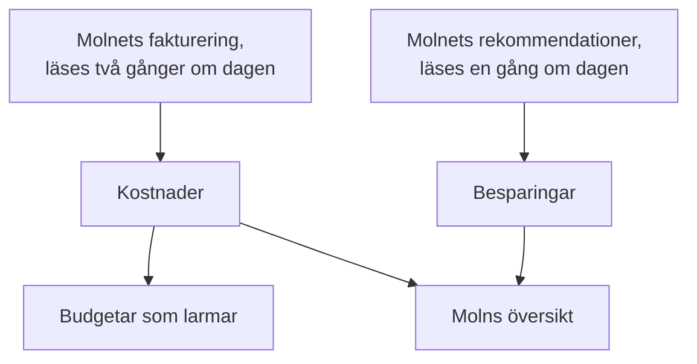

# Molnkostnader och besparingar

Ett anslutet molnkonto säger också vad det kostar och hur det kunde kosta mindre. OneUptime läser varje dags kostnader från molnets egen fakturering och rekommendationerna från molnets egen rekommendationstjänst, visar dem under **Moln → Utgifter → Kostnader** och **Moln → Utgifter → Besparingar**, och larmar innan en månad kostar mer än sin budget under **Moln → Utgifter → Budgetar**.

:::cards
- [Amazon Web Services](#amazon-web-services): Cost Explorer och Cost Optimization Hub, var och en påslagen en gång.
- [Microsoft Azure](#microsoft-azure): Cost Management och Azure Advisor, med en roll till.
- [Google Cloud](#google-cloud): Din faktureringsexport till BigQuery, och Recommender.
- [Budgetar](#budgetar): Ett larm när en månads utgifter passerar en andel av dess budget.
:::

## Så fungerar det



- **Kostnaderna kommer från molnets egen fakturering.** AWS Cost Explorer, Azure Cost Management och Google Clouds faktureringsexport till BigQuery, före krediter och återbetalningar, i den valuta kontot faktureras i. Varje belopp gäller en dag, i UTC-dagar, så som molnet fakturerar dem.
- **Ett moln rapporterar den sista dagen eller två sent.** Varje läsning tar den senaste veckan igen, och hela förra månaden under en månads första dagar, så en dags kostnad faller på plats medan molnet avslutar den. En anslutnings första läsning går tillbaka till början av månaden före förra månaden.
- **Månadens prognos följer takten under den senaste veckan.** Den är vad månaden har kostat hittills, med varje dag som återstår till genomsnittet av de senaste sju hela dagarna.
- **Besparingarna kommer från molnets egen rekommendationstjänst.** AWS Cost Optimization Hub, Azure Advisor och Google Clouds Recommender: en mindre storlek, en resurs som står oanvänd, ett åtagande som lönar sig, var och en med vad den skulle spara per månad. En rekommendation som du genomför eller avfärdar i molnets konsol försvinner vid nästa läsning.

## Innan du börjar

- **Ett anslutet konto.** [Anslut ett molnkonto](/docs/telemetry/cloud-accounts) med dagens installationskommando: det låter anslutningen läsa kostnader och rekommendationer. En anslutning som skapades tidigare läser ingetdera förrän du kör dess kommando igen.

## Amazon Web Services

Anslutningen läser kostnader med `ce:GetCostAndUsage` och rekommendationer med `cost-optimization-hub:ListRecommendations`. Var och en kräver att något först slås på i kontot:

:::steps
### Slå på Cost Explorer

Öppna Cost Explorer en gång i AWS-konsolen Billing and Cost Management: AWS förbereder kontots kostnader inom en dag. Anslut organisationens hanteringskonto för att läsa kostnaderna för varje medlemskonto.

### Anmäl dig till Cost Optimization Hub

Öppna Cost Optimization Hub i samma konsol och anmäl dig, för organisationen från dess hanteringskonto eller bara för kontot. Dess rekommendationer kommer inom en dag.
:::

Cost Explorer tar $0.01 för varje begäran, och en läsning av kostnaderna gör några få. Cost Optimization Hub är gratis.

## Microsoft Azure

Appen läser kostnader med rollen **Cost Management Reader**, på samma omfång som **Monitoring Reader**: installationskommandot tilldelar båda. Azure Advisors rekommendationer läses med **Monitoring Reader**, så det finns inget att slå på. För att ge en app som skapades tidigare rollen kör du:

```bash
az role assignment create --assignee <APP_ID> --role "Cost Management Reader" --scope /subscriptions/<SUBSCRIPTION_ID>
```

Cost Management svarar för varje prenumeration, med den resurs varje kostnad gäller, och det kostar inget att läsa. När den inte kan svara för en prenumeration säger kontots **Kostnader** varför.

## Google Cloud

Google Cloud har inget API för ett projekts kostnader: OneUptime läser dem från faktureringskontots export till BigQuery.

:::steps
### Exportera din fakturering till BigQuery

Öppna Billing och sedan Billing export i Google Cloud-konsolen, och slå på exporten av detaljerade användningskostnader till en BigQuery-datauppsättning. Google skriver den några timmar i efterhand, från den dag du slår på den.

### Låt tjänstkontot läsa den

Ge anslutningens tjänstkonto **BigQuery Data Viewer** på exportens datauppsättning. Installationskommandot har redan gett det **BigQuery Job User**, så att det kan köra frågan i sitt eget projekt.

### Ange exportens tabell

Redigera anslutningen under **Moln → Anslut**, och sätt under **Fler fält** **Tabell för faktureringsexport** till tabellens fullständiga namn: `<PROJECT_ID>.<DATASET>.gcp_billing_export_resource_v1_<BILLING_ACCOUNT_ID>`.
:::

Den detaljerade exporten anger den resurs varje kostnad gäller; standardexporten anger bara tjänsten och regionen. BigQuery debiterar frågan: den första 1 TiB per månad är gratis, därefter $6.25 per TiB, och en månad av en export är från några få megabyte till några få gigabyte. Recommenders rekommendationer om maskintyper och oanvända resurser läses med **Compute Recommender Viewer**, som installationskommandot tilldelar, och kostar inget.

## Sätt att spendera mindre

**Moln → Utgifter → Besparingar** listar varje rekommendation, den största besparingen först: vad som ska göras, för vilken resurs, vad som skulle ändras och vad den sparar per månad. Remsan ovanför summerar dem, totalt och efter typ: en mindre storlek, en resurs som står oanvänd, ett åtagande. En rekommendation länkar till sidan för sin resurs när OneUptime har resursen.

### Storleksanpassning utifrån OneUptimes egna mätvärden

En resurs som ingen rekommendationstjänst uttalar sig om, eftersom den inte är påslagen, inte täcker resursens typ eller tycker att den är för ny, får sin storlek bedömd av OneUptime utifrån de CPU- och minnesmätvärden som anslutningen har tagit de senaste 14 dagarna. OneUptime bedömer EC2-instanser, RDS-databaser och ElastiCache-kluster på AWS, virtuella maskiner, flexibla PostgreSQL- och MySQL-servrar och App Service-planer på Azure samt Compute Engine-VM:ar och Cloud SQL-instanser på Google Cloud:

- **Överprovisionerad** när storleken som är hälften så stor, eller en fjärdedel, fortfarande skulle ha utrymme: på den mindre storleken skulle CPU:ns 95:e percentil vara högst 60 %, dess högsta CPU-mätvärde högst 100 % och minnets topp högst 70 %, när minnet läses.
- **Underprovisionerad** när CPU:ns 95:e percentil är 85 % eller mer, eller minnets topp 90 % eller mer: storleken som är dubbelt så stor.

En resurs bedöms så snart den har 6 dagars mätvärden. Dess sida visar dess **Storleksanpassning** bredvid vad den kostar, och en överprovisionerad listas under **Moln → Utgifter → Besparingar** med OneUptime som källa. Det en ändring sparar är dess andel av vad resursen kostade de senaste 30 dagarna, så det är känt så snart ditt moln fakturerar resursen med namn: Azures och Google Clouds detaljerade export gör det, AWS Cost Explorer gör det inte. En EC2-instans rapporterar sitt minne bara med CloudWatch-agenten och en Compute Engine-VM bara med Ops Agent: utan den bedöms den enbart utifrån sin CPU. Burstable storlekar som t3, B-serien och e2-micro bedöms aldrig.

## Budgetar

:::steps
### Skapa en budget

Under **Moln → Utgifter → Budgetar** skapar du en budget: dess **Månadsbelopp** och det **Konto** den gäller, eller inget för alla konton.

### Välj när den larmar

**Larma vid** tar de andelar av budgeten som det ska larmas vid, i procent: 80 och 100 till att börja med. **Larma när en överskridning är på väg** larmar också, en gång per månad, när takten under den senaste veckan skulle ta månaden över budgeten. **Larma vid ovanliga dagar** larmar också dagen efter en dag som kostade långt mer än vanligt: se [Ovanliga dagar](#ovanliga-dagar). **Larmallvar** och **Jourpolicyer** anger hur allvarliga larmen är och vem som larmas.
:::

En budget kontrolleras efter varje läsning av kostnaderna och varje timme. När månadens utgifter passerar ett tröskelvärde skapas ett larm för det, det högsta när en läsning passerar flera på en gång, och en ny månad löser förra månadens larm. En budget räknar bara de konton som faktureras i dess valuta.

AI-agenter kan skapa och ändra budgetar via [MCP-servern](/docs/ai/mcp-server), och skript med CLI:ns kommando `oneuptime cloud-budget`: se [Resursoperationer](/docs/cli/resource-operations).

### Ovanliga dagar

Efter varje läsning jämförs var och en av ett kontos senaste 14 hela dagar med de 14 dagarna före. En dag är ovanlig när en tjänst kostade det dubbla mot sin vanliga dag eller mer, eller hela kontot en och en halv gång sin vanliga dag eller mer. I båda fallen måste det vara minst 10 mer än vanligt i kontots valuta och minst 5 % av kontots vanliga dag, så att några ören aldrig räknas som en topp. En dags vanliga värde är medianen av de 14 dagarna före, så en enstaka topp flyttar det lite, och ett konto bedöms först när det har en veckas kostnader.

**Moln → Utgifter → Kostnader** listar de ovanliga dagarna under de dagliga utgifterna. En budget som räknar in kontot skapar ett larm för varje konto och dag, dagen efter, och nämner varje tjänst som låg högt. En topp som håller i sig i flera dagar meddelas den dag den började, och en dag som är mer än en vecka gammal meddelas inte. En budget som skapades innan de här larmen fanns skapar dem inte förrän du redigerar den och slår på dem.

## Det du ser i OneUptime

- **Molns översikt.** **Moln → Översikt** visar månadens utgifter mot förra månadens på samma dag, de dyraste tjänsterna och de största sätten att spendera mindre, bredvid det som behöver uppmärksamhet.
- **Varje dags utgifter.** **Moln → Utgifter → Kostnader** ritar var och en av de senaste 30 dagarna, listar de dagar som kostade långt mer än vanligt och delar upp en period efter tjänst, region, konto eller resurs. De konton vars kostnader inte läses listas nedanför, var och en med orsaken.
- **Ett kontos kostnader.** Ett kontos **Kostnader** visar samma sak för kontot ensamt, med dess sätt att spendera mindre.
- **En resurs kostnad.** En resurs sida visar vad den har kostat den här månaden och de senaste 30 dagarna när dess moln fakturerar den med namn, med dess sätt att spendera mindre och dess storleksanpassning.

## Felsökning

:::details Ett konto säger Kräver behörighet
Anslutningen får inte läsa kontots kostnader än. Kör dess installationskommando igen från **Moln → Anslut**: det lägger till det som läsningen av kostnader behöver. På Google Cloud ger du också tjänstkontot **BigQuery Data Viewer** på exportens datauppsättning.
:::

:::details Ett konto säger Inte konfigurerad
Dess moln har inga kostnader att ge än. På AWS slår du på Cost Explorer; på Google Cloud anger du exportens tabell under **Tabell för faktureringsexport**. De första beloppen kommer med nästa läsning, inom 12 timmar.
:::

:::details Beloppen utelämnar ett konto
Beloppen är i den valuta som de flesta av dina konton faktureras i. Ett konto som faktureras i en annan listas nedanför med sin valuta, och en budget räknar bara de konton som faktureras i dess egen.
:::

:::details Den här månaden är lägre än i molnets konsol
Molnet rapporterar den sista dagen eller två sent, och beloppen är före krediter och återbetalningar. Nästa läsningar kommer ikapp.
:::

## Nästa steg

:::cards
- [Anslut ett molnkonto](/docs/telemetry/cloud-accounts): Anslut ett annat konto, eller kör dess kommando igen.
- [Molnresurser](/docs/telemetry/cloud-resources): Varje resurs mätvärden, från en egen collector.
- [Kostnadsobservability för Kubernetes](/docs/telemetry/kubernetes-cost): Vad varje Kubernetes-arbetsbelastning kostar.
:::
