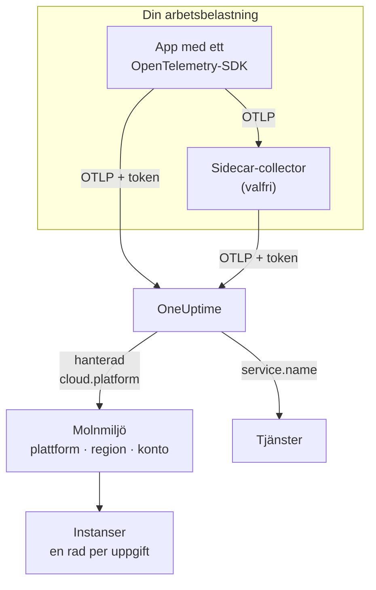

# Molnmiljöer

En **Cloud Environment** är platsen där dina containrar körs på en hanterad molnplattform: kontot och regionen för ett ECS-kluster, projektet och regionen för Cloud Run, prenumerationen och regionen för Container Apps. OneUptime skapar en första gången din telemetri kommer fram med rätt resursattribut, och samlar varje arbetsbelastning som körs där. Det finns inget att registrera för hand.

:::cards
- [AWS ECS / Fargate](/docs/telemetry/cloud-aws-ecs): Uppgifter på Fargate eller EC2, med CPU och minne per uppgift.
- [Google Cloud Run](/docs/telemetry/cloud-gcp-cloud-run): Tjänster och jobb, som också listas som serverlösa funktioner.
- [Azure Container Apps](/docs/telemetry/cloud-azure-container-apps): Repliker, med region och prenumeration angivna för hand.
- [Andra molnplattformar](/docs/telemetry/cloud-other-platforms): Elastic Beanstalk, App Runner, App Engine, App Service och Container Instances.
:::

## Så fungerar det



- **En resursdetektor talar om var arbetsbelastningen körs.** En OpenTelemetry-resursdetektor, i SDK:t eller i en collector, läser plattformens metadata och sätter `cloud.platform`, `cloud.account.id` och `cloud.region` på allt som arbetsbelastningen skickar. Där det inte finns någon detektor sätter du dem själv.
- **Miljön samlar allt.** Varje arbetsbelastning med samma plattform, konto och region hamnar i en och samma miljö. Tjänsterna behåller sina egna rader under **Tjänster**.
- **Varje uppgift som körs är en instans.** Miljöns flik **Instanser** listar uppgifterna, instanserna eller replikerna som körs, med CPU och minne i realtid där plattformen kan leverera dem.

## Innan du börjar

- **En intagningsnyckel.** Skapa en nyckel av typen **Server** under **Projektinställningar → Telemetri och APM → Intagningsnycklar** och kopiera dess token: se [Skapa en intagningsnyckel](/docs/telemetry/open-telemetry#skapa-en-intagningsnyckel). Den är en hemlighet: varje plattformssida visar var du förvarar den i molnets hemlighetslager.
- **OpenTelemetry i din applikation.** Ett OpenTelemetry-SDK som exporterar OTLP, eller en OpenTelemetry Collector som körs bredvid applikationen.

## Plattformar som stöds

| Plattform | `cloud.platform` | `cloud.*` fylls i av | Instansidentitet | Guide |
| ------------------------- | --------------------------- | ---------------------- | --------------------------------- | ------------------------------------------------------------------ |
| AWS ECS / Fargate | `aws_ecs` | resursdetektor | `aws.ecs.task.arn` | [AWS ECS / Fargate](/docs/telemetry/cloud-aws-ecs) |
| AWS Elastic Beanstalk | `aws_elastic_beanstalk` | resursdetektor | `host.id` | [Andra molnplattformar](/docs/telemetry/cloud-other-platforms) |
| AWS App Runner | `aws_app_runner` | anges för hand | `host.name` | [Andra molnplattformar](/docs/telemetry/cloud-other-platforms) |
| Google Cloud Run | `gcp_cloud_run` | resursdetektor | `faas.instance` | [Google Cloud Run](/docs/telemetry/cloud-gcp-cloud-run) |
| Google App Engine | `gcp_app_engine` | resursdetektor | `faas.instance` | [Andra molnplattformar](/docs/telemetry/cloud-other-platforms) |
| Azure Container Apps | `azure_container_apps` | resursdetektor | `azure.container_app.instance.id` | [Azure Container Apps](/docs/telemetry/cloud-azure-container-apps) |
| Azure Container Instances | `azure_container_instances` | anges för hand | `host.name` | [Andra molnplattformar](/docs/telemetry/cloud-other-platforms) |
| Azure App Service | `azure_app_service` | resursdetektor | `host.id` | [Andra molnplattformar](/docs/telemetry/cloud-other-platforms) |

- **Resursdetektor:** en OpenTelemetry-resursdetektor, i SDK:t eller i Collectorns processor `resourcedetection`, sätter attributen `cloud.*` åt dig.
- **Anges för hand:** det finns ingen detektor, så du lägger attributen i `OTEL_RESOURCE_ATTRIBUTES`. Plattformens sida visar den exakta raden.
- **Azure-detektorerna vet mindre.** Detektorerna för Container Apps känner varken till regionen eller prenumerationen, och detektorerna för App Service känner inte till prenumerationen: ange själv det som saknas.
- **Azure-stavningar med punkt fungerar.** Azure-detektorerna för Node.js och .NET skriver `azure.container_apps` och `azure.app_service`. OneUptime skriver om dem till värdena med understreck ovan när de tas emot.

## Så identifierar OneUptime en miljö

Det finns en miljö för varje kombination av tre resursattribut:

| Attribut | Obligatoriskt | Vad det är |
| ------------------ | -------- | ------------------------------------------------------------------------------------------- |
| `cloud.platform` | Ja | Ett av värdena i [Plattformar som stöds](#plattformar-som-stöds) |
| `cloud.account.id` | Nej | AWS-konto-ID:t, Google Cloud-projekt-ID:t eller Azure-prenumerations-ID:t |
| `cloud.region` | Nej | Regionen, till exempel `us-east-1`, `us-central1` eller `eastus` |

OneUptime fogar samman de tre med `|` till **miljönyckeln**, och namnger miljön efter samma värden, till exempel _AWS ECS · us-east-1 · 123456789012_:

```text title="Environment keys"
aws_ecs|123456789012|us-east-1
gcp_cloud_run|my-project|us-central1
azure_container_apps|00000000-0000-0000-0000-000000000000|eastus
```

> [!IMPORTANT]
> En del som saknas står kvar i nyckeln som ett tomt segment: `aws_ecs||us-east-1`. En arbetsbelastning som utelämnar `cloud.account.id` hamnar därför i en annan miljö än en som sätter den. Det är det vanliga skälet till att du ser två miljöer där du väntade dig en.

### Instansidentitet

Inom en miljö får varje uppgift, instans eller replik som körs en rad under **Instanser**. Namnet kommer från det första av dessa resursattribut som telemetrin bär:

1. `aws.ecs.task.id`
2. `aws.ecs.task.arn` (förkortat till uppgifts-ID:t)
3. `faas.instance`
4. `azure.container_app.instance.id`
5. `service.instance.id`
6. `container.id`
7. `host.id`
8. `host.name`

Plattformens egen identitet kommer först med avsikt. En sidecar-collector och applikationens SDK ser den båda, och den överlever omstarter. Ett SDK hittar oftast på ett nytt `service.instance.id` för varje process (Node.js-SDK:t gör det som standard), så om det vore nyckeln först skulle en ECS-uppgift delas upp på två rader. `service.instance.id` används när plattformen inte sätter någon egen identitet. Kolumnen **Instansidentitet** i [Plattformar som stöds](#plattformar-som-stöds) anger det attribut som en typisk konfiguration använder på varje plattform.

### Miljöer som du skapar för hand

Det behövs sällan: intaget skapar miljöer åt dig. För att skapa en innan dess telemetri kommer öppnar du **Moln → All Environments** och klickar på **Skapa Molnresurs**. Välj **Molnplattform** och skriv sedan **Moln-konto-ID** och **Molnregion** exakt som din telemetri rapporterar dem. OneUptime bygger nyckeln `platform|account|region` av dessa tre, och intaget matchar en miljö enbart på nyckeln. Miljön får det namn som intaget skulle ge den; vill du visa ett annat namn öppnar du **Fler fält** och skriver ett **Visningsnamn**.

## Det som inte är en molnmiljö

| Du kör på | Var det visas | Varför |
| ------------------------------------------------------------------------------------------------- | ------------------------ | ---------------------------------------------------------------------------------------------------- |
| EC2, Compute Engine, Azure VM (`aws_ec2`, `gcp_compute_engine`, `azure_vm`) | **Värdar** | En virtuell maskin är en värd. Se [OpenTelemetry-collector på värden](/docs/telemetry/host-otel-collector) |
| EKS, GKE, AKS, självhanterad Kubernetes | **Kubernetes** | Routas efter attributen `k8s.*`. Se [Kubernetes-agent](/docs/telemetry/kubernetes-agent) |
| Lambda, Cloud Functions, Azure Functions (`aws_lambda`, `gcp_cloud_functions`, `azure_functions`) | **Serverlösa funktioner** | Routas efter `faas.name`, eller efter `service.name` på en `cloud.platform` för FaaS. Se [Serverlösa funktioner](/docs/telemetry/serverless-functions) |
| Lastbalanserare, bucketar, hanterade databaser och andra IaaS- eller PaaS-resurser | **Cloud Resources** | Upptäcks från de mätvärden som Azure Monitor, CloudWatch och Cloud Monitoring publicerar. Se [Molnresurser](/docs/telemetry/cloud-resources) |

> [!NOTE]
> Cloud Run och App Engine visas med avsikt på två ställen. Deras detektor sätter både en hanterad `cloud.platform` och `faas.name`, så varje tjänst är också en egen **Serverlös funktion**, medan **Cloud Environment** samlar alla tjänster i det projektet och den regionen. Samma telemetri arkiveras under båda.

## Anslut en arbetsbelastning

Varje plattformssida har de här stegen med molnets egna kommandon och konsolskärmar. I stora drag:

:::steps
### Sätt molnattributen på din telemetri

:::tabs
@tab Sidecar collector
En extra container i uppgiften, instansen eller repliken. Applikationen exporterar till `localhost:4318`, och collectorns processor `resourcedetection` stämplar `cloud.*` på allt som passerar. Collectorn har din token, och på ECS skickar den också CPU och minne per uppgift:

```yaml title="collector.yaml"
processors:
  resourcedetection:
    detectors: [env, ecs] # [env, gcp] on Cloud Run and App Engine; [env, azurecontainerapps] on Container Apps
    timeout: 5s
```
@tab SDK direct
Applikationens SDK exporterar direkt till OneUptime. Slå på plattformens resursdetektor i SDK:t, till exempel `OTEL_NODE_RESOURCE_DETECTORS=env,host,os,aws` i Node.js: varje plattformssida listar inställningen för varje språk. Det finns ingen extra container, och ingen CPU eller minne för containern.
:::

### Exportera OTLP till OneUptime

:::tabs
@tab Sidecar collector
```yaml title="collector.yaml"
exporters:
  otlphttp/oneuptime:
    endpoint: https://oneuptime.com/otlp
    headers:
      x-oneuptime-token: ${env:ONEUPTIME_TOKEN}

service:
  pipelines:
    traces:
      receivers: [otlp]
      processors: [resourcedetection, batch]
      exporters: [otlphttp/oneuptime]
    metrics:
      receivers: [otlp]
      processors: [resourcedetection, batch]
      exporters: [otlphttp/oneuptime]
    logs:
      receivers: [otlp]
      processors: [resourcedetection, batch]
      exporters: [otlphttp/oneuptime]
```

Collectorn fyller i `${env:ONEUPTIME_TOKEN}` från en miljövariabel som plattformen fyller från sitt hemlighetslager: Secrets Manager, Secret Manager eller hemligheter i Container Apps.
@tab SDK direct
```bash
OTEL_EXPORTER_OTLP_ENDPOINT="https://oneuptime.com/otlp"
OTEL_EXPORTER_OTLP_HEADERS="x-oneuptime-token=YOUR_TELEMETRY_INGESTION_TOKEN"
```
:::

Om du driftar OneUptime själv använder du `https://YOUR-ONEUPTIME-HOST/otlp`.

### Kontrollera anslutningen

```bash
curl -i https://oneuptime.com/otlp/v1/validate \
  -H "x-oneuptime-token: YOUR_TELEMETRY_INGESTION_TOKEN"
```

`200` med `"valid": true` betyder att din token accepteras. `401` betyder att den är okänd, återkallad, inaktiverad eller har gått ut, och svarets `message` säger vilket. Inom en minut efter det första spannet, den första loggen eller det första mätvärdet visas miljön under **Moln → All Environments**.
:::

> [!TIP]
> Samma steg finns i instrumentpanelen, med din token ifylld: under **Moln → All Environments** tills din första miljö kommer, och på varje miljös flik **Dokumentation**.

## Vad du får

En miljös **Översikt** visar:

- **Begäranden**, **Felfrekvens** och **p95 latency** från dina spår, med diagram över begäranden, fel och minne under det tidsintervall du väljer.
- **CPU** och **Minne** för de levande instanserna, och listan **Främsta instanser efter CPU**. De kommer från mätvärdena `container.cpu.utilization` och `container.memory.usage` som bär instansidentiteten; på ECS från `ecs.task.cpu.utilized` och `ecs.task.memory.utilized` från receivern `awsecscontainermetrics`.
- **Instanser**: hur många som har rapporterat de senaste 15 minuterna. Fliken **Instanser** har en rad för varje.
- Flikarna **Loggar**, **Spår** och **Mätvärden**, filtrerade på miljön.

En miljö vars telemetri slutar komma i 15 minuter visar **Frånkopplad**, och nästa spann, logg eller mätvärde tar tillbaka den till **Ansluten**. Tid då OneUptime självt var nere eller höll på att komma ikapp räknas inte in i de 15 minuterna.

### Etiketter och ägare

- **Från din telemetri:** ett resursattribut som `oneuptime.label.team=payments` lägger till etiketten `team:payments` på miljön.
- **Från regler:** **Moln → Inställningar → Etikettregler** och **Ägarregler** lägger till etiketter och ägare på miljöer som matchar. Se [Etikett- och ägarregler](/docs/configuration/label-and-owner-rules).

## Felsökning

[Felsökning i molnet](/docs/telemetry/cloud-troubleshooting) går igenom varje fel i den ordning de inträffar: en miljö som aldrig visas, hamnar under **Värdar** eller bara under **Serverlösa funktioner**, saknar instanser eller saknar CPU och minne, visar **Frånkopplad**, delas i två eller skapades för hand och aldrig matchar.

## Nästa steg

:::cards
- [AWS ECS / Fargate](/docs/telemetry/cloud-aws-ecs): Den vanligaste konfigurationen, med en komplett uppgiftsdefinition.
- [Felsökning i molnet](/docs/telemetry/cloud-troubleshooting): Vad du ska kontrollera när en miljö saknas eller är fel.
- [Molnresurser (IaaS och PaaS)](/docs/telemetry/cloud-resources): Lastbalanserare, bucketar och hanterade databaser från molnets egen övervakning.
- [Serverlösa funktioner](/docs/telemetry/serverless-functions): Lambda, Cloud Functions och Azure Functions.
:::
