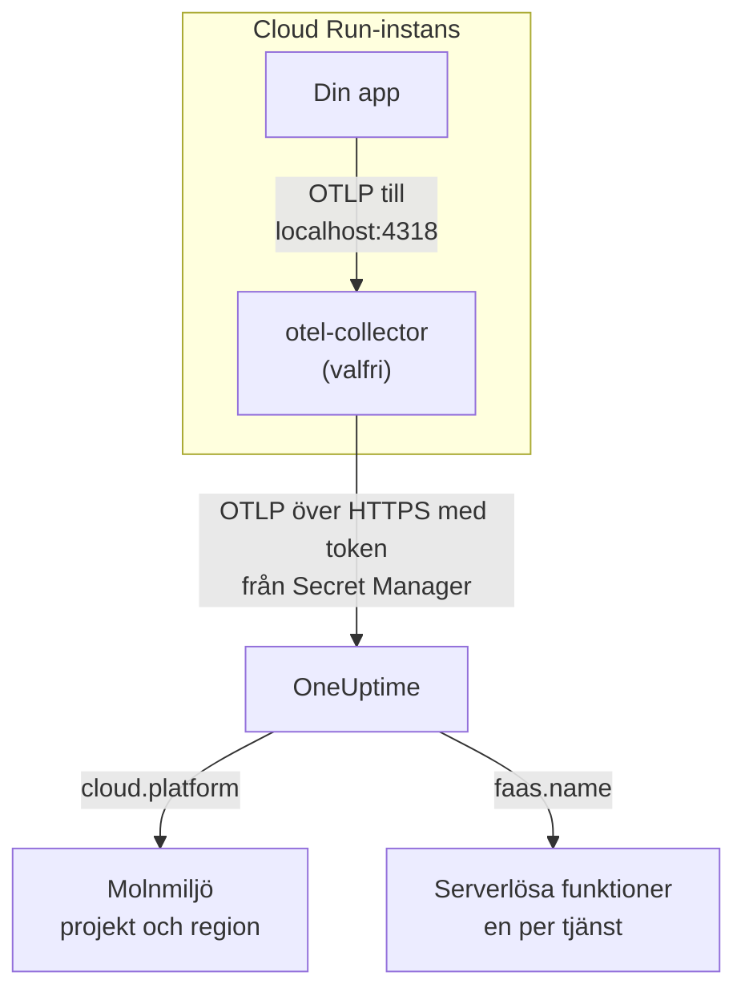

# Google Cloud Run

Skicka spår, loggar och mätvärden från dina Cloud Run-tjänster och -jobb till OneUptime. Allt som rapporterar `cloud.platform=gcp_cloud_run` hamnar i en **Cloud Environment** per Google Cloud-projekt och region, till exempel _GCP Cloud Run · us-central1 · my-project_, och varje tjänst visas också under **Serverlösa funktioner**.

:::cards
- [Så fungerar det](#så-fungerar-det): Vad GCP-detektorn sätter, och varför en tjänst visas på två ställen.
- [Konfigurera](#konfigurera): Spara din token, konfigurera tjänsten, distribuera och kontrollera.
- [Tjänstens YAML med en sidecar](#tjänstens-yaml-med-en-sidecar): En komplett Cloud Run-tjänst med en collector.
- [Felsökning](#felsökning): Fel med hemligheter, sidecarens startordning och miljöer som saknas.
:::

## Så fungerar det



OpenTelemetrys GCP-resursdetektor läser metadataservern och miljövariablerna `K_SERVICE` och `K_REVISION`, och sätter:

| Attribut | Värde på Cloud Run | Används till |
| ------------------ | ------------------------------ | ----------------------------------------------------------------------------------------- |
| `cloud.platform` | `gcp_cloud_run` | Arkiverar telemetrin under **Molnmiljöer** |
| `cloud.account.id` | projekt-ID:t | En del av miljönyckeln |
| `cloud.region` | `us-central1` | En del av miljönyckeln |
| `faas.name` | tjänstens namn (`K_SERVICE`) | Listar också tjänsten under **Serverlösa funktioner** |
| `faas.version` | revisionen (`K_REVISION`) | Visas i tjänstens översikt som serverlös funktion; miljön använder den inte |
| `faas.instance` | instans-ID:t | Namnger en instans som körs: en rad för varje under **Instanser** |

> [!NOTE]
> Cloud Run visas med avsikt på två ställen. Eftersom detektorn sätter `faas.name` är varje tjänst också en **Serverlös funktion**, med egna anrop, felfrekvens och varaktighet. **Cloud Environment** samlar alla tjänster i det projektet och den regionen. Inget lagras två gånger: samma telemetri arkiveras under båda.

Miljönyckeln är `gcp_cloud_run|my-project|us-central1`.

## Innan du börjar

- **En intagningsnyckel.** Skapa en nyckel av typen **Server** under **Projektinställningar → Telemetri och APM → Intagningsnycklar** och kopiera dess token.
- **`gcloud`**, inloggat i projektet, med Secret Manager-API:t påslaget: `gcloud services enable secretmanager.googleapis.com`.
- **Din applikation instrumenterad med ett OpenTelemetry-SDK** som exporterar OTLP.

## Välj hur telemetrin lämnar tjänsten

| | SDK direct | Sidecar collector |
| --------------- | ---------------------------------------------------- | ---------------------------------------------------------------------- |
| Extra container | Ingen | `otel-collector` i tjänsten |
| Passar bäst för | En tjänst, och Cloud Run-jobb | Flera tjänster i ett projekt, eller ett SDK som inte kan köra en detektor |
| Har din token | Applikationen | Collectorn |
| Hemligheten | `oneuptime-otlp-headers`, hela headern | `oneuptime-ingestion-token`, bara din token |

Ett jobb körs tills det är klart, så det finns inget att hålla en sidecar vid liv för: använd SDK direct. Varje steg nedan har en flik för båda; välj en, så följer varje steg den.

## Konfigurera

:::steps
### Spara din token i Secret Manager

> [!IMPORTANT]
> Din token är en hemlighet. Lägg den i Secret Manager och referera till den från tjänsten som en miljövariabel som bygger på en hemlighet. En vanlig miljövariabel syns för alla som kan visa projektet, i konsolen och i `gcloud run services describe`.

:::tabs
@tab SDK direct
```bash
printf '%s' "x-oneuptime-token=YOUR_TELEMETRY_INGESTION_TOKEN" | gcloud secrets create oneuptime-otlp-headers \
  --data-file=- \
  --replication-policy=automatic

gcloud secrets add-iam-policy-binding oneuptime-otlp-headers \
  --member="serviceAccount:checkout-api@my-project.iam.gserviceaccount.com" \
  --role="roles/secretmanager.secretAccessor"
```

Cloud Run lägger en hemlighets värde oförändrat i variabeln, och `OTEL_EXPORTER_OTLP_HEADERS` behöver hela paret `name=value`, så den här hemligheten innehåller hela headern.
@tab Sidecar collector
```bash
printf '%s' "YOUR_TELEMETRY_INGESTION_TOKEN" | gcloud secrets create oneuptime-ingestion-token \
  --data-file=- \
  --replication-policy=automatic

gcloud secrets add-iam-policy-binding oneuptime-ingestion-token \
  --member="serviceAccount:checkout-api@my-project.iam.gserviceaccount.com" \
  --role="roles/secretmanager.secretAccessor"
```

Collectorns konfiguration lägger till headerns namn, så den här hemligheten innehåller bara din token.
:::

Ange tjänstens körningstjänstkonto i `--member`, inte din egen användare. Utan `roles/secretmanager.secretAccessor` går revisionen inte att distribuera och misslyckas med `Permission denied on secret`. Om tjänsten fortfarande körs som standardtjänstkontot för Compute ger du rollen till det kontot, och överväger att ge tjänsten ett eget konto: standardkontot delas av allt i projektet.

### Konfigurera tjänsten

:::tabs
@tab SDK direct
1. **Google Cloud console → Cloud Run → click the service → Edit & deploy new revision**.
2. På fliken **Containers** öppnar du din container och går till **Variables & Secrets**. Lägg till variablerna nedan.
3. Klicka på **Reference a secret**, välj `oneuptime-otlp-headers`, version `latest`, och exponera den som miljövariabeln `OTEL_EXPORTER_OTLP_HEADERS`.
4. På fliken **Security** kontrollerar du att **Service account** är det konto som du gav `roles/secretmanager.secretAccessor`.

```bash
OTEL_SERVICE_NAME=checkout-api
OTEL_EXPORTER_OTLP_ENDPOINT=https://oneuptime.com/otlp
OTEL_EXPORTER_OTLP_PROTOCOL=http/protobuf
# Secret-backed (Variables & Secrets → Reference a secret), not typed here.
OTEL_EXPORTER_OTLP_HEADERS=x-oneuptime-token=YOUR_TELEMETRY_INGESTION_TOKEN
```

Slå sedan på GCP-resursdetektorn för ditt språk:

| Språk | Slå på GCP-detektorn |
| -------- | ------------------------------------------------------------------------------------------------------------------- |
| Node.js | `OTEL_NODE_RESOURCE_DETECTORS=env,host,os,gcp` (auto-instrumentations-node) |
| Python | `pip install opentelemetry-resourcedetector-gcp`, sedan `OTEL_EXPERIMENTAL_RESOURCE_DETECTORS=gcp_resource_detector` |
| Java | `-Dotel.resource.providers.gcp.enabled=true` |
| Go | `import "go.opentelemetry.io/contrib/detectors/gcp"` och skicka `gcp.NewDetector()` till `resource.New` |
| .NET | Paketet `OpenTelemetry.Resources.Gcp`: `.ConfigureResource(r => r.AddGcpDetector())` |

Eller ställ in allt från CLI:

```bash
gcloud run services update checkout-api --region us-central1 \
  --set-env-vars "^@^OTEL_SERVICE_NAME=checkout-api@OTEL_EXPORTER_OTLP_ENDPOINT=https://oneuptime.com/otlp@OTEL_EXPORTER_OTLP_PROTOCOL=http/protobuf@OTEL_NODE_RESOURCE_DETECTORS=env,host,os,gcp" \
  --set-secrets "OTEL_EXPORTER_OTLP_HEADERS=oneuptime-otlp-headers:latest"
```

Prefixet `^@^` får `gcloud` att dela flaggans lista vid `@` i stället för `,`. Utan det delar `gcloud` `OTEL_NODE_RESOURCE_DETECTORS=env,host,os,gcp` vid varje kommatecken och misslyckas med `Bad syntax for dict arg [host]`.
@tab Sidecar collector
1. **Google Cloud console → Cloud Run → click the service → Edit & deploy new revision**.
2. På fliken **Containers** öppnar du din container och går till **Variables & Secrets**. Lägg till applikationsvariablerna nedan.
3. Klicka på **+ Add container**. Ange containeravbildningens URL som `otel/opentelemetry-collector-contrib:latest`, och lägg under **Container command and arguments** till argumentet `--config=env:OTEL_COLLECTOR_CONFIG`.
4. På den nya containerns flik **Variables & Secrets**: **Reference a secret**, `oneuptime-ingestion-token`, som miljövariabeln `ONEUPTIME_TOKEN`. Lägg till variabeln `OTEL_COLLECTOR_CONFIG` med collector-konfigurationen från [Tjänstens YAML med en sidecar](#tjänstens-yaml-med-en-sidecar).
5. På collectorns flik **Settings** lägger du till en **Startup probe** (HTTP, sökväg `/`, port `13133`), och under **Container start-up order** gör du din container beroende av `otel-collector`.
6. På fliken **Security** kontrollerar du att **Service account** är det konto som du gav `roles/secretmanager.secretAccessor`.

Containrarna i en Cloud Run-instans delar `localhost`, så applikationen exporterar till sidecaren där:

```bash
OTEL_SERVICE_NAME=checkout-api
OTEL_EXPORTER_OTLP_ENDPOINT=http://localhost:4318
OTEL_EXPORTER_OTLP_PROTOCOL=http/protobuf
```

Från CLI är sidecaren tjänstens YAML nedan, distribuerad med `gcloud run services replace service.yaml --region us-central1`.
:::

Om du driftar OneUptime själv använder du `https://YOUR-ONEUPTIME-HOST/otlp` som endpoint.

### Distribuera den nya revisionen

Klicka på **Deploy** i konsolen. Cloud Run startar en ny revision med inställningarna och skickar trafik till den när den är klar. Kommandona med `gcloud` distribuerar en ny revision på egen hand.

### Kontrollera anslutningen

```bash
curl -i https://oneuptime.com/otlp/v1/validate \
  -H "x-oneuptime-token: YOUR_TELEMETRY_INGESTION_TOKEN"
```

`200` med `"valid": true` betyder att din token accepteras. `401` betyder att den är okänd, återkallad, inaktiverad eller har gått ut. Skicka sedan en begäran till tjänsten, och leta i collectorns loggar i Cloud Logging (filtrera på containern `otel-collector`) efter `401`, `connection refused` eller `context deadline exceeded`. Inom en minut visas miljön under **Moln → All Environments** som _GCP Cloud Run · us-central1 · my-project_, och tjänsten under **Serverlösa funktioner**.
:::

## Tjänstens YAML med en sidecar

Collectorn läser hela sin konfiguration från `OTEL_COLLECTOR_CONFIG` (`--config=env:OTEL_COLLECTOR_CONFIG`), och din token från hemligheten via `${env:ONEUPTIME_TOKEN}`. Annoteringen `run.googleapis.com/container-dependencies` får Cloud Run att starta collectorn först och vänta på dess startprob innan applikationen startas:

```yaml title="service.yaml"
apiVersion: serving.knative.dev/v1
kind: Service
metadata:
  name: checkout-api
spec:
  template:
    metadata:
      annotations:
        # "app" depends on "otel-collector": the collector starts first and
        # must pass its startup probe before the app container is started.
        run.googleapis.com/container-dependencies: '{"app":["otel-collector"]}'
    spec:
      serviceAccountName: checkout-api@my-project.iam.gserviceaccount.com
      containers:
        - name: app
          image: us-central1-docker.pkg.dev/my-project/apps/checkout-api:1.4.2
          ports:
            - containerPort: 8080
          env:
            - name: OTEL_SERVICE_NAME
              value: checkout-api
            - name: OTEL_EXPORTER_OTLP_ENDPOINT
              value: http://localhost:4318
            - name: OTEL_EXPORTER_OTLP_PROTOCOL
              value: http/protobuf
        - name: otel-collector
          image: otel/opentelemetry-collector-contrib:latest
          args:
            - --config=env:OTEL_COLLECTOR_CONFIG
          env:
            - name: ONEUPTIME_TOKEN
              valueFrom:
                secretKeyRef:
                  name: oneuptime-ingestion-token
                  key: latest
            - name: OTEL_COLLECTOR_CONFIG
              value: |
                receivers:
                  otlp:
                    protocols:
                      http:
                        endpoint: 0.0.0.0:4318
                      grpc:
                        endpoint: 0.0.0.0:4317
                processors:
                  # Stamps cloud.provider, cloud.platform=gcp_cloud_run,
                  # cloud.account.id, cloud.region and faas.* on everything.
                  resourcedetection:
                    detectors: [env, gcp]
                    timeout: 5s
                  batch: {}
                exporters:
                  otlphttp/oneuptime:
                    endpoint: https://oneuptime.com/otlp
                    headers:
                      x-oneuptime-token: ${env:ONEUPTIME_TOKEN}
                extensions:
                  health_check:
                    endpoint: 0.0.0.0:13133
                service:
                  extensions: [health_check]
                  pipelines:
                    traces:
                      receivers: [otlp]
                      processors: [resourcedetection, batch]
                      exporters: [otlphttp/oneuptime]
                    metrics:
                      receivers: [otlp]
                      processors: [resourcedetection, batch]
                      exporters: [otlphttp/oneuptime]
                    logs:
                      receivers: [otlp]
                      processors: [resourcedetection, batch]
                      exporters: [otlphttp/oneuptime]
          startupProbe:
            httpGet:
              path: /
              port: 13133
            periodSeconds: 2
            failureThreshold: 15
          resources:
            limits:
              cpu: 500m
              memory: 256Mi
```

Distribuera den:

```bash
gcloud run services replace service.yaml --region us-central1
```

Bara den container som tar emot begäranden (`app`) anger `ports`; en sidecar får inte göra det.

## Nätverk

- **Som standard** når en Cloud Run-tjänst internet direkt, och export till `oneuptime.com` behöver inget mer.
- **Med VPC egress: All traffic** (`--vpc-egress all-traffic`, via Direct VPC egress eller en Serverless VPC Access-connector) går utgående trafik genom din VPC, som då behöver Cloud NAT (eller en väg till en proxy) för att nå OneUptime-värden. Med standardvärdet `private-ranges-only` använder bara privata adresser VPC:n, och OneUptime nås direkt.
- **Brandväggsregler för utgående trafik** i VPC:n måste tillåta TCP 443 till OneUptime-värden.
- **En OneUptime i egen drift inuti VPC:n** är det omvända fallet: led trafiken genom VPC:n (`private-ranges-only` eller `all-traffic`), så att `https://YOUR-ONEUPTIME-HOST/otlp` slås upp där.

## Vad du får

- **Översikt**: begäranden, felfrekvens och p95-latens från dina spår.
- **Instanser**: en rad per Cloud Run-instans, namngiven efter `faas.instance`. Cloud Run visar inte en containers resursanvändning för en sidecar, så rutorna **CPU** och **Minne** förblir tomma om du inte själv skickar mätvärdena `container.cpu.utilization` och `container.memory.usage` med samma `faas.instance`. Läs rutorna för begäranden här, och lämna instansernas CPU och minne åt Cloud Monitoring.
- **Loggar**, **Spår** och **Mätvärden**, filtrerade på miljön.
- Samma tjänst under **Serverlösa funktioner** (efter `faas.name`) och under **Tjänster** (efter `service.name`).

## Felsökning

:::details Revisionen misslyckas med "Permission denied on secret"
Körningstjänstkontot saknar `roles/secretmanager.secretAccessor` på hemligheten, eller så ligger bindningen på en annan hemlighet än den som tjänsten refererar till. Kör kommandot `gcloud secrets add-iam-policy-binding` igen med körningstjänstkontot som `--member`.
:::

:::details Cloud Run avvisar container-dependencies
Annoteringen nämner en container som inte finns, eller så har collectorn ingen startprob, så Cloud Run kan inte avgöra när den är klar.
:::

:::details Tjänsten finns under Serverlösa funktioner, men det finns ingen miljö
Telemetrin saknar `cloud.platform`: GCP-detektorn är inte påslagen i SDK:t, eller så saknas `gcp` i collectorns lista `detectors`.
:::

:::details Miljön finns, men Instanser är tom
Telemetrin har varken `faas.instance` eller `service.instance.id`. Orsaken är densamma: detektorn körs inte.
:::

En miljö som aldrig visas, visar **Frånkopplad** eller delas i två tas upp på [Felsökning i molnet](/docs/telemetry/cloud-troubleshooting).

## Nästa steg

:::cards
- [Molnmiljöer](/docs/telemetry/cloud-environments): Så identifieras miljöer och instanser.
- [Serverlösa funktioner](/docs/telemetry/serverless-functions): Vyn per tjänst för varje Cloud Run-tjänst.
- [Felsökning i molnet](/docs/telemetry/cloud-troubleshooting): Felen som alla plattformar har gemensamt.
- [Molnresurser (IaaS och PaaS)](/docs/telemetry/cloud-resources): Din Cloud SQL, dina lastbalanserare och bucketar från Cloud Monitoring.
:::
