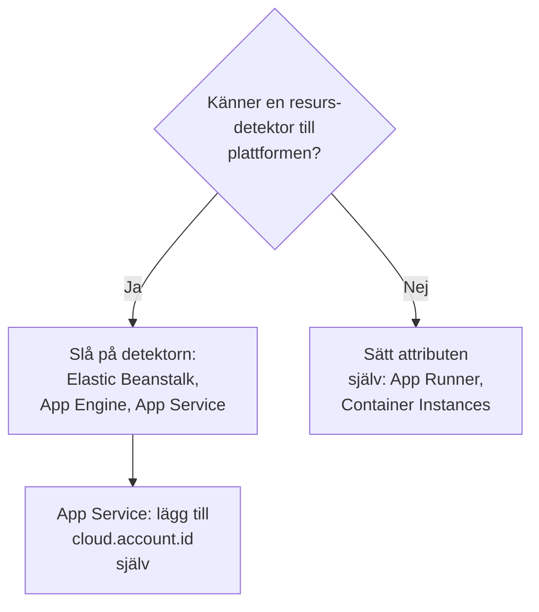

# Andra molnplattformar

Konfigurera de hanterade plattformar som inte har en egen sida: AWS Elastic Beanstalk, AWS App Runner, Google App Engine, Azure App Service och Azure Container Instances. Regeln är densamma som på alla plattformar: telemetri som bär en hanterad `cloud.platform`, med `cloud.account.id` och `cloud.region`, hamnar i en **Cloud Environment** per plattform, konto och region, och en instansidentitet ger varje instans som körs en rad under **Instanser**.

:::cards
- [AWS Elastic Beanstalk](#aws-elastic-beanstalk): En collector på varje instans, med detektorerna för Beanstalk och EC2.
- [AWS App Runner](#aws-app-runner): Attributen angivna för hand, din token från Secrets Manager.
- [Google App Engine](#google-app-engine): GCP-detektorn, med inställningarna i `app.yaml`.
- [Azure App Service](#azure-app-service): Azure-detektorerna, en Key Vault-referens och prenumerationen för hand.
- [Azure Container Instances](#azure-container-instances): Attributen angivna för hand, din token som en säker variabel.
:::

## Vad varje plattform behöver

Det som skiljer de här plattformarna åt är vem som sätter attributen `cloud.*`, och var inställningarna finns i molnets konsol:



| Plattform | `cloud.platform` | `cloud.*` fylls i av | Instansidentitet |
| ------------------------- | --------------------------- | ------------------------------------------------------------------------------------------ | ----------------------------------------------------------- |
| AWS Elastic Beanstalk | `aws_elastic_beanstalk` | Collectorns detektorer `elastic_beanstalk` och `ec2`; `aws` i Node.js | `host.id` (ta bort distributionens `service.instance.id`) |
| AWS App Runner | `aws_app_runner` | Du (ingen detektor) | `host.name` |
| Google App Engine | `gcp_app_engine` | Detektorn `gcp` (Collectorns och varje SDK:s) | `faas.instance` |
| Azure App Service | `azure_app_service` | Collectorns `azureappservice`, detektorerna `azure` för Node.js och .NET; `cloud.account.id` av dig | `service.instance.id`, sedan `host.id` |
| Azure Container Instances | `azure_container_instances` | Du (ingen detektor) | `host.name` |

Varje avsnitt nedan behöver en intagningsnyckel av typen **Server** från **Projektinställningar → Telemetri och APM → Intagningsnycklar**, och en applikation som är instrumenterad med ett OpenTelemetry-SDK. Om du driftar OneUptime själv byter du ut `https://oneuptime.com/otlp` mot `https://YOUR-ONEUPTIME-HOST/otlp`.

> [!IMPORTANT]
> Din token är en hemlighet på var och en av de här plattformarna. Varje avsnitt nämner plattformens hemlighetslager. En token som skrivs in i en vanlig miljövariabel kan läsas av alla som kan läsa appens konfiguration.

## AWS Elastic Beanstalk

`cloud.platform`: `aws_elastic_beanstalk`. Beanstalk-detektorn läser `/var/elasticbeanstalk/xray/environment.conf` på instansen och sätter `cloud.platform`, `service.instance.id`, `service.version` och miljöns namn. Den känner varken till kontot eller regionen, så kombinera den med EC2-detektorn, som gör det, och som också sätter `host.id`.

Kör en OpenTelemetry Collector på varje instans, med den här konfigurationen:

```yaml title="config.yaml"
receivers:
  otlp:
    protocols:
      http:
        endpoint: 0.0.0.0:4318
      grpc:
        endpoint: 0.0.0.0:4317
processors:
  # elastic_beanstalk sets cloud.platform and service.instance.id; ec2 adds
  # cloud.account.id, cloud.region and host.id. The first detector to set an
  # attribute wins, so elastic_beanstalk comes first.
  resourcedetection:
    detectors: [env, elastic_beanstalk, ec2]
    timeout: 5s
  # The Beanstalk detector's service.instance.id is the deployment ID, shared
  # by every instance of a deployment: drop it, so that ec2's host.id names
  # each instance.
  resource:
    attributes:
      - key: service.instance.id
        action: delete
  batch: {}
exporters:
  otlphttp/oneuptime:
    endpoint: https://oneuptime.com/otlp
    headers:
      x-oneuptime-token: ${env:ONEUPTIME_TOKEN}
service:
  pipelines:
    traces:
      receivers: [otlp]
      processors: [resourcedetection, resource, batch]
      exporters: [otlphttp/oneuptime]
    metrics:
      receivers: [otlp]
      processors: [resourcedetection, resource, batch]
      exporters: [otlphttp/oneuptime]
    logs:
      receivers: [otlp]
      processors: [resourcedetection, resource, batch]
      exporters: [otlphttp/oneuptime]
```

:::steps
1. Spara din token i Secrets Manager: `aws secretsmanager create-secret --name oneuptime/ingestion-token --secret-string "YOUR_TELEMETRY_INGESTION_TOKEN"`. Beanstalks miljöegenskaper sparas i miljöns konfiguration, inte i ett hemlighetslager, så läs i stället hemligheten från en plattformshook, med instansprofilen. Instansprofilen behöver `secretsmanager:GetSecretValue` på den.
2. Installera collectorn från ett skript i `.platform/hooks/postdeploy/` (eller `.ebextensions`): paketet `otelcol-contrib`, med konfigurationen ovan och hemligheten i dess miljö som `ONEUPTIME_TOKEN`.
3. **AWS Console → Elastic Beanstalk → Environments → your environment → Configuration**.
4. I kategorin **Updates, monitoring, and logging** klickar du på **Edit** och rullar till **Environment properties**. Lägg till `OTEL_SERVICE_NAME`, `OTEL_EXPORTER_OTLP_ENDPOINT` satt till `http://localhost:4318` och `OTEL_EXPORTER_OTLP_PROTOCOL` satt till `http/protobuf`.
5. Klicka på **Apply**. Beanstalk startar om applikationen med de nya egenskaperna.
:::

Node.js-applikationer kan hoppa över collectorn: SDK:ts detektorer omfattar Beanstalk och EC2. Sätt `OTEL_EXPORTER_OTLP_ENDPOINT` till `https://oneuptime.com/otlp`, `OTEL_EXPORTER_OTLP_HEADERS` till `x-oneuptime-token=YOUR_TELEMETRY_INGESTION_TOKEN` och `OTEL_NODE_RESOURCE_DETECTORS=env,host,os,aws`. Din token finns då i en miljöegenskap. Kontrollera efteråt resursattributen på ett spår: om `cloud.platform` är `aws_ec2` lät din SDK-version EC2-detektorn vinna, och collectorn är den pålitliga vägen.

**Nätverk:** instanser i ett privat undernät behöver en NAT-gateway, och instansens säkerhetsgrupp måste tillåta utgående trafik på TCP 443 till OneUptime-värden.

## AWS App Runner

`cloud.platform`: `aws_app_runner`. Det finns ingen detektor, så du sätter attributen själv. App Runner kan lägga en hemlighet från Secrets Manager (eller SSM Parameter Store) i en miljövariabel.

```bash
OTEL_SERVICE_NAME=checkout-api
OTEL_EXPORTER_OTLP_ENDPOINT=https://oneuptime.com/otlp
OTEL_EXPORTER_OTLP_PROTOCOL=http/protobuf
# From Secrets Manager: the secret holds the whole header.
OTEL_EXPORTER_OTLP_HEADERS=x-oneuptime-token=YOUR_TELEMETRY_INGESTION_TOKEN
OTEL_RESOURCE_ATTRIBUTES=cloud.provider=aws,cloud.platform=aws_app_runner,cloud.region=us-east-1,cloud.account.id=123456789012
OTEL_NODE_RESOURCE_DETECTORS=env,host,os
```

Byt ut regionen och konto-ID:t mot dina egna. Detektorn `host` levererar `host.name`, containerns värdnamn, som är olika för varje App Runner-instans, och OneUptime namnger instansen efter det.

:::steps
1. Spara hela headern i Secrets Manager: `aws secretsmanager create-secret --name oneuptime/otlp-headers --secret-string "x-oneuptime-token=YOUR_TELEMETRY_INGESTION_TOKEN"`. App Runner lägger hemlighetens värde oförändrat i variabeln.
2. **AWS Console → App Runner → Services → your service → Configuration → Configure service** (klicka på **Edit** på fliken **Configuration**).
3. Under **Environment variables** klickar du på **Add environment variable** för varje vanligt värde ovan.
4. Lägg till `OTEL_EXPORTER_OTLP_HEADERS` med **Source: Secrets Manager** och hemlighetens ARN. Under **Security → Instance role** väljer du en roll med `secretsmanager:GetSecretValue` på hemligheten: instansrollen, inte åtkomstrollen som hämtar avbildningen.
5. Klicka på **Save changes**. App Runner distribuerar en ny version.
:::

**Nätverk:** en tjänst utan VPC-anslutning når internet direkt. Med **Outgoing network traffic: Custom VPC** går utgående trafik genom din VPC, som behöver en NAT-gateway och en utgående regel i säkerhetsgruppen för TCP 443 till OneUptime-värden.

## Google App Engine

`cloud.platform`: `gcp_app_engine`. GCP-detektorn känner igen App Engine standard och flexible från `GAE_SERVICE`, `GAE_VERSION` och `GAE_INSTANCE` och metadataservern. Den sätter `cloud.account.id` (projektet), `cloud.region`, `faas.name`, `faas.version` och `faas.instance`. Precis som på Cloud Run gör `faas.name` att varje App Engine-tjänst också visas under **Serverlösa funktioner**, medan miljön samlar projektet och regionen.

| Språk | Slå på GCP-detektorn |
| -------- | ------------------------------------------------------------------------------------------------------------------- |
| Node.js | `OTEL_NODE_RESOURCE_DETECTORS=env,host,os,gcp` |
| Python | `pip install opentelemetry-resourcedetector-gcp`, sedan `OTEL_EXPERIMENTAL_RESOURCE_DETECTORS=gcp_resource_detector` |
| Java | `-Dotel.resource.providers.gcp.enabled=true` |
| Go | `go.opentelemetry.io/contrib/detectors/gcp` → `gcp.NewDetector()` |
| .NET | `OpenTelemetry.Resources.Gcp` → `.AddGcpDetector()` |

App Engine har ingen redigerare för miljövariabler i konsolen: de finns i `app.yaml`.

```yaml title="app.yaml"
runtime: nodejs22
env_variables:
  OTEL_SERVICE_NAME: checkout-api
  OTEL_EXPORTER_OTLP_ENDPOINT: https://oneuptime.com/otlp
  OTEL_EXPORTER_OTLP_PROTOCOL: http/protobuf
  OTEL_NODE_RESOURCE_DETECTORS: env,host,os,gcp
  # Do not commit the real value. Template it in CI, or read the secret at
  # start-up with the Secret Manager client instead.
  OTEL_EXPORTER_OTLP_HEADERS: x-oneuptime-token=YOUR_TELEMETRY_INGESTION_TOKEN
```

:::steps
1. Spara hela headern i Secret Manager: `printf '%s' "x-oneuptime-token=YOUR_TELEMETRY_INGESTION_TOKEN" | gcloud secrets create oneuptime-otlp-headers --data-file=-`. Ge App Engine-tjänstkontot (`my-project@appspot.gserviceaccount.com`) `roles/secretmanager.secretAccessor` på den.
2. Lägg in hemligheten i `app.yaml` i din distributionspipeline, och behåll en platshållare i den incheckade filen. Eller läs `projects/PROJECT_ID/secrets/oneuptime-otlp-headers/versions/latest` vid start och skicka den till exportörens inställning `headers` i koden.
3. Distribuera med `gcloud app deploy`. I konsolen visar **App Engine → Versions** den nya versionen, och **App Engine → Services** den tjänst som visas under **Serverlösa funktioner**.
:::

**Nätverk:** App Engine standard når internet direkt. Instanser i den flexibla miljön finns i en VPC: om undernätet saknar externa IP-adresser behöver de Cloud NAT, och en utgående brandväggsregel för TCP 443 till OneUptime-värden.

## Azure App Service

`cloud.platform`: `azure_app_service`. Azure-detektorerna för Node.js och .NET, och Collectorns detektor `azureappservice`, läser de variabler `WEBSITE_*` som App Service sätter. De fyller i `cloud.platform`, `cloud.region`, `service.instance.id` (från `WEBSITE_INSTANCE_ID`), `deployment.environment` (facket) och `host.id`. Ingen av dem sätter `cloud.account.id`: lägg till prenumerations-ID:t själv, annars får miljönyckeln ett tomt kontosegment.

```bash
OTEL_SERVICE_NAME=checkout-api
OTEL_EXPORTER_OTLP_ENDPOINT=https://oneuptime.com/otlp
OTEL_EXPORTER_OTLP_PROTOCOL=http/protobuf
# The Key Vault reference, which resolves to the whole header.
OTEL_EXPORTER_OTLP_HEADERS=@Microsoft.KeyVault(SecretUri=https://my-vault.vault.azure.net/secrets/oneuptime-otlp-headers/)
OTEL_RESOURCE_ATTRIBUTES=cloud.account.id=00000000-0000-0000-0000-000000000000
# Node.js:
OTEL_NODE_RESOURCE_DETECTORS=env,host,os,azure
```

SDK-detektorerna stavar plattformen `azure.app_service`, med punkt; OneUptime skriver om den till `azure_app_service` när den tas emot. I .NET lägger du till `OpenTelemetry.Resources.Azure` och anropar `.ConfigureResource(r => r.AddAzureAppServiceDetector())`. Andra språk lägger till `cloud.provider=azure,cloud.platform=azure_app_service,cloud.region=<region>` i `OTEL_RESOURCE_ATTRIBUTES`, och tar `service.instance.id` från `WEBSITE_INSTANCE_ID` i koden.

:::steps
1. Slå på appens systemtilldelade hanterade identitet (**Settings → Identity**), och ge den **Key Vault Secrets User** på valvet. Spara hela headern, `x-oneuptime-token=YOUR_TELEMETRY_INGESTION_TOKEN`, som hemligheten `oneuptime-otlp-headers`.
2. **Azure portal → App Services → your app → Settings → Environment variables** (**Configuration → Application settings** i äldre portaler).
3. Lägg till varje variabel ovan med **+ Add**. Värdet av `OTEL_EXPORTER_OTLP_HEADERS` är Key Vault-referensen.
4. Klicka på **Apply** och sedan **Confirm**: appen startar om med de nya inställningarna. Distributionsfack har egna inställningar: markera din token som **deployment slot setting** om bara ett fack ska skicka telemetri.
:::

**Nätverk:** App Service når internet direkt om inte **VNet integration** med **Route All** är påslaget. Då behöver VNet:et en NAT-gateway, eller en väg till en brandvägg som tillåter TCP 443 till OneUptime-värden.

## Azure Container Instances

`cloud.platform`: `azure_container_instances`. Det finns ingen detektor, så du sätter attributen själv. En containergrupps miljövariabler är fasta från skapandet: att ändra en betyder att skapa gruppen på nytt. Skicka din token med `--secure-environment-variables`, så att `az container show` inte returnerar den:

```bash
az container create \
  --resource-group my-rg \
  --name checkout-api \
  --image myregistry.azurecr.io/checkout-api:1.4.2 \
  --location eastus \
  --environment-variables \
    OTEL_SERVICE_NAME=checkout-api \
    OTEL_EXPORTER_OTLP_ENDPOINT=https://oneuptime.com/otlp \
    OTEL_EXPORTER_OTLP_PROTOCOL=http/protobuf \
    "OTEL_RESOURCE_ATTRIBUTES=cloud.provider=azure,cloud.platform=azure_container_instances,cloud.region=eastus,cloud.account.id=00000000-0000-0000-0000-000000000000" \
    OTEL_NODE_RESOURCE_DETECTORS=env,host,os \
  --secure-environment-variables \
    "OTEL_EXPORTER_OTLP_HEADERS=x-oneuptime-token=YOUR_TELEMETRY_INGESTION_TOKEN"
```

`host.name` från detektorn `host`, containergruppens värdnamn, namnger instansen. En sidecar-collector fungerar här också, eftersom en containergrupp kör flera containrar som en ECS-uppgift: använd mönstret `detectors: [env]` plus `OTEL_RESOURCE_ATTRIBUTES` från [Azure Container Apps](/docs/telemetry/cloud-azure-container-apps). Det är också den som fyller rutorna **CPU** och **Minne**, om den skickar `container.cpu.utilization` och `container.memory.usage` med gruppens identitet.

:::steps
1. **Azure portal → Container Instances → + Create**. Fyll i fliken **Basics**: resursgrupp, namn, region och avbildning.
2. På fliken **Advanced**, under **Environment variables**, lägger du till varje variabel. För `OTEL_EXPORTER_OTLP_HEADERS` ställer du in **Mark as secure** på **Yes**, så att portalen och API:t inte visar dess värde.
3. Klicka på **Review + create** och sedan **Create**. För att ändra en variabel senare tar du bort gruppen och skapar den igen.
:::

**Nätverk:** en containergrupp med en offentlig IP-adress når internet direkt. En grupp i ett VNet-undernät går bara ut via VNet:ets väg: lägg till en NAT-gateway, eller tillåt TCP 443 till OneUptime-värden i brandväggen eller NSG:n.

## Kontrollera anslutningen

Oavsett vilken plattform du har konfigurerat kontrollerar du din token först och letar sedan efter miljön:

```bash
curl -i https://oneuptime.com/otlp/v1/validate \
  -H "x-oneuptime-token: YOUR_TELEMETRY_INGESTION_TOKEN"
```

`200` med `"valid": true` betyder att din token accepteras. `401` betyder att den är okänd, återkallad, inaktiverad eller har gått ut. Inom en minut efter det första spannet, den första loggen eller det första mätvärdet visas miljön under **Moln → All Environments**, namngiven efter plattformen, regionen och kontot.

## Felsökning

:::details Beanstalk-instanser visas under Värdar
EC2-detektorns `cloud.platform=aws_ec2` vann. Den första detektorn som sätter ett attribut vinner, så håll `elastic_beanstalk` före `ec2` i `detectors`. Utan en collector kan även Node.js-SDK:t gynna EC2-detektorn: kör collectorn.
:::

:::details Alla Beanstalk-instanser delar en rad under Instanser
Beanstalk-detektorns `service.instance.id` är distributionens ID, som delas av alla instanser i en distribution, och det läses före `host.id`. Behåll processorn `resource` som tar bort det i varje pipeline.
:::

:::details En App Service-app får 401
Key Vault-referensen löstes inte upp, så App Service skickade vidare den bokstavliga texten `@Microsoft.KeyVault(...)` som header. Ge appens hanterade identitet **Key Vault Secrets User** på valvet, och kontrollera att hemligheten innehåller hela headern `x-oneuptime-token=...`.
:::

:::details En App Service-miljö har ett tomt kontosegment
Ingen av App Service-detektorerna sätter `cloud.account.id`. Lägg till prenumerations-ID:t i `OTEL_RESOURCE_ATTRIBUTES` på varje app: telemetri med och utan det hamnar i två miljöer.
:::

:::details En ändrad Container Instances-variabel har ingen effekt
En containergrupps miljövariabler är fasta från skapandet. Ta bort gruppen och skapa den igen med de nya värdena.
:::

Se [Felsökning i molnet](/docs/telemetry/cloud-troubleshooting) för resten, särskilt en miljö som visas under **Värdar**, bara under **Serverlösa funktioner** (App Engine utan GCP-detektorn), eller två gånger (`cloud.account.id` satt på vissa distributioner och inte på andra).

## Nästa steg

:::cards
- [Molnmiljöer](/docs/telemetry/cloud-environments): Så identifieras miljöer och instanser.
- [Felsökning i molnet](/docs/telemetry/cloud-troubleshooting): Felen som alla plattformar har gemensamt.
- [Serverlösa funktioner](/docs/telemetry/serverless-functions): Lambda, Cloud Functions och Azure Functions.
- [Molnresurser (IaaS och PaaS)](/docs/telemetry/cloud-resources): Resurserna runt dina appar, från molnets egen övervakning.
:::
