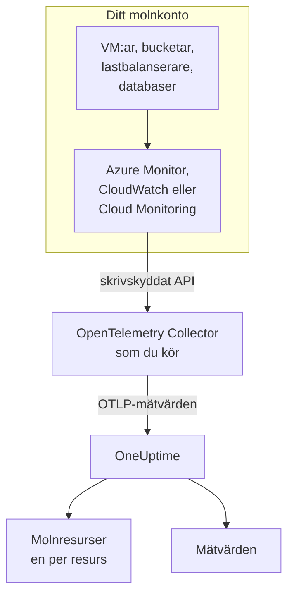
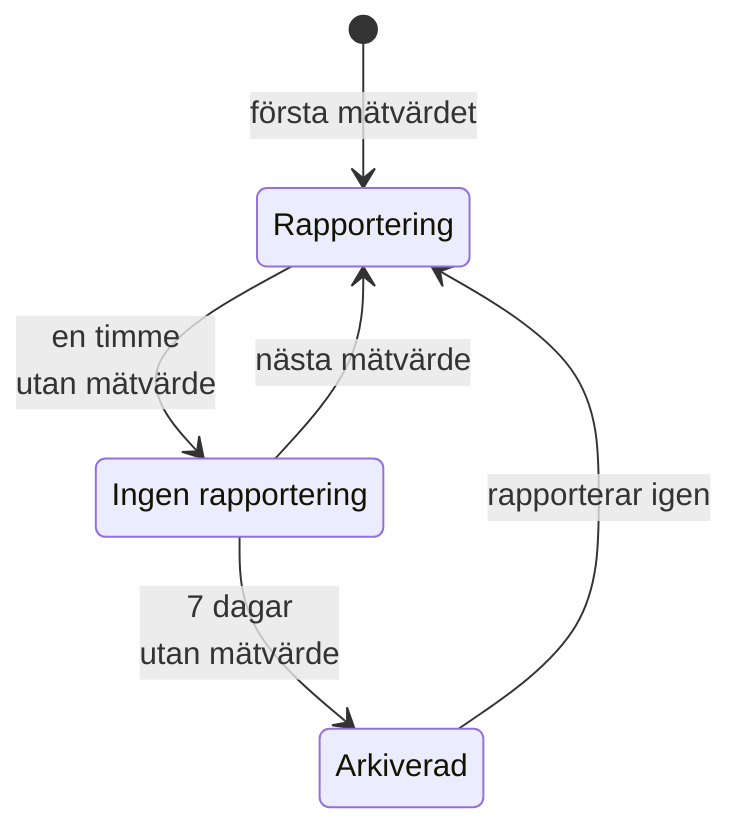

# Molnresurser (IaaS och PaaS)

**Cloud Resources** listar IaaS- och PaaS-resurserna i dina AWS-, Azure- och Google Cloud-konton: virtuella maskiner, diskar, lastbalanserare, bucketar, hanterade databaser, cachar, köer, API-gatewayer och resten. Varje resurs får en egen sida, med typ, region och konto, leverantörens eget ID för den, varje mätvärde som leverantören publicerar om den, och ägare och etiketter som alla andra resurser i OneUptime. Du hittar dem under **Moln → Alla resurser**.

:::cards
- [Anslut Azure](#anslut-azure): Läs varje resurs i en prenumeration från Azure Monitor.
- [Anslut AWS](#anslut-aws): Avfråga CloudWatch, eller strömma det via Amazon Data Firehose.
- [Anslut Google Cloud](#anslut-google-cloud): Läs ett projekts tjänster från Cloud Monitoring.
- [Så identifieras en resurs](#så-identifieras-en-resurs): Varje resurstyp som OneUptime känner igen, per leverantör.
:::

## Så fungerar det



- **Leverantören mäter redan dina resurser.** Azure Monitor, Amazon CloudWatch och Google Cloud Monitoring publicerar mätvärden om varje resurs som de kör åt dig.
- **En collector som du kör läser dem.** En OpenTelemetry Collector med skrivskyddad åtkomst till den övervakningstjänsten exporterar mätvärdena till OneUptime. Inget installeras på resurserna, och OneUptime har aldrig dina molnautentiseringsuppgifter: det har collectorn, i din miljö.
- **Varje resurs visas med sitt första mätvärde.** OneUptime avgör från varje datapunkt vilken resurs den gäller, och skapar molnresursen första gången den ser den.

Molnresurser är en av flera platser där ditt moln dyker upp:

| Du kör | Var det visas | Hur |
| --- | --- | --- |
| Containrar på ECS, Cloud Run, Container Apps, App Service, … | **Moln → All Environments** | Dina arbetsbelastningars egen telemetri, efter deras `cloud.platform`. Se [Molnmiljöer](/docs/telemetry/cloud-environments) |
| Varje IaaS- eller PaaS-resurs som leverantören övervakar | **Moln → Alla resurser** | Leverantörens övervaknings-API, läst av en collector: den här sidan |
| Virtuella maskiner med en OpenTelemetry Collector på | **Värdar** | Värdens egna mätvärden och loggar. Se [OpenTelemetry-collector på värden](/docs/telemetry/host-otel-collector) |
| Köer och ämnen som dina applikationer använder | **Queues** | Spann, och samma molnmätvärden. Se [Köer](/docs/telemetry/queues) |

En resurs kan visas på mer än ett ställe. En virtuell maskin med collectorn på är en **Värd**, och dess plattformsmätvärden (CPU-krediter, disk och nätverk så som hypervisorn ser dem) gör den också till en **Molnresurs**. En SQS-kö är en **Queue** och en **Molnresurs**. Varje vy visar vad dess källa vet.

## Innan du börjar

- **En intagningsnyckel.** Skapa en nyckel av typen **Server** under **Projektinställningar → Telemetri och APM → Intagningsnycklar**. Collectorerna nedan läser den från miljövariabeln `ONEUPTIME_TOKEN`, aldrig från sin konfigurationsfil.
- **Någonstans att köra OpenTelemetry Collector**: distributionen `otelcol-contrib`, avbildningen `otel/opentelemetry-collector-contrib`, med utgående åtkomst till din molnleverantör och till OneUptime. En liten VM, en container eller ditt Kubernetes-kluster räcker, och en collector kan läsa flera konton och leverantörer.
- **Läsåtkomst till leverantörens övervaknings-API.** Varje leverantörs första steg nedan skapar den.

> [!TIP]
> Samma steg finns i instrumentpanelen, med din token ifylld: under **Moln → Alla resurser** tills den första resursen kommer, och på varje resurs flik **Dokumentation**, som öppnas på resursens egen leverantör.

Om du driftar OneUptime själv byter du ut `https://oneuptime.com/otlp` mot `https://YOUR-ONEUPTIME-HOST/otlp`.

## Anslut Azure

Receivern `azure_monitor` listar resurserna i en prenumeration och läser deras plattformsmätvärden varje minut. Utan en lista `services` läser den varje resurstyp, så varje resurs i prenumerationen blir en molnresurs.

:::steps
### Skapa ett tjänsthuvudnamn med Monitoring Reader

**Monitoring Reader** läser mätvärden och listar resurser, och kan inte ändra något:

```bash
az ad sp create-for-rbac \
  --name oneuptime-cloud-collector \
  --role "Monitoring Reader" \
  --scopes /subscriptions/<SUBSCRIPTION_ID>
```

Kommandot skriver ut ett `appId` (klient-ID:t), ett `password` (klienthemligheten) och `tenant`. Ge samma tjänsthuvudnamn rollen på fler prenumerationer för att läsa dem med samma collector.

### Konfigurera Azure Monitor-receivern

Spara det här som `config.yaml`:

```yaml
extensions:
  azure_auth:
    service_principal:
      tenant_id: ${env:AZURE_TENANT_ID}
      client_id: ${env:AZURE_CLIENT_ID}
      client_secret: ${env:AZURE_CLIENT_SECRET}

receivers:
  azure_monitor:
    subscription_ids: ["${env:AZURE_SUBSCRIPTION_ID}"]
    auth:
      authenticator: azure_auth
    collection_interval: 60s
    # No `services` list: every resource type in the subscription.
    # Series Azure returns per metric and resource (default 10).
    maximum_number_of_records_per_resource: 50

processors:
  batch: {}

exporters:
  otlphttp/oneuptime:
    endpoint: https://oneuptime.com/otlp
    headers:
      x-oneuptime-token: ${env:ONEUPTIME_TOKEN}

service:
  extensions: [azure_auth]
  pipelines:
    metrics:
      receivers: [azure_monitor]
      processors: [batch]
      exporters: [otlphttp/oneuptime]
```

### Kör Azure-collectorn

```bash
docker run -d --name oneuptime-cloud-collector --restart unless-stopped \
  -e ONEUPTIME_TOKEN=YOUR_TELEMETRY_INGESTION_TOKEN \
  -e AZURE_TENANT_ID=<TENANT> \
  -e AZURE_CLIENT_ID=<APP_ID> \
  -e AZURE_CLIENT_SECRET=<PASSWORD> \
  -e AZURE_SUBSCRIPTION_ID=<SUBSCRIPTION_ID> \
  -v "$(pwd)/config.yaml:/etc/otelcol-contrib/config.yaml" \
  otel/opentelemetry-collector-contrib:latest
```

Resurserna visas under **Moln → Alla resurser** inom några minuter.
:::

Inställningar för receivern `azure_monitor`:

| Inställning | Vad den gör |
| --- | --- |
| `resource_groups`, `services`, `resource_tags` | Läs mindre: en lista med resursgrupper, med Resource Manager-typer (`Microsoft.Compute/virtualMachines`), eller med taggar som en resurs måste ha |
| `metrics` | Begränsar varje resurstyp till de mätvärden och aggregeringar som du listar. När en typ väl är listad läses bara dess listade mätvärden |
| `discover_subscriptions: true` | Läser varje prenumeration som tjänsthuvudnamnet kan se, i stället för `subscription_ids` |
| `maximum_number_of_records_per_resource` | Hur många serier Azure returnerar per mätvärde och resurs (10 som standard). Höj det när ett mätvärde delas upp efter en dimension med många värden |
| `use_batch_api: true` | För stora prenumerationer. Receivern gör ett Resource Manager-anrop per resurs och omgång om 20 mätvärden, och Resource Manager tillåter ungefär 12 000 läsningar i timmen; batch-API:t läser upp till 50 resurser per anrop från Azure Monitors dataplan, vars gräns är mycket högre |
| `cache_resources` | Hur ofta, i sekunder, receivern listar resurserna: en gång om dagen som standard. En resurs som skapats efter att collectorn startade kan ta upp till en dag att dyka upp; starta om collectorn för att lista dem direkt |

## Anslut AWS

CloudWatch-mätvärden når OneUptime på ett av två sätt:

| | Polling | Metric Streams |
| --- | --- | --- |
| Hur | Collectorns receiver `aws_cloudwatch` frågar CloudWatch | CloudWatch skickar via Amazon Data Firehose till collectorns receiver `awsfirehose` |
| Behövs på AWS-sidan | Bara autentiseringsuppgifter | En Firehose-ström och en metric stream i varje region |
| Collectorn måste kunna nås från AWS | Nej | Ja, över HTTPS på port 443 |
| Fördröjning | 10 till 20 minuter | Några minuter |
| Passar | De flesta konton | Stora konton |

### Polling med receivern aws_cloudwatch

:::steps
#### Låt collectorn läsa CloudWatch

Koppla den här policyn till den roll som collectorn körs som (en EC2-instansprofil, en ECS-uppgiftsroll, ett EKS-tjänstkonto), eller till en IAM-användare vars åtkomstnycklar du ger den:

```json
{
  "Version": "2012-10-17",
  "Statement": [
    {
      "Effect": "Allow",
      "Action": [
        "cloudwatch:ListMetrics",
        "cloudwatch:GetMetricData",
        "sts:GetCallerIdentity"
      ],
      "Resource": "*"
    }
  ]
}
```

`sts:GetCallerIdentity` låter receivern rapportera konto-ID:t, som varje resurs ARN behöver.

#### Konfigurera CloudWatch-receivrarna

En receiver läser ett namnområde i en region, så lägg till en för varje namnområde och region som du vill ha. Det här exemplet läser de vanliga; spara det som `config.yaml`:

```yaml
receivers:
  aws_cloudwatch/ec2:
    region: ${env:AWS_REGION}
    metrics:
      collection_interval: 5m
      period: 5m
      delay: 10m
      discovery:
        filters:
          namespace: AWS/EC2
        # Metrics read per scrape, at most. Each costs 4 GetMetricData queries.
        limit: 1000
  aws_cloudwatch/ebs:
    region: ${env:AWS_REGION}
    metrics:
      collection_interval: 5m
      period: 5m
      delay: 10m
      discovery:
        filters:
          namespace: AWS/EBS
        # Metrics read per scrape, at most. Each costs 4 GetMetricData queries.
        limit: 1000
  aws_cloudwatch/applicationelb:
    region: ${env:AWS_REGION}
    metrics:
      collection_interval: 5m
      period: 5m
      delay: 10m
      discovery:
        filters:
          namespace: AWS/ApplicationELB
        # Metrics read per scrape, at most. Each costs 4 GetMetricData queries.
        limit: 1000
  aws_cloudwatch/rds:
    region: ${env:AWS_REGION}
    metrics:
      collection_interval: 5m
      period: 5m
      delay: 10m
      discovery:
        filters:
          namespace: AWS/RDS
        # Metrics read per scrape, at most. Each costs 4 GetMetricData queries.
        limit: 1000
  aws_cloudwatch/lambda:
    region: ${env:AWS_REGION}
    metrics:
      collection_interval: 5m
      period: 5m
      delay: 10m
      discovery:
        filters:
          namespace: AWS/Lambda
        # Metrics read per scrape, at most. Each costs 4 GetMetricData queries.
        limit: 1000
  aws_cloudwatch/dynamodb:
    region: ${env:AWS_REGION}
    metrics:
      collection_interval: 5m
      period: 5m
      delay: 10m
      discovery:
        filters:
          namespace: AWS/DynamoDB
        # Metrics read per scrape, at most. Each costs 4 GetMetricData queries.
        limit: 1000

processors:
  batch: {}

exporters:
  otlphttp/oneuptime:
    endpoint: https://oneuptime.com/otlp
    headers:
      x-oneuptime-token: ${env:ONEUPTIME_TOKEN}

service:
  pipelines:
    metrics:
      receivers: [aws_cloudwatch/ec2, aws_cloudwatch/ebs, aws_cloudwatch/applicationelb, aws_cloudwatch/rds, aws_cloudwatch/lambda, aws_cloudwatch/dynamodb]
      processors: [batch]
      exporters: [otlphttp/oneuptime]
```

#### Kör CloudWatch-collectorn

```bash
docker run -d --name oneuptime-cloud-collector --restart unless-stopped \
  -e ONEUPTIME_TOKEN=YOUR_TELEMETRY_INGESTION_TOKEN \
  -e AWS_REGION=us-east-1 \
  -e AWS_ACCESS_KEY_ID=<ACCESS_KEY_ID> \
  -e AWS_SECRET_ACCESS_KEY=<SECRET_ACCESS_KEY> \
  -v "$(pwd)/config.yaml:/etc/otelcol-contrib/config.yaml" \
  otel/opentelemetry-collector-contrib:latest
```

På en EC2-instans, ECS-uppgift eller EKS-pod som har rollen utelämnar du de två nyckelvariablerna.
:::

- **Lämna `stats` osatt.** Varje mätvärde läses då som en sammanfattning per period: fyra statistikvärden, fyra frågor med `GetMetricData`, och AWS debiterar `GetMetricData` per begärt mätvärde. `discovery.limit` begränsar de mätvärden som en receiver läser per insamling (sätt den: receiverns egen standard är 100), och ett längre `collection_interval` läser dem mer sällan.
- **Data kommer sent.** `delay` väntar på att CloudWatch publicerar en period, så datapunkter kommer 10 till 20 minuter efter den tid de mäter, och resurser visas inom ungefär tjugo minuter.

### Strömning med CloudWatch Metric Streams

:::steps
#### Konfigurera Firehose-receivern

Collectorn behöver ett certifikat för sin adress: Firehose levererar bara till `https://` på port 443. Spara det här som `config.yaml`:

```yaml
extensions:
  awscloudwatchmetricstreams_encoding:
    format: opentelemetry1.0

receivers:
  awsfirehose:
    # Firehose delivers to HTTPS on port 443 only: expose this port as
    # 443, for example behind a load balancer.
    endpoint: 0.0.0.0:4433
    encoding: awscloudwatchmetricstreams_encoding
    access_key: ${env:FIREHOSE_ACCESS_KEY}
    tls:
      cert_file: /etc/otelcol-contrib/tls/server.crt
      key_file: /etc/otelcol-contrib/tls/server.key

processors:
  batch: {}

exporters:
  otlphttp/oneuptime:
    endpoint: https://oneuptime.com/otlp
    headers:
      x-oneuptime-token: ${env:ONEUPTIME_TOKEN}

service:
  extensions: [awscloudwatchmetricstreams_encoding]
  pipelines:
    metrics:
      receivers: [awsfirehose]
      processors: [batch]
      exporters: [otlphttp/oneuptime]
```

#### Kör Firehose-collectorn

```bash
docker run -d --name oneuptime-cloud-collector --restart unless-stopped \
  -e ONEUPTIME_TOKEN=YOUR_TELEMETRY_INGESTION_TOKEN \
  -e FIREHOSE_ACCESS_KEY=<A_LONG_RANDOM_SECRET> \
  -p 4433:4433 \
  -v "$(pwd)/tls:/etc/otelcol-contrib/tls:ro" \
  -v "$(pwd)/config.yaml:/etc/otelcol-contrib/config.yaml" \
  otel/opentelemetry-collector-contrib:latest
```

Certifikatet och dess nyckel läggs i `tls/`, som `server.crt` och `server.key`. Publicera port 4433 bakom något som svarar på 443, till exempel en lastbalanserare.

#### Skapa Firehose-strömmen och metric streams

1. **Amazon Data Firehose → Create Firehose stream**: källa **Direct PUT**, mål **HTTP Endpoint**. Endpointens URL är collectorns adress `https://`; åtkomstnyckeln är `FIREHOSE_ACCESS_KEY`. Välj eller skapa en S3-bucket för misslyckade leveranser.
2. **CloudWatch → Metrics → Streams → Create metric stream**: de namnområden som ska ingå (eller alla), Firehose-strömmen och utdataformatet **OpenTelemetry 1.0**.
3. Upprepa i varje region: en metric stream bär sin egen regions mätvärden.
:::

AWS debiterar en metric stream per mätvärdesuppdatering som den levererar, plus Firehoses dataavgifter, så ta bara med de namnområden som du vill ha. En ström i formatet **JSON** (`format: json` på kodningstillägget) namnger samma resurser, men skriver också varje namnområde i `service.name`, så att varje namnområde också visas under **Tjänster**: föredra **OpenTelemetry 1.0**.

## Anslut Google Cloud

Receivern `googlecloudmonitoring` läser de mätvärdestyper som dess `metrics_list` nämner, för ett projekt.

:::steps
### Skapa ett tjänstkonto med Monitoring Viewer

**Monitoring Viewer** läser mätvärden, och kan inte ändra något:

```bash
gcloud iam service-accounts create oneuptime-cloud-collector \
  --project <PROJECT_ID>

gcloud projects add-iam-policy-binding <PROJECT_ID> \
  --member "serviceAccount:oneuptime-cloud-collector@<PROJECT_ID>.iam.gserviceaccount.com" \
  --role roles/monitoring.viewer

gcloud iam service-accounts keys create key.json \
  --iam-account oneuptime-cloud-collector@<PROJECT_ID>.iam.gserviceaccount.com
```

På Google Cloud självt kör du collectorn som det här tjänstkontot i stället för att skapa en nyckel.

### Konfigurera Cloud Monitoring-receivern

Varje filter läser varje mätvärdestyp för en tjänst. Spara det här som `config.yaml`:

```yaml
receivers:
  googlecloudmonitoring:
    project_id: ${env:GCP_PROJECT_ID}
    collection_interval: 2m
    # Only the metric types these filters list are read.
    metrics_list:
      - metric_descriptor_filter: 'metric.type = starts_with("compute.googleapis.com/")'
      - metric_descriptor_filter: 'metric.type = starts_with("cloudsql.googleapis.com/")'
      - metric_descriptor_filter: 'metric.type = starts_with("loadbalancing.googleapis.com/")'
      - metric_descriptor_filter: 'metric.type = starts_with("storage.googleapis.com/")'
      - metric_descriptor_filter: 'metric.type = starts_with("redis.googleapis.com/")'
      - metric_descriptor_filter: 'metric.type = starts_with("run.googleapis.com/")'

processors:
  batch: {}

exporters:
  otlphttp/oneuptime:
    endpoint: https://oneuptime.com/otlp
    headers:
      x-oneuptime-token: ${env:ONEUPTIME_TOKEN}

service:
  pipelines:
    metrics:
      receivers: [googlecloudmonitoring]
      processors: [batch]
      exporters: [otlphttp/oneuptime]
```

### Kör Google Cloud-collectorn

```bash
docker run -d --name oneuptime-cloud-collector --restart unless-stopped \
  -e ONEUPTIME_TOKEN=YOUR_TELEMETRY_INGESTION_TOKEN \
  -e GCP_PROJECT_ID=<PROJECT_ID> \
  -e GOOGLE_APPLICATION_CREDENTIALS=/etc/otelcol-contrib/key.json \
  -v "$(pwd)/key.json:/etc/otelcol-contrib/key.json:ro" \
  -v "$(pwd)/config.yaml:/etc/otelcol-contrib/config.yaml" \
  otel/opentelemetry-collector-contrib:latest
```
:::

- **Listan läses när collectorn startar:** starta om den efter en ändring. `metric_name: compute.googleapis.com/instance/cpu/utilization` läser en enda typ i stället för alla en tjänsts typer.
- **En receiver läser ett projekt:** lägg till en per projekt.
- **Läsning har en kostnad och en kvot.** Varje mätvärdestyp är en läsning från Cloud Monitoring-API:t per insamlingsintervall. Det är gratis att läsa Google Clouds egna mätvärden inom API:ts månatliga kvot; ett längre `collection_interval` håller ett stort projekt inom den, och inom kvoten per minut.

## Håll pipelinen fri från resursidentifiering

> [!WARNING]
> Lägg inte till processorn `resourcedetection` i den pipeline som läser molnövervakningen. Den stämplar collectormaskinens eget `host.name` och `os.type` på varje datapunkt, och OneUptime arkiverar då också ditt molns mätvärden under den maskinen i **Värdar**. En collector som också övervakar sin egen värd bör göra det i en egen pipeline.

## Så identifieras en resurs

Varje datapunkt från de här receivrarna namnger en resurs, och OneUptime knyter molnresursen till den resursens identitet, aldrig till dess namn, som du kan ändra. Identiteten jämförs utan hänsyn till versaler och gemener, så en resurs som rapporteras med två stavningar är en och samma resurs.

### Azure

Varje datapunkt bär sin resurs Azure-resurs-ID (`azuremonitor.resource_id`), så varje resurs som receivern läser blir en molnresurs: typerna nedan under ett läsbart namn, alla andra under sin Resource Manager-typ. Resurs-ID, region, prenumeration och resursgrupp visas alla på resursen.

:::details Azure-resurstyperna med ett läsbart namn
| Resurstyp | Visas som | Modell |
| --- | --- | --- |
| `Microsoft.Compute/virtualMachines` | Virtual Machine | IaaS |
| `Microsoft.Compute/virtualMachineScaleSets` | Virtual Machine Scale Set | IaaS |
| `Microsoft.Compute/disks` | Managed Disk | IaaS |
| `Microsoft.Network/loadBalancers` | Load Balancer | IaaS |
| `Microsoft.Network/applicationGateways` | Application Gateway | IaaS |
| `Microsoft.Network/publicIPAddresses` | Public IP Address | IaaS |
| `Microsoft.Network/natGateways` | NAT Gateway | IaaS |
| `Microsoft.Network/virtualNetworkGateways` | Virtual Network Gateway | IaaS |
| `Microsoft.Network/expressRouteCircuits` | ExpressRoute Circuit | IaaS |
| `Microsoft.Network/azureFirewalls` | Azure Firewall | IaaS |
| `Microsoft.Network/frontdoors` | Front Door (classic) | IaaS |
| `Microsoft.Cdn/profiles` | Front Door and CDN Profile | IaaS |
| `Microsoft.Network/trafficmanagerprofiles` | Traffic Manager Profile | IaaS |
| `Microsoft.Network/networkInterfaces` | Network Interface | IaaS |
| `Microsoft.Network/virtualNetworks` | Virtual Network | IaaS |
| `Microsoft.Network/privateEndpoints` | Private Endpoint | IaaS |
| `Microsoft.Network/dnszones` | DNS Zone | IaaS |
| `Microsoft.Network/bastionHosts` | Bastion | IaaS |
| `Microsoft.Storage/storageAccounts` | Storage Account | IaaS |
| `Microsoft.RecoveryServices/vaults` | Recovery Services Vault | PaaS |
| `Microsoft.Web/sites` | App Service or Function App | PaaS |
| `Microsoft.Web/serverfarms` | App Service Plan | PaaS |
| `Microsoft.Web/staticSites` | Static Web App | PaaS |
| `Microsoft.App/containerApps` | Container App | PaaS |
| `Microsoft.App/managedEnvironments` | Container Apps Environment | PaaS |
| `Microsoft.ContainerInstance/containerGroups` | Container Instance | PaaS |
| `Microsoft.ContainerService/managedClusters` | AKS Cluster | PaaS |
| `Microsoft.ContainerRegistry/registries` | Container Registry | PaaS |
| `Microsoft.SignalRService/SignalR` | SignalR Service | PaaS |
| `Microsoft.Sql/servers/databases` | SQL Database | PaaS |
| `Microsoft.Sql/servers/elasticpools` | SQL Elastic Pool | PaaS |
| `Microsoft.Sql/managedInstances` | SQL Managed Instance | PaaS |
| `Microsoft.DBforPostgreSQL/flexibleServers` | PostgreSQL Flexible Server | PaaS |
| `Microsoft.DBforMySQL/flexibleServers` | MySQL Flexible Server | PaaS |
| `Microsoft.DocumentDB/databaseAccounts` | Cosmos DB Account | PaaS |
| `Microsoft.Cache/redis` | Azure Cache for Redis | PaaS |
| `Microsoft.Cache/redisEnterprise` | Azure Managed Redis | PaaS |
| `Microsoft.ServiceBus/namespaces` | Service Bus Namespace | PaaS |
| `Microsoft.EventHub/namespaces` | Event Hubs Namespace | PaaS |
| `Microsoft.EventGrid/topics` | Event Grid Topic | PaaS |
| `Microsoft.EventGrid/systemTopics` | Event Grid System Topic | PaaS |
| `Microsoft.EventGrid/namespaces` | Event Grid Namespace | PaaS |
| `Microsoft.ApiManagement/service` | API Management | PaaS |
| `Microsoft.Logic/workflows` | Logic App | PaaS |
| `Microsoft.DataFactory/factories` | Data Factory | PaaS |
| `Microsoft.Synapse/workspaces` | Synapse Workspace | PaaS |
| `Microsoft.Kusto/clusters` | Data Explorer Cluster | PaaS |
| `Microsoft.StreamAnalytics/streamingjobs` | Stream Analytics Job | PaaS |
| `Microsoft.CognitiveServices/accounts` | Azure AI Services or OpenAI | PaaS |
| `Microsoft.Search/searchServices` | AI Search Service | PaaS |
| `Microsoft.MachineLearningServices/workspaces` | Machine Learning Workspace | PaaS |
| `Microsoft.KeyVault/vaults` | Key Vault | PaaS |
| `Microsoft.Insights/components` | Application Insights | PaaS |
| `Microsoft.OperationalInsights/workspaces` | Log Analytics Workspace | PaaS |
| `Microsoft.Automation/automationAccounts` | Automation Account | PaaS |
| `Microsoft.Devices/IotHubs` | IoT Hub | PaaS |
:::

### AWS

Ett CloudWatch-mätvärde namnger sin resurs i en dimension som beror på namnområdet. En datapunkt som bär dimensionerna under **Identifieras av** hör till den resursen, tillsammans med dess konto och region; extra dimensioner smalnar av serien, inte resursen (en Application Load Balancers serier per målgrupp hör till lastbalanseraren). En datapunkt som aggregerats över något annat (`InstanceType`, `DatabaseClass`, en summa för hela kontot) namnger ingen resurs och upptäcks inte. Det gör inte heller ett namnområde som inte finns i listan: dess mätvärden når ändå **Mätvärden**.

Varje resurs visas med sitt ARN där dess mätvärden namnger det fullt ut; där de inte gör det (ett Auto Scaling-grupps ARN innehåller ett UUID som inget mätvärde rapporterar), med sitt namnområde och sina dimensioner.

:::details CloudWatch-namnområdena och dimensionerna som identifierar en resurs
| Namnområde | Identifieras av | Visas som | Resurstyp | Modell |
| --- | --- | --- | --- | --- |
| `AWS/EC2` | `InstanceId` | EC2 Instance | `AWS::EC2::Instance` | IaaS |
| `AWS/EC2` | `AutoScalingGroupName` (without `InstanceId`) | Auto Scaling Group | `AWS::AutoScaling::AutoScalingGroup` | IaaS |
| `AWS/AutoScaling` | `AutoScalingGroupName` | Auto Scaling Group | `AWS::AutoScaling::AutoScalingGroup` | IaaS |
| `AWS/EBS` | `VolumeId` | EBS Volume | `AWS::EC2::Volume` | IaaS |
| `AWS/ELB` | `LoadBalancerName` | Classic Load Balancer | `AWS::ElasticLoadBalancing::LoadBalancer` | IaaS |
| `AWS/ApplicationELB` | `LoadBalancer` | Elastic Load Balancer (ALB, NLB, GWLB) | `AWS::ElasticLoadBalancingV2::LoadBalancer` | IaaS |
| `AWS/NetworkELB` | `LoadBalancer` | Elastic Load Balancer (ALB, NLB, GWLB) | `AWS::ElasticLoadBalancingV2::LoadBalancer` | IaaS |
| `AWS/GatewayELB` | `LoadBalancer` | Elastic Load Balancer (ALB, NLB, GWLB) | `AWS::ElasticLoadBalancingV2::LoadBalancer` | IaaS |
| `AWS/NATGateway` | `NatGatewayId` | NAT Gateway | `AWS::EC2::NatGateway` | IaaS |
| `AWS/TransitGateway` | `TransitGateway` | Transit Gateway | `AWS::EC2::TransitGateway` | IaaS |
| `AWS/VPN` | `VpnId` | Site-to-Site VPN Connection | `AWS::EC2::VPNConnection` | IaaS |
| `AWS/DX` | `ConnectionId` | Direct Connect Connection | `AWS::DirectConnect::Connection` | IaaS |
| `AWS/CloudFront` | `DistributionId` | CloudFront Distribution | `AWS::CloudFront::Distribution` | IaaS |
| `AWS/GlobalAccelerator` | `Accelerator` (without `Listener`, `EndpointGroup`) | Global Accelerator | `AWS::GlobalAccelerator::Accelerator` | IaaS |
| `AWS/Route53` | `HealthCheckId` | Route 53 Health Check | `AWS::Route53::HealthCheck` | IaaS |
| `AWS/NetworkFirewall` | `FirewallName` | Network Firewall | `AWS::NetworkFirewall::Firewall` | IaaS |
| `AWS/WAFV2` | `WebACL` (without `Rule`, `RuleGroup`) | WAF Web ACL | `AWS::WAFv2::WebACL` | PaaS |
| `AWS/S3` | `BucketName` | S3 Bucket | `AWS::S3::Bucket` | IaaS |
| `AWS/EFS` | `FileSystemId` | EFS File System | `AWS::EFS::FileSystem` | IaaS |
| `AWS/FSx` | `FileSystemId` | FSx File System | `AWS::FSx::FileSystem` | IaaS |
| `AWS/ECS` | `ClusterName` + `ServiceName` | ECS Service | `AWS::ECS::Service` | PaaS |
| `AWS/ECS` | `ClusterName` (without `ServiceName`) | ECS Cluster | `AWS::ECS::Cluster` | PaaS |
| `AWS/AppRunner` | `ServiceName` | App Runner Service | `AWS::AppRunner::Service` | PaaS |
| `AWS/ElasticBeanstalk` | `EnvironmentName` | Elastic Beanstalk Environment | `AWS::ElasticBeanstalk::Environment` | PaaS |
| `AWS/Lambda` | `FunctionName` | Lambda Function | `AWS::Lambda::Function` | PaaS |
| `AWS/States` | `StateMachineArn` | Step Functions State Machine | `AWS::StepFunctions::StateMachine` | PaaS |
| `AWS/RDS` | `DBInstanceIdentifier` | RDS DB Instance | `AWS::RDS::DBInstance` | PaaS |
| `AWS/RDS` | `DBClusterIdentifier` (without `DBInstanceIdentifier`) | Aurora / RDS DB Cluster | `AWS::RDS::DBCluster` | PaaS |
| `AWS/DocDB` | `DBInstanceIdentifier` | DocumentDB Instance | `AWS::DocDB::DBInstance` | PaaS |
| `AWS/DocDB` | `DBClusterIdentifier` (without `DBInstanceIdentifier`) | DocumentDB Cluster | `AWS::DocDB::DBCluster` | PaaS |
| `AWS/Neptune` | `DBInstanceIdentifier` | Neptune Instance | `AWS::Neptune::DBInstance` | PaaS |
| `AWS/Neptune` | `DBClusterIdentifier` (without `DBInstanceIdentifier`) | Neptune Cluster | `AWS::Neptune::DBCluster` | PaaS |
| `AWS/DynamoDB` | `TableName` | DynamoDB Table | `AWS::DynamoDB::Table` | PaaS |
| `AWS/ElastiCache` | `CacheClusterId` | ElastiCache Cluster | `AWS::ElastiCache::CacheCluster` | PaaS |
| `AWS/ElastiCache` | `ReplicationGroupId` (without `CacheClusterId`) | ElastiCache Replication Group | `AWS::ElastiCache::ReplicationGroup` | PaaS |
| `AWS/ElastiCache` | `clusterId` (without `CacheClusterId`) | ElastiCache Serverless Cache | `AWS::ElastiCache::ServerlessCache` | PaaS |
| `AWS/MemoryDB` | `ClusterName` | MemoryDB Cluster | `AWS::MemoryDB::Cluster` | PaaS |
| `AWS/Redshift` | `ClusterIdentifier` | Redshift Cluster | `AWS::Redshift::Cluster` | PaaS |
| `AWS/ES` | `DomainName` | OpenSearch Domain | `AWS::OpenSearchService::Domain` | PaaS |
| `AWS/SQS` | `QueueName` | SQS Queue | `AWS::SQS::Queue` | PaaS |
| `AWS/SNS` | `TopicName` | SNS Topic | `AWS::SNS::Topic` | PaaS |
| `AWS/Kinesis` | `StreamName` | Kinesis Data Stream | `AWS::Kinesis::Stream` | PaaS |
| `AWS/Firehose` | `DeliveryStreamName` | Data Firehose Stream | `AWS::KinesisFirehose::DeliveryStream` | PaaS |
| `AWS/AmazonMQ` | `Broker` | Amazon MQ Broker | `AWS::AmazonMQ::Broker` | PaaS |
| `AWS/Kafka` | `Cluster Name` | MSK Cluster | `AWS::MSK::Cluster` | PaaS |
| `AWS/Events` | `RuleName` | EventBridge Rule | `AWS::Events::Rule` | PaaS |
| `AWS/ApiGateway` | `ApiName` | API Gateway REST API | `AWS::ApiGateway::RestApi` | PaaS |
| `AWS/ApiGateway` | `ApiId` (without `ApiName`) | API Gateway HTTP or WebSocket API | `AWS::ApiGatewayV2::Api` | PaaS |
| `AWS/AppSync` | `GraphQLAPIId` | AppSync GraphQL API | `AWS::AppSync::GraphQLApi` | PaaS |
| `AWS/CertificateManager` | `CertificateArn` | ACM Certificate | `AWS::CertificateManager::Certificate` | PaaS |
| `AWS/KMS` | `KeyId` | KMS Key | `AWS::KMS::Key` | PaaS |
| `AWS/Cognito` | `UserPool` | Cognito User Pool | `AWS::Cognito::UserPool` | PaaS |
| `AWS/SageMaker` | `EndpointName` | SageMaker Endpoint | `AWS::SageMaker::Endpoint` | PaaS |
| `AWS/Logs` | `LogGroupName` | CloudWatch Log Group | `AWS::Logs::LogGroup` | PaaS |
:::

### Google Cloud

Cloud Monitoring namnger varje mätvärdes övervakade resurs med en typ och etiketter. En datapunkt av en typ nedan hör till den resursen, identifierad av de listade etiketterna; resursens andra etiketter, och dess metadataetiketter, delar den aldrig. Kubernetes-typer (`k8s_container`, `k8s_pod`, …) lämnas åt produkten [Kubernetes](/docs/telemetry/kubernetes-agent).

:::details Cloud Monitoring-resurstyperna och etiketterna som identifierar dem
| Övervakad resurstyp | Identifieras av | Visas som | Modell |
| --- | --- | --- | --- |
| `gce_instance` | `project_id`, `zone`, `instance_id` | Compute Engine VM Instance | IaaS |
| `instance_group` | `project_id`, `location`, `instance_group_id` | Instance Group | IaaS |
| `gcs_bucket` | `project_id`, `bucket_name` | Cloud Storage Bucket | IaaS |
| `filestore_instance` | `project_id`, `location`, `instance_name` | Filestore Instance | IaaS |
| `https_lb_rule` | `project_id`, `url_map_name` | External Application Load Balancer | IaaS |
| `internal_http_lb_rule` | `project_id`, `region`, `url_map_name` | Internal Application Load Balancer | IaaS |
| `vpn_gateway` | `project_id`, `region`, `gateway_id` | Cloud VPN Gateway | IaaS |
| `nat_gateway` | `project_id`, `region`, `router_id`, `gateway_name` | Cloud NAT Gateway | IaaS |
| `gce_router` | `project_id`, `region`, `router_id` | Cloud Router | IaaS |
| `cloudsql_database` | `project_id`, `database_id` | Cloud SQL Instance | PaaS |
| `alloydb.googleapis.com/Instance` | `resource_container`, `location`, `cluster_id`, `instance_id` | AlloyDB Instance | PaaS |
| `redis_instance` | `project_id`, `region`, `instance_id` | Memorystore for Redis Instance | PaaS |
| `spanner_instance` | `project_id`, `instance_id` | Spanner Instance | PaaS |
| `bigtable_table` | `project_id`, `instance` | Bigtable Instance | PaaS |
| `bigquery_dataset` | `project_id`, `dataset_id` | BigQuery Dataset | PaaS |
| `cloud_function` | `project_id`, `region`, `function_name` | Cloud Run Function | PaaS |
| `cloud_run_revision` | `project_id`, `location`, `service_name` | Cloud Run Service | PaaS |
| `cloud_run_job` | `project_id`, `location`, `job_name` | Cloud Run Job | PaaS |
| `gae_app` | `project_id`, `module_id` | App Engine Service | PaaS |
| `pubsub_topic` | `project_id`, `topic_id` | Pub/Sub Topic | PaaS |
| `pubsub_subscription` | `project_id`, `subscription_id` | Pub/Sub Subscription | PaaS |
| `cloud_tasks_queue` | `project_id`, `location`, `queue_id` | Cloud Tasks Queue | PaaS |
| `cloud_composer_environment` | `project_id`, `location`, `environment_name` | Cloud Composer Environment | PaaS |
| `dataproc_cluster` | `project_id`, `region`, `cluster_name` | Dataproc Cluster | PaaS |
| `aiplatform.googleapis.com/Endpoint` | `resource_container`, `location`, `endpoint_id` | Vertex AI Endpoint | PaaS |
:::

### Namn

En resurs får det namn som leverantören kallar den (`vm-prod-01`, `checkout`, `orders`). Namn är unika inom ett projekt, och leverantörens är det inte: två prenumerationer har var sin `web-01`, och en App Service-plan och dess app heter båda `checkout`. Därför får en resurs vars namn är upptaget ett namn med sin typ, sedan sin resursgrupp eller region, sedan sitt konto: `web-01 (Virtual Machine, rg-prod)`. Byt namn på valfri resurs på dess flik **Inställningar**: mätvärden matchas på dess identitet, inte dess namn.

## Status, arkivering och gränser



- **Rapportering** betyder att leverantören har skickat ett mätvärde om resursen den senaste timmen; efter en timme utan står det **Ingen rapportering**. Vissa resurser är tysta av naturen, till exempel ett Key Vault som ingen anropade eller en bucket vars lagringsmätvärden CloudWatch publicerar en gång om dagen, och de kommer tillbaka med sin nästa datapunkt.
- En resurs som **inte skickar något mätvärde på 7 dagar** arkiveras automatiskt: en instans som en Auto Scaling-grupp ersatte, en borttagen volym, en bucket som är borta. Den behåller sina etiketter, ägare och sin historik under **Moln → Avancerad → Arkiverad**, och återställs av sig själv så snart den rapporterar igen. En resurs som du arkiverar själv förblir arkiverad; en som du återställer medan den är tyst stannar i listan tills den rapporterar.
- Att ta bort en resurs som leverantören fortfarande rapporterar håller inte: den upptäcks igen från sina nästa mätvärden. Arkivera den i stället.
- Upptäckten slutar skapa resurser när ett projekt har **5 000** levande (inte arkiverade), och loggar en varning; arkiverade resurser räknas inte.

Installationer i egen drift kan ändra detta med miljövariabler på appen:

| Variabel | Standard | Betydelse |
| --- | --- | --- |
| `CLOUD_RESOURCE_AUTO_ARCHIVE_DAYS` | `7` | Dagar utan mätvärde innan en resurs arkiveras (minst 1) |
| `CLOUD_RESOURCE_AUTO_CREATE_BUDGET` | `5000` | Levande resurser som ett projekt får ha innan upptäckten slutar skapa fler (`0` stänger av upptäckten) |

## Larm på en resurs

:::steps
1. Öppna resursen och dess flik **Mätvärden**, som listar varje mätvärde som leverantören rapporterar om den.
2. Öppna ett mätvärde för att visa det i ett diagram i mätvärdesutforskaren, redan filtrerat på resursen.
3. Klicka på **Skapa monitor från den här vyn**: monitorn bevakar det mätvärdet för den resursen.
:::

> [!IMPORTANT]
> Molnövervakning publicerar varje tal några minuter efter den tid det mäter: 10 till 20 minuter för CloudWatch som avfrågas som ovan, några minuter för Azure Monitor och Cloud Monitoring. Det lagras under den tid det mäter. Ge en monitor över de här mätvärdena ett fönster som är längre än så (30 minuter för CloudWatch, 15 för de andra), annars ser den inga data och utlöses aldrig.

## Inventering och regler

- **Inventering:** Molnresurser listas i [Inventering](/docs/inventory/overview) som objekt av typen **Molnresurs**, med leverantörens ID som `cloud.resource.id` och typen som `cloud.resource.type`. AI-agentens resursverktyg listar dem också.
- **Regler:** **Moln → Inställningar → Etikettregler** och **Ägarregler** gäller för dem precis som för molnmiljöer.

## Felsökning

### Inga resurser visas

1. Kontrollera din token: `curl -i https://oneuptime.com/otlp/v1/validate -H "x-oneuptime-token: YOUR_TELEMETRY_INGESTION_TOKEN"` måste svara `200` med `"valid": true`.
2. Läs collectorns logg (`docker logs oneuptime-cloud-collector`). Ett behörighetsfel nämner den behörighet som saknas: `AuthorizationFailed` (Azure: **Monitoring Reader** på prenumerationen), `AccessDenied` på `cloudwatch:GetMetricData` (AWS: policyn ovan), `PermissionDenied` (Google Cloud: **Monitoring Viewer**).
3. Leta i **Mätvärden** efter leverantörens mätvärden (`azure_…`, `amazonaws.com/aws/…`, `compute.googleapis.com/…`). Om de finns där men ingen resurs gör det, namnger datapunkterna ingen resurs som OneUptime känner igen: ett AWS-namnområde eller en Google Cloud-typ som inte finns ovan, eller en datapunkt som aggregerats över något annat än en resurs.
4. Vänta på sena data: CloudWatch som avfrågas som ovan ligger 10 till 20 minuter efter.

### En resurs saknas

- **Azure:** receivern listar resurserna en gång om dagen; starta om collectorn för att lista nya nu. En resurstyp utan plattformsmätvärden i Azure Monitor har inget att rapportera.
- **AWS:** varje receiver läser ett namnområde i en region, och `discovery.limit` begränsar hur många mätvärden den läser: höj den när ett konto har fler.
- **Google Cloud:** `metrics_list` måste nämna resursens tjänst.
- **Alla leverantörer:** ett projekt som har nått budgeten skapar inga nya resurser förrän några har arkiverats. Se [Status, arkivering och gränser](#status-arkivering-och-gränser).

### Samma resurs visas två gånger

En AWS-resurs som läses en gång med sitt konto-ID och en gång utan är två resurser: polling-receivern rapporterar bara kontot när den får anropa `sts:GetCallerIdentity`. Ge varje collector den behörigheten, och arkivera kopian utan konto.

### Mitt molns mätvärden visas under en värd

Pipelinen har en processor `resourcedetection`. Se [Håll pipelinen fri från resursidentifiering](#håll-pipelinen-fri-från-resursidentifiering).

## Begränsningar

- **Bara mätvärden.** Leverantörernas övervaknings-API:er publicerar inga loggar eller spår om en resurs. Skicka dem från dina arbetsbelastningar med OpenTelemetry.
- **Upptäckten följer mätvärdena.** En resurs som leverantören inte publicerar några mätvärden om, eller som collectorn inte läser, upptäcks inte.
- **Ingen egen inställning för lagringstid.** En resurs mätvärden behålls lika länge som resten av de mätvärden som dess collector skickar.
- **Avfrågning kostar pengar** och räknas mot molnens API-gränser: se varje leverantörs anteckningar ovan.

## Nästa steg

:::cards
- [Molnmiljöer](/docs/telemetry/cloud-environments): Dina containrar på ECS, Cloud Run och Container Apps, från deras egen telemetri.
- [Köer](/docs/telemetry/queues): SQS, Service Bus och Pub/Sub, med samma molnmätvärden.
- [Etikett- och ägarregler](/docs/configuration/label-and-owner-rules): Sätt etiketter på resurser och tilldela ägare allteftersom de upptäcks.
- [Inventering](/docs/inventory/overview): Varje värd, enhet och molnresurs i en enda lista.
:::
