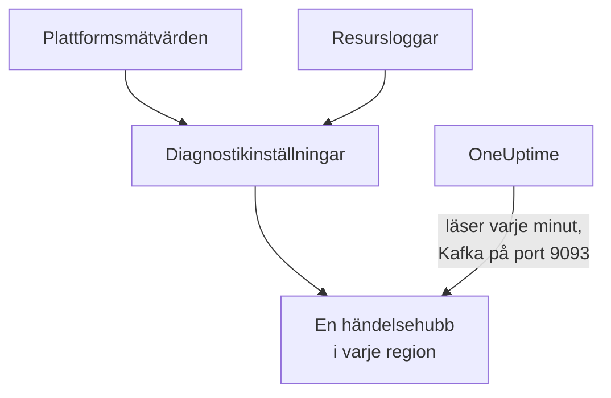

# Strömma Azure Monitor-mätvärden och -loggar

En ansluten Azure-prenumeration kan strömma sina Azure Monitor-mätvärden och resursloggar till OneUptime. Diagnostikinställningar skickar dem till händelsehubbar i din prenumeration, och OneUptime läser händelsehubbarna varje minut: de flesta nyckelmätvärden kommer några minuter efter att Azure Monitor har dem, i stället för vid anslutningens nästa läsning, och resursloggar kommer som OneUptime-loggar, var och en arkiverad under den resurs den gäller. Ett kommando i Azure Cloud Shell konfigurerar allt, och det finns inget att köra.

:::cards
- [Så fungerar det](#så-fungerar-det): Diagnostikinställningar skickar till en händelsehubb i varje region, och OneUptime läser dem.
- [Konfigurera strömning](#konfigurera-strömning): Välj vad som ska strömmas, slå på läsning och kör ett kommando.
- [Vad som kommer](#vad-som-kommer): Mätvärden på resurserna de mäter, och loggar på resurserna de kommer från.
- [Vad kommandot skapar](#vad-kommandot-skapar): Varje resurs och varje behörighet som kommandot skapar i din prenumeration.
- [Sluta strömma](#sluta-strömma): Sluta läsa, och ta sedan bort det som kommandot skapade.
:::

## Så fungerar det



- **En händelsehubb i varje region.** En diagnostikinställning skickar bara till en händelsehubb i resursens egen region, så kommandot skapar en Event Hubs-namnrymd i varje region där dina resurser finns, alla i en resursgrupp, och riktar varje resurs diagnostikinställning mot händelsehubben i dess region.
- **OneUptime läser dem.** Azure Monitor skickar bara till en händelsehubb, ett lagringskonto eller en Log Analytics-arbetsyta, aldrig till en adress hos dig: en händelsehubb som OneUptime läser är vägen där du inte behöver köra något. OneUptime loggar in som anslutningens egen app, som får läsa de händelsehubbarna och inget annat.
- **Läsningarna lämnar strömmade mätvärden åt strömmen.** Medan strömmen levererar en resurstyps nyckelmätvärden i en region slutar anslutningens läsningar att skriva dem som den bär, så ingen datapunkt räknas två gånger, och fortsätter att skriva [dem som den inte kan bära](#vad-som-kommer). Läsningarna fortsätter att hitta resurser, deras tillstånd och deras ändringar, och tar tillbaka mätvärdena efter 15 minuter utan någon händelse.
- **Ingenting går förlorat medan OneUptime inte kan läsa.** Händelser väntar i händelsehubbarna tills OneUptime läser dem, så länge händelsehubbarna sparar dem, och OneUptime minns hur långt det har läst varje partition, så att det fortsätter där det slutade.

## Innan du börjar

- **En ansluten Azure-prenumeration.** Anslut den först under **Moln → Anslut**: se [Anslut ett molnkonto](/docs/telemetry/cloud-accounts).
- **En projektägare eller administratör.** Bara de kan slå på läsning och sluta strömma.
- **Azure Cloud Shell**, inloggad som **Owner** för prenumerationerna, eller som **Contributor** som också är **User Access Administrator**: kommandot skapar en resursgrupp och en rolltilldelning, och ändrar diagnostikinställningar.
- **En väg ut till Azure, på en egen OneUptime-installation.** OneUptime läser varje namnrymd på `<namespace>.servicebus.windows.net` på port 9093, och namnrymderna tar emot anslutningar från internet.

## Konfigurera strömning

:::steps
### Öppna strömningsdialogen

Gå till **Moln → Anslut** och välj **Strömma mätvärden och loggar** på Azure-prenumerationens rad.

### Välj vad som ska strömmas

**Mätvärden** strömmar varje resurs nyckelmätvärden, minut för minut, de mätvärden som OneUptime visar och bedömer varje resurs efter, utom [dem som en diagnostikinställning inte kan skicka](#vad-som-kommer), som anslutningen fortsätter att läsa. **Mätvärden och loggar** lägger till varje resurs egna loggar, varje kategori som Azure för för den, och **Loggar** strömmar bara resursloggar.

### Slå på läsning

Välj **Slå på läsning**. OneUptime letar efter händelsehubbarna varje minut och väntar på dem tills kommandot har skapat dem.

### Kör kommandot i Azure Cloud Shell

Kopiera kommandot, kör det i Azure Cloud Shell och vänta tills det är klart. Det anger varje region där det skapade en händelsehubb, hur många resurser som skickar till dem och vilka resurser det utelämnade, med Azures orsak.

### Vänta på de första händelserna

Dialogen frågar med några sekunders mellanrum vad som har kommit. Azure börjar skicka några minuter efter att kommandot är klart; dialogen säger då vad som kom varifrån, och anslutningens rad säger **Strömmar**.
:::

**Fler fält** innehåller resten:

| Fält | Vad det gör |
| --- | --- |
| **Prenumerationer** | Prenumerationerna att strömma från: först de som anslutningen läser. Den första innehåller händelsehubbarna, och OneUptime läser dem där. Högst 50 |
| **Konfigurera det på ett annat sätt** | Namnen som kommandot använder, för att konfigurera allt med Terraform eller portalen |

När anslutningen ännu inte har läst någon prenumeration, eller fler än 50, frågar dialogen i stället efter **Prenumerationer** före sina steg.

När den första prenumerationen inte är den där OneUptime läser händelsehubbarna säger dialogen det: välj **Läs dem där** innan du kör kommandot.

## Vad som kommer

| Vad | Var det hamnar |
| --- | --- |
| Nyckelmätvärden | På molnresurserna de mäter, i samma serier som anslutningens läsningar skriver |
| Resursloggar | I loggutforskaren, under anslutningens telemetritjänst, med prenumerationen, regionen och kategorin som attribut |
| Loggar för en resurs som OneUptime känner till | Också på den resursen: dess sida i Moln får en flik **Loggar** |

Strömmen bär nyckelmätvärdena som anslutningen läser minut för minut. Läsningarna fortsätter att skriva resten enligt sitt schema: ett mätvärde som de läser med grövre upplösning, till exempel ett containerregisters använda lagring, och varje nyckelmätvärde som en diagnostikinställning inte kan skicka, som Azure Monitors lista över mätvärden som stöds markerar som inte exporterbart i kolumnen DS Export:

- Virtuella datorer och skalningsuppsättningar: `Network In Total`, `Network Out Total`.
- Diskar: `Composite Disk Read Bytes/sec`, `Composite Disk Write Bytes/sec`, `Composite Disk Read Operations/sec`, `Composite Disk Write Operations/sec`.
- Azure Cosmos DB-konton: `TotalRequests`, `TotalRequestUnits`, `NormalizedRUConsumption`, `ServerSideLatency`.
- Lagringskonton: `UsedCapacity`.
- AKS-kluster: `kube_pod_status_ready`.
- Programgatewayer: `ApplicationGatewayTotalTime`, `Throughput`.
- Brandväggar: `Throughput`.
- NAT-gatewayer: `ByteCount`, `SNATConnectionCount`, `DatapathAvailability`.

En Service Bus- eller Event Hubs-namnrymd strömmar inga mätvärden. Läsningarna läser dess nyckelmätvärden för varje kö, topic och händelsehubb, och namnrymdens egna totaler summerar dem, medan en diagnostikinställning bara skickar namnrymdens totaler, och inte alls 4 av en Service Bus-namnrymds 6 nyckelmätvärden eller 2 av en Event Hubs-namnrymds 4. Så läsningarna skriver alla, med eller utan strömning, och inget meddelande räknas två gånger.

En logg arkiveras under sin resurs efter resursens ARM-id, som bärs som `cloud.resource_id`, och behåller sin kategori, åtgärd, resultat och egenskaper som attribut, till exempel `azure.category`.

Virtuella datorer, skalningsuppsättningar, diskar, nätverksgränssnitt, virtuella nätverk, privata slutpunkter, NAT-gatewayer, DNS-zoner och App Service-planer skickar inga egna resursloggar, så deras sidor har ingen flik **Loggar**. Ett lagringskontos loggar är dess tjänsters, och en containerapps loggar är dess miljös.

## Vad kommandot skapar

Resursgruppen heter `oneuptime-stream-` följt av de 8 första tecknen i anslutningens id. Den ger inte OneUptime någon åtkomst till dina resurser: anslutningens app får läsa händelsehubbarna, och inget mer.

| Resurs | Vad den får göra |
| --- | --- |
| En resursgrupp, `oneuptime-stream-<suffix>`, i den första prenumerationen | Innehåller händelsehubbarna, taggad med anslutningens id som `oneuptime-connection` |
| En Event Hubs-namnrymd i varje region, `oneuptime-<suffix>-<region>`, på nivån Standard med 1 dataflödesenhet | Tar emot det som diagnostikinställningarna i dess region skickar |
| En händelsehubb i var och en, `oneuptime`, med 2 partitioner | Sparar händelserna tills OneUptime läser dem |
| Rollen **Azure Event Hubs Data Receiver** för anslutningens app, bara på resursgruppen | Låter appen läsa händelsehubbarna, och inget annat |
| En diagnostikinställning på varje resurs, `OneUptime-<suffix>` | Skickar resursens mätvärden, loggar eller båda till händelsehubben i dess region |

En resurs i en global region, till exempel Front Door, skickar till den första regionens händelsehubb. En resurs som Azure bara för mätvärden eller bara loggar för konfigureras med det den har, och en som redan har 5 diagnostikinställningar, det högsta som Azure tillåter, utelämnas. Azure fakturerar varje namnrymds dataflödesenhet per timme, och de händelser som diagnostikinställningarna skickar.

## Sluta strömma

:::steps
### Sluta läsa

Välj **Sluta strömma** på prenumerationens rad under **Moln → Anslut**. OneUptime slutar direkt att läsa händelsehubbarna, och anslutningen läser alla sina mätvärden enligt schemat igen. Det som har lästs finns kvar.

### Ta bort det som kommandot skapade

Händelsehubbarna och diagnostikinställningarna finns kvar i Azure, och Azure fakturerar dem, tills de tas bort. Dialogen visar kommandot: det tar bort varje resurs diagnostikinställning och sedan resursgruppen, i vilken prenumeration den än ligger.

```bash
oneuptime_stream_stop() {
  local SUB ID N=0
  for SUB in '11111111-aaaa-4aaa-8aaa-111111111111' '22222222-bbbb-4bbb-8bbb-222222222222'; do
    while IFS= read -r ID; do
      if [ -z "$ID" ]; then continue; fi
      az monitor diagnostic-settings delete --name OneUptime-6f1c3a2e --resource "$ID" --output none 2> /dev/null &
      N=$((N + 1))
      if [ $((N % 4)) -eq 0 ]; then wait; fi
    done < <(az resource list --subscription "$SUB" --query "[].id" --output tsv)
  done
  wait
  for SUB in '11111111-aaaa-4aaa-8aaa-111111111111' '22222222-bbbb-4bbb-8bbb-222222222222'; do
    if [ "$(az group exists --subscription "$SUB" --name oneuptime-stream-6f1c3a2e 2> /dev/null)" = true ]; then
      az group delete --subscription "$SUB" --name oneuptime-stream-6f1c3a2e --yes --no-wait && echo "Deleting oneuptime-stream-6f1c3a2e in $SUB."
    fi
  done
}
oneuptime_stream_stop
```
:::

Om du vill ändra vad som strömmas öppnar du **Strömma mätvärden och loggar** igen, väljer vad som ska strömmas och kör det nya kommandot: det uppdaterar det som den första körningen skapade, och skapar inget två gånger.

## Konfigurera det på ett annat sätt

Skapa med Terraform eller portalen det som kommandot skapar, med de här namnen:

| Inställning | Värde |
| --- | --- |
| Resursgrupp | `oneuptime-stream-<suffix>`, i prenumerationen där OneUptime läser händelsehubbarna |
| Event Hubs-namnrymd | `oneuptime-<suffix>-<region>`, en i varje region med en resurs att strömma |
| Händelsehubb | `oneuptime`, i varje namnrymd |
| Diagnostikinställning | `OneUptime-<suffix>` på varje resurs, till händelsehubben i dess region, med namnrymdens regel `RootManageSharedAccessKey` |
| Roll | **Azure Event Hubs Data Receiver** för anslutningens app, på resursgruppen |

Slå sedan på läsning, med den prenumerationen först under **Prenumerationer**.

## Felsökning

:::details Dialogen fortsätter att vänta på de första händelserna
Kontrollera att kommandot blev klart och att det sa att en regions händelsehubb är redo: `az eventhubs namespace list --resource-group oneuptime-stream-6f1c3a2e` listar namnrymderna. En diagnostikinställning skickar bara det som Azure Monitor har, så en resurs som inte gör något skickar lite. En ny roll kan ta några minuter att börja gälla: tills dess ser läsningarna inte händelserna.
:::

:::details Anslutningen säger Strömmen misslyckas
Dialogen och radens knappbeskrivning säger varför. När appen inte får läsa händelsehubbarna kör du kommandot igen: det ger appen dess roll igen. När OneUptime inte kunde nå dem kontrollerar du att namnrymderna tar emot anslutningar från internet, och att en egen OneUptime-installation får nå port 9093.
:::

:::details Kommandot utelämnade resurser
Det listar dem, var och en med Azures orsak. En resurs av en typ utan diagnostikinställningar skickar inget, och på en som redan har 5 diagnostikinställningar måste en av dem tas bort först. Kör sedan kommandot igen.
:::

## Nästa steg

:::cards
- [Anslut ett molnkonto](/docs/telemetry/cloud-accounts): Vad en anslutning läser, och hur ofta.
- [Strömma Google Cloud-loggar](/docs/telemetry/cloud-streaming-google-cloud): Ett Google Cloud-projekts loggar, pushade via Pub/Sub.
- [Strömma CloudWatch-mätvärden och -loggar](/docs/telemetry/cloud-streaming): Ett AWS-kontos, levererade av Amazon Data Firehose.
- [Loggutforskare](/docs/telemetry/logs-explorer): Sök och filtrera i det som strömmarna har levererat.
:::
