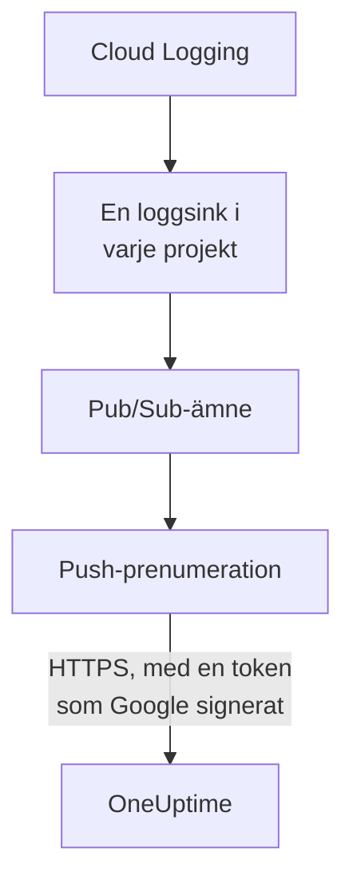

# Strömma Google Cloud-loggar

Ett anslutet Google Cloud-projekt kan strömma sina loggar till OneUptime så snart de skrivs. Cloud Logging skickar dem via en loggsink till ett Pub/Sub-ämne, och ämnets push-prenumeration levererar varje post till OneUptime inom en minut, som en OneUptime-logg arkiverad under den resurs den gäller. Ett kommando i Google Cloud Shell konfigurerar allt, och det finns inget att köra. Cloud Monitoring har ingen export som pushar mätvärden, så anslutningen fortsätter att läsa mätvärden enligt sitt schema.

:::cards
- [Så fungerar det](#så-fungerar-det): En loggsink i varje projekt, ett ämne och dess push-prenumeration.
- [Konfigurera strömning](#konfigurera-strömning): Välj vilka loggar, skapa en strömnyckel och kör ett kommando.
- [Vad som kommer](#vad-som-kommer): Loggar på resurserna de kommer från.
- [Vad kommandot skapar](#vad-kommandot-skapar): Varje resurs och varje behörighet som kommandot skapar i dina projekt.
- [Sluta strömma](#sluta-strömma): Stäng av nycklarna, och ta sedan bort det som kommandot skapade.
:::

## Så fungerar det



- **En loggsink i varje projekt.** Varje projekts sink skickar de poster som dess filter matchar till ett enda Pub/Sub-ämne, i projektet för anslutningens eget tjänstkonto.
- **Två kontroller vid varje push.** Pub/Sub signerar en OpenID Connect-token för ett tjänstkonto som bara skapats för pusharna, och tokenets audience är anslutningens strömnyckel. OneUptime tar bara emot en push när Google har signerat dess token för det tjänstkontot och nyckeln är en av anslutningens. Nyckeln namnger anslutningen, och därmed projektet: inget i en push avgör var den skrivs. OneUptime sparar bara nyckelns SHA-256.
- **Ingenting går förlorat medan OneUptime inte kan ta emot det.** Pub/Sub pushar en avvisad post igen, med pauser från 10 sekunder upp till 10 minuter mellan försöken, och sparar den i en dag.

## Innan du börjar

- **Ett anslutet Google Cloud-projekt.** Anslut det först under **Moln → Anslut**: se [Anslut ett molnkonto](/docs/telemetry/cloud-accounts).
- **En projektägare eller administratör.** Bara de kan skapa en strömnyckel och sluta strömma.
- **Google Cloud Shell**, inloggad som **Owner** för projekten, eller som någon som får skapa tjänstkonton, Pub/Sub-ämnen och loggsinkar i dem.
- **En HTTPS-adress, på en egen OneUptime-installation.** Pub/Sub pushar bara till `https://`-adresser, med ett certifikat som Google litar på, och adressen måste gå att nå från Google Cloud.

## Konfigurera strömning

:::steps
### Öppna strömningsdialogen

Gå till **Moln → Anslut** och välj **Strömma loggar** på Google Cloud-projektets rad.

### Välj vilka loggar

**Varningar och fel** strömmar varje post med allvarlighetsgrad `WARNING` eller högre: det som gick fel, inte varje begäran. **Varje logg** strömmar varje post utom Data Access-granskningsloggarna, som registrerar varje läsning och kan överträffa allt annat ett projekt skriver. **Ett eget filter** strömmar de poster som en Cloud Logging-fråga matchar, skriven i fältet **Filter**.

### Skapa en strömnyckel

Välj **Skapa en strömnyckel**. Nyckeln visas bara den här gången, i kommandot: OneUptime sparar bara dess SHA-256.

### Kör kommandot i Google Cloud Shell

Kopiera kommandot, kör det i Google Cloud Shell och vänta tills det är klart. Det anger varje projekt där det konfigurerade en sink, och stannar vid det första steg som Google avvisar, med Googles orsak.

### Vänta på den första pushen

Dialogen frågar med några sekunders mellanrum vad som har kommit. Pub/Sub pushar en post inom en minut efter att ett projekt skrivit en som filtret tar emot; dialogen säger då vad som kom varifrån, och anslutningens rad säger **Strömmar**.
:::

**Fler fält** innehåller resten:

| Fält | Vad det gör |
| --- | --- |
| **Projekt** | Projekten att strömma loggar från: först de som anslutningen läser. Ämnet skapas i projektet för anslutningens tjänstkonto. Högst 100 |
| **Konfigurera det på ett annat sätt** | Push-slutpunkten, push-tjänstkontot och nyckeln, för att konfigurera allt med Terraform eller konsolen |

## Vad som kommer

| Vad | Var det hamnar |
| --- | --- |
| Loggar | I loggutforskaren, under anslutningens telemetritjänst, med projektet, regionen och loggnamnet som attribut |
| Loggar för en resurs som OneUptime känner till | Också på den resursen: dess sida i Moln får en flik **Loggar** |

Varje logg behåller sin posts tid på nanosekunden, sin allvarlighetsgrad, sin trace och span, och sin HTTP-begäran under namnen i OpenTelemetrys semantiska konventioner. Den arkiveras under en resurs när dess övervakade resurs är en typ vars mätvärden OneUptime läser, till exempel en VM (`gce_instance`), en Cloud Run-tjänst (`cloud_run_revision`) eller en Cloud SQL-instans (`cloudsql_database`), och bär resursens id som `cloud.resource_id`. En extern lastbalanserares begärandeloggar, skrivna under `http_load_balancer`, arkiveras under dess URL-mappning, den `https_lb_rule` som dess mätvärden hamnar på.

En instansgrupps loggar är dess virtuella datorers, så dess sida har ingen flik **Loggar**. En post av en annan typ strömmas ändå, under sitt projekt.

## Vad kommandot skapar

Dess resurser är namngivna efter de 8 första tecknen i anslutningens id. Det ger inte OneUptime någon åtkomst till dina projekt: poster flödar bara ut.

| Resurs | Vad den får göra |
| --- | --- |
| Ett tjänstkonto, `oneuptime-push-<suffix>`, i projektet för anslutningens tjänstkonto | Har ingen roll: Pub/Sub signerar tokens för sina pushar åt det |
| Rollen **Service Account OpenID Connect Identity Token Creator** för Pub/Sub-tjänstagenten, bara på det tjänstkontot | Låter Pub/Sub skapa de tokens, och inget annat |
| Ett Pub/Sub-ämne, `oneuptime-stream-<suffix>` | Innehåller posterna som sinkarna skickar |
| Dess push-prenumeration, `oneuptime-stream-<suffix>-push` | Pushar varje post till OneUptime, med en bekräftelsefrist på 60 sekunder, och sparar i en dag det den inte kunde pusha |
| En loggsink i varje projekt, `oneuptime-stream-<suffix>` | Skickar de poster som dess filter matchar till ämnet |
| Rollen **Pub/Sub Publisher** för varje sinks skrivare, bara på ämnet | Låter sinken publicera till ämnet, och inget annat |

Kommandot slår på API:erna för Pub/Sub och Cloud Logging i ämnets projekt om de är avstängda. Google fakturerar Pub/Sub för de loggar det levererar: strömma bara de loggar du behöver.

## Sluta strömma

:::steps
### Stäng av nycklarna

Välj **Sluta strömma** på projektets rad under **Moln → Anslut**. Alla anslutningens strömnycklar slutar fungera direkt, och OneUptime avvisar det som Pub/Sub pushar. Det som har levererats finns kvar.

### Ta bort det som kommandot skapade

Sinkarna, ämnet och dess push-prenumeration finns kvar i Google Cloud, och Pub/Sub fortsätter att pusha, tills de tas bort. Dialogen visar kommandot, för de projekt som anslutningen läser:

```bash
for SOURCE in 'acme-prod' 'acme-data'; do
  gcloud logging sinks delete oneuptime-stream-6f1c3a2e --project "$SOURCE" --quiet
done
gcloud pubsub subscriptions delete oneuptime-stream-6f1c3a2e-push --project 'acme-prod' --quiet
gcloud pubsub topics delete oneuptime-stream-6f1c3a2e --project 'acme-prod' --quiet
gcloud iam service-accounts delete 'oneuptime-push-6f1c3a2e@acme-prod.iam.gserviceaccount.com' --project 'acme-prod' --quiet
```
:::

Om du vill ändra vilka loggar som strömmas öppnar du **Strömma loggar** igen, väljer **Skapa en ny nyckel** och kör det nya kommandot. Nyckeln som den ersätter fortsätter fungera i 24 timmar, så ingen push avvisas medan prenumerationen uppdateras. Högst 3 ersatta nycklar fungerar samtidigt.

## Konfigurera det på ett annat sätt

Ge ett Pub/Sub-ämne en push-prenumeration med de här värdena, och låt Pub/Sub-tjänstagenten skapa tokens för push-tjänstkontot:

| Inställning | Värde |
| --- | --- |
| Push-slutpunkt | `https://oneuptime.com/telemetry/gcp-pubsub/v1/logs` |
| Autentisering | En OpenID Connect-token för `oneuptime-push-<suffix>@<project>.iam.gserviceaccount.com` |
| Audience | Strömnyckeln |
| Nyttolast | Inslagen, så som Pub/Sub skickar den om inget annat anges |
| Bekräftelsefrist | 60 sekunder |
| Lagring av meddelanden | 1 dag |

Skicka sedan varje projekts loggar till ämnet med en loggsink, och ge varje sinks skrivare **Pub/Sub Publisher** på ämnet. På en egen OneUptime-installation ersätter du `https://oneuptime.com` med din OneUptimes HTTPS-adress.

OneUptime besvarar varje push så som Pub/Sub förväntar sig:

| Svar | När | Vad Pub/Sub gör |
| --- | --- | --- |
| `204` | Posten togs emot, eller hade tagits emot förut, eller meddelandet är ingen loggpost | Går vidare |
| `400` | Det är ingen Pub/Sub-push som OneUptime kan läsa | Pushar den igen, med längre paus varje gång, i en dag |
| `401` | Token är inte en som Google signerat för push-tjänstkontot, eller dess audience är ingen nyckel för anslutningen | Pushar den igen, med längre paus varje gång, i en dag |
| `402` | Projektet kan inte faktureras för telemetri | Pushar den igen, med längre paus varje gång, i en dag |
| `403` | Anslutningen är avstängd, eller projektet kan inte ta emot telemetri | Pushar den igen, med längre paus varje gång, i en dag |
| `413` | Begäran är större än 1 MiB, eller dess post större än 512 KiB | Pushar den igen, med längre paus varje gång, i en dag |
| `429` | Anslutningens prenumeration pushade mer än 12 000 poster på en minut | Pushar den igen, med längre paus varje gång, i en dag |
| `503` | OneUptime kunde inte kontrollera token eller köa posten just då | Pushar den igen, med längre paus varje gång, i en dag |

## Felsökning

:::details Dialogen fortsätter att vänta på den första pushen
Kontrollera att kommandot blev klart utan att stanna, och att ett projekt har skrivit en post som filtret tar emot: med **Varningar och fel** skickar ett lugnt projekt inget. `gcloud pubsub subscriptions describe oneuptime-stream-6f1c3a2e-push --project acme-prod` visar prenumerationens slutpunkt. På en egen OneUptime-installation kontrollerar du att Google Cloud når dess adress över HTTPS.
:::

:::details Anslutningen säger Strömmen avvisad
Dialogen och radens knappbeskrivning säger varför. En felaktig nyckel betyder att prenumerationen pushar med en nyckel som inte längre fungerar: skapa en ny nyckel och kör kommandot igen. En push som inte är signerad för push-tjänstkontot betyder att prenumerationen signerar som ett annat konto, eller att Pub/Sub inte får signera för det: kör kommandot igen.
:::

:::details En resurs loggar visas inte på dess sida
Sidan visar de loggar som Cloud Logging arkiverar under resursens övervakade resurs, med de etiketter som dess mätvärden har. Loggar som en arbetsbelastning skriver under en annan resurs, till exempel en containers, strömmas bara under sitt projekt.
:::

## Nästa steg

:::cards
- [Anslut ett molnkonto](/docs/telemetry/cloud-accounts): Vad en anslutning läser, och hur ofta.
- [Strömma Azure Monitor-mätvärden och -loggar](/docs/telemetry/cloud-streaming-azure): En Azure-prenumerations, lästa från händelsehubbar.
- [Strömma CloudWatch-mätvärden och -loggar](/docs/telemetry/cloud-streaming): Ett AWS-kontos, levererade av Amazon Data Firehose.
- [Loggutforskare](/docs/telemetry/logs-explorer): Sök och filtrera i det som strömmarna har levererat.
:::
