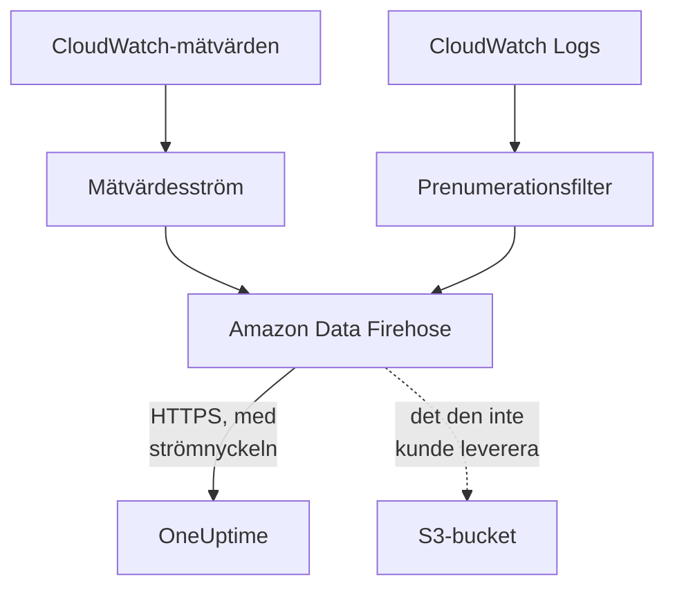

# Strömma CloudWatch-mätvärden och -loggar

Ett anslutet AWS-konto kan strömma sina CloudWatch-mätvärden och -loggar till OneUptime via Amazon Data Firehose. Mätvärden kommer då några minuter efter att CloudWatch har dem, i stället för vid anslutningens nästa läsning, och CloudWatch Logs kommer som OneUptime-loggar, var och en arkiverad under den resurs den handlar om. Ett kommando i AWS CloudShell ställer in allt, och det finns inget att köra.

:::cards
- [Så fungerar det](#så-fungerar-det): En mätvärdesström och loggprenumerationer i varje region, levererade av Firehose.
- [Konfigurera strömning](#konfigurera-strömning): Välj vad som ska strömmas, skapa en strömnyckel och kör ett kommando.
- [Vad som kommer](#vad-som-kommer): Mätvärden på resurserna de mäter, och loggar på resurserna de kommer från.
- [Vad stacken skapar](#vad-stacken-skapar): Varje resurs och varje behörighet som kommandot skapar i ditt konto.
- [Sluta strömma](#sluta-strömma): Stäng av nycklarna och ta sedan bort stackarna.
:::

## Så fungerar det



- **En stack i varje region.** Kommandot distribuerar en CloudFormation-stack i varje region du strömmar från. Dess mätvärdesström och prenumerationsfilter för loggar lämnar allt vidare till två Firehose-strömmar, och Firehose levererar det till OneUptime över HTTPS.
- **Strömnyckeln säger vems det är.** Firehose skickar anslutningens strömnyckel med varje leverans. Nyckeln namnger anslutningen, och därmed projektet: ingenting i en leverans avgör var den skrivs. OneUptime sparar bara nyckelns SHA-256.
- **Läsningarna överlåter strömmade mätvärden till strömmen.** Så länge en ström levererar en namnrymd i en region slutar anslutningens läsningar att skriva den namnrymdens mätvärden, så att ingen datapunkt räknas två gånger. Läsningarna fortsätter att hitta resurser, deras tillstånd och deras ändringar, och tar tillbaka en namnrymd efter 15 minuter utan leverans.
- **Ingenting går förlorat medan OneUptime inte kan ta emot det.** Firehose skickar en avvisad batch igen i upp till en timme och sparar den sedan i 30 dagar i stackens S3-bucket.

## Innan du börjar

- **Ett anslutet AWS-konto.** Anslut det först under **Moln → Anslut**: se [Anslut ett molnkonto](/docs/telemetry/cloud-accounts).
- **En projektägare eller administratör.** Bara de kan skapa en strömnyckel och sluta strömma.
- **AWS CloudShell i det kontot**, inloggat som någon som får skapa CloudFormation-stackar och IAM-roller.
- **En HTTPS-adress, på en egen driftad OneUptime.** Firehose levererar bara till `https://`-adresser på port 443, med ett certifikat som AWS litar på, och adressen måste nås från AWS.

## Konfigurera strömning

:::steps
### Öppna strömningsdialogen

Gå till **Moln → Anslut** och välj **Strömma mätvärden och loggar** på AWS-kontots rad.

### Välj vad som ska strömmas

**Mätvärden** strömmar varje nyckelmätvärde för varje resurs, en gång i minuten: de mätvärden som OneUptime visar i diagram och bedömer varje resurs efter. **Mätvärden och loggar** lägger till CloudWatch Logs, och **Loggar** strömmar bara CloudWatch Logs.

För loggar anger du **Logggrupper**, en per rad, med namn i **Region** bredvid eller med ARN i sin egen region, eller så väljer du **Alla kontots logggrupper, även nya**. Ett kommando prenumererar på högst 50 logggrupper med namn, i högst 10 regioner.

### Skapa en strömnyckel

Välj **Skapa en strömnyckel**. Nyckeln visas bara den här enda gången, i kommandot: OneUptime sparar bara dess SHA-256.

### Kör kommandot i AWS CloudShell

Kopiera kommandot, kör det i AWS CloudShell och vänta tills det är klart. Det skriver mallen till `oneuptime-stream.json` och distribuerar den i varje region, med nyckeln som en parameter som aldrig visas igen.

### Vänta på den första leveransen

Dialogen frågar med några sekunders mellanrum vad som har kommit. Firehose levererar inom några minuter efter att kommandot är klart; dialogen säger då vad som kom varifrån, och anslutningens rad säger **Strömmar**.
:::

**Fler fält** innehåller resten:

| Fält | Vad det gör |
| --- | --- |
| **Alla mätvärden, inte bara nyckelmätvärdena** | Strömmar alla mätvärden som CloudWatch har för kontot, även dina egna. AWS debiterar varje mätvärdesuppdatering som en ström skickar, så det kan kosta många gånger mer |
| **Regioner** | Varifrån det strömmas: först de regioner där anslutningen hittade resurser. Lämnas fältet tomt strömmar kommandot från AWS CloudShells egen region. Högst 30 |
| **Konfigurera det på ett annat sätt** | Slutpunkterna för mätvärden och loggar och nyckeln, för att konfigurera strömmarna med Terraform eller konsolen |

**Ladda ned mallen** sparar mallen som kommandot distribuerar, så att du kan distribuera den på ditt eget sätt.

## Vad som kommer

| Vad | Var det hamnar |
| --- | --- |
| Mätvärden | På molnresurserna de mäter, med de namn och attribut som anslutningens läsningar ger dem |
| Loggar | I loggutforskaren, under anslutningens telemetritjänst, med konto, region och logggrupp som attribut |
| Loggar från en logggrupp som AWS namnger efter en resurs | Även på den resursen: dess sida i Moln får en flik **Loggar** |

En logggrupp arkiveras under en resurs när AWS har namngett den efter en:

| Logggrupp | Resurstyp |
| --- | --- |
| `/aws/lambda/<function>` | `AWS::Lambda::Function` |
| `/aws/rds/instance/<instance>/<log>` | `AWS::RDS::DBInstance` |
| `/aws/rds/cluster/<cluster>/<log>` | `AWS::RDS::DBCluster` |
| `/aws/docdb/<cluster>/<log>` | `AWS::DocDB::DBCluster` |
| `/aws/neptune/<cluster>/<log>` | `AWS::Neptune::DBCluster` |
| `/aws/redshift/cluster/<cluster>/<log>` | `AWS::Redshift::Cluster` |
| `/aws/OpenSearchService/domains/<domain>/<log>` | `AWS::OpenSearchService::Domain` |
| `/aws/aes/domains/<domain>/<log>` | `AWS::OpenSearchService::Domain` |
| `/aws/apprunner/<service>/<service-id>/<log>` | `AWS::AppRunner::Service` |
| `/aws/elasticbeanstalk/<environment>/<log>` | `AWS::ElasticBeanstalk::Environment` |
| `/aws/ecs/containerinsights/<cluster>/performance` | `AWS::ECS::Cluster` |

Varje logg bär resursens ID som `cloud.resource_id`, och en Lambda-funktions loggar bär också `faas.name`, så de visas även på funktionen under Serverless. En logggrupp med ett annat namn strömmas ändå, under sitt konto och sin region. En loggs allvarlighetsgrad är den som dess meddelande anger, så som Lambda skriver den.

## Vad stacken skapar

Stacken heter `OneUptimeStream-` följt av de första 8 tecknen i anslutningens ID. Den ger OneUptime ingen åtkomst till ditt konto: data flödar bara ut.

| Resurs | Vad den får göra |
| --- | --- |
| En CloudWatch-mätvärdesström i formatet OpenTelemetry 1.0 | Bara lägga poster i Firehose-strömmen för mätvärden |
| Prenumerationsfilter för loggar, eller en kontoomfattande prenumerationsprincip för varje logggrupp | Bara lägga poster i Firehose-strömmen för loggar |
| Två Firehose-strömmar, `OneUptime-<suffix>-metrics` och `OneUptime-<suffix>-logs` | Leverera till OneUptime med GZIP, en buffert på 1 MiB eller 60 sekunder och en timmes nya försök, och skriva det de inte kunde leverera till bucketen |
| En S3-bucket för det som inte kunde levereras | Offentlig åtkomst blockerad, krypterad, tömd efter 30 dagar och kvar när stacken tas bort |
| En logggrupp, `/aws/kinesisfirehose/OneUptime-<suffix>` | Innehåller Firehoses egna leveransfel och strömmas aldrig |
| Tre IAM-roller | Var och en litar på en AWS-tjänst i det här kontot och tillåter bara det som raderna ovan säger |

AWS debiterar mätvärdesströmmen för varje mätvärdesuppdatering den skickar, och Firehose för det den levererar. Strömma bara de mätvärden och logggrupper du behöver.

## Sluta strömma

:::steps
### Stäng av nycklarna

Välj **Sluta strömma** på kontots rad under **Moln → Anslut**. Alla anslutningens strömnycklar slutar fungera direkt, OneUptime avvisar det som strömmarna levererar, och anslutningen läser åter alla sina mätvärden enligt sitt schema. Det som strömmarna har levererat finns kvar.

### Ta bort stackarna

Strömmarna finns kvar i AWS, och AWS debiterar dem, tills deras stackar har tagits bort. Dialogen visar kommandot, för de regioner där anslutningen hittade resurser:

```bash
for REGION in us-east-1 eu-west-1; do
  aws cloudformation delete-stack --region "$REGION" --stack-name OneUptimeStream-6f1c3a2e
done
```
:::

För att ändra vad en stack strömmar öppnar du **Strömma mätvärden och loggar** igen, väljer **Skapa en ny nyckel** och kör det nya kommandot. Nyckeln som den ersätter fungerar i 24 timmar till, så ingen leverans avvisas medan stackarna uppdateras. Högst 3 ersatta nycklar fungerar samtidigt.

## Konfigurera det på ett annat sätt

Ge varje Firehose-ström ett HTTP-slutpunktsmål med de här värdena, och mätvärdesströmmen utdataformatet OpenTelemetry 1.0:

| Inställning | Värde |
| --- | --- |
| Slutpunkt för mätvärden | `https://oneuptime.com/telemetry/aws-firehose/v1/metrics` |
| Slutpunkt för loggar | `https://oneuptime.com/telemetry/aws-firehose/v1/logs` |
| Åtkomstnyckel | Strömnyckeln, skickad som `X-Amz-Firehose-Access-Key` |
| Innehållskodning | `GZIP` |
| Buffert | 1 MiB eller 60 sekunder |
| Varaktighet för nya försök | 3600 sekunder, med en S3-bucket för det som inte kunde levereras |

På en egen driftad OneUptime ersätter du `https://oneuptime.com` med din OneUptimes HTTPS-adress. Slutpunkten för mätvärden tar också emot en mätvärdesström i JSON-formatet.

OneUptime svarar på varje leverans så som Firehose förväntar sig:

| Svar | När | Vad Firehose gör |
| --- | --- | --- |
| `200` | Leveransen togs emot, eller den hade tagits emot tidigare | Går vidare |
| `400` | Det är inte en Firehose-leverans som OneUptime kan läsa, till exempel en med fler än 10 000 poster | Skickar den igen i upp till en timme |
| `401` | Nyckeln är inte en av anslutningens nycklar | Skickar den igen i upp till en timme |
| `402` | Projektet kan inte debiteras för telemetri | Skickar den igen i upp till en timme |
| `403` | Anslutningen är avstängd, eller projektet kan inte ta emot telemetri | Skickar den igen i upp till en timme |
| `413` | Begäran är större än 4 MiB, eller blir uppackad större än 32 MiB | Sparar den i bucketen |
| `429` | Anslutningens strömmar skickade fler än 600 leveranser på en minut | Skickar den igen senare |

## Felsökning

:::details Dialogen väntar fortfarande på den första leveransen
Kontrollera att kommandot blev klart i varje region utan fel: `aws cloudformation describe-stacks --stack-name OneUptimeStream-6f1c3a2e` visar stackens status. En mätvärdesström levererar bara mätvärden som CloudWatch har, så en region utan resurser skickar ingenting. På en egen driftad OneUptime kontrollerar du att AWS når dess adress över HTTPS på port 443.
:::

:::details Anslutningen säger Strömmen avvisad
Dialogen och radens knappbeskrivning säger varför. En fel nyckel betyder att stackarna körs med en nyckel som inte fungerar längre: skapa en ny nyckel och kör kommandot igen. Firehose fortsätter att skicka det den håller, och det tas emot så snart nyckeln är rätt.
:::

:::details En Lambda-funktions loggar visas inte på dess sida
Sidan visar loggarna från den logggrupp som är namngiven efter funktionen, `/aws/lambda/<function>`. En funktion som skriver till en logggrupp med ett annat namn strömmar bara sina loggar under sitt konto och sin region.
:::

## Nästa steg

:::cards
- [Anslut ett molnkonto](/docs/telemetry/cloud-accounts): Vad en anslutning läser, och hur ofta.
- [Molnresurser (IaaS och PaaS)](/docs/telemetry/cloud-resources): Varje resurstyp som OneUptime känner igen.
- [Loggutforskare](/docs/telemetry/logs-explorer): Sök i och filtrera det som strömmarna har levererat.
:::
