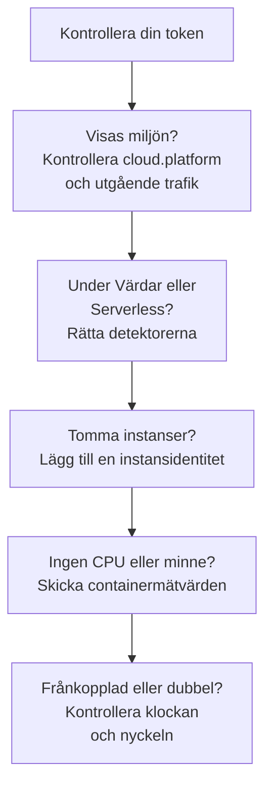

# Felsökning i molnet

Ta reda på varför en molnmiljö saknas, har arkiverats på fel ställe, är tom eller finns två gånger. Avsnitten står i den ordning som saker går fel, och varje avsnitt utesluter ett lager, så arbeta dig nedåt från toppen. Fel som hör till en enda plattform står sist på den plattformens sida: [AWS ECS / Fargate](/docs/telemetry/cloud-aws-ecs), [Google Cloud Run](/docs/telemetry/cloud-gcp-cloud-run), [Azure Container Apps](/docs/telemetry/cloud-azure-container-apps) och [Andra molnplattformar](/docs/telemetry/cloud-other-platforms).



## Kontrollera din token först

Det är den billigaste kontrollen, och inget nedan fungerar utan den:

```bash
curl -i https://oneuptime.com/otlp/v1/validate \
  -H "x-oneuptime-token: YOUR_TELEMETRY_INGESTION_TOKEN"
```

| Svar | Vad det betyder |
| ------------------------- | -------------------------------------------------------------------------------------------------------------------------- |
| `200`, `"valid": true` | Din token accepteras. Dess `keyType` ska vara `Server`: en nyckel av typen `Browser` avvisas från en collector eller en backend-tjänst. |
| `401`, `"valid": false` | Din token saknas, är okänd, återkallad, inaktiverad eller har gått ut, och svarets `message` säger vilket. Skapa en ny nyckel under **Projektinställningar → Telemetri och APM → Intagningsnycklar** och distribuera den igen. |

Om du driftar OneUptime själv använder du `https://YOUR-ONEUPTIME-HOST/otlp/v1/validate`. Kör kontrollen inifrån uppgiften, instansen eller repliken när du kan (ECS Exec, `az containerapp exec`): den bevisar att själva arbetsbelastningen når OneUptime, inte bara din bärbara dator.

## Miljön visas inte

Inget under **Moln → All Environments** en minut efter den första begäran. Kontrollera de här tre, i den här ordningen.

**`cloud.platform` saknas, eller är inte ett hanterat värde.** OneUptime arkiverar bara telemetri under Molnmiljöer när resursen bär ett av de här värdena: `aws_ecs`, `aws_elastic_beanstalk`, `aws_app_runner`, `gcp_cloud_run`, `gcp_app_engine`, `azure_container_apps`, `azure_container_instances` eller `azure_app_service`. De vanliga orsakerna:

- Resursdetektorn är avstängd i SDK:t (`OTEL_NODE_RESOURCE_DETECTORS`, `OTEL_EXPERIMENTAL_RESOURCE_DETECTORS`, `-Dotel.resource.providers.<cloud>.enabled=true`).
- Collectorns pipeline hoppar över processorn `resourcedetection`.
- På en plattform utan detektor har `OTEL_RESOURCE_ATTRIBUTES` ett stavfel.

Azure-detektorerna för Node.js och .NET skriver `azure.container_apps`, `azure.app_service` och `azure.functions`; OneUptime skriver om dem till värdena med understreck, så de räknas. För att se vad din telemetri bär öppnar du tjänsten under **Tjänster**, öppnar ett av dess spår från fliken **Spår** och läser resursattributen. Om `cloud.platform` inte finns där är det hela problemet.

**Din token är fel.** Kontrollen av din token svarade `401`. Collectorn loggar det som `Permanent error: ... 401`. Ett SDK loggar det en gång och slutar försöka igen, vilket är korrekt OTLP-beteende och lätt att missa.

**Utgående trafik är blockerad.** Collectorn loggar `connection refused`, `context deadline exceeded`, `i/o timeout` eller ett DNS-fel:

- **ECS och Fargate:** ett privat undernät behöver en NAT-gateway eller `assignPublicIp=ENABLED`, och säkerhetsgruppen måste tillåta utgående trafik på TCP 443.
- **Cloud Run:** **VPC egress: All traffic** behöver Cloud NAT.
- **Container Apps:** en användardefinierad väg till en brandvägg måste tillåta OneUptime-värden.
- **Överallt:** en OneUptime i egen drift bakom ett privat DNS-namn måste kunna slås upp från arbetsbelastningens nätverk.

## Den visas under Värdar i stället

Resursen bär en virtuell maskins plattform (`aws_ec2`, `gcp_compute_engine` eller `azure_vm`), så OneUptime arkiverar den under **Värdar**: rätt för en virtuell maskin, fel för hanterad beräkning. En virtuell maskins detektor vann över den hanterade: `detectors: [ec2, elastic_beanstalk]` i en collector, där den första detektorn som sätter `cloud.platform` vinner, eller ett SDK vars ordning gynnar EC2-detektorn. Sätt `elastic_beanstalk` först, eller sätt `cloud.platform` själv i `OTEL_RESOURCE_ATTRIBUTES` och behåll bara detektorn `env`.

## Den visas bara under Serverlösa funktioner

Resursen bär `faas.name` men ingen hanterad `cloud.platform`. Cloud Run och App Engine sätter båda när GCP-detektorn körs. Om du sätter `faas.name` för hand, eller om en collector slänger de resursattribut som SDK:ts detektor satte, är bara den serverlösa sidan uppfylld. Slå på detektorn, eller sätt `cloud.platform=gcp_cloud_run` (eller `gcp_app_engine`), `cloud.account.id` och `cloud.region` själv.

> [!NOTE]
> På Cloud Run och App Engine ska en tjänst visas på båda ställena: miljön samlar projektet och regionen, och **Serverlösa funktioner** visar den enskilda tjänsten.

## Instanser är tom

Miljön finns, men dess flik **Instanser** listar inget: telemetrin bär ingen instansidentitet. OneUptime namnger en instans efter det första av de här resursattributen som den hittar:

1. `aws.ecs.task.id`
2. `aws.ecs.task.arn` (förkortat till uppgifts-ID:t)
3. `faas.instance`
4. `azure.container_app.instance.id`
5. `service.instance.id`
6. `container.id`
7. `host.id`
8. `host.name`

Plattformens egen identitet kommer före `service.instance.id`, så att ett ID som SDK:t hittar på för varje process (Node.js-SDK:t gör det som standard) inte kan skilja en uppgift från dess sidecars CPU och minne. Vad som sätter identiteten på varje plattform:

| Plattform | Vad som sätter identiteten |
| ----------------------------------------- | ------------------------------------------------------------------------------------------------------------------------------------------------ |
| ECS | Detektorn `ecs` sätter uppgiftens ARN |
| Cloud Run, App Engine | Detektorn `gcp` sätter `faas.instance` |
| Container Apps | Collectorns detektor `azurecontainerapps` sätter replik-ID:t; eller sätt `service.instance.id` från `CONTAINER_APP_REPLICA_NAME`, eller kör värddetektorn |
| App Runner, Container Instances | Värddetektorns `host.name` |
| App Service, Elastic Beanstalk | Plattformens detektor sätter `service.instance.id`; på Beanstalk tar du bort den så att `host.id` namnger varje instans |

En instans visas inom en minut efter den första signalen som bär attributet.

## CPU och minne är tomma

Instanserna listas, men översiktens rutor **CPU** och **Minne**, och kolumnerna för CPU och minne i **Instanser**, är tomma. De kommer från mätvärden, inte spår: datapunkter från `container.cpu.utilization` och `container.memory.usage` (eller `container.memory.usage.total`) vars resurs bär samma instansidentitet som spåren, och `cloud.platform`.

- **På ECS** levererar receivern `awsecscontainermetrics` i en sidecar-collector dem som `ecs.task.cpu.utilized` och `ecs.task.memory.utilized`. Behåll den i pipelinen `metrics`, och behåll också `resourcedetection` i den pipelinen, annars kommer mätvärdena utan `cloud.platform` och arkiveras någon annanstans.
- **På Cloud Run, Container Apps och de andra plattformarna** visar plattformen inte containeranvändningen för en sidecar. Rutorna förblir tomma om du inte skickar de mätvärdena själv: läs rutorna för begäranden i stället.
- **Med SDK direct** skickar inget containermätvärden, så tomma rutor är väntat.

## Miljön visar Frånkopplad

En miljö visar **Frånkopplad** när ingen telemetri har kommit för den på 15 minuter, och nästa spann, logg eller mätvärde tar tillbaka den. Tid då OneUptime självt var nere eller höll på att komma ikapp räknas inte. Medan telemetrin flödar kan tiden för senast sedd ligga upp till fem minuter efter, och därför är tröskeln 15.

- **En upptagen miljö visar Frånkopplad:** exportören stannade. Leta i collectorns loggar efter felen `401` och felen med utgående trafik ovan.
- **En testmiljö som skalar ned till noll under natten** visar Frånkopplad fram till den första begäran på morgonen, vilket är korrekt.

Instanser följer två klockor:

- **Stale:** fliken **Instanser** markerar en uppgift, instans eller replik som **Stale** när den inte har rapporterat de senaste 15 minuterna, och översikten räknar bara de andra som levande.
- **Borttagen:** en rensning tar bort instansrader som inte har setts på `CLOUD_INSTANCE_STALE_MINUTES` (standard 15, minst 10), räknat från miljöns egen senaste telemetri, så att ett avbrott i collectorn fryser den klockan i stället för att radera den senast kända listan över uppgifter. Serverlösa funktioner använder `SERVERLESS_INSTANCE_STALE_MINUTES`. En högre tröskel behåller rader längre; den ändrar inte när de blir **Stale**.

## Två miljöer där det borde finnas en

Miljönyckeln är `cloud.platform|cloud.account.id|cloud.region`, jämförd tecken för tecken. Om vissa arbetsbelastningar sätter `cloud.account.id` och andra inte gör det, en skriver `eastus` och en annan `East US`, eller en collector kör detektorn `ecs` och en annan inte gör det, får du `aws_ecs|123456789012|us-east-1` och `aws_ecs||us-east-1` sida vid sida.

Öppna varje miljös **Översikt**: dess **Miljönyckel** visar vilken del som skiljer sig. Rätta den arbetsbelastning som saknar värdet. Miljön med den tomma delen slutar ta emot telemetri, och du kan arkivera den.

## En miljö som skapats för hand matchar aldrig

Intaget matchar en miljö enbart på dess nyckel, och nyckeln måste vara exakt `platform|account|region`, till exempel `aws_ecs|123456789012|us-east-1`: samma plattformsvärde, konto-ID och region som telemetrin bär. Formuläret för att skapa (**Skapa Molnresurs** under **Moln → All Environments**) bygger nyckeln från fälten **Molnplattform**, **Moln-konto-ID** och **Molnregion**, så de tre måste stämma med telemetrin tecken för tecken. Gör de inte det skapar intaget en andra miljö med den nyckel som det räknade fram, och din förblir tom. Arkivera miljön som skapades för hand och låt intaget skapa den rätta, eller skapa den igen med de rättade värdena.

## Fortfarande problem

Samla in följande innan du ber om hjälp:

- Resursattributen från ett riktigt spann eller en loggpost från arbetsbelastningen. Collectorns exportör `debug` skriver ut dem, eller öppna ett spår från tjänsten under **Tjänster**.
- Svaret från kontrollen `/otlp/v1/validate`, körd inifrån arbetsbelastningen.
- De sista 50 raderna i collectorns logg, eller SDK:ts diagnostiklogg med `OTEL_LOG_LEVEL=debug`.
- **Miljönyckel** för varje miljö som visades.

Kontakta sedan support@oneuptime.com, eller öppna ett ärende på [GitHub](https://github.com/OneUptime/oneuptime).

## Nästa steg

:::cards
- [Molnmiljöer](/docs/telemetry/cloud-environments): Så identifieras miljöer och instanser.
- [AWS ECS / Fargate](/docs/telemetry/cloud-aws-ecs): ECS-konfigurationen, med en komplett uppgiftsdefinition.
- [OpenTelemetry](/docs/telemetry/open-telemetry): Endpoints, gränser och vad varje svar betyder.
:::
