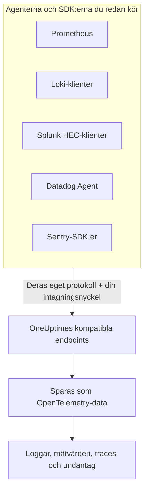

# Prometheus, Loki, Splunk, Datadog & Sentry

Kör du redan Prometheus, en Loki-klient, en Splunk-forwarder, Datadog Agent eller ett Sentry-SDK? Behåll det. OneUptime tar emot det som vart och ett av de här verktygen skickar, på de sökvägar verktyget redan använder, och sparar det som OpenTelemetry-data. Att prova OneUptime kräver bara en ny URL och nyckel, inte en ny instrumentering, och dina drop-filter, scrub-regler, loggpipelines, datalagring och intagningsbudgetar gäller för den här datan som för all annan.

:::cards
- [Prometheus remote write](#prometheus-remote-write): Mätvärden från Prometheus, Grafana Alloy eller vilken annan avsändare av remote write som helst.
- [Loki](#loki): Loggar från Promtail, Grafana Alloy, Fluent Bit eller Vector.
- [Splunk HTTP Event Collector](#splunk-http-event-collector): Loggar och mätvärdeshändelser från vilken HEC-klient som helst.
- [Datadog Agent](#datadog-agent): Mätvärden och loggar från Datadog Agent.
- [Sentry-SDK:er](#sentry-sdker): Fel, transaktioner och loggar från vilket Sentry-SDK som helst.
:::

## Så fungerar det



Varje endpoint svarar så som dess verktyg förväntar sig — en `204` för Prometheus och Loki, HEC:s `{"text": "Success", "code": 0}`, Datadogs `202`, Sentrys händelse-ID — så verktyget rapporterar lyckade och misslyckade anrop som det alltid har gjort. Sedan behandlas datan precis som data från ett OpenTelemetry-SDK.

## Innan du börjar

- **Ett OneUptime-projekt** – i OneUptime Cloud debiteras telemetri per intagen GB, och ett projekt på Free-planen behöver en betalningsmetod innan det kan skicka telemetri.
- **Intagningsnyckel för telemetri** – skapa en **Server**-nyckel under **Produkter → Projektinställningar → Telemetri och APM → Intagningsnycklar** och kopiera dess **Hemlig nyckel**. Varje verktyg skickar den där det skickar sina egna inloggningsuppgifter. En webbläsarapps Sentry-DSN tar i stället en nyckel av typen **Webbläsare**, med webbplatsens ursprung på.
- **Din värd** – exemplen använder `oneuptime.com`. Om du kör OneUptime i egen drift använder du din egen värd.

> [!TIP]
> Fliken Installationsguide på Loggar, Mätvärden, Spår och Undantag har de här verktygen med bland sina sätt att skicka, med din värd och en nyckel du väljer redan ifyllda.

## Endpoints

| Verktyg | Peka det mot | Var nyckeln ska stå |
| --- | --- | --- |
| Prometheus remote write | `https://oneuptime.com/telemetry/prometheus/api/v1/write` | En bearer-token, eller basic auth med nyckeln som lösenord. |
| Loki | `https://oneuptime.com/telemetry/loki/api/v1/push` | Basic auth med nyckeln som lösenord, eller en bearer-token. |
| Splunk HTTP Event Collector | `https://oneuptime.com/telemetry/services/collector` | HEC-token: `Authorization: Splunk <key>`. |
| Datadog Agent | `https://oneuptime.com/telemetry/datadog` | API-nyckeln: `DD-API-KEY`. |
| Sentry-SDK:er | DSN:en `https://<key>@oneuptime.com/telemetry/sentry/1` | DSN:ens publika nyckel. |

Varje endpoint tar också emot nyckeln i headern `x-oneuptime-token`, och headern `x-oneuptime-service-name` anger den tjänst som allt verktyget skickar hör till. En nyckel kan skrivas som sina 32 hexadecimala siffror utan bindestreck; i Sentry-DSN:en och i Datadogs API-nyckel måste den skrivas så.

## Prometheus remote write

Lägg till OneUptime som remote write-mål. Prometheus fortsätter att skrapa som nu och skickar en kopia av varje sample:

```yaml title="prometheus.yml"
remote_write:
  - url: https://oneuptime.com/telemetry/prometheus/api/v1/write
    authorization:
      credentials: YOUR_TELEMETRY_KEY
```

Med Grafana Alloy lägger du till en `prometheus.remote_write`-komponent och vidarebefordrar dina skrapningar till den:

```text title="config.alloy"
prometheus.remote_write "oneuptime" {
  endpoint {
    url          = "https://oneuptime.com/telemetry/prometheus/api/v1/write"
    bearer_token = "YOUR_TELEMETRY_KEY"
  }
}
```

Remote write 1.0 och 2.0 tas båda emot, snappy-komprimerade så som alla avsändare skickar dem.

### Vad en serie blir

- **Namn och etiketter behålls.** `http_requests_total{job="checkout", code="500"}` är mätvärdet `http_requests_total` med attributen `job` och `code`, så en fråga som flyttas från Grafana hittar det.
- **Jobbet är tjänsten.** Varje `job` blir en tjänst och varje `instance` dess tjänstinstans, så som OpenTelemetrys Prometheus-regler mappar dem.
- **Typer behålls.** Räknare, och ett histograms buckets och antal, är kumulativa summor, så deras takt ritas korrekt i diagram. En typ kommer från metadata som avsändaren skickar med; utan den är ett namn som slutar på `_total` en räknare, och en `_bucket` med en `le`-etikett en histogram-bucket.
- **Nativa histogram** blir exponentiella histogram, och nativa histogram med anpassade buckets blir vanliga histogram.
- **Behålls inte:** staleness-markörer och andra samples med NaN eller oändliga värden, räknares `_created`-serier och exemplars.

## Loki

OneUptime tar emot Lokis push-API på Lokis egen sökväg, i JSON eller som den snappy-komprimerade protobuf som Promtail och Grafana Alloy skickar. Lägg till OneUptime som klient:

```yaml title="promtail.yaml"
clients:
  - url: https://oneuptime.com/telemetry/loki/api/v1/push
    bearer_token: YOUR_TELEMETRY_KEY
```

Fluent Bits `loki`-output tar värden och sökvägen var för sig:

```text title="fluent-bit.conf"
[OUTPUT]
    Name         loki
    Match        *
    Host         oneuptime.com
    Port         443
    Tls          On
    Uri          /telemetry/loki/api/v1/push
    Http_User    oneuptime
    Http_Passwd  YOUR_TELEMETRY_KEY
    Labels       job=fluent-bit
```

### Vad en ström blir

- **Varje post är en logg**, med sin egen tidsstämpel på nanosekunden och sin rad som innehåll.
- **Etiketter och strukturerad metadata är attribut**, under de namn de har i Loki.
- **Tjänsten** kommer från den första av `service_name`, `service`, `app`, `application`, `name`, `app_kubernetes_io_name`, `container`, `container_name`, `component`, `workload` och `job` som en ström har, så som Loki hittar den. En `host`- eller `hostname`-etikett anger värden.
- **Nivån** kommer från en `level`-, `detected_level`- eller `severity`-etikett eller -metadata, annars från ett logfmt-`level=` eller en JSON-rads `level`-fält.
- **Spårkontext:** ett `trace_id` och `span_id` i den strukturerade metadatan kopplar loggen till dess trace.

## Splunk HTTP Event Collector

Använd OneUptime som HTTP Event Collector, med din intagningsnyckel som HEC-token. Splunks loggdrivrutin för Docker lägger till sökvägen själv, så den tar bara värden:

```bash
docker run \
  --log-driver=splunk \
  --log-opt splunk-url=https://oneuptime.com \
  --log-opt splunk-token=YOUR_TELEMETRY_KEY \
  --log-opt splunk-format=json \
  your-image
```

Alla andra HEC-klienter postar till `/services/collector/event` eller `/services/collector/raw`. Så här skickar du en händelse:

```bash
curl https://oneuptime.com/telemetry/services/collector/event \
  -H "Authorization: Splunk YOUR_TELEMETRY_KEY" \
  -d '{"event": "Payment failed for order 42", "sourcetype": "app", "fields": {"service": "checkout"}}'
```

En `200` med `{"text": "Success", "code": 0}` betyder att händelsen togs emot. Endpointen svarar också med HEC:s egna koder — `No data` (5), `Invalid data format` (6) med numret på händelsen som inte var giltig, och `Event field is required` (12) — och besvarar `GET /services/collector/health` utan token.

### Vad en händelse blir

- **En logg**, med händelsens `time` som tidsstämpel. Är händelsen en sträng är den innehållet; är den ett objekt är `message`, `msg`, `log`, `line` eller `text` innehållet, och dess övriga fält är attribut.
- **Metadatan behålls:** `host` är värden, och `source`, `sourcetype` och `index` sparas som `com.splunk.source`, `com.splunk.sourcetype` och `com.splunk.index`. Frågesträngens `host`, `source`, `sourcetype` och `index` fyller i det som en händelse utelämnar.
- **Fälten är attribut.** Ett `service.name`-fält anger tjänsten, och det gör även en loggs `service`-fält.
- **Mätvärdeshändelser** (`"event": "metric"`, med `metric_name` och `_value`, eller `metric_name:<name>`-fält) sparas som mätvärden, aldrig som loggar.
- **Erbjuds inte:** indexer acknowledgement. En klient som ber om det får inget `ackId`.

## Datadog Agent

Peka Agentens mätvärden och loggar mot OneUptime, med din intagningsnyckel som dess API-nyckel:

```yaml title="datadog.yaml"
api_key: YOUR_TELEMETRY_KEY_WITHOUT_HYPHENS
dd_url: https://oneuptime.com/telemetry/datadog
logs_enabled: true
logs_config:
  use_http: true
  logs_dd_url: oneuptime.com:443
apm_config:
  enabled: false
process_config:
  process_collection:
    enabled: false
```

Agenten lägger till sina egna sökvägar på `dd_url` och skickar loggar till `/api/v2/logs` på den värd och port som `logs_dd_url` anger. OneUptime besvarar de sökvägarna i roten bara för en request som har en `DD-API-KEY`-header. Starta om Agenten efter ändringen; `datadog-agent status` visar dess API-nyckel som giltig när OneUptime accepterar den.

### Vad Agentens data blir

- **Mätvärden** behåller sina namn. Gauges förblir gauges, counts blir summor och rates blir gauges av sitt värde per sekund.
- **Distributions** blir summaries med sitt antal, sin summa, sitt minimum och sitt maximum.
- **Service checks** blir ett mätvärde som heter som checken, vars värde är checkens status: 0 OK, 1 varning, 2 kritisk, 3 okänd.
- **Loggar** behåller sitt meddelande, sin status, värd och tjänst, och resten av sina fält som attribut.
- **Taggar är attribut**, och taggarna `service`, `env` och `version` anger tjänsten, dess miljö och dess version.
- **Läses inte än:** APM-traces, processer, containrar, nätverksdata och profiler. Låt dem vara avstängda i `datadog.yaml`, som ovan.

Datadogs HTTP API-klienter — ett loggbibliotek som postar till `/api/v2/logs`, ett skript som postar serier — kan skicka till samma endpoint med headern `DD-API-KEY`.

## Sentry-SDK:er

Byt ut DSN:en där du konfigurerar Sentry. Resten av din Sentry-kod förblir som den är:

```javascript
Sentry.init({
  dsn: "https://YOUR_TELEMETRY_KEY_WITHOUT_HYPHENS@oneuptime.com/telemetry/sentry/1",
  release: "checkout@1.4.2",
  environment: "production",
});
```

```python
sentry_sdk.init(
    dsn="https://YOUR_TELEMETRY_KEY_WITHOUT_HYPHENS@oneuptime.com/telemetry/sentry/1",
    release="checkout@1.4.2",
    environment="production",
)
```

Ettan `1` i slutet av DSN:en krävs av Sentrys SDK:er och läses inte. En webbläsarapps DSN är offentlig, så använd en intagningsnyckel av typen **Webbläsare** där, med webbplatsens ursprung på.

### Vad ett kuvert blir

- **Fel** visas i Undantag, med sina stack traces och de undantag som orsakade dem, grupperade som alla andra undantag. Varje fel är ett span i sin trace, under det span som var aktivt.
- **Transaktioner** och deras spans visas i Spår.
- **Sentry-loggar** och meddelanden som fångats med `capture_message` visas i Loggar.
- **Tjänsten** är en `service`-tagg, annars releasens namn före `@`: `checkout@1.4.2` är `checkout`. Releasen är tjänstens version, och miljön behålls.
- **Behålls inte:** sessioner, replays, bilagor, profiler och check-ins. SDK:t skickar dem fortfarande; OneUptime tar emot dem och kastar dem.

## Gränser och intagningsbudgetar

- **Requeststorlek** – OneUptimes ingress tar emot requests på upp till 4 MB under `/telemetry`, och varje requests innehåll får bli högst 64 MB när det dekomprimeras.
- **Intagningsbudgetar** – Prometheus remote write och Loki kontrolleras mot budgeten för mätvärden eller loggar innan deras innehåll läses, och avvisas med `403` när den är förbrukad. En HEC-batch, en Datadog-nyttolast eller ett Sentry-kuvert kan innehålla flera signaler, så varje signal räknas mot sin egen budget när den sparas, och kastas när den budgeten är förbrukad.

## Felsökning

### Alla requests avvisas med 401

Nyckeln kom inte fram dit där endpointen letar efter den, eller så är den inte en nyckel i det här projektet. Jämför verktygets inställning för inloggningsuppgifter med tabellen [Endpoints](#endpoints), och kontrollera att nyckeln inte är avstängd eller har gått ut.

### Ett Sentry-SDK säger att DSN:en är ogiltig

Sentrys SDK:er avvisar en DSN vars nyckel har bindestreck. Skriv nyckeln som sina 32 hexadecimala siffror, utan bindestrecken.

### Datadog-mätvärden kommer fram, men inte loggar

Kontrollera att `logs_config.use_http` är `true` och att `logs_config.logs_dd_url` är en värd och port, inte en URL. Agenten skickar loggar över TCP när `use_http` inte är satt.

### Prometheus rapporterar 415

Avsändaren bad om ett remote write-protokoll som OneUptime inte läser. Skicka remote write 1.0 eller 2.0.
