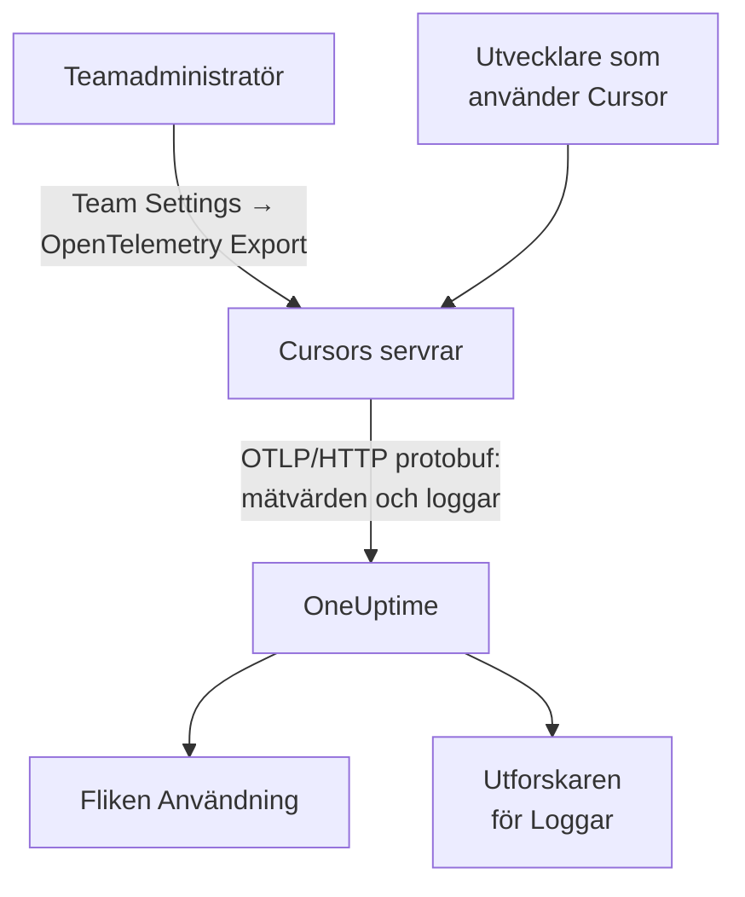

# Cursor

Cursor exporterar sitt teams telemetri från Cursors egna servrar. En teamadministratör lägger till OneUptime som destination en gång, i Cursors dashboard, och hela teamets tokens, uppskattade kostnad och verktygsanrop kommer in: inget att installera eller ställa in på utvecklarnas datorer.

:::cards
- [Konfigurera det](#konfigurera-det): Skapa en nyckel i OneUptime och en destination i Cursor.
- [Vad du får](#vad-du-får-och-vad-du-inte-får): Mätvärden och loggar; inga traces.
- [Vem spenderade vad](#tilldelning-till-anställda): Personer kommer in som Cursor-användar-id:n.
- [Felsökning](#felsökning): Vad du kontrollerar när inget kommer in.
:::

## Så fungerar det



## Innan du börjar

- **Cursors Enterprise-plan.** Skärmen OpenTelemetry Export finns inte i de andra planerna.
- **En endpoint som Cursor kan nå från internet.** Det är Cursor som ansluter till dig, från en fast uppsättning adresser. OneUptime Cloud behöver inget mer; en egendriftad OneUptime bakom en brandvägg måste tillåta de utgående adresser som Cursor listar på sin sida [OpenTelemetry Export](https://cursor.com/docs/enterprise/opentelemetry-export).

## Konfigurera det

:::steps
### Skapa en intagningsnyckel

I OneUptime öppnar du **Projektinställningar → Telemetri och APM → Intagningsnycklar**, klickar på **Skapa ingestion-nyckel** och kopierar nyckeln. Din OTLP-bas-URL är `https://oneuptime.com/otlp`, eller `https://YOUR-ONEUPTIME-HOST/otlp` om du driftar OneUptime själv.

### Skapa destinationen i Cursor

I Cursors webbdashboard öppnar du som teamadministratör **Team Settings → OpenTelemetry Export** och skapar en destination:

| Fält | Värde |
| --- | --- |
| Endpoint (base URL) | `https://oneuptime.com/otlp` |
| Header name | `x-oneuptime-token` |
| Header value | `YOUR_INGESTION_TOKEN` |

Ange bas-URL:en utan `/v1`: Cursor lägger själv till `/v1/metrics` och `/v1/logs`, och `https://oneuptime.com/otlp/v1` skulle skicka till `/otlp/v1/v1/metrics`, där inget kommer fram.

### Testa och aktivera

Klicka på **Test connection** för att kontrollera URL:en och headern, och sedan på **Enable**. Exporten startar inom ungefär en minut; senare ändringar av headern tar ungefär 30 sekunder.

### Kontrollera att data kommer in

Använd Cursor en minut eller två, öppna sedan **Loggar** i OneUptime och filtrera på tjänstnamnet `cursor`: `cursor.api.request`-poster med antal tokens betyder att nyckeln och URL:en stämmer.
:::

Cursor talar bara OTLP över HTTP med binär protobuf (ingen gRPC, ingen JSON), vilket OneUptime tar emot som det är. Den lagrar headern krypterad och skickar till en destination per team: för att skicka till OneUptime och någon annanstans sätter du en collector framför.

## Vad du får, och vad du inte får

| Signal | Från Cursor |
| --- | --- |
| Mätvärden: tokens, uppskattad kostnad, verktygsanrop | Ja, som deltan |
| Logghändelser: begäranden, fel, korrigeringar, skills, hooks, plugins, molnagenter | Ja |
| Text från prompter och svar | Bara om du slår på familjen `conversation_content` |
| Traces | Nej |
| Något från innan du aktiverade destinationen | Nej |

I OneUptime visas Cursor alltså på fliken **Användning** under **Produkter → AI / LLM**, från `cursor.token.usage` och `cursor.cost.usage`, men aldrig under **Anrop** eller **Konversationer**, som byggs från traces. Detaljerna per begäran är händelsen `cursor.api.request` i utforskaren för **Loggar**.

### Familjer

Varje signal, och varje familj av telemetri, har sin egen brytare i Cursors inställningar:

| Familj | Omfattar |
| --- | --- |
| `model_usage` | `cursor.token.usage`, `cursor.cost.usage` och händelserna `cursor.api.request`, `cursor.api.error` och `cursor.api.correction` |
| `tool_calls` | `cursor.tool.calls` |
| `skills_hooks_plugins` | Händelser från skills, hooks och plugins |
| `cloud_agents` | `cursor.cloud_agent.*`-händelser |
| `grok_bot_agent_actions` | `cursor.grok_bot.*`-händelser; kräver Action Recording |
| `conversation_content` | Meddelandetext och indata och utdata från MCP-verktyg; avstängd som standard |

Alla familjer utom `conversation_content` startar påslagna. Familjer som Cursor lägger till senare startar också påslagna, om du inte stänger av `auto_enable_new_families`.

## Mätvärden och händelser

Alla tre mätvärdena är deltasummor:

| Mätvärde | Enhet | Attribut |
| --- | --- | --- |
| `cursor.token.usage` | `{token}` | `cursor.token.type`: `input`, `output`, `cache_read`, `cache_creation`; `cursor.model.name`; `cursor.api.status`: `success`, `errored`, `aborted`; `cursor.api.billable` |
| `cursor.cost.usage` | `USD` | `cursor.model.name` |
| `cursor.tool.calls` | `{call}` | `cursor.tool.kind`: `builtin`, `mcp`; `cursor.tool.name`; `cursor.tool.status`: `success`, `failure`, `aborted`; `cursor.mcp.server.name` |

Datapunkterna bär inget konversations- eller begärande-id, så kostnad per session finns inte i mätvärdena. `cursor.model.name` är den begärda modellen, med routade val sammanslagna: en uppdelning per modell har en rad som heter `Auto` som inte kan fördelas på de modeller som Cursor routade den till.

Logghändelsen du kommer att använda mest är `cursor.api.request`: en per begäran, med antal indata-, utdata- och cachetokens, modellen och om den fakturerades. `cursor.api.error` registrerar en misslyckad begäran (utan felmeddelandet), och `cursor.api.correction` kommer senare för att säga att en begäran ändå inte fakturerades. Cursors [formatreferens](https://cursor.com/docs/enterprise/opentelemetry-export/wire) listar varje händelse och attribut.

Varje post bär de här resursattributen:

| Attribut | Vad det är |
| --- | --- |
| `service.name` | Alltid `cursor`: filtrera utforskarna för **Loggar** och **Mått** på det |
| `cursor.team.id` | Ditt team, ett heltal; finns alltid |
| `cursor.user.id` | Personen, ett heltal inom teamet; valfritt |
| `cursor.surface` | Var aktiviteten kom ifrån, som `desktop`, `cli`, `cloud_agent` eller `bugbot` |
| `cursor.entrypoint` | Hur den startade, som `desktop`, `cli`, `web`, `api` eller `github_pr` |

## Tilldelning till anställda

**Cursor anger en person med `cursor.user.id`, ett heltal som bara Cursor kan göra om till ett namn, och utelämnar det ofta för molnagenter.** OneUptime läser det som den anställde och `cursor.team.id` som teamet, så fliken **Användning** rangordnar personer och team utan konfiguration, men personer visas som heltal.

- Båda kommer in som resursattribut (`resource.cursor.user.id`, `resource.cursor.team.id`), som OneUptime läser.
- Cursor kan också skicka `cursor.user.email`, men OneUptime läser den inte ännu, så den anställdes e-postkolumn förblir tom för Cursor.
- `gen_ai.user`, `llm.user` och LiteLLMs slutanvändar-id:n läses aldrig som den anställde: de anger dina kunder, inte din personal. Se [Tilldelning till anställda och team](/docs/telemetry/ai-coding-assistants#tilldelning-till-anställda-och-team).

### Var Cursor visas på fliken Användning

Cursor skickar mätvärden och inga GenAI-spans, och mätvärdena fyller bara i för spans: **om samma projekt tar emot GenAI-spans med kostnad visas inte Cursors kostnader.** Skicka Cursor till ett eget projekt. Se [Spans först, mätvärden fyller i](/docs/telemetry/ai-llm-observability#spans-först-mätvärden-fyller-i).

| Uppdelning | För Cursor |
| --- | --- |
| **Anställd** | Ja, efter `cursor.user.id` |
| **Team** | Ja, efter `cursor.team.id` |
| **Modell** | Ja, efter `cursor.model.name` |
| **Leverantör** | Nej: Cursor säger aldrig vilken leverantör som betjänade ett anrop |
| **Applikation / Tjänst** | Nej: Cursors mätvärden hör inte till någon OneUptime-tjänst |

En Cursor-rad bär bara kostnad: dess celler för anrop och tokens visar `—`, eftersom `cursor.cost.usage` saknar detaljer per anrop. `cursor.token.usage` matar fortfarande tokentotalerna ovanför tabellen (dess typer `input` och `output`; cachetokens utelämnas), och du kan visa det i en dashboard per `cursor.token.type`.

:::details Gör om ett Cursor-användar-id till en person
Namn och fakturerade belopp finns i Cursors Admin API, som OneUptime inte anropar: anropa det själv om du behöver det. Det finns bara för Enterprise, på `https://api.cursor.com`, och tar en administratörs-API-nyckel som användarnamn med ett tomt lösenord:

```bash
curl -u YOUR_API_KEY: https://api.cursor.com/teams/members
```

`GET /teams/members` listar varje medlems e-postadress och namn. `POST /teams/filtered-usage-events` returnerar fakturerad användning per händelse; summera dess `chargedCents` för att få kostnaden. Dess `conversationId` motsvarar `cursor.conversation.id` på Cursors logghändelser, vilket kopplar en person och ett fakturerat belopp till en session som du redan ser, när båda sidor bär det. Cursor dokumenterar inte att heltalet `cursor.user.id` och Admin API:ts användar-id:n är desamma, så kontrollera det i ditt eget team innan du fakturerar någon utifrån det.
:::

## Så levererar Cursor

De här reglerna ändrar vad du ser i diagram, så känn till dem innan du rapporterar en lucka:

- **Mätvärden skickas högst en gång.** En misslyckad export görs inte om, så en kort lucka efter ett fel är väntad: larma inte någon för luckor i Cursors mätvärden.
- **Loggar skickas minst en gång**, dedupliceras på `cursor.event.id` och skickas om automatiskt i ungefär 7 dagar.
- **Det finns ingen ordning.** En `cursor.api.correction` kommer efter den begäran den korrigerar: sortera efter postens tidsstämpel, aldrig efter ankomst.
- **Inget fylls i i efterhand.** Inget från innan du aktiverade destinationen kommer in, och en destination som lämnas trasig förlorar det som Cursor inte kunde skicka.
- **Att inaktivera eller ta bort en destination tappar data under överföring.** För att byta intagningsnyckel redigerar du destinationens header i stället för att ta bort den och skapa den på nytt.

## Kostnaden är en uppskattning, inte en faktura

Cursor dokumenterar `cursor.cost.usage` som en uppskattning efter bästa förmåga. Den skiljer inte inkluderad användning från användning som faktureras på begäran; med dina egna modellnycklar återspeglar den bara Cursors tokenpris, inte din leverantörs faktura; och en senare `cursor.api.correction` kan dra tillbaka användning som redan räknats. Läs den som en trend. För en siffra som stämmer med fakturan summerar du `chargedCents` från Cursors Admin API.

## Felsökning

:::details Inget kommer in
Kör **Test connection** igen i Cursor. Kontrollera att bas-URL:en inte slutar på `/v1`, att headerns namn är `x-oneuptime-token` och dess värde exakt nyckeln, och att familjen `model_usage` är påslagen. Exporten startar ungefär en minut efter att du aktiverat destinationen.
:::

:::details Inget kommer in till en egendriftad OneUptime
Cursor ansluter från sina egna servrar: din OTLP-endpoint måste gå att nå från internet, under ett offentligt DNS-namn, och släppa igenom Cursors utgående adresser i din brandvägg.
:::

:::details Loggar kommer in, men fliken Användning visar inga kostnader från Cursor
Projektet tar också emot GenAI-spans med kostnad, så Cursors mätvärden läses inte. Skicka Cursor till ett eget projekt, med en egen intagningsnyckel.
:::

:::details Personer visas som siffror
Det är `cursor.user.id`: det enda person-id som OneUptime läser från Cursor i dag. Koppla det till namn med Cursors Admin API.
:::

## Nästa steg

:::cards
- [AI-kodassistenter](/docs/telemetry/ai-coding-assistants): Så tilldelas kostnader för alla kodassistenter.
- [AI-gatewayer](/docs/telemetry/ai-gateways): Fullständiga traces och prompter för de modellanrop som dina egna appar gör.
- [Metrikövervakning](/docs/monitor/metrics-monitor): Varna på `cursor.cost.usage`, `cursor.token.usage` eller `cursor.tool.calls`.
:::
