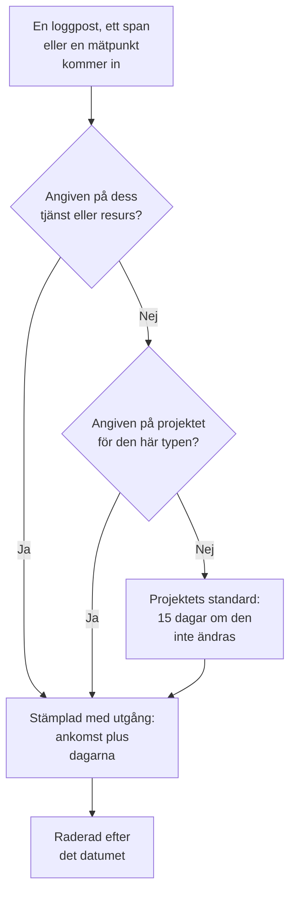

# Datalagring

OneUptime sparar dina loggar, spår, mätvärden och profiler i ett antal dagar och tar sedan bort dem: 15 dagar, om du inte ändrar det. Den här sidan visar hur det antalet räknas fram, hur du ändrar det för hela projektet och hur du sparar en del telemetri längre eller kortare än resten.

:::cards
- [Hur länge telemetri sparas](#hur-länge-telemetri-sparas): Ordningen som OneUptime läser inställningarna i.
- [Ändra projektets lagring](#ändra-projektets-lagring): Ett enda tal för all din telemetri.
- [Spara en del telemetri längre eller kortare](#spara-en-del-telemetri-längre-eller-kortare): Efter typ, allvarlighetsgrad, status eller tjänst.
- [Vad lagring kostar](#vad-lagring-kostar): Fakturering på OneUptime Cloud, disk när du kör själv.
:::

## Hur länge telemetri sparas

Varje loggpost, span, mätpunkt och profilprov får sin lagringstid när den kommer in. OneUptime räknar ut hur många dagar den ska sparas, stämplar datumet då den går ut och tar bort den efter det datumet. Den mest specifika inställningen vinner:

I sin helhet läser OneUptime de här inställningarna i den här ordningen, och den första som är angiven avgör:

| Ordning | Inställning | Var den anges |
| --- | --- | --- |
| 1 | Dagar för en loggallvarlighetsgrad eller span-status, för en tjänst eller resurs | **Lagring efter telemetrityp**, under **Fler inställningar** på dess sida **Inställningar** |
| 2 | Dagar för en typ av telemetri, för en tjänst eller resurs | Samma kort |
| 3 | Dagar för allt från en tjänst eller resurs | **Datalagring för telemetri**, under **Fler inställningar** på samma sida |
| 4 | Dagar för en loggallvarlighetsgrad eller span-status, för projektet | **Lagring efter telemetrityp**, under **Fler inställningar** på **Datalagring** |
| 5 | Dagar för en typ av telemetri, för projektet | Samma kort |
| 6 | Dagar för allt annat | **Standardlagring (dagar)**, på **Datalagring** |

- **Inställning 1 till 5 är åsidosättningar av lagringen.** De ingår i [Enterprise Edition](/docs/self-hosted/enterprise), och i Scale-planen på OneUptime Cloud. Utan dem sparas varje post enligt projektets standard.
- **En ändring gäller för ny telemetri.** En post behåller datumet den stämplades med: en kortare lagring tar inte bort den tidigare, och en längre sparar den inte längre. Nya poster följer en ändring inom ungefär fem minuter.
- **Undantag följer det de hittades i.** Ett undantag sparas lika länge som det span eller den loggpost det kom från. Session Replays har en egen lagring: se [Andra data med egen lagring](#andra-data-med-egen-lagring).

## Innan du börjar

- **En roll som ändrar projektet.** Project Owner eller Project Admin ändrar projektets lagring. En tjänsts eller resurs lagring kräver den roll som ändrar dess andra inställningar.
- **För åsidosättningar, Enterprise Edition eller Scale-planen.** En installation i egen drift behöver en Enterprise-licens, och ett OneUptime Cloud-projekt Scale-planen eller högre. Projektets standardlagring finns i alla utgåvor och planer.

## Ändra projektets lagring

:::steps
### Öppna datalagring

Gå till **Projektinställningar → Telemetri och APM → Datalagring**. **Telemetri och APM** är först hopfälld i sidomenyn: klicka på den för att öppna den. Kortet **Datalagring för telemetri** visar **Standardlagring (dagar)**.

### Ange antalet dagar

Klicka på **Edit Retention Settings**, ange antalet dagar, minst 1, och klicka på **Spara ändringar**.
:::

Det nya talet gäller för varje post som kommer in från och med då och som inte har en egen åsidosättning.

## Spara en del telemetri längre eller kortare

Åsidosättningar sparar det du behöver längre och resten kortare: felloggar i ett kvartal, till exempel, och felsökningsloggar i några dagar.

### För hela projektet

Under standarden, hopfällt under **Fler inställningar**, anger kortet **Lagring efter telemetrityp** dagar för varje typ av telemetri. Klicka på **Edit Overrides**, fyll i de fält du behöver och lämna resten tomma:

| Typ | Fält |
| --- | --- |
| Loggar | **Logs default (days)**, och ett fält för varje loggallvarlighetsgrad |
| Spår | **Traces default (days)**, och ett fält för varje span-status: Fel, Ok och Ej angiven |
| Mätvärden | **Metrics default (days)** |
| Profiler | **Profiles default (days)** |

Ett fält som lämnas tomt faller tillbaka på nästa inställning i ordningen ovan, så en allvarlighetsgrad utan egna dagar sparar sina loggar enligt standarden för loggar.

### För en tjänst eller resurs

Öppna tjänstens eller resursens sida **Inställningar** och sedan **Fler inställningar**. Dess kort **Datalagring för telemetri** innehåller **Behåll telemetridata i (dagar)**, ett enda tal för allt den skickar, och dess kort **Lagring efter telemetrityp** har samma fält som projektets. Lämna ett fält tomt för att använda projektets inställningar.

Tjänster, värdar, Kubernetes-kluster, Docker- och Podman-värdar, Docker Swarm-, Proxmox- och Ceph-kluster, lagringssystem, vCenter, databaser, serverlösa funktioner, molnresurser, RUM-applikationer och IoT-flottor har alla de här korten. Se [Tjänstekatalogen](/docs/telemetry/services#ändra-en-tjänst) för en tjänsts sida **Inställningar**.

### När planen eller licensen inte längre omfattar åsidosättningar

- **På en installation i egen drift** slutar åsidosättningar att gälla när Enterprise-provperioden eller respitperioden tar slut utan licens. Ny telemetri sparas enligt projektets standard, korten blir skrivskyddade, och inget av det du har angett tas bort: aktivera en licens så gäller de igen. Se [Enterprise Edition](/docs/self-hosted/enterprise#när-en-licens-löper-ut-eller-saknas).
- **På OneUptime Cloud** fortsätter en åsidosättning som en provperiod lämnade kvar att gälla under Scale-planen. Dess sida visar den under uppgraderingskortet, med en knapp **Ta bort åsidosättning** som fungerar på alla planer. Att ange en åsidosättning igen kräver Scale-planen.

## Andra data med egen lagring

| Data | Sparas i | Var du ändrar det |
| --- | --- | --- |
| Session Replays | 7 dagar om det inte ändras | RUM-applikationens replay-policy: se [Hantera applikationer](/docs/rum/applications#lagring-av-sessionsuppspelningar). |
| Övervakningsloggar, en rad per kontroll | 1 dag om det inte ändras | På en installation i egen drift, **Lagringstid för övervakningsloggar (dagar)** i Admin Dashboard |
| Övervakningsmätvärden, och de mätvärden som SLO:er registrerar | 30 dagar om det inte ändras | På en installation i egen drift, **Lagringstid för övervakningsmått (dagar)** i Admin Dashboard |

## Vad lagring kostar

- **På OneUptime Cloud** faktureras telemetri per intagen GB, och priset per GB inkluderar 15 dagars lagring. Längre lagring kostar proportionellt mer: 30 dagar kostar dubbelt så mycket per GB som 15. Kortare lagring kostar proportionellt mindre, men lagring kortare än 7 dagar faktureras som 7 dagar. **Projektinställningar → Fakturering och fakturor → Användningshistorik** visar dag för dag hur mycket varje tjänst skickade och hur länge det sparas.
- **När du kör själv** finns telemetrin i ClickHouse, och lagringen multiplicerar dess diskutrymme. Se [Dimensionering](/docs/installation/sizing#lagringstid-och-hur-den-påverkar-lagringen).

Telemetri som du inte behöver kostar ingenting om den aldrig lagras: [Drop-filter och scrub-regler](/docs/telemetry/drop-filters-and-scrub-rules) kasserar den när den kommer in.

## Felsökning

:::details Jag sänkte lagringen, men gamla data finns kvar
En post behåller det utgångsdatum som den stämplades med när den kom in. Poster som lagrades före ändringen tas bort på sina egna datum, och bara nya poster följer den nya lagringen.
:::

:::details Åsidosättningskorten visar en uppmaning att uppgradera
Åsidosättningar av lagringen kräver Enterprise Edition på en installation i egen drift, och Scale-planen på OneUptime Cloud. Till dess sparas allt enligt projektets standard.
:::

:::details Diskutrymmet kommer tillbaka en dag efter att data har gått ut
Utgångna poster slutar synas i sökningar, grafer och listor så snart de går ut. På disken tas loggar och mätvärden bort vid första midnatt efter det, så deras utrymme kommer tillbaka upp till en dag senare.
:::

## Nästa steg

:::cards
- [Intagningsnycklar](/docs/telemetry/ingestion-keys): Skicka telemetri till ditt projekt.
- [Drop-filter och scrub-regler](/docs/telemetry/drop-filters-and-scrub-rules): Behåll bara den telemetri du behöver.
- [Tjänstekatalog](/docs/telemetry/services): Ange en tjänsts egen lagring.
- [Enterprise Edition](/docs/self-hosted/enterprise): Vad åsidosättningar av lagringen följer med.
:::
