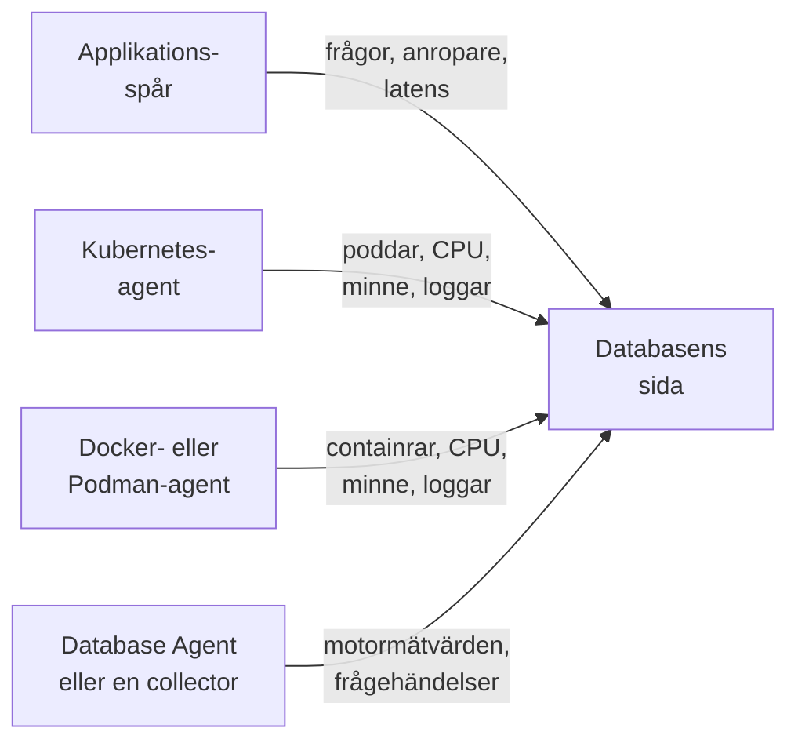

# Databaser

**Databases** ger varje databasserver som ditt projekt kör eller pratar med en egen sida: vem som anropar den och hur snabbt, var den körs, motorns egna hälsomätvärden, dess loggar och spår, de incidenter, varningar och planerade underhåll som är kopplade till den, och de varningsmonitorer som rekommenderas för dess motor. Databaser har etiketter, ägare, etikett- och ägarregler, lagring per databas och arkivering, precis som alla andra resurser. Öppna dem under **Produkter → Resurser → Databaser**.

:::cards
- [Database Agent](#database-agent): Motormätvärden för PostgreSQL, MySQL, SQL Server, Oracle, Redis, MongoDB, Elasticsearch och Memcached.
- [Så upptäcks databaser](#så-upptäcks-databaser): Från spår, Kubernetes, Docker, Podman och collectorer.
- [Varningar för en databas](#varningar-för-en-databas): Rekommenderade monitorer och monitorer som du bygger själv.
- [Felsökning](#felsökning): Ett diagnosskript, och de vanliga problemen.
:::

## Så fungerar det

De flesta databaser dyker upp av sig själva. OneUptime sätter ihop varje databas från upp till fyra källor, och varje källa bidrar med något olika:

| Källa | Vad den behöver från dig | Vad den lägger till på databasens sida |
| --- | --- | --- |
| **Applikationsspår** | Instrumenterade applikationer (OpenTelemetry) | Frågor från applikationer: anropsfrekvens, fel, latens och de tjänster som anropar den |
| **Kubernetes** | [OneUptimes Kubernetes-agent](/docs/telemetry/kubernetes-agent) | Var den körs: poddar, CPU och minne samt poddarnas loggar |
| **Docker / Podman** | [Docker-agenten](/docs/telemetry/docker-host) eller [Podman-agenten](/docs/telemetry/podman-host) | Var den körs: containrarna, deras CPU och minne samt deras loggar |
| **Database Agent** (en OpenTelemetry Collector) | [Database Agent](#database-agent) eller din egen collector | **Engine metrics**: anslutningar, genomströmning, träffkvot i cachen, lås, replikeringsfördröjning, minne, i den mån motorn har dem (se [Vad som samlas in](#vad-som-samlas-in)), plus valfria frågeprover, toppfrågor och motorns loggfil |



Motormätvärden kommer bara från en collector som pratar med själva databasen (eller, för en hanterad molndatabas, med leverantörens övervaknings-API). Spår och containerinventeringar berättar för OneUptime att en databas finns och hur den används, men inte hur den mår inuti; statusen **Engine metrics** på varje databas visar om den delen är ansluten.

Du kan också lägga till en databas manuellt: **Databases → Skapa Database** med dess motor, adress och port. För en hälsokontroll från en sond som inte behöver någon agent alls, se [Övervakning av databashälsa](/docs/monitor/database-health-monitor).

## Databaser som stöds

OneUptime känner till motorerna nedan med namn: den normaliserar det som instrumenteringar lägger i `db.system.name` (eller det äldre `db.system`) till värdet i den andra kolumnen, visar motorns namn, använder dess standardport när ett span eller en adress saknar port, känner igen dess containeravbildningar och Helm-diagram och vet var dess motormätvärden kommer ifrån. En motor som inte finns i listan fungerar ändå överallt där en databas identifieras med sin adress; den visas bara under det råa namn som dina span rapporterar och skapas aldrig enbart från spår.

En **familj** är den motor som en fork eller en protokollkompatibel motor nås genom: klientbibliotek kan inte skilja MariaDB från MySQL eller Valkey från Redis, så ett span säger `mysql` eller `redis` medan en containeravbildning, ett Helm-diagram eller Database Agent namnger forken. Båda hamnar i samma databas, och databasen visar den mer specifika motorn så snart dess containeravbildning, eller en källa som är minst lika stark som den bakom dess nuvarande motor, namnger den (se [Vilken motor en databas visar](#vilken-motor-en-databas-visar)).

**Skapad från spår** anger om klientspan ensamma skapar en databas för den motorn (se [Från applikationsspår](#från-applikationsspår)): en hanterad tjänst som nås via leverantörens delade API-värd och en motor som körs i din applikations process gör det aldrig. **Engine metrics** anger var motorns egna hälsomätvärden kommer ifrån: en konfiguration för Database Agent, en collector-contrib-receiver som du lägger till i din egen collector, motorns egen Prometheus-slutpunkt (`:port/path`, skrapad med collectorns `prometheus`-receiver), molnleverantörens övervaknings-API eller inget inbyggt. Fliken **Dokumentation** för varje databas gör om det till en färdig collectorkonfiguration för den databasen.

| Motor | `db.system.name` | Standardport | Familj | Skapad från spår | Engine metrics |
| --- | --- | --- | --- | --- | --- |
| Actian Ingres | `actian.ingres` | — | — | Ja | Inget inbyggt |
| Actian Zen (Pervasive PSQL) | `pervasive` | 1583 | — | Ja | Inget inbyggt |
| Aerospike | `aerospike` | 3000 | — | Ja | receiver `aerospike` |
| Amazon DocumentDB | `aws.documentdb` | 27017 | MongoDB | Ja | receiver `awsfirehose` (molnövervakning) |
| Amazon DynamoDB | `aws.dynamodb` | 443 | — | Nej (moln-API) | receiver `awsfirehose` (molnövervakning) |
| Amazon Neptune | `aws.neptune` | 8182 | — | Ja | receiver `awsfirehose` (molnövervakning) |
| Amazon Redshift | `aws.redshift` | 5439 | PostgreSQL | Ja | receiver `awsfirehose` (molnövervakning) |
| Apache Derby | `derby` | 1527 | — | Nej (i processen) | Inga (i processen) |
| Apache Doris | `doris` | 9030 | MySQL | Ja | Prometheus, `:8030/metrics` |
| Apache Druid | `druid` | 8888 | — | Ja | Inget inbyggt |
| Apache Geode | `geode` | 10334 | — | Ja | Inget inbyggt |
| Apache HBase | `hbase` | — | — | Ja | Inget inbyggt |
| Apache Hive | `hive` | 10000 | — | Ja | Inget inbyggt |
| Apache Ignite | `ignite` | 10800 | — | Ja | Inget inbyggt |
| Apache Impala | `impala` | 21050 | — | Ja | Inget inbyggt |
| Apache Pinot | `pinot` | 8099 | — | Ja | Inget inbyggt |
| Apache Solr | `solr` | 8983 | — | Ja | Inget inbyggt |
| ArangoDB | `arangodb` | 8529 | — | Ja | Prometheus, `:8529/_admin/metrics/v2` |
| Azure Cosmos DB | `azure.cosmosdb` | 443 | — | Nej (moln-API) | receiver `azure_monitor` (molnövervakning) |
| Cassandra | `cassandra` | 9042 | — | Ja | Inget inbyggt |
| Chroma | `chroma` | 8000 | — | Ja | Inget inbyggt |
| Claris FileMaker | `filemaker` | 2399 | — | Ja | Inget inbyggt |
| ClickHouse | `clickhouse` | 9000 | — | Ja | Prometheus, `:9363/metrics` |
| Cloud Bigtable | `gcp.bigtable` | 443 | — | Nej (moln-API) | receiver `googlecloudmonitoring` (molnövervakning) |
| Cloud Firestore | `gcp.firestore` | 443 | — | Nej (moln-API) | receiver `googlecloudmonitoring` (molnövervakning) |
| Cloud Spanner | `gcp.spanner` | 443 | — | Nej (moln-API) | receiver `google_cloud_spanner` |
| CockroachDB | `cockroachdb` | 26257 | PostgreSQL | Ja | Prometheus, `:8080/_status/vars` |
| Couchbase | `couchbase` | 11210 | — | Ja | Prometheus, `:8091/metrics` |
| CouchDB | `couchdb` | 5984 | — | Ja | receiver `couchdb` |
| Databricks | `databricks` | 443 | — | Ja | Inget inbyggt |
| Dragonfly | `dragonfly` | 6379 | Redis | Ja | Database Agent (receiver `redis`) |
| DuckDB | `duckdb` | — | — | Nej (i processen) | Inga (i processen) |
| Elasticsearch | `elasticsearch` | 9200 | — | Ja | Database Agent (receiver `elasticsearch`) |
| etcd | `etcd` | 2379 | — | Ja | Prometheus, `:2379/metrics` |
| FerretDB | `ferretdb` | 27017 | MongoDB | Ja | Prometheus, `:8088/debug/metrics` |
| Firebird | `firebirdsql` | 3050 | — | Ja | Inget inbyggt |
| FoundationDB | `foundationdb` | 4500 | — | Ja | Inget inbyggt |
| Google BigQuery | `bigquery` | 443 | — | Nej (moln-API) | receiver `googlecloudmonitoring` (molnövervakning) |
| Greenplum | `greenplum` | 5432 | PostgreSQL | Ja | Inget inbyggt |
| H2 | `h2database` | 9092 | — | Nej (i processen) | Inga (i processen) |
| Hazelcast | `hazelcast` | 5701 | — | Ja | Inget inbyggt |
| HyperSQL | `hsqldb` | 9001 | — | Nej (i processen) | Inga (i processen) |
| IBM Db2 | `ibm.db2` | 50000 | — | Ja | Inget inbyggt |
| IBM Informix | `ibm.informix` | 9088 | — | Ja | Inget inbyggt |
| IBM Netezza | `ibm.netezza` | 5480 | — | Ja | Inget inbyggt |
| InfluxDB | `influxdb` | 8086 | — | Ja | Prometheus, `:8086/metrics` |
| InstantDB | `instantdb` | — | — | Nej (i processen) | Inga (i processen) |
| InterBase | `interbase` | 3050 | Firebird | Ja | Inget inbyggt |
| InterSystems IRIS / Caché | `intersystems.cache` | 1972 | — | Ja | Prometheus, `:52773/api/monitor/metrics` |
| KeyDB | `keydb` | 6379 | Redis | Ja | Database Agent (receiver `redis`) |
| MariaDB | `mariadb` | 3306 | MySQL | Ja | Database Agent (receiver `mysql`) |
| Meilisearch | `meilisearch` | 7700 | — | Ja | Prometheus, `:7700/metrics` |
| Memcached | `memcached` | 11211 | — | Ja | Database Agent (receiver `memcached`) |
| Milvus | `milvus` | 19530 | — | Ja | Prometheus, `:9091/metrics` |
| MongoDB | `mongodb` | 27017 | — | Ja | Database Agent (receiver `mongodb`) |
| MySQL | `mysql` | 3306 | — | Ja | Database Agent (receiver `mysql`) |
| Neo4j | `neo4j` | 7687 | — | Ja | Prometheus, `:2004/metrics` |
| OceanBase | `oceanbase` | 2881 | MySQL | Ja | Inget inbyggt |
| OpenSearch | `opensearch` | 9200 | Elasticsearch | Ja | Database Agent (receiver `elasticsearch`) |
| Oracle | `oracle.db` | 1521 | — | Ja | Database Agent (receiver `oracledb`) |
| Pinecone | `pinecone` | 443 | — | Nej (moln-API) | Inget inbyggt |
| PostgreSQL | `postgresql` | 5432 | — | Ja | Database Agent (receiver `postgresql`) |
| Presto | `presto` | 8080 | — | Ja | Inget inbyggt |
| Progress OpenEdge | `progress` | — | — | Ja | Inget inbyggt |
| Qdrant | `qdrant` | 6333 | — | Ja | Prometheus, `:6333/metrics` |
| QuestDB | `questdb` | 8812 | PostgreSQL | Ja | Prometheus, `:9003/metrics` |
| RavenDB | `ravendb` | 8080 | — | Ja | Inget inbyggt |
| Redis | `redis` | 6379 | — | Ja | Database Agent (receiver `redis`) |
| Riak KV | `riak` | 8087 | — | Ja | receiver `riak` |
| SAP ASE (Sybase) | `sybase` | 5000 | — | Ja | Inget inbyggt |
| SAP HANA | `sap.hana` | 30015 | — | Ja | receiver `saphana` |
| SAP MaxDB | `sap.maxdb` | 7210 | — | Ja | Inget inbyggt |
| ScyllaDB | `scylladb` | 9042 | Cassandra | Ja | Prometheus, `:9180/metrics` |
| SingleStore | `singlestore` | 3306 | MySQL | Ja | Prometheus, `:9104/metrics` |
| Snowflake | `snowflake` | 443 | — | Ja | receiver `snowflake` |
| Software AG Adabas | `softwareag.adabas` | — | — | Ja | Inget inbyggt |
| SQL Server | `microsoft.sql_server` | 1433 | — | Ja | Database Agent (receiver `sqlserver`) |
| SQLite | `sqlite` | — | — | Nej (i processen) | Inga (i processen) |
| StarRocks | `starrocks` | 9030 | MySQL | Ja | Prometheus, `:8030/metrics` |
| SurrealDB | `surrealdb` | 8000 | — | Ja | Inget inbyggt |
| Teradata | `teradata` | 1025 | — | Ja | Inget inbyggt |
| TiDB | `tidb` | 4000 | MySQL | Ja | Prometheus, `:10080/metrics` |
| Trino | `trino` | 8080 | — | Ja | Prometheus, `:8080/metrics` |
| Typesense | `typesense` | 8108 | — | Ja | Inget inbyggt |
| Valkey | `valkey` | 6379 | Redis | Ja | Database Agent (receiver `redis`) |
| Vertica | `vertica` | 5433 | — | Ja | Inget inbyggt |
| Vitess | `vitess` | 3306 | MySQL | Ja | Prometheus, `:15000/metrics` |
| Weaviate | `weaviate` | 8080 | — | Ja | Prometheus, `:2112/metrics` |
| YugabyteDB | `yugabytedb` | 5433 | PostgreSQL | Ja | Prometheus, `:9000/prometheus-metrics` |

De vanliga andra stavningarna accepteras också: `postgres` och `pg`, `mssql` och `sqlserver`, `oracle`, `mongo`, `scylla`, `dragonflydb`, `memsql` och alla äldre `db.system`-värden som OpenTelemetry har använt (`db2`, `hanadb`, `cosmosdb`, `dynamodb`, `spanner`, `redshift`, `informix`, `maxdb`, `cache`, `h2`, `firebird`, `edb`, `cloudscape`, …). En hanterad tjänst som talar en motors protokoll (Amazon RDS och Aurora, Azure Database, Cloud SQL, AlloyDB, Neon, Supabase, PlanetScale, ElastiCache, Memorystore, MongoDB Atlas) är den motorn.

## Så upptäcks databaser

Varje databas kommer ihåg källan som skapade den (kolumnen **Discovered from**), och det första objektet i dess **Feed** säger vad som hittade den: Kubernetes-arbetsbelastningen och dess kluster, Docker- eller Podman-containern (eller Compose- eller Swarm-tjänsten) och dess värd, slutpunkten som applikationerna anropade, eller den Database Agent (med version) eller collector som rapporterade den. Senare källor lägger till i samma databas i stället för att skapa en ny, så länge de beskriver samma slutpunkt (se [Slutpunkter](#slutpunkter-och-regeln-om-en-ägare)).

### Från applikationsspår

Var 10:e minut sammanfattar OneUptime de CLIENT-span som dina applikationer skickade under de senaste 15 minuterna och som bär `db.system.name` (eller det äldre `db.system`). Servern kommer från `server.address` (eller det äldre `net.peer.name`, därefter `network.peer.address` / `net.sock.peer.addr`) och porten från `server.port` (eller `net.peer.port`, `network.peer.port`, `net.sock.peer.port`); när spannet saknar port antas motorns standardport. Motornamn normaliseras (se [Databaser som stöds](#databaser-som-stöds)), så `postgres`, `pg` och `postgresql` är en motor, liksom `mssql` och `microsoft.sql_server`; `mariadb` och `mysql` är två motorer i en familj.

En databas **skapas** bara från spår när alla dessa villkor gäller; allt annat räknas fortfarande för en databas som redan finns, men skapar aldrig någon:

- adressen namnger en enda server i hela projektet: ett DNS-namn, inte en IP-literal och inte ett namn som bara slås upp på en maskin eller i ett nätverk, om inte anroparens Kubernetes-kluster kvalificerar det (se [Slutpunkter](#slutpunkter-och-regeln-om-en-ägare));
- porten är en som en server lyssnar på. Operativsystem ger klientens ände av en anslutning en port från 32768 och uppåt (Linux standardintervall för tillfälliga portar börjar där; Windows och macOS använder 49152–65535), så en port från 32768 och uppåt skapar aldrig en databas, om det inte är motorns egen standardport (IBM Db2:s 50000). eBPF-instrumentering, även Kubernetes-agentens, kan ansluta till en långlivad anslutning mitt i flödet och byta plats på dess två ändar. Spannet anger då klientens egen port som server, och utan den här regeln skulle varje anslutning bli en egen databas;
- motorn är en som OneUptime känner till, med en egen adress: kolumnen **Skapad från spår** i [Databaser som stöds](#databaser-som-stöds). Moln-API:er vars värd delas av alla kunder (DynamoDB, BigQuery, Spanner, Firestore, Bigtable, Cosmos DB, Pinecone), motorer som körs inuti din applikation (SQLite, DuckDB, H2, HyperSQL, Derby) och motorer som OneUptime inte känner till skapas aldrig från spår; lägg till dem manuellt;
- slutpunkten tog emot minst 10 frågor under det 15-minutersfönster som en körning tittar på, så att ett engångsskript inte skapar en databas. Ett klientbiblioteks span för anslutningshantering (`pg.connect` och `pg-pool.connect` från node-postgres, `redis-connect`, `connect`, …) är inte frågor: de räknas varken här eller i en databas **Queries**;
- projektet ligger under sin [budget för automatiskt skapande](#budgeten-för-automatiskt-skapande).

Varje CLIENT-span till en databas märks också med sin slutpunkt när det tas in, så snart en databas äger en slutpunkt visar avsnittet **Queries from applications** och fliken **Spår** varje anrop till den, även anrop som gjordes innan databasen skapades. `db.client.*`-mätvärden (till exempel `db.client.operation.duration`) som bär en `server.address` märks på samma sätt.

**Kluster och värdlistor.** En anslutningssträng som anger flera värdar (`m1:27017,m2:27017,m3:27017`) är en databas, oavsett i vilken ordning en klient anger dem. Medlemmar i MongoDB Atlas (`cluster0-shard-00-01.ab1cd.mongodb.net`) blir en databas uppkallad efter sitt kluster (`cluster0.ab1cd.mongodb.net`), och varje medlem som ses blir en av dess slutpunkter. Drivrutiner som rapporterar varje medlem i en Cassandra-ring, ett Redis Cluster, ett Elasticsearch-kluster eller ElastiCache-noder för sig ger fortfarande en databas per medlem: inget i de värdnamnen säger vilket kluster de hör till. Behåll en och [slå ihop](#slutpunkter-och-regeln-om-en-ägare) de andra med den.

### Från Kubernetes

Var 5:e minut tittar OneUptime på poddarna i varje anslutet Kubernetes-kluster och känner igen databasarbetsbelastningar:

1. **Först operator- och diagrametiketter**: CloudNativePG, Zalando (Spilo), Crunchy PGO, Bitnami-diagram, ECK, Altinity ClickHouse, cass-operator, Percona, Oracle MySQL-operatorn och Vitess-operatorn (dess `vtgate`-poddar är databasen; `vttablet`, `vtctld`, `vtorc` och `vtbackup` är delar av den, inte medlemmar). Ett operatorkluster blir en databas. Vitess-klustrets egen vtgate-Service har ett hashat namn, så lägg till den på databasens flik **Slutpunkter** om applikationer ansluter genom den.
2. **Annars containeravbildningar**, efter exakt avbildningsnamn: de officiella avbildningarna, Bitnamis (inklusive de flyttade lagringsplatserna `bitnamilegacy` och `bitnamisecure`) och Red Hat / OpenShift-avbildningarna för varje motor i [Databaser som stöds](#databaser-som-stöds) som levererar en (`postgres`, `bitnami/postgresql`, `rhel9/postgresql-16`, `mysql`, `mariadb`, `mssql/server`, `gvenzl/oracle-free`, `redis`, `valkey/valkey`, `mongo`, `cockroachdb/cockroach`, `pingcap/tidb`, `clickhouse/clickhouse-server`, `qdrant/qdrant`, …). En fork känns igen som sig själv: en `mariadb`-avbildning är MariaDB, en `valkey/valkey`-avbildning är Valkey. Exportörer, operatorer, administrationsgränssnitt, anslutningspoolare (pgbouncer, pgpool, ProxySQL, HAProxy, Cloud SQL Proxy) och säkerhetskopieringsverktyg är inte databaser. En podd som också kör en applikationscontainer behandlas inte heller som en databas (en app med en databas-sidecar är fortfarande appen), även om ett StatefulSet vars databascontainer deklarerar motorns standardport får ha en extra container som OneUptime inte känner igen (till exempel en loggavsändare).

En databasavbildning gör inte en podd till en databasserver, men bara positiva bevis gör den till något annat. En container vars program är ett klient- eller dumpverktyg (`psql`, `redis-cli`, `mongosh`, `pg_dump`, `mysql`), en keep-alive (`sleep infinity`, `tail -f /dev/null`) eller ett interaktivt skal (eller vars `sh -c`-skript inte kör något annat än sådana verktyg, inbyggda skalkommandon och enkla hjälpprogram som `echo` och `cp`) är en klient- eller felsökningskörning, inte en databas; detsamma gäller en Redis- eller Valkey-Sentinel (`redis-sentinel`, `redis-server --sentinel`). Det gäller även bakom en startare: `env` (med sina `NAME=value`-inställningar), `nohup`, `setsid`, `tini`, `dumb-init` och en avbildnings `docker-entrypoint.sh` genomskådas till programmet som de startar, och detsamma gäller `exec`, `env` och `nohup` inuti ett skript, så `env PGPASSWORD=… psql` och `tini -- redis-cli` är klientkörningar, medan `tini -- docker-entrypoint.sh postgres` är servern, och det är `docker-entrypoint.sh -c max_connections=200` också, avbildningens egen server startad med en flagga. Ett skript som sedan startar något annat (`sleep 5 && exec redis-server`, `bash -ecx 'exec cockroach start …'`), en skriptfil (`sh /start.sh`), ett omslag som tar egna argument före programmet (`gosu postgres …`, `timeout 30 …`) eller ett skript som är för långt att läsa räknas som en möjlig server. Avslutade poddar, batchjobb och engångspoddar från `kubectl run` som inte deklarerar någon port är inte heller databaser.

En databas dyker upp när en av dess poddar har varit Ready i ungefär 10 minuter (när bara en sidecar hindrar podden från att bli Ready räknas en färdig databascontainer i stället). En podd i en kraschloop blir Ready på nytt vid varje omstart, så den blir aldrig en databas, och det blir inte heller ett CI-jobb eller en podd som kraschade efter en minut. När en databas väl har skapats uppdateras den vid varje körning.

Poddar grupperas efter sitt StatefulSet, sin Deployment eller sitt operatorkluster, så ett StatefulSet med tre medlemmar är en databas med tre medlemmar. **Instanser** på dess sida räknar de poddar vars databascontainer körs: inte en som väntar i `CrashLoopBackOff` eller `ImagePullBackOff`, eller en som har avslutats, även om Kubernetes fortfarande kan rapportera en sådan podd som Running; en arbetsbelastning som skalats till noll visar 0 och behåller sin sida tills [automatisk arkivering](#livscykel-arkivering-och-lagring) tar bort den. Vägen tillbaka fungerar också: arbetsbelastningens StatefulSet- eller Deployment-sida och sidan för var och en av dess poddar namnger databasen som den kör med en länk **Open database**, även för ett StatefulSet eller en Deployment med ett annat namn än dess databas (Bitnamis `shop-redis-master` för `shop-redis`, Perconas `cluster1-pxc` för `cluster1`), medan en poolar- eller säkerhetskopieringsarbetsbelastning som en operator märker som en del av ett kluster anger att den är en del av den databasens kluster.

Kubernetes-agenten rapporterar inte Service-objekt, så en databas Service-namn kommer från de konventioner som diagram och operatorer följer: namnet på det ägande StatefulSet eller den ägande Deployment, StatefulSettets headless Service (och varje medlem bakom den, `<pod>.<headless-service>`), och operatorernas proxy- och poolar-Services: HAProxy och ProxySQL i Percona XtraDB Cluster, routern och HAProxy i Percona Server for MySQL, mongos i Percona Server for MongoDB, pgBouncer från Crunchy och poolarna från Zalando och CloudNativePG. Var och en blir en slutpunkt kvalificerad av klustret (`postgres.prod.svc.cluster.local:5432@my-cluster`), så samma namn i två kluster förblir två databaser. Så länge projektet har exakt ett kluster läggs även det okvalificerade `postgres.prod.svc.cluster.local:5432` till, och det frigörs igen ungefär 2 timmar efter att ett andra kluster dyker upp. Lägg till en Service med något annat namn på databasens flik **Slutpunkter**.

Applikationer vars telemetri går genom Kubernetes-agenten bär sitt namespace och sitt kluster, så deras anrop läses som deras podds resolver läser dem: `postgres` (från samma namespace), `postgres.prod` (Servicen `postgres` i namespacet `prod`), `postgres.prod.svc` och det fullständiga namnet kopplas alla till databasen, och det gör även `mongo-0.mongo-headless`, en StatefulSet-medlem i anroparens eget namespace.

OneUptime läser poddmetadata, etiketter, avbildningar, deklarerade portar och vad en containers kommandorad kör (programmets namn, ett skals flaggor och vilka välkända klient-, keep-alive- och skalkommandon dess skript kör; alla andra kommandon noteras bara som okända), aldrig miljövariabler, argumentvärden, skripttext eller hemligheter.

### Från Docker och Podman

Var 5:e minut klassificeras containrarna på varje ansluten Docker- eller Podman-värd efter avbildning på samma sätt och grupperas och filtreras sedan efter sina namn och sina Compose-, Swarm- och Testcontainers-etiketter, aldrig efter kommandot som de kör (se nedan). Containrar i en Compose-tjänst (enligt Compose-etiketterna för projekt och tjänst) eller en Swarm-tjänst är en databas med flera medlemmar, och dess arbetsbelastning är den tjänsten (`Compose service/<project>-<service>`, `Swarm service/<service>`). Alla andra containrar är en egen databas under sitt exakta namn (`Container/<name>`), så `redis-6379` och `redis-6380` förblir två. Testcontainers, engångskörningar med `docker compose run`, containrar som kubelet kör på en Docker-nod (Kubernetes-upptäckten hittar dem som poddar) och containrar som körs i mindre än 10 minuter blir aldrig databaser. En containers ålder är dess drifttid, så en som redan har körts så länge blir en databas vid den första körningen efter att agenten har installerats. **Instanser** räknar de containrar som körs, och varje containers sida länkar tillbaka till dess databas (**Open database**). En värd som har registrerats två gånger under samma namn läses en gång, via den registrering som setts senast.

Agenten skickar de etiketterna med varje containers mätvärden när dess `otel-collector-config.yaml` kopierar dem (`container_labels_to_metric_labels`). En äldre Docker- eller Podman-agent gör inte det: uppdatera den, annars är varje container en egen databas, även Testcontainers-körningar och engångskörningar.

Till skillnad från i Kubernetes läses en containers kommandorad aldrig (agenterna skickar den inte, eftersom den kan innehålla hemligheter), så en långlivad klient- eller felsökningscontainer från en databasavbildning (`sleep infinity`, en `psql`- eller `redis-cli`-loop) blir en databas när den har körts i 10 minuter. Arkivera den för att avfärda den: en databas som en person har arkiverat förblir arkiverad. Låter du den vara blir den [automatiskt arkiverad](#livscykel-arkivering-och-lagring) 7 dagar efter att containern stoppas.

Containernamn slås bara upp inom ett Docker-nätverk, så de här databaserna får **inga** slutpunkter automatiskt; deras sida visar containrarnas egna mätvärden och loggar. För att koppla ihop frågorna som dina applikationer skickar lägger du till adressen som de använder på fliken [Slutpunkter](#slutpunkter-och-regeln-om-en-ägare).

För motormätvärden installerar du [Database Agent](#database-agent) från databasens egen flik **Dokumentation**: dess installationskommando och `.env` innehåller `DATABASE_SERVER_ID`, redan ifyllt, så att agentens data hamnar i den här databasen. En agent som installerats utan det matchas i stället via sin `DATABASE_SERVER_ADDRESS`, som en containerdatabas inte äger: ett DNS-namn registrerar servern som en andra databas (en sida med containrarna, en annan med motormätvärdena; se [Två databaser för en server](#två-databaser-för-en-server)), och en privat IP eller ett containernamn kopplas inte till något.

### Från Database Agent eller din egen collector

När motormätvärden eller loggar kommer från en databasreceiver i en collector kopplar OneUptime dem till en databas i samma ögonblick som de tas in: direkt via id när data bär `oneuptime.database.server.id` (agentens `DATABASE_SERVER_ID`), annars via slutpunkten som data namnger (`server.address` / `server.port`):

- data som kopplats via id hamnar i den databasen och visas på dess sidor (och bara där), oavsett vilken adress de rapporterar: en privat IP, ett klusterlokalt namn, en adress som en annan databas äger eller ingen alls. En rapporterad adress som namnger en enda server i hela projektet och ännu inte hör till någon databas läggs till i databasen som slutpunkt, så att applikationsspår till den adressen också hamnar där;
- annars kopplar en slutpunkt som en databas redan äger data till den databasen, oavsett vad som skapade den;
- annars **skapas** en databas, men bara från ett namn som betyder en enda server i hela projektet (ett DNS-namn, en offentlig IP eller ett klusterlokalt namn, `.internal`- eller `.local`-namn som data kvalificerar med sitt Kubernetes-kluster, `k8s.cluster.name`, som Database Agent aldrig sätter) och bara för en motor som får skapas av sig själv (kolumnen **Skapad från spår** i [Databaser som stöds](#databaser-som-stöds): aldrig ett delat moln-API, en motor i processen eller en okänd). Privata IP-adresser och link-local-IP-adresser, namn med en etikett (`db`) och okvalificerade klusterlokala (`postgres.prod.svc.cluster.local`), `.internal`- eller `.local`-namn kan betyda en annan server i varje nätverk; en podds IP ändras vid varje omstart; och ett namn med en etikett som collectorns eget namespace har kompletterat kan vara en Service eller collectorns egen podd. Data som namnger något av dem hamnar bara i en databas som redan har det som slutpunkt: arbetsbelastningen som upptäckts i Kubernetes, för dess Service-namn. Skapa den databasen manuellt (**Databases → Skapa Database**, samma adress och port) eller koppla agenten till den med `DATABASE_SERVER_ID`. I ett projekt med ett Kubernetes-kluster avvisas ett klusterlokalt Service-namn utan sitt kluster: skapa databasen som `postgres.prod.svc.cluster.local:5432@my-cluster` och lägg sedan till det okvalificerade `postgres.prod.svc.cluster.local:5432` (det som agenten rapporterar) på dess flik **Slutpunkter**;
- en receiverbatch som inte namnger någon server alls ignoreras (se [Använda din egen OpenTelemetry Collector](#använda-din-egen-opentelemetry-collector)).

Databaser som en collector skapar räknas mot [budgeten för automatiskt skapande](#budgeten-för-automatiskt-skapande) precis som alla andra upptäckta databaser; en databas som du har skapat manuellt och kopplat med `DATABASE_SERVER_ID` behöver aldrig skapas. Se [Database Agent](#database-agent).

### Vilken motor en databas visar

När källorna är oense om en databas motor vinner det starkaste beviset: en motor som en person har angett, därefter en collector eller Database Agent (motorn som rapporterar om sig själv), därefter en containeravbildning eller ett Helm-diagram och därefter klientspan; en PostgreSQL-drivrutin rapporterar `postgresql` även när den pratar med CockroachDB. En källa flyttar bara en databas till en annan motorfamilj när dess bevis är starkare än det som namngav den nuvarande motorn, och en motor som en person har angett ändras aldrig av upptäckten. Inom en familj preciserar en fork motorn när källan som namnger den är minst lika stark som den som namngav den nuvarande motorn, eller är en containeravbildning: ett span säger `redis`, avbildningen säger `valkey` och databasen visar Valkey, även där en collectors `redis`-receiver sa `redis`, eftersom den inte kan skilja de två åt. Applikationsspår ensamma preciserar aldrig en motor som en avbildning eller en collector har bestämt: en klient namnger protokollet som den talar, och MariaDB Connector/J rapporterar `mariadb` mot en MySQL-server. En collector namnger forken när den sätter den i `db.system.name` (det gör Database Agent, utifrån `DATABASE_SYSTEM`), eller när batchens `db.system.version` namnger den: en versionssträng som bär forkens namn (`8.0.11-TiDB-v7.5.1`) eller en huvudversion som bara forken har släppt; MySQL har ingen 10.x eller 11.x, så `mysql` med `11.4.13`, det nakna nummer som `mysql`-receivern rapporterar för MariaDB 11.4, är MariaDB (se [Använda din egen OpenTelemetry Collector](#använda-din-egen-opentelemetry-collector)). En fork ångras bara av en containeravbildning som namnger dess familjs motor, och bara när inget annat än applikationsspår har namngett forken; en collector eller ett spår som namnger familjen ångrar aldrig någon. En Kubernetes-arbetsbelastning vars avbildning byter till en fork i samma familj (`redis` till `valkey`) förblir samma databas.

### Budgeten för automatiskt skapande

Spår, Kubernetes, Docker, Podman och collectorer skapar bara databaser av sig själva så länge projektet har färre än 500 aktiva, icke-arkiverade upptäckta databaser (`DATABASE_SERVER_AUTO_CREATE_BUDGET`, se [Justering för självhosting](#justering-för-självhosting)). Databaser som du skapar manuellt räknas aldrig och blockeras aldrig; arkiverade databaser räknas inte, så [automatisk arkivering](#livscykel-arkivering-och-lagring) frigör budget; och databaser som redan finns fortsätter att matchas och uppdateras. När budgeten är nådd skapar collectordata för en ny slutpunkt ingenting (de hamnar bara i befintliga databaser), och OneUptime loggar en varning högst en gång var 10:e minut per projekt.

## Database Agent

OneUptime Database Agent är en förkonfigurerad OpenTelemetry Collector för **PostgreSQL**, **MySQL / MariaDB**, **SQL Server**, **Oracle**, **Redis / Valkey / KeyDB / Dragonfly**, **MongoDB**, **Elasticsearch / OpenSearch** och **Memcached**. Den består bara av konfiguration: en vanlig `otel/opentelemetry-collector-contrib`-container som kör collectorns inbyggda receiver för din motor, med en konfiguration som märker varje batch med databasens identitet och skickar den till OneUptime över OTLP. Ingenting installeras på databasservern. Samma `docker-compose.yml` kör också [databasens AI-agent](#ai-agent) bredvid collectorn, för OneUptime AI. För de andra motorerna i [Databaser som stöds](#databaser-som-stöds), se [Använda din egen OpenTelemetry Collector](#använda-din-egen-opentelemetry-collector); fliken **Dokumentation** för varje databas har konfigurationen.

**En agent övervakar en databasserver.** Identiteten märks på allt som agenten skickar, så kör en agent (en installationsmapp) per server, och en per replik om du vill ha replikerna på egna sidor.

Agenten finns i [mappen DatabaseAgent](https://github.com/OneUptime/oneuptime/tree/master/agents/DatabaseAgent): `docker-compose.yml`, en collectorkonfiguration per receiver (`configs/postgresql.yaml`, `configs/mysql.yaml`, `configs/sqlserver.yaml`, `configs/oracledb.yaml`, `configs/redis.yaml`, `configs/mongodb.yaml`, `configs/elasticsearch.yaml`, `configs/memcached.yaml`), `install.sh`, `troubleshoot.sh` och en systemd-enhet. En fork eller en kompatibel ersättare kör sin familjs konfiguration och rapporterar sitt eget namn: `DATABASE_SYSTEM=mariadb` kör `configs/mysql.yaml`, och databasen visas som MariaDB.

### Innan du börjar

- Docker Engine 20.10 eller senare med insticksprogrammet Docker Compose v2, på en maskin som når databasens port (eller ett Kubernetes-kluster: se [Kubernetes](#kubernetes)).
- En inloggning på databasen som kan skapa övervakningsanvändaren och ge den statistikbehörigheterna nedan.
- En intagningsnyckel. Skapa en under **Projektinställningar → Telemetri och APM → Intagningsnycklar** och kopiera värdet.

:::steps
### Skapa en övervakningsanvändare

Ge agenten en egen inloggning med läsbehörighet till motorns statistik: aldrig en administratör och aldrig en applikations inloggning. Om du redan har skapat en övervakningsanvändare för [Övervakning av databashälsa](/docs/monitor/database-health-monitor#skapa-en-övervakningsanvändare) täcker dess behörigheter för PostgreSQL, MySQL och SQL Server även agenten.

:::tabs
@tab PostgreSQL
```sql
CREATE USER oneuptime_monitor WITH PASSWORD 'a-strong-password';
GRANT pg_monitor TO oneuptime_monitor;
```

`pg_monitor` är en inbyggd roll (PostgreSQL 10 och senare) som ger läsbehörighet till statistik- och övervakningsvyerna och ingen åtkomst till dina tabeller. Den är inte valfri: utan den misslyckas inte `pg_stat_activity`, utan returnerar bara agentens egen session, så antalet anslutningar visar `1` på en server som egentligen är full. Receivern ansluter till varje databas för att läsa statistik per databas, så användaren behöver också `CONNECT` på var och en (`PUBLIC` har det som standard). PostgreSQL-receivern vägrar starta utan lösenord.

Toppfrågor (`DATABASE_QUERY_EVENTS=true`) läser också `pg_stat_statements`: läs in den med `shared_preload_libraries = 'pg_stat_statements'` (en omstart) och skapa den i varje övervakad databas:

```sql
CREATE EXTENSION IF NOT EXISTS pg_stat_statements;
```

Exekveringsplaner för toppfrågor kräver `SELECT` på tabellerna som frågorna rör, vilket `pg_monitor` inte ger; ge det per schema (`GRANT SELECT ON ALL TABLES IN SCHEMA app TO oneuptime_monitor`) om du vill ha planer. Utan det kommer toppfrågor ändå in, med tomma planer, och collectorn loggar `failed to explain` för var och en; diagnosskriptet rapporterar det som en varning, inte som en saknad behörighet.

På en hanterad tjänst där `pg_monitor` inte finns täcker `pg_read_all_stats` samma vyer. Agenten hoppar redan över de interna databaserna i Amazon RDS, Azure, Cloud SQL och AlloyDB som ingen kundinloggning kan öppna.
@tab MySQL / MariaDB
```sql
CREATE USER 'oneuptime_monitor'@'%' IDENTIFIED BY 'a-strong-password';
GRANT PROCESS, REPLICATION CLIENT ON *.* TO 'oneuptime_monitor'@'%';
GRANT SELECT ON performance_schema.* TO 'oneuptime_monitor'@'%';
```

`PROCESS` och `REPLICATION CLIENT` täcker de globala statusräknarna, InnoDB-statusen och replikstatusen; `performance_schema` (påslaget som standard sedan MySQL 5.6) läses för frågeprover och toppfrågor. MariaDB 10.5.9 och senare har flyttat replikstatusen till en egen behörighet, så kör även `GRANT SLAVE MONITOR ON *.* TO 'oneuptime_monitor'@'%';` där. Ange `DATABASE_SYSTEM=mariadb` för en MariaDB-server: samma konfiguration övervakar den, och databasen visas som MariaDB. Det är det tillförlitliga sättet. En agent som installerats som `mysql` mot MariaDB 10 eller senare hamnar också där, genom sitt versionsnummer (`11.4.13`; MySQL har aldrig släppt någon 10.x eller 11.x), men en MariaDB 5.5 förblir MySQL.
@tab SQL Server
```sql
CREATE LOGIN oneuptime_monitor WITH PASSWORD = 'a-strong-password';
GRANT VIEW SERVER STATE TO oneuptime_monitor;
GRANT VIEW ANY DEFINITION TO oneuptime_monitor;
```

`VIEW SERVER STATE` (på SQL Server 2022 och senare räcker `VIEW SERVER PERFORMANCE STATE`) läser de dynamiska hanteringsvyer som varje mätvärde kommer från, och ger ingen åtkomst till dina data. Receivern sätter in inloggningen i en anslutningssträng utan citattecken, så användarnamnet och lösenordet får inte innehålla semikolon (`;`) eller dubbla citattecken (`"`), och inte börja eller sluta med ett blanksteg; `install.sh` avvisar dem. Drivrutinen förhandlar krypteringen med servern själv, så TLS-variablerna gäller inte.

För en namngiven instans (`sql1.corp\INST01`) pekar du `DATABASE_ENDPOINT` mot instansens egen TCP-port, aldrig mot standardinstansens 1433, som i stället når standardinstansen. SQL Server Configuration Manager visar den (instansens TCP/IP-protokoll, IPAll), eller kör `SELECT local_tcp_port FROM sys.dm_exec_connections WHERE session_id = @@SPID;` på instansen. `install.sh` avvisar `host\instance` och ber om `host:port`.
@tab Oracle
```sql
-- In the pluggable database the agent connects to, e.g. ALTER SESSION SET CONTAINER = FREEPDB1;
CREATE USER oneuptime_monitor IDENTIFIED BY "a-strong-password";
GRANT CREATE SESSION TO oneuptime_monitor;
GRANT SELECT_CATALOG_ROLE TO oneuptime_monitor;
```

`SELECT_CATALOG_ROLE` läser `V$`- och `DBA_`-vyerna som mätvärdena, frågeproverna och toppfrågorna kommer från, och ger ingen åtkomst till dina tabeller. `DATABASE_ORACLE_SERVICE` namnger tjänsten som agenten ansluter till (`FREEPDB1`, `ORCLPDB1`, …).
@tab Redis / Valkey / KeyDB / Dragonfly
```text
ACL SETUSER oneuptime_monitor on >a-strong-password -@all +info +ping
```

Receivern kör bara `INFO`. Spara användaren permanent med `ACL SAVE` (eller en `user`-rad i `redis.conf` / din ACL-fil). På en server som bara skyddas av `requirepass` lämnar du `DATABASE_USERNAME` tomt och anger `DATABASE_PASSWORD`; på en server utan autentisering lämnar du båda tomma. Ange `DATABASE_SYSTEM` till `valkey`, `keydb` eller `dragonfly` för de servrarna. Receivern läser versionen från `redis_version` i `INFO`, som Valkey håller på `7.2.4` (den Redis-version som den forkades från) och som Dragonfly sätter till den Redis-version som den emulerar. OneUptime ignorerar den för dem, så en Valkey- eller Dragonfly-databas visar sin containeravbildnings version när Kubernetes, Docker eller Podman kör den, och ingen med bara agenten.
@tab MongoDB
```js
db.getSiblingDB("admin").createUser({
  user: "oneuptime_monitor",
  pwd: "a-strong-password",
  roles: [{ role: "clusterMonitor", db: "admin" }],
});
```

`clusterMonitor` täcker alla mätvärden. Exekveringsplaner för toppfrågor kräver dessutom `{ role: "read", db: "<database>" }` för varje övervakad databas; utan det kommer toppfrågor ändå in, med tomma planer. Agenten ansluter till exakt en medlem (`direct_connection`), så kör en agent per medlem i replica setet.
@tab Elasticsearch / OpenSearch
```text
POST /_security/role/oneuptime_monitor
{ "cluster": ["monitor"], "indices": [{ "names": ["*"], "privileges": ["monitor"] }] }

POST /_security/user/oneuptime_monitor
{ "password": "a-strong-password", "roles": ["oneuptime_monitor"] }
```

`monitor`-behörigheterna läser nod-, kluster- och indexstatistik och inga dokument. På OpenSearch med säkerhetsinsticksprogrammet ger du i stället klusterbehörigheten `cluster_monitor` och indexbehörigheten `indices_monitor` på `*`; på ett kluster utan säkerhet lämnar du `DATABASE_USERNAME` och `DATABASE_PASSWORD` tomma. En agent övervakar hela klustret genom en slutpunkt, en URL (`http://search.internal:9200`, eller `https://` för TLS). Ange `DATABASE_SYSTEM=opensearch` för ett OpenSearch-kluster.
@tab Memcached
Memcached har inga användare: receivern kör `stats` över textprotokollet, så lämna `DATABASE_USERNAME` och `DATABASE_PASSWORD` tomma. En server som har startats med SASL-autentisering (`-S`) kan inte övervakas på det här sättet.
:::

### Installera och starta agenten

:::tabs
@tab install.sh
Ladda ned installationsskriptet och kör det på maskinen som ska vara värd för agenten:

```bash
curl -sSL https://raw.githubusercontent.com/OneUptime/oneuptime/master/agents/DatabaseAgent/install.sh -o install.sh
bash install.sh
```

Skriptet frågar efter din OneUptime-URL och intagningsnyckel, motorn, slutpunkten att ansluta till och övervakningsuppgifterna (lösenordet läses utan eko) samt, för en motor som [AI-agenten](#ai-agent) stöder, om den får tillämpa åtgärder och i så fall efter en egen inloggning för den. Det laddar ned `docker-compose.yml` och den matchande `configs/<receiver>.yaml` (sparad som `otel-collector-config.yaml`) till `/opt/oneuptime-database-agent`, skriver en `.env`-fil med behörigheterna `0600` och startar agenten. När slutpunkten bara betyder något på den här maskinen (`localhost`, `host.docker.internal`) frågar det också efter värdnamnet som dina applikationer använder, eftersom det namnet är databasens identitet; när det namnet bara slås upp inom ett nätverk (en privat IP eller link-local-IP, ett namn med en etikett, ett klusterlokalt namn, `.internal`- eller `.local`-namn) ber det om databasens id i OneUptime (`DATABASE_SERVER_ID`), eftersom ett sådant namn aldrig skapar en databas av sig själv.

Varje fråga kan besvaras med en exporterad variabel med samma namn, och `INSTALL_DIR` väljer mappen, till exempel `INSTALL_DIR=/opt/oneuptime-database-agent-orders bash install.sh` för en andra databas. När du kör skriptet igen återanvänds alla värden i din befintliga `.env` (se [Uppgradera och avinstallera](#uppgradera-och-avinstallera)).

Alla tecken går bra i lösenordet, utom de få som SQL Servers anslutningssträng inte kan bära (se fliken SQL Server under [Skapa en övervakningsanvändare](#skapa-en-övervakningsanvändare)). Collectorn expanderar `$` i värdena som den läser en gång till (`$$` blir `$` och `${NAME}` blir en annan variabel), så skriptet skriver varje `$` i `DATABASE_USERNAME` och `DATABASE_PASSWORD` dubblerat, utöver att citera värdena för Docker Compose.
@tab Docker Compose
Ladda ned `docker-compose.yml` och konfigurationen för din motor från [mappen DatabaseAgent](https://github.com/OneUptime/oneuptime/tree/master/agents/DatabaseAgent) till en mapp, och spara konfigurationen som `otel-collector-config.yaml`:

```bash
curl -fsSL https://raw.githubusercontent.com/OneUptime/oneuptime/master/agents/DatabaseAgent/docker-compose.yml -o docker-compose.yml
curl -fsSL https://raw.githubusercontent.com/OneUptime/oneuptime/master/agents/DatabaseAgent/configs/postgresql.yaml -o otel-collector-config.yaml
```

Skapa en `.env`-fil bredvid dem (`chmod 600 .env`; den innehåller ett lösenord):

```bash
# DATABASE_USERNAME and DATABASE_PASSWORD are escaped for the collector: every $ is written as $$.
ONEUPTIME_URL=YOUR_ONEUPTIME_URL
ONEUPTIME_TELEMETRY_INGESTION_KEY=YOUR_TELEMETRY_INGESTION_KEY
DATABASE_SYSTEM=postgresql
DATABASE_ENDPOINT=db.example.com:5432
DATABASE_ENDPOINT_HOST=db.example.com
DATABASE_ENDPOINT_PORT=5432
DATABASE_ORACLE_SERVICE=
DATABASE_SERVER_ADDRESS=db.example.com
DATABASE_SERVER_PORT=5432
DATABASE_USERNAME=oneuptime_monitor
DATABASE_PASSWORD='a-strong-password'
DATABASE_TLS_INSECURE=true
DATABASE_TLS_INSECURE_SKIP_VERIFY=false
DATABASE_COLLECTION_INTERVAL=30s
DATABASE_QUERY_EVENTS=false
DATABASE_SERVER_ID=
```

Sätt lösenordet inom enkla citattecken, och skriv varje `$` i det som `$$`. Den första raden säger det, med orden i den `.env` som `install.sh` skriver, och `install.sh` läser filen på samma sätt när det körs igen på den här mappen (`INSTALL_DIR`). Starta den:

```bash
docker compose up -d
```
:::

### Hitta databasen i OneUptime

Efter den första insamlingen visas databasen under **Databases**, eller, om OneUptime redan hade upptäckt den från spår eller containrar på samma adress, ändras dess status **Engine metrics** till Ansluten. För en privat IP eller ett namn som bara slås upp inom ditt nätverk (`db.prod.internal`, ett klusterlokalt namn) skapar du databasen först eller anger `DATABASE_SERVER_ID` (se [Från Database Agent eller din egen collector](#från-database-agent-eller-din-egen-collector)).
:::

### Miljövariabler

| Variabel | Obligatorisk | Beskrivning |
| --- | --- | --- |
| `ONEUPTIME_URL` | Ja | URL:en till din OneUptime-instans (till exempel `https://oneuptime.com` eller din självhostade värd) |
| `ONEUPTIME_TELEMETRY_INGESTION_KEY` | Ja | Intagningsnyckeln från **Projektinställningar → Telemetri och APM → Intagningsnycklar** |
| `DATABASE_SYSTEM` | Ja | Motorn, märkt som `db.system.name`: `postgresql`, `mysql`, `mariadb`, `redis`, `valkey`, `keydb`, `dragonfly`, `mongodb`, `microsoft.sql_server`, `oracle.db`, `elasticsearch`, `opensearch` eller `memcached`. `install.sh` godtar de vanliga stavningarna och laddar ned den matchande konfigurationen |
| `DATABASE_ENDPOINT` | Ja | `host:port` som agenten ansluter till. Använd `host.docker.internal:<port>` när agenten körs på databasmaskinen (se [Felsökning](#felsökning) om det avvisas). För Elasticsearch / OpenSearch en URL: `http://host:9200`, eller `https://` för TLS |
| `DATABASE_ENDPOINT_HOST` | SQL Server | Värden i `DATABASE_ENDPOINT` för sig; SQL Server-receivern tar värd och port var för sig. `install.sh` skriver den |
| `DATABASE_ENDPOINT_PORT` | SQL Server | Porten i `DATABASE_ENDPOINT` för sig. `install.sh` skriver den |
| `DATABASE_ORACLE_SERVICE` | Oracle | Oracle-tjänsten att ansluta till, till exempel `FREEPDB1` eller `ORCLPDB1` |
| `DATABASE_SERVER_ADDRESS` | Ja | Databasens identitet, märkt som `server.address`: värdnamnet som dina **applikationer** använder för att nå den. Aldrig `localhost`; OneUptime ignorerar adresser som bara betyder något på en maskin. Ett namn som bara slås upp inom ett nätverk (en privat IP, ett namn med en etikett, ett klusterlokalt namn, `.internal`- eller `.local`-namn) hamnar bara i en databas som redan har det som slutpunkt. Håll det stabilt; en ändring registrerar en andra databas |
| `DATABASE_SERVER_PORT` | Ja | Porten som dina applikationer använder, märkt som `server.port` |
| `DATABASE_USERNAME` | PostgreSQL, MySQL, SQL Server, Oracle | Övervakningsanvändaren. Valfri för Redis-, MongoDB- och Elasticsearch-servrar utan autentisering; används inte för Memcached |
| `DATABASE_PASSWORD` | PostgreSQL, SQL Server, Oracle | Dess lösenord. I `.env` sätter du det inom enkla citattecken och skriver varje `$` som `$$` (`install.sh` gör båda åt dig) |
| `DATABASE_TLS_INSECURE` | Nej | `true` (standard) ansluter utan TLS; `false` slår på TLS |
| `DATABASE_TLS_INSECURE_SKIP_VERIFY` | Nej | `true` godtar ett certifikat som collectoravbildningen inte litar på (självsignerat, privat CA). Standard är `false` |
| `DATABASE_COLLECTION_INTERVAL` | Nej | Hur ofta motorns statistik läses. Standard är `30s` |
| `DATABASE_QUERY_EVENTS` | Nej | `true` skickar frågeprover och toppfrågor som loggar (PostgreSQL, MySQL, MongoDB, SQL Server och Oracle). De innehåller frågetext. Standard är `false` |
| `DATABASE_SERVER_ID` | Nej | Id för en databas som OneUptime redan visar (dess flik **Dokumentation** har det, redan ifyllt). Data hamnar då direkt i den databasen och visas på dess sidor, oavsett vilken adress de rapporterar (eller ingen); det är vägen att gå i Kubernetes och för privata IP-adresser. Det måste vara en databas i projektet som intagningsnyckeln hör till |

### Vad som samlas in

| Motor | Receiver | Även påslaget av agenten (avslaget upstream) | Frågehändelser |
| --- | --- | --- | --- |
| PostgreSQL | `postgresql`: anslutningar mot `max_connections`, commits och rollbacks, blockläsningar, databas- och tabellstorlekar, radoperationer, replikeringsfördröjning i byte, WAL-ålder, checkpoints, vacuums | `postgresql.blks_hit` / `postgresql.blks_read` (träffkvot i cachen), `postgresql.deadlocks`, `postgresql.temp_files`, `postgresql.tup_*` (radgenomströmning), `postgresql.database.locks`, `postgresql.wal.delay` (replikeringsfördröjning i tid) | frågeprover (`pg_stat_activity`), toppfrågor (`pg_stat_statements`) |
| MySQL / MariaDB | `mysql`: trådar och anslutningar, buffer pool-användning och -läsningar, rad- och tabellås, handlers, radoperationer (bara MySQL), drifttid | `mysql.query.count`, `mysql.query.slow.count`, `mysql.commands`, `mysql.connection.count`, `mysql.connection.errors`, `mysql.max_used_connections`, `mysql.replica.time_behind_source`, `mysql.client.network.io` | frågeprover, toppfrågor (`performance_schema`) |
| SQL Server | `sqlserver`: användaranslutningar, batchbegäranden, kompileringar, träffkvot i buffertcachen, page life expectancy, låsväntetider | `sqlserver.deadlock.rate`, `sqlserver.processes.blocked`, `sqlserver.memory.grants.pending.count`, `sqlserver.cpu.utilization`, `sqlserver.database.io`, `sqlserver.database.latency`, `sqlserver.availability_group.database_replica.secondary_lag` | frågeprover, toppfrågor (dynamiska hanteringsvyer) |
| Oracle | `oracledb`: sessioner, körningar, commits och rollbacks, parsningar, logiska och fysiska läsningar, CPU-tid, PGA, tablespace-storlekar (en anslutning till en pluggable database rapporterar varken antal processer eller gränser för sessioner eller processer) | `oracledb.db.time`, `oracledb.tablespace.utilization`, `oracledb.sga.usage`, `oracledb.sga.limit` | frågeprover, toppfrågor (`V$SESSION`, `V$SQL`) |
| Redis / Valkey / KeyDB / Dragonfly | `redis`: klienter, kommandon per sekund, keyspace-träffar och -missar, minne, evictions, utgångar, replikeringsoffset, drifttid | `redis.maxmemory`, `redis.role`, `redis.replication.replica_offset`, `redis.cmd.latency` | — |
| MongoDB | `mongodb`: anslutningar, operationer och deras tid, cacheoperationer, minne, data-, lagrings- och indexstorlekar, markörer, sessioner | `mongodb.uptime`, `mongodb.operation.latency.time`, `mongodb.page_faults`, `mongodb.lock.deadlock.count`, `mongodb.active.reads`, `mongodb.active.writes` | frågeprover (`$currentOp`), toppfrågor (profiler eller `getLog`) |
| Elasticsearch / OpenSearch | `elasticsearch`: klusterhälsa, shards och väntande uppgifter, dokument per nod, operationer och deras tid, trådpooler, cacher, disk, JVM-heap och GC, storlekar och operationer per index | `jvm.memory.heap.utilization`, `elasticsearch.process.cpu.usage`, `elasticsearch.node.operations.current` | — |
| Memcached | `memcached`: anslutningar, kommandon, träffar och missar, evictions, objekt, byte, nätverk, trådar, CPU (alla påslagna som standard) | — | — |

PostgreSQL-receiverns feature gate `postgresqlreceiver.preciselagmetrics`, som är påslagen som standard, registrerar replikeringsfördröjningen i tid som `postgresql.wal.delay` i stället för `postgresql.wal.lag`, och det mätvärdet är avslaget upstream; därför slår agenten på det. Varje konfiguration listar fler valfria mätvärden i en kommentar; slå på vilket som helst av dem på samma sätt. Avsnittet **Engine metrics** på översikten för en databas visar ett kurerat urval för varje motor i den här tabellen (för Elasticsearch / OpenSearch klusterhälsa, noder, otilldelade shards, väntande uppgifter, JVM-heap, ledigt diskutrymme, sökningar och indexering; för Memcached anslutningar, minne, objekt, get-träffar och -missar, kommandon och evictions), och fliken **Mätvärden** har allt. Där visar ett mätvärde som översikten visar översiktens värde (dess serier kombinerade på samma sätt, en räknare som takt per sekund) med en bildtext som säger hur (_total of series_, _per second, all series_); alla andra rader visar genomsnittet av sina serier, och det gör även alla rader medan du filtrerar listan efter ett attribut. MariaDB rapporterar `mysql.buffer_pool.limit` som antalet sidor i buffer poolen i stället för de byte som receivern anger, så på en MariaDB-databas läses den raden och dess diagram i sidor. MariaDB har inga `Innodb_rows_*`-statusräknare, så receivern skickar inga `mysql.row_operations` för den, och en MariaDB-översikt har inget diagram **Row operations**; **Handler operations** visar dess radläsningar och radskrivningar.

Databasens **Version** kommer från receivern där den rapporterar en: `db.system.version` (MySQL / MariaDB, MongoDB), `redis.version` (Redis, KeyDB), `oracle.db.version` (Oracle) och `elasticsearch.node.version` (Elasticsearch / OpenSearch). Receivrarna för PostgreSQL, SQL Server och Memcached rapporterar ingen, så med bara agenten visar de databaserna ingen version; en som också körs i Kubernetes, Docker eller Podman visar sin containeravbildnings version.

Frågeprover och toppfrågor kommer in på databasens flik **Loggar** med frågetexten som meddelande. Receivrarna skickar dem med en tom body och frågan i `db.query.text`; konfigurationens processor `transform/query_event_body` kopierar den till body och behåller attributet, och ger en händelse utan frågetext dess händelsenamn (`db.server.query_sample`, `db.server.top_query`).

Varje batch bär `db.system.name` (från `DATABASE_SYSTEM`), `server.address`, `server.port`, `oneuptime.database.agent` och `oneuptime.agent.version`, plus `oneuptime.database.server.id` när `DATABASE_SERVER_ID` är satt. Konfigurationen tar bort `service.name` så att data aldrig kan registrera en fantomtjänst (Service), konfigurationerna för SQL Server och Oracle slår av sina receivrars `host.name` (databasmaskinens namn), och ingen konfiguration har en `resourcedetection`-processor, så ingen maskin står någonsin för databasens identitet.

### Valfritt: skicka databasens loggfil

Konfigurationerna för PostgreSQL, MySQL, Redis och MongoDB har en utkommenterad `filelog`-receiver. Avkommentera den, lägg till den i pipelinen `logs` och montera motorns loggmapp på `/var/log/database` i `docker-compose.yml` (till exempel `- /var/log/postgresql:/var/log/database:ro`). Collectorn körs som en användare som inte är root, så filerna måste vara läsbara för den. Processorn `resource` märker samma identitet, så raderna hamnar på databasens flik **Loggar**.

### Kör som en systemd-tjänst

```bash
sudo cp /opt/oneuptime-database-agent/systemd/oneuptime-database-agent.service /etc/systemd/system/
sudo systemctl daemon-reload
sudo systemctl enable --now oneuptime-database-agent
```

Enheten förutsätter `/opt/oneuptime-database-agent` (installationsskriptets standard). För en andra databas kopierar du den under ett nytt namn och ändrar `WorkingDirectory`.

### Uppgradera och avinstallera

Kör `install.sh` igen: det återanvänder alla värden i din befintliga `.env`, ersätter `docker-compose.yml`, `otel-collector-config.yaml` och systemd-enheten med de aktuella versionerna och återskapar agentens container så att den nya konfigurationen börjar gälla. En fil som du hade redigerat (`network_mode: host`, en `filelog`-receiver och dess montering, extra mätvärden) behålls bredvid den nya som `<file>.bak.<timestamp>`, och skriptet listar den i slutet så att du kan tillämpa ändringen igen. Tillämpa varje ändring i `.env` eller `otel-collector-config.yaml` med `docker compose up -d --force-recreate`: collectorn läser sin konfiguration bara när den startar, och ett vanligt `docker compose up -d` lämnar den körande containern i fred när bara konfigurationsfilen har ändrats. Skriptet registrerar vad det har installerat i `.agent-files.sha256`, så en fil som ingen har redigerat ersätts utan kopia, hur mycket den nya versionen än har ändrats; i en mapp utan den registreringen (en som du har satt upp för hand) behålls varje fil som skiljer sig från den nya versionen, eftersom den kan innehålla ändringar. För att ta bort agenten: `cd /opt/oneuptime-database-agent && docker compose down`, och ta sedan bort övervakningsanvändaren (och AI-agentens egen inloggning, om du skapade en).

Agenten rapporterar den collectorversion som dess filer låser som sin **Agent version**. När den är äldre än den version som den här OneUptime-utgåvan låser visas en varningssymbol bredvid den på databasens **Översikt**. Välj den för att se hur du uppgraderar: med installationsskriptet, med Docker Compose eller, för en databas i Kubernetes, med Deploymenten från installationsguiden.

## AI-agent

Database Agents `docker-compose.yml` kör också **Databas-AI-agenten**, tjänsten `oneuptime-database-ai-agent` (avbildningen `oneuptime/resource-ai-agent:release`). Medan OneUptime AI undersöker en incident eller en varning för den här databasen ber den agenten om diagnostik (`db sessions --limit 20`, `db long-queries --min-seconds 30`, `db locks`, `db replication`, `db settings work_mem`) och tillämpar, bara om du tillåter det, en åtgärd: att avbryta en pågående fråga eller avsluta en session. `db` är inte SQL: varje kommando är en operation från en fast katalog som agenten kör genom motorns egen drivrutin, i en skrivskyddad session med en tidsgräns för varje sats. OneUptime AI skriver aldrig SQL, ett Redis-kommando eller MongoDB-skalkod, och frågetext kommer tillbaka med varje literal ersatt av `?`.

- **AI-undersökningar är påslagna som standard.** Så snart agenten ansluter undersöker OneUptime AI incidenter och varningar för den här databasen med den, och databasens **Översikt** visar agentens status. För att stoppa det anger du `ONEUPTIME_AI_INVESTIGATION=false` där agenten körs (**Ändra** under **Vad AI får göra** på AI-agentens sida visar hur), eller låter bli att installera agenten.
- Den stöder PostgreSQL, MySQL (och MariaDB och Percona Server), Redis (och Valkey, KeyDB och Dragonfly) och MongoDB. För SQL Server, Oracle, Elasticsearch / OpenSearch och Memcached kör den ingenting och säger det på databasens sida **AI → AI-agent**.
- Den registrerar sig som den databas som collectorn rapporterar (`DATABASE_SERVER_ID`, eller `DATABASE_SYSTEM`, `DATABASE_SERVER_ADDRESS` och `DATABASE_SERVER_PORT`) och ansluter till `DATABASE_ENDPOINT` med collectorns övervakningsinloggning från samma `.env`. **Inloggningen är den hårda gränsen**: övervakningsinloggningen kan läsa och inget annat.
- Den är **skrivskyddad** om du inte anger `ONEUPTIME_AI_ALLOW_WRITES=true`. Åtgärder kräver en egen inloggning för AI-agenten som får skicka signaler till andra sessioner (`pg_signal_backend` på PostgreSQL, behörigheten `CONNECTION_ADMIN` på MySQL 8, `+client|kill` för en Redis-ACL-användare, åtgärden `killop` på MongoDB), angiven som `ONEUPTIME_AI_DATABASE_USERNAME` / `ONEUPTIME_AI_DATABASE_PASSWORD` i samma `.env`, så att collectorns förblir skrivskyddad (agentens README har behörigheterna, och [Autentiseringsuppgifter och minsta behörighet](/docs/ai/infrastructure-ai-agents#credentials-and-least-privilege) de andra resursernas). Den avslutar aldrig sin egen session. `ONEUPTIME_AI_FIXES` i samma `.env` säger hur åtgärder körs (`ask-for-approval`, där en person godkänner varje åtgärd, `automatic` eller `bypass-approval`), och AI-agentens sida visar det skrivskyddat ([Vad AI får göra, satt av agenten](/docs/ai/infrastructure-ai-agents#what-ai-may-do-set-by-the-agent)).
- Den körs som UID 1000 utan capabilities. Ta bort tjänsten `oneuptime-database-ai-agent` från `docker-compose.yml` om du inte använder OneUptime AI.

Dess egna variabler, i samma `.env` (compose-filen skickar dem bara till AI-agenten; kör `docker compose up -d` efter att ha ändrat en):

| Variabel | Standard | Beskrivning |
| --- | --- | --- |
| `ONEUPTIME_AI_INVESTIGATION` | `true` | `false` hindrar OneUptime AI från att köra ens den skrivskyddade diagnostiken medan den undersöker |
| `ONEUPTIME_AI_FIXES` | `ask-for-approval` med `ONEUPTIME_AI_ALLOW_WRITES=true`, annars `off` | Hur åtgärder körs: `off`, `ask-for-approval`, `automatic` eller `bypass-approval`. Alla lägen utom `off` kräver också `ONEUPTIME_AI_ALLOW_WRITES=true`. Databasens AI-agentsida visar båda skrivskyddat |
| `ONEUPTIME_AI_ALLOW_WRITES` | `false` | `true` låter den tillämpa åtgärder; allt annat håller den skrivskyddad |
| `ONEUPTIME_AI_WRITE_TARGETS` | vilken session som helst | Kommaseparerade `session:<id>`-globmönster som en åtgärd får röra |
| `ONEUPTIME_AI_PROTECTED_TARGETS` | — | Kommaseparerade `session:<id>`-globmönster som en åtgärd aldrig rör |
| `ONEUPTIME_AI_DATABASE_USERNAME` | övervakningsinloggningen | AI-agentens egen inloggning, som används i stället för `DATABASE_USERNAME` / `DATABASE_PASSWORD` när någon av dessa två är angiven. Skrivs som den är: till skillnad från collectorns inloggning dubbleras inte dess `$` |
| `ONEUPTIME_AI_DATABASE_PASSWORD` | — | Lösenordet för den inloggningen; sätt det inom enkla citattecken |
| `ONEUPTIME_AI_DATABASE_NAME` | `postgres` / `admin` | PostgreSQL: databasen som agenten ansluter till. MongoDB: inloggningens autentiseringsdatabas |
| `ONEUPTIME_AI_DATABASE_CA_FILE` | — | Ett PEM-CA-paket, monterat i containern (se de utkommenterade `volumes` för `oneuptime-database-ai-agent`), som serverns certifikat verifieras mot när `DATABASE_TLS_INSECURE=false` |
| `ONEUPTIME_AI_AGENT_RESOURCE_NAME` | collectorns identitet | Registrerar AI-agenten som en annan databas än collectorns: dess id i OneUptime eller `<engine>\|<address>:<port>`. Lämna den tom |
| `LOG_LEVEL` | `info` | AI-agentens loggnivå: `debug`, `info`, `warn` eller `error` |

Vad den får köra, hur åtgärder fungerar och hur du felsöker den: [Infrastructure AI Agents](/docs/ai/infrastructure-ai-agents#database-servers).

## Kubernetes

Databaser som körs i ett kluster med OneUptimes Kubernetes-agent [upptäcks automatiskt](#från-kubernetes) med sina poddar, sin resursanvändning och sina loggar. Motormätvärden kräver Database Agent bredvid dem: kör den som en liten Deployment i databasens namespace, kopplad till den upptäckta databasen via dess id.

Fliken **Dokumentation** i appen för en upptäckt databas visar det här manifestet ifyllt för den databasen: namespace, motor, adress och id. För hand:

:::steps
### Lägg konfigurationen och hemligheterna i namespacet

Lägg konfigurationen för din motor i en ConfigMap och hemligheterna i en Secret (skriv varje `$` i lösenordet som `$$`; collectorn expanderar den):

```bash
curl -fsSL https://raw.githubusercontent.com/OneUptime/oneuptime/master/agents/DatabaseAgent/configs/postgresql.yaml -o config.yaml
kubectl -n prod create configmap oneuptime-database-agent --from-file=config.yaml=config.yaml
kubectl -n prod create secret generic oneuptime-database-agent \
  --from-literal=ONEUPTIME_TELEMETRY_INGESTION_KEY='YOUR_TELEMETRY_INGESTION_KEY' \
  --from-literal=DATABASE_PASSWORD='a-strong-password'
```

### Tillämpa Deploymenten

```yaml
apiVersion: apps/v1
kind: Deployment
metadata:
  name: oneuptime-database-agent
  namespace: prod
spec:
  replicas: 1
  selector:
    matchLabels:
      app.kubernetes.io/name: oneuptime-database-agent
  template:
    metadata:
      labels:
        app.kubernetes.io/name: oneuptime-database-agent
    spec:
      containers:
        - name: otel-collector
          image: otel/opentelemetry-collector-contrib:0.161.0
          env:
            - name: ONEUPTIME_URL
              value: "YOUR_ONEUPTIME_URL"
            - name: ONEUPTIME_TELEMETRY_INGESTION_KEY
              valueFrom:
                secretKeyRef:
                  name: oneuptime-database-agent
                  key: ONEUPTIME_TELEMETRY_INGESTION_KEY
            - name: DATABASE_SYSTEM
              value: "postgresql"
            - name: DATABASE_ENDPOINT
              value: "postgres.prod.svc.cluster.local:5432"
            - name: DATABASE_ENDPOINT_HOST
              value: "postgres.prod.svc.cluster.local"
            - name: DATABASE_ENDPOINT_PORT
              value: "5432"
            - name: DATABASE_ORACLE_SERVICE
              value: ""
            - name: DATABASE_SERVER_ADDRESS
              value: "postgres.prod.svc.cluster.local"
            - name: DATABASE_SERVER_PORT
              value: "5432"
            - name: DATABASE_USERNAME
              value: "oneuptime_monitor"
            - name: DATABASE_PASSWORD
              valueFrom:
                secretKeyRef:
                  name: oneuptime-database-agent
                  key: DATABASE_PASSWORD
            - name: DATABASE_TLS_INSECURE
              value: "true"
            - name: DATABASE_TLS_INSECURE_SKIP_VERIFY
              value: "false"
            - name: DATABASE_COLLECTION_INTERVAL
              value: "30s"
            - name: DATABASE_QUERY_EVENTS
              value: "false"
            - name: DATABASE_SERVER_ID
              value: "YOUR_DATABASE_ID"
          volumeMounts:
            - name: config
              mountPath: /etc/otelcol-contrib
              readOnly: true
          resources:
            requests:
              cpu: 50m
              memory: 64Mi
            limits:
              memory: 320Mi
      volumes:
        - name: config
          configMap:
            name: oneuptime-database-agent
```
:::

Två värden kopplar mätvärdena till den databas som OneUptime redan har upptäckt:

- `DATABASE_SERVER_ID`: databasens id från dess flik **Dokumentation**. Ett klusterlokalt namn är bara unikt inom ett kluster, så det skapar aldrig en databas av sig självt; id:t kopplar data direkt till den upptäckta databasen, och de visas på den databasens sidor även när projektet har flera kluster. Utan det hamnar data bara i en databas som redan har det enkla `<service>.<namespace>.svc.cluster.local:<port>` som slutpunkt, vilket OneUptime bara lägger till automatiskt så länge projektet har exakt ett kluster.
- `DATABASE_SERVER_ADDRESS`: Servicens fullständiga namn, `<service>.<namespace>.svc.cluster.local`, med `DATABASE_ENDPOINT` som pekar på samma Service. För mätvärden per medlem kör du en agent per medlem med båda satta till den poddens headless-namn (`<pod>.<headless-service>.<namespace>.svc.cluster.local`) och samma `DATABASE_SERVER_ID`: medlemmarnas serier hålls då isär av `server.address`.

Agenten märker aldrig `k8s.cluster.name`. OneUptime läser det attributet som Kubernetes-agentens egen heartbeat, så Database Agent skulle få klustret att se anslutet ut, eller registrera ett nytt kluster vid ett stavfel.

Collectoravbildningen monterar ConfigMapen på den sökväg som dess standardkommando redan läser, så inga `args` behövs. Den upptäcks inte själv som en databas: collectorer känns igen som infrastruktur.

## Använda din egen OpenTelemetry Collector

Om du redan kör collectorer lägger du till receivern i en av dem i stället för att köra agenten. OneUptime känner igen data från collector-contrib-receivrarna `postgresql`, `mysql`, `sqlserver`, `oracledb`, `redis`, `mongodb`, `mongodbatlas`, `elasticsearch`, `memcached`, `couchdb`, `riak`, `saphana`, `snowflake`, `aerospike` och `googlecloudspanner` (aktuella collectorer konfigurerar de för Atlas och Spanner som `mongodb_atlas` och `google_cloud_spanner`), och från alla resurser som bär både `db.system.name` (eller det äldre `db.system`) och `server.address` (till exempel en Prometheus-skrapning av motorns egen mätvärdesslutpunkt som du märker själv). Fliken **Dokumentation** för varje databas visar den fullständiga collectorkonfigurationen för dess motor: receiver eller Prometheus-skrapning, identitetsmärkning, exportör och pipeline. Tre regler:

1. **Varje batch måste namnge servern.** OneUptime läser `server.address` / `server.port`, därefter en `host:port` i `service.instance.id`, därefter `mysql.instance.endpoint`, därefter `mongodb_atlas.host.name` / `mongodb_atlas.process.port` och därefter `saphana.host` (med SAP HANA:s standardport, 30015); värden som inte identifierar något (`unknown`, ett container-id, poddens eget namn) räknas som saknade. Receivrar som inte rapporterar något av dem (Redis om inte `resource_attributes.server.address` och `server.port` är påslagna, Memcached, Elasticsearch, CouchDB, Snowflake, Riak, Aerospike och Cloud Spanner) ignoreras tills du märker `server.address` och `server.port` med en `resource`-processor, som agentkonfigurationerna gör (eller märker `oneuptime.database.server.id`). Batcher från `saphana`-receivern kopplas via HANA:s eget värdnamn; märk ändå `server.address` och `server.port` (eller id:t) när det värdnamnet är ett namn med en etikett (som bara hamnar i en databas som redan har det och aldrig skapar någon) eller inte är adressen som dina applikationer använder. En receiverinstans per pipeline, annars slår märkningen ihop dem. En receiver som pekar på en fork rapporterar sin familj: med standardinställningarna säger `mysql`-receivern `mysql` för MariaDB och TiDB, och `redis`-receivern säger `redis` för Valkey. `mysql`-receivern namnger MariaDB själv när dess `resource_attributes.db.system.name` är påslaget (det är avslaget som standard): då rapporterar den `mariadb`. Ett `db.system.version` med serverns egen versionssträng preciserar också motorn när den namnger MariaDB, TiDB, Vitess eller OceanBase (`8.0.11-TiDB-v7.5.1` är TiDB). `mysql`-receivern rapporterar bara numret där (`11.4.13`, aldrig `11.4.13-MariaDB`); det namnger ändå MariaDB 10 och senare, eftersom MySQL aldrig har släppt någon 10.x eller 11.x, men inte en MariaDB 5.5, och inte heller TiDB, Vitess eller OceanBase, vars nummer är MySQL:s. Att märka `db.system.name` med forkens namn är det tillförlitliga sättet att se den som sig själv; Database Agent gör det, utifrån `DATABASE_SYSTEM`.
2. **Håll `service.name` borta från resursen.** Data med ett `service.name` dirigeras först till den tjänsten (Service). Prometheus-receivern sätter det alltid (till jobbnamnet), så ta bort det, och även `service.instance.id`, skrapningsmålet, i `resource`-processorn.
3. **Namnge servern som dina applikationer använder.** En loopback-slutpunkt (`localhost:5432`) namnger ingen server. OneUptime faller bara tillbaka på collectormaskinens `host.name` för en collector som körs direkt på en virtuell maskin eller en fysisk värd (`resourcedetection`-detektorn `system` rapporterar `os.type`, och inget markerar den som en container, en podd eller en serverlös uppgift); överallt annars ignoreras batchen. Att märka `server.address` med namnet som applikationerna använder är mer tillförlitligt i vilket fall som helst, och det är det som kopplar motormätvärden till applikationsspår. Ge databasreceivrar en egen pipeline, som agentkonfigurationerna gör: receiverns data hör till dess databas i vilket fall som helst (se [Mätvärdena hamnar på en värd](#mätvärdena-hamnar-på-en-värd-eller-en-ny-service-dyker-upp)), men en `resource`-processor som märker en databas identitet märker varje resurs i sin pipeline, även värdmätvärden.

För att koppla en receiver till en databas som OneUptime redan visar, oavsett dess adress, märker du också `oneuptime.database.server.id` med den databasens id (dess flik **Dokumentation** har det). Värden som collectorn läser från miljön expanderas en gång till, så skriv varje `$` i ett lösenord som `$$`.

Om du slår på en receivers frågehändelser (`db.server.query_sample`, `db.server.top_query`) kopierar du frågetexten till loggens body på samma sätt som agentkonfigurationerna gör: receivrarna lämnar body tom, och fliken **Loggar** skulle visa `{}` som meddelande för varje händelse:

```yaml
processors:
  transform/query_event_body:
    error_mode: ignore
    log_statements:
      - set(log.body, log.attributes["db.query.text"]) where (log.body == nil or log.body == "") and log.attributes["db.query.text"] != nil and log.attributes["db.query.text"] != ""
      - set(log.body, log.event_name) where (log.body == nil or log.body == "") and log.event_name != ""
```

Lägg till den i pipelinen `logs`, före `batch`.

## Slutpunkter och regeln om en ägare

En slutpunkt är en `host:port` som en databas svarar på. En databas flik **Slutpunkter** listar dem: den primära (slutpunkten som databasen skapades från, som inte kan tas bort) och eventuella alias. Allt som namnger en slutpunkt (ett span, ett `db.client.*`-mätvärde, en receiverbatch, en monitor för databashälsa eller SQL-frågor) tillskrivs databasen som äger den, så det är slutpunkterna som binder ihop spår, Kubernetes, motormätvärden och varningar till en sida.

- **En ägare.** En slutpunkt hör till högst en databas i ett projekt. Att lägga till ett alias som en annan databas redan äger avvisas, och den databasen namnges när du kan se den.
- **Att lägga till eller ta bort ett alias är en redigering.** Det kräver behörighet att redigera den databasen (en redigeringsbehörighet som är begränsad till etiketter eller ägare täcker bara de databaser som den når), och den primära slutpunkten kan aldrig tas bort. Varje alias som läggs till eller tas bort på det här sättet hamnar i databasens **Feed**, med slutpunkten och vem som ändrade den; upptäcktens egna slutpunktsändringar gör det inte.
- **Slå ihop två databaser som är en server.** Anteckna slutpunkterna för den som du inte behåller, ta bort den och lägg genast till de slutpunkterna som alias på den andra. Borttagning frigör varje slutpunkt i den borttagna databasen, även den primära; arkivering gör det inte: en arkiverad databas behåller sina slutpunkter. När aliasen har lagts till hamnar allt som namnger dem i databasen som du behöll, så den borttagna kommer inte tillbaka.
- **Kanoniska former.** Slutpunkter lagras med gemener och med en port (motorns standardport när ingen anges), IPv6 inom hakparenteser. Kubernetes-namn expanderas till `<service>.<namespace>.svc.cluster.local`, och namn som bara slås upp inom ett nätverk får klustret som suffix (`postgres.prod.svc.cluster.local:5432@my-cluster`) när klustret är känt. En anslutningssträng som listar flera värdar är en slutpunkt, oavsett i vilken ordning den listar dem.
- **Namngivna SQL Server-instanser.** Två namngivna instanser på en värd är två databaser. En adress som namnger en instans och ingen port (`sql1.corp\INST01`, eller ett spans `db.mssql.instance_name` eller instansdelen av ett `db.namespace` på formen `instance|database`) blir slutpunkten `sql1.corp\inst01`, utan port. En känd port identifierar redan instansen, så `sql1.corp:14330` behöver inget instansnamn, och `MSSQLSERVER`, standardinstansen, är ingen instans alls. Om vissa applikationer namnger en instans och andra dess port slår du ihop de två databaserna som ovan.
- **Namn som bara gäller lokalt identifierar aldrig en databas.** `localhost`, `127.0.0.1`, `::1`, `host.docker.internal`, `host.containers.internal`, alla andra `*.docker.internal`-namn och `host.<tool>.internal`-namnen i minikube, k3d, Lima, OrbStack och Rancher Desktop pekar på olika ställen för varje anropare, oftast på en sidecar-proxy som Cloud SQL Auth Proxy eller pgbouncer på localhost. Anrop till dem tillskrivs ingen databas, och de kan inte läggas till som alias.
- **Namn som bara slås upp inom ett nätverk** (ett namn med en etikett som `postgres`, ett klusterlokalt namn, ett `.internal`-, `.local`-, `.home.arpa`- eller `.localdomain`-namn, en privat IP som `10/8`, `172.16/12`, `192.168/16`, `100.64/10` eller `fc00::/7`) kvalificeras med anroparens kluster när anroparen körs i Kubernetes. Utan ett kluster (ett anrop från en virtuell maskin, en bärbar dator, en serverlös funktion eller Database Agent) registreras de på span och receiverdata men skapar aldrig en databas: de kopplas bara till en databas som redan har exakt den slutpunkten, en som du har skapat med den adressen eller en som du har lagt till den i som alias eftersom namnet verkligen är unikt i ditt projekt. Link-local-adresser (`169.254/16`, `fe80::/10`) skapar aldrig en databas, inte ens från en podd: varje nätverkslänk har sina egna.
- **Anrop från Kubernetes bär sitt kluster.** En applikation vars telemetri går genom Kubernetes-agenten rapporterar sitt namespace och sitt kluster, så dess anrop läses som dess podds resolver läser dem (`postgres` som Servicen i dess eget namespace, `postgres.prod` som Servicen `postgres` i namespacet `prod`), och namn som bara slås upp inom klustret registreras med klustret bifogat. Ett tvådelat namn som anropas från en virtuell maskin är ett vanligt DNS-namn.
- **Ange klustret själv.** När du skriver in en slutpunkt (adressen till en databas som du skapar, eller ett alias på dess flik Slutpunkter) skriver du klustret efter ett `@` för ett namn som bara slås upp inom ett kluster eller nätverk: `postgres.prod.svc.cluster.local:5432@my-cluster` eller `postgres.prod:5432@my-cluster`, med det klusternamn som din Kubernetes-agent installerades med; annars matchar inte anrop från det klustret. På en databas som har upptäckts i Kubernetes får ett namn som skrivs utan kluster databasens eget. Tillägget avvisas på ett namn som slås upp likadant överallt (`db.example.com@prod`), ett namn med en etikett behöver först sitt namespace (`postgres.prod@prod`, inte `postgres@prod`), och `user@host` (`admin@10.0.0.5:5432`) avvisas: databasanvändaren hör inte hemma i en slutpunkt.
- **Motoroberoende.** Slutpunkter bär ingen motor, så protokollkompatibla motorer förenas: ett CockroachDB- eller YugabyteDB-kluster som applikationer når med en PostgreSQL-drivrutin, en MariaDB-server som de når med en MySQL-drivrutin, eller ett OpenSearch-kluster som klienter rapporterar som Elasticsearch hamnar ändå i sin databas, som visar den specifika motorn så snart en avbildning, ett diagram eller agenten namnger den.
- **Upptäckta slutpunkter flyttar vidare.** Kolumnen **Added by** anger om en person eller upptäckten lade till en slutpunkt. Upptäckten underhåller sina egna: ett Kubernetes-Service-namn frigörs ungefär 2 timmar efter att arbetsbelastningen slutar producera det (en omdöpt Service, eller den okvalificerade formen när projektet har ett andra kluster), och när en arbetsbelastning ersätts (en Deployment som har flyttats till ett StatefulSet, en avbildning som känns igen som en annan motor) flyttas den gamla databasens slutpunkter till den nya när den gamla arbetsbelastningen inte har setts på en timme. De flyttas också bort från en orörd dubblett som applikationsspår skapade innan arbetsbelastningen upptäcktes, en som ingen under de senaste 30 dagarna har döpt om, beskrivit, gett etiketter eller ägare, kopplat till en incident, en varning eller ett planerat underhåll, lagt till en slutpunkt i, ändrat lagringen för eller återställt från arkivet. Slutpunkter som en person har lagt till flyttas eller frigörs aldrig. **Last Matched** uppdateras högst en gång i timmen; för ett Kubernetes-Service-namn är det när arbetsbelastningen senast producerade det.

En databas namn är som standard motorn och dess slutpunkt (`PostgreSQL db.example.com:5432`) eller, för en databas som har upptäckts från sina containrar, motorn och dess arbetsbelastning: `<namespace>/<workload>` i Kubernetes (`PostgreSQL data/postgres`), och på Docker eller Podman containerns namn, dess Compose-tjänst (`<project>-<service>`) eller dess Swarm-tjänst. Det kan döpas om fritt; namnet är inte identiteten. Den standarden gör etikett- och ägarregler efter namn enkla: ett namnmönster `^PostgreSQL` matchar alla PostgreSQL-databaser, och `^MariaDB` alla MariaDB-databaser.

## Varningar för en databas

En databas flikar **Varningar** och **Incidenter** visar vad de monitorer som namnger den har öppnat. Medan databasen är i ett pågående fönster för planerat underhåll öppnar de monitorerna inga nya incidenter eller varningar, om de inte också namnger en resurs som är utanför fönstret. Deras status uppdateras ändå, och det som de öppnade före fönstret löses ändå. Databaser kan också kopplas till incidenter, varningar och planerat underhåll för hand, som alla andra resurser: när du skapar en från databasens egen flik **Incidenter**, **Varningar** eller **Schemalagt underhåll** är databasen redan vald.

### Rekommenderade monitorer

Databasens flik **Recommendations** erbjuder färdiga mätvärdesmonitorer för dess motor (anslutningar nära sin gräns, replikeringsfördröjning, tryck på minne och cache, blockerade sessioner, fulla tablespaces, klusterhälsa, omstarter och en kontroll **Engine Metrics Stopped** som utlöses när motorns mätvärden slutar komma) för de här motorerna: PostgreSQL, MySQL, MariaDB, SQL Server, Oracle, Redis, Valkey, KeyDB, Dragonfly, Memcached, MongoDB, CouchDB, Elasticsearch och OpenSearch. De läser de mätvärden som motorns collector-receiver rapporterar, så de erbjuds när ett av de mätvärdena har kommit in märkt med databasens `oneuptime.database.server.id` under de senaste 30 dagarna (dess loggar, en annan receiver, till exempel `mongodbatlas`-receivern för ett MongoDB Atlas-kluster, eller en exportör räknas inte, och fram till dess säger fliken varför den är tom), och var och en filtrerar på databasens `oneuptime.database.server.id`. Märket bredvid fliken räknar de som inte har skapats ännu.

En receivers dokumentation listar vad den kan rapportera, inte vad som kommer in från varje installation, så monitorerna för SQL Server och Oracle läser bara mätvärden som har setts komma från Database Agents egna konfigurationer. Därför har SQL Server ingen monitor för transaktionslogg eller låsväntetid (bara Windows prestandaräknare rapporterar dem, och agenten ansluter direkt) och Oracle ingen för sin sessions- eller processgräns (en anslutning till en pluggable database rapporterar dem inte).

### Monitorer som du bygger själv

En monitor som du bygger själv kopplar sina varningar och incidenter till en databas när den namnger databasen:

- **Via id.** En monitor av typen **Mätvärden** över ett motormätvärde, eller en monitor av typen **Loggar** över dess frågehändelser och loggfil, som filtrerar på `oneuptime.database.server.id`, id:t på databasens flik **Dokumentation**. För att bevaka många databaser med en monitor grupperar du i stället frågan efter `oneuptime.database.server.id`: varje serie kopplas då till sin egen databas och tystas bara av den databasens planerade underhåll.
- **Via slutpunkt.** Monitorer av typerna **Database Health** och **SQL Query** kopplas till den databas vars slutpunkter innehåller värden och porten som de ansluter till (för en namngiven SQL Server-instans, `host\instance`, dess värd och instans: drivrutinen ignorerar porten för en namngiven instans och frågar SQL Browser efter instansens egen), och det gör även mätvärdesmonitorer och monitorer av typen **Spår** som filtrerar på `server.address`, med `server.port` eller annars standardporten för den motor som ett filter på `db.system.name` eller ett receivermätvärde (`postgresql.backends`) namnger. En spårmonitor för de misslyckade anropen till `orders-db.example.com` hör till den databasen. Adressen läses på samma sätt som ett spans adress, så ett filter på `k8s.namespace.name` eller `k8s.cluster.name` bredvid ett klusterlokalt namn kompletterar och kvalificerar det; en sond bär inget kluster, så den matchar ett namn som bara slås upp inom ett kluster bara så länge databasen också har det okvalificerat (ett projekt med ett Kubernetes-kluster).

Det snabbaste sättet att bygga en är från själva diagrammet: ett diagram som har öppnats från databasens flik **Mätvärden** har **Create monitor**, som öppnar en ny mätvärdesmonitor över det mätvärdet (med diagrammets aggregering, attributfilter och tidsintervall), filtrerad på databasens `oneuptime.database.server.id`, så att den hör till databasen från början. En kurerad gauge som diagrammet summerar över serier (anslutningar per databas, en agent per medlem i replica setet) blir en monitor som varnar för varje serie (en monitor kan inte summera serier), och en vars diagram visar den högsta eller lägsta av sina serier läses med Max eller Min; en rad under knappen säger det. Knappen är inaktiverad, och säger varför, för en kumulativ räknare (diagrammet visar dess takt, och en monitor har ingen takt) och för ett mätvärde som inte bär databasens id: `db.client.*`-mätvärden från applikationerna som anropar den, eller CPU och minne för de poddar och containrar som den körs som. Bygg dem från mätvärdesutforskaren i stället.

Gruppering efter `server.address` kopplar ingenting: gruppera efter `oneuptime.database.server.id`. Diagram lägger en databas incidenter och varningar ovanpå när de filtreras efter `oneuptime.database.server.id`, aldrig efter `oneuptime.database.server.name`, som är ett visningsnamn som skapats från data och inte databasens eget namn.

### Vad du ska varna för

Gauges med tröskelvärde (anslutningar mot sin gräns, minne, replikeringsfördröjning, träffkvot i cachen, blockerade sessioner) eller ett förhållande mellan två gauges från samma skrapning. En kumulativ räknare (långsamma frågor, deadlocks, avvisade anslutningar, evictions) växer bara, och monitorer har ingen takt-funktion, så ett tröskelvärde på dess råvärde utlöses en gång och återställs aldrig; fliken **Mätvärden** visar den ändå som takt. För att varna för en sådan gör du om den till deltan i collectorn med en `cumulativetodelta`-processor: varje punkt är då ökningen sedan den föregående, och en summa över monitorns fönster jämförs med tröskelvärdet. I agentens `otel-collector-config.yaml` lägger du till processorn och placerar den i pipelinen `metrics` före `batch`:

```yaml
processors:
  cumulativetodelta/alerting:
    include:
      metrics:
        - postgresql.deadlocks
        - postgresql.rollbacks
      match_type: strict

service:
  pipelines:
    metrics:
      processors: [memory_limiter, resource, transform/optional_identity, cumulativetodelta/alerting, batch]
```

Lista bara de räknare som du varnar för: från och med då visar databasens diagram de mätvärdena per intervall. En uppgradering ersätter konfigurationen och behåller din redigerade kopia bredvid den (se [Uppgradera och avinstallera](#uppgradera-och-avinstallera)), så tillämpa ändringen igen efteråt.

SQL Servers `sqlserver.*.rate`-mätvärden (batchbegäranden, kompileringar, låsväntetider, deadlocks) är förklädda räknare: över agentens direkta anslutning bär de räknarens totalsumma sedan servern startade i stället för en takt per sekund (bara Windows prestandaräknare rapporterar takten), och `cumulativetodelta` lämnar dem i fred eftersom receivern rapporterar dem som gauges. Varna i stället för SQL Servers ögonblicksvärden: blockerade sessioner, väntande minnesanslag, page life expectancy, träffkvot i buffertcachen.

För en sond som kontrollerar en databas utan någon agent, se [Övervakning av databashälsa](/docs/monitor/database-health-monitor).

## Livscykel, arkivering och lagring

- **Last seen** uppdateras av varje källa, och märket i databasens sidhuvud läser det: _Seen recently_ medan någon källa har sett databasen under de senaste 30 minuterna, _Not seen recently_ efter det, och _Never seen_ innan någon källa har sett den. Det säger ingenting om motormätvärden, som har en egen status.
- **Engine metrics** visar _Ansluten_ medan collectordata fortsätter att komma, _Frånkopplad_ när en collector som har rapporterat slutar i 15 minuter, och _Inte ansluten_ när ingen Database Agent eller collector någonsin har rapporterat. De 15 minuterna är ett minimum: OneUptime registrerar en collectors heartbeat bara ungefär var 5:e minut medan data flödar, så den väntar 7 minuter utöver dem, räknat från den senast registrerade heartbeaten, och kontrollerar var 5:e minut; en collector som slutar visar _Frånkopplad_ mellan 15 och ungefär 27 minuter efter sin sista datapunkt. Listans filter **Engine metrics** erbjuder alla tre.
- **Arkivera för att avfärda.** Att ta bort en upptäckt databas tar bara bort den tills en källa ser den igen: nästa span eller podd tar tillbaka den som en ny databas. För att avfärda en för gott **arkiverar** du den: en arkiverad databas behåller sina slutpunkter, så allt som matchar dem förblir kopplat till den arkiverade databasen i stället för att skapa en ny.
- **Databaser som skapats för en klients port.** En databas som applikationsspår skapade för en port från 32768 och uppåt (annan än motorns standardport) tas bort, inte arkiveras, om ingen har investerat i den, döpt om den, beskrivit den eller arkiverat eller återställt den. Upptäckten skapar inte längre sådana (se [En databas per anslutning](#en-databas-per-anslutning-var-och-en-på-en-annan-hög-port)), och en borttagen kommer inte tillbaka.
- **Automatisk arkivering.** En upptäckt databas som ingen källa har sett på 7 dagar arkiveras automatiskt, om inte någon har investerat i den: etiketter eller ägare som en person har lagt till, en incident, en varning eller ett planerat underhåll, en slutpunkt som en person har lagt till eller en lagringsinställning. Etiketter och ägare som etikett- eller ägarregler, eller `oneuptime.label.*`-attribut, har kopplat på av sig själva räknas inte (annars skulle en allomfattande regel behålla varje databas för alltid) förrän en person sparar dem på databasen. Databaser i ett Kubernetes-kluster eller på en Docker- eller Podman-värd som själv har tystnat arkiveras inte medan den är tyst: en databas räknas bara som osedd när den slutade synas långt innan dess kluster eller värd gjorde det.
- **Återställning.** En databas som har arkiverats automatiskt återställs automatiskt så snart en källa ser den igen, utom databasen för en Kubernetes-, Docker- eller Podman-arbetsbelastning, som bara dess arbetsbelastning eller en collector tar tillbaka: applikationsspår som fortfarande namnger dess Service varken återställer den eller räknas som att se den (dess **Last seen** flyttas inte). Databaser som du har skapat, och databaser som en person har arkiverat, arkiveras eller återställs aldrig av upptäckten. En databas som en person återställer förblir återställd i 30 dagar (eller arkivfönstret, om det är längre) även om ingenting ser den; från nästa observation gäller 7-dagarsregeln igen.
- **Lagring.** Lagringsinställningen på databasens flik **Inställningar** gäller telemetri som en collector eller agenten samlar in från själva databasen: motormätvärden, frågehändelser och dess loggfil, även data från en databasreceiver som delar collector med värd- eller Kubernetes-mätvärden. Utan en inställning gäller projektets standard. Applikationsspår följer lagringen för tjänsten som skickade dem, och containerloggar och -mätvärden följer lagringen för sitt kluster eller sin värd.

## Justering för självhosting

Självhostade installationer kan justera upptäckten med de här miljövariablerna på OneUptime-appen:

| Variabel | Standard | Vad den styr |
| --- | --- | --- |
| `DATABASE_SERVER_MIN_CALLS` | `10` | Frågor som en slutpunkt behöver inom det 15-minutersfönster som varje 10-minuterskörning tittar på innan spår skapar en databas för den (anslutningsspan som `pg.connect` räknas inte) |
| `DATABASE_SERVER_AUTO_CREATE_BUDGET` | `500` | Aktiva, icke-arkiverade upptäckta databaser som ett projekt kan ha innan spår, Kubernetes, Docker, Podman och collectorer slutar skapa nya. Bara databaser som skapats för hand är undantagna; `0` stänger av automatiskt skapande |
| `DATABASE_SERVER_AUTO_ARCHIVE_DAYS` | `7` | Dagar utan observation innan en orörd upptäckt databas arkiveras (minst 1) |
| `DATABASE_SERVER_COLLECTOR_STALE_MINUTES` | `15` | Minuter av tystnad från collectorn innan Engine metrics visar Frånkopplad (minst 10): minst så länge efter de senaste data, och upp till ungefär 12 minuter till (se [Livscykel](#livscykel-arkivering-och-lagring)) |

## Felsökning

### Kör diagnosskriptet först

```bash
curl -sSL https://raw.githubusercontent.com/OneUptime/oneuptime/master/agents/DatabaseAgent/troubleshoot.sh -o troubleshoot.sh
bash troubleshoot.sh    # add -d <dir> if you installed outside /opt/oneuptime-database-agent
```

Det kontrollerar containern, identiteten i `.env`, databasens TCP-nåbarhet från agentens eget nätverk, inloggnings-, behörighets- och TLS-fel i collectorloggen (och namnger alla andra receiverfel som det hittar där) samt intagningsnyckeln. Nyckelkontrollen är viktig: OneUptimes OTLP-slutpunkter avvisar en felaktig nyckel med `401` (`422` för en inaktiverad nyckel eller en webbläsarnyckel), och collectorn kastar varje batch som den inte kan leverera och loggar en `Exporting failed`-rad per batch som är lätt att missa bland receiverns utdata. Skriptet anropar `GET <url>/otlp/v1/validate`, som svarar `200` eller `401` direkt. Det kör sina sonder från en fastlåst curl-avbildning och ger den nyckeln via stdin, aldrig på en kommandorad.

### Agenten körs men ingen databas visas

- `DATABASE_SERVER_ADDRESS` är `localhost`, `127.0.0.1` eller `host.docker.internal`: adresser som bara gäller lokalt ignoreras. Använd namnet som dina applikationer använder.
- Det är en privat IP, ett namn med en etikett eller ett klusterlokalt namn (`*.svc.cluster.local`): sådana namn skapar aldrig en databas av sig själva. Skapa databasen för hand med den adressen och porten, eller ange `DATABASE_SERVER_ID`. I ett projekt med ett Kubernetes-kluster skapar du ett klusterlokalt Service-namn med dess kluster (`postgres.prod.svc.cluster.local:5432@my-cluster`), eftersom det okvalificerade namnet avvisas där, och lägger sedan till det okvalificerade namnet som agenten rapporterar på databasens flik **Slutpunkter**.
- `DATABASE_SERVER_ID` är inte id för en databas i projektet som intagningsnyckeln hör till.
- Intagningsnyckeln är fel: kör diagnosskriptet.
- Din egen collector skickar receiverbatcher utan `server.address`: **receiverbatcher som inte namnger sin server ignoreras**. Slå på `resource_attributes.server.address` / `server.port` (Redis) eller märk båda med en `resource`-processor (Memcached, Elasticsearch, CouchDB, Snowflake, Riak, Aerospike, Cloud Spanner). En resurs som du märker själv behöver `db.system.name` (eller det äldre `db.system`) bredvid `server.address`.
- Batcherna från din egen collector namnger en server bara med ett namn med en etikett (till exempel SAP HANA:s eget värdnamn), som aldrig skapar en databas. Märk `server.address` / `server.port` med namnet som applikationerna använder, eller `oneuptime.database.server.id`.

### Collectorn kan inte ansluta till databasen

Inuti agentens container är `localhost` containern själv. Använd `host.docker.internal:<port>` (compose-filen mappar den till maskinen även på Linux) med databasen lyssnande även på Docker-bryggans adress, eller avkommentera `network_mode: host` i `docker-compose.yml` och använd `localhost:<port>`. För fjärrservrar kontrollerar du DNS, brandväggar och serverns egen tillåtelselista (`pg_hba.conf`, `bind-address`, `bind`, `net.bindIp`).

### Inloggnings-, behörighets- eller TLS-fel i collectorloggen

- `password authentication failed`, `Access denied for user`, `Login failed for user`, `ORA-01017`, `WRONGPASS`, `Authentication failed`: kontrollera inloggningsuppgifterna. Collectorn expanderar `$` i dem en gång till, så varje `$` måste skrivas som `$$` i `.env` eller i en Kubernetes-Secret (`install.sh` gör det). Sätt ett lösenord som innehåller `#`, blanksteg eller citattecken inom citattecken i `.env`. På SQL Server misslyckas alltid en inloggning som innehåller `;` eller `"`, eller som har blanksteg runt sig: dess anslutningssträng kan inte bära dem (se fliken SQL Server under [Skapa en övervakningsanvändare](#skapa-en-övervakningsanvändare)).
- Anslutningar alltid `1`, `permission denied`, `Access denied; you need … privilege(s)` (MySQL- / MariaDB-fel 1227: `PROCESS`, eller `SLAVE MONITOR` på MariaDB 10.5.9 och senare), `NOPERM`, `not authorized`, `VIEW SERVER STATE`, `ORA-00942`: övervakningsanvändaren saknar sin behörighet; se [Skapa en övervakningsanvändare](#skapa-en-övervakningsanvändare).
- `ORA-12514` eller `ORA-12505`: Oracle-lyssnaren svarar (så anslutningskontrollen godkänns) men känner inte till tjänsten som `DATABASE_ORACLE_SERVICE` namnger; `lsnrctl services` på databasvärden listar de som den känner till.
- `ORA-28000` eller `ORA-28001`: Oracle-övervakningsanvändaren är låst eller dess lösenord har gått ut.
- `failed to explain` på PostgreSQL-toppfrågor är inte en saknad behörighet: exekveringsplaner kräver `SELECT` på dina tabeller, vilket `pg_monitor` medvetet inte ger. Mätvärden och toppfrågor påverkas inte; bara planerna förblir tomma.
- `SSL is not enabled on the server`: ange `DATABASE_TLS_INSECURE=true`. En server som kräver TLS: `DATABASE_TLS_INSECURE=false`, plus `DATABASE_TLS_INSECURE_SKIP_VERIFY=true` för ett certifikat som avbildningen inte litar på. För Elasticsearch / OpenSearch avgör `http://` eller `https://` i `DATABASE_ENDPOINT` det.
- Fel från `pg_stat_statements`: skapa tillägget, eller ange `DATABASE_QUERY_EVENTS=false`.
- För alla andra receiverfel skriver diagnosskriptet ut det vanligaste, så som databasdrivrutinen formulerade det (med lösenordet maskerat).

### Mätvärdena hamnar på en värd, eller en ny Service dyker upp

OneUptime tillskriver en batch till en databas bara när batchen namnger databasens server eller bär dess `oneuptime.database.server.id`. En batch som inte gör det tillskrivs efter sina andra attribut: till collectorns värd när `resourcedetection` lade till `host.name`, eller till en Service när den bär `service.name`, som vinner även över en databas identitet. Märk `server.address` / `server.port` (se [Använda din egen OpenTelemetry Collector](#använda-din-egen-opentelemetry-collector)) och ta bort `service.name` i `resource`-processorn.

En databasreceivers data hör till databasen även när receivern delar en collector (och en pipeline) med värd- eller Kubernetes-mätvärden: varje receiver skickar ut sin egen resurs, så en PostgreSQL-receiver som har lagts till i en pipeline för värdmätvärden eller i Kubernetes-agentens pipeline tillskrivs sin databas, inte värden eller klustret, och den varken registrerar en inventeringsvärd eller håller en vid liv med en heartbeat. Bara en enskild resurs som själv också bär `system.*`- eller `process.*`-mätvärden förblir en värd. Collectorer som sattes upp på det här sättet innan databasen fanns skickar nu de data till databasen (som skapas automatiskt när dess adress tillåter det), så:

- gäller databasens lagring för dem (ange den på databasens flik **Inställningar**) och, tills du anger en, projektets standard, inte värdens eller klustrets;
- bär deras rader `oneuptime.database.server.id` i stället för `oneuptime.host.id`: en monitor eller en instrumentpanel som grupperade sådana mätvärden efter `oneuptime.host.id` bör i stället filtrera eller gruppera efter `oneuptime.database.server.id`.

### Två databaser för en server

Källorna namngav den olika: en IP på ett ställe och ett DNS-namn på ett annat, två DNS-namn, en SQL Server-instans som namngavs efter sin instans på ett ställe och efter sin port på ett annat, eller en klustermedlem som en drivrutin rapporterade för sig (Cassandra, Redis Cluster, Elasticsearch, ElastiCache). Ta bort den som du inte behåller och lägg till dess slutpunkter som alias på den andra (se [Slutpunkter](#slutpunkter-och-regeln-om-en-ägare)). Att peka agenten mot databasen med `DATABASE_SERVER_ID` undviker problemet för motormätvärden, särskilt för en databas som har upptäckts från sina Docker- eller Podman-containrar och inte har någon slutpunkt som agentens adress kan matcha: installera agenten från den databasens flik **Dokumentation**, där id:t redan är ifyllt.

### En databas per anslutning, var och en på en annan hög port

Många databaser med samma värd och olika portar från 32768 och uppåt, till exempel `Redis my-worker.default.svc.cluster.local:46600`, `…:46482` och `…:60538`, alla hittade av **Applikationsspår**, är inte databaser. De är klientens egen ände av varje anslutning. eBPF-instrumentering som anslöt till anslutningarna mitt i flödet bytte plats på deras två ändar, så varje span angav den anropande arbetsbelastningen och dess tillfälliga port som server. Upptäckten skapar inte längre en databas för en sådan port (se [Från applikationsspår](#från-applikationsspår)). De som skapades tidigare tas bort inom 5 minuter, om inte någon har döpt om, beskrivit, gett etiketter eller ägare åt, arkiverat eller återställt en av dem, kopplat den till en incident, en varning eller ett planerat underhåll, lagt till en slutpunkt i den eller ändrat dess lagring. Ta bort dem själv.

### En databas som mina applikationer använder skapades inte

Den föll troligen utanför [regeln för skapande](#från-applikationsspår): en IP-adress, ett namn som bara gäller lokalt eller har en etikett, ett namn som bara slås upp inom ett nätverk (ett `.internal`- eller `.local`-namn, ett klusterlokalt namn) och som anropas utanför Kubernetes, en port från 32768 och uppåt som inte är motorns standardport (till exempel en Docker-port som publicerats slumpmässigt), färre än 10 frågor under de senaste 15 minuterna (anslutningsspan som `pg.connect` och `pg-pool.connect` räknas inte), en motor som aldrig skapas från spår (ett delat moln-API, en motor i processen eller en som OneUptime inte känner till), eller projektets [budget för automatiskt skapande](#budgeten-för-automatiskt-skapande). Skapa den för hand med adressen som dina applikationer använder: dess avsnitt **Queries from applications** fylls i från de span som redan har lagrats.

### En Kubernetes-databas upptäcktes inte

Klustret måste vara anslutet (Kubernetes-agenten körs), och en av databasens poddar måste ha varit Ready i ungefär 10 minuter; en podd i `CrashLoopBackOff` blir Ready på nytt vid varje omstart. En podd som också kör en applikationscontainer, en klient- eller felsökningskörning av en databasavbildning (direkt, via `sh -c` eller bakom `env`, `nohup`, `tini`, `dumb-init` eller `docker-entrypoint.sh`), en `kubectl run`-podd som inte deklarerar någon port, en avbildning som OneUptime inte känner igen eller en anslutningspoolare är inte en databas. Skapa den för hand och lägg till dess Service-namn som slutpunkter med klustret bifogat (`postgres.prod.svc.cluster.local:5432@my-cluster`), så att anrop från applikationer i klustret matchar.

### Avsnittet Queries from applications är tomt

Spannen saknar `db.system.name` / `db.system` eller `server.address`, eller så använder de en adress som inte är en av databasens slutpunkter: jämför fliken **Slutpunkter** med `server.address` på ett span i utforskaren **Spår**, och lägg till aliaset som saknas.

### Engine metrics visar Frånkopplad eller Inte ansluten

_Inte ansluten_: ingen Database Agent eller collector har någonsin rapporterat för den här databasen; installera agenten från dess flik **Dokumentation**. _Frånkopplad_: en har gjort det och har inte skickat något på minst 15 minuter (se [Livscykel](#livscykel-arkivering-och-lagring)); kör [diagnosskriptet](#kör-diagnosskriptet-först) där den körs. Rekommenderade monitorer visas på fliken **Recommendations** när motorreceiverns egna mätvärden har kommit in.

### En monitors varningar visas inte på databasen

Monitorn namnger inte databasen. Filtrera eller gruppera en mätvärdes- eller loggmonitor efter `oneuptime.database.server.id`, eller kontrollera att värden och porten som en monitor för databashälsa, SQL-frågor, mätvärden eller spår namnger är en av databasens slutpunkter, exakt som fliken **Slutpunkter** listar den (se [Monitorer som du bygger själv](#monitorer-som-du-bygger-själv)).

## Nästa steg

:::cards
- [Metrikövervakning](/docs/monitor/metrics-monitor): Varna för en databas motormätvärden, filtrerade på dess `oneuptime.database.server.id`.
- [Övervakning av databashälsa](/docs/monitor/database-health-monitor): Kontrollera PostgreSQL, MySQL eller SQL Server från en sond, utan agent.
- [OpenTelemetry](/docs/telemetry/open-telemetry): Instrumentera dina applikationer, så att deras databasanrop fyller **Queries from applications**.
- [Infrastructure AI Agents](/docs/ai/infrastructure-ai-agents): Vad databasens AI-agent får köra, och hur åtgärder fungerar.
:::
