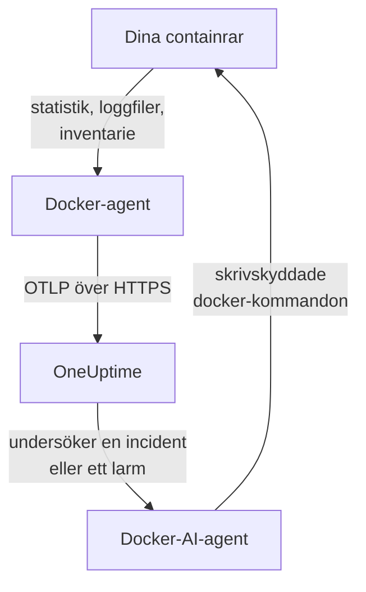

# Docker-agent

OneUptime Docker-agenten är en container som du kör på en Docker-värd. Den läser statistiken och loggfilerna för varje container på värden och skickar dem till OneUptime, där värden visas med sina containrar, mätvärden och loggar. En andra container, Docker-AI-agenten, låter OneUptime AI undersöka värden. [Docker-monitorer](/docs/monitor/docker-monitor) larmar på det som agenten skickar.

:::cards
- [Installera agenten](#installera-agenten): Två containrar, med `docker run` eller Docker Compose.
- [Vad agenten samlar in](#vad-agenten-samlar-in): Mätvärden, loggar och en inventering av varje container.
- [Containerloggar behöver json-file](#containerloggar-behöver-loggdrivrutinen-json-file): Kontrollera och byt en containers loggdrivrutin.
- [Felsökning](#felsökning): Omstartsloopar, saknade mätvärden, saknade loggar.
:::

## Så fungerar det

Agenten är en OpenTelemetry Collector med OneUptimes konfiguration inbyggd. Via Docker-socketen läser den varje containers statistik var 30:e sekund och listar varje container, image, nätverk och volym var 5:e minut. Den följer containrarnas loggfiler och skickar allt till din OneUptime-URL över OTLP, med den intagningsnyckel du ger den.



Värden registrerar sig med sina första data, under det namn du ger den i `DOCKER_HOST_NAME`. AI-agenten är valfri: utelämna den så fungerar collectorn likadant.

## Innan du börjar

- Docker Engine 20.10 eller senare, och root-åtkomst på värden: agenten läser `/var/run/docker.sock`.
- Docker Compose v2 (kommandot `docker compose`), om du installerar med Docker Compose.
- En intagningsnyckel. Skapa en under **Projektinställningar → Telemetri och APM → Intagningsnycklar** och kopiera värdet.
- Utgående HTTPS från värden till din OneUptime-URL.
- För containerloggar: containrar som använder Dockers loggdrivrutin `json-file`, som är Dockers standard. Se [Containerloggar behöver loggdrivrutinen json-file](#containerloggar-behöver-loggdrivrutinen-json-file).

## Installera agenten

:::steps
### Starta agenten

Ersätt `YOUR_ONEUPTIME_URL` med din OneUptime-URL, `YOUR_TELEMETRY_INGESTION_TOKEN` med intagningsnyckeln och `my-docker-host` med ett namn på den här värden, till exempel `prod-docker-01`. Namnet är hur värden visas i OneUptime, så håll det stabilt: ett nytt namn registrerar en ny värd.

:::tabs
@tab Docker CLI
```bash
docker run -d \
  --name oneuptime-docker-agent \
  --user 0:0 \
  --restart unless-stopped \
  -v /var/run/docker.sock:/var/run/docker.sock:ro \
  -v /var/lib/docker/containers:/var/lib/docker/containers:ro \
  -e ONEUPTIME_URL="YOUR_ONEUPTIME_URL" \
  -e ONEUPTIME_SERVICE_TOKEN="YOUR_TELEMETRY_INGESTION_TOKEN" \
  -e DOCKER_HOST_NAME="my-docker-host" \
  oneuptime/docker-agent:release
```

Starta sedan [AI-agenten](#ai-agent) bredvid, med samma värden. **AI-undersökningar är på som standard**: medan OneUptime AI undersöker en incident eller ett larm på den här värden kör den skrivskyddade `docker`-kommandon genom AI-agenten, och ändrar ingenting om du inte tillåter åtgärder. För att installera utan AI-undersökningar hoppar du över det här kommandot.

```bash
docker run -d \
  --name oneuptime-docker-ai-agent \
  --user 0:0 \
  --restart unless-stopped \
  --read-only --tmpfs /tmp \
  -v /var/run/docker.sock:/var/run/docker.sock:ro \
  -e ONEUPTIME_URL="YOUR_ONEUPTIME_URL" \
  -e ONEUPTIME_SERVICE_TOKEN="YOUR_TELEMETRY_INGESTION_TOKEN" \
  -e ONEUPTIME_AI_AGENT_RESOURCE_TYPE=docker \
  -e DOCKER_HOST_NAME="my-docker-host" \
  oneuptime/resource-ai-agent:release
```
@tab Docker Compose
Spara detta som `docker-compose.yml` i en mapp på värden. Den andra tjänsten är [AI-agenten](#ai-agent): utelämna den för att köra collectorn utan AI-undersökningar.

```yaml title="docker-compose.yml"
services:
  oneuptime-docker-agent:
    image: oneuptime/docker-agent:release
    container_name: oneuptime-docker-agent
    user: "0:0"
    restart: unless-stopped
    volumes:
      - /var/run/docker.sock:/var/run/docker.sock:ro
      - /var/lib/docker/containers:/var/lib/docker/containers:ro
    environment:
      - ONEUPTIME_URL=YOUR_ONEUPTIME_URL
      - ONEUPTIME_SERVICE_TOKEN=YOUR_TELEMETRY_INGESTION_TOKEN
      - DOCKER_HOST_NAME=my-docker-host
    logging:
      driver: json-file
      options:
        max-size: "10m"
        max-file: "3"
  oneuptime-docker-ai-agent:
    image: oneuptime/resource-ai-agent:release
    container_name: oneuptime-docker-ai-agent
    user: "0:0"
    restart: unless-stopped
    read_only: true
    tmpfs:
      - /tmp
    volumes:
      - /var/run/docker.sock:/var/run/docker.sock:ro
    environment:
      - ONEUPTIME_URL=YOUR_ONEUPTIME_URL
      - ONEUPTIME_SERVICE_TOKEN=YOUR_TELEMETRY_INGESTION_TOKEN
      - ONEUPTIME_AI_AGENT_RESOURCE_TYPE=docker
      - DOCKER_HOST_NAME=my-docker-host
```

Starta den i den mappen:

```bash
docker compose up -d
```
:::

### Kontrollera att agenten körs

```bash
docker ps --filter name=oneuptime-docker-agent
docker logs -f oneuptime-docker-agent
```

Loggarna ska visa den här raden när collectorn har startat:

```text
Everything is ready. Begin running and processing data.
```

### Hitta värden i OneUptime

Öppna **Produkter → Infrastruktur → Docker → Alla värdar**. Värden visas under sitt `DOCKER_HOST_NAME` inom en minut eller så, med sina containrar, mätvärden och loggar. AI-agenten visas som ansluten på värdens sida **AI-agent**, och längst ned på dess **Översikt**.
:::

## Miljövariabler

| Variabel | Obligatorisk | Beskrivning |
| --- | --- | --- |
| `ONEUPTIME_URL` | Ja | Din OneUptime-URL, till exempel `https://oneuptime.com` eller din självhostade instans. Använd `http://` och dess port om instansen bara använder HTTP. |
| `ONEUPTIME_SERVICE_TOKEN` | Ja | Intagningsnyckeln från **Projektinställningar → Telemetri och APM → Intagningsnycklar**. |
| `DOCKER_HOST_NAME` | Nej | Värdens namn i OneUptime. Standard är `docker-host`, så ge varje värd ett eget. |
| `DOCKER_API_VERSION` | Nej | Den version av Docker Engine API som agenten talar. Standard är `1.44`. Sänk den på en äldre daemon, eller sätt ett tomt värde för att förhandla fram den med daemonen (se [Felsökning](#felsökning)). |

För att ändra ett värde tar du bort agenten och kör dess kommando igen (Docker CLI), eller redigerar `docker-compose.yml` och kör `docker compose up -d` (Docker Compose).

## Vad agenten samlar in

| Data | Vad det är |
| --- | --- |
| Containermätvärden | CPU (användning, procent, strypning), minne (användning, gräns, procent), nätverks- och block-I/O, drifttid, omstarter och antal processer, per container, var 30:e sekund. |
| Containerloggar | Stdout och stderr från varje container, från dess loggfil `json-file`. |
| Inventering | Varje container i alla tillstånd, och varje image, nätverk och volym, var 5:e minut. |

Varje containers mätvärden och loggar arkiveras under en tjänst som är uppkallad efter containern. Varje loggrad får en allvarlighetsgrad från den nivå den anger, som `[ERROR]`, `level=warn` eller `{"level":"info"}`; en rad som inte anger någon får sin ströms: stderr är `ERROR`, stdout är `INFO`. Rader som börjar med blanksteg eller en avslutande hakparentes slås ihop med raden före, så en stackspårning kommer in som en enda post. Agentens egna loggar utelämnas.

[Docker-övervakning](/docs/monitor/docker-monitor#insamlade-mätvärden) listar varje mätvärde och vad det betyder.

## Containerloggar behöver loggdrivrutinen json-file

Agenten följer `/var/lib/docker/containers/*/*-json.log`, de filer som Dockers loggdrivrutin `json-file` skriver. En container som använder en annan drivrutin lämnar ingen fil att läsa: `local` skriver binärfiler, och `journald`, `syslog`, `fluentd` och `gelf` skickar loggarna någon annanstans. Dess mätvärden kommer fortfarande in; dess loggar gör det inte.

Kontrollera en containers loggdrivrutin och daemonens standard:

```bash
docker inspect <container> --format '{{.HostConfig.LogConfig.Type}}'
docker info --format '{{.LoggingDriver}}'
```

Byt en Compose-tjänst till `json-file`, med rotation:

```yaml
services:
  my-app:
    image: my-app:latest
    logging:
      driver: "json-file"
      options:
        max-size: "100m"
        max-file: "5"
```

Eller gör den till standard för varje container som skapas efteråt, i `/etc/docker/daemon.json`:

```json title="/etc/docker/daemon.json"
{
  "log-driver": "json-file",
  "log-opts": {
    "max-size": "100m",
    "max-file": "5"
  }
}
```

Starta sedan om Docker och återskapa containrarna. En container behåller den loggdrivrutin den skapades med, så det räcker inte att starta om den.

## Uppgradera agenten

När agenten är äldre än din OneUptime visas en varningssymbol bredvid **Agentversion** på värdens **Översikt**. Välj den för att se de här kommandona.

:::tabs
@tab Docker CLI
```bash
docker pull oneuptime/docker-agent:release
docker pull oneuptime/resource-ai-agent:release
docker rm -f oneuptime-docker-agent oneuptime-docker-ai-agent
```

Kör sedan båda `docker run`-kommandona från [Starta agenten](#starta-agenten) igen.
@tab Docker Compose
```bash
docker compose pull
docker compose up -d
```
:::

Taggen `release` pekar alltid på den senaste utgåvan. För att låsa en version använder du `oneuptime/docker-agent:<version>`, till exempel `oneuptime/docker-agent:10.0.31`. Samma image finns i GitHub Container Registry som `ghcr.io/oneuptime/docker-agent:release`.

## Avinstallera agenten

:::tabs
@tab Docker CLI
```bash
docker rm -f oneuptime-docker-agent
docker rm -f oneuptime-docker-ai-agent
```
@tab Docker Compose
```bash
docker compose down
```
:::

Värden finns kvar i OneUptime med de data den skickade. Om du inte längre behöver den tar du bort den med **Ta bort värd** i dess meny.

## AI-agent

Kommandona och Compose-filen ovan, Docker-agentens `install.sh` och `docker-compose.yml` i dess [DockerAgent-katalog](https://github.com/OneUptime/oneuptime/tree/master/agents/DockerAgent) kör alla **Docker-AI-agenten**: en andra container, `oneuptime-docker-ai-agent` (imagen `oneuptime/resource-ai-agent:release`), som kör de skrivskyddade `docker`-kommandon som OneUptime AI ber om medan den undersöker en incident eller ett larm på den här värden — `docker ps -a`, `docker logs --tail 200 web`, `docker container inspect web`, `docker stats --no-stream` — och, bara om du tillåter det, genomför åtgärder som att starta om en namngiven container. Den läser samma `ONEUPTIME_URL`, `ONEUPTIME_SERVICE_TOKEN` och `DOCKER_HOST_NAME` som collectorn, så den betjänar exakt den här värden, och den visas på värdens sida **AI-agent** i OneUptime.

- **AI-undersökningar är på som standard.** När agenten väl ansluter undersöker OneUptime AI incidenter och larm på den här värden med den, och värdens **Översikt** visar agentens status. För att stoppa sätter du `ONEUPTIME_AI_INVESTIGATION=false` där agenten körs (**Ändra** under **Vad AI får göra** på AI-agentsidan visar hur), eller utelämnar agenten.
- Den är skrivskyddad om du inte startar den med `ONEUPTIME_AI_ALLOW_WRITES=true`; `ONEUPTIME_AI_WRITE_TARGETS` (till exempel `web-*,api-*`) begränsar vilka containrar en åtgärd får röra. Starta den också med `ONEUPTIME_AI_FIXES` för att ange hur åtgärder körs — `ask-for-approval` (en person godkänner varje åtgärd), `automatic` eller `bypass-approval` — och AI-agentsidan visar det skrivskyddat ([Vad AI får göra, inställt av agenten](/docs/ai/infrastructure-ai-agents#what-ai-may-do-set-by-the-agent)).
- Den körs som root med Docker-socketen monterad, eftersom socketen ägs av root — och den som kan använda socketen är root på den här värden, `:ro` eller inte. Agentens kommandopolicy är gränsen: den kör aldrig `exec`, `run`, `rm` eller `prune`, och ändrar aldrig sig själv, collectorn eller något i `ONEUPTIME_AI_PROTECTED_TARGETS` (globmönster för containernamn). Miljövärden i utdata från `docker inspect` maskeras innan något lämnar värden.
- `install.sh --no-ai-agent` utelämnar den; `docker rm -f oneuptime-docker-ai-agent` tar bort den. Uppgradera den som collectorn: `docker pull oneuptime/resource-ai-agent:release`, ta bort den och starta den igen.

Vad den får köra, hur åtgärder fungerar och hur du felsöker den: [Infrastructure AI Agents](/docs/ai/infrastructure-ai-agents#docker-and-podman-hosts).

## Felsökning

:::details Agenten startar om med "client version is too new"
Agentens loggar visar:

```text
Error: cannot start pipelines: failed to start "docker_stats" receiver:
Error response from daemon: client version 1.44 is too new.
Maximum supported API version is 1.41
```

En daemon nekar en klient som är nyare än dess eget maximum, så receivern startar aldrig och collectorn avslutas med den. Ta reda på daemonens maximum:

```bash
docker version --format '{{ .Server.APIVersion }}'
```

Lägg sedan till `-e DOCKER_API_VERSION=1.41` (eller värdet du fick) i `docker run`, eller sätt `DOCKER_API_VERSION` i Compose. Nyare daemoner hanterar fortfarande äldre API-versioner, så inställningen förblir giltig efter en uppgradering.

Vill du hellre slippa slå upp numret? Sätt `DOCKER_API_VERSION` till den tomma strängen. Agenten förhandlar då fram versionen med daemonen (en `HEAD /_ping`, sedan daemonens eget maximum), vilket fungerar mot både gamla och nya daemoner:

```bash
docker run -d ... -e DOCKER_API_VERSION= ...
```
:::

:::details Åtkomst nekad till Docker-socketen
Agenten måste köras som root för att läsa `/var/run/docker.sock`. Kontrollera att `--user 0:0` finns i ditt `docker run`-kommando, eller `user: "0:0"` i Compose.
:::

:::details Värden visas som frånkopplad
1. Kontrollera att agenten körs: `docker ps --filter name=oneuptime-docker-agent`
2. Leta efter fel i dess loggar: `docker logs oneuptime-docker-agent 2>&1 | grep -i error`
3. Kontrollera `ONEUPTIME_URL` och `ONEUPTIME_SERVICE_TOKEN`: nyckeln måste vara en giltig intagningsnyckel som inte har inaktiverats.
4. Kontrollera att värden kan nå din OneUptime-URL över nätverket.
:::

:::details Inga mätvärden visas
1. Kontrollera att Docker-socketen är monterad i agenten. Dess image har inget skal, så titta från en tillfällig container som delar dess monteringar: `docker run --rm --volumes-from oneuptime-docker-agent alpine:3.19 ls -la /var/run/docker.sock`
2. Leta efter exportfel i dess loggar: `docker logs oneuptime-docker-agent 2>&1 | tail -100`
3. Kontrollera att intagningsnyckeln är giltig och inte har gått ut.
:::

:::details Mätvärden kommer in men inga containerloggar
Dina containrar använder troligen en annan loggdrivrutin än `json-file`. Kontrollera vilka filer agenten bevakar, och vilken drivrutin en container använder:

```bash
docker logs oneuptime-docker-agent 2>&1 | grep -E "Started watching file|no files match"
docker inspect <container> --format '{{.HostConfig.LogConfig.Type}}'
```

Om agenten rapporterar `no files match the configured criteria` byter du containrarna till `json-file` och återskapar dem, som [Containerloggar behöver loggdrivrutinen json-file](#containerloggar-behöver-loggdrivrutinen-json-file) visar.
:::

:::details Loggarna hamnar på en annan värd, eller värden heter docker-host
Värdens namn kommer från `DOCKER_HOST_NAME`. En agent som startats utan det rapporterar `docker-host`, så varje värd som konfigurerats på det sättet ser ut som samma värd; ändrar du namnet senare registrerar OneUptime en andra värd, som då innehåller de nya data. Sätt `DOCKER_HOST_NAME` till ett eget namn på varje värd och återskapa agenten. För att kontrollera vilket namn agenten rapporterar:

```bash
docker inspect oneuptime-docker-agent --format '{{range .Config.Env}}{{println .}}{{end}}' | grep DOCKER_HOST_NAME
```
:::

## Nästa steg

:::cards
- [Docker-övervakning](/docs/monitor/docker-monitor): Larma på containrarnas CPU, minne och omstarter.
- [Databaser](/docs/telemetry/databases): Databascontainrar på värden hittas och får egna sidor.
- [Kubernetes-agent](/docs/telemetry/kubernetes-agent): Övervaka ett Kubernetes-kluster i stället.
- [OpenTelemetry-collector på värden](/docs/telemetry/host-otel-collector): Övervaka själva maskinen: CPU, diskar, processer och loggar.
:::
