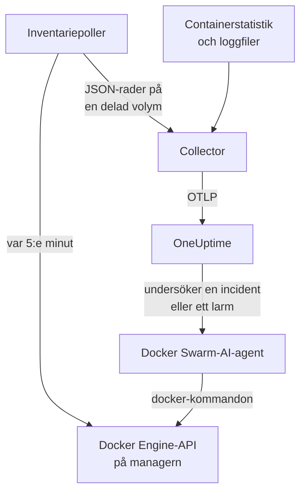

# Docker Swarm-agent

OneUptimes Docker Swarm-agent övervakar ett Docker Swarm-kluster: dess noder, tjänster, uppgifter, stackar, overlay-nätverk, secrets, configs och volymer, plus varje containers mätvärden och loggar. Du kör den med Docker Compose på en managernod i swarmen, och klustret visas i OneUptime med allt detta. [Docker Swarm-övervakare](/docs/monitor/docker-swarm-monitor) larmar utifrån det som kommer in.

:::cards
- [Installera agenten](#installera-agenten): Installationsskriptet eller Docker Compose, på en managernod.
- [Vad agenten samlar in](#vad-agenten-samlar-in): Inventariet, klustrets räknare samt containrarnas mätvärden och loggar.
- [AI-agent](#ai-agent): Låt OneUptime AI läsa swarmen medan den undersöker.
- [Felsökning](#felsökning): Ett diagnosskript, och de vanliga problemen.
:::

## Så fungerar det

Agenten är tre containrar, alla definierade i en enda `docker-compose.yml`:

1. **Collector**: en OpenTelemetry Collector som läser `docker_stats` för varje containers mätvärden, följer containrarnas loggfiler och följer filen med inventarieögonblicksbilden. Den stämplar allt med ditt klusters namn (`docker.swarm.cluster.name`) och skickar det till OneUptime över OTLP.
2. **Inventariepoller**: en liten sidecar med `curl` och `jq` som var 5:e minut går igenom swarm-managerns API (`/nodes`, `/services`, `/tasks`, `/networks`, `/secrets`, `/configs`, `/volumes`) och härleder stackarna från tjänsteetiketten `com.docker.stack.namespace`. Den skriver en JSON-rad per objekt som collectorn vidarebefordrar.
3. **AI-agent**: `oneuptime-docker-swarm-ai-agent`, som kör de `docker`-kommandon som OneUptime AI ber om medan den undersöker en incident eller ett larm på det här klustret. Den är skrivskyddad om du inte tillåter åtgärder (se [AI-agent](#ai-agent)).



Klustret registrerar sig med sina första data, under det klusternamn som du konfigurerar.

## Innan du börjar

- En **manager**nod i swarmen att köra agenten på: inventariepollern och AI-agenten anropar API-slutpunkter som bara managers svarar på.
- Docker Engine 20.10 eller senare med pluginet Docker Compose v2.
- En intagningsnyckel. Skapa en under **Projektinställningar → Telemetri och APM → Intagningsnycklar** och kopiera värdet.
- Utgående HTTPS från noden till din OneUptime-URL.

### Var du kör agenten

Kör den på en managernod. Collectorn rapporterar containrarna på den nod den körs på, så för alla noders containermätvärden kör du collectorn på varje nod, alla med samma `DOCKER_SWARM_CLUSTER_NAME`; inventariepollern och AI-agenten behöver bara köras på en manager. `install.sh` utelämnar AI-agenten på en nod som inte är manager (och tar bort en som den tidigare installerade där). En AI-agent som ändå startas på en worker registrerar sig aldrig för klustret: den väntar tills dess nod är en manager, så den kan inte tränga undan managerns AI-agent. Distribuerar du agenten som en swarm-stack i stället för med Compose? Håll inventariepollern och AI-agenten på managers med villkoret `node.role == manager`.

## Installera agenten

:::steps
### Installera och starta agenten

:::tabs
@tab install.sh
Ladda ned installationsskriptet och kör det på en managernod:

```bash
curl -sSL https://raw.githubusercontent.com/OneUptime/oneuptime/master/agents/DockerSwarmAgent/install.sh -o install.sh
sh install.sh
```

Skriptet frågar efter din OneUptime-URL, intagningsnyckeln och ett namn på klustret. Det installerar till `/opt/oneuptime-docker-swarm-agent`, skriver en `.env`-fil som bara dess ägare kan läsa och startar alla tre containrarna. Lägg till `--no-ai-agent` för att utelämna AI-agenten.
@tab Docker Compose
Ladda ned `docker-compose.yml`, `otel-collector-config.yaml` och `inventory-snapshot.sh` från [DockerSwarmAgent-katalogen](https://github.com/OneUptime/oneuptime/tree/master/agents/DockerSwarmAgent) till en ny mapp på en managernod:

```bash
curl -fsSL https://raw.githubusercontent.com/OneUptime/oneuptime/master/agents/DockerSwarmAgent/docker-compose.yml -o docker-compose.yml
curl -fsSL https://raw.githubusercontent.com/OneUptime/oneuptime/master/agents/DockerSwarmAgent/otel-collector-config.yaml -o otel-collector-config.yaml
curl -fsSL https://raw.githubusercontent.com/OneUptime/oneuptime/master/agents/DockerSwarmAgent/inventory-snapshot.sh -o inventory-snapshot.sh
chmod +x inventory-snapshot.sh
```

Skapa en `.env`-fil bredvid dem. Den innehåller intagningsnyckeln, så håll den privat med `chmod 600 .env`:

```bash title=".env"
ONEUPTIME_URL=https://oneuptime.com
ONEUPTIME_SERVICE_TOKEN=your-telemetry-ingestion-key
DOCKER_SWARM_CLUSTER_NAME=my-swarm
```

Starta agenten:

```bash
docker compose up -d
```
:::

### Kontrollera att agenten körs

```bash
docker compose ps
docker compose logs --tail 50 oneuptime-docker-swarm-agent oneuptime-docker-swarm-inventory
```

`docker compose ps` listar tre containrar: collectorn (`oneuptime-docker-swarm-agent`), inventariepollern (`oneuptime-docker-swarm-inventory`) och AI-agenten (`oneuptime-docker-swarm-ai-agent`).

### Hitta klustret i OneUptime

Öppna **Produkter → Infrastruktur → Docker Swarm → Alla kluster**. Klustret visas inom några minuter, och dess sidor **Noder**, **Tjänster**, **Uppgifter**, **Stacks**, **Nätverk**, **Hemligheter**, **Configs** och **Volymer** fylls i efter den första inventarieögonblicksbilden, inom 5 minuter.
:::

## Miljövariabler

Installationsskriptet skriver de tre första till `/opt/oneuptime-docker-swarm-agent/.env`; en Docker Compose-installation läser dem från `.env` bredvid `docker-compose.yml`. Lägg till eller ändra vilken som helst av dem där och kör sedan `docker compose up -d` i den mappen.

| Variabel | Obligatorisk | Beskrivning |
| --- | --- | --- |
| `ONEUPTIME_URL` | Ja | Din OneUptime-URL, till exempel `https://oneuptime.com` eller din självhostade instans. Använd `http://` och dess port om instansen bara använder HTTP. |
| `ONEUPTIME_SERVICE_TOKEN` | Ja | Intagningsnyckeln från **Projektinställningar → Telemetri och APM → Intagningsnycklar**. |
| `DOCKER_SWARM_CLUSTER_NAME` | Ja | Klustrets namn i OneUptime och nyckeln som varje nods data sammanförs på: stämplat på allt som resursattributet `docker.swarm.cluster.name`. Håll det stabilt: att ändra det senare registrerar ett andra kluster. Standard är `docker-swarm`. |
| `DOCKER_INVENTORY_INTERVAL_SECONDS` | Nej | Hur ofta inventariepollern tar en ögonblicksbild, i sekunder. Standard är `300`. |
| `DOCKER_API_VERSION` | Nej | Den Docker Engine-API-version som collectorn och inventariepollern talar. Standard är `1.44`; tom förhandlar den med daemonen (se [Felsökning](#felsökning)). AI-agenten förhandlar den om du inte anger en. |

AI-agentens egna inställningar finns under [AI-agent](#ai-agent).

## Vad agenten samlar in

| Signal | Källa | Var den visas |
| --- | --- | --- |
| Noderna, tjänsterna, uppgifterna, stackarna, nätverken, secrets, configs och volymerna | Inventariepollern, från swarm-managerns API | Klustrets listor och detaljsidor |
| Klusterräknare (redo noder, körande uppgifter, tjänster, stackar, …) | Samma ögonblicksbild | Översiktens kort och sidomenyns brickor |
| Containerns CPU, minne, antal processer och drifttid | Mottagaren `docker_stats` | Sidan **Mätvärden** |
| Containerns stdout- och stderr-loggar | Mottagaren `filelog` | Sidan **Loggar** |

### Så skiljer den sig från Docker-agenten

[Docker-agenten](/docs/telemetry/docker-host) modellerar en värd och stämplar `host.name` och `container.runtime=docker`. Docker Swarm-agenten stämplar med avsikt bara `docker.swarm.cluster.name`: OneUptime arkiverar då data under swarm-klustret i stället för att registrera varje nod som en egen värd.

## Tagga klustret med projektetiketter

Ett resursattribut som börjar med `oneuptime.label.` blir en projektetikett på klustret: `oneuptime.label.<dimension>=<value>` är etiketten `<dimension>:<value>`. Lägg till attributen i processorn `resource` i `otel-collector-config.yaml`, bredvid `docker.swarm.cluster.name`:

```yaml
processors:
  resource:
    attributes:
      # ...existing attributes...
      - key: oneuptime.label.team
        value: platform
        action: upsert
      - key: oneuptime.label.env
        value: production
        action: upsert
```

Collectorn läser sin konfiguration bara när den startar: Kör `docker compose restart oneuptime-docker-swarm-agent`. Klustret visar då etiketterna `team:platform` och `env:production`. Etiketter jämförs utan hänsyn till skiftläge, så en befintlig etikett `Production` återanvänds i stället för att dupliceras, och agenten tar aldrig bort en etikett som någon har lagt till i OneUptime.

## Kör som en systemd-tjänst

För att starta agenten med noden och starta om den när den misslyckas installerar du dess systemd-enhet. Den förutsätter att agenten ligger i `/opt/oneuptime-docker-swarm-agent`, där installationsskriptet placerar den:

```bash
sudo curl -fsSL https://raw.githubusercontent.com/OneUptime/oneuptime/master/agents/DockerSwarmAgent/systemd/oneuptime-docker-swarm-agent.service -o /etc/systemd/system/oneuptime-docker-swarm-agent.service
sudo systemctl daemon-reload
sudo systemctl enable --now oneuptime-docker-swarm-agent
```

## Uppgradera agenten

Agenten rapporterar den collectorversion den kör. När den är äldre än den version som den här OneUptime-versionen låser, visas ett varningstecken bredvid agentens version på klustrets sida **Översikt**. Välj det för att se de här kommandona.

Kör installationsskriptet igen på managernoden och besvara dess frågor med samma URL, nyckel och klusternamn. Det laddar ned de senaste filerna, hämtar imagesen och startar om agenten:

```bash
curl -sSL https://raw.githubusercontent.com/OneUptime/oneuptime/master/agents/DockerSwarmAgent/install.sh -o install.sh
sh install.sh
```

Skriptet skriver `.env` på nytt utifrån dina svar. Det behåller bara AI-agentens mållistor och vad AI får göra (`ONEUPTIME_AI_INVESTIGATION`, `ONEUPTIME_AI_FIXES`): Lägg tillbaka alla variabler som du själv har satt, till exempel `DOCKER_API_VERSION`. Har du slagit på AI-åtgärder? Kör det som `ONEUPTIME_AI_ALLOW_WRITES=true sh install.sh` för att behålla dem påslagna. Utelämnade du AI-agenten? Skicka `--no-ai-agent` igen.

Med Docker Compose laddar du ned de tre filerna igen i agentens mapp (och gör sedan om eventuella ändringar du gjort i `docker-compose.yml`), och hämtar och startar om:

```bash
docker compose pull
docker compose up -d
```

Collectorversionen är låst i filerna, så att bara hämta images för inte agenten framåt.

## Avinstallera agenten

```bash
cd /opt/oneuptime-docker-swarm-agent
docker compose down
```

## AI-agent

Swarmens `docker-compose.yml` (och `install.sh`) kör också **Docker Swarm-AI-agenten**: en tredje container, `oneuptime-docker-swarm-ai-agent` (image `oneuptime/resource-ai-agent:release`), som kör de skrivskyddade `docker`-kommandon som OneUptime AI ber om medan den undersöker en incident eller ett larm på det här klustret — `docker node ls`, `docker service ps web --no-trunc`, `docker service logs --tail 200 web` — och, bara om du tillåter det, tillämpar åtgärder som en rullande omstart av en namngiven tjänst. Den läser samma `ONEUPTIME_URL`, `ONEUPTIME_SERVICE_TOKEN` och `DOCKER_SWARM_CLUSTER_NAME` som collectorn, så den betjänar just det här klustret, och den visas på klustrets sida **AI → AI-agent** i OneUptime.

- **AI-undersökningar är på som standard.** När agenten väl ansluter undersöker OneUptime AI incidenter och larm på det här klustret med den, och klustrets **Översikt** visar agentens status. För att stoppa sätter du `ONEUPTIME_AI_INVESTIGATION=false` där agenten körs (**Ändra** under **Vad AI får göra** på AI-agentsidan visar hur), eller utelämnar agenten.
- Precis som inventariepollern **måste den köras på en managernod**: Kommandon för noder, tjänster och uppgifter finns bara på managers. På en worker kör den ingenting och registrerar sig inte för klustret förrän noden är en manager (dess `/status` säger varför). Kör en per kluster.
- Den är **skrivskyddad** om du inte sätter `ONEUPTIME_AI_ALLOW_WRITES=true` i `.env` och kör `docker compose up -d` (eller kör `install.sh` med den; installationsprogrammet skriver `ONEUPTIME_AI_ALLOW_WRITES`, `ONEUPTIME_AI_INVESTIGATION`, `ONEUPTIME_AI_FIXES`, `ONEUPTIME_AI_WRITE_TARGETS` och `ONEUPTIME_AI_PROTECTED_TARGETS` från sin miljö till `.env`, och en ny körning behåller det som `.env` redan har för de fyra sista om du inte skickar den variabeln, även tom); `ONEUPTIME_AI_WRITE_TARGETS` (globmönster för tjänst- och nodnamn, till exempel `web_*,api_*`) begränsar vad en åtgärd får röra. `ONEUPTIME_AI_FIXES` i samma `.env` anger hur åtgärder körs — `ask-for-approval` (en person godkänner varje), `automatic` eller `bypass-approval` — och AI-agentsidan visar det skrivskyddat ([Vad AI får göra, fastställt av agenten](/docs/ai/infrastructure-ai-agents#what-ai-may-do-set-by-the-agent)). Att tömma en nod kräver alltid en persons godkännande, oavsett läge.
- Den körs som root med Docker-socketen monterad, eftersom socketen ägs av root — och på en manager kontrollerar den som kan använda socketen hela swarmen, `:ro` eller inte. Agentens kommandopolicy är gränsen: Den skapar eller tar aldrig bort tjänster eller stackar, rör aldrig secrets eller configs och ändrar aldrig sig själv, collectorn, inventariepollern eller något i `ONEUPTIME_AI_PROTECTED_TARGETS` (globmönster för tjänst- och nodnamn).
- `install.sh --no-ai-agent` utelämnar den; du kan också ta bort tjänsten `oneuptime-docker-swarm-ai-agent` ur `docker-compose.yml`.

Vad den får köra, hur åtgärder fungerar och hur du felsöker den: [Infrastructure AI Agents](/docs/ai/infrastructure-ai-agents#docker-swarm-clusters).

## Felsökning

:::details Kör diagnosskriptet först
Agenten levereras med ett skript, [`troubleshoot.sh`](https://github.com/OneUptime/oneuptime/blob/master/agents/DockerSwarmAgent/troubleshoot.sh), som kontrollerar hela kedjan: containrarna, att inventariepollern körs på en manager (`docker node ls`), ögonblicksbildsfilen, det klusternamn som stämplas på allt, tokenens format, collectorns egna mätvärden, och om OneUptime godtar intagningsnyckeln. Den sista kontrollen är viktigast. OneUptime nekar en felaktig nyckel med `401` (`422` för en inaktiverad nyckel eller en webbläsarnyckel), och collectorn loggar det som en `Exporting failed`-rad per batch, som är lätt att missa. Skriptet frågar `GET <url>/otlp/v1/validate` för ett direkt `200` (giltig) eller `401` (ogiltig). Kör det på managernoden:

```bash
curl -sSL https://raw.githubusercontent.com/OneUptime/oneuptime/master/agents/DockerSwarmAgent/troubleshoot.sh -o troubleshoot.sh
bash troubleshoot.sh    # add -d <dir> if you installed outside /opt/oneuptime-docker-swarm-agent
```
:::

:::details Klustret visas aldrig
Kör diagnosskriptet först. Läs annars collectorns loggar (`docker compose logs oneuptime-docker-swarm-agent`), kontrollera att `ONEUPTIME_SERVICE_TOKEN` och `ONEUPTIME_URL` i `.env` stämmer och att noden når din OneUptime-URL.
:::

:::details Inget inventarium visas
Kontrollera att inventariepollern körs på en manager: `docker node ls` måste lyckas där. Leta sedan efter rader med `failed to emit ...` i dess loggar: `docker compose logs oneuptime-docker-swarm-inventory`.
:::

:::details Klustret växlar till frånkopplat
Ett kluster blir frånkopplat när OneUptime inte har tagit emot något från det på 15 minuter; OneUptime kontrollerar var 5:e minut, och tid då OneUptime själv inte tog emot data räknas inte. Se till att collector-containern förblir igång: `docker compose ps` visar den.
:::

:::details Collectorn avslutas med "client version is too new"
Collectorns loggar visar:

```text
Error: cannot start pipelines: failed to start "docker_stats" receiver:
Error response from daemon: client version 1.44 is too new.
Maximum supported API version is 1.41
```

Daemonens högsta API-version ligger under standardvärdet `1.44` (Docker Engine 20.10 stannar vid `1.41`), så mottagaren `docker_stats` kan inte starta och containern startar om i en loop. Ta reda på daemonens högsta version:

```bash
docker version --format '{{ .Server.APIVersion }}'
```

Sätt `DOCKER_API_VERSION` till det värdet i `.env` och kör `docker compose up -d` på varje nod som agenten körs på. Nyare daemoner hanterar fortfarande äldre API-versioner, så inställningen fortsätter att fungera efter att du har uppgraderat Docker. Eller sätt `DOCKER_API_VERSION=` (tom) så att collectorn förhandlar versionen med daemonen i stället för att låsa en.
:::

:::details Klustret visas under fel namn
Klustrets namn kommer från `DOCKER_SWARM_CLUSTER_NAME`. Ändra det i `.env` och kör `docker compose up -d`: Ett nytt namn registrerar ett nytt kluster i stället för att byta namn på det gamla.
:::

## Nästa steg

:::cards
- [Docker Swarm-övervakning](/docs/monitor/docker-swarm-monitor): Larma om noder, tjänster, uppgifter och containrar.
- [Infrastructure AI Agents](/docs/ai/infrastructure-ai-agents): Vad Docker Swarm-AI-agenten får köra och hur åtgärder fungerar.
- [Docker-agent](/docs/telemetry/docker-host): Övervaka i stället en enskild Docker-värd.
:::
