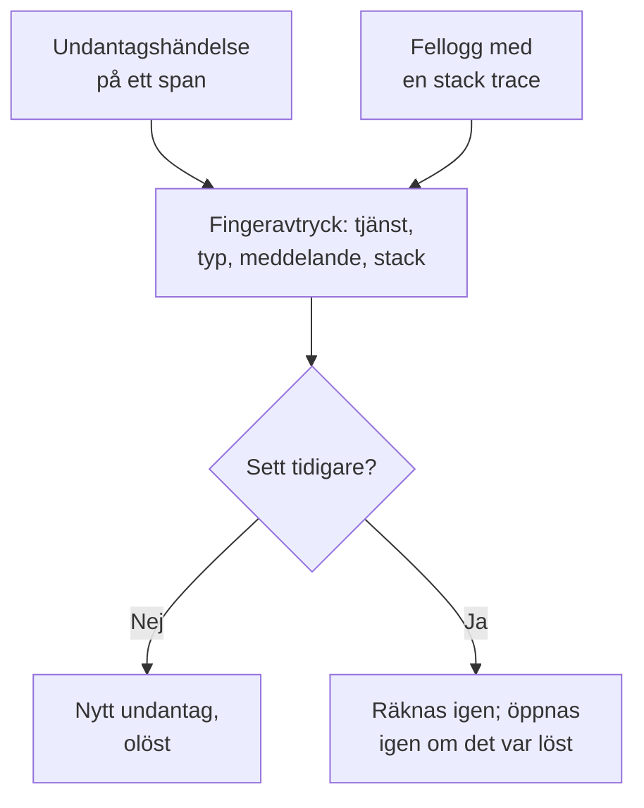

# Undantagsspårning

Undantagsspårning samlar in felen som din kod kastar och grupperar varje förekomst av samma fel i ett undantag, med dess stack trace, dess utveckling och de förfrågningar där det inträffade. Gå igenom dem som en att göra-lista: rätta, lös eller arkivera bruset, och låt AI öppna en pull request för dem som den kan rätta.

:::cards
- [Var undantag kommer ifrån](#var-undantag-kommer-ifrån): Spans och loggar som dina tjänster redan skickar.
- [Gå igenom listan](#gå-igenom-listan): Det olösta först, bruset dolt.
- [Ett undantags sida](#ett-undantags-sida): Stack trace, förekomster och sammanhang.
- [Rätta det med AI](#rätta-det-med-ai): En pull request med rättelsen, eller ett regressionstest.
:::

## Var undantag kommer ifrån

Du skickar inte undantag separat. OneUptime hittar dem i telemetrin som dina tjänster redan skickar:

- en undantagshändelse på ett span, vilket är vad OpenTelemetrys `recordException()` skriver;
- en logg med attributen `exception.type`, `exception.message` eller `exception.stacktrace`;
- en logg med allvarlighetsgraden Error eller Fatal vars meddelande innehåller en stack trace, när loggen inte skrevs inuti ett span (spannet rapporterar det redan).

Varje förekomst grupperas med de tidigare förekomsterna av samma fel i ett undantag:

- **Ett undantag per tjänst och fel.** Fingeravtrycket bildas av tjänsten, undantagstypen, meddelandet och stack trace. Värden som ändras från anrop till anrop tas bort först: UUID:er och andra ID:n, tidsstämplar, IP- och e-postadresser, och tal med sju siffror eller fler. Därför är `Order id=1042 not found` och `Order id=2077 not found` ett och samma undantag.
- **En ny förekomst öppnar ett löst undantag igen.** Om det händer igen efter att du har löst det höll inte rättelsen.
- **Ett arkiverat undantag förblir arkiverat.** Dess nya förekomster räknas fortfarande, men de skickar inte längre aviseringar.

> [!TIP]
> För att hålla ett förväntat fel utanför Undantagsspårning, till exempel ogiltiga indata som din tjänst avvisade, sätter du attributet `error.class` till `user-error` eller `expected-denial` på spannets undantagshändelse. OneUptime registrerar då inget undantag för det.

## Innan du börjar

- **Spans eller loggar som kommer in.** Instrumentera dina tjänster med [OpenTelemetry](/docs/telemetry/open-telemetry). Fliken **Installationsguide** visar koden för ditt språk.
- **En roll som får läsa telemetri.** Project Owner, Project Admin, Project Member, Viewer, Telemetry Admin, Telemetry Member eller Telemetry Viewer, eller en anpassad roll med behörigheten Read Telemetry Service Exception. Att lösa och arkivera kräver Project Owner eller Project Admin, eller behörigheten Edit Telemetry Service Exception.

## Gå igenom listan

:::steps
### Öppna undantagen

Gå till **Produkter → Observerbarhet → Undantag**. Märket på fliken **Undantag** räknar de olösta problemen, och listan öppnas på undantagen under **Olöst**.

### Välj en status

Växla mellan **Olöst**, **Löst**, **Arkiverad** och **Alla**. Diagrammet ovanför listan visar hur många förekomster som var **Ohanterad** och hur många som var **Hanterad** över tid.

### Välj vad som räknas som ett problem

**Problem**, som är standard, döljer användarfel och förväntade nekanden, så att listan visar det som behöver rättas. **User errors** visar bara dem, och **Alla** visar alla undantag.

### Sök och filtrera

Skriv en fråga som `type:TypeError env:production`, se [Söksyntax](/docs/telemetry/search-syntax#undantag), eller klicka på ett värde i sidopanelen **Filter**: en tjänst, en värd eller en annan resurs, en **Undantagstyp**, en **Miljö** eller en **Error Class**.

### Öppna ett undantag

Klicka på en rad för att öppna undantagets sida.
:::

## Ett undantags sida

Sidans sidomeny samlar det du gör med ett undantag:

| Sida | Vad den visar |
| --- | --- |
| **Översikt** | Meddelandet, tjänsten, hur ofta det inträffade och när det sågs första och senaste gången, dess utveckling över tid, och dess senaste förekomst: release, miljö, span, spår och användarsession. |
| **Stack trace** | Stackens ramar. För webbläsarkod de ursprungliga filerna och raderna, när du har laddat upp [Source maps](/docs/telemetry/source-maps) för releasen. |
| **Occurrences** | Varje förekomst, med tidpunkt, meddelande och spåret där den inträffade. |
| **Context** | Den senaste förekomstens attribut, dess sessionsinspelning när en spelades in, och stegen som ledde fram till den. |
| **Loggar** | Loggarna som skrevs runt den senaste förekomsten. |
| **AI Assistance** | AI-uppgifter som rättar undantaget eller testar det. |
| **Inställningar** | Lös eller arkivera undantaget. Sidan ligger under **Manage**, som är hopfällt från början. |

## Lös, öppna igen och arkivera

Knapparna högst upp på undantagets sida, och dess sida **Inställningar**, ändrar dess status:

| Åtgärd | När du använder den | Vad som händer sedan |
| --- | --- | --- |
| **Lös** | Du har driftsatt rättelsen. | Det lämnar listan **Olöst**. En ny förekomst öppnar det igen. |
| **Reopen** | Rättelsen fungerade inte. | Det är olöst igen. |
| **Arkivera** | Det är brus som du inte tänker rätta. | Det lämnar listan. Nya förekomster räknas men skickar inte längre aviseringar. |
| **Avarkivera** | Du vill höra om det igen. | Det är tillbaka i den lista där det hör hemma. |

**Inställningar** visar vem som senast löste eller arkiverade undantaget, och när. Knapparna där heter **Markera som löst** eller **Markera som olöst**, och **Arkivera** eller **Avarkivera**.

## Felklasser

Varje undantag har en felklass, som säger vems problem det är. OneUptime AI sätter den när den går igenom en insikt om undantaget, till exempel ett nytt undantag eller ett som ökar kraftigt: se [AI SRE](/docs/ai/ai-sre#insikter-proaktiv-upptäckt). Ett undantag som den inte har gått igenom förblir `unknown`.

| Klass | Vad den betyder | I **Problem** |
| --- | --- | --- |
| `code-fault` | Ett fel i koden. Den enda klass som AI rättar på egen hand. | Ja |
| `infrastructure` | En tidsgräns, en bruten anslutning eller uttömda resurser. | Ja |
| `unknown` | Inte klassificerat ännu. | Ja |
| `user-error` | Resultatet av ogiltiga indata från en användare. | Nej |
| `expected-denial` | En kontroll som gör sitt jobb, till exempel en nekad inloggning. | Nej |

Med **Arkivera förväntade undantag** påslaget, i inställningarna för AI-insikter, arkiveras undantag som genomgången bedömer vara förväntade nekanden åt dig.

## Rätta det med AI

Sidan **AI Assistance** erbjuder tre uppgifter. Var och en körs som en AI-uppgift som öppnar en pull request i ditt kodförråd:

| Uppgift | Vad pull requesten gör |
| --- | --- |
| **Fix this exception with AI** | Rättar grundorsaken. Starta den med **Åtgärda med AI**. |
| **Generate Regression Test** | Lägger till ett test som misslyckas tills felet är rättat. |
| **Förbättra felhantering** | För förväntade fel: validerar indata tidigare, håller användardata utanför meddelanden och markerar felet som hanterat. |

AI behöver tre saker först: en LLM-leverantör, ett anslutet förråd (på GitHub, GitLab, Forgejo eller Gitea, eller valfri Git-server), och en AI-agent online som kör uppgiften. Sidan kontrollerar var och en och länkar till det som saknas. Uppgifterna pausas medan undantaget är löst eller arkiverat. Se [Kod](/docs/ai/ai-agent).

## Insikter i undantag

Fliken **Insikter** räknar dina undantag under **Olöst**, **Löst** och **Arkiverad** och din lösningsgrad, och visar de vanligaste undantagen, tjänsterna de påverkar och de som setts senast.

## Felsökning

:::details Ett undantag som jag just kastade finns inte i listan
Kontrollera vyn först: **Problem** döljer användarfel och förväntade nekanden, så välj **Alla**. Vidga sedan tidsintervallet, och kontrollera att undantaget registrerades på ett span, eller i en logg med en stack trace.
:::

:::details Ett fel visas som flera undantag
Fingeravtrycket omfattar meddelandet och stack trace. När de skiljer sig åt, till exempel när ett meddelande innehåller ett kort tal eller ett namn som ändras vid varje anrop, blir varje variant ett eget undantag.
:::

:::details Ett löst undantag kommer tillbaka hela tiden
En ny förekomst öppnar ett löst undantag igen med avsikt: felet inträffar fortfarande. Kontrollera att rättelsen nådde den release som rapporterar det, eller arkivera undantaget om du inte längre vill höra om det.
:::

## Nästa steg

:::cards
- [Undantagsövervakning](/docs/monitor/exceptions-monitor): Få en varning när undantagen ökar kraftigt.
- [Source maps](/docs/telemetry/source-maps): Läsbara stack traces för webbläsarkod.
- [Kod](/docs/ai/ai-agent): Hur AI rättar kod och öppnar pull requests.
- [Spårutforskare](/docs/telemetry/traces-explorer): Se förfrågan där ett undantag inträffade.
:::
