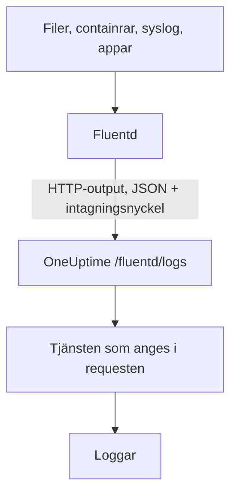

# Fluentd

[Fluentd](https://www.fluentd.org/) samlar in loggar från filer, containrar, syslog, applikationer och [många andra källor](https://www.fluentd.org/datasources). Dess inbyggda [HTTP-output](https://docs.fluentd.org/output/http) skickar dem till OneUptimes Fluentd-endpoint, där de blir sökbara under **Produkter → Loggar**.

:::cards
- [Konfigurera Fluentd](#konfigurera-fluentd): Lägg till en HTTP-output som pekar på OneUptime.
- [Så läses posterna](#så-läses-posterna): Vilka fält som blir meddelandet, allvarlighetsgraden och attribut.
- [OneUptime i egen drift](#oneuptime-i-egen-drift): Peka Fluentd mot din egen instans.
:::

## Så fungerar det



Fluentd skickar poster i omgångar som JSON, med din intagningsnyckel i headern `x-oneuptime-token` och tjänstnamnet i `x-oneuptime-service-name`. OneUptime gör varje post till en logg för den tjänsten och skapar tjänsten första gången den skickar.

## Innan du börjar

- **Installera Fluentd** – se [installationsguiden](https://docs.fluentd.org/installation).
- **Ett OneUptime-projekt.** I OneUptime Cloud debiteras telemetri per intagen GB – se [priser](https://oneuptime.com/pricing) – och ett projekt på Free-planen behöver en betalningsmetod innan det kan skicka telemetri.
- **En intagningsnyckel för telemetri.** Om du inte har någon:

:::steps
### Öppna intagningsnycklarna

Gå till **Produkter → Projektinställningar**, öppna **Telemetri och APM** i sidomenyn och välj **Intagningsnycklar**.


### Skapa en nyckel

Klicka på **Skapa intagningsnyckel**. Dialogen har redan fyllt i nyckelns namn och valt **Server** – den sortens nyckel som en applikation eller en collector skickar med – så klicka på **Skapa intagningsnyckel** för att skapa den, eller byt namn på den först.

### Kopiera hemligheten

Den nya nyckeln öppnas på en egen sida. Kopiera dess **Hemlig nyckel**: det är `YOUR_SERVICE_TOKEN` i konfigurationen nedan.


:::

## Konfigurera Fluentd

Fluentds konfigurationsfil är oftast `/etc/fluent/fluentd.conf`, eller `/etc/td-agent/td-agent.conf` för det äldre td-agent-paketet.

:::steps
### Lägg till en HTTP-output

Lägg till ett `<match>`-avsnitt som skickar poster till OneUptime. Ersätt `YOUR_SERVICE_TOKEN` med din intagningsnyckel och `YOUR_SERVICE_NAME` med namnet som loggarna ska visas under – vilket namn du vill:

```text title="fluentd.conf"
# Send the time Fluentd gave each event: the HTTP output sends only the record
<filter **>
  @type record_transformer
  enable_ruby true
  <record>
    fluentd_time ${time.utc.strftime("%Y-%m-%dT%H:%M:%S.%NZ")}
  </record>
</filter>

# Match all patterns
<match **>
  @type http

  endpoint https://oneuptime.com/fluentd/logs
  open_timeout 2

  headers {"x-oneuptime-token":"YOUR_SERVICE_TOKEN", "x-oneuptime-service-name":"YOUR_SERVICE_NAME"}

  content_type application/json
  json_array true

  # Send a batch again when OneUptime is busy (429) or restarting (502, 503, 504)
  retryable_response_codes 429,502,503,504

  <format>
    @type json
  </format>
  <buffer>
    # Keep the batches on disk until OneUptime takes them: a restart of Fluentd loses none
    @type file
    path /var/log/fluent/buffer/oneuptime
    total_limit_size 512m
    flush_interval 10s
    chunk_limit_size 900k
    # Try again at least every 30 seconds, for up to 72 hours
    retry_max_interval 30s
    retry_timeout 72h
  </buffer>
</match>

# Keep Fluentd's own logs out of OneUptime
<label @FLUENT_LOG>
  <match **>
    @type null
  </match>
</label>
```

`json_array true` skickar varje chunk i bufferten som en enda JSON-array, och `flush_interval 10s` skickar bufferten var 10:e sekund. `chunk_limit_size 900k` håller varje request under 1 MB, det mesta OneUptime tar emot på den här endpointen.

Även Fluentds standardinställning fungerar: utan `content_type` och `json_array true` skickar Fluentd radavgränsad JSON, en post per rad, och OneUptime läser varje rad som den post den är, med `compress gzip` eller utan.

`@type file` håller de batcher som ännu ska skickas i mappen som `path` anger, så att en omstart av Fluentd inte förlorar någon av dem; en buffert i minnet, Fluentds standard, förlorar det den håller. Fluentds användare måste kunna skriva i mappen: `/var/log/fluent` är fluent-packages, `/var/log/td-agent` td-agents och `/fluentd/log` den i avbilden `fluent/fluentd`. `total_limit_size 512m` håller högst 512 MB där; när den är full tar Fluentd inte emot fler poster förrän en batch har skickats.

`retryable_response_codes 429,502,503,504` skickar en batch igen när OneUptime är upptaget (`429`) eller startar om (`502`, `503`, `504`); utan den kastar Fluentd en batch vid alla svar utom `503`. `retry_max_interval 30s` väntar högst 30 sekunder mellan försöken, och `retry_timeout 72h` kastar en batch som fortfarande inte kan skickas efter 72 timmar. Filtret `record_transformer` lägger till den tid Fluentd gav varje post, som `fluentd_time`: HTTP-outputen skickar bara posten, och OneUptime läser en loggs tid från den.

### Starta om Fluentd

Starta om Fluentd-tjänsten så att den läser in den nya outputen.

### Kontrollera att loggarna kommer fram

Några sekunder efter nästa tömning visas loggarna under **Produkter → Loggar**. Tjänsten finns under **Produkter → Tjänster** – om den inte fanns tidigare skapar OneUptime den.
:::

## Fullständigt exempel

Den här konfigurationen tar emot poster över Fluentds forward-protokoll på port `24224`, bara från den här värden, och skickar alla till OneUptime:

```text title="fluentd.conf"
####
## Source descriptions:
##

## built-in TCP input
## @see https://docs.fluentd.org/input/forward
<source>
  @type forward
  port 24224
  # This host alone: see "Take records from other hosts" to open it
  bind 127.0.0.1
</source>

# Send the time Fluentd gave each event: the HTTP output sends only the record
<filter **>
  @type record_transformer
  enable_ruby true
  <record>
    fluentd_time ${time.utc.strftime("%Y-%m-%dT%H:%M:%S.%NZ")}
  </record>
</filter>

<match **>
  @type http

  endpoint https://oneuptime.com/fluentd/logs
  open_timeout 2

  headers {"x-oneuptime-token":"YOUR_SERVICE_TOKEN", "x-oneuptime-service-name":"YOUR_SERVICE_NAME"}

  content_type application/json
  json_array true

  # Send a batch again when OneUptime is busy (429) or restarting (502, 503, 504)
  retryable_response_codes 429,502,503,504

  <format>
    @type json
  </format>
  <buffer>
    # Keep the batches on disk until OneUptime takes them: a restart of Fluentd loses none
    @type file
    path /var/log/fluent/buffer/oneuptime
    total_limit_size 512m
    flush_interval 10s
    chunk_limit_size 900k
    # Try again at least every 30 seconds, for up to 72 hours
    retry_max_interval 30s
    retry_timeout 72h
  </buffer>
</match>

# Keep Fluentd's own logs out of OneUptime
<label @FLUENT_LOG>
  <match **>
    @type null
  </match>
</label>
```

`bind 127.0.0.1` tar bara emot poster från den här värden, som de från Dockers loggdrivrutin `fluentd`, som skickar till `localhost:24224`. För att skicka olika källor som olika tjänster använder du ett `<match>`-avsnitt per tagg, vart och ett med sitt eget `x-oneuptime-service-name` och sin egen buffert-`path`: Fluentd startar inte med två buffertar på samma sökväg.

## Ta emot poster från andra värdar

Med `bind 0.0.0.0` och inget avsnitt `<security>` kan alla som når port `24224` skicka loggar till OneUptime under din intagningsnyckel. För att ta emot poster från Fluentd eller Fluent Bit på andra värdar lyssnar du på alla adresser, kräver en delad nyckel av varje avsändare och använder TLS. Ersätt avsnittet `<source>` i det fullständiga exemplet med:

```text title="fluentd.conf on this host"
<source>
  @type forward
  port 24224
  bind 0.0.0.0
  <transport tls>
    cert_path /etc/fluent/certs/fluentd.crt
    private_key_path /etc/fluent/certs/fluentd.key
  </transport>
  <security>
    self_hostname fluentd.example.com
    shared_key YOUR_SHARED_KEY
  </security>
</source>
```

`cert_path` och `private_key_path` är ett certifikat för den här värdens namn, här `fluentd.example.com`, och dess nyckel, som Fluentds användare måste kunna läsa. Fluentd varnar när nyckeln saknar lösenfras; `private_key_passphrase` anger en. Ersätt `YOUR_SHARED_KEY` med en lång slumpmässig hemlighet, till exempel en från `openssl rand -base64 32`, och ge varje avsändare samma:

```text title="fluentd.conf on each sender"
<match **>
  @type forward
  transport tls
  # The certificate of the authority that signed this host's; not needed for a public one
  tls_cert_path /etc/fluent/certs/ca.crt
  <security>
    self_hostname app-1.example.com
    shared_key YOUR_SHARED_KEY
  </security>
  <server>
    host fluentd.example.com
    port 24224
  </server>
  <buffer>
    @type file
    path /var/log/fluent/buffer/forward
  </buffer>
</match>

# Keep Fluentd's own logs out of OneUptime
<label @FLUENT_LOG>
  <match **>
    @type null
  </match>
</label>
```

Fluent Bits `forward`-output tar samma inställningar: `Shared_Key`, `Self_Hostname`, `tls On` och `tls.ca_file`.

En avsändare utan nyckeln, eller utan TLS, avvisas. Själva nyckeln korsar aldrig nätverket: varje sida bevisar att den har den. Utan TLS kan alla i nätverket mellan värdarna läsa posterna. Öppna port `24224` i värdens brandvägg bara för de värdar som skickar. Körs Fluentd från loggguidens Docker Compose-fil, publicera då porten på alla adresser där också, `"24224:24224"`, och montera certifikatets mapp i containern.

## Så läses posterna

OneUptime läser de här fälten från varje post:

| Loggfält | Läses från postens första befintliga fält av | Anmärkningar |
| --- | --- | --- |
| Innehåll | `message`, `log`, `msg`, `body`, `text` | Loggraden. En post utan något av dem sparas i sin helhet, som JSON. |
| Allvarlighetsgrad | `level`, `severity`, `loglevel`, `log_level`, `priority`, `severityText`, `severity_text` | Namn som `trace`, `debug`, `info`, `notice`, `warn`, `error`, `critical` och `fatal`, med stora eller små bokstäver. Alla andra värden sparas som `Unspecified`. |
| Trace-ID | `trace_id`, `traceId`, `traceid` | Kopplar loggen till dess trace. |
| Span-ID | `span_id`, `spanId`, `spanid` | Kopplar loggen till dess span. |
| Tjänst | headern `x-oneuptime-service-name` | `Fluentd` när headern inte är satt. |
| Tid | `time`, `timestamp`, `@timestamp`, `ts`, `fluentd_time` | En ISO 8601-tid, till exempel `2026-11-14T08:00:00.123Z`, eller sekunder, millisekunder, mikrosekunder eller nanosekunder sedan epoken; en tid utan tidszon är UTC. En tid före 2000, eller mer än en dag framåt, läses inte. Fältet som tiden läses från sparas inte som attribut. En post utan tid sparas vid den tidpunkt då OneUptime tar emot den. |

Alla andra fält blir ett attribut med namnet `fluentd.` följt av fältets namn, som du kan söka och filtrera på: ett fält `container_name` är `@fluentd.container_name` i loggutforskaren. Ett nästlat objekt plattas ut med punkter, som `fluentd.kubernetes.pod_name`, och en lista sparas som JSON.

Fluentd-loggar går igenom dina [loggpipelines](/docs/telemetry/log-pipelines), drop-filter och maskeringsregler precis som alla andra loggar.

## OneUptime i egen drift

Ersätt `https://oneuptime.com` i `endpoint` med URL:en till din OneUptime-instans: `http(s)://YOUR_ONEUPTIME_HOST/fluentd/logs`.

## Felsökning

:::details Fluentd loggar `401` från HTTP-outputen
Intagningsnyckeln saknas, är okänd eller har gått ut. Kontrollera värdet på `x-oneuptime-token` i `headers`.
:::

:::details Fluentd loggar `402` eller `422`
`402`: i OneUptime Cloud har projektet Free-planen och ingen betalningsmetod. Lägg till en under **Projektinställningar → Fakturering och fakturor → Fakturering**. `422`: nyckeln är inaktiverad, eller så är det en webbläsarnyckel. Slå på **Aktiverad** igen i nyckelns inställningar, eller skapa en **Server**-nyckel.
:::

:::details Fluentd loggar `413`
Requesten är större än 1 MB, det mesta OneUptime tar emot på den här endpointen. Ange `chunk_limit_size 900k` i avsnittet `<buffer>`, som i konfigurationen ovan.
:::

:::details Fluentd loggar `429`, `502`, `503` eller `504`
OneUptime är upptaget eller startar om. Med `retryable_response_codes 429,502,503,504` i avsnittet `<match>`, som i konfigurationen ovan, behåller Fluentd batchen och skickar den igen; utan den kastar Fluentd batchen. Med `@type file` i avsnittet `<buffer>` behåller Fluentd också batchen när den startar om.
:::

:::details Loggar visar tiden då OneUptime tog emot dem, inte sin egen
OneUptime läser en loggs tid från dess post, och Fluentds HTTP-output skickar bara posten. Ett avsnitt `<parse>` tar bort fältet `time` ur posten, som händelsens tid: lägg till `time_key fluentd_time` i det, så att det inte läser någon posts tid och lämnar `time` som det är. Lägg också till filtret `record_transformer` från konfigurationen ovan: det lägger till den tid Fluentd gav varje post, som `fluentd_time`.
:::

:::details En JSON-rad vars `time` är `null`, `true`, en lista eller ett objekt kommer aldrig fram
Fluentds `json`-parser läser en rads fält `time` som händelsens tid, och kastar utan varning en rad vars `time` varken är text eller ett tal. Lägg till `time_key fluentd_time` i dess avsnitt `<parse>`, som ovan: då lämnar Fluentd `time` i posten som det är. Med filtret `record_transformer` ovan lagrar OneUptime loggen vid den tid Fluentd läste den, `fluentd_time`; utan det vid den tid OneUptime tar emot den.
:::

:::details Loggarna kommer under tjänsten `Fluentd`
Headern `x-oneuptime-service-name` saknas. Lägg till den i `headers` i varje `<match>`-avsnitt.
:::

:::details Logginnehållet visar hela posten som JSON
OneUptime tar innehållet från det första befintliga fältet av `message`, `log`, `msg`, `body` eller `text`, och sparar hela posten när den inte har något av dem. Byt namn på fältet med din loggrad till ett av dem, till exempel med Fluentds filter `record_transformer`.
:::

Har du frågor eller behöver hjälp med konfigurationen kan du skriva till oss på support@oneuptime.com.

## Nästa steg

:::cards
- [Loggpipelines](/docs/telemetry/log-pipelines): Tolka och berika loggarna som Fluentd skickar.
- [Söksyntax](/docs/telemetry/search-syntax): Hitta loggarna i loggutforskaren.
- [Fluent Bit](/docs/telemetry/fluentbit): En lättare agent som skickar över OpenTelemetry.
- [Loggövervakning](/docs/monitor/logs-monitor): Larma när matchande loggar dyker upp.
:::
