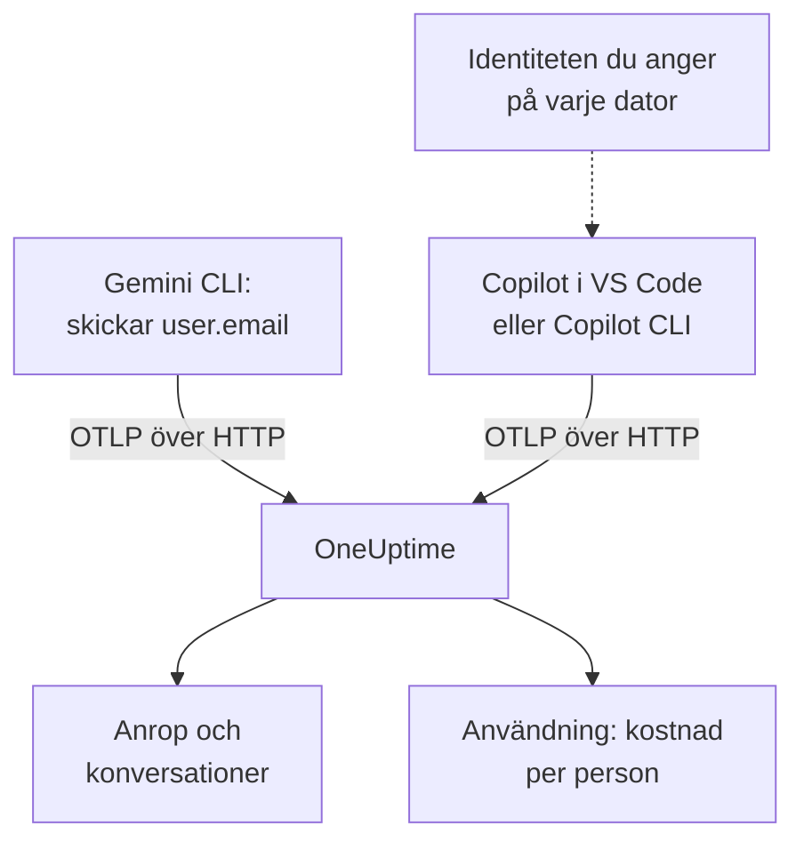

# Gemini CLI och GitHub Copilot

Gemini CLI och GitHub Copilot exporterar båda OpenTelemetry själva: rikta dem mot OneUptime, så kommer deras modellanrop, tokens, kostnader och verktygsanrop in i [AI / LLM](/docs/telemetry/ai-llm-observability), bredvid AI-anropen från dina egna appar. De skiljer sig åt i det som betyder mest för internfakturering: Gemini CLI namnger personen på varje post, och Copilot namnger ingen, så du namnger varje utvecklare själv.

:::cards
- [Gemini CLI](#konfigurera-gemini-cli): Slå på telemetri, med spår, och skicka den direkt till OneUptime.
- [GitHub Copilot](#konfigurera-github-copilot): Exportera från VS Code eller Copilot CLI.
- [Namnge varje utvecklare](#namnge-varje-utvecklare): Identiteten som Copilot utelämnar.
- [Felsökning](#felsökning): Vad du kontrollerar när ingenting kommer fram.
:::

## Så fungerar det



| | Gemini CLI | GitHub Copilot |
| --- | --- | --- |
| Skickar | Spår, metriker och loggar | Spår, metriker och händelser, bara från sina agentytor |
| Namnger personen | `user.email`, när någon är inloggad | Ingen: du anger `enduser.id` och `user.email` |
| Prompttext | Skickas, om du inte stänger av `logPrompts` | Skickas inte, om du inte slår på `captureContent` |
| Skickar som standard till | `http://localhost:4317`, över gRPC | `http://localhost:4318`, över HTTP |

## Innan du börjar

- En ingestion-nyckel: öppna **Projektinställningar → Telemetri och APM → Intagningsnycklar** och klicka på **Skapa ingestion-nyckel**.
- Din OTLP-bas-URL: `https://oneuptime.com/otlp`, eller `https://YOUR-ONEUPTIME-HOST/otlp` om du hostar OneUptime själv.
- Nyckeln följer med i huvudet `x-oneuptime-token` i varje exportbegäran.

## Konfigurera Gemini CLI

Gemini CLI skickar spår, metriker och logghändelser, och sätter `user.email` på varje post när någon är inloggad. OneUptime läser `user.email` som den anställda, så varje persons kostnad visas utan mappningstabell och utan konfiguration per dator.

:::steps
### Slå på telemetri

Lägg till ett block `telemetry` i användarinställningsfilen på varje dator, eller i `.gemini/settings.json` i ett repository:

```json title="~/.gemini/settings.json"
{
  "telemetry": {
    "enabled": true,
    "target": "local",
    "otlpEndpoint": "https://oneuptime.com/otlp",
    "otlpProtocol": "http",
    "otlpHeaders": {
      "x-oneuptime-token": "YOUR_INGESTION_TOKEN"
    },
    "traces": true,
    "logPrompts": false
  }
}
```

### Starta en ny session

Gemini CLI läser sina inställningar när den startar, så starta om den och kör en prompt.

### Kontrollera att data kommer fram

Öppna **Produkter → AI / LLM → Anrop**: anropen listas under tjänsten `gemini-cli`, med modellen och tokens.
:::

Tre inställningar i det blocket betyder mer än resten:

- `otlpProtocol: "http"`. Gemini CLI använder gRPC om du inte anger något annat. Över HTTP lägger den själv till `/v1/traces`, `/v1/metrics` och `/v1/logs` till bas-URL:en. OneUptime tar också emot gRPC på port 443 (se [OTLP över gRPC](/docs/telemetry/open-telemetry#otlp-över-grpc)), men HTTP är enklare.
- `traces: true`. Den är avstängd som standard, och utan den bär Gemini CLI:s spans varken modell eller tokenräkningar, så ingenting kan prissättas. Gemini CLI skickar inte heller någon kostnadsmetrik: slå på spår för att se vad dess anrop kostar.
- `logPrompts: false`. Läs varningen nedan.

> [!WARNING]
> `logPrompts` är `true` som standard, så när du slår på telemetri skickas texten som dina utvecklare skriver: ofta källkod, kunddata och inklistrade inloggningsuppgifter. Sätt den till `false` i samma ändring som slår på telemetrin. Vill du ha prompter för felsökning, bestäm det medvetet, och maskera det som behövs med rensningsregler under **Spår → Inställningar**.

### Inställningar för en flotta

Varje inställning har en miljövariabel, och variablerna går före ett repositorys `.gemini/settings.json`, vilket gör dem till platsen för en flottpolicy som rullas ut via MDM:

```bash
export GEMINI_TELEMETRY_ENABLED=true
export GEMINI_TELEMETRY_TARGET=local
export GEMINI_TELEMETRY_OTLP_ENDPOINT="https://oneuptime.com/otlp"
export GEMINI_TELEMETRY_OTLP_PROTOCOL=http
export GEMINI_TELEMETRY_OTLP_HEADERS="x-oneuptime-token=YOUR_INGESTION_TOKEN"
export GEMINI_TELEMETRY_TRACES_ENABLED=true
export GEMINI_TELEMETRY_LOG_PROMPTS=false
```

| Inställning | Variabel | Standard | Vad den gör |
| --- | --- | --- | --- |
| `enabled` | `GEMINI_TELEMETRY_ENABLED` | `false` | Slår på telemetri |
| `target` | `GEMINI_TELEMETRY_TARGET` | `local` | `local` skickar till slutpunkten du anger; `gcp` skickar till Google Cloud |
| `otlpEndpoint` | `GEMINI_TELEMETRY_OTLP_ENDPOINT` | `http://localhost:4317` | Vart telemetrin skickas |
| `otlpProtocol` | `GEMINI_TELEMETRY_OTLP_PROTOCOL` | `grpc` | `grpc` eller `http` |
| `otlpHeaders` | `GEMINI_TELEMETRY_OTLP_HEADERS` | Inga | Huvuden på varje export: ett objekt i filen, `key=value`-par eller JSON i variabeln |
| `traces` | `GEMINI_TELEMETRY_TRACES_ENABLED` | `false` | Lägger modellen, tokens och innehållet på spans |
| `logPrompts` | `GEMINI_TELEMETRY_LOG_PROMPTS` | `true` | Lägger prompttext i logghändelser |
| `outfile` | `GEMINI_TELEMETRY_OUTFILE` | Ingen | Skriver telemetri till en fil i stället, för att se vad som skulle skickas |

Kommandoradsflaggor går före variablerna `GEMINI_TELEMETRY_*`, som går före standardvariablerna `OTEL_EXPORTER_OTLP_*`, som går före `settings.json`. Gemini CLI läser också `OTEL_EXPORTER_OTLP_HEADERS`, så ett huvud som du redan har angett för andra verktyg når även den.

:::details Skicka via en OpenTelemetry Collector i stället
En collector på varje dator, eller en per team, kan samla ihop, försöka igen och dirigera telemetri innan den når OneUptime. Låt Gemini CLI använda sina standardvärden, som skickar gRPC till `http://localhost:4317`, och låt collectorn lägga till nyckeln:

```yaml title="otel-collector-config.yaml"
receivers:
  otlp:
    protocols:
      grpc:
        endpoint: 0.0.0.0:4317
      http:
        endpoint: 0.0.0.0:4318

exporters:
  otlphttp:
    endpoint: "https://oneuptime.com/otlp"
    headers:
      "x-oneuptime-token": "YOUR_INGESTION_TOKEN"

service:
  pipelines:
    traces:
      receivers: [otlp]
      exporters: [otlphttp]
    metrics:
      receivers: [otlp]
      exporters: [otlphttp]
    logs:
      receivers: [otlp]
      exporters: [otlphttp]
```

Se [OpenTelemetry](/docs/telemetry/open-telemetry) för hur du kör en collector.
:::

### Vad Gemini CLI skickar

| Metrik | Vad den bär |
| --- | --- |
| `gen_ai.client.token.usage` | In- och utdatatokens: serien som OneUptime räknar |
| `gemini_cli.token.usage` | Samma tokens under Gemini CLI:s eget namn, plus dess tokens `thought`, `cache` och `tool`; räknas inte, så att tokens aldrig räknas två gånger |
| `gen_ai.client.operation.duration` | Hur lång tid varje modellanrop tog |
| `gemini_cli.api.request.count` | Modellanrop |
| `gemini_cli.tool.call.count` | Verktygsanrop |
| `gemini_cli.session.count` | Startade sessioner |
| `gemini_cli.lines.changed` | Rader som agenten ändrade |

Dess logghändelser omfattar `gemini_cli.user_prompt`, `gemini_cli.api_request`, `gemini_cli.api_response`, `gemini_cli.api_error`, `gemini_cli.tool_call` och `gemini_cli.file_operation`. Varje post bär `session.id`, `installation.id`, `active_approval_mode` och, när någon är inloggad, `user.email`. OneUptime läser `session.id` som ett konversations-ID, så en hel session i Gemini CLI visas som en enda konversation under **Konversationer**, hur många spår den än tog.

Metrikerna är vanliga OpenTelemetry-metriker: visa vilken som helst av dem i ett diagram på en instrumentpanel, eller larma på en med en [Metrikövervakning](/docs/monitor/metrics-monitor).

## Konfigurera GitHub Copilot

GitHub dokumenterar OpenTelemetry bara för Copilots agentytor:

| Yta | Skickar OpenTelemetry |
| --- | --- |
| Copilot Chat och agentläget i VS Code | Ja |
| Copilot CLI | Ja |
| Copilot SDK | Ja |
| Agentarbetsflöden i JetBrains-IDE:er | Ja, angivet i inställningarna för Copilot-pluginet |
| Inline-kompletteringar, Copilot på github.com, kodgranskning med Copilot | Inte dokumenterat |

Ett team som mest använder inline-kompletteringar ser därför inaktivt ut i OneUptime, hur exporten än är konfigurerad.

:::tabs
@tab VS Code
```json title="settings.json"
{
  "github.copilot.chat.otel.enabled": true,
  "github.copilot.chat.otel.exporterType": "otlp-http",
  "github.copilot.chat.otel.otlpEndpoint": "https://oneuptime.com/otlp",
  "github.copilot.chat.otel.captureContent": false
}
```
@tab Copilot CLI
```bash
export COPILOT_OTEL_ENABLED=true
export OTEL_EXPORTER_OTLP_ENDPOINT="https://oneuptime.com/otlp"
export OTEL_EXPORTER_OTLP_HEADERS="x-oneuptime-token=YOUR_INGESTION_TOKEN"
```
@tab Hanterade inställningar
```json
{
  "telemetry": {
    "enabled": true,
    "endpoint": "https://oneuptime.com/otlp",
    "protocol": "http/protobuf",
    "serviceName": "github-copilot",
    "captureContent": false,
    "lockCaptureContent": true,
    "headers": {
      "x-oneuptime-token": "YOUR_INGESTION_TOKEN"
    }
  }
}
```
:::

- VS Codes inställningar har ingen nyckel för huvuden: ange `OTEL_EXPORTER_OTLP_HEADERS` i miljön som VS Code startar från, som för Copilot CLI. Miljövariabler går före VS Codes inställningar.
- Hanterade inställningar, som ett företag rullar ut till VS Code och Copilot CLI, bär nyckeln i `headers` och går före det som varje utvecklare anger. `lockCaptureContent` håller insamlingen av prompter avstängd för alla. `protocol` är där dataformatet, `http/protobuf` eller `http/json`.
- `captureContent` är avstängd som standard, så prompter och svar skickas inte om du inte slår på den.

## Namnge varje utvecklare

Copilot skickar ingen identitet som OneUptime kan använda. Dess inställning `captureIdentity` lägger till `user.name`, och Copilot CLI kan lägga till `enduser.pseudo.id`, men OneUptime läser ingen av dem som den anställda. Utan en identitet hamnar alla Copilots kostnader i en enda rad **Ej tilldelat** på fliken **Användning**.

Ange identiteten på varje dator, i miljön som VS Code och Copilot CLI startar från: en skalprofil eller ett skript som din MDM kör.

```bash
export OTEL_RESOURCE_ATTRIBUTES="enduser.id=alice@example.com,user.email=alice@example.com,team.id=platform,cost_center=eng-tools"
```

| Attribut | OneUptime läser det som |
| --- | --- |
| `enduser.id` | Den anställdas ID |
| `user.email` | Den anställdas e-postadress: namnet som fliken **Användning** visar |
| `team.id`, `team`, `cost_center`, `department` | Teamet eller kostnadsstället |

Det här är resursattribut, så de kommer in som `resource.enduser.id`, `resource.user.email` och så vidare: OneUptime läser varje identitets- och teamnyckel med eller utan prefixet `resource.`. Gemini CLI skickar redan `user.email`; ge den `OTEL_RESOURCE_ATTRIBUTES` bara för teamet.

- Ange identiteten före det första anropet: anrop som kom in utan en kan inte tilldelas i efterhand.
- Utelämna `resourceAttributes` från Copilots hanterade inställningar: de går före `OTEL_RESOURCE_ATTRIBUTES` och skulle ersätta identiteten som du anger på varje dator.
- Använd inte `gen_ai.user` eller `llm.user`. I en app som betjänar kunder namnger de kunden, så OneUptime läser dem aldrig som den anställda.

## Så ser Copilots data ut

Copilot följer OpenTelemetrys GenAI-konventioner, så dess anrop visas i **Anrop**, **Konversationer** och **Användning** precis som anropen från dina egna appar.

| Span | Ett per |
| --- | --- |
| `invoke_agent` | Agenttur |
| `chat` | Modellanrop |
| `execute_tool` | Verktygsanrop |
| `execute_hook` | Hookkörning |

Dess spans bär modellen, `gen_ai.usage.input_tokens`, `gen_ai.usage.output_tokens` och `gen_ai.conversation.id`, så en hel agenttur visas som en enda konversation. Båda ytorna skickar också metrikerna `gen_ai.client.token.usage` och `gen_ai.client.operation.duration`, och händelser på OTLP-loggsignalen: behåll en pipeline `logs` i varje collector som du sätter emellan.

OneUptime prissätter varje anrop utifrån dess modell och tokens, med priserna under **Priser**. Det är vad tokens skulle kosta till listpris, inte vad GitHub fakturerar dig: Copilot betalas per licens och per premiumbegäran.

Licenser, licensaktivitet och fakturering av premiumbegäranden finns inte alls i OpenTelemetry: de finns i GitHubs REST-API, som OneUptime inte läser. Hämta licens- och faktureringssiffror från GitHub.

## Felsökning

:::details Ingenting kommer från Gemini CLI
Den vanliga orsaken är att `otlpProtocol` står kvar på standardvärdet `grpc` medan slutpunkten är HTTP-URL:en. Sätt `otlpProtocol` till `http`, och kontrollera att `otlpEndpoint` är bas-URL:en som slutar på `/otlp` och att huvudet `x-oneuptime-token` är angivet. Ange `outfile` en kort stund för att se vad Gemini CLI skulle skicka.
:::

:::details Gemini CLI:s anrop kommer utan modell, tokens eller kostnad
`traces` är avstängd. Slå på den: utan den bär Gemini CLI:s spans varken modell eller tokenräkningar, och den skickar ingen kostnadsmetrik.
:::

:::details Copilots kostnader visas som Ej tilldelat
Identiteten nådde inte exportören. Kontrollera att `OTEL_RESOURCE_ATTRIBUTES` är angiven i miljön som VS Code eller Copilot CLI startade från, och att Copilots hanterade inställningar inte anger `resourceAttributes`, som skulle ersätta den.
:::

:::details Copilot skickar ingenting alls
Kontrollera att personerna du väntar dig använder en agentyta och inte inline-kompletteringar, och att `OTEL_EXPORTER_OTLP_HEADERS` bär nyckeln: VS Codes egna inställningar kan inte göra det.
:::

:::details Nyckeln avvisas
OneUptime svarar `401` på en saknad, okänd eller utgången nyckel och `422` på en inaktiverad nyckel eller en webbläsarnyckel. Använd en servernyckel, skickad i `x-oneuptime-token`.
:::

## Nästa steg

:::cards
- [AI-kodassistenter](/docs/telemetry/ai-coding-assistants): Vem som använder vilket verktyg, och vad varje person och team kostar.
- [AI- / LLM-observerbarhet](/docs/telemetry/ai-llm-observability): Attributen som OneUptime läser, hur kostnader räknas ut och dagliga budgetar.
- [AI-gatewayer](/docs/telemetry/ai-gateways): Verktyg utan egen export, via en gateway.
:::
