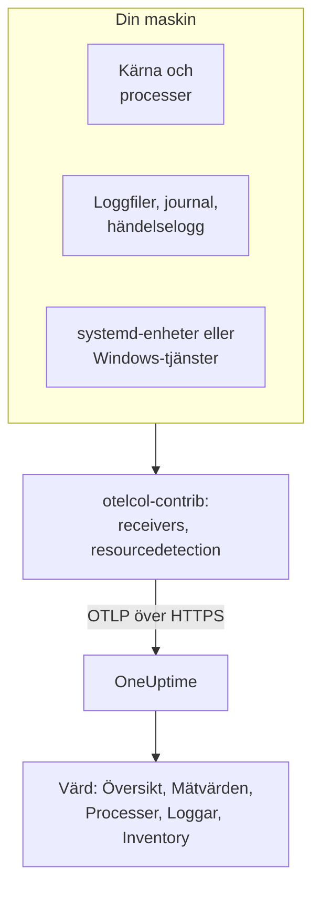

# OpenTelemetry-collector på värden

Kör OpenTelemetry Collector på en Linux-, macOS- eller Windows-maskin för att skicka dess mätvärden, processer, loggar och tjänstetillstånd till OneUptime. Maskinen visas under **Produkter → Infrastruktur → Värdar** med egna sidor, utan någon OneUptime-agent att installera: collectorn är uppströmsutgåvan `otelcol-contrib`. [Värdmonitorer](/docs/monitor/host-monitor) larmar på det den skickar.

:::cards
- [Installera collectorn](#installera-collectorn): Tre steg på Linux, macOS eller Windows.
- [Välj vad som ska samlas in](#välj-vad-som-ska-samlas-in): Mätvärden, filloggar, journalen, händelseloggar och tjänstetillstånd.
- [Inventarieattribut](#inventarieattribut-ip-mac-serienummer-tillverkare-modell-firmware): IP, MAC, serienummer, tillverkare, modell och firmware för din CMDB.
- [Skicka mindre](#minska-mängden-data-som-samlas-in): Färre loggrader, grövre intervall, färre serier.
:::

## Så fungerar det

Collectorn läser maskinen genom sina receivers, stämplar varje post med maskinens identitet och skickar den till OneUptime över OTLP med din intagningsnyckel. OneUptime registrerar värden utifrån de första mätvärdena och fyller i dess sidor allteftersom data kommer in.



| Det du ser på värden | Var det kommer ifrån |
| --- | --- |
| **Översikt** och **Mätvärden** | Receivern `hostmetrics`: CPU, minne, diskar, filsystem, nätverk, belastning, paging. |
| **Processer** | Skraparen `process` i `hostmetrics`: en uppsättning serier per process. |
| **Loggar** | Receivrarna `filelog`, `journald` och `windowseventlog`. |
| **Systemd Units** (Linux) | Receivern `systemd`. |
| **Tjänster** (Windows) | Receivern `windows_service`. |
| Inventarieposten | Processorn `resourcedetection`, plus [attributen du stämplar](#inventarieattribut-ip-mac-serienummer-tillverkare-modell-firmware). |
| **Agentversion** | `oneuptime.agent.version` i processorn `resource`. |

En värd registreras så snart en batch som har `host.name` också har `hostmetrics`- eller `process`-mätvärden, eller ett `os.type`-attribut. Processorn `resourcedetection` sätter alla dessa, och därför lägger varje konfiguration den först. `host.id` eller `host.arch` ensamma registrerar ingen värd, och telemetri med en Kubernetes-identitet (`k8s.cluster.name`, `k8s.node.name`, `k8s.pod.name`) arkiveras i stället under sitt kluster: övervaka Kubernetes-noder med [Kubernetes-agenten](/docs/telemetry/kubernetes-agent).

## Innan du börjar

- En intagningsnyckel. Skapa en under **Projektinställningar → Telemetri och APM → Intagningsnycklar** och kopiera värdet. Collectorn skickar den som huvudet `x-oneuptime-token`.
- Administratörsrättigheter på maskinen: `sudo` på Linux och macOS, en PowerShell-prompt med förhöjda rättigheter på Windows.
- Utgående HTTPS från maskinen till din OneUptime-URL.
- Contrib-distributionen av collectorn, `otelcol-contrib`. Kärnbygget `otelcol` saknar de receivers och processorer som dessa konfigurationer använder. Receivern `systemd` (Linux) fungerar från v0.143.0 och receivern `windows_service` (Windows) från v0.155.0; kommandona nedan installerar v0.161.0, den utgåva som OneUptime låser.

## Installera collectorn

:::steps
### Spara konfigurationen

Spara detta som `config.yaml` i mappen du kör installationskommandona från, och ersätt `YOUR_TELEMETRY_INGESTION_TOKEN` med din intagningsnyckel (och slutpunkten med din egen URL om du kör självhostat).

:::tabs
@tab Linux
```yaml title="config.yaml"
receivers:
  hostmetrics:
    collection_interval: 30s
    scrapers:
      cpu:
        metrics:
          system.cpu.utilization:
            enabled: true
          system.cpu.logical.count:
            enabled: true
      memory:
        metrics:
          system.memory.utilization:
            enabled: true
      disk:
      filesystem:
        metrics:
          system.filesystem.utilization:
            enabled: true
      load:
      network:
      paging:
      processes:
      process:
        mute_process_name_error: true
        mute_process_exe_error: true
        mute_process_io_error: true
        metrics:
          process.cpu.utilization:
            enabled: true
          process.memory.utilization:
            enabled: true

  # The systemd journal: every unit's logs, info and above.
  journald:
    directory: /var/log/journal
    priority: info

  # Powers the Systemd Units tab (otelcol-contrib v0.143.0+).
  systemd:
    collection_interval: 30s
    units: ["*.service"]
    metrics:
      systemd.service.cpu.time:
        enabled: false

processors:
  # Stamps host.name, host.id and os.type: this is how OneUptime attaches
  # telemetry to the host. Without it the host's pages stay empty.
  resourcedetection:
    detectors: [system, env]
    system:
      hostname_sources: [os]
      resource_attributes:
        host.name:
          enabled: true
        host.id:
          enabled: true
        host.arch:
          enabled: true
        host.ip:
          enabled: true
        host.mac:
          enabled: true
        os.type:
          enabled: true
        os.description:
          enabled: true
        os.version:
          enabled: true
  # The collector release this config is for: the host's Agent Version.
  resource:
    attributes:
      - key: oneuptime.agent.version
        value: "0.161.0"
        action: upsert
  batch:

exporters:
  otlphttp/oneuptime:
    endpoint: https://oneuptime.com/otlp
    headers:
      x-oneuptime-token: YOUR_TELEMETRY_INGESTION_TOKEN

service:
  pipelines:
    metrics:
      receivers: [hostmetrics, systemd]
      processors: [resourcedetection, resource, batch]
      exporters: [otlphttp/oneuptime]
    logs:
      receivers: [journald]
      processors: [resourcedetection, resource, batch]
      exporters: [otlphttp/oneuptime]
```
@tab macOS
```yaml title="config.yaml"
receivers:
  hostmetrics:
    collection_interval: 30s
    scrapers:
      cpu:
        metrics:
          system.cpu.utilization:
            enabled: true
          system.cpu.logical.count:
            enabled: true
      memory:
        metrics:
          system.memory.utilization:
            enabled: true
      disk:
      filesystem:
        metrics:
          system.filesystem.utilization:
            enabled: true
      load:
      network:
      paging:
      processes:
      process:
        mute_process_name_error: true
        mute_process_exe_error: true
        mute_process_io_error: true
        metrics:
          process.cpu.utilization:
            enabled: true
          process.memory.utilization:
            enabled: true

  filelog/system:
    include:
      - /var/log/install.log
      - /var/log/wifi.log
    start_at: end

processors:
  # Stamps host.name, host.id and os.type: this is how OneUptime attaches
  # telemetry to the host. Without it the host's pages stay empty.
  resourcedetection:
    detectors: [system, env]
    system:
      hostname_sources: [os]
      resource_attributes:
        host.name:
          enabled: true
        host.id:
          enabled: true
        host.arch:
          enabled: true
        host.ip:
          enabled: true
        host.mac:
          enabled: true
        os.type:
          enabled: true
        os.description:
          enabled: true
        os.version:
          enabled: true
  # The collector release this config is for: the host's Agent Version.
  resource:
    attributes:
      - key: oneuptime.agent.version
        value: "0.161.0"
        action: upsert
  batch:

exporters:
  otlphttp/oneuptime:
    endpoint: https://oneuptime.com/otlp
    headers:
      x-oneuptime-token: YOUR_TELEMETRY_INGESTION_TOKEN

service:
  pipelines:
    metrics:
      receivers: [hostmetrics]
      processors: [resourcedetection, resource, batch]
      exporters: [otlphttp/oneuptime]
    logs:
      receivers: [filelog/system]
      processors: [resourcedetection, resource, batch]
      exporters: [otlphttp/oneuptime]
```
@tab Windows
```yaml title="config.yaml"
receivers:
  hostmetrics:
    collection_interval: 30s
    scrapers:
      cpu:
        metrics:
          system.cpu.utilization:
            enabled: true
          system.cpu.logical.count:
            enabled: true
      memory:
        metrics:
          system.memory.utilization:
            enabled: true
      disk:
      filesystem:
        metrics:
          system.filesystem.utilization:
            enabled: true
      load:
      network:
      paging:
      processes:
      process:
        mute_process_name_error: true
        mute_process_exe_error: true
        mute_process_io_error: true
        metrics:
          process.cpu.utilization:
            enabled: true
          process.memory.utilization:
            enabled: true

  windowseventlog/system:
    channel: System
    start_at: end

  windowseventlog/application:
    channel: Application
    start_at: end

  windowseventlog/security:
    channel: Security
    start_at: end

  # Powers the Services tab (otelcol-contrib v0.155.0+).
  windows_service:
    collection_interval: 30s

processors:
  # Stamps host.name, host.id and os.type: this is how OneUptime attaches
  # telemetry to the host. Without it the host's pages stay empty.
  resourcedetection:
    detectors: [system, env]
    system:
      hostname_sources: [os]
      resource_attributes:
        host.name:
          enabled: true
        host.id:
          enabled: true
        host.arch:
          enabled: true
        host.ip:
          enabled: true
        host.mac:
          enabled: true
        os.type:
          enabled: true
        os.description:
          enabled: true
        os.version:
          enabled: true
  # The collector release this config is for: the host's Agent Version.
  resource:
    attributes:
      - key: oneuptime.agent.version
        value: "0.161.0"
        action: upsert
  batch:

exporters:
  otlphttp/oneuptime:
    endpoint: https://oneuptime.com/otlp
    headers:
      x-oneuptime-token: YOUR_TELEMETRY_INGESTION_TOKEN

service:
  pipelines:
    metrics:
      receivers: [hostmetrics, windows_service]
      processors: [resourcedetection, resource, batch]
      exporters: [otlphttp/oneuptime]
    logs:
      receivers:
        - windowseventlog/system
        - windowseventlog/application
        - windowseventlog/security
      processors: [resourcedetection, resource, batch]
      exporters: [otlphttp/oneuptime]
```
:::

Varje konfiguration är den som instrumentpanelen skriver under **Produkter → Infrastruktur → Värdar → Dokumentation**, med en loggpipeline tillagd: processorerna är `resourcedetection`, `resource` och `batch`, och exportören är `otlphttp/oneuptime`. Den sätter ingen `service.name`, så värdens telemetri tillhör värden själv, arkiverad som `host/<hostname>`. Lägg bara till en `service.name` i processorn `resource` om du vill att den i stället arkiveras under en telemetritjänst med det namnet.

### Installera och starta collectorn

:::tabs
@tab Linux
På Debian eller Ubuntu:

```bash
VERSION=0.161.0                      # the release OneUptime pins
ARCH=$(dpkg --print-architecture)   # amd64 or arm64

curl -fL -o /tmp/otelcol-contrib.deb \
  "https://github.com/open-telemetry/opentelemetry-collector-releases/releases/download/v${VERSION}/otelcol-contrib_${VERSION}_linux_${ARCH}.deb"
sudo dpkg -i /tmp/otelcol-contrib.deb
```

På RHEL, CentOS, Fedora eller Amazon Linux:

```bash
VERSION=0.161.0
ARCH=$(uname -m | sed 's/x86_64/amd64/;s/aarch64/arm64/')

curl -fL -o /tmp/otelcol-contrib.rpm \
  "https://github.com/open-telemetry/opentelemetry-collector-releases/releases/download/v${VERSION}/otelcol-contrib_${VERSION}_linux_${ARCH}.rpm"
sudo rpm -Uvh /tmp/otelcol-contrib.rpm
```

Paketet installerar `/usr/bin/otelcol-contrib` och en systemd-enhet, och startar den med en standardkonfiguration. Lägg din på plats, låt collectorns användare läsa journalen och starta om den:

```bash
sudo install -m 0644 config.yaml /etc/otelcol-contrib/config.yaml
sudo usermod -aG systemd-journal otelcol-contrib
sudo systemctl enable otelcol-contrib
sudo systemctl restart otelcol-contrib
sudo systemctl status otelcol-contrib
```

Den paketerade enheten kör collectorn som den oprivilegierade användaren `otelcol-contrib`. Gruppen `systemd-journal` låter den läsa journalen; för att följa filer i `/var/log` (läsbara för gruppen `adm` på Debian och Ubuntu) lägger du också till den gruppen. För att skraparen `process` ska se andra användares processer ger du den förmågan `CAP_SYS_PTRACE`.
@tab macOS
```bash
VERSION=0.161.0
ARCH=$(uname -m | sed 's/x86_64/amd64/')   # arm64 on Apple silicon, amd64 on Intel

curl -fL -o /tmp/otelcol-contrib.tar.gz \
  "https://github.com/open-telemetry/opentelemetry-collector-releases/releases/download/v${VERSION}/otelcol-contrib_${VERSION}_darwin_${ARCH}.tar.gz"

sudo mkdir -p /usr/local/otelcol-contrib /usr/local/bin /etc/otelcol-contrib
sudo tar -xzf /tmp/otelcol-contrib.tar.gz -C /usr/local/otelcol-contrib
sudo ln -sf /usr/local/otelcol-contrib/otelcol-contrib /usr/local/bin/otelcol-contrib
sudo install -m 0644 config.yaml /etc/otelcol-contrib/config.yaml
```

Skapa `/Library/LaunchDaemons/com.oneuptime.otelcol-contrib.plist`, så att launchd startar collectorn med Macen och startar om den om den stannar:

```xml title="/Library/LaunchDaemons/com.oneuptime.otelcol-contrib.plist"
<?xml version="1.0" encoding="UTF-8"?>
<!DOCTYPE plist PUBLIC "-//Apple//DTD PLIST 1.0//EN" "http://www.apple.com/DTDs/PropertyList-1.0.dtd">
<plist version="1.0">
<dict>
  <key>Label</key><string>com.oneuptime.otelcol-contrib</string>
  <key>ProgramArguments</key>
  <array>
    <string>/usr/local/bin/otelcol-contrib</string>
    <string>--config=/etc/otelcol-contrib/config.yaml</string>
  </array>
  <key>RunAtLoad</key><true/>
  <key>KeepAlive</key><true/>
  <key>StandardOutPath</key><string>/var/log/otelcol-contrib.out.log</string>
  <key>StandardErrorPath</key><string>/var/log/otelcol-contrib.err.log</string>
</dict>
</plist>
```

Läs in den:

```bash
sudo launchctl load -w /Library/LaunchDaemons/com.oneuptime.otelcol-contrib.plist
sudo launchctl list | grep otelcol-contrib
```

Använd detta tarball-arkiv, inte Homebrew: Homebrew-formeln är kärnbygget, som vägrar starta med den här konfigurationen.
@tab Windows
Från en PowerShell-prompt med förhöjda rättigheter, i mappen som innehåller `config.yaml`, kör du hela det här blocket på en gång: varje rad beror på variablerna ovanför den.

```powershell
$VERSION = "0.161.0"                          # the release OneUptime pins; v0.155.0+ has the Services tab
$ARCH    = "amd64"                            # use "arm64" on ARM hosts
$dest    = "C:\Program Files\otelcol-contrib"
$tar     = "$env:TEMP\otelcol-contrib.tar.gz"

# Note the "-contrib" in the asset name; otelcol_... is the wrong archive.
$url = "https://github.com/open-telemetry/opentelemetry-collector-releases/releases/download/v$VERSION/otelcol-contrib_${VERSION}_windows_${ARCH}.tar.gz"

New-Item -ItemType Directory -Force -Path $dest | Out-Null
Invoke-WebRequest -Uri $url -OutFile $tar
tar -xf $tar -C $dest                          # tar.exe ships with Windows 10 1803+ / Server 2019+
Get-ChildItem $dest                            # expect otelcol-contrib.exe, not otelcol.exe
Copy-Item config.yaml "$dest\config.yaml" -Force

# --% hands the rest of the line to sc.exe unchanged, so its quoting
# survives PowerShell — keep the command on one line.
sc.exe --% create "otelcol-contrib" binPath= "\"C:\Program Files\otelcol-contrib\otelcol-contrib.exe\" --config=\"C:\Program Files\otelcol-contrib\config.yaml\"" start= auto DisplayName= "OpenTelemetry Collector (OneUptime)"
sc.exe description "otelcol-contrib" "Collects host telemetry and forwards it to OneUptime over OTLP."
sc.exe start "otelcol-contrib"
sc.exe query "otelcol-contrib"
```

Tjänsten körs som `LocalSystem`, som kan läsa händelseloggen `Security` och alla Windows-tjänster. På Windows emulerar skraparen `load` bara ett belastningsgenomsnitt utifrån räknaren *Processor Queue Length*, med start på 0.

Namnet på utgåvefilen måste börja med `otelcol-contrib_`. Kärnarkivet `otelcol_<version>_windows_amd64.tar.gz` packar upp `otelcol.exe`, som inte har någon `windowseventlog`- eller `windows_service`-receiver; att byta namn på den till `otelcol-contrib.exe` lägger inte till dem. Föredrar du ett installationsprogram? Samma [utgåvesida](https://github.com/open-telemetry/opentelemetry-collector-releases/releases) har en signerad `otelcol-contrib_<version>_windows_x64.msi`, som registrerar tjänsten åt dig: peka den mot denna `config.yaml` och behåll tjänsten på `LocalSystem`.
:::

### Kontrollera att värden visas

Öppna **Produkter → Infrastruktur → Värdar → Alla värdar**. Värden visas under sitt värdnamn när de första mätvärdena kommer in, oftast inom 30 sekunder, och sidorna **Översikt**, **Mätvärden**, **Processer** och **Loggar** fylls i. Om den inte gör det, läs collectorns egna loggar:

:::tabs
@tab Linux
```bash
sudo journalctl -u otelcol-contrib -f
```
@tab macOS
```bash
tail -f /var/log/otelcol-contrib.err.log
```
@tab Windows
```powershell
Get-WinEvent -LogName Application -MaxEvents 20 | Where-Object ProviderName -eq "otelcol-contrib"
```
:::
:::

För att skapa en testloggrad kör du `logger "hello from oneuptime"` (Linux, macOS) eller `eventcreate /T INFORMATION /ID 999 /L APPLICATION /SO OneUptimeTest /D "hello from oneuptime"` (Windows, med förhöjda rättigheter), och tittar sedan på värdens sida **Loggar**.

## Välj vad som ska samlas in

Varje konfiguration har samma form: receivers för det som ska läsas, processorerna `resourcedetection`, `resource` och `batch`, och exportören `otlphttp/oneuptime`. Lägg till receivrarna nedan under `receivers:` och i deras pipeline, och starta sedan om collectorn (`sudo systemctl restart otelcol-contrib`, `launchctl unload` och `load` på en Mac, `Restart-Service otelcol-contrib` på Windows). Slå ihop varje utdrag med de sektioner din konfiguration har: en andra `processors:`- eller `service:`-nyckel ersätter den första.

### Värdmätvärden

`hostmetrics` fungerar på alla operativsystem. Den läser CPU, minne, diskar, filsystem, nätverk, belastning, paging och processer från kärnan, vid varje `collection_interval`. `*.utilization`-mätvärdena och `system.cpu.logical.count` är avstängda som standard i receivern, och värdens diagram och Host-larmmallarna läser dem, så håll dem aktiverade som konfigurationerna ovan gör. Skraparen `process` förser sidan **Processer**; den är också den största källan till serier (se [Skicka mindre](#minska-mängden-data-som-samlas-in)).

På Linux läser collectorn `/proc` och `/sys`. En collector i en container måste montera värdens och sätta `HOST_PROC` och `HOST_SYS` (se [I en Docker-container](#i-en-docker-container)); en inbyggd installation behöver ingenting.

### Filloggar

Följ vilken loggfil som helst på disken med en `filelog`-receiver, och lägg till den i `logs`-pipelinen:

```yaml
receivers:
  filelog/app:
    include:
      - /var/log/myapp/*.log
    start_at: end
    multiline:
      # A new entry starts with a timestamp; continuation lines (the
      # "at ...", "File ...", "Caused by: ..." frames) are folded into it.
      line_start_pattern: '^\d{4}-\d{2}-\d{2}[ T]\d{2}:\d{2}:\d{2}'
```

`start_at: end` läser bara nya rader; använd `beginning` för att läsa filerna från början vid första körningen. Collectorn håller reda på sin position i varje fil, så den fortsätter rätt efter en omstart.

OneUptime söker igenom fel- och fatal-loggrader efter stackspårningar och grupperar dem i **Undantag**, under värden. För det måste en stackspårning över flera rader (Java, Python, .NET, Ruby) komma in som en enda post, vilket är vad `multiline` gör; utan den är varje ram en egen logg. Om din applikation själv kan skriva OpenTelemetry-attributen `exception.type`, `exception.message` och `exception.stacktrace` är det ännu mer tillförlitligt.

På en systemd-värd upprepar `/var/log/syslog` och `/var/log/messages` det som journalen redan innehåller, så läs det ena eller det andra.

### systemd-journal

På en systemd-värd läser receivern `journald` loggarna från alla enheter på ett ställe, med deras strukturerade fält. Linux-konfigurationen ovan läser dem alla från `info` och uppåt; begränsa den till vissa enheter:

```yaml
receivers:
  journald:
    directory: /var/log/journal
    units:
      # Drop this list to ingest everything; restrict it to limit volume.
      - ssh.service
      - cron.service
      - nginx.service
    priority: info
```

Receivern kör `journalctl`, som alla systemd-värdar har, och collectorns användare måste vara med i gruppen `systemd-journal`.

### Linux-tjänster (systemd-enheter, mätvärden)

Värdens sida **Systemd Units** listar varje enhet och dess tillstånd, från [`systemdreceiver`](https://github.com/open-telemetry/opentelemetry-collector-contrib/tree/main/receiver/systemdreceiver) (konfigurationstyp `systemd`), Linux-motsvarigheten till sidan **Tjänster** på Windows. Linux-konfigurationen ovan slår på den:

```yaml
receivers:
  systemd:
    collection_interval: 30s
    # The service manager to read: "system" (default) or "user".
    scope: system
    # Which units to scrape, as systemctl unit patterns. The default is
    # every service; widen it to include timers, sockets or mounts, or
    # narrow it to cut volume on hosts with hundreds of units:
    units: ["*.service"]
    # units: [nginx.service, postgresql.service, "*.timer"]
    metrics:
      # Per-service CPU time is on by default and doubles this receiver's
      # datapoint count. The Systemd Units tab does not use it, so turn it
      # off unless you chart it. On v0.142.0 the key is
      # systemd.unit.cpu.time — naming a metric the running build does not
      # have stops the collector at startup.
      systemd.service.cpu.time:
        enabled: false

service:
  pipelines:
    metrics:
      receivers: [hostmetrics, systemd]
      processors: [resourcedetection, resource, batch]
```

Receivern kom först i `otelcol-contrib` v0.142.0, och v0.143.0 är den första utgåvan som är värd att köra. Om du lägger till `systemd` i något äldre misslyckas starten med `'receivers' unknown type: "systemd"`; v0.142.0 ensam kallar sitt CPU-mätvärde `systemd.unit.cpu.time` och letar efter cgroup-statistik på varje enhet, vilket loggar ett skrapfel för varje enhet som inte är `.service`.

Den skickar `systemd.unit.state` som en tillståndsmängd: vid varje skrapning får varje enhet en datapunkt per möjligt tillstånd (`active`, `reloading`, `inactive`, `failed`, `activating`, `deactivating`, `maintenance`, `refreshing`), `1` för tillståndet den är i och `0` för resten. Enhetsnamnet är resursattributet `systemd.unit.name` och tillståndet datapunktsattributet `systemd.unit.active_state`. Eftersom enhetsnamnet är ett resursattribut måste `resourcedetection` stanna i mätvärdespipelinen: den stämplar `host.name` på varje enhets resurs, och utan den kopplas samplen aldrig till en värd.

Den läser enhetstillståndet över system-D-Bus, med de skrivskyddade anrop som `systemctl list-units` gör, vilka systemd tillåter utan privilegier. Den paketerade tjänsten, som körs som användaren `otelcol-contrib` och inte som root, behöver därför inga extra rättigheter. Den behöver däremot bussen: en collector i en container har ingen `/run/dbus/system_bus_socket` om du inte monterar värdens, så använd en inbyggd installation. Receivern är i alfa och finns bara för Linux.

> [!WARNING]
> Tillståndsmängden kostar åtta datapunkter per enhet och skrapning, och `systemd.service.cpu.time`, som är på som standard, lägger till två till (`user` och `system`): 10 datapunkter per enhet och skrapning. En värd som följer 300 enheter var 30:e sekund skickar omkring 6 000 datapunkter i minuten från enbart den här receivern, eller omkring 4 800 med CPU-mätvärdet avstängt. Begränsa `units:` till de tjänster du larmar på, eller höj `collection_interval`, innan du slår på den i en hel flotta.

### Apple Unified Log

macOS skriver sina systemloggar till Apple Unified Log, som läses med `log show` och `log stream`, i stället för till `/var/log/system.log`. För att samla in den strömmar du den till en fil med ett litet skript, `/usr/local/otelcol-contrib/log-stream.sh`:

```bash title="/usr/local/otelcol-contrib/log-stream.sh"
#!/bin/bash
exec /usr/bin/log stream --style ndjson --level info \
  --predicate 'subsystem != "com.apple.cfnetwork"' \
  >> /var/log/apple-unified.log
```

Gör det körbart och kör det under launchd (eller `nohup` för ett snabbt test), och peka sedan en `filelog`-receiver mot filen:

```yaml
receivers:
  filelog/apple-unified:
    include:
      - /var/log/apple-unified.log
    start_at: end
    operators:
      - type: json_parser
        timestamp:
          parse_from: attributes.timestamp
          layout: "%Y-%m-%d %H:%M:%S.%f%j"
```

Många Mac-flottor klarar sig bra med värdmätvärden och några få filloggar, utan unified log.

### Windows-händelseloggar

Windows-konfigurationen ovan prenumererar på kanalerna `System`, `Application` och `Security`. För att begränsa den högvolymiga `Security`-kanalen till vissa händelse-ID:n:

```yaml
windowseventlog/security:
  channel: Security
  start_at: end
  query: "*[System[(EventID=4625 or EventID=4740)]]"
```

För att läsa en annan kanal (allt under *Event Viewer → Applications and Services Logs*) använder du dess exakta namn:

```yaml
windowseventlog/iis:
  channel: Microsoft-IIS-Logging/Logs
  start_at: end
```

### Windows-tjänster (mätvärden)

Värdens sida **Tjänster** listar varje Windows-tjänst med dess tillstånd och starttyp, från [`windowsservicereceiver`](https://github.com/open-telemetry/opentelemetry-collector-contrib/tree/main/receiver/windowsservicereceiver) (konfigurationstyp `windows_service`). Den ingår i `otelcol-contrib` från v0.155.0: om du lägger till `windows_service` i tidigare utgåvor misslyckas starten med `'receivers' unknown type: "windows_service"`. Windows-konfigurationen ovan slår på den:

```yaml
receivers:
  windows_service:
    collection_interval: 30s
    # Collect every service by default. To cut volume — and avoid the
    # "access denied" noise from services the collector can't open —
    # list just the ones you care about:
    # include_services: [Spooler, W3SVC, MSSQLSERVER]
    # Or collect everything except a few:
    # exclude_services: [TrustedInstaller]

service:
  pipelines:
    metrics:
      receivers: [hostmetrics, windows_service]
```

Den skickar en `windows.service.status`-mätare per tjänst, Win32-tjänstens tillstånd (`4` är körs, `1` är stoppad), med attributen `name` och `startup_mode`. Collectorn läser alla tjänster som `LocalSystem` och hoppar över dem den inte kan öppna. Receivern är i alfa och finns bara för Windows; om ett skrapfel eller en `access denied` på en tjänst påverkar de andra begränsar du den med `include_services`.

`include_services` kan bara begränsa mängden. Om du listar tjänster och ändå ser alla har den redigerade konfigurationen inte nått den collector som körs: starta om tjänsten, kontrollera att `include_services` är en ifylld lista på samma indrag som `collection_interval`, och ge sidan **Tjänster** några minuter, tills de tjänster som rapporterades före ändringen har lämnat dess rullande fönster. Namnen är de exakta tjänstnyckelnamnen, skiftlägeskänsliga (`Spooler`, `W3SVC`), som `Get-Service | Select-Object Name` listar.

### Etiketter

Varje resursattribut som börjar med `oneuptime.label.` blir en projektetikett på värden: `oneuptime.label.<dimension>=<value>` är etiketten `<dimension>:<value>`. Lägg till en processor för dem och ange den i pipelinerna:

```yaml
processors:
  resource/oneuptime-labels:
    attributes:
      - key: oneuptime.label.team
        value: payments
        action: upsert
      - key: oneuptime.label.env
        value: production
        action: upsert

service:
  pipelines:
    metrics:
      processors: [resourcedetection, resource, resource/oneuptime-labels, batch]
```

Etiketter matchas utan hänsyn till skiftläge, så en befintlig `Production`-etikett återanvänds i stället för att dupliceras, och etiketter som lagts till i OneUptime tas aldrig bort av collectorn.

### Inventarieattribut (IP, MAC, serienummer, tillverkare, modell, firmware)

Varje värd får också en inventariepost: den post som en CMDB-export läser. Dess detaljer fylls direkt från resursattributen på telemetrin du skickar, så det som kommer in är det som en CMDB-synkronisering kan hämta.

| Det du vill ha | Attribut | Var det kommer ifrån |
| --- | --- | --- |
| IP-adresser | `host.ip` | `resourcedetection`, kommaseparerade när maskinen har flera |
| MAC-adresser | `host.mac` | `resourcedetection`, en per gränssnitt som är uppe, kommaseparerade |
| Arkitektur | `host.arch` | `resourcedetection` |
| Maskin-ID | `host.id` | `resourcedetection`: maskinens GUID på Windows, `/etc/machine-id` på Linux |
| OS | `os.type`, `os.description`, `os.version` | `resourcedetection` |
| Serienummer | `host.serial_number` | Stämplas av dig, från WMI eller DMI |
| Tillverkare | `device.manufacturer` | Stämplas av dig, från WMI eller DMI |
| Modell | `device.model.name` | Stämplas av dig, från WMI eller DMI |
| Firmwareversion (BIOS eller UEFI) | `device.firmware.version` | Stämplas av dig, från WMI eller DMI |

Konfigurationerna ovan aktiverar alla identifierade attribut: i systemdetektorn är bara `host.name` och `os.type` på som standard, och därför listar de de övriga under `resource_attributes`. Bygger du en egen konfiguration ska du behålla det `resourcedetection`-blocket: utan det finns ingen `host.name`, och därmed ingen värd och ingen inventariepost alls.

#### Serienummer, tillverkare, modell och firmwareversion har ingen detektor

De finns i maskinens firmware, som collectorn inte läser. På Linux är det ingen inställning du kan ändra: den paketerade collectorn körs som den oprivilegierade användaren `otelcol-contrib`, och `/sys/class/dmi/id/product_serial` kan bara läsas av root. Läs dem därför en gång, när maskinen provisioneras, och stämpla dem på resursen med en egen processor:

```yaml
processors:
  resource/oneuptime-hardware:
    attributes:
      - key: host.serial_number
        value: "7XYZ123"
        action: upsert
      - key: device.manufacturer
        value: "Dell Inc."
        action: upsert
      - key: device.model.name
        value: "OptiPlex 7090"
        action: upsert
      - key: device.firmware.version
        value: "1.21.0"
        action: upsert

service:
  pipelines:
    metrics:
      processors: [resourcedetection, resource, resource/oneuptime-hardware, batch]
```

Lägg till `resource/oneuptime-hardware` i den processorlista du redan har i stället för att klistra in den här raden över den: tar du bort `resource` förlorar värden sin **Agentversion**. Behåll `resourcedetection` först i vilket fall som helst: det är den som kopplar batchen till värden.

`host.manufacturer`, `host.model.name`, `host.firmware.version` och `host.bios.version` godtas som alternativa stavningar och lagras under `device.*`-nycklarna ovan, så en konfiguration som skrivits på något av sätten hamnar på ett ställe; när båda finns vinner `device.*`-värdet. Serienumret går åt andra hållet: `device.serial_number` godtas och lagras som `host.serial_number`.

> [!NOTE]
> På en resurs utan värdidentitet betyder `device.manufacturer` ”mobilapp”: det är ett av attributen som markerar en batch som mobil Real User Monitoring. En värds resurs har alltid `host.name` eller `host.id`, så en collector-konfiguration som den ovan förväxlas aldrig med en telefon, men återanvänd inte samma block i SDK-konfigurationen för en mobilapp.

#### Läsa värdena

På Windows, från en PowerShell-prompt med förhöjda rättigheter. Den skriver ut YAML-blocket för maskinen du kör den på:

```powershell
$bios = Get-CimInstance -ClassName Win32_BIOS
$cs   = Get-CimInstance -ClassName Win32_ComputerSystem

# Quote for YAML: trim, escape any embedded quote, wrap in single quotes.
# The cast to string first is what keeps this working on machines whose
# firmware leaves a field empty — .Trim() on $null throws.
function Format-YamlValue($value) {
  "'" + ("$value".Trim() -replace "'", "''") + "'"
}

@"
  resource/oneuptime-hardware:
    attributes:
      - key: host.serial_number
        value: $(Format-YamlValue $bios.SerialNumber)
        action: upsert
      - key: device.manufacturer
        value: $(Format-YamlValue $cs.Manufacturer)
        action: upsert
      - key: device.model.name
        value: $(Format-YamlValue $cs.Model)
        action: upsert
      - key: device.firmware.version
        value: $(Format-YamlValue $bios.SMBIOSBIOSVersion)
        action: upsert
"@
```

Den skriver ut en processorpost, redan indragen: lägg till den i det `processors:`-block du har, inte som en andra `processors:`-nyckel. Använd `Get-CimInstance`, inte den föråldrade `Get-WmiObject`, som PowerShell 7 och senare inte längre har. Ett fält som firmwaren lämnar tomt skrivs ut som `''`: ta bort det attributet i stället för att skicka ett tomt. Virtuella maskiner har ofta inget serienummer alls.

På Linux, som root:

```bash
cat /sys/class/dmi/id/product_serial   # host.serial_number
cat /sys/class/dmi/id/sys_vendor       # device.manufacturer
cat /sys/class/dmi/id/product_name     # device.model.name
cat /sys/class/dmi/id/bios_version     # device.firmware.version
```

`bios_version` är det av de fyra som alla användare kan läsa. På maskiner utan `/sys/class/dmi` returnerar `dmidecode -s system-serial-number`, `-s system-manufacturer`, `-s system-product-name` och `-s bios-version` samma värden. Virtuella maskiner rapporterar sin hypervisor här (`QEMU`, `VMware, Inc.`, `Amazon EC2`), vilket oftast är vad du vill ha i en CMDB.

På en Mac:

```bash
ioreg -l | awk -F'"' '/IOPlatformSerialNumber/{print $4}'   # host.serial_number
sysctl -n hw.model                                          # device.model.name
system_profiler SPHardwareDataType | awk -F': ' '/System Firmware Version/{print $2}'   # device.firmware.version
```

Tillverkaren är `Apple Inc.` `hw.model` returnerar modellidentifieraren, till exempel `Mac14,7` eller `MacBookPro18,3`, inte marknadsföringsnamnet, som Macen inte rapporterar: mappa identifieraren i din CMDB om du behöver ett. Lägg den i `device.model.name` ändå: `device.model.identifier` markerar en batch som en mobilapp oavsett vad den annars innehåller, så en Mac som stämplas med den arkiveras som en telefon och kopplas loss från sin värd.

#### Använda miljövariabler i stället

Detektorn `env` är på, så `OTEL_RESOURCE_ATTRIBUTES` fungerar i stället för processorn:

```text
OTEL_RESOURCE_ATTRIBUTES=host.serial_number=7XYZ123,device.manufacturer=Dell%20Inc.,device.model.name=OptiPlex%207090
```

Procentkoda varje värde. Variabeln läses som en W3C Baggage-lista med `key=value`, där `,` och `=` skiljer posterna åt och mellanslag inte är portabla mellan collector-versioner; citattecken hjälper inte, och `device.manufacturer="Dell Inc."` kan komma fram med citattecknen i värdet. På Windows kodar `[System.Uri]::EscapeDataString($value)` ett värde.

Sätt den på collectorns egen tjänst, aldrig för hela maskinen:

- **Linux:** `sudo systemctl edit otelcol-contrib`, sedan en `[Service]`-sektion med `Environment="OTEL_RESOURCE_ATTRIBUTES=…"`.
- **Windows:** värdet `Environment` (typ `REG_MULTI_SZ`) under `HKLM\SYSTEM\CurrentControlSet\Services\otelcol-contrib`. `sc.exe create` kan inte sätta miljövariabler för tjänster, och `setx` sätter en variabel som den körande tjänsten aldrig läser igen.

> [!WARNING]
> Sätt den inte för hela maskinen (`setx /M`, `/etc/environment`). Varje OpenTelemetry SDK-process på maskinen ärver `OTEL_RESOURCE_ATTRIBUTES`, så dina applikationer skulle rapportera maskinens `device.manufacturer` som sin egen, och en applikationsresurs med `device.manufacturer` och utan `host.name` eller `host.id` läses som en mobilapp, vilket kopplar loss den från sin tjänst.

Processorn är lättare att få rätt: den är begränsad till collectorn genom sin konstruktion, och värdena ändras aldrig för en maskin. Föredra den om du inte redan använder mallar för miljöfiler.

#### En MAC-adress är inget stämplat värde

`host.mac` kommer från detektorn `system`, precis som `host.ip`: en adress per nätverksgränssnitt som är uppe, loopback undantaget, i den IEEE-form som OpenTelemetry anger (`AC-DE-48-23-45-67`). En maskin som kör Docker eller Hyper-V rapporterar också sina virtuella switchar, och därför är värdet en lista. Ett gränssnitt som rapporterar platshållaren med bara nollor (`00-00-00-00-00-00`) utelämnas.

Ingenting på maskinen rapporterar en firmwareversion som finns tillgänglig som uppgradering, så OneUptime registrerar den installerade versionen.

#### Kontrollera att det fungerade

Öppna värdens post under **Produkter → Inventarie** och titta på kortet **Tillgångsdetaljer**. Värdena visas inom några minuter efter nästa batch; en detalj som collectorn inte har rapporterat visas som okänd, med en länk tillbaka till det här avsnittet. Eftersom de stämplas och inte identifieras uppdaterar de sig inte själva: stämpla dem igen efter ett moderkortsbyte, en firmwareuppdatering eller en ominstallation.

## Andra sätt att köra collectorn

### I en Docker-container

Kör collectorn i en container som ser värdens processer och filsystem, från mappen som innehåller `config.yaml`:

```bash
docker run -d \
  --name otel-collector \
  --restart unless-stopped \
  --network host \
  --pid host \
  -v $(pwd)/config.yaml:/etc/otelcol-contrib/config.yaml:ro \
  --volume /:/hostfs:ro,rslave \
  -e HOST_PROC=/hostfs/proc \
  -e HOST_SYS=/hostfs/sys \
  -e HOST_ETC=/hostfs/etc \
  -e HOST_VAR=/hostfs/var \
  -e HOST_RUN=/hostfs/run \
  -e HOST_DEV=/hostfs/dev \
  otel/opentelemetry-collector-contrib:0.161.0 \
  --config /etc/otelcol-contrib/config.yaml
```

`--network host`, `--pid host`, monteringen `/hostfs` och `HOST_*`-variablerna låter `hostmetrics` och `process` läsa värdens kärna i stället för containerns. Använd bara konfigurationens mätvärdespipeline: imagen har ingen `journalctl`, och receivern `systemd` behöver värdens D-Bus.

### Från utgåvans tarball-arkiv

Där paket inte är ett alternativ packar du upp den statiska binärfilen och ger den en egen systemd-enhet:

```bash
VERSION=0.161.0
ARCH=$(uname -m | sed 's/x86_64/amd64/;s/aarch64/arm64/')

curl -fL -o /tmp/otelcol.tar.gz \
  "https://github.com/open-telemetry/opentelemetry-collector-releases/releases/download/v${VERSION}/otelcol-contrib_${VERSION}_linux_${ARCH}.tar.gz"
sudo mkdir -p /opt/otelcol-contrib
sudo tar -xzf /tmp/otelcol.tar.gz -C /opt/otelcol-contrib
sudo install -m 0644 config.yaml /opt/otelcol-contrib/config.yaml
```

```ini title="/etc/systemd/system/otelcol-contrib.service"
[Unit]
Description=OpenTelemetry Collector
After=network.target

[Service]
ExecStart=/opt/otelcol-contrib/otelcol-contrib --config /opt/otelcol-contrib/config.yaml
Restart=on-failure
RestartSec=5s
User=root

[Install]
WantedBy=multi-user.target
```

```bash
sudo systemctl daemon-reload
sudo systemctl enable --now otelcol-contrib
```

`User=root` låter den här enheten läsa alla loggfiler och alla processer; den paketerade installationen ovan är det oprivilegierade alternativet.

### På Kubernetes-noder

Kubernetes-noder är inte värdar i OneUptime: deras telemetri har en Kubernetes-identitet och arkiveras under klustret. Installera [Kubernetes-agenten](/docs/telemetry/kubernetes-agent): varje nod visas på klustrets sida **Noder**, bredvid sina poddar.

## Uppgradera collectorn

Varje konfiguration på den här sidan stämplar den collector-utgåva den är gjord för som `oneuptime.agent.version`, i processorn `resource`. OneUptime visar den som **Agentversion** på värdens **Översikt**, med en varningssymbol bredvid när OneUptime låser en nyare utgåva. Välj symbolen för att se hur du uppgraderar på det sätt du installerade.

För att uppgradera manuellt installerar du den nya utgåvan på samma sätt som du installerade den här, med den nya `VERSION` (på Debian och Ubuntu behåller `sudo dpkg -i --force-confold` din konfiguration utan att fråga), sätter `oneuptime.agent.version` i `config.yaml` till samma version och startar om collectorn. En collector vars konfiguration inte stämplar någon version visar ingen, och aldrig någon symbol.

## Minska mängden data som samlas in

Du äger konfigurationen, så ingenting lämnar maskinen om inte en receiver som du har lagt till läser det. Om en värd skickar mer än du vill (vilket syns som mer intag, och på OneUptime Cloud som högre kostnad) kan du trimma det här. De två största spakarna är vilka loggar du läser och hur ofta du skrapar mätvärden; en `filter`-processor gör resten. Ändra en spak i taget och starta om collectorn efter varje ändring.

### Var volymen kommer ifrån

| Signal | Största drivkraft | Skruva ned med |
| --- | --- | --- |
| Loggar | Varje rad från varje fil, journalenhet eller händelsekanal | Färre receivers, en smalare `units:` eller `query:`, ett `filter` på allvarlighetsgrad |
| Värdmätvärden | Hur ofta du skrapar, gånger antalet serier | Ett längre `collection_interval`, färre skrapare |
| Mätvärdeskardinalitet | Mätvärden per process: en uppsättning serier per process | Att utelämna eller begränsa skraparen `process` |
| systemd-enheter | 10 datapunkter per enhet och skrapning (tillståndsmängd och CPU) | En smalare `units:`, CPU-mätvärdet avstängt, ett längre `collection_interval` |

### Läs bara de loggar du behöver

Loggar är nästan alltid den största andelen, och collectorn läser bara det du listar, så lista mindre:

- Peka `filelog` mot specifika filer, inte breda globmönster: `/var/log/myapp/error.log` i stället för `/var/log/**`.
- Begränsa `journald` till de enheter du bryr dig om, och höj `priority` för att släppa `info` och `debug` innan de lämnar maskinen:

```yaml
receivers:
  journald:
    directory: /var/log/journal
    units:
      - ssh.service
      - nginx.service
    priority: warning # info and debug are dropped before export
```

- Begränsa den högvolymiga händelsekanalen `Security` till de händelse-ID:n du granskar med en `query:` (som i [Windows-händelseloggar](#windows-händelseloggar)), eller släpp kanalen.

### Skrapa mätvärden mer sällan

Volymen från `hostmetrics` skalar med `collection_interval`: om en upplösning på 30 sekunder är mer än du behöver halverar 60 sekunder antalet datapunkter.

```yaml
receivers:
  hostmetrics:
    collection_interval: 60s
```

### Begränsa skraparen per process

Skraparen `process` skickar en uppsättning serier för varje process som körs, så på en upptagen maskin är den den största källan till serier. Utelämna den om du inte behöver sidan **Processer**, eller begränsa den till de processer som betyder något (behåll `processes`, en handfull processräknare, i vilket fall som helst):

```yaml
receivers:
  hostmetrics:
    collection_interval: 60s
    scrapers:
      cpu:
      memory:
      disk:
      filesystem:
      network:
      load:
      paging:
      processes: # aggregate counts only — cheap
      process:
        mute_process_name_error: true
        mute_process_exe_error: true
        mute_process_io_error: true
        include:
          names: [nginx, postgres, node]
          match_type: strict
```

Detta trimmar receivern till dess standardmätvärden: lägg tillbaka `metrics:`-blocken från konfigurationerna ovan under `cpu`, `memory`, `filesystem` och `process` om du använder värdens diagram och Host-larmmallarna.

### Begränsa systemd-enheterna

Receivern `systemd` skickar en datapunkt per tillstånd och enhet vid varje skrapning, åtta per enhet, plus två för `systemd.service.cpu.time`, som är på som standard, så dess volym bestäms av hur många enheter `units:` matchar. Standardvärdet `["*.service"]` omfattar dussintals engångsenheter som aldrig ändrar tillstånd. Lista de enheter du larmar på, och stäng av CPU-mätvärdet om du inte visar det i diagram:

```yaml
receivers:
  systemd:
    collection_interval: 60s
    units: [nginx.service, postgresql.service, ssh.service]
    metrics:
      # On otelcol-contrib v0.142.0 this key is systemd.unit.cpu.time.
      systemd.service.cpu.time:
        enabled: false
```

Tillsammans tar dessa en värd med 300 enheter från omkring 6 000 datapunkter i minuten till långt under 100. Enheter som tas bort från listan försvinner från sidan **Systemd Units** några minuter senare, när deras sista sampel har åldrats ut ur det rullande fönstret.

### Släpp poster med en filter-processor

När du vill ha en receiver men inte allt den producerar lägger du till en [`filter`](https://github.com/open-telemetry/opentelemetry-collector-contrib/tree/main/processor/filterprocessor)-processor. Den utvärderar ett [OTTL](https://github.com/open-telemetry/opentelemetry-collector-contrib/blob/main/pkg/ottl/README.md)-villkor och släpper varje post som matchar, innan något skickas.

Släpp loggar under en allvarlighetsgrad:

```yaml
processors:
  filter/drop-low-severity:
    error_mode: ignore
    logs:
      log_record:
        # Drop anything less severe than WARN (info, debug, trace).
        # The UNSPECIFIED guard is required — see the warning below.
        - "severity_number != SEVERITY_NUMBER_UNSPECIFIED and severity_number < SEVERITY_NUMBER_WARN"
```

> [!WARNING]
> Behåll `UNSPECIFIED`-spärren. `SEVERITY_NUMBER_UNSPECIFIED` är `0` och `SEVERITY_NUMBER_WARN` är `13`, så en ensam `severity_number < SEVERITY_NUMBER_WARN` är sann för varje post vars allvarlighetsgrad aldrig tolkades. En vanlig `filelog`-receiver tolkar ingen allvarlighetsgrad från raden, så utan spärren tar villkoret tyst bort varje rad den läser, utan något fel någonstans. Med spärren behålls otolkade poster och kommer in med allvarlighetsgraden `Unspecified`, vilket säger dig att det är en allvarlighetsparser du behöver.

För att filtrera filloggar efter allvarlighetsgrad på rätt sätt tolkar du först en med en [`severity_parser`](https://github.com/open-telemetry/opentelemetry-collector-contrib/blob/main/pkg/stanza/docs/operators/severity_parser.md)-operator på receivern:

```yaml
receivers:
  filelog/app:
    include:
      - /var/log/myapp/*.log
    start_at: end
    operators:
      # Pull a level out of lines like "2026-01-01 ERROR something broke".
      - type: regex_parser
        regex: '(?i)(?P<level>TRACE|DEBUG|INFO|WARN(?:ING)?|ERROR|FATAL)'
        parse_from: body
        # Lines with no recognisable level fall through unparsed rather
        # than being discarded, and are then kept by the guard above.
        on_error: send
      - type: severity_parser
        parse_from: attributes.level
        preset: default
        mapping:
          warn: warning
          error: err
          fatal: panic
```

På en systemd-värd behöver journalen inget av detta: `priority:` i `journald` filtrerar på nivå i själva `journalctl`.

Släpp mätvärden som du inte visar i diagram, efter exakt namn eller efter mönster:

```yaml
processors:
  filter/drop-metrics:
    error_mode: ignore
    metrics:
      metric:
        # Exact metric name.
        - 'name == "system.paging.faults"'
        # Or a whole family. IsMatch is RE2 and UNANCHORED, so anchor it
        # yourself with ^ when you mean "starts with".
        - 'IsMatch(name, "^system\\.paging\\.")'
```

För att bara skicka en fast uppsättning mätvärden vänder du på villkoret: `filter` släpper det som matchar, så `not (...)` släpper allt du inte har namngett. Håll villkoret på en rad:

```yaml
processors:
  filter/allowlist:
    error_mode: ignore
    metrics:
      metric:
        - 'not (name == "system.cpu.utilization" or name == "system.memory.utilization" or name == "system.filesystem.utilization")'
```

En tillåtelselista är en stor slägga: det du glömmer att namnge är borta, tillsammans med de monitorer som bygger på det. Släpp hellre de få mätvärden du inte vill ha, eller utelämna skraparen som skapar dem: ett mätvärde som aldrig samlas in kostar ingenting att filtrera.

Lägg sedan till processorn i dess pipeline, före `batch`:

```yaml
service:
  pipelines:
    metrics:
      receivers: [hostmetrics]
      processors: [filter/drop-metrics, resourcedetection, resource, batch]
      exporters: [otlphttp/oneuptime]
    logs:
      receivers: [journald]
      processors: [filter/drop-low-severity, resourcedetection, resource, batch]
      exporters: [otlphttp/oneuptime]
```

En pipeline som anger en processor eller exportör som konfigurationen inte definierar stoppar collectorn vid start. Behåll `resourcedetection`, som kopplar telemetrin till värden, och `resource`, som rapporterar collectorns version. `filter` är en contrib-processor, så kärnbygget avvisar den här konfigurationen.

### En mager utgångspunkt

En värd med bara mätvärden, med ett grovt intervall och utan serier per process, är det minsta användbara fotavtrycket:

```yaml title="config.yaml"
receivers:
  hostmetrics:
    collection_interval: 60s
    scrapers:
      cpu:
        metrics:
          system.cpu.utilization:
            enabled: true
          system.cpu.logical.count:
            enabled: true
      memory:
        metrics:
          system.memory.utilization:
            enabled: true
      disk:
      filesystem:
        metrics:
          system.filesystem.utilization:
            enabled: true
      load:
      network:
      paging:
      processes:

processors:
  # Stamps host.name, host.id and os.type: this is how OneUptime attaches
  # telemetry to the host. Without it the host's pages stay empty.
  resourcedetection:
    detectors: [system, env]
    system:
      hostname_sources: [os]
      resource_attributes:
        host.name:
          enabled: true
        host.id:
          enabled: true
        host.arch:
          enabled: true
        host.ip:
          enabled: true
        host.mac:
          enabled: true
        os.type:
          enabled: true
        os.description:
          enabled: true
        os.version:
          enabled: true
  # The collector release this config is for: the host's Agent Version.
  resource:
    attributes:
      - key: oneuptime.agent.version
        value: "0.161.0"
        action: upsert
  batch:

exporters:
  otlphttp/oneuptime:
    endpoint: https://oneuptime.com/otlp
    headers:
      x-oneuptime-token: YOUR_TELEMETRY_INGESTION_TOKEN

service:
  pipelines:
    metrics:
      receivers: [hostmetrics]
      processors: [resourcedetection, resource, batch]
      exporters: [otlphttp/oneuptime]
```

Lägg tillbaka en `logs`-pipeline, med en smal `filelog`- eller `journald`-receiver, när du behöver den.

> [!CAUTION]
> Var försiktig med vad du skär bort. En loggmonitor behöver att dess loggar kommer in, så att filtrera bort en allvarlighetsgrad eller en kanal tystar de monitorer som bevakar den, och Host-larmmallarna behöver `*.utilization`-mätvärdena. Trimma data som du inte agerar på, inte data som en monitor bevakar, och kontrollera minskningen under **Projektinställningar → Användningshistorik** en dag eller två senare (användning räknas per dag) innan du drar i nästa spak.

## Självhostad OneUptime och proxyservrar

På en självhostad OneUptime pekar du exportören mot din egen instans; använd `http://` och dess port om den bara använder HTTP:

```yaml
exporters:
  otlphttp/oneuptime:
    endpoint: https://your-oneuptime-host.example.com/otlp
    headers:
      x-oneuptime-token: YOUR_TELEMETRY_INGESTION_TOKEN
```

Bakom en proxy använder collectorn standardvariablerna `HTTPS_PROXY`, `HTTP_PROXY` och `NO_PROXY`. Sätt dem på dess tjänst:

- **Linux:** en drop-in, `/etc/systemd/system/otelcol-contrib.service.d/proxy.conf`, med en `[Service]`-sektion och `Environment="HTTPS_PROXY=http://proxy.example.com:3128"`; kör sedan `sudo systemctl daemon-reload` och starta om collectorn.
- **macOS:** en `EnvironmentVariables`-ordlista i plist-filen.
- **Windows:** värdet `Environment` under `HKLM\SYSTEM\CurrentControlSet\Services\otelcol-contrib`.

## AI-agent

Collectorn skickar det som en värd rapporterar; **Värd-AI-agenten** låter OneUptime AI fråga värden själv medan den undersöker en incident eller ett larm där. Den kör skrivskyddade kommandon — `systemctl status nginx --no-pager -n 50`, `journalctl -u nginx -n 200 --no-pager`, `df -h`, `free -m`, `ps aux --sort=-%cpu`, `ss -tulpn` — och, bara om du tillåter det, genomför åtgärder som att starta om en namngiven systemd-enhet. Den är en Linux-container (imagen `oneuptime/resource-ai-agent:release`) med ett eget installationsprogram, som behöver Docker (systemmotorn, inte rootless Docker) och insticksprogrammet Docker Compose:

```bash
curl -fsSL https://raw.githubusercontent.com/OneUptime/oneuptime/master/agents/HostAIAgent/install.sh -o install.sh
sudo bash install.sh
```

- **AI-undersökningar är på som standard.** När agenten väl ansluter undersöker OneUptime AI incidenter och larm på den här värden med den, och värdens **Översikt** visar agentens status. För att stoppa sätter du `ONEUPTIME_AI_INVESTIGATION=false` där agenten körs (**Ändra** under **Vad AI får göra** på AI-agentsidan visar hur), eller tar bort agenten.
- Den registrerar sig under `HOST_NAME`; lämna det tomt för att använda värdens eget värdnamn, vilket är det som den här collectorn rapporterar som `host.name` om du inte anger ett annat namn. De två måste stämma överens, så att agenten betjänar den värd som den här collectorn skapade. Den visas på värdens sida **AI-agent** i OneUptime.
- Den kör värdens egna program och går in i värdens namnrymder med `nsenter`, så den körs privilegierad, som root, med `pid: host`: den är root på värden. Agentens kommandopolicy är gränsen: skrivskyddade kommandon om du inte sätter `ONEUPTIME_AI_ALLOW_WRITES=true`, aldrig ett skal, `sudo` eller ett program utanför dess lista, och aldrig sig själv, den här collectorns enhet eller något i `ONEUPTIME_AI_PROTECTED_TARGETS`.
- Med `ONEUPTIME_AI_ALLOW_WRITES=true` begränsar `ONEUPTIME_AI_WRITE_TARGETS` (fullständiga enhetsnamn som `nginx.service,app-*`) vilka enheter en åtgärd får röra. `ONEUPTIME_AI_FIXES` anger hur åtgärder körs — `ask-for-approval` (en person godkänner varje åtgärd), `automatic` eller `bypass-approval` — och AI-agentsidan visar det skrivskyddat; installationsprogrammet skriver båda från sin miljö till agentens `.env` ([Vad AI får göra, inställt av agenten](/docs/ai/infrastructure-ai-agents#what-ai-may-do-set-by-the-agent)).

Vad den får köra, hur åtgärder fungerar och hur du felsöker den: [Infrastructure AI Agents](/docs/ai/infrastructure-ai-agents#hosts).

## Felsökning

:::details Ingen värd visas i OneUptime
1. Läs collectorns loggar efter exportfel (se [Kontrollera att värden visas](#kontrollera-att-värden-visas)). Lägg till `service.telemetry.logs.level: debug` i konfigurationen för fler detaljer.
2. En HTTP `401` betyder att intagningsnyckeln saknas, är fel eller har gått ut; `422` betyder att den har inaktiverats, eller är en webbläsarnyckel, som inte kan skicka värdtelemetri. Skapa en nyckel under **Projektinställningar → Telemetri och APM → Intagningsnycklar** och uppdatera `x-oneuptime-token`.
3. Kontrollera att maskinen når OneUptime: `curl -v https://oneuptime.com/otlp` (eller din självhostade URL) från samma maskin.
4. Behåll `resourcedetection` i mätvärdespipelinen: den sätter `host.name`, vilket är hur OneUptime känner igen värden.
:::

:::details Collectorn kan inte läsa journalen eller en loggfil
Den paketerade collectorn körs som den oprivilegierade användaren `otelcol-contrib`. Lägg till den i gruppen som kan läsa loggarna och starta sedan om den: `sudo usermod -aG systemd-journal otelcol-contrib` för journalen, och gruppen `adm` för det mesta av `/var/log` på Debian och Ubuntu. För `journald` måste `journalctl` finnas i collectorns `PATH`, och `/var/log/journal` måste finnas (`sudo systemd-tmpfiles --create --prefix /var/log/journal` skapar den).
:::

:::details Windows-tjänsten misslyckas med Error 2: The system cannot find the file specified
Tjänstkontrollhanteraren hittar inte programmet som tjänsten registrerades med. Kör `sc.exe qc "otelcol-contrib"` och jämför `BINARY_PATH_NAME` med det som finns i `C:\Program Files\otelcol-contrib`. Nästan alltid var det kärnarkivet `otelcol_<version>_windows_amd64.tar.gz` som laddades ned: det packar upp `otelcol.exe`, medan tjänsten anger `otelcol-contrib.exe`, som bara arkivet `otelcol-contrib_<version>_...` har. Ladda ned contrib-filen igen; byt inte namn på `otelcol.exe`, vilket i stället ger `1064` nedan. Den andra orsaken är en `binPath=` utan citattecken: en sökväg genom `C:\Program Files` delas vid mellanslaget om den inte står inom citattecken exakt som installationssteget visar.
:::

:::details Windows-tjänsten misslyckas med Error 1064
Tjänsthanteraren startade programmet, men collectorn avslutades under starten. En omdöpt `otelcol.exe` gör så: kärnbygget har ingen `windowseventlog`- eller `windows_service`-receiver, så den avvisar konfigurationen. Det gör också en `--config`-sökväg utan citattecken, som delas vid mellanslaget i `Program Files`. Kontrollera vad du har:

- `otelcol-contrib.exe --version` ska skriva ut `otelcol-contrib version ...`; `otelcol version ...` är kärnbygget, omdöpt.
- `otelcol-contrib.exe components` ska lista `windowseventlog` och `windows_service` bland receivrarna (inte `hostmetrics`, som kärnbygget också har).
- Kör den i förgrunden för att se det verkliga felet: `& "C:\Program Files\otelcol-contrib\otelcol-contrib.exe" --config="C:\Program Files\otelcol-contrib\config.yaml"`.
- *Event Viewer → Windows Logs → Application*, källa `otelcol-contrib`, registrerar startfelet som tjänsthanteraren svalde.
:::

:::details Händelseloggen Security ger åtkomst nekad
Tjänsten saknar rättigheterna. Kör den som `LocalSystem` (standard för `sc.exe create`), eller ge dess konto användarrättigheten *Manage auditing and security log*.
:::

:::details systemd-receivern rapporterar ett D-Bus-fel, eller sidan Systemd Units är tom
- Collectorn når inte systembussen: kontrollera att `/run/dbus/system_bus_socket` finns och att collectorns användare kan öppna den; `systemctl list-units` körd som den användaren är den snabbaste kontrollen. Root krävs inte. En collector i en container ser ingen buss om du inte monterar värdens socket.
- Sidan är tom medan receivern körs: behåll `resourcedetection` i samma mätvärdespipeline. Receivern kopplar bara `systemd.unit.name` till varje enhets resurs, så utan `resourcedetection` finns ingen `host.name` och samplen kopplas aldrig till en värd.
- Ett skrapfel per enhet, eller en collector som vägrar starta på grund av ett okänt mätvärde, är versionsskillnad: v0.142.0 läser cgroup-statistik på varje enhet och kallar sitt CPU-mätvärde `systemd.unit.cpu.time`; v0.143.0 och senare läser bara tjänster och kallar det `systemd.service.cpu.time`. Kör v0.143.0 eller senare, och använd den nyckel som ditt bygge har i varje `metrics:`-åsidosättning.
:::

:::details CPU- och minnesdiagrammen eller Host-larmmallarna visar inga data
De läser `system.cpu.utilization`, `system.memory.utilization` och `system.filesystem.utilization`, som `hostmetrics` låter vara avstängda om du inte aktiverar dem. Kopiera `metrics:`-blocken under `cpu`, `memory` och `filesystem` från konfigurationerna ovan till din, och starta om collectorn.
:::

:::details För mycket data, eller en hög räkning
Se [Minska mängden data som samlas in](#minska-mängden-data-som-samlas-in): begränsa receivrarna (Windows-kanaler, systemd-enheter, loggfiler), skrapa mer sällan, begränsa skraparen per process, eller släpp poster med en `filter`-processor innan de skickas.
:::

## Nästa steg

:::cards
- [Värdövervakning](/docs/monitor/host-monitor): Larma på CPU, minne, disk och processer.
- [Loggövervakning](/docs/monitor/logs-monitor): Larma på loggmönster, som misslyckade inloggningar inom ett 5-minutersfönster.
- [Exportera till en CMDB](/docs/inventory/cmdb-sync): Skicka inventarieattributen vidare till din CMDB.
- [Server- / VM-övervakning](/docs/monitor/server-monitor): Bevaka också en servers nåbarhet utifrån.
:::
