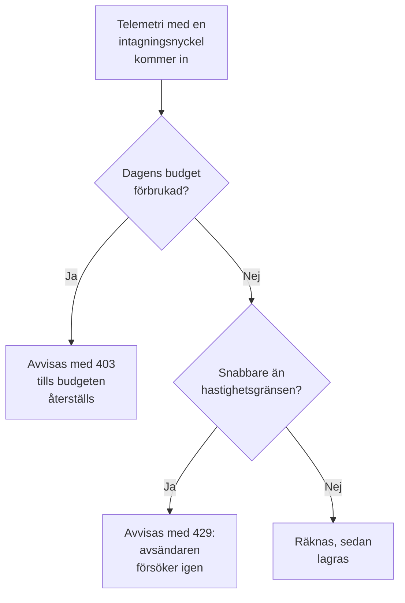

# Intagningsbudgetar

En intagningsbudget begränsar hur mycket telemetri ett projekt skickar under en dag, så att en enda pratsam tjänst eller en skenande loggloop inte kan fylla din lagring. Instansadministratören anger en daglig budget för varje signal, för alla projekt eller för ett enskilt projekt, och den som redigerar en intagningsnyckel kan ge nyckeln en mindre, egen budget. Varje budget kan också ha en hastighetsgräns per sekund.

:::cards
- [Så fungerar budgetar](#så-fungerar-budgetar): Tre nivåer, räknade när telemetrin kommer in.
- [Ange standardbudgetar för alla projekt](#ange-standardbudgetar-för-alla-projekt): I inställningarna i Admin Dashboard.
- [Ge en intagningsnyckel en egen budget](#ge-en-intagningsnyckel-en-egen-budget): En del av projektets budget.
- [Larma på en budget](#larma-på-en-budget): Innan den är förbrukad, och när den är det.
:::

## Så fungerar budgetar

Telemetri räknas när den kommer in: mot projektets budget för dess signal, och mot intagningsnyckelns budget när nyckeln har en. När en daglig budget är förbrukad avvisas den signalen tills budgeten återställs.



- **Tre nivåer.** Instansens standard gäller för alla projekt. Instansadministratören kan i stället ge ett projekt en egen budget, eller ingen gräns alls. En nyckels budget delar bara upp projektets: den kan vara mindre, aldrig större.
- **Fem signaler.** Loggar, spår, mätvärden, profiler och säkerhetshändelser har var sin egen budget. Sessionsuppspelningar har egna gränser: se [Sessionsuppspelning](/docs/telemetry/session-replay).
- **Byte räknas dekomprimerade.** En begäran räknas med storleken på sitt innehåll efter dekomprimering, så komprimering ändrar inte vad den räknas som. En GB är 1024³ byte, och en MB 1024² byte.
- **Det som kommer in räknas, inte det som lagras.** Telemetri som ett [drop-filter](/docs/telemetry/drop-filters-and-scrub-rules) tar bort senare räknas ändå, så en budget kan visa mer än sidan [Telemetrianvändning](/docs/telemetry/usage), som räknar det som lagrades.
- **Den sista begäran lagras hel.** En begäran som kommer in medan en budget fortfarande har utrymme lagras i sin helhet, så en förbrukad budget kan visa lite över 100 %.
- **Inget begränsas förrän en budget har angetts.** Varje installation börjar utan budgetar, och ett projekt utan budget räknas inte alls.
- **Ändringar når alla servrar inom en minut.**
- **Telemetri tas emot när den inte kan räknas.** Budgetarna räknas i Valkey. Medan Valkey inte går att nå lagrar OneUptime telemetrin utan att räkna den i stället för att avvisa den, och budgetsidorna säger det.

## Innan du börjar

- **För instansens och ett projekts budgetar, Admin Dashboard.** På en installation i egen drift är det bara instansadministratören som anger dem. Ett projekts ägare och administratörer ser dess budgetar, men kan inte ändra dem.
- **För en nyckels egen budget, en roll som redigerar intagningsnycklar.** Project Owner eller Project Admin, eller en anpassad roll med behörigheten Edit Ingestion Key.
- **För att se budgetarna, en roll som ser projektets användning.** De roller som ser sidan [Telemetrianvändning](/docs/telemetry/usage) ser projektets budgetar på den.

## Ange standardbudgetar för alla projekt

:::steps
### Öppna Intagningsbudgetar

Gå till **Inställningar → Telemetri → Intagningsbudgetar** i Admin Dashboard. **Telemetri** är först hopfälld i sidomenyn: klicka på den för att öppna den.

### Ange de dagliga budgetarna

På kortet **Dagliga standardbudgetar** klickar du på **Redigera dagliga standardbudgetar**, anger ett antal GB för varje signal som ska begränsas, till exempel **Loggar (GB per dag)**, och klickar på **Spara ändringar**. Lämna en signal tom för ingen gräns.

### Ange hastighetsgränserna, om du behöver dem

På kortet **Standardhastighetsgränser** klickar du på **Redigera standardhastighetsgränser** och anger ett antal MB per sekund för en signal, till exempel **Loggar (MB per sekund)**. En hastighetsgräns hindrar en enda topp från att förbruka en dags budget på några minuter.
:::

Kortet **Varning och återställning** innehåller varningströskeln och tiden då budgetdagen återställs: se [Varningen och återställningen](#varningen-och-återställningen).

## Ange ett projekts budgetar

:::steps
### Öppna projektet

Gå till **Projekt** i Admin Dashboard, klicka på projektet och klicka på **Intagningsbudgetar** i dess sidomeny. Sidan öppnas med vad projektet har använt av sina budgetar i dag.

### Ange dess dagliga budgetar

På kortet **Dagliga budgetar för det här projektet** klickar du på **Redigera dagliga budgetar**. Ange ett antal GB i stället för instansens standard för en signal, eller 0 för ingen gräns alls. Lämna en signal tom för att behålla instansens standard.

### Ange dess hastighetsgränser

På kortet **Hastighetsgränser för det här projektet** klickar du på **Redigera hastighetsgränser** och anger dem på samma sätt: ett antal MB per sekund, 0 för ingen gräns eller tomt för instansens standard.
:::

Projektets medlemmar ser de här budgetarna, skrivskyddade, på sin sida [Telemetrianvändning](/docs/telemetry/usage).

## Ge en intagningsnyckel en egen budget

En nyckels budget är en del av projektets: en avsändare som översvämmar sin egen nyckel stoppas vid nyckelns budget, medan projektets andra nycklar fortsätter att skicka.

:::steps
### Öppna nyckeln

Gå till **Projektinställningar → Telemetri och APM → Intagningsnycklar** och klicka på nyckeln. **Telemetri och APM** är först hopfälld i sidomenyn: klicka på den för att öppna den.

### Ange dess budgetar

På kortet **Intagningsbudgetar** klickar du på **Redigera intagningsbudgetar**. Ange ett antal GB per dag för varje signal som ska begränsas i steget **Dagliga budgetar**, och ett antal MB per sekund i steget **Hastighetsgränser**. Lämna en signal tom om nyckeln inte ska ha någon egen budget för den.

### Spara budgetarna

Klicka på **Spara ändringar**. En nyckels budget kan inte vara större än projektets: OneUptime avvisar den och anger hur stor den högst kan vara.
:::

- **Båda budgetarna räknas.** Telemetri som skickas med nyckeln räknas mot både nyckelns och projektets budget, och den som förbrukas först avvisar den.
- **En sänkt projektbudget gäller även nyckeln.** När projektets budget sänks under en nyckels budget begränsas nyckeln till projektets.

## Vad avsändare ser

| När | Över HTTP | Över OTLP/gRPC | Vad avsändaren gör |
| --- | --- | --- | --- |
| En daglig budget är förbrukad | `403` | `RESOURCE_EXHAUSTED` | Kasserar batchen: att försöka igen hjälper inte före återställningen |
| En hastighetsgräns överskrids | `429` med `Retry-After` | `RESOURCE_EXHAUSTED` med en fördröjning för nytt försök | Skickar batchen igen efter fördröjningen |

Varje avvisning säger varför. Över OTLP/HTTP är dess innehåll en `google.rpc.Status`, i protobuf eller JSON beroende på hur begäran skickades, så avsändarens logg visar ett skäl som:

```text
This project's daily logs ingestion budget of 10 GB is used up, so OneUptime is not storing logs from this project until the budget resets at 2026-11-10 00:00 UTC.
```

- **Andra HTTP-avsändare får JSON.** Fluent Bit, Fluentd, syslog och övriga HTTP-endpoints får `error`, `message` och `resetsAt`, och `retryAfterSeconds` vid en hastighetsgräns.
- **MQTT och molnströmmar får inget besked.** Telemetri som kommer in över MQTT eller från en molnleverantörs ström kasseras när dess budget är förbrukad. Ingen hastighetsgräns gäller för den: den skulle inte kunna skickas igen.
- **Avvisningar räknas.** Det som en förbrukad budget avvisar eller kasserar räknas som kasserat, och varje begäran som en hastighetsgräns avvisar räknas som strypt: se [Se dagens användning och kasserad telemetri](#se-dagens-användning-och-kasserad-telemetri).

## Varningen och återställningen

- **Varningen.** När en daglig budget passerar varningströskeln, 80 % om inte instansadministratören ändrar den, får projektets ägare ett e-postmeddelande, och utforskarna visar en banner ovanför den signalens data. De får ytterligare ett e-postmeddelande när budgeten är förbrukad. Varje budget skickar varje e-postmeddelande högst en gång om dagen.
- **Återställningen.** Varje budgetdag börjar om kl. 00:00 UTC om inte instansadministratören ändrar det. Kortet **Varning och återställning** anger **Varningströskel (%)**, från 1 till 99, **Återställningstid**, som HH:MM, och **Tidszon för återställning**: klicka på **Redigera varning och återställning**.
- **Sommartid.** Återställningen följer tidszonens klocka, så budgetdagen då klockan ställs om är en timme kortare eller längre. En återställningstid som klockan hoppar över inträffar lika lång tid efter hoppet.
- **En ändrad återställning startar en ny dag.** Att ändra återställningstiden eller tidszonen startar genast en ny budgetdag, där ingenting har räknats ännu.

## Se dagens användning och kasserad telemetri

Gå till **Projektinställningar → Telemetri och APM → Användning**. Medan en budget eller en hastighetsgräns är angiven för projektet öppnas sidan med kortet **Intagningsbudgetar**, och nycklarna med egna budgetar finns på kortet **Budgetar för intagningsnycklar**:

| Kolumn | Vad den visar |
| --- | --- |
| **Signal** | Signalen som raden gäller. |
| **Använt i dag** | Det som har räknats sedan budgetdagen började, och dess andel av budgeten. |
| **Daglig budget** | Budgeten som gäller, och var den angavs: **Instansens standard**, **Angiven för det här projektet** eller **Nyckelns egen**. |
| **Hastighetsgräns** | Hastighetsgränsen som gäller. |
| **Kasserade** | Det som avvisades eller kasserades för att budgeten var förbrukad. |
| **Strypt** | Hur många begäranden hastighetsgränsen avvisade. |
| **Status** | **Inom budget**, **Över varningströskeln** eller **Förbrukad**, **Ingen daglig budget** för en signal med bara en hastighetsgräns, och **Okänd** medan siffrorna inte kan läsas. |

- **På en nyckels sida** visar kortet **Dagens budgetanvändning** vad nyckeln har använt av sina egna budgetar.
- **I utforskarna** säger en banner ovanför data för loggar, spår, mätvärden, profiler och säkerhetshändelser när den signalens budget har passerat sin varning eller är förbrukad, med **Se budgetar** för att öppna sidan Användning.
- **I Admin Dashboard** visar ett projekts sida **Intagningsbudgetar** samma siffror.

## Larma på en budget

Var 5:e minut skriver OneUptime varje budgets siffror för dagen som mätvärden för projektet, och en [metrikmonitor](/docs/monitor/metrics-monitor) larmar på dem som på vilket annat mätvärde som helst:

| Mätvärde | Enhet | Vad det innehåller |
| --- | --- | --- |
| `oneuptime.telemetry.budget.used.bytes` | `By` | De byte som har räknats mot den dagliga budgeten sedan budgetdagen började. |
| `oneuptime.telemetry.budget.used.percent` | `%` | Samma sak, i procent av den dagliga budgeten. Vid 100 eller mer avvisas signalen till återställningen. |
| `oneuptime.telemetry.budget.dropped.bytes` | `By` | De byte som har avvisats eller kasserats sedan budgetdagen började för att budgeten var förbrukad. |
| `oneuptime.telemetry.budget.throttled.requests` | `{request}` | De begäranden som hastighetsgränsen har avvisat sedan budgetdagen började. |

Varje punkt har de här attributen:

| Attribut | Värde |
| --- | --- |
| `projectId` | Projektets ID. |
| `signal` | `logs`, `traces`, `metrics`, `profiles` eller `security-events`. |
| `scope` | `project`, eller `ingestion-key` för en nyckels egen budget. |
| `ingestionKeyId` | Nyckelns ID, för en nyckels egen budget. |
| `ingestionKeyName` | Nyckelns namn när punkten skrevs, för en nyckels egen budget. |

För att få veta när 90 % av projektets loggbudget har använts skapar du en metrikmonitor på `oneuptime.telemetry.budget.used.percent`, filtrerad på `signal` `logs` och `scope` `project`, som larmar när maximum är över 90:

- **Aggregera med maximum.** Varje siffra växer bara under en budgetdag.
- **Använd ett fönster på 15 minuter eller mer.** En punkt skrivs var 5:e minut, och ett fönster utan någon punkt löser larmet.
- **Räkna med luckor, inte nollor.** Ingenting skrivs för en siffra som är 0, eller medan siffrorna inte kan läsas.
- **De kostar ingenting.** De här mätvärdena räknas inte mot någon budget eller som telemetrianvändning, och sparas lika länge som monitorernas mätvärden: 30 dagar om inte instansadministratören ändrar det. Namn på mätvärden som börjar med `oneuptime.telemetry.budget.` är reserverade för dem: mätvärden som dina applikationer skickar under ett sådant namn kasseras.

## Felsökning

:::details En collector loggar 403 för sina exporter
Projektets eller nyckelns dagliga budget för den signalen är förbrukad, och collectorn kasserar det den inte kan skicka tills budgeten återställs. Se **Använt i dag** på sidan Användning. Be instansadministratören att höja projektets budget, eller skicka mindre: ett drop-filter hjälper inte här, eftersom det tar bort telemetri efter att den har räknats.
:::

:::details En collector loggar 429 och försöker igen
Den skickar snabbare än en hastighetsgräns tillåter. Den försöker igen efter `Retry-After`-fördröjningen, så inget går förlorat om inte dess kö blir full. Höj hastighetsgränsen, eller sprid ut sändningen jämnare.
:::

:::details Använt i dag är mer än sidan Telemetrianvändning visar
En budget räknar telemetri när den kommer in, dekomprimerad, inklusive det som drop-filter tar bort senare. Sidan Användning räknar det som lagrades, dagen efter.
:::

:::details Budgetarna säger att dagens siffror inte kunde läsas
OneUptime kan inte nå Valkey, där budgetarna räknas. Tills det går lagras telemetri utan att räknas, och ingen budget tillämpas.
:::

## Nästa steg

:::cards
- [Telemetrianvändning](/docs/telemetry/usage): Se vad varje projekt och tjänst skickar.
- [Drop-filter och scrub-regler](/docs/telemetry/drop-filters-and-scrub-rules): Sluta lagra telemetri som du inte behöver.
- [Intagningsnycklar](/docs/telemetry/ingestion-keys): En nyckel för varje avsändare, så att var och en kan ha en budget.
- [Metrikövervakning](/docs/monitor/metrics-monitor): Larma på budgetmätvärdena.
:::
