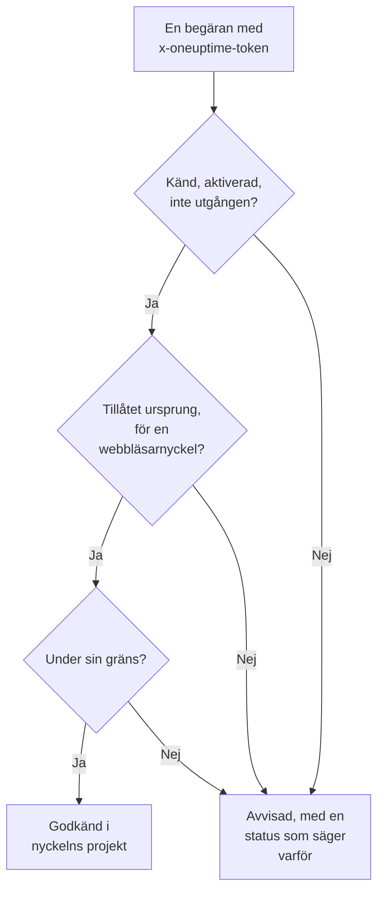

# Intagningsnycklar

En intagningsnyckel kopplar din telemetri till ditt projekt. Applikationer, OpenTelemetry Collectors och agenter skickar den med varje begäran, och OneUptime lägger deras loggar, spår och mätvärden i det projekt som nyckeln tillhör. Den här sidan visar hur du skapar en nyckel, vilken typ du ska välja och hur du håller nycklar säkra.

:::cards
- [Skapa en intagningsnyckel](#skapa-en-intagningsnyckel): Ett namn, en typ och en hemlighet att kopiera.
- [Server eller Browser](#server-eller-browser): Vilken sorts nyckel en avsändare behöver.
- [Lås ned en webbläsarnyckel](#lås-ned-en-webbläsarnyckel): Ursprung, ett tjänstnamn och en gräns.
- [Byt ut, stäng av eller ta bort en nyckel](#byt-ut-stäng-av-eller-ta-bort-en-nyckel): Vad du gör när en nyckel läcker.
:::

## Så kontrolleras en nyckel

Varje begäran bär nyckelns hemlighet, oftast i en `x-oneuptime-token`-header. OneUptime slår upp nyckeln, kontrollerar att den fortfarande får skicka och tar först då emot data i nyckelns projekt.



- **Nyckeln bestämmer projektet.** Du skickar aldrig ett projekt-ID: data som skickas med en nyckel hamnar i det projekt som nyckeln tillhör.
- **Ändringar når alla servrar inom en minut.** Att stänga av en nyckel, återställa dess hemlighet eller ändra dess ursprung, utgång eller gräns får effekt inom ungefär en minut.
- **En servernyckel är ett lösenord.** Den som har den kan skicka telemetri till ditt projekt. Förvara den bland dina servrars hemligheter, aldrig i versionshantering eller på en webbsida.

## Server eller Browser

Välj typ efter var nyckeln ska finnas. Typen kan inte ändras efter att nyckeln har skapats.

| | **Server** | **Webbläsare** |
| --- | --- | --- |
| För | Applikationer, collectors och agenter på maskiner du driver | Webbsidor, och React Native Session Replay |
| Skickar | All sorts telemetri, till alla endpoints | Spår, loggar, mätvärden och Session Replays |
| En hemlighet | Ja: håll den på dina servrar | Nej: alla som ser sidan kan läsa den |
| Ursprung | Kontrolleras inte | Bara de angivna ursprungen godkänns |
| Begäranden per minut | Ingen gräns, om du inte anger en | 6 000, om du inte anger en annan gräns |

Överallt annars avvisar OneUptime en webbläsarnyckel, till exempel över gRPC och MQTT, för profiler, Syslog, Fluent Bit och Fluentd, och för uppladdning av source maps. För att flytta en avsändare till den andra typen skapar du en nyckel av den typen, byter avsändaren till den och tar sedan bort den gamla nyckeln.

## Innan du börjar

- **En roll som hanterar intagningsnycklar.** Project Owner eller Project Admin, eller en anpassad roll med behörigheten Create Telemetry Ingestion Key. Telemetry-rollerna omfattar inte intagningsnycklar.
- **På OneUptime Cloud, en betalningsmetod.** Telemetri faktureras efter användning, så ett projekt på Free-planen behöver en betalningsmetod innan det kan skapa en nyckel. Dialogrutan för att skapa slutar då med ett steg **Fakturering** som visar priserna.

## Skapa en intagningsnyckel

:::steps
### Öppna intagningsnycklar

Gå till **Projektinställningar → Telemetri och APM → Intagningsnycklar**. **Telemetri och APM** är först hopfälld i sidomenyn: klicka på den för att öppna den. Listan visar för varje nyckel kolumnerna **Namn**, **Typ**, **Last Used** och **Beskrivning**.

### Namnge nyckeln och välj dess typ

Klicka på **Skapa ingestion-nyckel**. Dialogrutan börjar med namnet **Servernyckel** och typen **Server**. Välj **Nyckeltyp** och byt namn på nyckeln efter det som ska använda den, till exempel `checkout-collector`. En **Beskrivning** finns under **Avancerad**.

### Lägg till en webbläsarnyckels ursprung

En **Webbläsare**-nyckel ber om sina **Tillåtna ursprung** i nästa steg, **Webbläsarinställningar**, med sitt **Fäst tjänstnamn** under **Avancerad**. Se [Lås ned en webbläsarnyckel](#lås-ned-en-webbläsarnyckel).

### Skapa nyckeln och kopiera dess hemlighet

Klicka på **Skapa ingestion-nyckel**. Nyckelns egen sida öppnas: kopiera dess **Hemlig nyckel** och ge den till dina avsändare.
:::

Varje produkts **Installationsguide** börjar med **Välj en ingestion-nyckel**, som listar de nycklar guiden kan använda och skapar en på plats. Kodsnuttarna i guiden innehåller sedan den nyckeln.

## Skicka telemetri med nyckeln

Avsändare lägger hemligheten i en `x-oneuptime-token`-header:

```text
x-oneuptime-token: YOUR_ONEUPTIME_INGESTION_KEY
```

- OpenTelemetry-SDK:er läser den från `OTEL_EXPORTER_OTLP_HEADERS`. Se [snabbstarten för OpenTelemetry](/docs/telemetry/open-telemetry#snabbstart).
- Över OTLP/gRPC går den i `x-oneuptime-token`-metadatan.
- En MQTT-enhet skickar den som sitt lösenord. Se [IoT-enheter](/docs/telemetry/iot-devices).
- OneUptime läser också nyckeln från en `x-oneuptime-ingestion-key`- eller `x-oneuptime-service-token`-header, som vissa äldre installationer skickar.

## Lås ned en webbläsarnyckel

En webbläsarnyckel finns i din sida, där vem som helst kan kopiera den. De här inställningarna begränsar vad en kopia kan göra. Ändra dem på nyckelns sida med **Redigera Telemetri Ingestion Key**.

| Inställning | Vad den gör |
| --- | --- |
| **Tillåtna ursprung** | De enda ursprung som nyckeln godkänns från. En begäran från något annat ursprung, eller helt utan `Origin`-header, avvisas. En webbläsarnyckel måste behålla minst ett. |
| **Fäst tjänstnamn** | Lägger allt som nyckeln skickar över OTLP/HTTP under den här enda tjänsten, oavsett vilket `service.name` avsändaren har satt. En kopia av nyckeln kan då bara skriva till den tjänsten. |
| **Requests Per Minute Limit** | Det största antalet begäranden som nyckeln godkänns för varje minut, delat av alla besökare. En webbläsarnyckel får 6 000 när du lämnar fältet tomt. |
| **Upphör** | Datumet då nyckeln börjar avvisas, så att en publicerad kopia slutar fungera. |

Ett ursprung är ett schema, en värd och en valfri port: `https://app.example.com` täcker inte `https://app.example.com:8443`. Ett inledande `*.` täcker alla underdomäner, men inte själva domänen. React Native Session Replay skickar en exakt `app://`-identitet, som inte tar något jokertecken:

```json
[
  "https://app.example.com",
  "https://*.example.com",
  "app://com.example.mobile"
]
```

[Tjänstekatalogen](/docs/telemetry/services#så-hamnar-en-tjänst-i-katalogen) visar hur ett fastlåst namn bestämmer tjänsten. Kubernetes-agentens Runner och AI-agent, och infrastrukturens AI-agenter, registrerar sig inte med en fastlåst nyckel: ge dem en servernyckel utan fastlåst namn.

## Byt ut, stäng av eller ta bort en nyckel

En nyckels sida visar dess **Status**, dess **Hemlig nyckel** bakom **Click to reveal** och dess **Last Used At**: senaste gången OneUptime tog emot data som skickades med den.

| För att | Gör så här | Vad avsändare ser |
| --- | --- | --- |
| Stoppa en nyckel direkt, och kunna ångra det senare | Klicka på **Redigera Telemetri Ingestion Key**, öppna **Åtkomst och gränser** och stäng av **Aktiverad**. Statusen visar **Disabled — telemetry refused**. | `422` tills du slår på den igen |
| Ersätta en läckt hemlighet | Klicka på **Återställ hemlig nyckel** och bekräfta. Nyckeln behåller sina inställningar och får en ny hemlighet. | `401` tills de skickar den nya hemligheten |
| Stoppa en nyckel för gott | Klicka på **Ta bort Telemetri Ingestion Key** längst ned på dess sida. | `401` |

För att byta en hemlighet utan att förlora data skapar du en andra nyckel, flyttar dina avsändare till den och tar bort den gamla nyckeln när dess **Last Used At** slutar ändras. **Last Used At** uppdateras med några minuters mellanrum, inte vid varje begäran.

## Felsökning

En avvisad begäran får en status och en mening som säger varför.

| Svar | Vad det betyder |
| --- | --- |
| `401` med `Missing ingestion token` | Begäran har ingen nyckel. Skicka den i `x-oneuptime-token`. |
| `401` med `Invalid ingestion token` | Ingen nyckel har den här hemligheten: den är felskriven, återställd eller borttagen. |
| `401` med `This telemetry ingestion key expired.` | Dess **Upphör** har passerats. Ange ett senare datum, eller använd en annan nyckel. |
| `402` med `Add a payment method` | På OneUptime Cloud är projektet på Free-planen och har ännu ingen betalningsmetod. |
| `422` med `This telemetry ingestion key has been disabled.` | Någon har stängt av **Aktiverad**. |
| `422` med `A browser ingestion key cannot be used for` | En webbläsarnyckel nådde en endpoint som bara tar servernycklar. |
| `422` med `did not send an Origin header` | En webbläsarnyckel skickades utanför en webbläsare. Använd en servernyckel där. |
| `422` med `is not allowed for this browser ingestion key` | Sidans ursprung finns inte i **Tillåtna ursprung**. |
| `422` med `is pinned to a single service` | En nyckel med ett **Fäst tjänstnamn** användes för att registrera en agent. Använd en servernyckel utan fastlåst namn. |
| `429` med `Too many telemetry requests for this ingestion key` | Nyckeln nådde sin **Requests Per Minute Limit**. Exportörer försöker igen efter `Retry-After`-tiden. |

För de andra svar som en OTLP-exportör kan få, se [Svar](/docs/telemetry/open-telemetry#svar).

:::details Data kommer fortfarande in en minut efter att jag stängde av nyckeln
Varje OneUptime-server minns vad den vet om en nyckel i upp till en minut, så en ändring når alla inom ungefär en minut. Begäranden efter det avvisas.
:::

:::details En webbläsarnyckel fungerar på min bärbara dator men inte i produktion
Ett ursprung omfattar sitt schema och sin port. `http://localhost:3000` och `https://app.example.com` är olika ursprung: ange vart och ett som sidan serveras från.
:::

:::details Last Used At säger fortfarande Aldrig
Inget har skickat data med den här nyckeln sedan OneUptime började registrera användningen av den. Kontrollera att dina avsändare har den här nyckelns hemlighet och att deras begäranden når OneUptime.
:::

## Nästa steg

:::cards
- [OpenTelemetry](/docs/telemetry/open-telemetry): Skicka spår, mätvärden och loggar med din nyckel.
- [Tjänstekatalog](/docs/telemetry/services): Se tjänsterna som din telemetri läggs under.
- [Datalagring](/docs/telemetry/data-retention): Bestäm hur länge data sparas.
- [Drop-filter och scrub-regler](/docs/telemetry/drop-filters-and-scrub-rules): Kassera eller maskera data innan den lagras.
:::
