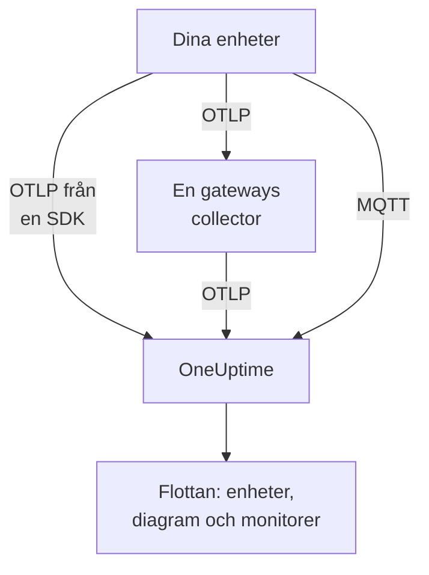

# IoT-enheter

OneUptime övervakar flottor av IoT-enheter — sensorer, gateways, styrenheter och edge-lådor — utifrån en liten uppsättning `iot_*`-mätvärden som de skickar. Den grupperar enheterna i flottor, för ett inventarie över varje flottas enheter och visar diagram över deras batteri, signal, temperatur, CPU, minne och tillgänglighet. Det finns ingen OneUptime-agent att installera på en enhet: enheterna skickar standard-OpenTelemetry, eller publicerar till OneUptimes MQTT-slutpunkt. [IoT-enhetsmonitorer](/docs/monitor/iot-device-monitor) larmar på det de skickar.

:::cards
- [Välj hur du skickar](#välj-hur-du-skickar): En OpenTelemetry SDK, en gateway-collector eller MQTT.
- [Skicka mätvärden via MQTT](#skicka-mätvärden-via-mqtt): Ämnen, inloggningsuppgifter per enhet och Last Will.
- [Mätvärdeskonventioner](#mätvärdeskonventioner): De `iot_*`-namn som OneUptime visar diagram över och larmar på.
- [Felsökning](#felsökning): Saknade flottor, saknade enheter, felaktiga offlinelägen.
:::

## Så fungerar det

Varje avläsning hör till en flotta och en enhet. OneUptime skapar flottan från dess första avläsning, lägger till varje ny enhet i flottans inventarie och uppdaterar sedan enhetens senaste värden vid varje avläsning. Avläsningar som skickas över OpenTelemetry och över MQTT matar samma flottor, inventarie, diagram och monitorer.



## Så modellerar OneUptime IoT

- **Flotta**: en grupp enheter, till exempel `building-a-sensors` eller `field-gateways`. Den kommer från resursattributet `iot.fleet.name` och visas i OneUptime som telemetritjänsten `iot/<fleet>`. Sätt också `service.name=iot/<fleet>`, så att loggar och mätvärden hamnar under samma tjänst.
- **Enhet**: en enhet i en flotta, namngiven av attributet `device.id` på varje datapunkt. Flottans inventarie är nycklat på `device.id`.

| Attribut | Sätts på | Obligatoriskt | Beskrivning |
| --- | --- | --- | --- |
| `iot.fleet.name` | Resurs | Ja | Den flotta som enheten tillhör. Den blir OneUptime-tjänsten `iot/<fleet>`. |
| `device.id` | Varje datapunkt | Ja | Ett stabilt ID för enheten, unikt i dess flotta. |
| `iot.device.kind` | Varje datapunkt | Nej | Enhetsklassen, till exempel `Device`, `Sensor` eller `Gateway`. Standard är `Device`. |
| `iot.device.type` | Varje datapunkt | Nej | En finare typ eller modell för att filtrera monitorer, till exempel `temp-sensor`. |
| `iot.device.firmware` | Varje datapunkt | Nej | Den firmwareversion som enheten rapporterar. |

Över MQTT anger ämnet flottan och enheten åt dig.

## Välj hur du skickar

| Sätt | Använd det när | Behöver |
| --- | --- | --- |
| [OpenTelemetry SDK](#skicka-mätvärden-via-opentelemetry-sdk) | Enheten kör en OpenTelemetry SDK och når OneUptime själv. | En intagningsnyckel på enheten. |
| [OpenTelemetry Collector](#skicka-mätvärden-via-en-opentelemetry-collector) | Många enheter rapporterar via en gateway. | En gateway som kör collectorn. |
| [MQTT](#skicka-mätvärden-via-mqtt) | Enheten talar redan MQTT, eller ska rapportera offline i samma ögonblick som den försvinner. | Valfri MQTT-klient som ansluter över WebSocket. |

## Innan du börjar

- En intagningsnyckel. Skapa en under **Projektinställningar → Telemetri och APM → Intagningsnycklar** och kopiera värdet. Enheterna skickar den som huvudet `x-oneuptime-token`, eller som MQTT-lösenord.
- Nätverksåtkomst från enheten eller gatewayen till din OneUptime-URL.
- Ett flottnamn för varje grupp enheter, och ett stabilt ID för varje enhet.

## Skicka mätvärden via OpenTelemetry SDK

:::steps
### Peka SDK:n mot OneUptime

Sätt OpenTelemetrys standardmiljövariabler på enheten. Ersätt nyckeln, flottnamnet och enhets-ID:t med dina:

```bash
export OTEL_EXPORTER_OTLP_ENDPOINT=https://oneuptime.com/otlp
export OTEL_EXPORTER_OTLP_PROTOCOL=http/protobuf
export OTEL_EXPORTER_OTLP_HEADERS=x-oneuptime-token=YOUR_TELEMETRY_INGESTION_TOKEN
export OTEL_RESOURCE_ATTRIBUTES=iot.fleet.name=building-a-sensors,device.id=sensor-001,service.name=iot/building-a-sensors
```

Håll `iot.fleet.name` stabilt: att ändra det registrerar en ny flotta.

### Registrera avläsningar som IoT-mätvärden

Skicka varje avläsning som ett mätvärde med ett av de [konventionella namnen](#mätvärdeskonventioner), och ge varje datapunkt ett `device.id`-attribut:

| Mätvärde | Värde | Datapunktsattribut |
| --- | --- | --- |
| `iot_device_up` | `1` | `device.id=sensor-001` |
| `iot_battery_percent` | `87` | `device.id=sensor-001` |
| `iot_temperature_celsius` | `21.5` | `device.id=sensor-001` |

Inventariet är nycklat på datapunktens `device.id`, inte på resursens, så sätt det på varje mätning och dessutom i `OTEL_RESOURCE_ATTRIBUTES`.
:::

Därefter: [kontrollera att flottan visas](#kontrollera-att-flottan-visas).

## Skicka mätvärden via en OpenTelemetry Collector

När många enheter rapporterar via en gateway kör du en OpenTelemetry Collector på gatewayen. Den tar emot OTLP från dina enheter, stämplar flottan på varje avläsning och vidarebefordrar dem till OneUptime.

:::steps
### Spara gatewayens konfiguration

Spara detta som `config.yaml` på gatewayen:

```yaml title="config.yaml"
receivers:
  otlp:
    protocols:
      grpc:
        endpoint: 0.0.0.0:4317
      http:
        endpoint: 0.0.0.0:4318

processors:
  batch:
    send_batch_size: 512
    timeout: 5s
  resource:
    attributes:
      - key: iot.fleet.name
        value: field-gateways
        action: upsert
      - key: service.name
        value: iot/field-gateways
        action: upsert

exporters:
  otlphttp:
    endpoint: "https://oneuptime.com/otlp"
    headers:
      "x-oneuptime-token": "YOUR_TELEMETRY_INGESTION_TOKEN"

service:
  pipelines:
    metrics:
      receivers: [otlp]
      processors: [resource, batch]
      exporters: [otlphttp]
```

- `otlp` tar emot från dina enheter över gRPC (`4317`) och HTTP (`4318`). Ta emot avläsningar på vilket annat sätt som helst som collectorn stöder (en MQTT-brygga, filloggar) och skicka dem genom samma pipeline.
- `resource` stämplar varje avläsning med flottan. Sätt `iot.fleet.name`, och motsvarande `service.name=iot/<fleet>`, per gateway, så att varje gateways enheter hamnar i sin flotta.
- Behåll `device.id`, och eventuella `iot.device.kind`, `iot.device.type` och `iot.device.firmware`, på varje datapunkt, så att OneUptime kan skilja enheterna i flottan åt.
- `otlphttp` skickar till OneUptime över HTTPS med intagningsnyckeln. Både standardkodningen protobuf och `encoding: json` godtas.

### Kör collectorn på gatewayen

:::tabs
@tab Docker
Kör den från mappen som innehåller `config.yaml`:

```bash
docker run -d \
  --name otel-collector \
  --restart unless-stopped \
  -p 4317:4317 \
  -p 4318:4318 \
  -v $(pwd)/config.yaml:/etc/otelcol-contrib/config.yaml:ro \
  otel/opentelemetry-collector-contrib:0.161.0 \
  --config /etc/otelcol-contrib/config.yaml
```
@tab otelcol-contrib
Om gatewayen redan har `otelcol-contrib` pekar du den mot filen:

```bash
otelcol-contrib --config config.yaml
```
:::

Enheterna skickar sedan OTLP till gatewayen, till exempel med `OTEL_EXPORTER_OTLP_ENDPOINT=http://<gateway-host>:4318` i varje enhets SDK.
:::

Därefter: [kontrollera att flottan visas](#kontrollera-att-flottan-visas).

## Skicka mätvärden via MQTT

OneUptime har en egen MQTT-slutpunkt, så enheter som talar MQTT publicerar avläsningar direkt till den, utan SDK, collector eller brygga. Det som kommer in över MQTT går genom samma pipeline som OTLP: flottor skapas, inventariet uppdateras, och varje IoT-monitor och larmmall fungerar likadant.

### Slutpunkter

| Transport | Adress | Anmärkningar |
| --- | --- | --- |
| MQTT över WebSocket | `wss://<your-host>/mqtt` | Fungerar i alla driftsättningar, via den vanliga HTTPS-porten. |
| MQTT över TCP | `<app-host>:1883` | Bara självhostat, och internt i klustret eller Compose-nätverket tills du exponerar den. Porten är `MQTT_INGEST_PORT`. |

### Autentisering

- **Med intagningsnyckeln**: skicka den som MQTT-lösenord. Användarnamnet ignoreras; om din klient bara har ett fält för användarnamn lägger du nyckeln där. Det passar en gateway som publicerar för många enheter.
- **Med inloggningsuppgifter per enhet**: rekommenderas för enheter som ansluter direkt. Öppna flottans sida **Device Registry** och registrera enheten, med det **Device ID** som den använder som `device.id`. Enhetens **MQTT Username** är dess användarnamn och dess **MQTT Password (Secret)** dess lösenord.

En enhets inloggningsuppgifter kan bara publicera under dess egna `oneuptime/<fleet>/<device>/`-ämnen. Du kan återkalla en enhet utan att röra resten av flottan: stäng av dess reglage **Aktiverad**, eller ta bort den, så kopplas en ansluten enhet bort inom ungefär en minut. En registrerad enhet som tystnar finns kvar i inventariet som offline, och larmmallen Device Offline utlöses för den, även om den dör utan en Last Will.

OneUptime nekar felaktiga inloggningsuppgifter vid CONNECT med returkod 4 (felaktigt användarnamn eller lösenord), så en felkonfigurerad enhet misslyckas tydligt. Webbläsarnycklar nekas över MQTT.

### Ämnen och nyttolaster

Publicera under det fasta prefixet `oneuptime/`. Segmenten för flotta och enhet får inte innehålla `/`, `+` eller `#`, får inte börja med `$`, och är högst 100 tecken långa.

| Ämne | Nyttolast |
| --- | --- |
| `oneuptime/<fleet>/<device>/telemetry` | Ett JSON-objekt med avläsningar: `{"metrics":{"iot_temperature_celsius":21.5}}`, eller ett platt objekt vars numeriska fält är mätvärdena. |
| `oneuptime/<fleet>/<device>/metrics/<metricName>` | Ett värde: ett nakent tal (`23.4`) eller `{"value":23.4}`. |
| `oneuptime/<fleet>/<device>/status` | `online` eller `offline` (även `1` eller `0`, `true` eller `false`, `up` eller `down`). Det sätter `iot_device_up`. |

En telemetrinyttolast kan också innehålla `"attributes"`, en mappning av strängar som stämplas på varje datapunkt (använd den för `iot.device.kind`, `iot.device.type`, `iot.device.firmware` eller dina egna etiketter), och `"timestamp"`, i ISO 8601 eller i Unix-sekunder eller -millisekunder. Båda är valfria: utan `timestamp` används tidpunkten då OneUptime tar emot avläsningen.

### Offlineidentifiering med Last Will

Registrera en MQTT Last Will på `oneuptime/<fleet>/<device>/status` med nyttolasten `offline`. Om enheten dör eller försvinner från nätverket publicerar OneUptime `iot_device_up = 0` för den i samma ögonblick som dess session avslutas, vilket utlöser den inbyggda larmmallen Device Offline och markerar enheten som nere i inventariet, utan avfrågning. Publicera `online` till samma ämne efter anslutningen, så att enheten visas som uppe igen.

### Exempel

:::tabs
@tab mosquitto_pub
Över rå TCP, på en självhostad instans:

```bash
mosquitto_pub -h YOUR-ONEUPTIME-APP-HOST -p 1883 \
  -u oneuptime -P "YOUR_TELEMETRY_INGESTION_TOKEN" \
  -t "oneuptime/building-a-sensors/sensor-001/telemetry" \
  -m '{"metrics":{"iot_device_up":1,"iot_battery_percent":87,"iot_temperature_celsius":21.5},"attributes":{"iot.device.type":"temp-sensor","iot.device.firmware":"1.4.2"}}'
```
@tab Node.js
Med paketet `mqtt`, över WebSocket, mot oneuptime.com eller valfri självhostad instans:

```javascript
const mqtt = require("mqtt");

const client = mqtt.connect("wss://oneuptime.com/mqtt", {
  username: "oneuptime", // ignored — the token below is what authenticates
  password: "YOUR_TELEMETRY_INGESTION_TOKEN",
  will: {
    topic: "oneuptime/building-a-sensors/sensor-001/status",
    payload: "offline",
  },
});

client.on("connect", () => {
  client.publish("oneuptime/building-a-sensors/sensor-001/status", "online");
  setInterval(() => {
    client.publish(
      "oneuptime/building-a-sensors/sensor-001/telemetry",
      JSON.stringify({
        metrics: {
          iot_device_up: 1,
          iot_battery_percent: readBattery(),
          iot_temperature_celsius: readTemperature(),
        },
      }),
    );
  }, 60 * 1000);
});
```
@tab Python
Med `paho-mqtt`, över WebSocket:

```python
import json
import paho.mqtt.client as mqtt

client = mqtt.Client(transport="websockets")
client.username_pw_set("oneuptime", "YOUR_TELEMETRY_INGESTION_TOKEN")
client.tls_set()
client.will_set("oneuptime/building-a-sensors/sensor-001/status", "offline")
client.ws_set_options(path="/mqtt")
client.connect("oneuptime.com", 443)

client.publish("oneuptime/building-a-sensors/sensor-001/status", "online")
client.publish(
    "oneuptime/building-a-sensors/sensor-001/telemetry",
    json.dumps({"metrics": {"iot_device_up": 1, "iot_temperature_celsius": 21.5}}),
)
```
:::

### Gränser och leverans

- Slutpunkten tar bara emot avläsningar: prenumerationer nekas (ett SUBACK-fel), och kvarhållna meddelanden sparas inte.
- Intaget sker minst en gång. Använd QoS 1 för att låta OneUptime bekräfta varje publicering; en omsändning med QoS 1 eller 2 efter en förlorad bekräftelse kan ge dubblerade datapunkter.
- En publicering över 128 KB, eller med fler än 100 mätvärden, släpps, och ett paket som anger mer än så stänger anslutningen.
- En publicering utanför dessa ämnen, eller med en felformaterad nyttolast, godtas och släpps, eftersom MQTT 3.1.1 inte har något fel per meddelande. OneUptime loggar en varning med orsaken (`MQTT: dropped publish to …`).
- På WebSocket-slutpunkten håller du MQTT-keepalive under 5 minuter. Ingressen stänger en WebSocket som är inaktiv i 300 sekunder, vilket utlöser Last Will och ett falskt Device Offline-larm. Klientbibliotekens standardvärden (60 sekunder för `mqtt` och `paho-mqtt`) fungerar bra, och TCP-slutpunkten har ingen sådan gräns.

## Mätvärdeskonventioner

OneUptime känner igen dessa `iot_*`-mätvärdesnamn. Skicka bara de som är meningsfulla för din enhet: de som saknas visas inte i diagram. Varje datapunkt har enhetens `device.id` (över MQTT anger ämnet enheten).

| Mätvärdesnamn | Betydelse |
| --- | --- |
| `iot_device_up` | Tillgänglighet: `1` är uppe och nåbar, `0` är nere. IoT Device-monitorn läser det. |
| `iot_device_info` | Bara identitet. Det har `device.id`, klassen, typen och firmwaren, så att en enhet visas i inventariet innan den rapporterar avläsningar. |
| `iot_battery_percent` | Batteriladdning, `0` till `100` (%). |
| `iot_signal_strength_dbm` | Trådlös signalstyrka i dBm, till exempel RSSI för Wi-Fi, LoRa eller mobilnät. |
| `iot_temperature_celsius` | Enhetens eller sensorns temperatur i °C. |
| `iot_cpu_usage_ratio` | CPU-användning som ett förhållande från `0` till `1`. OneUptime lagrar och visar det som en procentsats. |
| `iot_memory_usage_bytes` | Använt minne, i byte. |
| `iot_memory_size_bytes` | Totalt minne på enheten, i byte. |
| `iot_uptime_seconds` | Sekunder sedan enheten senast startade. |

## Kontrollera att flottan visas

1. Kontrollera att enheten, gatewayens collector eller MQTT-klienten skickar utan fel: leta efter exportfel och HTTP-svar `401` eller `422` i dess loggar, eller en anslutning som nekas med returkod 4.
2. Öppna **Produkter → Infrastruktur → IoT → All Fleets**. Flottan visas som `iot/<fleet>` inom en minut eller så efter de första avläsningarna.
3. Öppna flottans sida **Devices**. Varje enhet du skickade från ska finnas med sitt senaste batteri, signal, temperatur, CPU, minne och status uppe eller nere.
4. Öppna flottans sida **Mätvärden** för att visa någon av `iot_*`-serierna i ett diagram.

## Självhostad OneUptime

Peka slutpunkten mot din egen instans:

```bash
export OTEL_EXPORTER_OTLP_ENDPOINT=https://your-oneuptime-host.example.com/otlp
```

Eller, i en collector:

```yaml
exporters:
  otlphttp:
    endpoint: https://your-oneuptime-host.example.com/otlp
    headers:
      "x-oneuptime-token": "YOUR_TELEMETRY_INGESTION_TOKEN"
```

För MQTT ansluter du till `wss://your-oneuptime-host.example.com/mqtt`, eller exponerar app-tjänstens råa MQTT-TCP-port (`MQTT_INGEST_PORT`, `1883` som standard) för enheter som inte kan använda WebSocket. Sätt `MQTT_INGEST_ENABLED=false` på app-tjänsten för att stänga av båda MQTT-lyssnarna. Om instansen bara använder HTTP använder du `http://` (och `ws://` för MQTT) och dess port.

## Felsökning

:::details Flottan visas inte
1. Kontrollera att `iot.fleet.name` är ett resursattribut (inte en datapunktsetikett) och att `service.name` är `iot/<fleet>`.
2. Kontrollera att slutpunkten är `https://oneuptime.com/otlp` (eller din självhostade `…/otlp`) och att huvudet `x-oneuptime-token` innehåller en giltig intagningsnyckel.
3. Över MQTT kontrollerar du att ämnet följer `oneuptime/<fleet>/<device>/…` exakt: det är ämnets flottsegment som skapar flottan.
:::

:::details Enheter saknas i inventariet
1. Ge varje datapunkt en `device.id`-etikett: enheterna är nycklade på den. Över MQTT är det ämnets enhetssegment.
2. För en enhet som inte har rapporterat avläsningar än skickar du `iot_device_info` (eller, över MQTT, ett `status`-meddelande) så att den visas i inventariet.
3. Håll `device.id`-värdena stabila: ett ID som ändras skapar dubblerade enheter.
:::

:::details HTTP 401 eller 422 från exportören
`401` betyder att intagningsnyckeln saknas, är fel eller har gått ut; `422` betyder att den har inaktiverats, eller är en webbläsarnyckel, som inte kan skicka enhetstelemetri. Skapa en ny under **Projektinställningar → Telemetri och APM → Intagningsnycklar** och uppdatera huvudet `x-oneuptime-token`.
:::

:::details MQTT-anslutningen nekas med "bad username or password"
OneUptime nekar felaktiga inloggningsuppgifter vid CONNECT med returkod 4. Kontrollera att lösenordet är en giltig intagningsnyckel som inte har inaktiverats eller gått ut, eller, för en registrerad enhet, inloggningsuppgiftens hemlighet med dess **MQTT Username** som användarnamn. Webbläsarnycklar nekas över MQTT.
:::

:::details Enheter växlar till offline medan de körs
På WebSocket-slutpunkten stänger ingressen en anslutning som är inaktiv i 300 sekunder, vilket utlöser Last Will och ett falskt Device Offline-larm. Håll MQTT-keepalive under 5 minuter: klientbibliotekens standardvärden på 60 sekunder fungerar bra.
:::

:::details Avläsningar visas inte i flottans diagram
1. Använd de exakta `iot_*`-namnen från [Mätvärdeskonventioner](#mätvärdeskonventioner): andra namn lagras som generiska mätvärden och fyller inte IoT-diagrammen.
2. Skicka `iot_cpu_usage_ratio` som ett förhållande från `0` till `1`; OneUptime visar det som en procentsats.
3. Räkna med upp till en minut innan de första datapunkterna visas efter att en enhet börjar rapportera.
:::

## Nästa steg

:::cards
- [IoT-enhets-övervakning](/docs/monitor/iot-device-monitor): Larma när en enhet går offline, får lågt batteri eller blir överhettad.
- [OpenTelemetry](/docs/telemetry/open-telemetry): Hur OneUptime tar emot OTLP från valfri SDK eller collector.
- [OpenTelemetry-collector på värden](/docs/telemetry/host-otel-collector): Övervaka själva en Linux-, macOS- eller Windows-gateway.
:::
