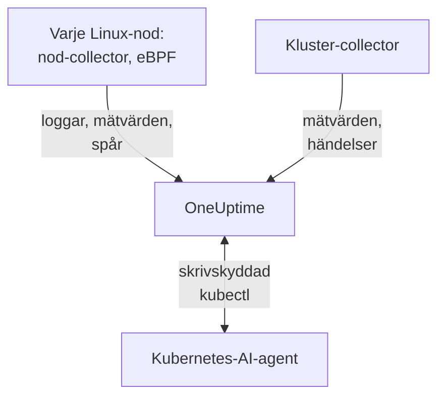

# Kubernetes-agent

OneUptime Kubernetes-agenten är ett Helm-chart som samlar in klustrets mätvärden, Kubernetes-händelser och poddloggar och, med eBPF, spår, förfrågningsmätvärden, tjänstegraf och nätverksflöden för varje podd, utan kodändringar och utan SDK:er. Den kör också [Kubernetes-AI-agenten](#kubernetes-ai-agent), som låter OneUptime AI köra skrivskyddad `kubectl` medan den undersöker en incident eller ett larm. En enda `helm install` sätter den på plats; [Kubernetes-monitorer](/docs/monitor/kubernetes-monitor) larmar på det den skickar.

:::cards
- [Installera agenten](#installera-agenten): Fyra steg med Helm.
- [Konfigurationsalternativ](#konfigurationsalternativ): Filter, sampling, kontrollplan, service mesh, kostnader och etiketter.
- [Kubernetes-AI-agent](#kubernetes-ai-agent): Skrivskyddad `kubectl` för OneUptime AI, och åtgärder när du tillåter dem.
- [Skicka mindre](#minska-mängden-data-som-samlas-in): Spakarna, i ordning efter effekt.
:::

## Så fungerar det

Chartet kör några få arbetsbelastningar i sitt eget namespace. Var och en skickar det den samlar in till din OneUptime-URL över OTLP, med den intagningsnyckel du ger den, och klustret registrerar sig under det namn du ger det i `clusterName`.



| Arbetsbelastning | Typ | Vad den gör | Körs |
| --- | --- | --- | --- |
| Kluster-collector | Deployment | Klustermätvärden, Kubernetes-händelser och specifikationerna för poddar, noder och arbetsbelastningar, från Kubernetes-API:t. | Alltid |
| Nod-collector | DaemonSet | Poddloggar från `/var/log/pods`, kubelet- och cAdvisor-mätvärden och nodens OS-mätvärden. | Överallt utom EKS Fargate |
| eBPF-instrumentering (OBI) | DaemonSet | HTTP-, gRPC-, SQL- och Redis-spår och förfrågningsmätvärden från varje podd, och tjänstekartan. | Som standard, utom på GKE Autopilot och EKS Fargate |
| Kubernetes-AI-agent | Deployment | Skrivskyddad `kubectl` för OneUptime AI medan den undersöker en incident eller ett larm. | Som standard |
| Loggläsare | Deployment | Poddloggar via Kubernetes-API:t, där nod-collectorn inte kan läsa dem. | Med presetarna `gke-autopilot` och `eks-fargate` |
| Kostnadsmotor och poller | Deployments | Utgifter per namespace, arbetsbelastning och podd. | Med `cost.enabled=true` |

Alla agentimages finns bara för Linux, så varje arbetsbelastning är fäst vid Linux-noder.

## Innan du börjar

- Ett Kubernetes-kluster som kör v1.23 eller senare, och `kubectl` konfigurerad för att nå det.
- Helm 3. Uppgraderingar använder `--reset-then-reuse-values`, som kräver Helm 3.14 eller senare.
- En intagningsnyckel. Skapa en under **Projektinställningar → Telemetri och APM → Intagningsnycklar**. Agenten skickar den som huvudet `x-oneuptime-token`, så en projekt-API-nyckel fungerar inte här.
- Ett namn på klustret, unikt i ditt projekt och stabilt, till exempel `prod-us-east-1`: klustret visas i OneUptime under det.
- Utgående HTTPS från klustret till din OneUptime-URL.

## Installera agenten

:::steps
### Lägg till Helm-repositoryt

```bash
helm repo add oneuptime https://helm-chart.oneuptime.com
helm repo update
```

### Installera chartet

Ersätt `YOUR_ONEUPTIME_URL`, `YOUR_ONEUPTIME_API_KEY` (intagningsnyckeln) och klusternamnet med dina värden, och välj fliken för din plattform (se [Välj ett preset](#välj-ett-preset)).

:::tabs
@tab Standard
Självförvaltade kluster, EKS on EC2, GKE Standard, AKS, minikube, kind och k3s:

```bash
helm install kubernetes-agent oneuptime/kubernetes-agent \
  --namespace oneuptime-agent \
  --create-namespace \
  --set oneuptime.url="YOUR_ONEUPTIME_URL" \
  --set oneuptime.apiKey="YOUR_ONEUPTIME_API_KEY" \
  --set clusterName="my-cluster" \
  --set aiAgent.enabled=true
```
@tab GKE Autopilot
```bash
helm install kubernetes-agent oneuptime/kubernetes-agent \
  --namespace oneuptime-agent \
  --create-namespace \
  --set oneuptime.url="YOUR_ONEUPTIME_URL" \
  --set oneuptime.apiKey="YOUR_ONEUPTIME_API_KEY" \
  --set clusterName="my-cluster" \
  --set aiAgent.enabled=true \
  --set preset=gke-autopilot
```
@tab EKS Fargate
```bash
helm install kubernetes-agent oneuptime/kubernetes-agent \
  --namespace oneuptime-agent \
  --create-namespace \
  --set oneuptime.url="YOUR_ONEUPTIME_URL" \
  --set oneuptime.apiKey="YOUR_ONEUPTIME_API_KEY" \
  --set clusterName="my-cluster" \
  --set aiAgent.enabled=true \
  --set preset=eks-fargate
```
:::

**AI-undersökningar är på som standard.** `aiAgent.enabled=true` kör [Kubernetes-AI-agenten](#kubernetes-ai-agent) bredvid collectorn: när en incident eller ett larm uppstår på det här klustret undersöker OneUptime AI det med skrivskyddad `kubectl` (`get`, `describe`, `logs`, `events`, `top`) och ändrar ingenting. Åtgärder är avstängda tills du tillåter dem. För att installera utan den använder du `--set aiAgent.enabled=false` i stället.

### Kontrollera att poddarna körs

```bash
kubectl get pods -n oneuptime-agent
```

Varje podd ska nå `Running` inom en minut eller två:

:::tabs
@tab Standard
Kluster-collectorn, AI-agenten, och på varje nod en nod-collector och en eBPF-podd:

```text
NAME                                          READY   STATUS    RESTARTS   AGE
kubernetes-agent-xxxxxxxxxx-xxxxx             1/1     Running   0          1m
kubernetes-agent-ai-agent-xxxxxxxxxx-xxxxx    1/1     Running   0          1m
kubernetes-agent-ebpf-xxxxx                   1/1     Running   0          1m
kubernetes-agent-logs-xxxxx                   1/1     Running   0          1m
```
@tab GKE Autopilot
Nod-collectorn körs fortfarande och läser kubelet- och cAdvisor-mätvärden utan `hostPath`, och en Deployment för loggläsaren läser poddloggar via Kubernetes-API:t:

```text
NAME                                          READY   STATUS    RESTARTS   AGE
kubernetes-agent-xxxxxxxxxx-xxxxx             1/1     Running   0          1m
kubernetes-agent-ai-agent-xxxxxxxxxx-xxxxx    1/1     Running   0          1m
kubernetes-agent-logs-yyyyyyyyyy-yyyyy        1/1     Running   0          1m
kubernetes-agent-logs-xxxxx                   1/1     Running   0          1m
```
@tab EKS Fargate
Tre Deployments och inget DaemonSet: Fargate ger varje podd en egen mikro-VM och schemalägger aldrig DaemonSets, så nodmätvärden finns inte där:

```text
NAME                                          READY   STATUS    RESTARTS   AGE
kubernetes-agent-xxxxxxxxxx-xxxxx             1/1     Running   0          1m
kubernetes-agent-ai-agent-xxxxxxxxxx-xxxxx    1/1     Running   0          1m
kubernetes-agent-logs-yyyyyyyyyy-yyyyy        1/1     Running   0          1m
```
:::

### Hitta klustret i OneUptime

Öppna **Produkter → Infrastruktur → Kubernetes → Alla kluster**. Klustret visas under sitt `clusterName` inom några minuter, och dess noder, poddar och arbetsbelastningar fylls i. Kubernetes-AI-agenten visas som ansluten på klustrets sida **Agent**, under **AI**.
:::

## Välj ett preset

`preset` väljer de standardvärden som fungerar på din plattform: om poddloggar läses från noden via `hostPath` eller via Kubernetes-API:t, och vilka arbetsbelastningar som får köras privilegierade.

| `preset` | Används för | Poddloggar | Nodmätvärden |
| --- | --- | --- | --- |
| `standard` (standard) | Självförvaltade kluster, **EKS on EC2**, **GKE Standard**, **AKS**, minikube, kind, k3s | Nod-collectorn läser `/var/log/pods` via `hostPath` (lägst overhead) | Kubelet, cAdvisor och nodens OS-mätvärden |
| `gke-autopilot` | **GKE Autopilot** | Loggläsaren läser dem via Kubernetes-API:t (ingen `hostPath`, ingen värdåtkomst) | Kubelet och cAdvisor, utan `hostPath` |
| `eks-fargate` | **EKS Fargate** | Loggläsaren läser dem via Kubernetes-API:t (ingen `hostPath`, ingen värdåtkomst) | Inga: Fargate kör inga DaemonSets |

Om du är osäker, börja med `standard`. Om installationen misslyckas med ett Pod Security-fel som nämner `hostPath`, installera igen med `preset=gke-autopilot` (eller `eks-fargate` på Fargate). GKE Autopilot och EKS Fargate nekar också privilegierade poddar, som eBPF och profileraren behöver, så de två presetarna utelämnar båda.

## Vad som samlas in

| Kategori | Data |
| --- | --- |
| Nodmätvärden | Användning av CPU, minne, filsystem och nätverk |
| Poddmätvärden | CPU, minne, nätverk och omstarter |
| Containermätvärden | CPU och minne per container |
| Klustermätvärden | Nodvillkor, allokerbara resurser, antal poddar |
| Kubernetes-händelser | Varningar, fel och schemaläggningshändelser |
| Poddloggar | Stdout och stderr från varje container (via `hostPath` på standardkluster, via Kubernetes-API:t på Autopilot och Fargate) |
| Applikationsspår (eBPF, på som standard) | HTTP-, gRPC-, SQL- och Redis-spans från varje podd, utan SDK eller kodändringar |
| HTTP RED-mätvärden (eBPF) | `http.server.request.duration`, och storleken på förfrågnings- och svarskroppar, per tjänst |
| Tjänstegraf (eBPF) | Förfrågningsfrekvens, latens och fel från anropare till anropad, som ritar tjänstekartan |
| Nätverksflödesmätvärden (eBPF) | Byte- och paketräknare för TCP och UDP från podd till podd, med Kubernetes-metadata |
| TCP-statistik (eBPF) | Tur och retur-tid, misslyckade anslutningar och omsändningsräknare på nodnivå |
| Kostnader för arbetsbelastningar (tillval, `cost.enabled=true`) | Utgifter per namespace, arbetsbelastning och podd, med ledig kapacitet och effektivitet, och timkostnader för noder och volymer: se [Kubernetes-kostnadsobserverbarhet](/docs/telemetry/kubernetes-cost) |

## Konfigurationsalternativ

Varje alternativ nedan är ett Helm-värde. Sätt det vid installationen, eller på en installerad agent med `helm upgrade ... --reset-then-reuse-values --set <value>`.

### Filtrering efter namespace

`namespaceFilters.rules` tillämpar namespace-mönster på fyra områden, vart och ett för sig:

| Område | Var det filtrerar | Vad det påverkar |
| --- | --- | --- |
| `podLogs` | I hostPath-receivern filelog eller i API-loggläsaren | Bara poddarnas stdout och stderr; Kubernetes-händelser och granskningsloggar påverkas inte |
| `ebpfDiscovery` | I OBI:s processidentifiering | Både eBPF-spår och eBPF-mätvärden från matchande arbetsbelastningar |
| `metrics` | I collectorn, efter att Kubernetes-metadata har lagts till | Mätvärdesserier med namespace; nod- och klusterserier utan namespace behålls |
| `traces` | I collectorn, efter att Kubernetes-metadata har lagts till | Både eBPF-spans och spans som applikationer skickar över OTLP |

Ett mönster matchar hela namnet på namespacet och kan använda `*` (`team-*`). Om ett område har någon `include`-regel behålls bara matchande namespaces för det området, och `exclude`-regler vinner alltid. Standardregeln utesluter `kube-system` endast från `podLogs` och `ebpfDiscovery`.

För att begränsa poddloggar och eBPF-identifiering till vissa namespaces:

```bash
helm install kubernetes-agent oneuptime/kubernetes-agent \
  --namespace oneuptime-agent \
  --create-namespace \
  --set oneuptime.url="YOUR_ONEUPTIME_URL" \
  --set oneuptime.apiKey="YOUR_ONEUPTIME_API_KEY" \
  --set clusterName="my-cluster" \
  --set-json 'namespaceFilters.rules=[{"action":"include","namespaces":["default","production","staging"],"scopes":["podLogs","ebpfDiscovery"]}]'
```

För att stoppa loggarna från ett bullrigt namespace men behålla dess eBPF-spår, tjänstekarta och mätvärden avgränsar du uteslutningen till `podLogs`:

```bash
  --set-json 'namespaceFilters.rules=[{"action":"exclude","namespaces":["kube-system"],"scopes":["podLogs","ebpfDiscovery"]},{"action":"exclude","namespaces":["noisy-*"],"scopes":["podLogs"]}]'
```

Regler för `podLogs` och `ebpfDiscovery` filtrerar vid källan: uteslutna loggfiler öppnas aldrig, och uteslutna arbetsbelastningar instrumenteras aldrig. Regler för `metrics` och `traces` verkar senare, i collectorn, efter att namespacet har kopplats till data.

#### Filtrera mätvärden och spår efter namespace

Lägg till dessa områden i en regel för att också filtrera mätvärden eller spans med namespace:

```bash
  --set-json 'namespaceFilters.rules=[{"action":"exclude","namespaces":["kube-system","noisy-*"],"scopes":["podLogs","ebpfDiscovery","metrics","traces"]}]'
```

> [!NOTE]
> Mätvärden på nod- och klusternivå behålls alltid. Ett namespace hör till en podd, inte till en nod, så serier som nodens CPU, nodens minne och filsystemsanvändning har inget att matcha och släpps aldrig: en regel avgränsad till `metrics` trimmar serier per podd utan att dölja en nod som går sönder.

Kubernetes-händelser kan inte filtreras efter namespace i agenten: de kommer från receivern `k8sobjects` utan ett `k8s.namespace.name`-attribut (namespacet ligger i händelsens innehåll), så det finns inget för ett filter att matcha. Släpp dem i OneUptime i stället, med **Loggar → Inställningar → Drop-filter**.

### Filtrering efter loggallvarlighetsgrad

`filters.logs.minSeverity` släpper poddloggposter under en allvarlighetsgrad, i agenten, innan något skickas:

```bash
  --set filters.logs.minSeverity=WARN
```

Den godtar `TRACE`, `DEBUG`, `INFO`, `WARN`, `ERROR` och `FATAL`. `WARN` behåller WARN, ERROR och FATAL och släpper INFO, DEBUG och TRACE; standardvärdet (`""`) behåller allt. Det gäller i båda loggägena (via collectorn i `daemonset`-läge, inuti loggläsaren i `api`-läge), så ett preset stänger aldrig av det bakom din rygg.

Containerkörtider registrerar ingen allvarlighetsgrad, så agenten läser en från själva loggtexten (`[ERROR]`, `WARN:`, `"level":"info"`, …). Vad som händer med en rad utan igenkännbar nivå beror på loggläget, eftersom de två lägena vet olika saker:

| Läge | En rad utan nivå | Varför |
| --- | --- | --- |
| `daemonset` | `stderr` räknas som ERROR (behålls), `stdout` som INFO (släpps av en WARN-tröskel) | Containerkörtiden registrerar vilken ström varje rad kom från. |
| `api` | Behålls alltid | Kubernetes-API:t `pods/log` slår ihop stdout och stderr till en ström utan markering per rad, så i stället för att gissa behåller agenten raden. |

Därför släpper `api`-läget strikt mindre än `daemonset`-läget, med avsikt: en Python-traceback eller en `npm ERR!` har inget nyckelord för allvarlighetsgrad, och att tyst ta bort den är just det fel som en tröskel ska skydda dig mot. I hybridläge (`logs.windowsPods.enabled`) gäller båda raderna, efter nodens OS: Linux-poddar följer `daemonset`, Windows-poddar `api`.

Händelser över flera rader sätts ihop igen före filtreringen i båda lägena, så en Java-stackspårning bedöms efter sin första rad och behålls eller släpps i sin helhet.

> [!IMPORTANT]
> Kubernetes-händelser och resursspecifikationer filtreras aldrig av detta. De kommer från Kubernetes-API:t utan egen allvarlighetsgrad, så en tröskel skulle ta bort hela flödet, inklusive varningarna `FailedScheduling`, `BackOff` och `OOMKilling` som du helst vill ha. De är få och värdefulla, så agenten skickar dem alltid; för att glesa ut dem använder du **Loggar → Inställningar → Drop-filter** i OneUptime.

### Inkludera eller utesluta mätvärden efter namn

`filters.metrics` avgör vilka mätvärden som lämnar klustret, för alla receivers.

Släpp några få bullriga mätvärden (en blockeringslista, oftast det du vill ha):

```bash
  --set-json 'filters.metrics.exclude=["k8s.volume.available","k8s.volume.capacity"]'
```

Skicka bara en fast uppsättning (en tillåtelselista: allt annat släpps):

```bash
  --set-json 'filters.metrics.include=["k8s.pod.cpu.utilization","k8s.pod.memory.usage"]'
```

Matcha efter mönster i stället för efter exakt namn:

```bash
  --set filters.metrics.matchType=regexp \
  --set-json 'filters.metrics.exclude=["^container_network_"]'
```

| Nyckel | Betydelse |
| --- | --- |
| `filters.metrics.exclude` | Mätvärdesnamn som ska släppas. Tillämpas efter `include`, så en uteslutning vinner alltid. |
| `filters.metrics.include` | När den inte är tom skickas bara dessa mätvärden. |
| `filters.metrics.matchType` | `strict` (det exakta namnet, standard) eller `regexp` (RE2, oförankrat). |

- `regexp` är oförankrat: `system.cpu` matchar också `system.cpu.time`. Förankra det (`^system\.cpu$`) när du menar exakt ett mätvärde.
- RE2 har ingen lookahead, så `^(?!container_)` kompileras inte. Uttryck ”allt utom” med `include`, inte med ett negativt mönster.
- `include` omfattar alla receivers på en gång. En tillåtelselista som glömmer ett mätvärde tar tyst bort de monitorer som bygger på det, så välj hellre `exclude` om du inte vill ha en sluten mängd.
- Använd `--set-json` (eller en värdesfil) för listor: en vanlig `--set` ersätter en lista i stället för att lägga till i den.

> [!WARNING]
> Testa ett mönster innan du rullar ut det. Collectorn kompilerar mönster när den startar, så ett ogiltigt mönster beter sig inte tyst fel: collectorn vägrar starta och kraschar i en loop, och tar med sig den collectorns loggar tillsammans med dess mätvärden. Helm kan inte kompilera RE2, så `helm upgrade` godtar ett felaktigt mönster utan att klaga.

### Spårsampling

Filtren ovan tar bort en kategori av telemetri: ett namespace, en allvarlighetsgrad, ett mätvärdesnamn. Sampling behåller varje kategori och glesar i stället ut populationen. Sätt `sampling.traces.percentage` till andelen spår som ska behållas:

```bash
helm upgrade kubernetes-agent oneuptime/kubernetes-agent \
  --namespace oneuptime-agent --reset-then-reuse-values \
  --set sampling.traces.percentage=10
```

Det behåller ett spår av tio och släpper de andra nio i agenten, innan de lämnar ditt kluster.

- **Du får hela spår, inte fragment.** Beslutet är en hash av spår-ID:t, inte ett myntkast per span, så varje span i ett spår behålls eller släpps tillsammans, och de spår som överlever går att läsa från början till slut.
- **Dina mätvärdesbaserade monitorer rör sig inte.** OBI beräknar eBPF RED-mätvärdena (förfrågningsfrekvens, felfrekvens, varaktighet) från varje förfrågan, och de går genom mätvärdespipelinen, som samplaren inte finns i. Vid 10 % får du en tiondel av spåren och exakt frekvens, fel och latens.
- **Dina spanbaserade monitorer gör det.** Allt som OneUptime räknar från själva spansen skalas ned med frekvensen: se varningen nedan.

| Nyckel | Betydelse |
| --- | --- |
| `sampling.traces.percentage` | Andelen spår som ska behållas i procent, 0 till 100. Standard `100` (behåll allt). |
| `sampling.traces.hashSeed` | Fröet för hashen av spår-ID:t. Standard `22`. |

- `0` behåller inga spår alls. Det är en frekvens, inte en avstängningsknapp: den tar bort varje spår medan eBPF-DaemonSet:et fortsätter att köras och kosta dig. För inga spår, använd `ebpf.enabled=false`; för inga spår men RED-mätvärdena och tjänstekartan, behåll eBPF på och sätt `0` med avsikt.
- Det gäller bara när `ebpf.enabled` är på: annars finns ingen spårpipeline, och värdet gör ingenting.
- Det samplar bara spår. Det finns ingen `sampling.logs` eller `sampling.metrics`, med avsikt: se anmärkningen nedan.
- Bråktal kräver `--set-json`, och de har ett golv. `--set sampling.traces.percentage=0.5` misslyckas, eftersom Helm läser `0.5` som en sträng: använd `--set-json 'sampling.traces.percentage=0.5'` eller en värdesfil. Under ungefär `0.0061` avrundas frekvensen ned till noll och beter sig exakt som `0`, utan fel; `0.01` (en på tiotusen) är det minsta värdet som gör det det säger.
- Flera kluster fungerar som standard. Två agenter behåller samma spår bara om de är överens om både `hashSeed` och `percentage`, och båda har samma standardvärden överallt, så ett spår som korsar två kluster överlever i sin helhet. Ändra `hashSeed` bara för att göra två samplingsnivåer oberoende: med samma frö behåller en lägre frekvens en delmängd av den högre frekvensens spår.
- Poddloggar samplas aldrig, så med `ebpf.logToTraceCorrelation: true` har varje loggpost fortfarande ett spår-ID medan bara den behållna andelen av de spåren finns. Ungefär (100 − `percentage`) % av loggposterna länkar då till ett spår som inte finns; att följa ett spår till dess loggar påverkas inte.

> [!WARNING]
> Justera dina spanbaserade monitorer när du sätter detta. Sampling minskar de spans som når OneUptime, så allt som räknar dem räknar mindre: en **Spår**-monitor på `Span Count` och en **Undantag**-monitor på `Exception Count` ser ungefär `percentage` % av gårdagens volym. En tröskel som är inställd på osamplad trafik slutar tyst att passeras: monitorn ger inget fel, den blir bara tyst. Dela de trösklarna med samma faktor; frekvensen gäller hela klustret, så ingen tjänst kan undantas. Felgrupperingen försämras värre än linjärt: ett vanligt undantag syns fortfarande, men ett sällsynt engångsfel försvinner snarare än visas en tiondel så ofta.

> [!NOTE]
> Varför det inte finns någon logg- eller mätvärdessampling: collectorns samplare kan inte sampla mätvärden alls. Den kan sampla loggar, men den hämtar sin slumpmässighet från spår-ID:t, som poddloggar inte har, så varje loggpost skulle hashas på samma sätt, och en loggfrekvens skulle behålla allt eller ta bort allt beroende på fröet. I stället för att erbjuda en inställning som tyst tar bort dina loggar erbjuder chartet ingen. Glesa ut loggar med [Filtrering efter loggallvarlighetsgrad](#filtrering-efter-loggallvarlighetsgrad) och [Filtrering efter namespace](#filtrering-efter-namespace), som är precisa om vad de tar bort.

### Stäng av logginsamling

Om du inte behöver poddloggar:

```bash
helm install kubernetes-agent oneuptime/kubernetes-agent \
  --namespace oneuptime-agent \
  --create-namespace \
  --set oneuptime.url="YOUR_ONEUPTIME_URL" \
  --set oneuptime.apiKey="YOUR_ONEUPTIME_API_KEY" \
  --set clusterName="my-cluster" \
  --set logs.enabled=false
```

Dina mätvärden påverkas inte: nod-collectorn fortsätter att köras för kubelet-, cAdvisor- och värdmätvärden, och slutar bara läsa poddloggar. Loggbaserade larm upphör, och inget annat.

### Tvinga ett visst logginsamlingsläge

`logs.mode` åsidosätter presetets val, och vinner alltid över det:

- `logs.mode=daemonset`: hostPath-DaemonSet:et (lägst overhead; kräver `hostPath`).
- `logs.mode=api`: Deployment för Kubernetes-API-loggläsaren (fungerar på alla kluster).
- `logs.mode=disabled`: inga poddloggar.

Läget avgör bara var poddloggar kommer ifrån: nodmätvärden samlas in i vilket fall som helst, så `api` och `disabled` behåller dina kubelet-, cAdvisor- och värdmätvärden. Undantaget är plattformen: EKS Fargate kan inte schemalägga DaemonSets alls, så den har ingen nod-collector och inga nod-, podd- eller containermätvärden. GKE Autopilot kör nod-collectorn men blockerar `hostPath`, så den samlar in kubelet- och cAdvisor-mätvärden utan de `hostmetrics`-mätvärden (disk-I/O, inoder, NIC-fel) som läser värdens `/proc` och `/sys`.

På kluster med Windows-nodpooler täcker `daemonset`-läget bara Linux-noderna, eftersom alla agentimages finns bara för Linux. Lägg till `--set logs.windowsPods.enabled=true` för att köra API-loggläsaren bredvid, bara för poddarna på Windows-noder: Linux-poddar behåller nodlokal filläsning, och de två skickar aldrig samma rad två gånger. Det kräver en `kubernetes-log-tailer`-image som är minst lika ny som chartet: en äldre image ignorerar begränsningen och skickar Linux-loggar två gånger.

### Aktivera övervakning av kontrollplanet

Klustrets sida **Kontrollplan** visar diagram för etcd, API-servern, schemaläggaren och kontrollerhanteraren. Agenten skrapar alla fyra när `controlPlane.enabled` är `true`:

```bash
helm upgrade kubernetes-agent oneuptime/kubernetes-agent \
  --namespace oneuptime-agent \
  --reset-then-reuse-values \
  --set controlPlane.enabled=true
```

Varje komponent skrapas på adresserna i sin egen lista: `controlPlane.etcd.endpoints`, `controlPlane.apiServer.endpoints`, `controlPlane.scheduler.endpoints` och `controlPlane.controllerManager.endpoints`. Skrapningen körs i agentens podd, som inte har något värdnätverk, så standardvärdena (`https://localhost:<port>/metrics`) pekar på själva podden: sätt varje lista till en adress som podden kan nå. Inuti alla kluster svarar API-servern på `https://kubernetes.default.svc:443/metrics`:

```bash
helm upgrade kubernetes-agent oneuptime/kubernetes-agent \
  --namespace oneuptime-agent \
  --reset-then-reuse-values \
  --set controlPlane.enabled=true \
  --set "controlPlane.apiServer.endpoints={https://kubernetes.default.svc:443/metrics}"
```

`controlPlane.enabled` slår på alla fyra skrapningar på en gång. Där en komponent inte kan nås på sina slutpunkter (etcd, schemaläggaren och kontrollerhanteraren på ett hanterat kluster, eller på sina `localhost`-standardvärden) misslyckas skrapningen vid varje intervall: collectorn loggar ett skrapfel och rapporterar målet som nere, och inget annat ändras.

Agenten skrapar bara över HTTPS, med tjänstekontots token och utan klientcertifikat. Därför:

- **etcd** behöver en HTTPS-adress för mätvärden som inte kräver ett klientcertifikat. etcd:s vanliga mätvärdesportar är utom räckhåll: vanlig HTTP på `2381` (kubeadms `--listen-metrics-urls`) skrapas som HTTPS och misslyckas, och `2379` kräver klientcertifikat.
- **Schemaläggaren** (`10259`) och **kontrollerhanteraren** (`10257`) serverar HTTPS och godtar token, men kubeadm binder dem till `127.0.0.1` på kontrollplanets noder: de behöver en `--bind-address` som agentens podd kan nå.

Hanterade Kubernetes-tjänster (EKS, GKE, AKS) exponerar inte etcd, schemaläggaren eller kontrollerhanteraren, så de flikarna förblir tomma där. Tills en fliks mätvärden kommer in visar sidan **Kontrollplan** vad som ska sättas i stället för dess diagram, med kommandot att kopiera.

### Aktivera CoreDNS-mätvärden

Fliken **CoreDNS** på sidan **Kontrollplan** visar diagram för DNS-frågor, latens, cachen och vidarebefordran. Insamlingen är avstängd som standard:

```bash
helm upgrade kubernetes-agent oneuptime/kubernetes-agent \
  --namespace oneuptime-agent \
  --reset-then-reuse-values \
  --set coreDns.enabled=true
```

Agenten skrapar port `9153` på poddarna märkta `k8s-app=kube-dns` i `kube-system`, vilket är hur CoreDNS körs på kubeadm-kluster, EKS och AKS. Om ditt körs någon annanstans sätter du också `coreDns.namespace`, `coreDns.service` (etiketten `k8s-app`) och `coreDns.port`. GKE kör kube-dns (dnsmasq) eller Cloud DNS i stället för CoreDNS, så fliken förblir tom där.

### Aktivera mätvärden för service mesh

Klustrets sida **Service Mesh** visar diagram för Istio och Linkerd. Agenten skrapar ett mesh, det som `serviceMesh.provider` anger (`istio` eller `linkerd`):

```bash
helm upgrade kubernetes-agent oneuptime/kubernetes-agent \
  --namespace oneuptime-agent \
  --reset-then-reuse-values \
  --set serviceMesh.enabled=true \
  --set serviceMesh.provider=istio
```

För Istio läser den Envoy-statistiken för varje `istio-proxy`-sidecar (port `15090`); för Linkerd administratörsporten för varje `linkerd-proxy`. Inget av meshens kontrollplan skrapas: istiod (kortet **Pilot**) och Linkerds komponenter identity, destination och proxy-injector (kortet **Kontrollplan**) serverar sina mätvärden på egna administratörsportar, så de korten säger det i stället för att visa diagram.

### Mätvärden som agenten inte samlar in

Vissa diagram visar mätvärden som agenten inte skrapar: **kube-proxy** på sidan **Kontrollplan**; **Cilium** (med Hubble) på sidan **Service Mesh**; och på flikarna för Istio och Linkerd meshens egna kontrollplan (**istiod**, och Linkerds komponenter identity, destination och proxy-injector). De fylls i när de mätvärdena når OneUptime på annat sätt, till exempel från din egen [OpenTelemetry Collector](/docs/telemetry/open-telemetry) som skrapar dem, med resursattributet `k8s.cluster.name` satt till klustrets namn (agentens `clusterName`). Kluster som körs utan kube-proxy har inga kube-proxy-mätvärden alls.

### Aktivera kostnadsobserverbarhet

Se vad varje namespace, arbetsbelastning och podd kostar, med ledig kapacitet och hur mycket av varje request som används, på klustrets sida **Costs**:

```bash
helm upgrade kubernetes-agent oneuptime/kubernetes-agent \
  --namespace oneuptime-agent \
  --reset-then-reuse-values \
  --set cost.enabled=true
```

Det i sig är en fullständig installation: chartet levereras med motorn [OpenCost](https://opencost.io) med öppen källkod (med den lilla Prometheus den behöver) och prissätter dina noder och volymer utifrån molnleverantörens offentliga listpriser, utan inloggningsuppgifter. Den lägger till två små poddar, och de första kostnaderna visas efter den första avslutade timmen. Kör du redan Kubecost eller OpenCost? Lägg till `--set cost.engine.url=<its service URL>` i stället, så medföljer ingenting. Lokala kluster kan sätta en prislista med `cost.opencost.customPricing`. Den fullständiga guiden, med lokal prissättning och felsökning, är [Kubernetes-kostnadsobserverbarhet](/docs/telemetry/kubernetes-cost).

### Automatisk märkning med projektetiketter

Varje resursattribut som börjar med `oneuptime.label.` blir en projektetikett, kopplad till klustret och till de tjänster och värdar som den här agenten rapporterar: `oneuptime.label.<dimension>=<value>` är etiketten `<dimension>:<value>`. Skicka etiketter vid installationen med `--set oneuptime.labels.<key>=<value>`:

```bash
helm install kubernetes-agent oneuptime/kubernetes-agent \
  --namespace oneuptime-agent \
  --create-namespace \
  --set oneuptime.url="YOUR_ONEUPTIME_URL" \
  --set oneuptime.apiKey="YOUR_ONEUPTIME_API_KEY" \
  --set clusterName="prod" \
  --set oneuptime.labels.team=payments \
  --set oneuptime.labels.env=production \
  --set oneuptime.labels.region=us-east-1
```

Eller ha dem i en värdesfil:

```yaml title="values.yaml"
oneuptime:
  url: YOUR_ONEUPTIME_URL
  apiKey: YOUR_ONEUPTIME_API_KEY
  labels:
    team: payments
    env: production
    region: us-east-1
clusterName: prod
```

Etiketter matchas utan hänsyn till skiftläge, så en befintlig `Production`-etikett som du skapat för hand återanvänds i stället för att dupliceras, och etiketter som lagts till i OneUptime tas aldrig bort av agenten.

## Applikationsspår och HTTP-mätvärden via eBPF (på som standard)

Chartet kör ett DaemonSet med [OpenTelemetry eBPF Instrumentation (OBI)](https://opentelemetry.io/docs/zero-code/obi/) på varje nod. Det läser in eBPF-program i kärnan och fångar HTTP- och HTTPS-, gRPC-, SQL- och Redis-trafiken för alla körtider som stöds (Go, .NET, Java, Node.js, Python, Ruby, Rust), utan SDK och utan sidecar. Spåren och förfrågningsmätvärdena går sedan genom collectorn i klustret till OneUptime.

Det kräver Linux-kärna 5.8 eller senare med BTF (standard på Debian 11+, Ubuntu 20.10+, Fedora 34+, RHEL och Stream 9+), och DaemonSet:et körs privilegierat, eftersom det krävs för att läsa in eBPF-program.

### Hur eBPF-spår ser ut

eBPF ser nätverksanrop, inte din kod, så ett spår byggs av de förfrågningar som en tjänst hanterar och de anrop den gör medan den hanterar dem:

- **En förfrågan och dess anrop bildar ett spår.** Förfrågan in till en tjänst är rotspannet, med namnet `<METHOD> <route>`, och de HTTP-, gRPC-, SQL- och Redis-anrop som tjänsten gör medan den hanterar den är dess barn. (För Node.js bygger detta på OBI:s Node.js-agent, som chartet slår på med `ebpf.nodejs.enabled`.) Anrop som samtidiga förfrågningar skickar över en delad anslutning, typiskt för Redis-klienter, kan inte alltid skiljas åt, så en del av dem placeras inte i sin förfrågans spår.
- **Ett anrop till en tjänst på en annan nod startar ett nytt spår**, om inte något bär spårkontexten vidare: en OpenTelemetry SDK, eller den valfria kontextspridning som beskrivs nedan. När båda ändarna körs på samma nod ser OBI båda och länkar dem själv.
- **Arbete som ingen förfrågan startade står ensamt.** En köarbetare som pollar Redis, eller ett cron-jobb, har ingen förfrågan som dess anrop kan höra till.
- **Databasservrar står oftast ensamma.** Databasernas trådprotokoll bär ingen spårkontext, så om inte anroparen körs på samma nod blir det span som OBI registrerar inuti en databasserver för varje kommando ett spår med ett enda span.

Dessa fristående databasanrop kommer som spår med ett span, namngivna efter ett naket kommando (`set`, `evalsha`, `SELECT`), och på ett upptaget kluster kan de utgöra det mesta av det OBI fångar. Som standard släpper agenten dem innan de lämnar klustret: en databasservers eget span, som alltid duplicerar anroparens (`ebpf.dropDatabaseServerSpans=true`), och ett applikationsanrop som inte hör till något spår (`ebpf.dropUnlinkedDatabaseCalls=true`). En applikations databasanrop inuti en förfrågans spår behålls, spans som dina applikationer skickar från sina egna SDK:er rörs aldrig, och databasmätvärdena räknar fortfarande varje kommando.

En avvägning: OneUptime identifierar databaser, och ritar dem på tjänstekartan, utifrån databasklientens spans. En databas som bara bakgrundsarbete pratar med (en arbetares kö, ett cron-jobbs datalager) identifieras då inte längre från spår, och visas på tjänstekartan som en fjärrslutpunkt. Dess mätvärden påverkas inte. Sätt `ebpf.dropUnlinkedDatabaseCalls=false` för att behålla de spansen.

Bakgrundsarbetets HTTP- och gRPC-anrop (en arbetare som frågar ClickHouse över HTTP, en kontroller som förnyar sitt Kubernetes-lease) kommer också som spår med ett span (`POST /`, `PUT /apis/*/...`). Sätt `ebpf.dropUnlinkedClientCalls=true` för att släppa även dem, tillsammans med anrop som OBI inte kunde placera i sin förfrågans spår, som ser likadana ut; databas-, meddelande- och GenAI-anrop (MCP inräknat) släpps aldrig av den. Den är avstängd som standard eftersom den kostar data: när den anropade tjänsten körs på samma nod länkar OBI förfrågan den hanterade under anropet, så anropet är roten i det spåret, och att släppa det lämnar spåret utan rot. Med `ebpf.contextPropagation` på händer det på vilken nod som helst, och även mot en tjänst med en egen OpenTelemetry SDK. Tjänstekartan läser också dessa anrop: ett beroende som bara bakgrundsarbete anropar ritas då enbart utifrån OBI:s tjänstegrafmätvärden, och en kant som också syns inuti förfrågningar räknar bara de anropen. En tjänsts översikt räknar dess spans, så en arbetare eller sond vars spans mestadels är sådana anrop visar betydligt färre förfrågningar, med en felfrekvens och p95-latens över de spans som är kvar. OBI:s mätvärden för klientförfrågningar räknar fortfarande varje anrop.

På en självhostad OneUptime uppgraderar du servern före agenten: den eBPF-spårare som det här chartet kör (OBI v0.14) namnger anropade tjänster och rapporterar meddelandemäklarnas egna spans på sätt som äldre OneUptime-servrar inte läser.

Namnen kommer från trafiken. HTTP-spans använder appens routemall när OBI kan läsa den, och annars ett mönster som skapats från URL:en med ID-liknande segment ersatta med `*`; sätt `ebpf.routes.patterns` för att namnge dem själv. OBI läser routemallarna i appar skrivna i Go (net/http, Gorilla mux, Gin), Java (Spring, JAX-RS), Node.js (Express, Fastify, Koa, NestJS, Next.js), Python (Django, FastAPI, Flask), Ruby (Rails), .NET (attributroutes i ASP.NET Core) och PHP (Symfony, Laravel, Slim). Namn på applikationsnivå, som `OrderService.charge`, finns bara i koden och kräver en OpenTelemetry SDK.

Om en app redan exporterar spår med en OpenTelemetry SDK märker OBI det och slutar skicka eBPF-spår för den, så att den inte spåras två gånger (`ebpf.excludeOtelInstrumentedServices=true`, OBI:s standard). Sätt den till `false` om den SDK:n rapporterar till ett annat projekt och du vill ha eBPF-spår för appen även i det här.

### Stäng av eBPF-autoinstrumentering

Stäng av eBPF när:

- Du installerar på **GKE Autopilot** eller **EKS Fargate**: de plattformarna nekar privilegierade poddar, så `preset=gke-autopilot` och `preset=eks-fargate` utelämnar redan eBPF åt dig, och profileraren med den.
- Noderna kör en kärna äldre än 5.8 utan BTF-bakåtporteringar.
- Du redan skickar spår från OpenTelemetry SDK:er i varje app och inte heller vill ha eBPF-mätvärdena. (För enbart spår behöver du inte det: OBI slutar skicka eBPF-spår för en app som den ser exportera sina egna, som ovan.)

```bash
helm install kubernetes-agent oneuptime/kubernetes-agent \
  --namespace oneuptime-agent \
  --create-namespace \
  --set oneuptime.url="YOUR_ONEUPTIME_URL" \
  --set oneuptime.apiKey="YOUR_ONEUPTIME_API_KEY" \
  --set clusterName="my-cluster" \
  --set ebpf.enabled=false
```

### Slå på och av enskilda signalfamiljer

Alla är på som standard utom en. Stäng av vilken som helst med `--set ebpf.features.<name>=false`:

| `ebpf.features.*` | Standard | Vad den lägger till |
| --- | --- | --- |
| `httpMetrics` | på | HTTP- och gRPC-RED-mätvärden (förfrågningsfrekvens, latens, fel) per tjänst |
| `spanMetrics` | på | Antal anrop och varaktighet för spans (`traces.span.metrics.*`) |
| `serviceGraph` | på | Kantmätvärden från anropare till anropad, som ritar tjänstekartan |
| `networkMetrics` | på | TCP- och UDP-flödesräknare från podd till podd |
| `networkInterZoneMetrics` | av | Varianten av nätverksmätvärdena mellan zoner (fördubblar deras kardinalitet) |
| `tcpStats` | på | TCP-tur och retur-tid, misslyckade anslutningar och omsändningsräknare på nodnivå |

Spridning av spårkontext mellan tjänster, där OBI injicerar en W3C-`traceparent` så att en förfrågan som går från podd A till podd B visas som ett spår utan någon SDK någonstans, är avstängd som standard. Välj den med `--set ebpf.contextPropagation=true`. Den kräver ingen kärna utöver det som resten av agenten kräver, och ingen kärnversion gör den verkningslös.

Den är avstängd eftersom att injicera huvudet innebär att skriva om trafik som redan är på väg: HTTP-förfrågningar i klartext breddas på plats i kärnan, medan TLS och rå TCP får ett TCP-alternativ tillagt från en Traffic Control-krok. Om anslutningens bytebokföring inte korrigeras exakt hamnar strömmen ur takt; det rapporterade symptomet är att överföringar genom en L7-proxy som nginx hänger mitt i kroppen när svaret passerar ungefär 64KB, medan små förfrågningar fortsätter att fungera. Uteslut inte detta utifrån kärnans ålder: under kärna 5.17 faller OBI tillbaka på program med begränsad skanning och skriver om trafik på samma sätt. Spår, RED-mätvärden och tjänstekartan är inte beroende av den; för att länka ihop tjänster sprider en OpenTelemetry SDK `traceparent` i användarutrymmet, utan omskrivning i kärnan, och är det säkrare valet.

## Kubernetes-AI-agent

När en incident eller ett larm uppstår på det här klustret undersöker OneUptime AI det. **Kubernetes-AI-agenten** i chartet ger den en terminal: den kör skrivskyddad `kubectl` som en jourhavande ingenjör skulle göra (beskriver den felande podden, läser dess händelser, följer loggarna från containern som kraschar, kontrollerar nodkapaciteten) och citerar varje kommando på incidentsidan.

Agenten är **på som standard** och **skrivskyddad**: en liten Deployment (`kubernetes-agent-ai-agent`, poddetiketten `component=ai-agent`, imagen `oneuptime/kubernetes-ai-agent`) vars ServiceAccount bara får läsa. Den registrerar sig med samma `oneuptime.apiKey` och `clusterName` som collectorn använder, så det finns inget att ställa in i instrumentpanelen: klustrets sida **AI-agent** (Kubernetes → kluster → AI → Agent) visar den som ansluten inom en minut, och **Testa anslutningen**, i menyn **⋯** bredvid den statusen, kör `kubectl version` och `kubectl auth can-i --list` genom den. Allt AI har gjort med den finns på klustrets sida **AI-loggar** (AI → Loggar), och det som är värt att veta om klustret — de problem som hela tiden återkommer och varför, noden eller arbetsbelastningen bakom de flesta av dem, vad AI har åtgärdat — på sidan **AI Insights** (AI → Insights). Agenten levereras med en låst kubectl (v1.36.4). Den är ingen Runner och visas aldrig under Runbooks → Runners: OneUptime ger den aldrig inloggningsuppgifter, kör aldrig runbooks på den, och den godtas aldrig som kommando-Runner för en regel för automatisk åtgärd.

På en agent som installerades innan AI-agenten fanns uppdaterar du först ditt chart-index och uppgraderar sedan (på en självhostad OneUptime uppgraderar du OneUptime först — se [Uppgradera agenten](#uppgradera-agenten)):

```bash
helm repo update
helm upgrade kubernetes-agent oneuptime/kubernetes-agent \
  --namespace oneuptime-agent --reset-then-reuse-values \
  --set aiAgent.enabled=true
```

Använd det releasenamn och namespace som du installerade agenten med, om de skiljer sig (`helm list -A | grep kubernetes-agent` visar dem). Utan `helm repo update` kan Helm välja det chart du installerade från, som inte känner till `aiAgent` och misslyckas med `Additional property aiAgent is not allowed`. Publicerade chartversioner följer OneUptime-versionen, så om `helm show values oneuptime/kubernetes-agent | grep aiAgent` inte skriver ut något är ditt index fortfarande gammalt. För att köra chartet utan AI-agenten skickar du `--set aiAgent.enabled=false`.

### Vad AI får göra

Vad OneUptime AI får göra på klustret ställs in i chartet, med två värden, och klustrets AI-agentsida visar dem under **Vad AI får göra** utan något sätt att ändra dem där:

- `aiAgent.investigation` — `true`: AI kör skrivskyddad `kubectl` medan den undersöker en incident eller ett larm på klustret. `false`: den undersöker ändå, med de data som OneUptime redan har.
- `aiAgent.fixes` — `off`, `ask-for-approval`, `automatic` eller `bypass-approval` (nedan). Varje nivå utom `off` ger AI-agenten skrivåtkomst; `off` ger ingen, och agenten avvisar då själv varje skrivning.

AI-agenten rapporterar båda till OneUptime, som tillämpar dem på klustret och avvisar en ändring som görs någon annanstans — AI-agentsidan, API:t eller Terraform. **Ändra** på den sidan visar kommandot för det alternativ du väljer. Båda är osatta i `values.yaml`: en release som inte sätter något av dem låter agenten använda sina standardvärden (undersökning på, åtgärder av), och OneUptime tillämpar dem bara på ett kluster vars inställningar ingen har valt på dess AI-agentsida — inställningar som någon har valt där behålls som de är, och sidan visar hur du flyttar dem till chartet.

### Låt AI åtgärda det den hittar

Åtgärder är avstängda tills du slår på dem med `aiAgent.fixes` — ett separat, valfritt steg som också ger AI-agenten skrivåtkomst. Den rekommenderade formen ger den bara i de namespaces där AI får åtgärda, med nodoperationer avstängda:

```bash
helm repo update
helm upgrade kubernetes-agent oneuptime/kubernetes-agent \
  --namespace oneuptime-agent --reset-then-reuse-values \
  --set aiAgent.enabled=true \
  --set aiAgent.investigation=true \
  --set aiAgent.fixes=ask-for-approval \
  --set "aiAgent.remediation.namespaces={web,api}" \
  --set aiAgent.remediation.nodeOperations=false
```

Eller för hela klustret:

```bash
helm repo update
helm upgrade kubernetes-agent oneuptime/kubernetes-agent \
  --namespace oneuptime-agent --reset-then-reuse-values \
  --set aiAgent.enabled=true \
  --set aiAgent.investigation=true \
  --set aiAgent.fixes=ask-for-approval \
  --set-json 'aiAgent.remediation.namespaces=[]'
```

Varje namespace du listar måste redan finnas: chartet skapar en RoleBinding i vart och ett och skapar aldrig något namespace, så ett som saknas får hela uppgraderingen att misslyckas — även collectorns — med `namespaces "api" not found`. Skapa det först, eller ta bort det från listan, och ta bort ett namespace från listan innan du raderar det. Om flaggan utelämnas i en uppgradering behålls den lagrade listan; `--set-json 'aiAgent.remediation.namespaces=[]'` (Helm 3.10+) går tillbaka till hela klustret — inte `={}`, som Helm läser som ett tomt namn. `--set aiAgent.remediation.namespaces=null` återställer inte en lagrad lista under `--reuse-values`: Helm behåller den lagrade listan. `aiAgent.remediation.nodeOperations=false` håller åtgärder borta från noder; sätt den till `true` för att låta AI köra cordon, uncordon, drain och taint på noder.

`aiAgent.fixes` väljer hur åtgärder körs; för att stänga av dem igen uppgraderar du med `--set aiAgent.fixes=off`, som också tar bort skrivåtkomsten:

- **ask-for-approval** — OneUptime AI sätter ihop den exakta `kubectl`-planen och en människa godkänner den med ett klick på incidenten;
- **automatic** — säkra ändringar körs av sig själva; en riskablare ändring gör det aldrig. När rundan bara hittade riskablare åtgärder avslutar den med att föreslå exakt dem för godkännande med ett klick; när den också körde en säker åtgärd föreslås den riskablare bara om verifieringen visar att den säkra åtgärden inte återställde signalen (uppföljningsrundan, som frågar);
- **bypass-approval** — AI frågar inte: varje ändring som policyn tillåter körs av sig själv, uppföljningsrundor inräknade, förutom att en runda frågar när den timvisa kretsbrytaren löser ut, när en annan obevakad OneUptime AI-runda fortfarande ändrar eller verifierar samma kluster, eller när den följer en åtgärd vars återställning inte slutfördes.

Oavsett läge kräver en skrivning i kube-system, kube-public eller kube-node-lease alltid en människa, och det gör även en `drain`, en `taint` och en `patch` av en nod (en drain avhyser poddar i alla namespaces, även agentens egen, och det gör även en `NoExecute`-taint, oavsett om `kubectl taint` eller en nod-`patch` sätter den); en anpassad resurs bedöms efter sitt namespace, även en som är namngiven som en inbyggd typ; och AI-agenten ändrar aldrig något i sitt eget namespace, utanför `aiAgent.remediation.namespaces` eller på en nod med `aiAgent.remediation.nodeOperations=false`. OneUptime läser det omfånget från det som AI-agenten rapporterar och avvisar en sådan åtgärd när den föreslås eller godkänns, inte bara i agenten. I båda de obevakade lägena föreslår en runda sin plan för godkännande i stället för att köra den när den timvisa kretsbrytaren löser ut eller en annan obevakad runda redan håller klustret. Se [AI SRE — Klusteråtkomst](/docs/ai/ai-sre) för vad varje läge får köra och vad kommandopolicyn avvisar direkt.

**Vad skrivåtkomsten innebär.** Patch/update på arbetsbelastningar, poddar och CronJobs, och create på Jobs, i ett namespace motsvarar att köra vilken image som helst som vilket ServiceAccount som helst i det namespacet och läsa dess Secrets — en poddmall kan ange vilken image, vilket ServiceAccount och vilken Secret-volym som helst. Chartets RBAC begränsar därför *var* AI-agenten får skriva, inte vad en skrivning får göra: kommandopolicyn avvisar säkerhetspatchar för poddmallar, patchar som ersätter poddspecifikationen eller en hel `containers`-lista, `set serviceaccount`, `create … --image`, `expose --overrides` (som kan skapa ett Job eller någon annan typ av objekt i stället för en Service) och patchkroppar som inte är JSON. Den avvisar inte `set image`, eller en patch av ett image-fält: det är en riskablare ändring — den nya imagen körs som arbetsbelastningens eget ServiceAccount, med dess Secrets — som en människa godkänner, om inte klustret hoppar över godkännanden eller dess tillåtelselista anger kommandot. Med `aiAgent.remediation.namespaces` tom binds skrivrollen för hela klustret, vilket RBAC inte kan hålla borta från kube-system, kube-public, kube-node-lease eller agentens eget namespace; där är det policyn och AI-agenten som håller linjen. Lista namespaces så binder chartet den bara i dem, och en skrivning någon annanstans avvisas när den föreslås eller godkänns, och igen av AI-agenten.

### Värden för AI-agenten

`aiAgent.remediation.*` och `aiAgent.extraEnv` är inte satta i `values.yaml`, så ett värde som lagrats under den gamla `aiAccess`-nyckeln fortsätter att gälla tills du sätter dem (se [Uppgradera agenten](#uppgradera-agenten)). De standardvärden som tabellen anger för dem gäller bara när varken `aiAgent`-nyckeln eller `aiAccess`-nyckeln är satt. `aiAgent.investigation` och `aiAgent.fixes` är inte heller satta, så AI-inställningar som valts på ett klusters AI-agentsida finns kvar tills du sätter något av dem.

| Värde | Standard | Vad det gör |
| --- | --- | --- |
| `aiAgent.enabled` | `true` | Kör Kubernetes-AI-agenten med skrivskyddad RBAC (för hela klustret). `false` tar bort den. |
| `aiAgent.investigation` | osatt (`true`) | Om OneUptime AI kör skrivskyddad `kubectl` medan den undersöker. Klustrets AI-agentsida visar det skrivskyddat. |
| `aiAgent.fixes` | osatt (`off`) | `off`, `ask-for-approval`, `automatic` eller `bypass-approval`. Varje nivå utom `off` ger skrivverben nedan. Klustrets AI-agentsida visar det skrivskyddat. |
| `aiAgent.remediation.enabled` | `false` | Ersatt av `aiAgent.fixes`, och läses bara medan den är osatt. Ger också de skrivverb som OneUptime AI:s åtgärder använder: patch/update på Deployments, StatefulSets, DaemonSets, ReplicaSets (och deras scale-underresurs), Jobs, CronJobs, Pods och HPA:er; create på Jobs och HPA:er; delete bara på Pods och Jobs. Det ger aldrig Secrets, `exec`, `attach`, `port-forward`, CRD:er eller RBAC-skrivningar, så en ändring av någon annan typ — att ta bort en Deployment, märka en Service eller ConfigMap — misslyckas med `Forbidden` även när den är godkänd. |
| `aiAgent.remediation.namespaces` | `[]` | Bind skrivrollen bara i dessa namespaces, en RoleBinding i vart och ett; en skrivning någon annanstans avvisas när den föreslås eller godkänns, och av AI-agenten. Vart och ett måste redan finnas, annars misslyckas uppgraderingen. Tom binder den för hela klustret; `--set-json 'aiAgent.remediation.namespaces=[]'` återställer en lagrad lista (`--set aiAgent.remediation.namespaces=null` återställer inte en lagrad lista under `--reuse-values`). Agentens eget namespace kan inte listas. |
| `aiAgent.remediation.nodeOperations` | `true` | Med `remediation.enabled` ges också cordon/uncordon/taint (patch på noder) och drain (avhysning av poddar), för hela klustret. Sätt `false` för att hålla åtgärder borta från noder: ingen nod-RBAC, nodoperationer avvisas när de föreslås eller godkänns, och AI-agenten avvisar dem (`ONEUPTIME_KUBECTL_ALLOW_NODE_OPERATIONS=false`). |
| `aiAgent.image.repository` | `oneuptime/kubernetes-ai-agent` | Agentens image. Peka den mot din spegel om noderna inte kan hämta från Docker Hub. |
| `aiAgent.image.tag` | `release` | `release` följer varje OneUptime-release; lås en version för att behålla den. |
| `aiAgent.image.pullPolicy` | `Always` för `release`, `IfNotPresent` för en låst tagg | Lämna den tom för det standardvärdet, så att en nods cachade agent aldrig överlever en uppgradering. |
| `aiAgent.imagePullSecrets` | `[]` | Pull-secrets för ett privat register eller en spegel, som `[{name: <secret>}]`. |
| `aiAgent.resources` | `50m` / `64Mi` i requests, `500m` / `256Mi` i limits | Agenten är inaktiv mellan kommandona. |
| `aiAgent.extraEnv` | `[]` | Extra `EnvVar`-objekt för agentens container — t.ex. `HTTPS_PROXY` / `NO_PROXY` bakom en utgående proxy, som agenten respekterar. Namn som chartet sätter själv (som `ONEUPTIME_KUBECTL_ALLOW_WRITES`, `ONEUPTIME_KUBECTL_WRITE_NAMESPACES`, `ONEUPTIME_KUBECTL_ALLOW_NODE_OPERATIONS` eller `ONEUPTIME_KUBERNETES_CLUSTER_NAME`) får renderingen att misslyckas i stället för att tyst ersätta chartets värde. |

### Om AI-agenten inte ansluter

Om AI-agentsidan fortfarande säger att agenten inte är ansluten efter ett par minuter läser du dess logg:

```bash
kubectl logs -n oneuptime-agent -l component=ai-agent --tail=100
```

- **"This OneUptime server does not have the Kubernetes AI agent API"** — chartet är nyare än din OneUptime-server. Uppgradera OneUptime, eller installera den chartversion som matchar din server (`--version <your OneUptime version>`). Agenten försöker igen var 5:e minut.
- **Ett avslag som försvinner av sig självt** — en tidigare agentpodd som fortfarande rapporterar in (en podd som ersattes utan en ren avstängning), eller den gamla Runnern i klustret som fortfarande stängs av under en uppgradering. Agenten försöker igen efter den väntetid som servern anger.
- **Ett avslag som kräver dig** — ett tomt eller för långt `clusterName`, eller ett projekt som har nått sin gräns för AI-agenter; loggen anger vad som ska ändras. Om en agent aldrig ansluter och dess logg säger `Another Kubernetes AI agent for cluster "<name>" is online` delar två installationer samma `clusterName` (AI-agentsidan varnar också för det): den som redan är ansluten behåller det så länge den körs, så ge varje kluster ett eget `clusterName` eller ta bort den extra releasen. En intagningsnyckel med ett **Pinned Service Name** kan inte registrera agenten — ge chartet en nyckel utan.

**Återställ agenten**, i menyn **⋯** bredvid agentens status på AI-agentsidan, får servern att glömma agentens nyckel när du bekräftar (en projektägare, en projektadministratör eller **Edit Auto Remediation Rule** får göra det); podden ansluter igen av sig själv inom några minuter. Agentens beredskap beror inte på OneUptime, så en felkonfigurerad AI-agent får aldrig `helm upgrade --wait` att misslyckas — bara en podd som inte kan hämta sin image gör det.

## Uppgradera agenten

När agenten är äldre än din OneUptime visas en varningssymbol bredvid **Agentversion** i klustrets **Klusterdetaljer**. Välj den för att se det här kommandot.

```bash
helm repo update
helm upgrade kubernetes-agent oneuptime/kubernetes-agent \
  --namespace oneuptime-agent \
  --reset-then-reuse-values
```

`--reset-then-reuse-values` (Helm 3.14+) behåller de värden du har satt (preset, klusternamn, filter) och tar alla andra värden från det nya chartet; skicka eventuella nya `--set`-åsidosättningar ovanpå. På Helm 3.13 eller äldre uppgraderar du i stället med de värden du har satt:

```bash
helm repo update
helm get values kubernetes-agent --namespace oneuptime-agent -o yaml > values.yaml && \
  helm upgrade kubernetes-agent oneuptime/kubernetes-agent \
  --namespace oneuptime-agent -f values.yaml
```

Använd inte `--reuse-values`: den behåller också standardvärdena från det chart du uppgraderar från, så ett nyare charts standardvärden (bland dem eBPF-imagen) tillämpas aldrig. När en release körs på ett äldre charts standardvärden avslutas de anteckningar som Helm skriver ut efter installationen eller uppgraderingen med en varning och kommandot som åtgärdar det.

Om uppgraderingen misslyckas med `namespaces "<name>" not found` listar `aiAgent.remediation.namespaces` (eller den äldre `aiAccess.remediation.namespaces`) ett namespace som inte finns (eller inte längre finns): chartet lägger en RoleBinding i varje listat namespace och skapar aldrig något. Skapa namespacet, eller uppgradera med listan utan det namespacet (`--set "aiAgent.remediation.namespaces={web}"`), eller med `--set-json 'aiAgent.remediation.namespaces=[]'` för att gå tillbaka till bindningen för hela klustret. `--set aiAgent.remediation.namespaces=null` återställer inte en lagrad lista under `--reuse-values`, så det misslyckas med samma fel.

> **eBPF:s spanmätvärden har nya namn.** `ebpf.features.spanMetrics` skickar nu `traces.span.metrics.calls` och `traces.span.metrics.duration` (sekunder) i stället för `traces_spanmetrics_calls_total` och `traces_spanmetrics_latency`: samma serier, under de namn som OBI behåller (det har gjort de gamla föråldrade). En instrumentpanel, ett diagram eller en mätvärdesmonitor på ett gammalt namn tar inte emot några nya data efter uppgraderingen, utan något fel — flytta den till det nya namnet, och uppdatera varje `filters.metrics`-post som anger ett gammalt.

### Uppgradera till Kubernetes-AI-agenten

Chartet kör nu [Kubernetes-AI-agenten](#kubernetes-ai-agent) som standard. Den ersätter Runnern i klustret (`component=ai-runner`) som `aiAccess.enabled=true` installerade i tidigare versioner. Innan du uppgraderar:

- **Självhostad OneUptime: uppgradera OneUptime-servern först.** AI-agenten behöver ett API som äldre servrar inte har. Mot en sådan loggar den "This OneUptime server does not have the Kubernetes AI agent API" och försöker igen var 5:e minut — och uppgraderingen har redan tagit bort den gamla Runnern i klustret, så OneUptime AI har ingen kubectl-åtkomst förrän servern är uppgraderad. Om du inte kan uppgradera servern än installerar du den chartversion som matchar den (`--version <your OneUptime version>`).
- **Uppgraderingen lägger till en podd som hämtar `docker.io/oneuptime/kubernetes-ai-agent`.** Om dina noder hämtar via en spegel eller en tillåtelselista för images, och du uppgraderar med `--wait` eller `--atomic`, med Terraform eller med Flux (båda väntar som standard), speglar du imagen först och sätter `aiAgent.image.repository` (och `aiAgent.imagePullSecrets` för ett privat register) — eller skickar `--set aiAgent.enabled=false`. Annars blir podden aldrig redo, uppgraderingen överskrider tidsgränsen, och `--atomic` rullar tillbaka hela releasen, collectorn inräknad.

Dina `aiAccess`-inställningar förs över:

- Skrivåtkomst (`aiAccess.enabled` med `aiAccess.remediation.enabled`), `aiAccess.remediation.namespaces`, `aiAccess.remediation.nodeOperations` och `aiAccess.extraEnv` fortsätter att gälla tills du sätter motsvarande `aiAgent.*`-värde, som alltid vinner. Återkalla skrivåtkomst med `--set aiAgent.fixes=off`, gå tillbaka till hela klustret med `--set-json 'aiAgent.remediation.namespaces=[]'`, och rensa en lagrad proxyinställning med `--set-json 'aiAgent.extraEnv=[]'`.
- `aiAccess.enabled=false` stänger inte av AI-agenten; det gör `--set aiAgent.enabled=false`.
- `aiAccess.image` och `aiAccess.resources` förs inte över: AI-agenten är en annan image, med egna `aiAgent.image` och `aiAgent.resources`.
- I OneUptime behåller varje kluster sina AI-inställningar, med två ändringar som görs när servern uppgraderas: ett kluster vars Runner någon hade kopplat bort eller tagit bort (Runnern i klustret eller någon annan) startar med **Undersök med kubectl** och åtgärder avstängda (slå på dem igen på dess AI-agentsida), och **Automatiskt** eller **Hoppa över godkännande** på ett kluster vars projekt aldrig slog på **Enable AI Command Execution** blir **Be om godkännande** — den växeln brukade hålla tillbaka de åtgärderna, och åtgärder via AI-agenten behöver den inte längre.

För att gå tillbaka använder du `helm rollback kubernetes-agent <revision> --namespace oneuptime-agent` (`helm history` listar revisionerna), inte `helm upgrade --version <older version>`: ett äldre charts schema avvisar de `aiAgent`-värden som lagrats på releasen. Inom en vecka efter uppgraderingen tar återställningen tillbaka Runnern i klustret, och den ansluter igen av sig själv när AI-agenten har stoppats. Efter det kan OneUptime ha tagit bort den gamla Runnern (klustrets **Feed** säger när). Den återställda Runnern ansluter då men används inte förrän du binder den till klustret igen med API:t eller Terraform (klustrets **AI Access Runner**; en projektägare, en projektadministratör eller **Edit Auto Remediation Rule** får göra det), eller uppgraderar chartet igen.

Kubernetes-AI-agenten har inget samband med den AI Agent som pensionerades i OneUptime 12.

## Avinstallera agenten

```bash
helm uninstall kubernetes-agent --namespace oneuptime-agent
kubectl delete namespace oneuptime-agent
```

Klustret finns kvar i OneUptime med de data det skickade, visat som frånkopplat. Om du inte längre behöver det tar du bort det med **Ta bort kluster** i dess meny.

## Minska mängden data som samlas in

Direkt ur lådan är agenten inställd för täckning: den skickar mätvärden, poddloggar och eBPF-spår från hela klustret, så att varje instrumentpanel och monitor fungerar från första dagen. På ett stort eller upptaget kluster kan det vara mer än du behöver, vilket syns som mer intag (och på OneUptime Cloud, högre kostnad). Inget här är obligatoriskt, men om ett kluster skickar mer än du vill är det här inställningarna att ändra, ungefär i ordning efter effekt. Var och en är ett Helm-värde: tillämpa det med `--set` på `helm upgrade --reset-then-reuse-values`, och ångra det på samma sätt.

### Var volymen kommer ifrån

| Signal | Största drivkraft | Skruva ned med |
| --- | --- | --- |
| Poddloggar | Varje rad från varje container, i hela klustret | `namespaceFilters`, `filters.logs.minSeverity`, `logs.enabled`, `logs.mode` |
| eBPF-spår och spanmätvärden | Ett spår per förfrågan från varje instrumenterad process | `sampling.traces.percentage`, `ebpf.enabled`, `ebpf.features.*`, `ebpf.autoTargetExe`, `ebpf.excludeExePaths` |
| Mätvärdesdatapunkter | Hur ofta agenten skrapar, gånger poddarna och containrarna | `collectionInterval`, `hostMetrics.collectionInterval`, `cadvisor.scrapeInterval` |
| Mätvärdeskardinalitet | Antalet distinkta serier (per container, per PVC, …) | `filters.metrics.exclude`, `namespaceFilters.rules` med området `metrics`, `cadvisor.metricsAllowlist`, `kubeletstats.volumeMetrics` |
| Tillvalsfunktioner | Profilering, granskningsloggar, kontrollplanet, mätvärden mellan zoner | Att låta dem vara avstängda, som de är som standard |

Det finns tre sätt att minska volymen, och det är värt att veta vilket du använder:

- **Vid receivern**: data samlas aldrig in. `namespaceFilters` på poddloggar, `cadvisor.metricsAllowlist`, ett längre `collectionInterval`. Det kostar ingenting att köra och sparar CPU, utgående trafik och intag på en gång, så föredra det där det täcker ditt fall.
- **Vid filterprocessorn**: data samlas in och släpps sedan innan de skickas. `filters.logs.minSeverity`, `filters.metrics.*`, och `namespaceFilters.rules` avgränsade till `metrics` eller `traces`. Lite mer CPU i collectorn, men det fungerar över alla receivers och kan uttrycka det som en receiver inte kan.
- **Vid samplaren**: data samlas in, och sedan behålls en representativ andel. `sampling.traces.percentage`. De två andra tar bort en hel kategori av telemetri; sampling behåller varje kategori och glesar ut den, så det som överlever är fortfarande fullständigt och representativt.

Alla tre är oåterkalleliga: det du släpper når aldrig OneUptime, och alla tre kan tysta en monitor. De två första tystar en monitor genom att ta bort det den bevakar. Sampling är snävare: eBPF RED-mätvärdena beräknas före samplaren, så mätvärdesmonitorer förblir exakta, men monitorer som räknar spans (**Spår** på `Span Count`, **Undantag** på `Exception Count`) ser proportionellt färre och behöver få sina trösklar justerade. För att i stället bestämma senare släpper du data i OneUptime (**Loggar → Inställningar → Drop-filter**, **Mätvärden → Inställningar → Pipelineregler**): det kostar fortfarande utgående trafik, men du ändrar det utan en ny driftsättning.

### Minska poddloggarna först

Containerloggar är nästan alltid den största andelen av intaget: en post per rad, från varje container i klustret.

- Vill du bara ha loggar från vissa namespaces? Använd en include-regel för `podLogs`. Matchningen sker vid källan, så filtrerade namespaces läses aldrig, och eBPF-telemetri påverkas inte:

```bash
helm upgrade kubernetes-agent oneuptime/kubernetes-agent \
  --namespace oneuptime-agent --reset-then-reuse-values \
  --set-json 'namespaceFilters.rules=[{"action":"include","namespaces":["default","production"],"scopes":["podLogs"]}]'
```

- För att behålla alla namespaces utom en familj av bullriga använder du en exclude-regel med `"namespaces":["noisy-*"]` och `"scopes":["podLogs"]`.
- Bryr du dig bara om varningar och fel? `filters.logs.minSeverity` släpper resten i agenten. På ett pratigt kluster är detta ofta den största enskilda minskningen, eftersom INFO och DEBUG är det mesta av det applikationer skriver (se [Filtrering efter loggallvarlighetsgrad](#filtrering-efter-loggallvarlighetsgrad) för hur allvarlighetsgraden läses):

```bash
helm upgrade kubernetes-agent oneuptime/kubernetes-agent \
  --namespace oneuptime-agent --reset-then-reuse-values \
  --set filters.logs.minSeverity=WARN
```

- Behöver du inte poddloggar i OneUptime alls? Stäng av dem:

```bash
helm upgrade kubernetes-agent oneuptime/kubernetes-agent \
  --namespace oneuptime-agent --reset-then-reuse-values \
  --set logs.enabled=false
```

Detta stoppar bara poddloggar. Nod-, podd- och containermätvärden fortsätter att flöda, och de monitorer som bygger på dem (OOM-kills, CPU-strypning, lite PVC-diskutrymme) fortsätter att fungera: nod-collectorn finns kvar, den slutar bara läsa `/var/log/pods`. Detsamma gäller `logs.mode: api` och `logs.mode: disabled`.

### Trimma eBPF-autoinstrumenteringen

eBPF ger dig spår, RED-mätvärden, tjänstekartan och nätverksflödesmätvärden utan kodändringar, men det är också den näst största datakällan: ett span per förfrågan, och flera mätvärdesfamiljer per tjänst.

- Skickar du redan spår från OpenTelemetry SDK:er, eller vill du inte ha automatiska spår? Stäng av eBPF:

```bash
helm upgrade kubernetes-agent oneuptime/kubernetes-agent \
  --namespace oneuptime-agent --reset-then-reuse-values \
  --set ebpf.enabled=false
```

- Behåll spåren och släpp de tunga mätvärdesfamiljerna. [Tabellen över signalfamiljer](#slå-på-och-av-enskilda-signalfamiljer) listar varje `ebpf.features.*`-flagga; nätverks- och spanmätvärdena är de största, och att stänga av dem behåller spår, HTTP RED-mätvärden och tjänstekartan:

```bash
helm upgrade kubernetes-agent oneuptime/kubernetes-agent \
  --namespace oneuptime-agent --reset-then-reuse-values \
  --set ebpf.features.networkMetrics=false \
  --set ebpf.features.tcpStats=false \
  --set ebpf.features.spanMetrics=false
```

- Låt `ebpf.features.networkInterZoneMetrics` vara avstängd, som är standard: den fördubblar nätverksflödesserierna.
- Instrumentera bara de körtider du bryr dig om. Som standard kopplar OBI till varje process den känner igen (`ebpf.autoTargetExe: "*"`); begränsa den, eller lägg till binärfiler i hopplistan (`ebpf.excludeExePaths` i chartets värden), för att minska de tjänster och spår som agenten producerar. `--set` delar på kommatecken, så escapa kommatecknet mellan de två mönstren:

```bash
helm upgrade kubernetes-agent oneuptime/kubernetes-agent \
  --namespace oneuptime-agent --reset-then-reuse-values \
  --set 'ebpf.autoTargetExe=*/python\,*/java'
```

### Skrapa mer sällan

Mätvärdesvolymen är proportionell mot hur ofta agenten skrapar. Att fördubbla ett intervall halverar ungefär datapunkterna för det mätvärdet, med samma täckning och grövre upplösning. Om en upplösning på 30 sekunder är mer än du behöver är 60 eller 120 sekunder en stor, säker minskning:

```bash
helm upgrade kubernetes-agent oneuptime/kubernetes-agent \
  --namespace oneuptime-agent --reset-then-reuse-values \
  --set collectionInterval=60s \
  --set hostMetrics.collectionInterval=60s \
  --set cadvisor.scrapeInterval=60s
```

- `collectionInterval` (standard `30s`) styr nod-, podd- och containermätvärdena (`kubeletstats`) och mätvärdena för klustertillstånd (`k8s_cluster`): det mesta av mätvärdesvolymen.
- `hostMetrics.collectionInterval` och `cadvisor.scrapeInterval` täcker nodernas OS-mätvärden och räknarna för strypning och OOM.
- `resourceSpecs.interval` (standard `300s`) anger hur ofta fullständiga resursspecifikationer (etiketter, annoteringar, status) läses: höj det om specifikationsändringar inte behöver synas snabbt.
- De valfria skraparna har sina egna: `kubeStateMetrics.scrapeInterval`, `serviceMesh.*.scrapeInterval`, `coreDns.scrapeInterval`, `csi.scrapeInterval`.

### Håll mätvärdeskardinaliteten begränsad

Kardinalitet, antalet distinkta serier, betyder lika mycket som frekvens, eftersom varje serie lagras och faktureras för sig.

- cAdvisor är tillåtelselistad med avsikt. cAdvisor-receivern (på som standard) kan skicka hundratals mätvärden; chartet vidarebefordrar bara de få som monitorer använder (`cadvisor.metricsAllowlist`). Håll listan kort: varje post behålls per container, så ett mätvärde till multipliceras med klustrets antal containrar. kube-state-metrics är avstängd som standard; om du slår på den (`kubeStateMetrics.enabled=true`) fungerar dess `kubeStateMetrics.metricsAllowlist` på samma sätt.
- Volymmätvärden per PVC (`kubeletstats.volumeMetrics.enabled`, på som standard) skickar en serie per PVC och podd: helt okej för de flesta kluster, mycket på tillståndsbärande arbetsbelastningar (Kafka, databaser) med tusentals PVC:er. Stäng av dem där om du inte bevakar PVC-diskutrymme, med `--set kubeletstats.volumeMetrics.enabled=false`.
- Mättnadsmätvärden (`kubeletstats.utilizationMetrics.enabled`, på som standard) lägger till 8 härledda familjer av typen ”% av request eller limit”. De kostar ingen extra skrapning, men om du inte använder monitorerna för CPU och minne mot limit släpper du dem med `--set kubeletstats.utilizationMetrics.enabled=false`.
- Släpp mätvärden efter namn med `filters.metrics.exclude`, som omfattar alla receivers, för allt som receivrarnas tillåtelselistor inte kan uttrycka (se [Inkludera eller utesluta mätvärden efter namn](#inkludera-eller-utesluta-mätvärden-efter-namn)):

```bash
helm upgrade kubernetes-agent oneuptime/kubernetes-agent \
  --namespace oneuptime-agent --reset-then-reuse-values \
  --set filters.metrics.matchType=regexp \
  --set-json 'filters.metrics.exclude=["^container_network_"]'
```

- Släpp alla mätvärden från ett namespace med en exclude-regel avgränsad till `metrics`. Serier per podd och per container filtreras, och nod- och klusterserier utan namespace behålls alltid:

```bash
helm upgrade kubernetes-agent oneuptime/kubernetes-agent \
  --namespace oneuptime-agent --reset-then-reuse-values \
  --set-json 'namespaceFilters.rules=[{"action":"exclude","namespaces":["noisy-*"],"scopes":["metrics"]}]'
```

### Låt de tunga tillvalsfunktionerna vara avstängda

Dessa är avstängda som standard eftersom de ökar belastningen. Slå bara på en när du använder det den ger dig, och stäng av den igen om du bara provade den:

| Värde | Lägger till |
| --- | --- |
| `profiling.enabled` | Ett DaemonSet för kontinuerlig CPU-profilering, tyngre än eBPF-spår |
| `auditLogs.enabled` | Varje förfrågan mot Kubernetes-API:t som en loggpost (hög volym) |
| `controlPlane.enabled` | Mätvärden för etcd, API-servern, schemaläggaren och kontrollerhanteraren |
| `kubeStateMetrics.enabled` | Mätvärden för CrashLoop, ImagePull och schemaläggningsorsaker (lägger till en kube-state-metrics-Deployment och en skrapning) |
| `ebpf.features.networkInterZoneMetrics` | Fördubblar nätverksflödesserierna |
| `serviceMesh.enabled` / `csi.enabled` / `coreDns.enabled` | Fler Prometheus-skrapjobb |
| `cost.enabled` | Kostnader för arbetsbelastningar (levereras med OpenCost och en liten Prometheus; kostnadsrader per timme och en skrapning av mätvärden med en snäv tillåtelselista; måttligt intag, två poddar till) |

### Sampla spår i stället för att släppa dem

Varje inställning ovan köper volym genom att ge upp något: ett namespace du slutar bevaka, en allvarlighetsgrad du slutar behålla, en mätvärdesfamilj du slutar samla in. Sampling är undantaget, och på ett upptaget kluster är det ofta den största minskningen för den minsta förlusten:

```bash
helm upgrade kubernetes-agent oneuptime/kubernetes-agent \
  --namespace oneuptime-agent --reset-then-reuse-values \
  --set sampling.traces.percentage=10
```

Det är en minskning med 90 % av spårvolymen, och de spår du behåller är hela, medan dina RED-mätvärden förblir exakta. Det du ger upp är mest exempelspår: när en monitor utlöses har du en tiondel så många att öppna. På ett kluster som hanterar tusentals identiska förfrågningar per sekund är det oftast en bra affär; på ett lugnt kluster är det inte det, eftersom du kanske inte har något exempel på den sällsynta förfrågan som gick sönder. Kontrollera de monitorer som räknar spans först (se [Spårsampling](#spårsampling)), och stäng hellre av eBPF-funktioner när du vill sluta instrumentera något helt.

### En mager utgångspunkt

För att skicka mindre medan varje monitor fortfarande fungerar behåller den här profilen full mätvärdestäckning och minskar de två saker som driver volymen, loggrader och eBPF-spans:

```yaml title="lean-values.yaml"
# lean-values.yaml
oneuptime:
  url: YOUR_ONEUPTIME_URL
  apiKey: YOUR_ONEUPTIME_API_KEY
clusterName: my-cluster

# Halve the metric data points. Coarser resolution, same coverage.
collectionInterval: 60s
hostMetrics:
  collectionInterval: 60s
cadvisor:
  scrapeInterval: 60s

# Keep pod logs, but only ship the ones worth alerting on. (Metrics do
# not depend on this — the node collector runs either way.)
logs:
  enabled: true
  mode: daemonset

filters:
  logs:
    minSeverity: WARN # drop INFO / DEBUG / TRACE at the agent

namespaceFilters:
  rules:
    - action: exclude
      namespaces: [kube-system]
      scopes: [podLogs, ebpfDiscovery]
    - action: exclude
      namespaces: [noisy-*]
      scopes: [podLogs]

ebpf:
  enabled: true
  features:
    networkMetrics: false # the heaviest eBPF families
    tcpStats: false
    spanMetrics: false
```

```bash
helm upgrade --install kubernetes-agent oneuptime/kubernetes-agent \
  --namespace oneuptime-agent --create-namespace \
  -f lean-values.yaml
```

Strama åt ytterligare efter behov: höj `minSeverity` till `ERROR`, lägg till `metrics` i områdena för en namespace-regel, eller sätt `ebpf.enabled=false` om du redan skickar spår från OpenTelemetry SDK:er.

> [!CAUTION]
> Var försiktig med vad du skär bort. Vissa monitorer beror på särskilda signaler: att stänga av `cadvisor` tar bort monitorerna för OOM-kill och CPU-strypning, att stänga av `kubeletstats.volumeMetrics` tar bort monitorn för lite PVC-diskutrymme, och att stänga av loggar tar bort loggbaserade larm. `sampling.traces.percentage` tar inte bort någon monitor men skalar ned de spanbaserade (**Spår** på `Span Count`, **Undantag** på `Exception Count`), så justera deras trösklar. Trimma de signaler du inte agerar på, inte dem som en monitor bevakar.

### Mät effekten

Telemetrianvändning räknas per dag, så kontrollera trenden under **Projektinställningar → Användningshistorik** under en dag eller två: den rör sig inte i samma ögonblick som du tillämpar en ändring. Ändra en inställning i taget (loggar av, sedan intervallet upp, sedan eBPF trimmat) så att du kan se vad var och en gjorde, i stället för att skruva ned allt på en gång och förlora en monitor du förlitade dig på.

## Felsökning

Börja med diagnosskriptet. Det kontrollerar poddarnas hälsa, avkodar och validerar intagningsnyckeln, kontrollerar att klustret kan nå OneUptime och frågar OneUptime om den godtar din nyckel, och skriver sedan ut en enda bedömning som anger den mest sannolika orsaken:

```bash
curl -fsSL https://raw.githubusercontent.com/OneUptime/oneuptime/master/HelmChart/Public/kubernetes-agent/troubleshoot.sh \
  | bash -s -- -n oneuptime-agent
```

Det läser bara klustrets tillstånd och kör ett par sonder; det ändrar ingenting. För det mest exakta testet av utgående trafik installerar du först med `--set debug.enabled=true`: det lägger till en liten sidecar med nätverksverktyg i agentens poddar, så att skriptet testar collectorns egen väg ut.

:::details Installationen misslyckas med "hostPath volumes are not allowed" eller ett Pod Security-fel
Ditt kluster nekar `hostPath`, som GKE Autopilot och EKS Fargate gör. Byt till presetet för API-läge. Det utelämnar också eBPF och profileraren, som behöver privilegierade poddar som de plattformarna nekar:

```bash
helm repo update
helm upgrade kubernetes-agent oneuptime/kubernetes-agent \
  --namespace oneuptime-agent \
  --reset-then-reuse-values \
  --set preset=gke-autopilot   # or eks-fargate
```
:::

:::details Klustret visas som frånkopplat
Ett klusters anslutningsstatus följer den telemetri som kommer in: om inga data kommer in på omkring 15 minuter visas klustret som frånkopplat. Därför har ”frånkopplat” och ”inga mätvärden” nästan alltid samma orsak: OneUptime godtar inte agentens telemetri.

Den vanligaste orsaken, särskilt efter en ominstallation, är en felaktig eller återkallad intagningsnyckel. OneUptime nekar en sådan nyckel: OTLP-slutpunkterna svarar HTTP `401` för en saknad, okänd eller utgången nyckel och `422` för en inaktiverad nyckel eller en webbläsarnyckel. Ingen av dem försöks igen, så collectorn släpper varje batch och loggar ett `Exporting failed. Dropping data.`-fel per batch, medan poddarna förblir Running och Ready, vilket gör raden lätt att missa.

1. Kontrollera att agentens poddar körs: `kubectl get pods -n oneuptime-agent`
2. Kontrollera loggarna från mätvärdes-collectorn: `kubectl logs -n oneuptime-agent -l component=metrics-collector -c otel-collector` (en `Exporting failed`-rad som rapporterar `HTTP Status Code 401` eller `422` betyder att nyckeln nekades)
3. Fråga OneUptime om din nyckel godtas (`200` är giltig, `401` är okänd eller återkallad):

```bash
curl -i -H "x-oneuptime-token: <YOUR_API_KEY>" https://oneuptime.com/otlp/v1/validate
```

4. Om den svarar `401` är nyckeln i din release felaktig eller återkallad. Kopiera en aktiv nyckel från **Projektinställningar → Telemetri och APM → Intagningsnycklar** och driftsätt den:

```bash
helm upgrade kubernetes-agent oneuptime/kubernetes-agent \
  --namespace oneuptime-agent --reset-then-reuse-values \
  --set oneuptime.apiKey=<LIVE_KEY>
```

5. Kontrollera att `oneuptime.url` stämmer och att klustret kan nå den över nätverket.
6. Om du ändrade `clusterName` vid en ominstallation visas agenten som ett nytt kluster, och det gamla förblir frånkopplat: det är väntat, det är inaktuellt.
:::

:::details Inga mätvärden visas
1. Uteslut först en nekad intagningsnyckel: det är den vanligaste orsaken, och svår att se från agentens sida. Se *Klustret visas som frånkopplat* ovan, eller kör diagnosskriptet.
2. Kontrollera att klustrets **Klusternamn (clusterName)** matchar det `clusterName` du skickade. Det finns på klustrets sida **Inställningar**, i **Klusterdetaljer**; för att rätta det väljer du **Redigera detaljer** och öppnar **Fler fält**.
3. Kontrollera RBAC-behörigheterna: `kubectl get clusterrolebinding | grep kubernetes-agent`
4. Leta efter exportfel i collectorns loggar.
:::

:::details Inga poddloggar visas (API-läge)
1. Kontrollera att loggläsarens podd är Ready: `kubectl get pods -n oneuptime-agent -l component=log-collector`
2. Kontrollera dess `/healthz`: loggläsaren svarar på port `13133` med sitt antal aktiva strömmar och sitt senaste exportfel.
3. Läs dess loggar: `kubectl logs -n oneuptime-agent deployment/kubernetes-agent-logs`
4. På ett mycket stort kluster kan en enda replika bli en flaskhals: dela upp namespacen på flera releaser med include-regler avgränsade till `podLogs` i `namespaceFilters.rules`.
:::

:::details eBPF-poddarna kraschar i en loop eller startar inte
Läs deras loggar:

```bash
kubectl logs -n oneuptime-agent -l component=ebpf-instrument --tail=200
```

- **Kärnan är för gammal, eller saknar BTF.** OBI kräver Linux 5.8 eller senare med BTF; kör `uname -r` på en nod. Om du inte kan uppgradera stänger du av eBPF med `--set ebpf.enabled=false`.
- **Privilegierade poddar nekas.** På GKE Autopilot och EKS Fargate utelämnar deras presets redan eBPF; på andra låsta kluster stänger du av eBPF.
- **`debugfs` eller `tracefs` är inte monterat på värden.** Familjen `tcpStats` kopplar till kärnans tracepoints, som behöver dem. Chartet monterar båda via `hostPath`; om dina värdar inte har dem stänger du av bara den familjen med `--set ebpf.features.tcpStats=false`.
:::

:::details Inga applikationsspår visas
1. Kontrollera att eBPF-DaemonSet:et är friskt: `kubectl get pods -n oneuptime-agent -l component=ebpf-instrument`
2. Slå på OBI:s spårutskrift för att kontrollera att den fångar trafik: `--set ebpf.printTraces=true --set ebpf.logLevel=debug`, och läs sedan `kubectl logs -n oneuptime-agent -l component=ebpf-instrument --tail=200`.
3. Om OBI skriver ut spans som instrumentpanelen inte visar är problemet exporten från collectorn till OneUptime: läs loggarna från mätvärdes-collectorn.
:::

## Nästa steg

:::cards
- [Kubernetes-övervakning](/docs/monitor/kubernetes-monitor): Larma på kraschloopar, OOM-kills, CPU-strypning och fulla diskar.
- [Kubernetes-kostnadsobserverbarhet](/docs/telemetry/kubernetes-cost): Se vad varje arbetsbelastning kostar, och vilka requests som bör minskas.
- [Databaser](/docs/telemetry/databases): Databasarbetsbelastningar i klustret hittas och får egna sidor.
- [OpenTelemetry-collector på värden](/docs/telemetry/host-otel-collector): Övervaka Linux-, macOS- och Windows-maskiner utanför Kubernetes.
:::
