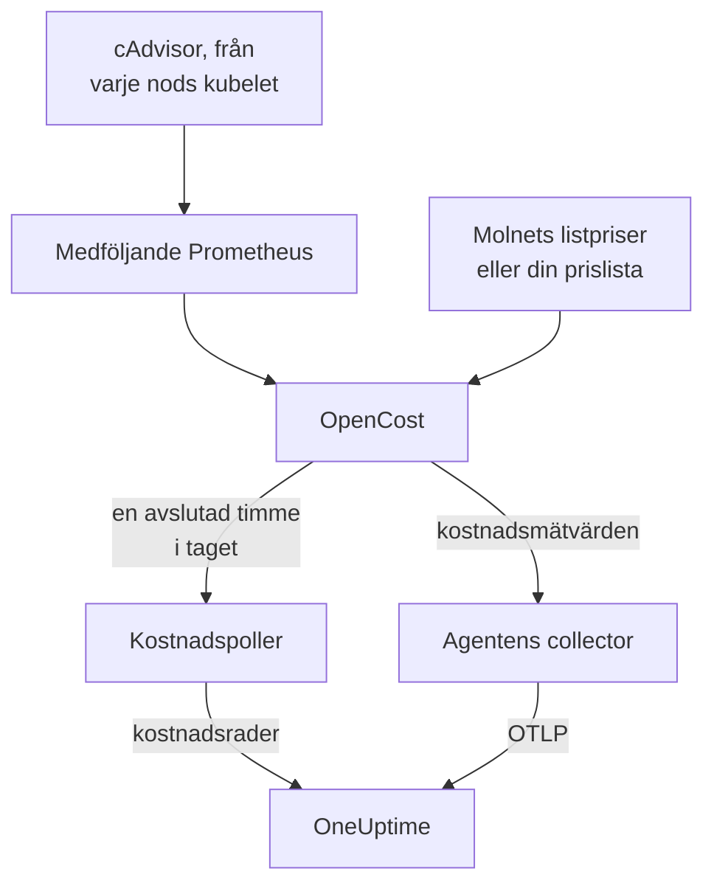

# Kubernetes-kostnadsobserverbarhet

Se vad varje Kubernetes-arbetsbelastning kostar — utgifter per namespace, arbetsbelastning och podd, ledig kapacitet och hur mycket av varje request som används — bredvid de mätvärden, loggar och spår som [Kubernetes-agenten](/docs/telemetry/kubernetes-agent) redan samlar in. Det är på som standard, utan molninloggningsuppgifter: klustrets översikt visar vad det kostar, dess sida **Kostnader** visar vilka requests som bör minskas, och kostnadsmätvärdena kan visas i diagram och larmas på som alla andra mätvärden.

:::cards
- [Slå på det](#slå-på-kostnadsobserverbarhet): På som standard; en enda `helm upgrade` där det inte är det.
- [Larm på kostnader](#larm-på-kostnader): Kostnad per kluster, namespace och arbetsbelastning, som mätvärden.
- [Din egen motor](#kör-du-redan-kubecost-eller-opencost): Kubecost eller OpenCost som du redan kör hittas och läses.
- [Right-sizing](#right-sizing): Rekommendationer för requests, och hur de tas fram.
- [Felsökning](#felsökning): Tomma sidor, saknade rekommendationer.
:::

## Så fungerar det

Med kostnadsövervakningen påslagen, som den är som standard (`cost.enabled: auto`), kör chartet fyra saker bredvid agenten:



1. **OpenCost**, kostnadsmotorn med öppen källkod (Apache-2.0, CNCF; den [cost-model](https://github.com/kubecost/cost-model) som även driver Kubecost). Den bevakar klustret, prissätter dina noder, volymer och lastbalanserare, och räknar ut vad varje arbetsbelastning kostar.
2. **En liten Prometheus**, som OpenCost behöver för användnings- och prishistorik. Den kör en replika, behåller 7 dagars historik och skrapar exakt två mål: cAdvisor på varje nods kubelet (via API-serverns nodproxy med presetet `eks-fargate`, eftersom ingen podd når en kubelet på den plattformen), där den bara behåller de serier som OpenCost läser, och OpenCost själv (som skickar sina egna mätvärden för resursrequests, så kube-state-metrics är inte inblandat). Den exponeras aldrig utanför klustret, och dess data lämnar det aldrig.
3. **Kostnadspollern** (`cost.agent`). En gång per avslutad timme läser den OpenCosts Allocation API och skickar en kostnadsrad per arbetsbelastning till OneUptime: CPU, minne, GPU, volymer, nätverk, lastbalanserare och ledig kapacitet, med effektivitet. Varje timme skickas en gång; servern hoppar över en timme som den redan har, så en omstart kan inte räkna utgifter två gånger. OneUptime skriver också [kostnadsmätvärdena](#larm-på-kostnader) utifrån de här raderna.
4. **En skrapning av kostnadsmätvärden** (`cost.metrics`). Agentens collector skrapar OpenCosts prismätvärden, alltså vad varje nod, volym och lastbalanserare kostar per timme, och skickar dem tillsammans med resten av klustrets mätvärden.

OpenCost prissätter noder utifrån molnleverantörens offentliga listpriser (AWS, Google Cloud, Azure), utan inloggningsuppgifter. På andra ställen använder den sina standardpriser, som en egen [prislista](#prissättning-för-lokala-kluster-och-bare-metal) ersätter.

De tre poddarna begär tillsammans ungefär 150m CPU och 450Mi minne. Kostnadsövervakningen är avstängd som standard med presetarna `gke-autopilot` och `eks-fargate`: de plattformarna debiterar varje podd efter vad den begär, så kostnadspoddarna skulle öka just den räkning som de mäter, och OpenCost prissätter noder, vilket inte är så någon av plattformarna tar betalt.

## Slå på kostnadsobserverbarhet

En ny installation behöver ingenting: kostnadsövervakningen är på som standard. Uppgradera en agent som installerades innan den var det, eller slå på den med presetet `gke-autopilot` eller `eks-fargate`:

:::steps
### Uppgradera agenten

```bash
helm upgrade kubernetes-agent oneuptime/kubernetes-agent \
  --namespace oneuptime-agent \
  --reset-then-reuse-values \
  --set cost.enabled=true
```

Det är en fullständig installation: tre små extra poddar, OpenCost, dess Prometheus och kostnadsagenten. Om du installerade agenten under ett annat releasenamn eller namespace använder du ditt (`helm list -A | grep kubernetes-agent` visar dem). För att stänga av kostnadsövervakningen sätter du `--set cost.enabled=false` på samma sätt.

### Vänta på den första avslutade timmen

De första kostnaderna visas efter att den första hela timmen har avslutats, och OpenCost behöver några minuter efter start för att prissätta sin första timme.

### Öppna Costs-sidorna

- **Produkter → Infrastruktur → Kubernetes → Kostnader** visar utgifterna för alla kluster i projektet.
- På ett kluster visar översikten dess utgifter under de senaste 24 timmarna, en beräknad månadskostnad, utgifter för ledig kapacitet, effektivitet och dess dyraste namespaces och arbetsbelastningar.
- På ett kluster visar **Kostnader** dess utgiftstrend, **Spend by Namespace** med fördelningen på CPU, minne och lagring, **Spend by Workload**, utgifter för ledig kapacitet, effektivitet och kortet **Right-Sizing**.
:::

Kostnadsmätvärdena (`node_total_hourly_cost`, `pv_hourly_cost` och resten) är vanliga mätvärden: de finns i mätvärdesutforskaren, på anpassade instrumentpaneler och i mätvärdesmonitorer. För en färdig instrumentpanel går du till **Produkter → Instrumentpaneler**, väljer **Skapa instrumentpanel** och väljer **Kubernetes Cost Dashboard**: trender för nodernas timkostnad, enhetskostnader för CPU och minne, och utgifter för volymer och lastbalanserare.

Under siffrorna visar översikten och sidan **Kostnader** var priserna kommer ifrån: en molnleverantörs listpriser, din prislista eller OpenCosts standardpriser. Effektivitet är en och samma siffra överallt, effektivitetsmätvärdet inräknat: hur stor del av den begärda CPU:n och det begärda minnet som användes, där varje containers timme viktas efter vad dess CPU och minne kostar, så att ett billigt jobb som inte använder något inte kan dra ned ett välutnyttjat kluster, och ledig kapacitet räknas inte med.

## Kör du redan Kubecost eller OpenCost?

Kostnadsagenten hittar din motor och läser den i stället för den medföljande OpenCost, så att klustret prissätts så som du har konfigurerat det: med din prislista, eller med din molnfaktura som Kubecost är kopplat till. Den letar när den startar, och sedan varje timme, via Kubernetes-API:t efter de Services som motorernas egna charts skapar i valfritt namespace (Kubecosts `cost-analyzer` eller `frontend`, OpenCosts chart och den Service `opencost` som OpenCosts manifest skapar), med Kubecost först. Den hoppar över en motor som inte svarar, kräver inloggning eller svarar för flera kluster, och läser då den medföljande.

Klustrets översikt namnger sedan din motor och säger att den medföljande OpenCost inte behövs. Sluta köra den:

```bash
helm upgrade kubernetes-agent oneuptime/kubernetes-agent \
  --namespace oneuptime-agent \
  --reset-then-reuse-values \
  --set cost.engine.url=auto
```

Med `cost.engine.url=auto` medföljer ingenting, och agenten läser din motor var den än körs; utan någon installerad motor prissätts ingenting. Chartet kan inte själv leta efter en motor: Helms funktion `lookup` ser ingenting under `helm template`, Argo CD eller en provkörning. För att behålla den medföljande OpenCost bredvid din egen motor sätter du `cost.engine.preferExisting=false`; för att ange vilken motor som ska läsas sätter du `cost.engine.url` till dess Service:

| Motor | Vanlig tjänst-URL |
| --- | --- |
| OpenCost | `http://opencost.opencost.svc.cluster.local:9003` |
| Kubecost 2 | `http://kubecost-cost-analyzer.kubecost.svc.cluster.local:9090` |
| Kubecost 3 | `http://kubecost-frontend.kubecost.svc.cluster.local:9090` |

Sökvägen till Allocation API hittas av sig själv (`/model/allocation` för Kubecost, `/allocation/compute` eller `/allocation` för OpenCost). Sätt `cost.engine.allocationPath` bara för en ovanlig installation. Med `auto` eller en URL medföljer ingenting, så för minnesrekommendationer sätter du också `cost.engine.prometheusUrl` (se [Data bakom](#data-bakom)). Prismätvärdena hittas på samma sätt, vilken av motorns Services du än anger: agenten provar dess `/metrics`, sedan den `/model/metrics` som en Kubecost 2-frontend eller OpenCosts gränssnitt skickar vidare till motorn, sedan Kubecost 3:s FinOps-agent, och collectorn skrapar den första adressen med prisserier. Sätt `cost.metrics.endpoint` för att ange dem själv.

## Prissättning för lokala kluster och bare metal

Kluster vars noder inte har något offentligt listpris i molnet kan sätta en prislista. Utan prislista prissätter OpenCost dem efter sina standardpriser (lokala kluster, bare metal, kind, k3s), som kan ligga långt från vad din hårdvara kostar, och det säger klustrets översikt och sidan **Kostnader** också; i ett moln som den känner igen behåller en nod sitt listpris, och en prislista prissätter bara det som listan saknar. Med en prislista prissätter OpenCost då varje resurs utifrån dessa siffror, alla i USD per resurstimme:

```yaml title="values.yaml"
cost:
  enabled: true
  opencost:
    customPricing:
      enabled: true
      cpuPerCoreHour: "0.031611"       # ~$23 per core-month
      ramPerGiBHour: "0.004237"        # ~$3 per GiB-month
      storagePerGBHour: "0.00005479452" # ~$0.04 per GB-month
      gpuPerHour: "0.95"
```

Det här är OpenCosts egna standardpriser: fyll i dina egna siffror, annars säger sidan **Kostnader** fortfarande att klustret prissätts efter OpenCosts standardpriser.

## Inställningar som är värda att känna till

Alla är valfria; chartets `values.yaml` har den fullständiga listan:

```yaml title="values.yaml"
cost:
  enabled: auto           # on, except with the gke-autopilot and eks-fargate presets
  agent:
    windowSeconds: 3600   # allocation window length (hourly = native)
    includeIdle: true     # ship the engine's __idle__ allocation
    currency: USD         # currency code shown in the UI (informational)
  prometheus:
    retention: 7d         # bundled TSDB history; right-sizing reads peaks back over days
    persistence:
      enabled: false      # set true for a small PVC; emptyDir otherwise
  metrics:
    enabled: true         # cost metrics for dashboards / Metric Explorer
    scrapeInterval: 60s
```

## Right-sizing

Kortet **Right-Sizing** på ett klusters sida **Kostnader** rekommenderar en CPU- och en minnesrequest för varje container som det har tillräcklig historik för, rangordnade efter hur mycket varje ändring sparar per månad.

En rekommendation är den observerade efterfrågan plus 25 % marginal, avrundad till ett värde som du kan klistra in i ett manifest (10m CPU, 16Mi minne):

- CPU dimensioneras utifrån 95:e percentilen av den genomsnittliga användningen per timme: tillräckligt högt för att täcka verklig last, tillräckligt lågt för att en enda topp inte ska blåsa upp requesten i en månad.
- Minne dimensioneras utifrån toppen i working set, aldrig utifrån ett genomsnitt (se [Data bakom](#data-bakom)).

Requests rekommenderas; limits gör det inte. En request är det som schemaläggaren reserverar och det som räkningen beräknas utifrån, så det är den siffran som påverkar kostnaden. En limit är ett beslut om huruvida en container som beter sig illa ska strypas eller dödas, och det beslutet kan användningsdata inte fatta åt dig.

Varje container jämförs med sin nuvarande request:

| Bedömning | Vad den betyder |
| --- | --- |
| Överprovisionerad | Den reserverar tydligt mer än den använder. Det är här besparingarna kommer ifrån. |
| Underprovisionerad | Den reserverar mindre än den använder, så den stryps eller riskerar en OOM-kill. Att åtgärda det kostar pengar, och kortet visar det som en ökning. |
| Ingen request satt | Det finns inget att minska, men schemaläggaren kan inte placera containern säkert, och den är den första som avhyses under tryck. |

En container inom 15 % av sin rekommendation räknas som rätt dimensionerad och utelämnas: ingen bör redigera ett manifest för att skala bort 3 % av en request.

Två skydd håller råden ärliga. En arbetsbelastning behöver minst 24 timmars kostnadsfönster innan den dimensioneras alls, eftersom ett fönster på fyra timmar kan fånga ett nattligt batchjobb i vila och råda till att krympa det till ingenting. Och besparingar räknas fram utifrån längden på det fönster du tittar på, inte utifrån antalet rader, så en Deployments besparing multipliceras inte med dess antal repliker. Uppskattningen förutsätter att utgifterna skalar med det som motorn har allokerat, vilket är `max(request, usage)`; för en överprovisionerad container är det requesten, så besparingssiffran är exakt.

### Data bakom

Utöver utgifterna samlar pollern in det som en rekommendation behöver: varje containers CPU- och minnesrequests, limits och användning.

Minne behöver en källa till. Allocation API rapporterar bara ett genomsnitt över varje fönster, och ett timgenomsnitt döljer den topp som OOM-dödar en container, så att dimensionera minne utifrån det vore farligt. Pollern läser i stället varje containers minnestopp från Prometheus, kopplat på `(namespace, pod, container)`:

- Med den medföljande motorn (standard) använder den chartets egen Prometheus. Inget att ställa in.
- När `cost.engine.url` är satt (`auto` eller din motors URL) pekar du `cost.engine.prometheusUrl` mot en Prometheus som skrapar cAdvisor, och sätter `cost.engine.prometheusCadvisorJob` om dess skrapjobb inte heter `kubernetes-nodes-cadvisor`.
- Utan Prometheus fungerar CPU-rekommendationer fortfarande, utifrån de lagrade timgenomsnitten, och minnesrekommendationer utelämnas i stället för att gissas.

Ett avbrott i Prometheus stoppar aldrig insamlingen av utgifter: toppar är ett tillägg, och en timme skickas utan dem. CPU använder medvetet inte Prometheus: en för stor CPU-request stryper bara, medan en för liten minnesrequest dödar, så timgenomsnitten är säkra för CPU, och att fråga efter CPU-frekvensen för varje container i ett helt kluster är tungt nog för att välta en liten Prometheus.

## Larm på kostnader

OneUptime skriver fyra mätvärden utifrån varje timmes kostnadsrader, prissatta och namngivna efter vad de är, så att kostnader kan visas i diagram, läggas på en instrumentpanel och larmas på i en [Kubernetes-monitor](/docs/monitor/kubernetes-monitor) eller en [mätvärdesmonitor](/docs/monitor/metrics-monitor):

| Mätvärde | Vad det är | Attribut |
| --- | --- | --- |
| `oneuptime.kubernetes.cost.total` | Vad klustret kostade varje timme, ledig kapacitet inräknad | `k8s.cluster.name` |
| `oneuptime.kubernetes.cost.idle` | Den del av det som ingen arbetsbelastning använde: ledig och oallokerad kapacitet | `k8s.cluster.name` |
| `oneuptime.kubernetes.cost.workload` | Vad varje arbetsbelastning kostade varje timme; summerat per namespace, vad namespacet kostade | `k8s.cluster.name`, `k8s.namespace.name` och arbetsbelastningens namn under nyckeln för dess typ, till exempel `k8s.deployment.name` |
| `oneuptime.kubernetes.cost.efficiency` | Hur stor del av sin begärda CPU och sitt begärda minne varje arbetsbelastning använde, i procent, viktat efter kostnad | Arbetsbelastningens, som ovan |

Varje punkt är en timmes kostnad, i agentens valuta (USD som standard), tidsstämplad vid timmens början och skriven ungefär en timme efter att timmen har slutat: summera punkterna över ett fönster av timmar, så blir en dags punkter tillsammans dagens kostnad. De kommer från det som klustret redan har skickat, så de debiteras inte som intagna mätvärden, och de sparas lika länge som klustrets övriga mätvärden.

Kubernetes-monitorn har tre mallar för dem: Cluster Daily Cost Over Budget, Namespace Daily Cost Over Budget och High Idle Spend, var och en med en budget som du ändrar till din egen. OpenCosts prismätvärden är också vanliga mätvärden: en mätvärdesmonitor kan larma när genomsnittet för `node_total_hourly_cost` stiger över en budget, eller när `pv_hourly_cost` dyker upp för en volymklass som inte borde finnas i ett kluster.

## Datamodell och lagringstid

Kostnadsrader lagras i ClickHouse, en per kluster, fönster, namespace, kontroller, podd och container. De följer klustrets lagringstid för telemetri: klustrets `retainTelemetryDataForDays`, eller projektets lagringstid för data när den inte är satt. Ledig och oallokerad kapacitet lagras som vanliga rader under namespacen `__idle__` och `__unallocated__`, så de grupperas och filtreras som utgifter för arbetsbelastningar.

## Felsökning

:::details Costs-sidorna är tomma
Med presetarna `gke-autopilot` och `eks-fargate` är kostnadsövervakningen avstängd som standard: slå på den med `--set cost.enabled=true`. Läs annars kostnadspollerns loggar: `kubectl logs -n oneuptime-agent deploy/kubernetes-agent-cost`. (Deploymenten heter `<release>-kubernetes-agent-cost` när releasenamnet inte innehåller `kubernetes-agent`; `kubectl get deploy -n oneuptime-agent` listar dem.) `HTTP 401` betyder att OneUptime nekade intagningsnyckeln. `did not answer any known allocation path` betyder att motorn inte är igång än (den medföljande OpenCost behöver några minuter för att prissätta sina första timmar) eller att `cost.engine.url` är fel.
:::

:::details Den medföljande OpenCost är inte redo
Läs dess loggar: `kubectl logs -n oneuptime-agent deploy/kubernetes-agent-opencost`. De säger vilken molnleverantör den identifierade och om dess prisdata lästes in.
:::

:::details Översikten säger att den medföljande OpenCost inte behövs
Klustret kör sin egen Kubecost eller OpenCost, och kostnadsagenten läser den, så den OpenCost och Prometheus som medföljde chartet prissätter ingenting. Uppgradera med `--set cost.engine.url=auto` för att sluta köra dem, eller sätt `cost.engine.preferExisting=false` för att läsa den medföljande motorn i stället.
:::

:::details Kostnadsagenten läser inte din motor
Kostnadsagentens logg säger vilken motor den läser, och varför den hoppade över de andra: `kubectl logs -n oneuptime-agent deploy/kubernetes-agent-cost`. Den hoppar över en motor som inte svarar (till exempel på grund av en NetworkPolicy mellan namespacen), kräver inloggning eller svarar för flera kluster, som en Kubecost som federerar andra kluster gör. Ange vilken motor som ska läsas med `cost.engine.url`.
:::

:::details OpenCost-loggen säger mkdir /var/configs: permission denied
Ett äldre chart körde OpenCost utan en skrivbar konfigurationskatalog, så `Error downloading default pricing data` gjorde att dess Allocation API inte kunde svara och pollern stannade, medan podden förblev `Running`, `/healthz` förblev grön och nodernas kostnadsmätvärden fortsatte att publiceras. Nuvarande charts åtgärdar det: kör `helm repo update` och uppgradera sedan med `--reset-then-reuse-values`. Kostnadsrader visas vid nästa pollning.
:::

:::details Kubernetes Cost Dashboard visar inga data
Mallen läser de skrapade kostnadsmätvärdena: kontrollera att `cost.metrics.enabled` är `true`. Med `cost.engine.url` satt hittar kostnadsagenten var din motor tillhandahåller dem, och dess logg säger var, eller vilka adresser den provade: `kubectl logs -n oneuptime-agent deploy/kubernetes-agent-cost`. Sätt `cost.metrics.endpoint` för att ange dem själv.
:::

:::details Right-Sizing-kortet är tomt
Antingen är tidsintervallet kortare än de 24 timmar som en rekommendation behöver (bredda det), eller så ligger varje container redan inom 15 % av sin rekommenderade request, vilket kortet säger.
:::

:::details Minnesrekommendationer visar -, men CPU-rekommendationerna fungerar
Ingen minnestopp nådde OneUptime, så minnet lämnades odimensionerat i stället för att gissas utifrån ett genomsnitt. Med din egen motor sätter du `cost.engine.prometheusUrl`. Kortet säger hur många containrar det gäller.
:::

:::details Siffrorna skiljer sig från motorns eget gränssnitt
OneUptime tar med motorns avstämningsjusteringar i varje kostnadskomponent, och skickar hela, avslutade timmar: utgifterna för den pågående timmen visas efter att den har avslutats.
:::

:::details Den medföljande Prometheus har startats om
Med standardlagringen `emptyDir` förlorar en omstart några timmars användningshistorik, så kostnaderna för de timmarna kan bli lägre. Sätt `cost.prometheus.persistence.enabled=true` om det spelar roll för dig.
:::

## Nästa steg

:::cards
- [Kubernetes-agent](/docs/telemetry/kubernetes-agent): Installera agenten, och allt annat den samlar in.
- [Metrikövervakning](/docs/monitor/metrics-monitor): Larma när utgifterna passerar en budget.
- [Kubernetes-övervakning](/docs/monitor/kubernetes-monitor): Larma också på klustrets hälsa.
:::
