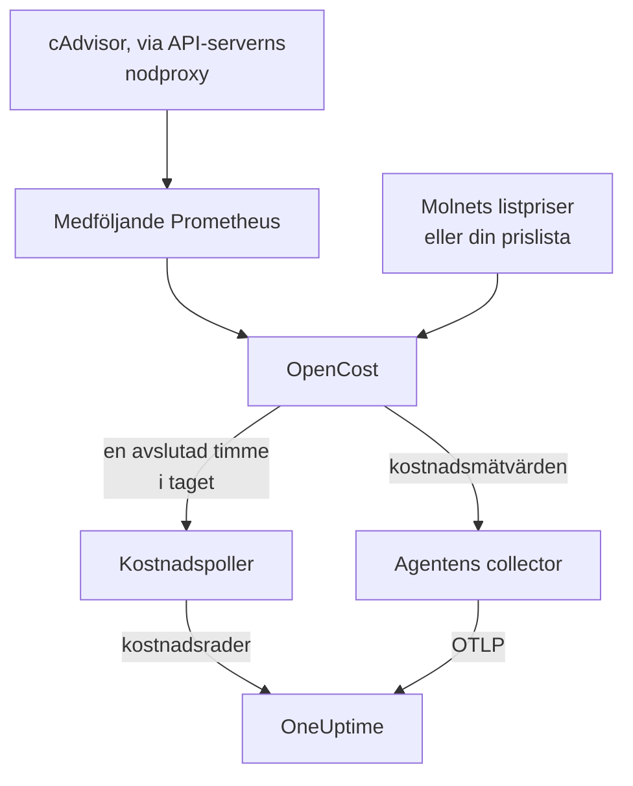

# Kubernetes-kostnadsobserverbarhet

Se vad varje Kubernetes-arbetsbelastning kostar — utgifter per namespace, arbetsbelastning och podd, ledig kapacitet och hur mycket av varje request som används — bredvid de mätvärden, loggar och spår som [Kubernetes-agenten](/docs/telemetry/kubernetes-agent) redan samlar in. Ett enda Helm-värde slår på det, utan molninloggningsuppgifter, och klustrets sida **Costs** visar sedan vilka requests som bör minskas.

:::cards
- [Slå på det](#slå-på-kostnadsobserverbarhet): En enda `helm upgrade`.
- [Använd din egen motor](#kör-du-redan-kubecost-eller-opencost): Peka agenten mot Kubecost eller OpenCost.
- [Right-sizing](#right-sizing): Rekommendationer för requests, och hur de tas fram.
- [Felsökning](#felsökning): Tomma sidor, saknade rekommendationer.
:::

## Så fungerar det

Med `cost.enabled=true` kör chartet fyra saker bredvid agenten:



1. **OpenCost**, kostnadsmotorn med öppen källkod (Apache-2.0, CNCF; den [cost-model](https://github.com/kubecost/cost-model) som även driver Kubecost). Den bevakar klustret, prissätter dina noder, volymer och lastbalanserare, och räknar ut vad varje arbetsbelastning kostar.
2. **En liten Prometheus**, som OpenCost behöver för användnings- och prishistorik. Den kör en replika, behåller 7 dagars historik och skrapar exakt två mål: cAdvisor via API-serverns nodproxy, och OpenCost själv (som skickar sina egna mätvärden för resursrequests, så kube-state-metrics är inte inblandat). Den exponeras aldrig utanför klustret, och dess data lämnar det aldrig.
3. **Kostnadspollern** (`cost.agent`). En gång per avslutad timme läser den OpenCosts Allocation API och skickar en kostnadsrad per arbetsbelastning till OneUptime: CPU, minne, GPU, volymer, nätverk, lastbalanserare och ledig kapacitet, med effektivitet. Varje timme skickas en gång; servern hoppar över en timme som den redan har, så en omstart kan inte räkna utgifter två gånger.
4. **En skrapning av kostnadsmätvärden** (`cost.metrics`). Agentens collector skrapar OpenCosts kostnadsmätvärden och skickar dem tillsammans med resten av klustrets mätvärden.

OpenCost prissätter noder utifrån molnleverantörens offentliga listpriser (AWS, Google Cloud, Azure), utan inloggningsuppgifter. Kluster utan listpris i molnet sätter i stället en [prislista](#prissättning-för-lokala-kluster-och-bare-metal).

## Slå på kostnadsobserverbarhet

:::steps
### Uppgradera agenten med cost.enabled

```bash
helm upgrade kubernetes-agent oneuptime/kubernetes-agent \
  --namespace oneuptime-agent \
  --reset-then-reuse-values \
  --set cost.enabled=true
```

Det är en fullständig installation: två små extra poddar, OpenCost och dess Prometheus. Om du installerade agenten under ett annat releasenamn eller namespace använder du ditt (`helm list -A | grep kubernetes-agent` visar dem).

### Vänta på den första avslutade timmen

De första kostnaderna visas efter att den första hela timmen har avslutats, och OpenCost behöver några minuter efter start för att prissätta sin första timme.

### Öppna Costs-sidorna

- **Produkter → Infrastruktur → Kubernetes → Costs** visar utgifterna för alla kluster i projektet.
- På ett kluster visar **Costs** dess utgiftstrend, **Spend by Namespace** med fördelningen på CPU, minne och lagring, **Spend by Workload**, utgifter för ledig kapacitet, effektivitet och kortet **Right-Sizing**.
:::

Kostnadsmätvärdena (`node_total_hourly_cost`, `pv_hourly_cost` och resten) är vanliga mätvärden: de finns i mätvärdesutforskaren, på anpassade instrumentpaneler och i mätvärdesmonitorer. För en färdig instrumentpanel går du till **Produkter → Instrumentpaneler**, väljer **Skapa Instrumentpanel** och väljer **Kubernetes Cost Dashboard**: trender för nodernas timkostnad, enhetskostnader för CPU och minne, och utgifter för volymer och lastbalanserare.

## Kör du redan Kubecost eller OpenCost?

Peka agenten mot din egen motor i stället, så medföljer ingenting:

```bash
helm upgrade kubernetes-agent oneuptime/kubernetes-agent \
  --namespace oneuptime-agent \
  --reset-then-reuse-values \
  --set cost.enabled=true \
  --set cost.engine.url=http://kubecost-cost-analyzer.kubecost.svc.cluster.local:9090
```

| Motor | Vanlig tjänst-URL |
| --- | --- |
| OpenCost | `http://opencost.opencost.svc.cluster.local:9003` |
| Kubecost | `http://kubecost-cost-analyzer.kubecost.svc.cluster.local:9090` |

Sökvägen till Allocation API hittas av sig själv (`/model/allocation` för Kubecost, `/allocation/compute` eller `/allocation` för OpenCost). Sätt `cost.engine.allocationPath` bara för en ovanlig installation. För minnesrekommendationer sätter du också `cost.engine.prometheusUrl` (se [Data bakom](#data-bakom)).

## Prissättning för lokala kluster och bare metal

Kluster vars noder inte har något offentligt listpris i molnet kan sätta en prislista. OpenCost prissätter då varje resurs utifrån dessa siffror, alla i USD per resurstimme:

```yaml title="values.yaml"
cost:
  enabled: true
  opencost:
    customPricing:
      enabled: true
      cpuPerCoreHour: "0.031611"       # ~$23 per core-month
      ramPerGiBHour: "0.004237"        # ~$3 per GiB-month
      storagePerGBHour: "0.00005479452" # ~$0.04 per GB-month
      gpuPerHour: "0.95"
```

## Inställningar som är värda att känna till

Alla är valfria; chartets `values.yaml` har den fullständiga listan:

```yaml title="values.yaml"
cost:
  agent:
    windowSeconds: 3600   # allocation window length (hourly = native)
    includeIdle: true     # ship the engine's __idle__ allocation
    currency: USD         # currency code shown in the UI (informational)
  prometheus:
    retention: 7d         # bundled TSDB history; right-sizing reads peaks back over days
    persistence:
      enabled: false      # set true for a small PVC; emptyDir otherwise
  metrics:
    enabled: true         # cost metrics for dashboards / Metric Explorer
    scrapeInterval: 60s
```

## Right-sizing

Kortet **Right-Sizing** på ett klusters sida **Costs** rekommenderar en CPU- och en minnesrequest för varje container som det har tillräcklig historik för, rangordnade efter hur mycket varje ändring sparar per månad.

En rekommendation är den observerade efterfrågan plus 25 % marginal, avrundad till ett värde som du kan klistra in i ett manifest (10m CPU, 16Mi minne):

- CPU dimensioneras utifrån 95:e percentilen av den genomsnittliga användningen per timme: tillräckligt högt för att täcka verklig last, tillräckligt lågt för att en enda topp inte ska blåsa upp requesten i en månad.
- Minne dimensioneras utifrån toppen i working set, aldrig utifrån ett genomsnitt (se [Data bakom](#data-bakom)).

Requests rekommenderas; limits gör det inte. En request är det som schemaläggaren reserverar och det som räkningen beräknas utifrån, så det är den siffran som påverkar kostnaden. En limit är ett beslut om huruvida en container som beter sig illa ska strypas eller dödas, och det beslutet kan användningsdata inte fatta åt dig.

Varje container jämförs med sin nuvarande request:

| Bedömning | Vad den betyder |
| --- | --- |
| Överprovisionerad | Den reserverar tydligt mer än den använder. Det är här besparingarna kommer ifrån. |
| Underprovisionerad | Den reserverar mindre än den använder, så den stryps eller riskerar en OOM-kill. Att åtgärda det kostar pengar, och kortet visar det som en ökning. |
| Ingen request satt | Det finns inget att minska, men schemaläggaren kan inte placera containern säkert, och den är den första som avhyses under tryck. |

En container inom 15 % av sin rekommendation räknas som rätt dimensionerad och utelämnas: ingen bör redigera ett manifest för att skala bort 3 % av en request.

Två skydd håller råden ärliga. En arbetsbelastning behöver minst 24 timmars kostnadsfönster innan den dimensioneras alls, eftersom ett fönster på fyra timmar kan fånga ett nattligt batchjobb i vila och råda till att krympa det till ingenting. Och besparingar räknas fram utifrån längden på det fönster du tittar på, inte utifrån antalet rader, så en Deployments besparing multipliceras inte med dess antal repliker. Uppskattningen förutsätter att utgifterna skalar med det som motorn har allokerat, vilket är `max(request, usage)`; för en överprovisionerad container är det requesten, så besparingssiffran är exakt.

### Data bakom

Utöver utgifterna samlar pollern in det som en rekommendation behöver: varje containers CPU- och minnesrequests, limits och användning.

Minne behöver en källa till. Allocation API rapporterar bara ett genomsnitt över varje fönster, och ett timgenomsnitt döljer den topp som OOM-dödar en container, så att dimensionera minne utifrån det vore farligt. Pollern läser i stället varje containers minnestopp från Prometheus, kopplat på `(namespace, pod, container)`:

- Med den medföljande motorn (standard) använder den chartets egen Prometheus. Inget att ställa in.
- Med din egen motor (`cost.engine.url`) pekar du `cost.engine.prometheusUrl` mot en Prometheus som skrapar cAdvisor, och sätter `cost.engine.prometheusCadvisorJob` om dess skrapjobb inte heter `kubernetes-nodes-cadvisor`.
- Utan Prometheus fungerar CPU-rekommendationer fortfarande, utifrån de lagrade timgenomsnitten, och minnesrekommendationer utelämnas i stället för att gissas.

Ett avbrott i Prometheus stoppar aldrig insamlingen av utgifter: toppar är ett tillägg, och en timme skickas utan dem. CPU använder medvetet inte Prometheus: en för stor CPU-request stryper bara, medan en för liten minnesrequest dödar, så timgenomsnitten är säkra för CPU, och att fråga efter CPU-frekvensen för varje container i ett helt kluster är tungt nog för att välta en liten Prometheus.

## Larm på kostnader

Kostnadsmätvärdena är vanliga mätvärden, så en [mätvärdesmonitor](/docs/monitor/metrics-monitor) kan larma på dem som på allt annat: till exempel när genomsnittet för `node_total_hourly_cost` stiger över en budget, eller när `pv_hourly_cost` dyker upp för en volymklass som inte borde finnas i ett kluster.

## Datamodell och lagringstid

Kostnadsrader lagras i ClickHouse, en per kluster, fönster, namespace, kontroller, podd och container. De följer klustrets lagringstid för telemetri: klustrets `retainTelemetryDataForDays`, eller projektets lagringstid för data när den inte är satt. Ledig och oallokerad kapacitet lagras som vanliga rader under namespacen `__idle__` och `__unallocated__`, så de grupperas och filtreras som utgifter för arbetsbelastningar.

## Felsökning

:::details Costs-sidorna är tomma
Läs kostnadspollerns loggar: `kubectl logs -n oneuptime-agent deploy/kubernetes-agent-cost`. (Deploymenten heter `<release>-kubernetes-agent-cost` när releasenamnet inte innehåller `kubernetes-agent`; `kubectl get deploy -n oneuptime-agent` listar dem.) `HTTP 401` betyder att OneUptime nekade intagningsnyckeln. `did not answer any known allocation path` betyder att motorn inte är igång än (den medföljande OpenCost behöver några minuter för att prissätta sina första timmar) eller att `cost.engine.url` är fel.
:::

:::details Den medföljande OpenCost är inte redo
Läs dess loggar: `kubectl logs -n oneuptime-agent deploy/kubernetes-agent-opencost`. De säger vilken molnleverantör den identifierade och om dess prisdata lästes in.
:::

:::details OpenCost-loggen säger mkdir /var/configs: permission denied
Ett äldre chart körde OpenCost utan en skrivbar konfigurationskatalog, så `Error downloading default pricing data` gjorde att dess Allocation API inte kunde svara och pollern stannade, medan podden förblev `Running`, `/healthz` förblev grön och nodernas kostnadsmätvärden fortsatte att publiceras. Nuvarande charts åtgärdar det: kör `helm repo update` och uppgradera sedan med `--reset-then-reuse-values`. Kostnadsrader visas vid nästa pollning.
:::

:::details Kubernetes Cost Dashboard visar inga data
Mallen läser de skrapade kostnadsmätvärdena: kontrollera att `cost.metrics.enabled` är `true`.
:::

:::details Right-Sizing-kortet är tomt
Antingen är tidsintervallet kortare än de 24 timmar som en rekommendation behöver (bredda det), eller så ligger varje container redan inom 15 % av sin rekommenderade request, vilket kortet säger.
:::

:::details Minnesrekommendationer visar -, men CPU-rekommendationerna fungerar
Ingen minnestopp nådde OneUptime, så minnet lämnades odimensionerat i stället för att gissas utifrån ett genomsnitt. Med din egen motor sätter du `cost.engine.prometheusUrl`. Kortet säger hur många containrar det gäller.
:::

:::details Siffrorna skiljer sig från motorns eget gränssnitt
OneUptime tar med motorns avstämningsjusteringar i varje kostnadskomponent, och skickar hela, avslutade timmar: utgifterna för den pågående timmen visas efter att den har avslutats.
:::

:::details Den medföljande Prometheus har startats om
Med standardlagringen `emptyDir` förlorar en omstart några timmars användningshistorik, så kostnaderna för de timmarna kan bli lägre. Sätt `cost.prometheus.persistence.enabled=true` om det spelar roll för dig.
:::

## Nästa steg

:::cards
- [Kubernetes-agent](/docs/telemetry/kubernetes-agent): Installera agenten, och allt annat den samlar in.
- [Metrikövervakning](/docs/monitor/metrics-monitor): Larma när utgifterna passerar en budget.
- [Kubernetes-övervakning](/docs/monitor/kubernetes-monitor): Larma också på klustrets hälsa.
:::
