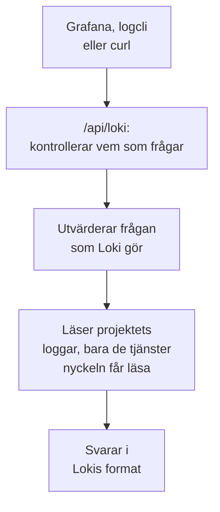

# Fråga loggar med LogQL

LogQL är frågespråket i Grafana Loki. OneUptime besvarar Lokis fråge-API över ditt projekts loggar, så att Grafanas Loki-datakälla, logcli eller vilken Loki-klient som helst läser dem, och de instrumentpaneler och sparade frågor du skrev för Loki fortsätter att fungera.

:::cards
- [Anslut Grafana](#anslut-grafana): Lägg till OneUptime som Loki-datakälla.
- [Så får loggar sina etiketter](#så-får-loggar-sina-etiketter): Vad en strömväljare hittar.
- [Vad LogQL omfattar](#vad-logql-omfattar): Loggfrågor, parsers och mätvärdesfrågor.
- [Gränser](#gränser): Vad en fråga får läsa, och hur ofta.
:::

## Så fungerar det

Grafana frågar OneUptime som det frågar Loki. OneUptime kontrollerar att API-nyckeln får läsa projektets loggar, läser bara de tjänster den får läsa och utvärderar frågan som Loki gör.



## Innan du börjar

- **Loggar som kommer in.** Skicka dem med [OpenTelemetry](/docs/telemetry/open-telemetry), eller från Promtail, Grafana Alloy, Fluent Bit eller Vector via [Lokis push-API](/docs/telemetry/compatible-endpoints).
- **En API-nyckel för projektet som läser loggar**, med rollen Projektägare, Projektadministratör, Projektmedlem, Tittare, Telemetriadministratör, Telemetrimedlem eller Telemetritittare, eller behörigheten Read Logs. En nyckel som är begränsad till vissa tjänster läser bara deras loggar. Se [Skapa en API-nyckel](/docs/api-reference/api-reference#skapa-en-api-nyckel). På OneUptime Cloud kräver API-nycklar planen **Growth**.
- **Inte en intagningsnyckel.** En intagningsnyckel skickar telemetri och läser ingen, så Grafana kan inte logga in med en.

## Anslut Grafana

:::steps
### Skapa en API-nyckel

Öppna **Projektinställningar → Avancerad → API-nycklar** i OneUptime och klicka på **Skapa API-nyckel**. Ge nyckeln en roll som får läsa telemetri, eller behörigheten Read Logs.

### Lägg till en Loki-datakälla

Öppna **Connections → Data sources → Add data source** i Grafana och välj **Loki**.

### Ange URL:en

Ställ in **URL** på din OneUptime-adress följd av `/api/loki`. På OneUptime Cloud är det `https://oneuptime.com/api/loki`.

### Skicka API-nyckeln

Under **HTTP headers** lägger du till huvudet `Authorization` med värdet `Bearer` följt av ett mellanslag och din API-nyckel. Basic-autentisering fungerar också: valfritt användarnamn, med API-nyckeln som lösenord.

### Spara och testa

Klicka på **Save & test**. Grafana kör en fråga och meddelar att datakällan fungerar.
:::

Explore, loggvolymen ovanför raderna, etikettläsarna och instrumentpanelerna läser sedan OneUptime som de läser Loki. logcli och alla andra Loki-klienter fungerar på samma sätt. Med curl:

```bash title="Query OneUptime's Loki API"
curl -G -H "Authorization: Bearer $ONEUPTIME_API_KEY" \
  "https://oneuptime.com/api/loki/loki/api/v1/query_range" \
  --data-urlencode 'query={service_name="checkout"} |= "error"'
```

## Så får loggar sina etiketter

En strömväljare hittar en loggs attribut, namngivna så som Loki 3 namnger OpenTelemetry-loggar:

| I OneUptime | I LogQL |
| --- | --- |
| Ett resursattribut `service.name` | Etiketten `service_name` |
| Ett resursattribut `k8s.pod.name` | Etiketten `k8s_pod_name` |
| Ett attribut `http.method` | Etiketten `http_method` |
| En etikett som en Loki-klient skickade, som `job` | Etiketten `job` |
| Loggens allvarlighetsgrad | Etiketten `detected_level`: `trace`, `debug`, `info`, `warn`, `error`, `fatal` eller `unknown` |

- **Varje attribut är en etikett.** En loggfråga svarar med en ström per etikettuppsättning, så loggar med olika attribut är olika strömmar, så som Loki 3 svarar för loggar med strukturerad metadata.
- **En loggs eget attribut kommer först** när dess resurs har ett med samma namn.
- **En väljare nämner ett värde**, så som Loki kräver: minst en matchare som en logg utan etiketten inte uppfyller, som `{service_name="checkout"}` eller `{service_name=~"check.+"}`.

Några frågor att börja med:

```text title="LogQL"
# The checkout service's lines that say error
{service_name="checkout"} |= "error"

# Requests slower than 250ms, read from JSON lines
{service_name="checkout"} | json | duration > 250ms

# Error logs per second, by service
sum by (service_name) (rate({detected_level="error"} [5m]))
```

## Vad LogQL omfattar

- **Loggfrågor**: strömväljare med `=`, `!=`, `=~` och `!~`; radfilter `|=`, `!=`, `|~` och `!~`, med `or`; tolkarna `json` och `logfmt`; etikettfilter på text, tal, varaktigheter och storlekar, med `and`, `or` och `__error__`; `line_format` med `{{.label}}`; `drop`, `keep` och `decolorize`.
- **Mätvärdesfrågor**: `count_over_time`, `rate`, `bytes_over_time`, `bytes_rate` och `absent_over_time`; över en etikett som tas med `unwrap` (med `duration()` eller `bytes()`), `rate`, `sum_over_time`, `avg_over_time`, `min_over_time`, `max_over_time`, `first_over_time`, `last_over_time`, `stddev_over_time`, `stdvar_over_time` och `quantile_over_time`; och `offset`.
- **Runt dem**: `sum`, `avg`, `min`, `max`, `count`, `stddev`, `stdvar`, `topk` och `bottomk`, med `by` eller `without`; aritmetik, jämförelser (med `bool`), `and`, `or` och `unless`, med `on`, `ignoring`, `group_left` och `group_right`; `sort`, `sort_desc`, `label_replace` och `vector()`.

Tolkarna `pattern`, `regexp` och `unpack`, `label_format`, `json` med namngivna fält, `ip()`-filter och `line_format`-mallar utöver `{{.label}}` finns inte än. En fråga som använder någon av dem avvisas med ett meddelande som nämner den.

## API:t

API:t besvarar rutterna i Lokis HTTP-API, med `GET` eller `POST`, under `/api/loki`:

| Rutt | Vad den besvarar |
| --- | --- |
| `/loki/api/v1/query_range` | En loggfrågas rader från `start` till `end`, eller en mätvärdesfråga vid varje `step`. |
| `/loki/api/v1/query` | En mätvärdesfråga vid en tidpunkt (`time`, som standard nu). |
| `/loki/api/v1/labels` | Etikettnamn, för de loggar som `query` väljer eller för alla loggar. |
| `/loki/api/v1/label/<name>/values` | En etiketts värden. |
| `/loki/api/v1/series` | Etikettuppsättningarna för de loggar som `match[]` väljer. |

Tider är nanosekunder sedan 1970, Unix-sekunder eller RFC 3339, och ett intervall är timmen före `end` om inget annat sägs. En loggfråga svarar med `limit` rader, 100 som standard, de nyaste först om inte `direction=forward`. Svaren är i Lokis format, och fel är ren text, så som Loki skriver dem. `/loki/api/v1/status/buildinfo` svarar som en Loki 3-server.

## Gränser

Varje fråga är begränsad, så att en instrumentpanel med många paneler inte kan överbelasta OneUptime:

| Gräns | Värde |
| --- | --- |
| Rader som en loggfråga svarar med | 5 000 |
| Loggar som en loggfråga läser, när filter efter dess tolkar sorterar bort några | 20 000 |
| Loggar som en mätvärdesfråga läser själv, när ClickHouse inte kan räkna dem | 100 000 |
| Serier som en mätvärdesfråga svarar med | 500 |
| Punkter i en serie i en intervallfråga | 11 000 |
| Loggar som en läsning ger tillbaka | 64 MB |
| Tid som en läsning får ta | 30 sekunder |
| Frågor som ett projekt får skicka varje minut | 1 200 |

En mätvärdesfråga vars pipeline bara är radfilter, som `sum(count_over_time({service_name="checkout"} |= "error" [5m]))`, räknas där loggarna finns, så den läser inga rader alls.

## Felsökning

:::details Grafana säger att datakällan inte fungerar
Kontrollera att URL:en slutar på `/api/loki` och att huvudet `Authorization` innehåller `Bearer`, ett mellanslag och API-nyckeln. En intagningsnyckel, eller en API-nyckel utan en roll som läser loggar, avvisas: ge nyckeln en sådan roll under **Projektinställningar → Avancerad → API-nycklar**.
:::

:::details "queries require at least one regexp or equality matcher that does not have an empty-compatible value"
Väljaren hittar loggar utan att nämna ett värde, som `{service_name=~".*"}`. Lägg till en matchare som nämner ett, som `{service_name="checkout"}`.
:::

:::details "This project sent more queries this minute than OneUptime answers."
Projektets instrumentpaneler och klienter skickade fler än 1 200 frågor till API:t den här minuten. Panelerna laddas igen nästa minut; uppdatera instrumentpanelerna mer sällan för att hålla dig under gränsen.
:::

## Nästa steg

:::cards
- [Loggutforskare](/docs/telemetry/logs-explorer): Sök i och filtrera loggar utan att skriva en fråga.
- [PromQL](/docs/telemetry/promql): Fråga mätvärden med PromQL, även från Grafanas Prometheus-datakälla.
- [Loggövervakning](/docs/monitor/logs-monitor): Larma om loggvolym och logginnehåll.
:::
