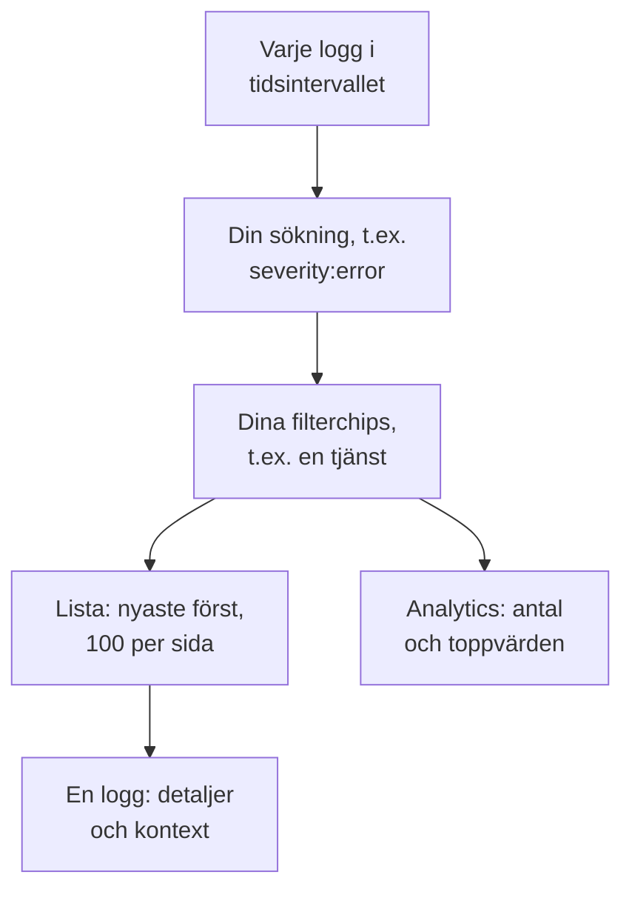

# Loggutforskare

Loggutforskaren är där du söker i och läser loggarna som dina tjänster, värdar och agenter skickar till OneUptime. Minska miljontals rader till de få som spelar roll, följ nya när de kommer in, visa dem i diagram och spara de vyer som ditt team återkommer till.

:::cards
- [Hitta en loggrad](#hitta-en-loggrad): Ett tidsintervall, en sökning och några filter.
- [Läs en logg](#läs-en-logg): Dess attribut, dess spår och raderna runt den.
- [Följ loggar live](#följ-loggar-live): Nya rader var tionde sekund.
- [Spara en vy](#spara-en-vy): Behåll en sökning, dess filter och dess kolumner för alla.
- [Insikter i loggar](#insikter-i-loggar): De vanligaste felen, allvarlighetsgrader och vem som loggar vad.
:::

## Så avgränsar utforskaren dina loggar

Allt på fliken **Tittare** arbetar med en uppsättning loggar: de i tidsintervallet som matchar din sökning och varje filterchip. Ändra något av dem så ändras listan, volymdiagrammet och siffrorna i sidopanelen tillsammans.

Utforskaren har fyra flikar:

| Flik | Vad den är till för |
| --- | --- |
| **Tittare** | Sök i, filtrera och läs loggar. Den öppnas på den senaste timmen, nyaste först, 100 loggar per sida. |
| **Insikter** | Vad dina tjänster har loggat i ett tidsintervall, och vad som gick fel. |
| **Installationsguide** | Hur du skickar loggar med OpenTelemetry, Fluent Bit eller Fluentd med en av dina inmatningsnycklar. |
| **Inställningar** | Vad som händer med loggar när de kommer in: **Pipelines**, **Drop-filter**, **Scrub-regler** och **Inspelningsregler**. |

## Innan du börjar

- **Loggar som kommer in.** Skicka dem med [OpenTelemetry](/docs/telemetry/open-telemetry), [Fluent Bit](/docs/telemetry/fluentbit), [Fluentd](/docs/telemetry/fluentd) eller [Syslog](/docs/telemetry/syslog). Fliken **Installationsguide** visar konfigurationen för ditt språk eller din collector.
- **En roll som får läsa telemetri.** Project Owner, Project Admin, Project Member, Viewer, Telemetry Admin, Telemetry Member eller Telemetry Viewer, eller en anpassad roll med behörigheten Read Telemetry Service Log. Dess omfång avgör vems loggar du ser: se [Telemetri](/docs/permissions/index#telemetri).

## Hitta en loggrad

:::steps
### Öppna Tittare

Gå till **Produkter → Observerbarhet → Loggar**. **Tittare** visar loggarna från den senaste timmen, nyaste först, med **Tid**, **Tjänst**, **Allvarlighetsgrad** och **Meddelande**.

### Välj tidsintervallet

Välj ett intervall i tidsväljaren, eller dra över volymdiagrammet ovanför listan för att zooma in på en topp. Dubbelklicka på diagrammet för att zooma ut igen. Se [Zooma in på ett tidsintervall](/docs/telemetry/charts-and-time-ranges).

### Sök

Skriv en fråga i sökrutan och tryck på Enter, till exempel `severity:error service:checkout timeout`. Lösa ord söker i meddelandet, och `@key:value` söker i ett attribut. Se [Söksyntax](/docs/telemetry/search-syntax#loggar).

### Avgränsa med filter

Klicka på ett värde i sidopanelen **Filter** för att lägga till det som ett chip: en allvarlighetsgrad, en tjänst, eller en värd, ett kluster eller en annan resurs som har skickat loggar. Varje värde visar hur många loggar som har det. På en telefon trycker du på **Filter** för att öppna sidopanelen.

### Öppna en logg

Klicka på en rad. Dess detaljer öppnas bredvid listan.
:::

Din sökning, dina chips och tidsintervallet sparas i sidans adress, så en omladdning, ett bokmärke eller en delad länk öppnar samma loggar.

## Läs en logg

Detaljpanelen har två flikar:

| Flik | Vad den visar |
| --- | --- |
| **Detaljer** | **Loggkropp**, dess **Spår-ID**, **Span-ID** och **Session** när den har dem, och dess **Attribut**, som lista eller som JSON. |
| **Context** | Loggen bland sina grannar. **Nearby (service + time)** visar de fem raderna före och efter den från samma tjänst, och **This trace** visar upp till 100 loggar från dess spår. |

- Klicka på spår-ID:t för att öppna hela förfrågan i [Spårutforskare](/docs/telemetry/traces-explorer).
- Peka på ett attribut och klicka på dess filterikon för att söka efter det värdet, eller kopiera det. Du kan kopiera alla attribut på en gång som JSON.
- **This trace** visas bara för en logg som skrevs inuti ett spår.

## Följ loggar live

Klicka på **Live** ovanför listan. Utforskaren hoppar till första sidan, sorterad med de nyaste först, och letar efter nya loggar var tionde sekund, så att raderna dyker upp medan dina tjänster skriver dem.

Live-läget stänger av sig självt när du ändrar sökningen, ett filter eller tidsintervallet, eller går till en annan resultatsida: det visar bara de nyaste loggarna. Klicka på **Live** igen för att fortsätta.

## Välj kolumner och exportera

- **Columns** väljer vad listan visar. **Tid**, **Tjänst**, **Allvarlighetsgrad** och **Meddelande** kommer först; lägg till **Spår-ID**, **Span-ID** eller valfritt attribut, flytta kolumner upp och ned, eller återgå till standard med **Återställ**.
- **Export** laddar ned loggarna på sidan du tittar på. **Export as CSV** skriver de kolumner du visar; **Export as JSON** skriver varje fält i varje logg med alla dess attribut.

## Spara en vy

En sparad vy behåller en sökning, dess filterchips, tidsintervallet, kolumnerna, sorteringen och sidstorleken under ett namn.

:::steps
### Ställ in vyn

Sök, filtrera och välj de kolumner du vill behålla.

### Spara den

Öppna **Saved Views** och klicka på **+ Save Current View**. Ange ett **Namn**, markera **Ange som standard** om vyn ska öppnas varje gång någon öppnar loggarna, och klicka på **Spara vy**.

### Använd den

Välj vyn i **Saved Views** för att använda den, och **Clear view** för att gå tillbaka till den senaste timmen utan filter. Peka på en vy i listan för att **Redigera** eller **Ta bort** den, eller, medan den används, för att **Uppdatera** den med dina ändringar.
:::

Sparade vyer hör till projektet, så alla i det ser samma lista. Ett rullande intervall som den senaste timmen fortsätter att rulla: vyn visar timmen innan du öppnar den, inte timmen då du sparade den. Så länge projektet saknar en standardvy blir nästa sparade vy standard, och ett projekt har en standard i taget.

## Visa dina loggar i diagram

Växla listan till **Analytics** för att räkna loggar i stället för att läsa dem. Välj en tidsserie, en topplista eller en tabell; räkna varje logg, eller de unika värdena i ett fält; och gruppera efter allvarlighetsgrad, tjänst, spår, span eller valfritt attribut, och sedan efter ett andra fält. En topplista eller en tabell visar de översta 5, 10, 25 eller 50 grupperna.

Klicka på **Lista** för att gå tillbaka till själva raderna.

## Öppna tillhörande spår och mätvärden

Knapparna **Spår** och **Mätvärden** bredvid **Saved Views** öppnar [Spårutforskare](/docs/telemetry/traces-explorer) eller [Måttutforskare](/docs/telemetry/metrics-explorer) för samma tidsfönster, med så mycket av din filtrering som den utforskaren kan använda. Peka på en knapp för att se vad den inte kan ta med sig.

## Insikter i loggar

Fliken **Insikter** visar vad dina tjänster har loggat i ett tidsintervall, och vad som gick fel. Begränsa den till vissa tjänster, värdar eller kluster med listrutan bredvid tidsväljaren.

| Panel | Vad den visar |
| --- | --- |
| Översiktskort | **Totalt antal loggar**, **Fel**, **Distinct errors** och **Reporting sources**. |
| **Severity distribution** | Hur loggarna fördelar sig på allvarlighetsgrad. |
| **Top errors** | De olika meddelanden som loggats med allvarlighetsgraden Error eller Fatal, de vanligaste först. |
| **Sources reporting logs** | Volymen och felsignalen för varje tjänst, värd eller annan källa. |

Välj ett av de vanligaste felen för att se vad som hände runt det: när det inträffade, vad dess förekomster har gemensamt, var det inträffar, spåren som bär det och dess senaste rader. **Open matching logs** öppnar dem i **Tittare**, och **Explain with AI** öppnar [Fråga AI](/docs/ai/ask-ai) med felet och dess bevis som en prompt du kan redigera.

## Vad som händer med loggar när de kommer in

Fliken **Inställningar** innehåller reglerna som OneUptime tillämpar på varje logg innan den lagras. De verkar på loggarna som kommer in efteråt, inte på lagrade.

| Regel | Vad den gör |
| --- | --- |
| **Drop-filter** | Kassera loggar du inte vill behålla, eller behåll bara ett stickprov av dem. |
| **Scrub-regler** | Maskera känsliga data, som e-postadresser och kortnummer. |
| **Pipelines** | Plocka ut fält ur meddelandet, rätta allvarlighetsgraden, byt namn på attribut. Se [Loggpipelines](/docs/telemetry/log-pipelines). |
| **Inspelningsregler** | Gör matchande loggar till mätvärden. Se [Inspelningsregler för loggar](/docs/telemetry/log-recording-rules). |

## Kortkommandon

Tryck på `?` i Tittare för att se dem.

| Tangent | Vad den gör |
| --- | --- |
| `j` / `k` | Gå till nästa eller föregående logg. |
| Enter | Öppna eller stäng den valda loggen. |
| Esc | Stäng detaljpanelen. |
| `/` | Hoppa till sökrutan. |
| ⌘ + Enter eller Ctrl + Enter | Tillämpa sökningen. |
| `?` | Visa eller dölj kortkommandona. |

## Felsökning

:::details Inga loggar visas
Vidga först tidsintervallet: Tittare öppnas på den senaste timmen. Är listan fortfarande tom jämför du din konfiguration med **Installationsguide** och kontrollerar att din rolls omfång täcker tjänsten som skickar loggarna.
:::

:::details Sökningen säger att tiden tog slut
En sökning som pågår längre än 45 sekunder avbryts. Välj ett kortare tidsintervall, eller lägg till ett exakt värde som en tjänst, så att OneUptime kan använda sitt index. Se [Söksyntax](/docs/telemetry/search-syntax#bra-att-veta).
:::

:::details Live stänger av sig hela tiden
Live-läget följer bara de nyaste loggarna, så en ändring av sökningen, ett filter, tidsintervallet eller sidan stänger av det. Klicka på **Live** igen när dina filter är på plats.
:::

## Nästa steg

:::cards
- [Söksyntax](/docs/telemetry/search-syntax): Varje filter som sökrutan förstår.
- [Loggövervakning](/docs/monitor/logs-monitor): Få en avisering när loggarna du söker efter dyker upp.
- [Loggpipelines](/docs/telemetry/log-pipelines): Gör delar av en loggrad till attribut du kan filtrera på.
- [Spårutforskare](/docs/telemetry/traces-explorer): Följ en loggs förfrågan genom dina tjänster.
:::
