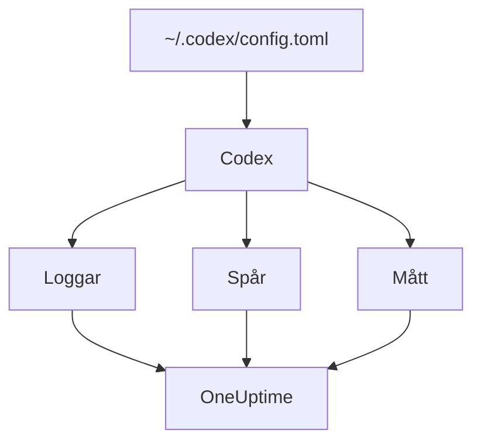

# OpenAI Codex

Codex CLI har tre inbyggda OpenTelemetry-exportörer, en vardera för loggar, traces och mätvärden. Peka dem mot OneUptime i `~/.codex/config.toml`, så kommer varje Codex-tur in med sina tokens och sin kostnad, utan wrapper eller proxy emellan.

:::cards
- [Konfigurera Codex](#konfigurera-codex): Ett `[otel]`-block, med en fullständig URL per signal.
- [Tilldela användningen till en person](#tilldela-codex-användningen-till-en-person): Codex nämner ingen på spans eller mätvärden, så det gör du.
- [Tokens och kostnad](#tokens-och-kostnad): Vilken signal OneUptime läser, och vad det visar.
- [Felsökning](#felsökning): Vad du kontrollerar när inget kommer in.
:::

## Så fungerar det

Varje exportör skickar en signal till sin egen URL. Traces och loggar är avstängda tills du konfigurerar dem; mätvärden är det inte.



> [!WARNING]
> Codex skickar sina mätvärden till OpenAI om du inte ändrar det här. I en release-version är `metrics_exporter` som standard `statsig`, som skickar dem till `https://ab.chatgpt.com/otlp/v1/metrics`. Att sätta `metrics_exporter` till en OTLP-exportör, som nedan, eller till `none` stoppar det. `[analytics]` med `enabled = false` stoppar också Statsig-standarden, men låter en OTLP-exportör för mätvärden som du har konfigurerat fortsätta fungera.

## Innan du börjar

1. Skapa en intagningsnyckel för telemetri under **Projektinställningar → Telemetri och APM → Intagningsnycklar**.
2. Din OTLP-endpoint är `https://oneuptime.com/otlp`, eller `https://YOUR-ONEUPTIME-HOST/otlp` om du driftar OneUptime själv.
3. Varje export skickar nyckeln i headern `x-oneuptime-token`.

## Konfigurera Codex

:::steps
### Lägg till otel-blocket

Lägg det här i `~/.codex/config.toml`. Det slår på alla tre signalerna och ersätter samtidigt Statsig-standarden:

```toml title="~/.codex/config.toml"
[otel]
environment = "prod"
log_user_prompt = false

[otel.exporter.otlp-http]
endpoint = "https://oneuptime.com/otlp/v1/logs"
protocol = "binary"
headers = { "x-oneuptime-token" = "YOUR_INGESTION_TOKEN" }

[otel.trace_exporter.otlp-http]
endpoint = "https://oneuptime.com/otlp/v1/traces"
protocol = "binary"
headers = { "x-oneuptime-token" = "YOUR_INGESTION_TOKEN" }

[otel.metrics_exporter.otlp-http]
endpoint = "https://oneuptime.com/otlp/v1/metrics"
protocol = "binary"
headers = { "x-oneuptime-token" = "YOUR_INGESTION_TOKEN" }

[otel.span_attributes]
"user.id" = "dev@example.com"
"user.email" = "dev@example.com"
"team" = "platform"
```

### Ge varje exportör dess fullständiga URL

Codex använder varje `endpoint` exakt som det står: det lägger inte till `/v1/logs`, `/v1/traces` eller `/v1/metrics` som de flesta SDK:er gör. Tre exportörer som är satta till bara `https://oneuptime.com/otlp` skickar ingenting någonstans, utan fel.

### Kör en tur

Starta en interaktiv `codex`-session, fråga något litet och låt turen bli klar. Öppna sedan **Loggar** i OneUptime: Codex händelser, som `codex.conversation_starts`, `codex.api_request` och `codex.turn_cost`, dyker upp där.
:::

> [!IMPORTANT]
> Codex ignorerar nycklar som det inte känner till under `[otel]`, utan varning. Dess nycklar är i snake_case (`trace_exporter`, `metrics_exporter`, `span_attributes`), men dess exportörnamn och TLS-fält är i kebab-case (`otlp-http`, `ca-certificate`). En `trace-exporter` stänger av traces utan något fel alls.

## Konfigurationsnycklar

| Nyckel | Standard | Vad den gör |
| --- | --- | --- |
| `environment` | `"dev"` | Sätter resursattributet `env` |
| `log_user_prompt` | `false` | Skickar prompttexten på `codex.user_prompt`; annars står det `[REDACTED]` |
| `log_agent_responses` | `false` | Skickar agentens slutliga svar till loggexportören |
| `exporter` | `none` | Loggexportören |
| `trace_exporter` | `none` | Trace-exportören |
| `metrics_exporter` | `statsig` | Exportören för mätvärden: sätt den |
| `span_attributes` | — | Attribut som läggs till på varje exporterat span |
| `tracestate` | — | W3C-`tracestate`-medlemmar |
| `tool_result` | `{ max_bytes = 2048 }` | Hur mycket av ett verktygs resultat en loggpost behåller, i UTF-8-byte |

En exportör är `none`, `statsig`, `otlp-http` eller `otlp-grpc`. `otlp-http` tar `endpoint`, `headers`, `protocol` (`"binary"` eller `"json"`, som OneUptime tar emot båda) och `tls` (`ca-certificate`, `client-certificate`, `client-private-key`); `otlp-grpc` tar samma sak utan `protocol`.

## Tilldela Codex-användningen till en person

Codex nämner utvecklaren på bara ett ställe:

- **Loggposter** bär `user.account_id` och `user.email`.
- **Spans** gör det inte: Codex håller medvetet båda utanför sina traces.
- **Mätvärden** gör det inte heller: de bär `auth_mode`, `session_source`, `originator`, `service_name`, `model` och `app.version`, och ingen person.

OneUptime läser personer från spans och från datapunkter för mätvärden, aldrig från loggposter. Så sätt identiteten själv på varje span, i `[otel.span_attributes]`:

```toml title="~/.codex/config.toml"
[otel.span_attributes]
"user.id" = "dev@example.com"
"user.email" = "dev@example.com"
"team" = "platform"
"cost_center" = "eng-123"
```

`user.id` är nyckeln som OneUptime föredrar, och `user.email` fyller e-postkolumnen. Codex har inga resursattribut, så sätt teamnycklarna (`team.id`, `team`, `cost_center`, `department`) här också. Det här blocket finns i varje utvecklares egen konfigurationsfil: leverera det per utvecklare, via dina dotfiles eller en MDM-profil. En enda delad fil med en identitet skulle föra allas kostnader på en person.

## Tokens och kostnad

| Signal | Vad Codex skickar | Vad OneUptime gör med det |
| --- | --- | --- |
| Traces | `gen_ai.usage.input_tokens`, `gen_ai.usage.output_tokens` och cachetokens, men ingen modell | Räknar tokens per person; kan inte prissätta dem |
| Mätvärden | `codex.turn.token_usage` per `token_type`, och `codex.turn.cost_microusd`, i miljondelar av en USD | Räknar om kostnaden till USD; läser mätvärdena bara där spans inte rapporterar något |
| Loggar | `codex.turn_cost`, med `usage.estimated_usd` och personen | Lagrar den i utforskaren för **Loggar**; kopplas inte till kostnaderna |

Med konfigurationen ovan blir resultatet på fliken **Användning** så här:

- Tokens kommer från spans, per person, och `codex.turn.token_usage` läggs inte till ovanpå: de två läggs aldrig ihop ([varför](/docs/telemetry/ai-llm-observability#spans-först-mätvärden-fyller-i)).
- Codex spans nämner ingen modell, så OneUptime kan inte prissätta dem, och deras kostnad är 0. Kostnadstotalerna tar då Codex kostnad från `codex.turn.cost_microusd`, omräknad till USD åt dig.
- Tabellerna **Anställd**, **Team** och **Modell** visar raderna från spans: tokens per person, men ingen kostnad per person.
- Utan traces fyller mätvärdena de tabellerna i stället, bara med kostnad, allt under **Ej tilldelat**, eftersom Codex mätvärden inte nämner någon.

Den mest exakta kostnaden per tur, med personen på, är loggposten `codex.turn_cost`. OneUptime kopplar ännu inte loggposter till kostnader, men låt loggexportören vara påslagen: historiken finns där när det sker.

## Codex i CI och som MCP-server

`codex`, `codex exec` och `codex mcp-server` bygger alla sin telemetri från samma `[otel]`-block, med alla tre exportörerna. Körningar av `codex exec` bär `originator` `codex_exec`, och `codex mcp-server` exporterar som `codex_mcp_server`, så du kan skilja körningar i CI och via MCP från interaktiva sessioner med de värdena.

## Integritet

`log_user_prompt` och `log_agent_responses` är `false` som standard: låt dem vara avstängda. Händelsen `codex.user_prompt` kommer ändå in, med prompten ersatt av `[REDACTED]`, så du behåller turen, dess tokens och dess kostnad utan prompttexten. Personen (`user.email`, `user.account_id`) finns på loggposterna oavsett vad de här brytarna säger.

Om du slår på innehåll för en utredning maskerar eller släpper tracens **Scrub-regler** och **Drop-filter** under **Spår → Inställningar** det innan det lagras.

## Använda OpenAI:s API i stället för Codex

OpenAI:s plattforms-API skickar ingen egen OpenTelemetry: varje span kommer från att instrumentera din egen klient. Tre instrumenteringar fungerar med OneUptime:

- **OpenTelemetry**: `opentelemetry-instrumentation-genai-openai` för Python, som ersätter `opentelemetry-instrumentation-openai-v2`. `OTEL_INSTRUMENTATION_GENAI_CAPTURE_MESSAGE_CONTENT` avgör om meddelanden registreras.
- **OpenLLMetry** (Traceloop): `opentelemetry-instrumentation-openai`.
- **OpenInference** (Arize): `openinference-instrumentation-openai`.

Peka vilken som helst av dem mot OneUptime som [AI- / LLM-observerbarhet](/docs/telemetry/ai-llm-observability) visar. Ingen av dem vet vem din anställde är: sätt `user.id` själv.

**OpenAI Agents SDK** skickar traces till OpenAI:s egen endpoint, inte via OTLP. Bygg en brygga med `opentelemetry-instrumentation-openai-agents-v2` eller `openinference-instrumentation-openai-agents`, som lämnar SDK:ts spans vidare till en OTLP-exportör.

## Felsökning

:::details Inget kommer in
Kontrollera först de tre `endpoint`-värdena: vart och ett måste sluta på `/v1/logs`, `/v1/traces` eller `/v1/metrics`. Kontrollera sedan headern `x-oneuptime-token`: OneUptime avvisar en felaktig nyckel.
:::

:::details Traces kommer aldrig in, men loggar gör det
Leta efter en felstavad nyckel under `[otel]`: Codex ignorerar den tyst. `trace-exporter` i stället för `trace_exporter` är den vanliga.
:::

:::details Codex kostnad visas i totalerna, men varje person visar $0
Det är väntat: Codex spans bär tokens men ingen modell, så de kan inte prissättas, och kostnadsmätvärdet nämner ingen. Se [Tokens och kostnad](#tokens-och-kostnad).
:::

:::details Allas kostnader visas under en enda person
Samma identitet i `[otel.span_attributes]` finns på varje dator. Ge varje utvecklare sin egen.
:::

## Nästa steg

:::cards
- [AI-kodassistenter](/docs/telemetry/ai-coding-assistants): Så tilldelas kostnader för alla kodassistenter.
- [AI- / LLM-observerbarhet](/docs/telemetry/ai-llm-observability): Konversationer, varningar, kostnad och budgetar för dina egna AI-anrop.
- [AI-gatewayer](/docs/telemetry/ai-gateways): En gateway som tracar och prissätter varje modellanrop.
:::
