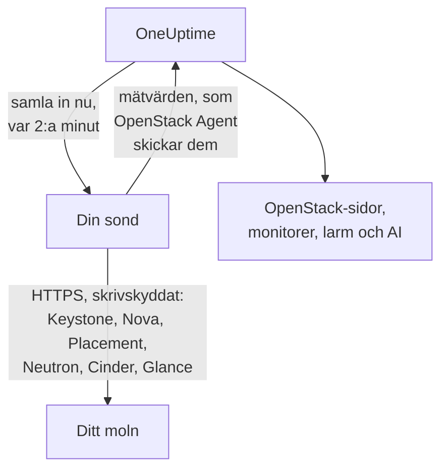

# OpenStack utan agent

Övervaka ett OpenStack-moln utan att installera något: ange Keystones adress och en applikationsuppgift i OneUptime, välj den sond som når molnet, så samlar sonden in samma data som [OpenStack Agent](/docs/telemetry/openstack) skulle ha gjort. Det finns ingen agent att installera, uppgradera eller hålla igång, och ingen egen maskin att sätta upp.

> [!IMPORTANT]
> En sond talar bara HTTPS med ett moln. En inloggningsuppgift eller dess token skickas aldrig över vanlig HTTP, och DevStack och Kolla-Ansible exponerar som standard sina API:er över vanlig HTTP. För ett sådant moln: slå på TLS för dess API:er, eller använd [OpenStack Agent](/docs/telemetry/openstack), som körs bredvid det. Anslutningstestet säger till när det hittar en adress med vanlig HTTP.

:::cards
- [Innan du börjar](#innan-du-börjar): En sond som når API:erna och en inloggningsuppgift.
- [Anslut ett moln](#anslut-ett-moln): Adressen, en inloggningsuppgift, ett test och ett namn.
- [Felsökning](#felsökning): Vad varje meddelande betyder och vad som åtgärdar det.
:::

## Så fungerar det



Varannan minut läser sonden varje tjänst i varje region du valde och skickar det den hittade till OneUptime. Det kommer fram precis som från OpenStack Agent, så varje OpenStack-sida, [OpenStack-monitor](/docs/monitor/openstack-monitor) och larmmall läser det på samma sätt.

Varje tjänst läses för sig och samtidigt med de andra. En Neutron som fallerar eller hänger sig kostar Neutrons serier, och Novas data kommer fram som vanligt, med ett undantag som Nova skapar själv: den frågar Neutron om varje instans som den listar. Så medan Neutron är nere behåller sonden de instanser den senast läste och frågar bara efter det som ändrats. Om en instans har ändrats, eller sonden precis har startat, kan Nova inte svara på den listan heller: Nova visas som felande, dess övriga serier kommer fram ändå, och varje instans står kvar på sin sida som den senast var tills Neutron är tillbaka.

Heat, Magnum, Manila, Trove, Gnocchi, Designate, Swift och Barbican läses där Keystones katalog nämner dem. Ett moln som inte kör någon av dem betalar inget för dem, hör inget om dem från anslutningstestet och [visar inga spår av dem](/docs/telemetry/openstack#heat-och-magnum).

I ett moln vars katalog har Octavia läser en sond dess lastbalanserare, pooler, lyssnare och amforor med en lista vardera, därefter varje pools medlemmar och trafikräknarna för varje lastbalanserare och lyssnare som är `ACTIVE`, en begäran vardera. Ett moln med 3 lastbalanserare, 1 pool och 1 lyssnare kostar 9 begäranden per insamling; den riktiga DevStack som testriggen spelade in kostade exakt det. Högst 25 pooler medlemmar och 50 räknare läses i en insamling, de som längst legat oläsda först, och de andra visar det de visade när de senast lästes. Octavias räknare är kumulativa, så en sond behåller senaste avläsningen av varje och ritar skillnaden per sekund mellan två av dem: ett diagram börjar vid den andra insamlingen, och en räknare som minskar (en lyssnare som byggts om) ritar ingenting för det intervallet. OVN-leverantören rapporterar 0 för varje räknare, vilket är en platt linje och inget fel.

Amforor kräver Octavias adminregel för varje läsning. En inloggningsuppgift under admin ser sitt eget projekts lastbalanserare, pooler, lyssnare och medlemmar samt sina egna räknare, men inga amforor: sidan Lastbalanserare säger det, och inget varnar. Monitoringrollen, i ett projekt utan lastbalanserare, ser inga. `load-balancer_global_observer` nekas allt i den här versionen.

Ett stoppat Octavia-API är `up 0` för en sond, vilket agentens exporter inte kan säga.

## Sond eller agent?

| | En sond (den här sidan) | OpenStack Agent |
|---|---|---|
| Vad du kör | En sond du redan kör, eller en ny | Agenten, på en egen maskin |
| Var inloggningsuppgiften lagras | Krypterad i OneUptime, skickas bara till sonden | I agentens fil `clouds.yaml` |
| Vad den måste nå | Keystone och varje tjänsts API, över HTTPS | Keystone och varje tjänsts API |
| API:er över vanlig HTTP | Samlas inte in: en token skickas aldrig okrypterad | Samlas in |
| Största moln | Testat med [200 000 instanser](/docs/telemetry/openstack-very-large-clouds) mot ett simulerat moln, inte ett riktigt, i upp till tio uppladdningar på 48 MiB | Ännu inte testat med något: [dess scrape tar slut på tid](/docs/telemetry/openstack-very-large-clouds#genom-agenten) långt innan dess |
| Tjänstloggar och AI-agenten | Ingår inte | Ingår |
| Vad molnet vilar på: RabbitMQ, MariaDB, Memcached, HAProxy, OVN, libvirt | Ingår inte: en sond läser molnets API:er | Ingår, med sina mål angivna |
| Varje instans verkliga CPU, minne och disk, från libvirt eller Ceilometer | Ingår inte | Ingår, med sina exportrar angivna |
| Inloggningar till Keystone | En per tokens livstid, vanligtvis en timme | En per scrape |
| En vanlig `reader` på ett projekt | Det projektets instanser, volymer och nätverk | Det projektets volymer och nätverk, och inga instanser |

Båda skickar samma serier, så sidor och monitorer fungerar med någon av dem. En sond skickar också det som bara en inbyggd klient kan läsa: en instans adresser, uppgiftstillstånd och felmeddelande, avbildningen den startade från, om en operatör tvingade en Nova-tjänst att vara nere, vilka nätverk en DHCP-agent betjänar, vilken pool som rymmer en volym, när en instans, volym eller avbildning senast ändrades, samt status för varje volymögonblicksbild och säkerhetskopia. Cinder uppger bara vilken pool som rymmer en volym åt en inloggningsuppgift som den behandlar som admin. I ett moln som kör [Heat eller Magnum](/docs/telemetry/openstack#heat-och-magnum) skickar den dessutom varför en stack eller ett kluster misslyckades, vilka instanser och volymer en stack äger, varje klusters projekt, mall och Kubernetes-version, samt om var och en av Heats motorer och Magnums conductors är uppe.

Välj agenten för tjänstloggar, för AI-agenten, för det molnet vilar på och varje instans verkliga användning, för ett moln vars API:er bara talar vanlig HTTP, som DevStack och Kolla-Ansible gör som standard, eller för ett moln så stort att det måste [läsas från sina databaser](/docs/telemetry/openstack-very-large-clouds#databasvägen). Välj en sond för allt annat: det finns inget att installera, och den läser mer av det Nova och Cinder uppger. [Mycket stora OpenStack-moln](/docs/telemetry/openstack-very-large-clouds) beskriver vad någon av dem kostar vid varje storlek.

Du kan byta ett moln från det ena till det andra när som helst på dess sida **Inställningar**.

## Innan du börjar

- **En sond som når Keystone och varje tjänsts API över HTTPS.** Det är vanligtvis en [egen sond](/docs/probe/custom-probe) i molnets nätverk. Keystones katalog anger var varje tjänst svarar, och sonden ansluter till de adresserna, så var och en måste vara nåbar från sonden, och var och en måste vara HTTPS. I OneUptime Cloud får de delade sonderna aldrig en OpenStack-inloggningsuppgift, så lägg till en egen sond. På en självhostad instans kan instansens egna sonder också samla in.
- **En inloggningsuppgift.** En applikationsuppgift är bäst, eftersom den kan begränsas till läsning och kan löpa ut. Ett användarnamn och lösenord fungerar också, och kan göra allt som deras konto kan.

OpenStack har ingen global skrivskyddad roll, så hur mycket sonden ser beror på inloggningsuppgiften:

| Nivå | Vad den kräver | Vad sonden läser |
|---|---|---|
| Full vy | En applikationsuppgift på ett konto med `admin` på ett eget projekt, begränsad med åtkomstregler till läsning | Allt utom Keystones användare och grupper, som reglerna medvetet utelämnar |
| Endast infrastruktur | Rollerna `oneuptime_monitoring` och `reader` på ett eget projekt som inte innehåller något och har noll kvot, samt de policyfiler som OpenStack Agent levererar | Hypervisorer, Novas tjänster, Neutrons agenter, adresspooler, Placement, projektlistan och varje projekts instanser. Volymer, nätverk och routrar bara där rollen är tilldelad. Inte tillstånd för `cinder-volume` och `cinder-scheduler` eller lagringspooler: Cinders egen kod kräver en admin |
| Projektvy | Vanlig `reader` på ett projekt | Det projektets instanser, volymer och nätverk, och ingen infrastruktur |

Anslutningstestet säger vilken av dessa en inloggningsuppgift motsvarar, och varnar när dess eget projekt innehåller saker: där Cinder har `enforce_new_defaults` avstängt, vilket är dess eget standardvärde, kan vilken roll som helst i ett projekt skapa det projektets volymer, `reader` inräknad.

> [!IMPORTANT]
> En applikationsuppgift som begränsas av åtkomstregler nekas med `401` av varje tjänst vars `keystonemiddleware` saknar `service_type`. Anslutningstestet säger det för varje läsning. Ange det i varje tjänsts konfiguration och starta sedan om den. [Skapa inloggningsuppgiften](/docs/telemetry/openstack#skapa-autentiseringsuppgiften) har reglerna, policyfilerna och inställningarna för varje tjänst, och [vad varje nivå läser](/docs/telemetry/openstack#vad-varje-nivå-läser) är vad riktiga moln svarade.

## Anslut ett moln

:::steps
### Öppna dina moln
Öppna **OpenStack → All Clouds** i OneUptime och klicka på **Anslut moln**.

### Ange adressen och inloggningsuppgiften
Ange `auth_url` från din fil `clouds.yaml` eller `openrc`, till exempel `https://keystone.example.com:5000/v3`, samt applikationsuppgiftens ID och hemlighet. Välj den sond som når molnet.

### Testa anslutningen
Klicka på **Testa anslutningen**. Sonden loggar in, provar varje läsning som en insamling gör i varje region och loggar ut. Den anger vilka regioner katalogen nämner, vad inloggningsuppgiften kan läsa, vad den nekas, vilka sidor som blir utan, och raden som öppnar det. En misslyckad läsning stoppar inte testet.

### Lita på molnets certifikat
Ett moln med egen certifikatutfärdare presenterar ett certifikat som sonden inte litar på. Testet visar då certifikatet och värden som presenterade det. Kontrollera dess fingeravtryck mot API:ets eget och klicka sedan på **Lita på det här certifikatet**. Ett moln med en värd per tjänst kan ha ett certifikat per tjänst, och du kan lita på upp till 32.

### Välj regioner och anslut
Välj de regioner som ska läsas, namnge molnet och klicka på **Anslut moln**. Molnets sida öppnas.
:::

Molnets **Översikt** visar ett kort **Datainsamling**. Det visar **Kontrollerar** fram till den första insamlingen, som startar inom en minut, därefter **Samlar in**, och sidorna fylls på. När vissa tjänster lästes och en annan inte gjorde det, anger det vilken. Om ingen sond kommer för molnet på 15 minuter, eftersom den är offline eller för gammal, visas **Samlar inte in** och det anges, oavsett vad den senaste insamlingen fann.

Kortet **Datainsamling** på molnets sida **Inställningar** innehåller det du anslöt det med:


## Anslut ett moln från API:et eller Terraform

Ett molns anslutningsinställningar är vanliga fält i [resursen OpenStack-moln](/reference/open-stack-cloud) i API:et, på `/api/openstack-cloud`, så ett moln kan anslutas helt utan instrumentpanel. Med Terraform är det `oneuptime_openstack_cloud`:

```hcl
resource "oneuptime_openstack_cloud" "prod_eu" {
  name                      = "prod-eu"
  collection_method         = "Probe"
  auth_url                  = "https://keystone.example.com:5000/v3"
  credential_kind           = "applicationCredential"
  application_credential_id = var.openstack_application_credential_id
  credential_secret         = var.openstack_application_credential_secret
  collection_probe_id       = oneuptime_probe.eu_west.id
  collection_regions        = jsonencode(["RegionOne"])

  # A cloud with its own certificate authority: the fingerprints it presents.
  trusted_certificate_fingerprints = jsonencode(["AB:CD:EF:..."])
}
```

För användarnamn och lösenord anger du `credential_kind` som `password`, med `keystone_username`, `project_name` och, när de inte är `Default`, `user_domain_name` och `project_domain_name`. `endpoint_interface`, `collection_interval_in_minutes` och `collection_options` är det formuläret viker in under **Fler fält**. Bara `name` är obligatoriskt, eftersom ett moln som agenten skickar inte har något av detta.

`credential_secret` är skrivbart men inte läsbart, så ingen läsning returnerar det och Terraform håller det utanför planer och utdata. [Reglerna för en sparad inloggningsuppgift](#den-sparade-inloggningsuppgiften) gäller också här: att ändra adressen, sonden eller de betrodda certifikaten kräver hemligheten i samma begäran. Det sonden rapporterar, som `collection_status`, `collection_error` och `presented_certificate`, kan läsas men inte anges.

## Vad det kostar ditt moln

Övervakning får aldrig vara det som tar ner ett moln, så en insamling är skonsam till sin konstruktion:

- **En inloggning, bevarad.** Token används till fem minuter före utgång. En inloggning är det en Keystone i trubbel minst har råd med.
- **Listor i sidor.** Varje lista läses tusen rader åt gången, med `limit` och `marker`.
- **Instanser efter vad som ändrats.** Mellan fullständiga läsningar, var halvtimme, frågar sonden Nova bara efter det som ändrats sedan senaste läsningen, med `changes-since`.
- **En hypervisors inventarier en gång.** Placement flyttar en leverantörs generation när de ändras, vilket ett enda listanrop säger om dem alla, så de läses om först då.
- **En angiven belastning.** Det som är ett anrop per sak sker i omgångar efter 2 000 per insamling, och efter 250 projekt för gränser. Det som inte lästes den här gången skickas som senast läst, så ingen serie får ett glapp, och belastningen slutar växa med molnet.
- **Bara de fält den läser.** Neutrons listor anger sina fält, och säkerhetsgrupper efterfrågas bara med sina ID.
- **Aldrig i hög.** En insamling som tar längre tid än sitt intervall hoppas över, den körs inte bredvid nästa.
- **En tidsbudget.** En insamling har nio tiondelar av sitt intervall, och högst tio minuter. Det som lästs då skickas, och tjänsten som fick slut på tid säger det.
- **Backar av.** Ombeds sonden vänta med `429` eller `Retry-After` så väntar den. En tjänst som svarar `429`, `503` eller inte alls lämnas i fred en minut, sedan två, sedan fyra, upp till en halvtimme, och dess serier fortsätter säga att den är nere medan den väntar.
- **Saktar ner.** Ett svar som är tre gånger långsammare än den tjänsten brukar svara, och minst en sekund, eller fem sekunder oavsett vad som är brukligt, håller tillbaka den tjänstens nästa begäran lika länge. Kortet **Datainsamling** anger när det hände.
- **En nekad inloggningsuppgift väntar längst.** Att upprepa en är det som låser ett konto, så den väntar fem minuter, sedan tio, upp till en timme. En inloggningsuppgift du rättat provas direkt.

- **Mindre av ett stort moln.** Över 5 000 instanser behåller ett moln antal och sina delar, och inga serier per instans eller per volym, om du inte väljer annat under **Verklig användning per instans** på dess sida **Inställningar**. Det som ändrats, det du valde att behålla och det ett larm bevakar går ändå med i varje insamling. Resten går i omgångar, och kortet **Datainsamling** anger hur lång en omgång är.

Vid varje insamling, med standardvärdena, kostar en region 7 anrop till Nova, 7 till Neutron och 5 till Cinder, ett anrop till Placement och två till per hypervisor, upp till 4 till för att fråga Placement [hur många av varje flavor som ryms](/docs/telemetry/openstack#kapacitet), och, ungefär var femte minut, 5 till Keystone och 1 till Glance. En hypervisors inventarie läses en gång, och igen först när Placement säger att den ändrats. En lista längre än tusen rader tar ett anrop per tusen. Varje instans som ändrats tar ett anrop till till Nova, för att läsa vad den gått igenom, och högst 25 läses per insamling: ett lugnt moln gör inga. På ML2/OVS tar Neutron ett anrop till per router, för att fråga vilka L3-agenter som håller den, och var tionde minut ett anrop per DHCP-agent, högst 20, för att fråga vilka nätverk den betjänar. Ett moln med fler DHCP-agenter går runt dem i omgångar, ett moln över sammanfattningsstorleken utelämnar detta, och en långsam Neutron tillfrågas inte alls. Ett moln på OVN har inga att fråga om. [Mycket stora OpenStack-moln](/docs/telemetry/openstack-very-large-clouds#belastningen-på-ditt-kontrollplan) har vad det blir i begäranden per minut vid varje storlek.

Ett moln som kör Manila betalar, ungefär var femte minut, 2 anrop till det, ett som kör Trove betalar 1, Gnocchi 1 och Barbican 3. Designate tar 2, och ett till för varje zon som inte är `ACTIVE`, högst 50 per insamling. Swift tar 1 för inloggningsuppgiftens eget projekt, och med `ResellerAdmin` ett till för varje annat projekt, högst 200 per insamling. Ett moln som kör Heat eller Magnum betalar, ungefär var femte minut, 2 anrop till Heat och 3 till Magnum. Ingen av listorna säger allt: Magnums säger inte vems ett kluster är eller varför det misslyckades, och Heats säger inte vad en stack äger. Så sonden läser också ett kluster eller en stack på egen hand när dess status har flyttat sig, högst 25 av vardera per insamling. Ett moln med fler fyller på under de följande insamlingarna, och ett som står stilla läses aldrig två gånger.

Tre saker är avstängda om du inte slår på dem, under **Vad den läser utöver standard** i kortet **Datainsamling** på molnets sida **Inställningar**, eller under **Fler fält** när du ansluter det, eftersom var och en kostar ditt moln mer:

| Alternativ | Vad du får | Vad det kostar |
|---|---|---|
| Portar | En serie per port, och hur många som saknar adress eller en lastbalanserare som är nere | En sidindelad lista per nätverk eller projekt du anger, eller över alla portar om du inte anger något. En lista över portar utan avgränsning kan mätta Neutron i ett stort moln |
| Projektgränser | Kvoter och gränser per projekt | Fyra anrop per projekt, högst 250 projekt per insamling |
| Swifts lagringsservrar | Om var och en svarar, dess replikering och om alla har samma ringar, där du anger varje servers `/recon`-port som `host:port`. Bara ett moln som kör Swift erbjuder detta, på sin sida **Inställningar** när dess första insamling har läst Swift | 5 anrop per server vid varje insamling. Ingen inloggningsuppgift skickas till dem |

## Certifikat

Sonden hoppar aldrig över certifikatverifiering. Varje anslutning slutför en fullständig TLS-handskakning, och därefter gäller:

- om inga certifikat är betrodda måste ett API:s certifikat komma från en utfärdare som sondens maskin litar på, för den adress det svarar på;
- om certifikat är betrodda måste ett API presentera exakt ett av dem, identifierade med sina SHA-256-fingeravtryck. Inget annat accepteras, inte ens ett offentligt betrott.

Kör detta från sondens maskin för att kontrollera ett fingeravtryck:

```bash
openssl s_client -connect keystone.example.com:5000 </dev/null | openssl x509 -noout -fingerprint -sha256
```

När ett certifikat förnyas stoppas insamlingen med **API:ets certifikat ändrades** och det nya certifikatet visas. Ingenting skickas förrän du litar på det, på molnets sida **Översikt** eller **Inställningar**.

## Den sparade inloggningsuppgiften

Hemligheten är krypterad och endast skrivbar: ingen kan läsa tillbaka den, och API:et returnerar den aldrig. Den skickas bara till den sond som samlar in molnet, som håller den i minnet.

En sparad inloggningsuppgift skickas bara till den adress, via den sond och till de certifikat som den angavs för. Att ändra adressen, sonden eller de betrodda certifikaten kräver hemligheten igen, så ingen som kan redigera molnet kan skicka den någon annanstans. Att lita på det certifikat sonden hittade på den sparade adressen behåller den, och det gör även att lita på färre.

Katalogen hålls till samma regler som adressen du skrev, eftersom en token går dit den anger. Sonden ansluter inte till en loopback-adress, länklokal adress eller molnmetadataadress, vare sig katalogen nämner den eller ett värdnamn slås upp till den, och den ansluter till de adresser den kontrollerade, inte till vad DNS säger en stund senare. Den följer inte omdirigeringar.

## Byt mellan agent och sond

Öppna molnets sida **Inställningar**. Dess kort **Datainsamling** erbjuder **Samla in med en sond** för ett moln som agenten skickar, och **Använd OpenStack Agent** för ett som en sond samlar in. Att byta till agenten glömmer den sparade inloggningsuppgiften.

> [!WARNING]
> Stoppa OpenStack Agent när den första insamlingen med sond har lyckats. Medan båda körs kommer varje mätvärde fram två gånger.

Över [5 000 instanser](/docs/telemetry/openstack-very-large-clouds#sammanfattningsläge) känner en sonds första insamling till hela molnet och skickar en andel av det, så ett nytt moln fylls på sina listor under sin första cykel, och kortet **Datainsamling** anger när de alla finns där.

## Bare metal

I ett moln vars katalog har Ironic läser en sond dess noder och ber om varje fält vid namn, så en nods `driver_info` läses aldrig i en insamling. Den lägger till det agentens exporter inte har: en nods drivrutin, dess conductor, dess fel och varför det uppstod. Ironic kan tömma `last_error` inom ungefär en minut, så en sida behåller det senaste en insamling såg och anger när.

En sond läser katalogen först, så den kan säga att Ironics API är nere, vilket agentens exporter inte kan. Ett moln utan Ironic tillfrågas inte om det.

Ironic visar ett projekt bara de noder det äger, och nekar det listan över conductors. Enligt Ironics standardpolicy läser bara en systemavgränsad inloggningsuppgift dem, och en sonds inloggningsuppgift kan inte vara systemavgränsad, eftersom den läser Novas listor med samma uppgift. Så om inte molnets policy ger dess roll `baremetal:node:list_all` och `baremetal:conductor:get` ser en sond de noder dess projekt äger och inga conductors, och sidorna säger det. [Bare metal](/docs/telemetry/openstack#bare-metal) har resten.

## Referens

| Inställning | Standard | Anmärkningar |
|---|---|---|
| Samla in var | 2 minuter | Från 1 till 60 minuter. Samla in ett stort moln mer sällan för att vara skonsammare mot det. Keystone och Glance läses ungefär var femte minut, hur ofta resten än läses. |
| Slutpunktsgränssnitt | public | Vilken av katalogens URL:er som används: public, internal eller admin. |
| Insamlingar samtidigt | 4 per sond | En insamling som är långsammare än sitt intervall hoppas över, den staplas aldrig. |
| Största uppladdning | 48 MiB | En insamling går in i så många som krävs, upp till tio. Över [5 000 instanser](/docs/telemetry/openstack-very-large-clouds#sammanfattningsläge) går det som inte ändrats in i omgångar. |
| Begäranden till varje tjänst | En i taget | Placements anrop per leverantör går fyra åt gången. |
| Väntan på ett svar | 60 sekunder | Provas tre gånger sammanlagt vid `429` eller ett serverfel. |
| Anslutningstest | 90 sekunder att starta | Ett test som ingen sond hämtar i tid, eller som körs längre än 3 minuter, besvaras som misslyckat. Fem kan vänta eller köras samtidigt i ett projekt. |

## Felsökning

:::details API:ets certifikat är inte betrott
Molnet presenterar ett certifikat från sin egen utfärdare. Kontrollera det visade fingeravtrycket mot API:ets certifikat och klicka sedan på **Lita på det här certifikatet**.
:::

:::details API:ets certifikat ändrades
Certifikatet förnyades, eller så sitter någon i mitten. Ingenting skickas förrän du litar på det nya. Kontrollera dess fingeravtryck och lita sedan på det.
:::

:::details Auth-URL:en är inte giltig
Ange Keystones adress över HTTPS, till exempel `https://keystone.example.com:5000/v3`. En adress med vanlig HTTP nekas innan något skickas. För ett moln vars API:er bara talar vanlig HTTP: slå på TLS, eller använd [OpenStack Agent](/docs/telemetry/openstack).
:::

:::details Katalogen anger en slutpunkt med vanlig HTTP
En inloggningsuppgifts token skickas aldrig okrypterad. Slå på TLS för det API:et, välj ett annat slutpunktsgränssnitt, eller använd [OpenStack Agent](/docs/telemetry/openstack) för det här molnet. Anslutningstestet misslyckas tills varje API det läser är på HTTPS. I en insamling blir bara tjänsten med den slutpunkten utan: de andra läses som vanligt.
:::

:::details Keystone nekade inloggningsuppgiften
ID, hemlighet eller lösenord är fel, det har löpt ut eller tagits bort, eller så förlorade kontot sin roll på projektet. Skapa en ny och ange den med **Redigera anslutning** på molnets sida **Inställningar**.
:::

:::details Kontot har ingen roll på det projektet
Ett användarnamn och lösenord loggade in, men inte på det projektet. Kontrollera projektnamnet och båda domänerna. En applikationsuppgift undviker detta: den avgränsas när den skapas.
:::

:::details Inloggningsuppgiften kan inte läsa det övervakningen behöver
Testet listar varje läsning som nekades, vad som blir utan den och raden som öppnar det. Ett `401` på en inloggningsuppgift med åtkomstregler betyder att de inte listar den sökvägen, eller att den tjänstens `keystonemiddleware` saknar `service_type` och inte har startats om.
:::

:::details Sonden får inget svar från molnet
Sondens nätverk kan inte nå det API:et. Släpp igenom det i brandväggen, eller välj en sond i molnets nätverk. Varje tjänsts adress är sin egen: meddelandet anger den som inte svarade.
:::

:::details Inget svarar på den porten
Kontrollera adressen och porten. Keystone svarar vanligtvis på 5000, eller på 443 bakom en sökväg som `/identity`.
:::

:::details Den säkra anslutningen misslyckades
Adressen pekar troligen på en port som inte talar HTTPS. Kontrollera den. Om molnets API:er bara talar vanlig HTTP: slå på TLS, eller använd OpenStack Agent.
:::

:::details OneUptime ansluter inte till den här adressen
Adressen, eller något katalogen anger, är eller slås upp till en loopback-adress, länklokal adress eller molnmetadataadress. Använd den adress API:et svarar på i ditt nätverk.
:::

:::details Den här adressen är inte Keystone
Ange Identity-slutpunkten från din fil `clouds.yaml` eller `openrc`: dess `auth_url`.
:::

:::details En region finns inte i katalogen
Välj bland de regioner katalogen nämner. Anslutningstestet listar dem.
:::

:::details Keystone fallerar
Keystone svarade med ett serverfel. Sonden väntar längre mellan inloggningar tills den återhämtar sig, och inget annat kan läsas utan inloggning. Kontrollera Keystones tjänst och databasen bakom den.
:::

:::details En tjänst är stoppad eller för upptagen för att svara
Den svarade hela tiden `429` eller ett serverfel, så sonden väntar längre mellan insamlingar tills den återhämtar sig. Kontrollera att den körs och därefter dess belastning. Att samla in mer sällan hjälper en upptagen tjänst.
:::

:::details Insamlingen tog för lång tid
Molnet svarade för långsamt för det här intervallet. Samla in mer sällan, eller kontrollera dess belastning.
:::

:::details Sonden hämtade inte det här
Sonden är offline, eller kör en OneUptime-version som är äldre än OpenStack-insamling. Kontrollera att den är ansluten på sidan **Sonder** och uppdatera den. Ett molns kort anger detta också när en insamling är 15 minuter försenad, hur den senaste insamlingen än gick, och går tillbaka av sig själv när sonden gör det.
:::

:::details Det här molnet är för stort för att samlas in från en sond
Dess mätvärden är fler än en insamling får skicka, och det här molnet är inställt på att behålla varje instans serier. Låt det behålla antal i stället, under **Verklig användning per instans** på dess sida **Inställningar**, eller använd [OpenStack Agent](/docs/telemetry/openstack). [Sammanfattningsläge](/docs/telemetry/openstack-very-large-clouds#sammanfattningsläge) anger vad det ger upp.
:::

## Nästa steg

:::cards
- [OpenStack-monitor](/docs/monitor/openstack-monitor): Larma om tjänster, hypervisorer, instanser, nätverk och volymer.
- [Egen sond](/docs/probe/custom-probe): Kör en sond i molnets nätverk.
- [OpenStack Agent](/docs/telemetry/openstack): Samla in ett moln med agenten i stället.
:::
